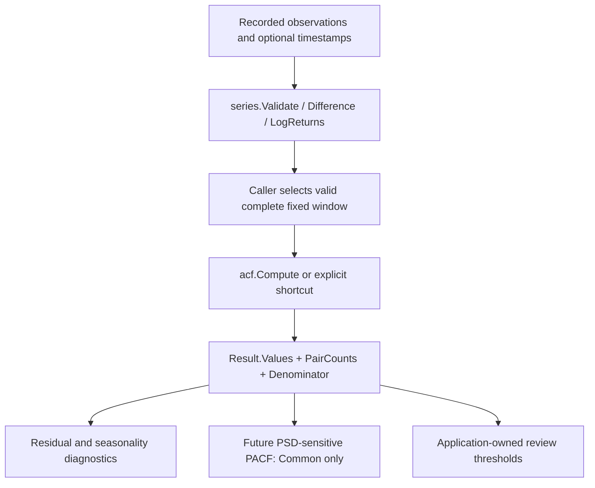

<!--
  SPDX-License-Identifier: AGPL-3.0-only
  Copyright (C) 2025-2026 katalvlaran

  File: docs/ACF.md
  Package: github.com/lvlath/go/acf
  Purpose: Sample autocorrelation, direct numeric kernel, estimator selection,
           public result law, independent verification, and operational usage.
  Contract status: implemented public API; synchronized with acf source and GoDoc.
  Scope: fixed, finite, equally spaced scalar observation windows; no FFT/PACF.
  License: AGPL-3.0-only. See ../LICENSE.
-->

# ACF — direct sample autocorrelation and pair-adjusted estimators

> **One observation window, one global center, two deliberately different denominators.**
>
> `acf` is a deterministic scalar diagnostic for serial dependence. It measures
> relationships between observations at sample-index lags; it is **not** a
> stationarity test, a causal streaming transform, or a forecasting model.

## Contents

1. [Purpose, scope and package boundaries](#1-purpose-scope-and-package-boundaries)
2. [Public API and estimator selection](#2-public-api-and-estimator-selection)
3. [Mathematics and finite-sample invariants](#3-mathematics-and-finite-sample-invariants)
4. [Toeplitz PSD: proof, counterexample and limits](#4-toeplitz-psd-proof-counterexample-and-limits)
5. [Numerically stable direct kernel](#5-numerically-stable-direct-kernel)
6. [Validation, sentinel errors and degenerate inputs](#6-validation-sentinel-errors-and-degenerate-inputs)
7. [Ownership, determinism and concurrency](#7-ownership-determinism-and-concurrency)
8. [Executable Go workflows](#8-executable-go-workflows)
9. [Integration with other lvlath packages](#9-integration-with-other-lvlath-packages)
10. [Complexity, testing and benchmark governance](#10-complexity-testing-and-benchmark-governance)
11. [Pitfalls and operational checklist](#11-pitfalls-and-operational-checklist)
12. [Source and further reading](#12-source-and-further-reading)

---

## 1. Purpose, scope and package boundaries

An autocorrelation function (ACF) asks whether the values in **one fixed
sequence** resemble values recorded `k` sample positions earlier. For equally
spaced telemetry, lag 24 may represent a daily cycle if and only if the
observations are known to be hourly and no expected samples are missing.
`acf` itself receives only a `[]float64` and knows nothing about clocks.

Appropriate questions include:

- **Industrial monitoring:** Is a compressor duty cycle repeating every 24
  hourly samples, or do bearing impacts recur every 64 vibration samples?
- **Reliability engineering:** Does a fixed six-hour retry-rate window have
  a repeat pattern absent from a known baseline window?
- **Time-series model diagnostics:** Do fixed-window residuals show persistence
  that warrants investigating model specification or periodic features?
- **Signal processing:** Does an AC-coupled signal exhibit a plausible pitch
  period under a physically justified lag search interval?
- **Financial research:** Do the absolute values of log returns show serial
  dependence different from the signed returns themselves?

An ACF coefficient is a **descriptive sample statistic**. It does not establish
that a process is stationary, that a peak is statistically significant, that a
period is causal, or that the resulting ARMA/ARIMA model will forecast well.
No missing samples, timestamp intervals, confidence bands, Ljung–Box p-values,
PACF, Fourier spectrum, or spectral density are supplied by this package.

## 2. Public API and estimator selection

The entire current public computation surface is small and explicit:

| Operation                            | Effective policy              | Appropriate use                                          |
|:-------------------------------------|:------------------------------|:---------------------------------------------------------|
| `Compute(x, m, opts)`                | Caller-selected `Options`     | Canonical entry point; controls both modes explicitly    |
| `ComputeDefault(x, m)`               | Centered, `CommonDenominator` | Default fixed-window serial-dependence diagnostics       |
| `ComputeLagAdjusted(x, m)`           | Centered, `LagAdjusted`       | Explicit pair-count-normalized covariance ratios         |
| `ComputeUncentered(x, m)`            | `NoCenter=true`, common       | A meaningful physical zero, e.g. AC-coupled measurements |
| `ComputeUncenteredLagAdjusted(x, m)` | `NoCenter=true`, adjusted     | Pair-adjusted raw second-moment ratios                   |
| `(*Result).IsNil()`                  | Pointer-presence check        | `core.Nilable`-compatible typed-nil safety               |
| `(*Result).Clone()`                  | Deep copy of both slices      | Independently mutable result artifact                    |

All four convenience functions delegate to **the same** `Compute` and direct
kernel; they do not select another algorithm or create extra policy defaults.
The numerical path has no dependency on `series`, `stats`, `matrix` or `core`.

```go
// Public types, with complete declarations in acf/types.go.
type Denominator uint8
const (
    CommonDenominator Denominator = iota
    LagAdjusted
)
type Options struct {
    Denominator Denominator
    NoCenter    bool
}
type Result struct {
    Values      []float64
    PairCounts  []int
    Mean        float64
    Denominator Denominator
}
```

A zero `Options{}` means **centering is enabled** and
`Denominator == CommonDenominator`. The caller must provide `maxLag`:
`0 <= maxLag < len(x)`. The upper lag is *inclusive*. The successful result
has `maxLag+1` coefficients indexed from zero, not one per input sample unless
`maxLag == n-1` was explicitly requested.

`Result.Values[0]` is exactly `1.0` whenever a result exists.
`Result.PairCounts[k] == len(x)-k` for every reported lag.
`Result.Mean` is a rounded full-window sample mean when centered; it is
**exactly zero as mode metadata** when `NoCenter` is true. The caller must retain
`Result.Denominator` alongside coefficients; their estimator identity cannot
safely be reconstructed from coefficient magnitudes.

### Policy selection is part of the mathematical contract

```text
                     Fixed, nonempty float64 observations
                                      |
                         Compute(x, maxLag, Options)
                                      |
                     +----------------+----------------+
                     |                                 |
             NoCenter = false                   NoCenter = true
            one global fitted mean                 raw zero origin
                     |                                 |
                     +----------------+----------------+
                                      |
                         one normalized lag kernel
                                      |
                  +-------------------+--------------------+
                  |                                        |
          CommonDenominator                           LagAdjusted
             S[k] / S[0]                        n/(n-k) * S[k]/S[0]
           Toeplitz-compatible                    not generally PSD
              (exact math)                         do not clamp
                  |                                        |
                  +-------------------+--------------------+
                                      |
                    detached Values, PairCounts, Mean,
                             effective Denominator
```

## 3. Mathematics and finite-sample invariants

Let `n=len(x)` and let the **single full-window sample mean** be:


```math
\bar{x}=\frac{1}{n}\sum_{i=0}^{n-1}x_i
```

Set `c_i = x_i - mean` when centering is enabled, or `c_i = x_i` when
`NoCenter=true`. Each lag uses the **same** deviations, with the exact
set of observed pairs:


```math
S_k=\sum_{i=k}^{n-1}c_i c_{i-k},\quad\text{PairCounts}[k]=n-k
```

The zero-lag energy is `S_0 = sum(c_i^2)` and must be positive. For
`0 <= k <= maxLag < n`, the two conventions are:


```math
r_k^{(C)}=\frac{S_k}{S_0},\qquad r_k^{(L)}=\frac{n}{n-k}\frac{S_k}{S_0}
```

`LagAdjusted` corrects the **lag-specific covariance numerator per available
pair**. It is **not** a proof that the resulting ACF ratio is an unbiased
estimator of population autocorrelation: its global fitted mean and random
ratio denominator remain estimated from the finite window.

### Exact fixtures, not a convention guessed from another library

| Input / mode                   | `maxLag` | `Values`              | `Mean` |
|:-------------------------------|---------:|:----------------------|-------:|
| `[1,2,3]`, centered common     |        2 | `[1,0,-0.5]`          |      2 |
| `[1,2,3]`, centered adjusted   |        2 | `[1,0,-1.5]`          |      2 |
| `[1,-1,1,-1]`, common          |        3 | `[1,-0.75,0.5,-0.25]` |      0 |
| `[1,-1,1,-1]`, adjusted        |        3 | `[1,-1,1,-1]`         |      0 |
| `[2,2,2]`, uncentered common   |        2 | `[1,2/3,1/3]`         |      0 |
| `[2,2,2]`, uncentered adjusted |        2 | `[1,1,1]`             |      0 |

For `[1,2,3]`, the centered deviations are `[-1,0,1]`, hence `S_0=2`,
`S_1=0`, and `S_2=-1`. The second lag has only one observed pair, so
`CommonDenominator` returns `-1/2` and `LagAdjusted` returns
`3/1 * (-1/2) = -1.5`. **Clipping this value to -1 is a contract defect**, not
numeric stabilization.

For nonzero uncentered constants `x_i=a`, every pair product is `a*a`:


```math
\text{NoCenter},\quad r_k^{(C)}=\frac{n-k}{n},\qquad r_k^{(L)}=1\quad(a\ne0)
```

In particular, a constant current trace can have adjusted raw coefficient
`1` even though its **centered** sample variance is zero and a centered ACF
must fail. These are different objects, not competing fixes for an error.

### Transformations of the input

In exact arithmetic, reversing the sequence preserves every `S_k` and thus
every coefficient. A nonzero common multiplication `x_i -> b*x_i` preserves
both conventions when the transformed values remain valid; the signs cancel
in each cross-product. In centered mode an additive translation also cancels.
**Uncentered ACF is intentionally not translation invariant.** Finite binary64
input quantization and rounding prevent promising bitwise equivalence for
arbitrary nonzero scales and offsets, especially when a transformed spread
ceases to be representable.

Appended observations can change **all** earlier coefficients: they may change
both the fitted center and the denominator `S_0`. `acf` is not
prefix-invariant, and unlike `series.Lag` it is not a causal per-index
transformation of an ever-growing sequence.

## 4. Toeplitz PSD: proof, counterexample and limits

The common-denominator convention is necessary when a downstream method
assumes a nonnegative-definite sample autocovariance Toeplitz matrix.
Define `c_t=0` outside the original window. In **exact arithmetic**,
`S_k = sum_t c_t c_(t-k)`. For any finite real vector `a` and any Toeplitz
matrix `T[p,q] = S_|p-q| / S_0`:


```math
a^{\top}Ta=\frac{1}{S_0}\sum_t\left(\sum_p a_p c_{t-p}\right)^2\geq0
```

The right-hand side is a sum of squares divided by positive `S_0` and is
nonnegative. Therefore the common-denominator Toeplitz matrix is PSD for any
finite dimension in real arithmetic. **PSD is weaker than positive
*definiteness***: this proof alone does not establish that a downstream
factorization or Levinson–Durbin recursion has strictly positive prediction
error at every step.

`LagAdjusted` introduces a different factor at each `k`. For the exact
`[1,2,3]` example, its 3-by-3 Toeplitz matrix is

```text
[ 1     0   -1.5 ]
[ 0     1    0   ]
[ -1.5  0    1   ]
```

Its eigenvalues include `-0.5`, so it is **not PSD**. This is an explicit
algebraic counterexample; it cannot be repaired by clipping without changing
the estimator. `CommonDenominator` must be the explicit input convention for
a later PSD-sensitive PACF implementation. `pacf` is a separate package and
is not implemented here.

**Floating-point qualification:** `acf` returns ordinary finite `float64`
coefficients. Independently rounded entries can introduce small PSD defects
even when the exact sequence is PSD. Neither `Compute` nor `ComputeDefault`
certifies machine-level Toeplitz PSD or silently projects a matrix onto a PSD
cone. The downstream solver owns conditioning and tolerance policy.

## 5. Numerically stable direct kernel

### 5.1 Why a direct raw sum is unsafe

Two finite operands around `1e154` can produce a square close to or beyond
`MaxFloat64`, although their ratio of lag energies is perfectly finite.
Similarly `sum(x_i)` may overflow for repeated `1e308` values despite a finite
mean. `E[x*x] - E[x]^2` also loses small variation on large offsets. Neither
ordinary compensation nor a post-hoc `IsInf` check can recover bits after an
unscaled intermediate has overflowed.

The implementation therefore operates on a single **dimensionless, scaled
workspace**. In centered mode, it determines minimum and maximum input values,
chooses a bounded numeric origin, scales differences to `[-1,1]`, computes one
compensated global mean shift, subtracts that shift, and rescales once more.
In uncentered mode it normalizes the original values directly.

### 5.2 What the current source actually computes

1. **Input validation** rejects invalid policy, shape, and any nonfinite
   observation before allocating the numeric workspace.
2. **Centered origin**: let `lo` and `hi` be the extrema. When `hi-lo` is finite,
   `midpoint(lo,hi)` uses `math.FMA(0.5,hi-lo,lo)`; otherwise it uses
   `lo/2 + hi/2` to avoid a false overflow in the range.
3. **First normalization**: build `d_i=(x_i-base)/scale`, where
   `scale=max(abs(x_i-base))`. Reject exact zero scale with `ErrZeroVariance`.
   For `NoCenter`, the analogous scale is `max(abs(x_i))`; a zero scale rejects
   the all-zero signal.
4. **Global recentering**: use a deterministic Neumaier compensated reduction
   of the `d_i` to calculate one mean shift. Publish the mean with
   `math.FMA(meanShift,scale,base)`, so the combined operation has a single
   final rounding even at the subnormal boundary.
5. **Second normalization**: subtract that normalized mean shift from every
   `d_i`, then divide by its maximum absolute value. The returned `Mean` may
   round away information retained in these private residual coordinates.
6. **Zero lag**: compute `S_0` from the scaled coordinates using the same
   compensated dot-product reduction. Reject exact zero; do not materialize
   the raw, potentially overflowing energy.
7. **Higher lags**: for `k=1,...,maxLag`, accumulate the `n-k` signed products
   in increasing endpoint order and divide by the shared `S_0`. For
   `LagAdjusted`, multiply the ratio by `float64(n)/float64(n-k)` *after*
   division. Return `ErrOverflow` if a required public coefficient becomes
   nonfinite; never return an incomplete `Result`.

The implementation follows a **fixed traversal order**, not a map iteration
or parallel reduction. Neumaier compensation reduces rounding error but is
not a universal correctly-rounded cross-product proof. In particular, tiny
signed cross-products can suffer cancellation; regressions compare against
independent exact-binary-input `math/big.Rat` reference calculations.

```text
validate enum / negative lag
  -> validate input presence, shape and every finite value
  -> normalizedDeviations (one global center OR raw origin)
  -> dotScaled(k=0) + zero-energy gate
  -> allocate Result.Values / PairCounts
  -> set lag 0 to exactly 1
  -> for k=1..maxLag:
       pairs = n-k
       Sk = dotScaled(deviations, k)
       ratio = Sk/S0
       if LagAdjusted: ratio *= float64(n)/float64(pairs)
       check finite ratio, then publish Values[k], PairCounts[k]
  -> publish complete detached Result
```

No FFT implementation, second estimator engine, artificial clamp, per-lag
recenter, `reflect`, `panic` or `recover` exists in the package.

## 6. Validation, sentinel errors and degenerate inputs

The exact error order is part of the public protocol:

```text
invalid Denominator / negative maxLag
    -> nil slice
    -> non-nil empty slice
    -> maxLag >= n
    -> any NaN or +/-Inf input
    -> S0 == 0 in the selected moment domain
    -> unrepresentable arithmetic result
    -> complete Result
```

| Stage / condition                                                     | `errors.Is(err, ...)`  | Result |
|:----------------------------------------------------------------------|:-----------------------|:-------|
| Unknown `Denominator`, `maxLag < 0`                                   | `acf.ErrInvalidOption` | `nil`  |
| `values == nil`                                                       | `acf.ErrNilInput`      | `nil`  |
| `values` is non-nil but empty                                         | `acf.ErrEmptyInput`    | `nil`  |
| `maxLag >= len(values)`                                               | `acf.ErrInvalidOption` | `nil`  |
| Any input `NaN`, `+Inf` or `-Inf`                                     | `acf.ErrNonFinite`     | `nil`  |
| Centered constant (including singleton), or uncentered all-zero input | `acf.ErrZeroVariance`  | `nil`  |
| Nonrepresentable required `float64` result                            | `acf.ErrOverflow`      | `nil`  |

There is **no error-producing partial result**. Use `errors.Is`, not error
string comparisons. An invalid enum or negative lag wins over a simultaneous
nil input. Once option-level gates pass, a nil input wins over `maxLag >= n`.
The finite scan happens before the energy/domain check, including when
`maxLag == 0`.

Specific boundary cases:

| Input and policy                           | Expected outcome                         |
|:-------------------------------------------|:-----------------------------------------|
| `[1]`, `maxLag=0`, centered                | `ErrZeroVariance`                        |
| `[1]`, `maxLag=0`, `NoCenter=true`         | `Values=[1]`, `PairCounts=[1]`, `Mean=0` |
| `[0]`, `maxLag=0`, `NoCenter=true`         | `ErrZeroVariance`                        |
| `[2,2,2]`, centered                        | `ErrZeroVariance`                        |
| `[2,2,2]`, uncentered adjusted, `maxLag=2` | `Values=[1,1,1]`                         |
| `[1,2,3]`, `maxLag=3`                      | `ErrInvalidOption`                       |
| `[]float64{}`, `maxLag=0`                  | `ErrEmptyInput`                          |

## 7. Ownership, determinism and concurrency

`Compute` reads the caller-owned input and **does not mutate or retain it**.
On success it returns separately allocated `Values` and `PairCounts` slices.
Changing either result slice does not modify the input or any future call.
`Result.Clone()` deep-copies each non-nil slice and scalar metadata; clones can
be mutated independently. `(*Result).IsNil()` returns `true` for a nil pointer
(including a typed nil stored behind `core.Nilable`) and `false` for every
allocated pointer, including `&acf.Result{}`. Nil-state is not validity.

Calls with independent workspaces can execute concurrently over *stable*
read-only inputs. Concurrent caller mutation during a call is unsupported.
Likewise, a returned `Result` is caller-owned and not internally locked:
coordinate concurrent writes/reads of the same `Result` yourself.

For identical binary64 inputs, options, package version and floating-point
environment, the kernel visits input indices, lags, and pair endpoints in a
fixed order and returns deterministic coefficients. It does not guarantee
cross-platform bitwise identity when underlying floating-point execution
rules differ.

The entire sample window is a fitted statistical object. Recomputing on a
longer prefix or a heldout batch is a **new fit**. Never use a full-window
ACF to claim that the earlier coefficients were available at earlier times.

## 8. Executable Go workflows

### 8.1. Minimal estimator counterexample — two different valid answers

```go
package main

import (
    "fmt"

    "github.com/lvlath/go/acf"
)

func main() {
    observations := []float64{1, 2, 3}
    common, err := acf.ComputeDefault(observations, 2)
    if err != nil {
        fmt.Println("common:", err)
        return
    }
    adjusted, err := acf.ComputeLagAdjusted(observations, 2)
    if err != nil {
        fmt.Println("adjusted:", err)
        return
    }
    fmt.Println("common:", common.Values)
    fmt.Println("adjusted:", adjusted.Values)
    fmt.Println("pairs:", adjusted.PairCounts)
    fmt.Println("same mean:", common.Mean == adjusted.Mean)
}
```

Expected output:

```text
common: [1 0 -0.5]
adjusted: [1 0 -1.5]
pairs: [3 2 1]
same mean: true
```

This is a counterexample to clipping adjusted values and to silently routing
the adjusted estimator into a PSD-sensitive downstream solver.

### 8.2. Operational periodicity: retry spikes in a fixed minute window

The following fully runnable program compares baseline and suspect traffic.
The input is a **deterministic synthetic** minute-bucket fixture, not customer
data. A fixed 15-minute repeat produces a plausible incident-investigation
lead, but the ACF cannot identify a causal root cause by itself.

```go
package main

import (
    "fmt"
    "math"

    "github.com/lvlath/go/acf"
)

func main() {
    const (
        minutes = 360
        periodMinutes = 15
        maxLag = 45
    )
    baseline := make([]float64, minutes)
    suspect := make([]float64, minutes)
    for i := range baseline {
        background := 12 + 2.4*math.Sin(2*math.Pi*float64(i)/37)
        background += 1.1 * math.Cos(2*math.Pi*float64(i)/19)
        baseline[i] = math.Round(background)
        phase := i % periodMinutes
        burst := 0.0
        if phase <= 2 {
            burst = 26 * math.Exp(-float64(phase))
        }
        suspect[i] = baseline[i] + math.Round(burst)
    }

    healthy, err := acf.ComputeDefault(baseline, maxLag)
    if err != nil {
        fmt.Println("baseline:", err)
        return
    }
    degraded, err := acf.ComputeDefault(suspect, maxLag)
    if err != nil {
        fmt.Println("suspect:", err)
        return
    }

    fmt.Printf("lag=%d minutes, pair-count=%d\n", periodMinutes, degraded.PairCounts[periodMinutes])
    fmt.Printf("baseline=%.3f suspect=%.3f\n", healthy.Values[periodMinutes], degraded.Values[periodMinutes])
    fmt.Printf("review=%t\n", degraded.Values[periodMinutes]-healthy.Values[periodMinutes] > 0.30)
}
```

Run with `go run` in a main package under the module. For the richer table
of lags 5/15/30/45, see the **already executable**
[`examples/acf/main.go`](../examples/acf/main.go) (`go run ./examples/acf`).
A fixed application threshold is a review policy, **not** an ACF-derived
statistical significance test.

### 8.3. A mask-aware `series` to `acf` boundary

`series.Difference` preserves length and emits invalid warmup cells. Passing
its complete `Values` slice directly into ACF treats placeholder zeros as
real samples. Instead, choose an explicitly valid fixed interval and verify
the timestamp grid upstream.

```go
package main

import (
    "fmt"

    "github.com/lvlath/go/acf"
    "github.com/lvlath/go/series"
)

func main() {
    timesNS := []int64{0, 10, 20, 30, 40, 50, 60, 70}
    levels := []float64{100, 104, 102, 109, 107, 110, 112, 113}
    if _, err := series.Validate(timesNS, levels, series.GridOptions{CadenceNS: 10}); err != nil {
        fmt.Println("grid:", err)
        return
    }
    delta, err := series.Difference(levels, 1)
    if err != nil {
        fmt.Println("difference:", err)
        return
    }
    usable := make([]float64, 0, len(delta.Values))
    for i, valid := range delta.Valid {
        if valid {
            usable = append(usable, delta.Values[i])
        }
    }
    result, err := acf.ComputeDefault(usable, 2)
    if err != nil {
        fmt.Println("acf:", err)
        return
    }
    fmt.Printf("valid increments=%d pairs-at-lag-2=%d\n", len(usable), result.PairCounts[2])
}
```

Expected output:

```text
valid increments=7 pairs-at-lag-2=5
```

This example selects valid observations from one uninterrupted grid. Blindly
filtering interior invalid cells in a *gapped* series could make unequal time
intervals look adjacent; reject gaps, split into valid contiguous windows, or
establish a separate sampling policy before ACF.

### 8.4. Six executable package examples

The suite [`acf/example_test.go`](../acf/example_test.go) includes independent,
reproducible, scenario-driven demonstrations:

| Executable example                                   | Domain interpretation                                     |
|:-----------------------------------------------------|:----------------------------------------------------------|
| `ExampleComputeDefault_coldStorageLoad`              | Daily and weekly cycles in hourly refrigeration demand    |
| `ExampleComputeDefault_volatilityClustering`         | Signed versus absolute log-return persistence             |
| `ExampleComputeUncentered_pitchDetection`            | AC-coupled pitch period within a constrained search range |
| `ExampleComputeDefault_bearingFaultPeriodicity`      | Candidate vibration impact periodicity versus a baseline  |
| `ExampleComputeLagAdjusted_calibrationDrift`         | Late-lag adjusted coefficient below -1 with one pair      |
| `ExampleComputeUncenteredLagAdjusted_standbyCurrent` | Nonzero constant current and the meaning of raw moments   |

All six use explicitly synthetic, fixed data and deterministic `// Output:`
blocks. Their conclusions are **diagnostic hypotheses**, not certified
physical failures, price forecasts, or significance tests.

## 9. Integration with other lvlath packages



- **`series`** owns cadence, missing slots, and mask-aware causal transforms;
  `acf` owns fitted full-window dependence. `series.LogReturns` and
  `series.Difference` can prepare inputs, but their invalid warmups and gaps
  must be handled explicitly before ACF.
- **`stats`** supplies independent, stable moment calculations and frozen
  feature standardizers. ACF uses its own scaled mean and products and does
  **not** import or silently reuse `stats.Moments`. Their public means need
  not agree at the last bit for arbitrary adversarial inputs.
- **`ols` and `ridge`** produce regression results/residual diagnostics; a
  caller may compute a *fixed residual window* ACF to investigate serial
  dependence. The package does not calculate Durbin–Watson, whiten residuals,
  or provide a significance decision. If parameters or residuals are fitted
  using future data, preserve that noncausal provenance.
- **`pca`** projects multivariate features using frozen training parameters;
  individual score or reconstruction-error series may be analyzed by ACF
  after the caller establishes a valid sampling grid.
- **`hmm`** provides causal hidden-state filtering and retrospective smoothing;
  a full-window ACF of filtered diagnostic scores remains a retrospective
  statistic. It does not acquire `FilterStep`'s prefix-causality contract.
- **`dtw`** compares *two* signals under time warping. ACF analyzes *one*
  signal at fixed integer lags; neither substitutes for the other.
- **Future `pacf`** requires a documented common-denominator contract plus
  its own positive-definiteness/conditioning checks. ACF does not compute
  Levinson–Durbin coefficients or repair Toeplitz matrices.

## 10. Complexity, testing and benchmark governance

For `m=maxLag`, the direct kernel scans `n` zero-lag products and
`n-k` products for each `k=1,...,m`:


```math
n+\sum_{k=1}^{m}(n-k)=n(m+1)-\frac{m(m+1)}{2}
```

That yields time **O(n*(m+1))** and additional space **O(n+m)**, consisting
of one normalized n-element workspace and two result slices of length `m+1`.
The implementation does not allocate a full `n×n` Toeplitz matrix or an FFT
workspace. A full-lag query with `m=n-1` is quadratic; smaller scientifically
justified lag ranges reduce actual work.

Acceptance verification uses external tests (`package acf_test`) and the following
contract checks:

- exact fixtures for *both* conventions, constant input, singleton, and
  `maxLag=n-1`; exact structural counts and `Values[0]==1`;
- reversed-sequence symmetry, representable scaling/translation checks,
  result detachment, `Clone` independence and typed-nil `IsNil` behavior;
- extreme offset/spread/subnormal regression tests and an independent
  `math/big.Rat` oracle over the original binary64 inputs;
- explicit error-precedence and finite-only scans, including invalid modes;
- reproducible core benchmarks for `n=1000` and `n=100000` at valid lag
  bounds, with `b.ReportAllocs()` and setup excluded from timed execution.

Use the repository's actual Go toolchain and lint configuration, then run:

```bash
go test ./acf -count=1
go test -race ./acf -count=1
go test ./...
go vet ./...
golangci-lint run
go test -run '^$' -bench . -benchmem ./acf
```

Do not infer package coverage or a repository-wide PASS from this document;
test outcomes and performance figures depend on the actual checkout, CPU and
Go toolchain. The direct benchmark for `n=100000, m=n-1` necessarily loads
billions of products and should not be treated as a routine smoke test.

## 11. Pitfalls and operational checklist

| Misuse                                                     | Consequence                                     | Correct practice                                                         |
|:-----------------------------------------------------------|:------------------------------------------------|:-------------------------------------------------------------------------|
| Clamping `LagAdjusted` to `[-1,1]`                         | Changes the mathematical estimator              | Preserve the finite published value; keep `Denominator` metadata         |
| Sending adjusted values to a Toeplitz-based PACF solver    | Matrix may be indefinite                        | Select `CommonDenominator`, then check downstream numerical conditioning |
| Recomputing a different mean for each lag                  | Violates the single-window covariance contract  | Use one global mean for all lags                                         |
| Computing `sum(c*c)` before scaling                        | Intermediate `+Inf` at valid large magnitudes   | Preserve scaled compensated direct products                              |
| Reconstructing residuals by `x-Result.Mean`                | Rounding may erase a small representable spread | Use the returned coefficients; `Mean` is descriptive metadata            |
| Calling ACF on uninspected `series.TransformResult.Values` | Invalid warmup zeros become fake observations   | Respect `Valid` masks and uninterrupted grid policy                      |
| Treating lag 24 as a day without cadence proof             | False time interpretation                       | Establish complete hourly sampling externally                            |
| Assuming append-only prefix invariance                     | Historical coefficients silently change         | Fit only on the fixed allowed window                                     |
| Reading a high ACF as a p-value                            | Unsupported alarm/statistical claim             | Calibrate a separate hypothesis-testing policy                           |
| Assuming `NoCenter` estimates zero sample mean             | Wrong physical interpretation                   | Treat `Mean=0` as a mode marker                                          |
| Running `maxLag=n-1` for every large stream                | Quadratic cost                                  | Use a domain-based lag horizon and benchmark it                          |
| Sharing/mutating result slices concurrently                | Data races                                      | Clone or externally synchronize caller-owned artifacts                   |

**Before admitting an ACF result downstream**, record the sampling cadence,
window boundaries, input preprocessing provenance, `NoCenter` policy,
`Denominator`, `PairCounts`, and the numerical decision threshold or model
that will interpret the statistic. The estimator itself does not make those
application decisions.

## 12. Source and further reading

- [`acf/doc.go`](../../../../Downloads/acf_docs_phase13_synchronized/acf/doc.go) — canonical package charter and API laws.
- [`acf/api.go`](../acf/api.go), [`acf/types.go`](../acf/types.go),
  [`acf/errors.go`](../acf/errors.go) — public interfaces, metadata and sentinels.
- [`acf/impl_direct.go`](../acf/impl_direct.go),
  [`acf/numeric.go`](../acf/numeric.go) — direct kernel and stable reductions.
- [`acf/oracle_test.go`](../acf/oracle_test.go),
  [`acf/numeric_precision_test.go`](../acf/numeric_precision_test.go) — exact
  independent oracle and numerical regression anchors.
- [`acf/example_test.go`](../acf/example_test.go) — six executable use cases.
- [`examples/acf/main.go`](../examples/acf/main.go) — complete incident
  monitoring scenario (`go run ./examples/acf`).
- [`TUTORIAL.md`](TUTORIAL.md) — how ACF fits into the time-series stack.
- [`FAQ_&_TIPS.md`](FAQ_%26_TIPS.md) — estimator and numerical troubleshooting.
- [`lvlath_UES.md`](lvlath_UES.md) — library-wide engineering contracts.
