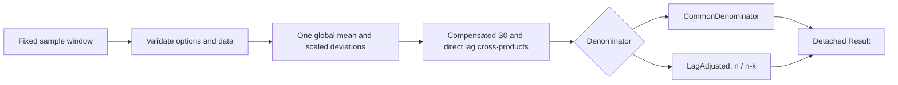

<!--
File: docs/acf.md
Package: github.com/lvlath/go/acf
Purpose: Direct sample ACF operation and mathematical contract
Status: implemented in proposed lvlath-spec-13-v1 patch
Scope: scalar, fixed observations, no FFT or PACF
License: AGPL-3.0-only; Copyright (C) 2025-2026 katalvlaran
-->

# ACF: sample autocorrelation with two explicit conventions

## What and why

`acf.Compute` measures how much a finite, uniformly indexed observation window resembles itself after an integer lag. Suitable inputs include fixed-window stationary residuals, differenced observations, regular sensor measurements, and uncentered sound samples. It does **not** establish stationarity, infer calendar times, or produce a streaming causal transform.

Call `series.Difference` / return transforms upstream if required. `stats.Moments` is a useful independent numeric reference, not a dependency of the scalar kernel. A future `pacf` must explicitly consume `CommonDenominator`, not an automatically substituted `LagAdjusted` sequence.

## Mathematics and estimator laws

For `n=len(values)`, one full-window sample mean is computed once:


Let `c_i=x_i-mean` (or `c_i=x_i` when `NoCenter=true`). Define


`CommonDenominator` computes `S_k/S_0`. `LagAdjusted` computes `n*S_k/((n-k)*S_0)`; the multiplication is applied after division by `S_0` to avoid intermediate overflow. Only the former is guaranteed to generate a positive semidefinite Toeplitz sequence in **exact arithmetic**. Floating-point values can have small PSD defects due to rounding. For the input `[1,2,3]`, the lag-two coefficients are `-0.5` and `-1.5`, respectively. **Do not clamp either estimator, especially LagAdjusted.**

The PSD argument follows from zero-extending centered values: for any finite coefficient vector `a`, the Toeplitz quadratic form equals `sum_t(sum_j a_j*c_(t-j))^2/S_0 >= 0`. Lag-wise correction by `n/(n-k)` breaks this Gram-structure proof.

## Numeric design

Directly summing `x_i` or `c_i*c_i` can overflow for inputs near `MaxFloat64`. The implementation takes an overflow-safe midpoint of the minimum and maximum observation, forms deviations from that midpoint, normalizes by their maximum absolute value, and uses a Neumaier compensated sum to compute the single global mean displacement. The normalized vector is recentered and rescaled once, then reused for every lag. Pair products are accumulated with the same compensation strategy.

This gives `O(n*(maxLag+1))` time and `O(n+maxLag)` extra memory. It does not guarantee correctly rounded coefficients for arbitrary adversarial binary64 inputs: a rounded global mean and normalized subtraction can still incur floating-point error. Tests compare against an **independent** `math/big.Rat` oracle on small binary64 vectors. No arbitrary epsilon threshold decides whether variance is zero.

## Validation and error precedence

Options (unknown denominator or negative lag) → nil input → empty input → `maxLag >= n` → any NaN/Inf observation → zero dispersion/second moment → computation. Sentinels: `ErrInvalidOption`, `ErrNilInput`, `ErrEmptyInput`, `ErrNonFinite`, `ErrZeroVariance`, `ErrOverflow`. Use `errors.Is`, not substring matching. Every failure returns `(nil,error)`, without a partial result.

`NoCenter=true` sets `Result.Mean=0` and evaluates **raw second moments**. A nonzero constant is valid in this mode. A centered constant, a centered singleton, and an all-zero uncentered sample yield `ErrZeroVariance`. Lag zero is exactly `1.0` on success; `PairCounts[k]=n-k`.

## Procedure

```text
validate enum and maxLag negative
validate nil, empty, maxLag < n, finite values
if centered:
    base = safe_midpoint(min(values), max(values))
    normalize values-base before compensated mean accumulation
    subtract one common mean displacement
else:
    normalize raw observations
rescale normalized coordinates to max absolute deviation
S0 = compensated_dot(deviations, deviations)
if S0 == 0: return ErrZeroVariance
result.Values[0] = 1; result.PairCounts[0] = n
for lag = 1..maxLag:
    Sk = compensated_dot(deviations[lag:], deviations[:n-lag])
    result.Values[lag] = Sk / S0
    if LagAdjusted: result.Values[lag] *= n / (n-lag)
    result.PairCounts[lag] = n-lag
return detached result
```

## Minimal compilable usage

```go
package main

import (
    "fmt"
    "github.com/lvlath/go/acf"
)

func main() {
    x := []float64{1, 2, 3}
    r, err := acf.Compute(x, 2, acf.Options{Denominator: acf.LagAdjusted})
    if err != nil { fmt.Println(err); return }
    fmt.Println(r.Values, r.PairCounts, r.Mean)
}
```

Expected: `[1 0 -1.5] [3 2 1] 2`. The executable suite lives in `acf/example_test.go`; a standalone synthetic returns analysis lives in `examples/acf/main.go` (`go run ./examples/acf`).

## Architecture and ownership



`Compute` reads without modifying or retaining the input. The caller owns returned slices. Independent calls are safe; concurrent mutation of any input slice is not. No `panic`, `recover`, `reflect`, FFT, missing-value synthesis, time normalization, Ljung–Box statistic, confidence intervals, PACF, or spectral density is provided.

## High-risk pitfalls

- **LagAdjusted > 1 in magnitude is legal.** Clamping changes mathematics.
- **A new mean per lag is not the specified estimator.** Mean is fitted once for the entire observation window.
- **Lag index is not elapsed time.** Caller must establish a uniform sampling convention.
- **No prefix-causality.** Appending samples changes the fitted window and all coefficients.
- **Do not interpret raw uncentered coefficients as estimates about a centered stochastic process.** `NoCenter` is an explicit second-moment model.
- **A large last lag uses very few pairs.** PairCounts is evidence metadata, not a confidence interval.
- **Avoid `maxLag=n-1` at n=100000 in routine monitoring.** Direct computation is quadratic in this regime; use a smaller scientifically justified lag bound.
