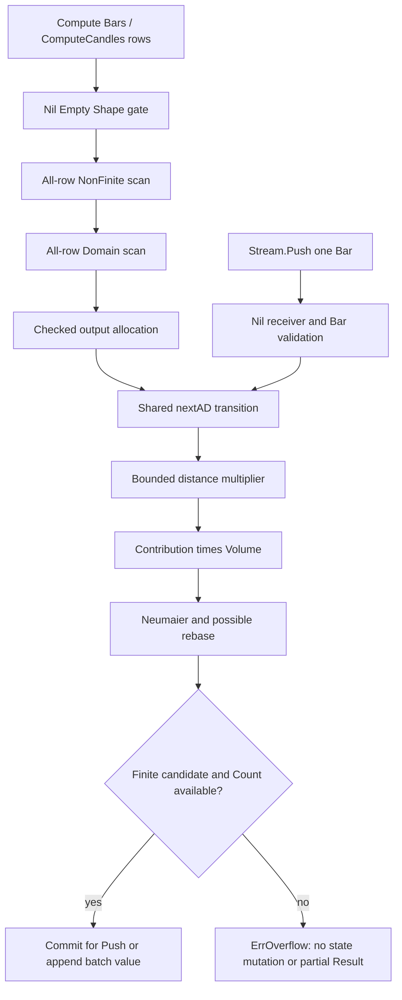

<!--
  SPDX-License-Identifier: AGPL-3.0-only
  Copyright (C) 2025-2026 katalvlaran

  File: docs/AD.md
  Package: github.com/lvlath/go/ad
  Purpose: mathematical reference, public contracts, numeric safeguards,
           deterministic replay, and operational examples for Chaikin A/D.
  Contract status: implemented API; package ad/doc.go and source are authoritative.
  Scope: Chaikin Accumulation/Distribution line, not market-breadth A/D,
         automatic differentiation, divergence classification, or trading signals.
-->

# Chaikin Accumulation/Distribution (`ad`)

> Close-location-weighted volume, accumulated from an explicit origin with a
> deterministic two-component Neumaier recurrence and replayable stream state.

## Contents

1. [Purpose and package boundaries](#1-purpose-and-package-boundaries)
2. [Candle geometry and mathematical definition](#2-candle-geometry-and-mathematical-definition)
3. [Independent hand-checkable oracles](#3-independent-hand-checkable-oracles)
4. [Floating-point safety and compensated accumulation](#4-floating-point-safety-and-compensated-accumulation)
5. [Processing architecture and pseudocode](#5-processing-architecture-and-pseudocode)
6. [Public API and ownership](#6-public-api-and-ownership)
7. [Validation and errors](#7-validation-and-errors)
8. [Streaming state, snapshots, and replay](#8-streaming-state-snapshots-and-replay)
9. [Executable Go workflows](#9-executable-go-workflows)
10. [Integration patterns and interpretation limits](#10-integration-patterns-and-interpretation-limits)
11. [Complexity and verification](#11-complexity-and-verification)
12. [Further reading](#12-further-reading)

---

## 1. Purpose and package boundaries

`ad` implements **Marc Chaikin's Accumulation/Distribution Line**. A candle
contributes positively when its close is nearer its high, negatively when
nearer its low, and zero when it closes at the midpoint or has zero range.
The contribution is weighted by the candle's **base-volume amount** and then
added to the cumulative balance. The result is a numeric feature, not a
measured buy/sell order-flow ledger or an instruction to trade.

| Indicator | What determines the signed quantity?                                   | Initial observation               | Lookback / units                             |
|-----------|------------------------------------------------------------------------|-----------------------------------|----------------------------------------------|
| `ad`      | Current close position inside the current `[Low, High]` range          | **Contributes immediately**       | Cumulative, base-volume units; no warmup     |
| `obv`     | Comparison of current close with **previous** accepted close           | Seeds previous close; result `+0` | Cumulative, base-volume units; no warmup     |
| `mfi`     | Changes in typical price, weighted by money flow and separated by sign | Seeds previous typical price      | Rolling transition window; bounded `[0,100]` |

`ad` does not compare successive closes, apply moving averages, infer
institutional participation, calculate a price/A/D divergence signal, normalize
quote volume, or convert different instruments to comparable scales. Those
operations require separate, explicit application policies. The package is
independent of `obv`, `mfi`, `series`, and `core`: it only uses the Go standard
library while its `Result.IsNil` satisfies the `core.Nilable` convention.

## 2. Candle geometry and mathematical definition

For observation `t`, the five input fields are:

- `Open`, `High`, `Low`, `Close`: strictly positive, finite `float64` prices
  in a **consistent quote unit**; `Low <= Open,Close <= High`.
- `Volume`: finite, nonnegative `float64` amount of traded **base units**;
  zero is permitted and is not a missing-candle marker.

A geometrically valid flat candle has
`Open == High == Low == Close`. There is no restriction that Open and Close
must differ. Timestamp ordering and missing-grid-slot detection are not part
of the `Bar` value.

With `L = Close - Low`, `R = High - Close`, and
`S = High - Low`, the implemented Close Location Value / Money Flow
Multiplier is

$$
m_t = \begin{cases}
\dfrac{L_t-R_t}{S_t}, & S_t>0,\\[3pt]
0, & S_t=0.
\end{cases}
\qquad d_t = m_t\,V_t.
$$


The initial state is `A/D before bar 0 = 0` and the first **published** value
includes the first candle's contribution:

$$
A_t = \operatorname{CompensatedSum}(d_0,\ldots,d_t),\qquad
A_0=d_0,\quad Valid_t=\mathrm{true}.
$$


The symbols express the mathematical objective; the published `float64`
values are those of the specified deterministic compensated recurrence, not
an arbitrary-precision evaluation of the real-valued sum.

### Why the distance formula is bounded and safe

For accepted positive OHLC, real-valued geometry yields
`0 <= L <= S` and `0 <= R <= S`. Thus `-S <= L-R <= S`, so
`-1 <= m <= 1`. Since `High`, `Low`, and `Close` are positive and ordered,
each subtraction is between positive finite endpoints; neither `S` nor
`L` nor `R` can overflow to infinity. IEEE-754 subtraction and division
preserve the interval bound for this expression. The implementation therefore
needs **no** post-division clamp and **no** arbitrary price epsilon.

The familiar algebraic form `(2*Close - High - Low)/(High - Low)` is **not**
the programmatic formula: it can form `+Inf` from a valid near-`MaxFloat64`
close. Rearranging the operations is a correctness requirement, not a style
preference. Every nonflat candle has `S>0` before division; the flat branch
returns exact zero without dividing. The contribution satisfies
`abs(d_t) <= Volume_t`, whereas the **cumulative** A/D balance has no such
single-candle bound and can grow or become negative.

A positive affine price transformation preserves the ideal ratio only when
its relevant price differences survive `float64` rounding. Scaling prices
into identical representable endpoints can erase the range; the package does
not claim invariance under lossy transformations.

## 3. Independent hand-checkable oracles

These examples establish mathematics without relying on batch/stream parity
(which alone could reproduce the same bug twice).

| Bar | Open | High | Low | Close | Base Volume |     Multiplier | Contribution | Cumulative A/D |
|----:|-----:|-----:|----:|------:|------------:|---------------:|-------------:|---------------:|
|   0 |  1.5 |    2 |   1 |     2 |           3 |           `+1` |         `+3` |          **3** |
|   1 |  1.5 |    2 |   1 |     1 |           2 |           `-1` |         `-2` |          **1** |
|   2 |    1 |    1 |   1 |     1 |         100 |     `0` (flat) |          `0` |          **1** |
|   3 |  1.5 |    2 |   1 |   1.5 |         100 | `0` (midpoint) |          `0` |          **1** |
|   4 |    3 |    4 |   2 |   3.5 |           8 |         `+0.5` |         `+4` |          **5** |

For the fifth bar, `(Close-Low)=1.5`, `(High-Close)=0.5`, and
`(High-Low)=2`, so `m=(1.5-0.5)/2=0.5`. In the single-bar case,
`Compute` returns exactly `Values=[contribution_0]`, `Valid=[true]`.
Even if a flat candle has `Volume=math.MaxFloat64`, its contribution remains
zero and its accepted observation still increments `Count`.

Additional independent audit regimes:

- **Extreme positive offset:** choose representable High/Low near a very large
  positive power of two and verify a finite bounded multiplier against an
  exact-rational or high-precision reference; never form `2*Close`.
- **Signed cancellation:** three nonflat bars with multipliers `+1,+1,-1`
  and volumes `1e16,1,1e16` yield terminal `A/D=1` under Neumaier summation.
- **True overflow:** after a `+MaxFloat64` accepted contribution, a second
  identical one returns `ErrOverflow`; Count and both stored components remain
  unchanged.
- **Invalid geometry:** `Close>High` or `Open<Low` is `ErrDomain`, not a
  clipped multiplier; a NaN in any OHLCV field is `ErrNonFinite`.

## 4. Floating-point safety and compensated accumulation

An ordinary `sum += contribution` loses low-order information when very large
positive and negative contributions cancel. Neumaier preserves a second
component `compensation` to capture the rounding residual of the rounded high
sum. The following is faithful pseudocode for the **normal** transition:

```text
high = sum + delta
if high is not finite:
    attempt cancellation-first rebase
else:
    if abs(sum) >= abs(delta):
        residual = (sum - high) + delta
    else:
        residual = (delta - high) + sum
    candidateCompensation = compensation + residual
    candidateTotal = high + candidateCompensation
    if candidateCompensation or candidateTotal is not finite:
        attempt cancellation-first rebase
    else:
        publish (high, candidateCompensation, candidateTotal)
```

The **exceptional** rebase is not another public algorithm or a precision
switch. It is the only fallback inside the fixed two-component recurrence:

```text
(reduced, reducedResidual) = NeumaierPair(sum, compensation)
(high, low)                = NeumaierPair(reduced, delta)
correction                 = reducedResidual + low
value                      = high + correction
if any required coordinate or value is not finite:
    ErrOverflow
else:
    publish (high, correction, value)
```

The rebase may recover a representable balance despite an overflowing
intermediate addition. It **does not** prove that a rejected exact real sum
would be unrepresentable under every possible arbitrary-precision algorithm.
Do not claim exact decimal arithmetic or correctly rounded rational totals for
all inputs. Do not replace the residual calculation by `(sum+delta)-high`:
that subtraction cannot reconstruct the information already discarded.

Every update is calculated as a **candidate**. `Stream.Push` commits the new
`sum`, `compensation`, and `Count` only after it has obtained a finite
`sum+compensation`. On any `ErrOverflow`, the live stream is bit-for-bit
unchanged. A batch failure returns `nil` with an error rather than publishing
a valid prefix; the batch had no externally visible stream state to roll back.

## 5. Processing architecture and pseudocode



The batch facade checks entire input validity **before** output allocation
or arithmetic, using global error-category precedence. Then all accepted
observations traverse the **same** unexported `nextAD` transition in ascending
index order. `Stream.Push` does per-bar validation, then uses that transition
and commits once. This structural sharing is the reason for per-prefix
**bitwise**, not merely approximate, batch/stream equality under identical
input and floating-point execution conditions.

Operational ordering matters: there is no timestamp, source offset, sorting,
automatic reset, or quote/base conversion inside this package. Upstream code
must define those aspects of the feed.

## 6. Public API and ownership

```go
package ad

type Bar struct { Open, High, Low, Close, Volume float64 }
type Bars struct { Open, High, Low, Close, Volume []float64 }
type Result struct { Values []float64; Valid []bool }
type Snapshot struct {
    Algorithm string
    Config string
    Count uint64
    FloatState []float64
    IntState []uint64
}
type Stream struct { /* unexported scalar state */ }

func Compute(bars Bars) (*Result, error)
func ComputeCandles(candles []Bar) (*Result, error)
func Latest(bars Bars) (value float64, valid bool, err error)
func LatestCandles(candles []Bar) (value float64, valid bool, err error)
func New() *Stream
func (s *Stream) Push(bar Bar) (value float64, valid bool, err error)
func (s *Stream) Reset()
func (s *Stream) Snapshot() Snapshot
func (s *Stream) Restore(state Snapshot) error
func (r *Result) IsNil() bool
```

The declaration excerpt above is a reference to the implemented source, not
an alternative `ad` definition to paste into a caller package.

| Call                                    | Purpose                                                 | Time | Additional owned storage                   |
|-----------------------------------------|---------------------------------------------------------|------|--------------------------------------------|
| `Compute(Bars)`                         | Five aligned column slices                              | O(n) | O(n) detached Result                       |
| `ComputeCandles([]Bar)`                 | Direct row-oriented feed, no column transposition       | O(n) | O(n) detached Result                       |
| `Latest(Bars)` / `LatestCandles([]Bar)` | Last element of a complete batch, with identical errors | O(n) | O(n) temporary Result                      |
| `New()` / `Stream{}`                    | Independent zero-origin engine                          | O(1) | O(1)                                       |
| `(*Stream).Push(Bar)`                   | One validated, transactional update                     | O(1) | O(1) state, **0 steady-state heap allocs** |
| `(*Stream).Reset()`                     | New cumulative origin                                   | O(1) | O(1)                                       |
| `(*Stream).Snapshot()`                  | Detached fixed-layout checkpoint                        | O(1) | O(1) fresh FloatState                      |
| `(*Stream).Restore(Snapshot)`           | Validate-then-replace state                             | O(1) | O(1), no alias retained                    |
| `(*Result).IsNil()`                     | Pointer presence (`core.Nilable`)                       | O(1) | O(1), no allocation                        |

`Result.Values` and `Result.Valid` both have length `n` and are caller-owned
with no retained input alias. All flags are `true` on success, including
zeros and the first bar. A nil `*Result` is different from an allocated
`&ad.Result{}`; `IsNil` simply checks pointer nilness. A caller may mutate
returned arrays without changing the originating stream or source inputs.
The raw input columns / row slice are read-only **during** computation; a
concurrent write to them is not supported.

`Latest` is **not an O(1) shortcut**: it calculates the entire `Result` and
projects its final element. Use the last successful `Push` value when building
an allocation-sensitive online service.

## 7. Validation and errors

The two batch inputs share the numeric OHLCV contract, but have different
structural shapes: `Bars` requires five non-nil aligned columns; `[]Bar`
requires one non-nil nonempty row collection. Neither facade sorts, trims,
repairs, clips, or silently drops candles.

### Exact precedence

```text
Compute(Bars):
  any nil column -> ErrNilInput
  then empty Open -> ErrEmptyInput
  then unequal lengths -> ErrShape
  then ANY nonfinite input across the whole batch -> ErrNonFinite
  then ANY invalid domain or geometry across the whole batch -> ErrDomain
  then allocation bounds and arithmetic -> ErrOverflow

ComputeCandles([]Bar):
  nil -> ErrNilInput; non-nil empty -> ErrEmptyInput
  then all-row NonFinite, then all-row Domain, then arithmetic

Stream.Push(Bar):
  nil receiver -> ErrNilInput
  current-bar NonFinite -> ErrNonFinite
  current-bar Domain -> ErrDomain
  then Count and arithmetic -> ErrOverflow

Stream.Restore(Snapshot):
  nil receiver -> ErrNilInput
  then version, lengths, finite state, zero-count invariant -> ErrStateVersion
```

**A late NaN outranks an earlier bad candle geometry in batch mode.** This
is a deliberate global category order; simply iterating `validateBar` row
by row would change the documented result. Nonfinite input errors are not
numerical overflows: `ErrOverflow` is reserved for computations or output
byte-count arithmetic after valid input.

| Sentinel          | Concrete condition                                                  | Publication / mutation                    |
|-------------------|---------------------------------------------------------------------|-------------------------------------------|
| `ErrNilInput`     | Missing column/slice or nil Push/Restore receiver                   | No result; no change                      |
| `ErrEmptyInput`   | Non-nil zero-length input                                           | Nil batch result                          |
| `ErrShape`        | Mismatched `Bars` column lengths                                    | Nil batch result, no element read         |
| `ErrNonFinite`    | NaN, +Inf, or -Inf in ANY OHLCV field                               | Nil batch result or failed Push           |
| `ErrDomain`       | Price `<=0`, Volume `<0`, or incorrect OHLC geometry                | No clipping; no result or stream mutation |
| `ErrOverflow`     | Unrepresentable Count, accumulated total or allocation byte product | Atomic failure                            |
| `ErrStateVersion` | Invalid Algorithm/Config/layout/float state                         | Restore leaves receiver untouched         |

Classify with `errors.Is(err, ad.ErrDomain)`, never by comparing error text.
On a failed Push the outputs are exactly `(0, false, err)` and on a failed
batch the `*Result` is `nil`. There are no `Options`, periods, contexts,
automatic timestamps, or `ErrInvalidOption` sentinel.

## 8. Streaming state, snapshots, and replay

A `Stream` has exactly three internal coordinates: `sum`, `compensation`, and
`count`. There is no previous closing price, ring buffer, rolling window,
heap-backed accumulation history, or global state. `New()` and `Stream{}`
start from the same valid all-zero state.

### Snapshot v1 wire-facing fields

| Field        | Exact invariant                                                                                                      |
|--------------|----------------------------------------------------------------------------------------------------------------------|
| `Algorithm`  | `ad/chaikin-neumaier/v1`                                                                                             |
| `Config`     | `df3132e9b6a35bdbc7d3567d9f8e3c4675dc6736013e4a408c6e150b5441a2df` (lowercase SHA-256 of the ASCII Algorithm string) |
| `Count`      | Number of successfully accepted bars, starting at 0; `math.MaxUint64` is valid on Restore but cannot be incremented  |
| `FloatState` | Exactly `[sum, compensation]`, length 2; each finite and their effective sum finite                                  |
| `IntState`   | Exactly zero elements; no previous-close, cursor, or index is encoded                                                |

`Count==0` requires numerically zero `sum` and `compensation`; Restore
canonicalizes signed zeros to `Stream{}`. With `Count>0`, any finite signed
state with a representable effective sum may be restored. Snapshot slices
are **detached**: modifying one does not modify the originating stream, and
Restore copies only two scalar values. Nil `Snapshot()` returns a zero
`Snapshot{}`; nil `Reset()` is a safe no-op; nil Push and Restore return
`ErrNilInput`. Restoration is validate-then-commit, with an unchanged
receiver on any error.

The public `Config` hash only identifies the numerical schema. It is **not**
a checksum of FloatState, a keyed authenticator, nor proof of untampered
market data. Before trusting an external checkpoint, the surrounding service
must authenticate the whole serialized payload **together with** instrument,
volume unit, source identity, epoch/origin, and last committed source offset.
After Restore it must resume at the **next** source bar, not replay the last
accepted one. Restore does not validate timestamps, prevent a replay, or
recover any external source metadata.

```text
       completed bar and trusted offset
                    |
           Stream.Push(bar)
                    |
            Snapshot (Count,
           sum, compensation)
                    |
         application MAC/signature
     + instrument + epoch + offset
                    |
          persisted checkpoint
                    |
       verify authenticity/offset
                    |
         standby.Restore(state)
                    |
           resume offset + 1
```

Streams are **single-owner mutable state**. Calling Push, Reset, Restore or
Snapshot on the same stream concurrently without external synchronization
is unsupported; independent streams may safely run concurrently. Calling
Reset starts a new A/D origin and cannot reproduce the uninterrupted total
across a gap. Preserve an epoch identifier externally whenever comparing
values from different segments.

## 9. Executable Go workflows

### 9.1. Typed candle feed and checkpoint failover

This complete example processes twelve fixed, illustrative five-minute
BTC/base-volume candles. After eight successful Push calls, it transfers
the **two-coordinate compensated state** to a standby worker and continues
without replaying the eighth candle. It checks every output against a
separately computed batch. It demonstrates **numerical continuity**, not
payload authentication: a real service must persist and authenticate the
source identity and last accepted offset alongside the checkpoint.

```go
package main

import (
    "fmt"
    "math"

    "github.com/lvlath/go/ad"
)

func main() {
    // Illustrative five-minute BTC/base-volume records, not exchange history.
    candles := []ad.Bar{
        {Open: 92100, High: 92140, Low: 92100, Close: 92140, Volume: 14},
        {Open: 92120, High: 92140, Low: 92100, Close: 92110, Volume: 20},
        {Open: 92140, High: 92160, Low: 92120, Close: 92160, Volume: 13},
        {Open: 92140, High: 92160, Low: 92120, Close: 92120, Volume: 12},
        {Open: 92150, High: 92180, Low: 92140, Close: 92170, Volume: 22},
        {Open: 92180, High: 92200, Low: 92160, Close: 92180, Volume: 15},
        {Open: 92190, High: 92220, Low: 92180, Close: 92220, Volume: 17},
        {Open: 92200, High: 92220, Low: 92180, Close: 92190, Volume: 16},
        {Open: 92180, High: 92200, Low: 92160, Close: 92160, Volume: 18},
        {Open: 92160, High: 92180, Low: 92140, Close: 92160, Volume: 11},
        {Open: 92150, High: 92180, Low: 92140, Close: 92180, Volume: 24},
        {Open: 92170, High: 92200, Low: 92160, Close: 92190, Volume: 13},
    }
    history, err := ad.ComputeCandles(candles)
    if err != nil {
        fmt.Println("batch rejected:", err)
        return
    }
    worker := ad.New()
    parity := true
    var transferredCount uint64
    const transferBefore = 8
    for i, bar := range candles {
        if i == transferBefore {
            checkpoint := worker.Snapshot()
            standby := ad.New()
            if err := standby.Restore(checkpoint); err != nil {
                fmt.Println("restore rejected:", err)
                return
            }
            transferredCount = checkpoint.Count
            worker = standby
        }
        value, valid, pushErr := worker.Push(bar)
        if pushErr != nil {
            fmt.Println("push rejected:", pushErr)
            return
        }
        parity = parity && valid == history.Valid[i] &&
            math.Float64bits(value) == math.Float64bits(history.Values[i])
    }
    last := len(history.Values) - 1
    fmt.Printf("bars=%d transferred-count=%d final=%.2f bitwise=%t\n",
        len(candles), transferredCount, history.Values[last], parity)
    // Output:
    // bars=12 transferred-count=8 final=37.50 bitwise=true
}
```

The continued value is exactly identical bit for bit to the uninterrupted
batch at each prefix. The original source order and base-volume units must
be established by the caller before invoking this program; no timestamp
sorting, source cursor or authentication is hidden in Stream.Restore.

### 9.2. Bitwise audit of atomic invalid-bar rejection

A failed Push must not change Count, the high component, **or** the
Neumaier correction, even when the returned displayed value is zero.
The following complete program uses only the exported API and
`errors.Is`; it does not inspect private fields or use reflection.

```go
package main

import (
    "errors"
    "fmt"
    "math"

    "github.com/lvlath/go/ad"
)

func main() {
    stream := ad.New()
    _, _, err := stream.Push(ad.Bar{
        Open: 100, High: 102, Low: 98, Close: 102, Volume: 1200,
    })
    if err != nil {
        fmt.Println("initial rejection:", err)
        return
    }
    before := stream.Snapshot()
    value, valid, err := stream.Push(ad.Bar{
        Open: 9, High: 10, Low: 9, Close: 11, Volume: 50,
    })
    after := stream.Snapshot()
    unchanged := before.Algorithm == after.Algorithm &&
        before.Config == after.Config && before.Count == after.Count &&
        len(before.FloatState) == 2 && len(after.FloatState) == 2 &&
        len(before.IntState) == 0 && len(after.IntState) == 0 &&
        math.Float64bits(before.FloatState[0]) == math.Float64bits(after.FloatState[0]) &&
        math.Float64bits(before.FloatState[1]) == math.Float64bits(after.FloatState[1])
    fmt.Printf("rejected=%t valid=%t value=%.0f unchanged=%t count=%d\n",
        errors.Is(err, ad.ErrDomain), valid, value, unchanged, after.Count)
    // Output:
    // rejected=true valid=false value=0 unchanged=true count=1
}
```

The invalid Close exceeds High, so this failure is `ErrDomain`, not a
numeric overflow. A late bad OHLCV bar in a batch similarly returns a nil
Result rather than the successful prefix.

### 9.3. Production-oriented boundary examples

The following files are the canonical executable references for different
operational concerns:

| Scenario                                                 | Location                                                                     | What it demonstrates                                                       |
|----------------------------------------------------------|------------------------------------------------------------------------------|----------------------------------------------------------------------------|
| Intraday pressure with realistic shaped candles          | [`ad/example_test.go`](../ad/example_test.go) (`ExampleCompute`)             | 16 aligned five-minute observations and cumulative-vs-price interpretation |
| Live market-data gateway                                 | [`ad/example_test.go`](../ad/example_test.go) (`ExampleStream_Push`)         | Repeated `Push`, valid flat observations, six-bar aggregation              |
| Hot standby checkpoint                                   | [`ad/example_test.go`](../ad/example_test.go) (`ExampleStream_Restore`)      | Detached state and deterministic continuation                              |
| 100-asset research review                                | [`ad/example_test.go`](../ad/example_test.go) (`ExampleComputeCandles`)      | Independent per-asset origins; screening outside kernel                    |
| Vendor data integrity gate                               | [`ad/example_test.go`](../ad/example_test.go) (`ExampleLatest`)              | Error classification and no false zero publication                         |
| Incorrect candle geometry                                | [`ad/example_test.go`](../ad/example_test.go) (`ExampleCompute_invalidOHLC`) | `errors.Is` and nil result on rejection                                    |
| Event-time CSV ingestion, explicit gap reset and standby | [`examples/ad/main.go`](../examples/ad/main.go)                              | Application timestamp/offset checks and parity only within one epoch       |

The standalone program can be run from the repository module root with
`go run ./examples/ad` if that example directory is present. Its timestamps
and prices are embedded deterministic fixtures; it performs no live feed
I/O. External checkpoint authentication and durable source-offset storage
must be added by a production service.

## 10. Integration patterns and interpretation limits

### Causal inputs and warmup masks

`ad` processes each candle without future data and reports `Valid=true` from
bar zero. It does **not** guarantee a contiguous input clock. Where timestamps
exist, use `series.Validate` and an explicit gap policy before passing OHLCV
rows to AD; `series` never fills the missing candles. If a feed has a verified
discontinuity, decide whether to reject it, replay from a trustworthy source,
or start a new cumulative epoch with `stream.Reset()`. A fabricated zero-volume
bar is not equivalent to an absent bar in provenance or Count.

When joining A/D with `rsi`, `macd` or `mfi`, align by the **caller-validated**
source index/time key and respect their distinct warmup masks. AD's valid
initial observations do not make unready downstream indicators valid.
For fitted `stats`, `ols`, `ridge`, `pca`, or HMM workflows, perform a
chronological train/holdout split and fit preprocessors only on training
data; neither AD nor the neighboring indicators performs model fitting.

```text
 OHLCV + instrument + base-volume unit + timestamp + source offset
                          |
             caller validates grid and units
                          |
                ad.Compute / Stream.Push
                          |
                 Values + Valid (all true)
                          |
        alignment with RSI / MACD / MFI masks
                          |
          caller-owned research or monitoring rules
```

### What the A/D value does *not* establish

- A/D is **not** a time-consistent measure if candle cadence and aggregation
  change without an explicit convention.
- A rising line is **not** proof that identified traders bought the asset.
- Comparing raw A/D levels across two assets, different base units, or
  different reset origins does **not** create a normalized ranking.
- `Snapshot.Config` does **not** authenticate checkpoint data or prevent replay.
- A sign change, slope, or price/A/D mismatch is **not** automatically a
  classifier, statistical significance test, or validated trading threshold.
- Finite positive prices and a structurally valid candle do **not** prove
  exchange authenticity or absence of feed tampering.

## 11. Complexity and verification

| Operation                  | Time |                             Extra memory | Test focus                                                          |
|----------------------------|-----:|-----------------------------------------:|---------------------------------------------------------------------|
| `Compute`                  | O(n) |               O(n) detached Values/Valid | Shape, global precedence, first bar, first failure, numeric oracles |
| `ComputeCandles`           | O(n) |               O(n) detached Values/Valid | No transpose, parity, invalid late row                              |
| `Latest` / `LatestCandles` | O(n) |                    O(n) temporary result | Error and last-bit projection parity                                |
| `Push`                     | O(1) | O(1) scalar state; 0 steady-state allocs | Cancellation, rollback, true overflow, nil receiver                 |
| `Snapshot` / `Restore`     | O(1) |              O(1) fixed snapshot storage | ABI, detached arrays, corrupted state, prefix continuation          |
| `Reset` / `IsNil`          | O(1) |                                     O(1) | Zero origin and nil-receiver safety                                 |

Regression tests belong to the strictly external `package ad_test` and use
only exported `ad` symbols. Independent analytic fixtures should include
low/high/midpoint/flat bars; a rational or ulp-aware oracle near extreme
positive prices; `+1e16,+1,-1e16`; actual cumulative overflow; and
complete checkpoint continuation at **every** split. Batch/stream bit parity
and Snapshot round-trip are useful additional checks, never substitutes for
independent mathematical oracles. Race tests should use separate streams,
not unsupported concurrent mutation of one stream. Benchmarks should process
real nonflat and alternating-sign observations, not only constant zero-delta
fast paths.

From the root of the existing single module `github.com/lvlath/go`:

```sh
gofmt -l ad/*.go
go test ./ad -count=1 -cover
go test -race ./ad -count=1
go test ./ad -run '^Example' -count=1 -v
go test ./ad -run '^$' -bench 'Benchmark(Compute|Push)' -benchmem
go test ./...
go vet ./...
golangci-lint run
```

These are **verification commands**, not an assertion that CI ran or passed
in every environment. The module declares Go 1.23.4 or newer. The package
checks integer byte-count overflow before `make`, but does not convert
operating-system out-of-memory termination into `ErrOverflow`.

## 12. Further reading

- [`ad/doc.go`](../ad/doc.go) - package charter and exact publication rules.
- [`ad/api.go`](../ad/api.go), [`ad/stream.go`](../ad/stream.go),
  [`ad/impl_multiplier.go`](../ad/impl_multiplier.go),
  [`ad/impl_ad.go`](../ad/impl_ad.go) - public facades and canonical numeric path.
- [`ad/snapshot.go`](../ad/snapshot.go) - fixed v1 ABI and transactional restore.
- [`ad/example_test.go`](../ad/example_test.go) - six executable workflows.
- [`TUTORIAL.md`](TUTORIAL.md#11n-ad-foundations-close-location-volume-and-deterministic-replay) - introductory conceptual walkthrough.
- [`FAQ_&_TIPS.md`](FAQ_%26_TIPS.md#13m-ad-faq-close-location-volume-precision-and-checkpoint-safety) - common operational failures.
- [`OBV.md`](OBV.md) and [`MFI.md`](MFI.md) - related indicators with
  **different** mathematics and origin/warmup semantics.
