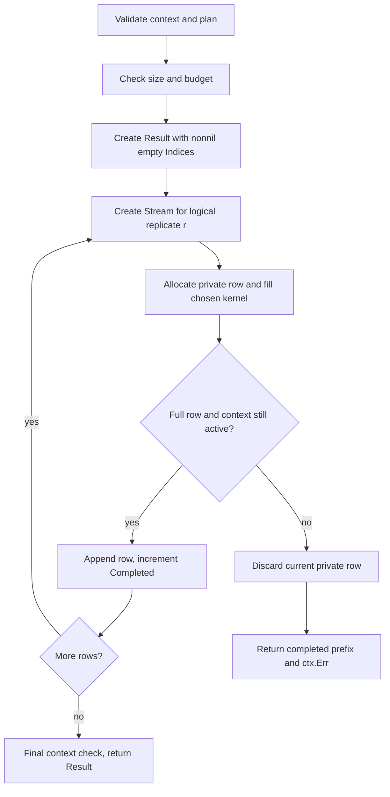

<!--
  SPDX-License-Identifier: AGPL-3.0-only
  Copyright (C) 2025-2026 katalvlaran

  File: docs/BOOTSTRAP.md
  Package reference: github.com/lvlath/go/bootstrap
  Purpose: Exact block-index mathematics, replay protocol, ownership, resource
    admission, interruption semantics, package integration, and operational recipes.
  Contract status: Describes the public API in bootstrap/api.go; reproducibility
    also requires the versioned github.com/lvlath/go/rng dependency.
  Scope: Moving, Circular, and Stationary block-index bootstrap; no estimators.
-->

# BOOTSTRAP: reproducible dependent-data index resampling

`bootstrap` constructs a reproducible matrix of **zero-based observation indices**.
Each output row specifies an artificial observation history; the package never
receives the underlying prices, features, residuals, timestamps, or labels.
The calling application decides which observations to gather and how to estimate
its business statistic. This strict separation lets the same index row drive
several synchronized data sources without silently destroying their pairing.

## Contents

1. [What the package does and does not do](#1-what-the-package-does-and-does-not-do)
2. [Public API and dimensions](#2-public-api-and-dimensions)
3. [Mathematics of three block laws](#3-mathematics-of-three-block-laws)
4. [Unbiased integer mapping and replay protocol](#4-unbiased-integer-mapping-and-replay-protocol)
5. [Validation, overflow and budget](#5-validation-overflow-and-budget)
6. [Cancellation and detached ownership](#6-cancellation-and-detached-ownership)
7. [Operational scenario: portfolio tail-risk sensitivity](#7-operational-scenario-portfolio-tail-risk-sensitivity)
8. [Cross-package workflows](#8-cross-package-workflows)
9. [Verification and performance](#9-verification-and-performance)
10. [Pitfalls, non-goals and selection guidance](#10-pitfalls-non-goals-and-selection-guidance)

## 1. What the package does and does not do

Use block-bootstrap indices when nearby observations may be statistically
dependent and ordinary IID resampling would destroy useful serial structure.
Three explicitly selected laws are available:

| `Kind`             | Block construction                             | Source starts | Typical application                                              |
|--------------------|------------------------------------------------|---------------|------------------------------------------------------------------|
| `MovingBlocks`     | Fixed length, **no** source wrap               | `0..n-B`      | Historical windows where the physical boundary must be respected |
| `CircularBlocks`   | Fixed length, source wrap permitted            | `0..n-1`      | Approximately periodic or boundary-neutral histories             |
| `StationaryBlocks` | Random geometric runs with cyclic continuation | `0..n-1`      | Stationary dependent processes; non-fixed block length           |

There is **no automatic IID fallback for B>1**. The user explicitly chooses
`Kind`, `BlockLength`, `Length`, `Replicates`, and `Seed`.

This package does **not** calculate sample means, regression coefficients,
quantiles, VaR, Expected Shortfall, HAC/Newey-West covariance, confidence
intervals, Ljung-Box p-values, or a null-hypothesis distribution. Nor does it
choose block length, interpolate timestamp gaps, detect time zones, partition
train/test sets, assess stationarity, or certify statistical coverage.
Those responsibilities belong to domain-specific application code.

## 2. Public API and dimensions

The canonical interface is `SampleIndices(ctx, rows, Plan)`. Three convenience
functions build exactly one plan and delegate to the same facade:

```go
bootstrap.SampleMovingIndices(ctx, rows, length, blockLength, replicates, seed)
bootstrap.SampleCircularIndices(ctx, rows, length, blockLength, replicates, seed)
bootstrap.SampleStationaryIndices(ctx, rows, length, meanBlockLength, replicates, seed)
```

The plan is an exported value type:

```go
type Plan struct {
    Kind        Kind
    Length      int
    BlockLength int
    Replicates  int
    Seed        uint64
}
```

Definitions, with `n=rows`, `L=Length`, `B=BlockLength`, and `R=Replicates`:

- `n>=1`: number of **existing** observations; no values or timestamps enter the sampler.
- `L>=1`: length of **each output index row**; it may be larger or smaller than `n`.
- `1<=B<=n`: fixed block length for Moving/Circular; expected geometric run
  length for Stationary. `B` is not a stationary maximum.
- `R>=1`: number of independent **logical streams**, not a concurrency setting.
- `Seed`: explicit unsigned seed. **Zero is valid** and does not mean "use time".
- `Kind`: exactly `MovingBlocks`, `CircularBlocks`, or `StationaryBlocks`.
  Its zero value is `MovingBlocks`; other fields have **no** zero defaults.

The successful result is `*bootstrap.Result`:

```go
type Result struct {
    Indices   [][]int
    Completed int
    RNG       AlgorithmID
}
```

`Indices` is `R x L` on success; `Completed==len(Indices)==R`.
Every index lies in `[0,n)`. The complete matrix is caller-owned and detached:
rows never alias each other or the generator's workspace. `Result.IsNil()` is
safe on nil receivers and implements `core.Nilable`; **it is not a completion
predicate**. The result is a mutable artifact after return, not an immutable
statistical model.

`AlgorithmID` identifies the RNG factory's accepted `Version` combined with
`/bootstrap-index-v1`. It is a replay protocol identifier, not an assurance of
cryptographic security or independent data-generating processes.

## 3. Mathematics of three block laws

### 3.1. Moving Blocks (Kunsch-style nonwrapping resampling)

For each block draw a start `s` uniformly from the inclusive interval
`[0,n-B]`, then append `s,s+1,...,s+B-1`. If fewer than `B` output positions
remain, emit only the required prefix of the **freshly selected** block.

```text
Source n=5:            0  1  2  3  4
Legal B=3 starts:      0     1     2
A sampled block:             [2  3  4]
Output L=5:           [2, 3, 4 | 0, 1]
                                  ^ fresh block truncated to two positions
```

Moving blocks never wrap *inside* one block. Consecutive blocks are chosen
independently, so the transition at their boundary may happen to look like a
continuation or a wrap: that visual coincidence does not redefine the law.
The nonwrapping start count is `n-B+1`, not `n`.

### 3.2. Circular Blocks (fixed length on the cyclic source)

Each block starts uniformly in `[0,n-1]` and advances via
`next(i)=0` if `i==n-1`, otherwise `next(i)=i+1`.
For `n=5`, `B=3`, start `s=4` gives exactly `[4,0,1]`.
The implementation avoids the potentially overflowing expression `(s+j)%n`
when `n` is close to native `MaxInt`.

```text
Source on a ring:
            0 --- 1
           /       \
          4         2
           \       /
             ---- 3

Start 4, B=3:         4 -> 0 -> 1
Full block           [4, 0, 1]
```

Wrapping does not mean IID selection. Draw **one** uniform start per block,
not one uniform index per observation.

### 3.3. Stationary Blocks (Politis-Romano)

Let `I_t` be the source index at output position `t` and `p=1/B`.
Draw `I_0` uniformly over all `n` positions. For every later output position:

1. Draw `restart := UniformInteger(B)==0`, with exact probability `p=1/B`.
2. If restarted, select `I_t` uniformly from `[0,n)` independently of the
   previous index; otherwise continue with `next(I_{t-1})` cyclically.
3. Append exactly one index and repeat until the row has length `L`.

This is equivalent to the transition law:


For every destination `j`, the uniform distribution `pi(i)=1/n` is invariant:


Because `I_0` is uniform, the **index process** has stationary
finite-dimensional laws. This does not imply that the bootstrap law equals the
unknown original stochastic process, or that its confidence intervals have
correct coverage for every dependent dataset.

At `B=1`, the algorithm draws one uniform index per output position and does
**not** waste a Bernoulli random word. In fact, all three modes then consume
identical random words for the same `(Seed, replicate)` and produce identical
rows. With `B>1`, the geometric run length has mean `B` and no fixed maximum.
A restart can select the same index as ordinary continuation; observed index
adjacency therefore cannot be used to infer whether a restart happened.

## 4. Unbiased integer mapping and replay protocol

Direct `word % bound` from all 64-bit words introduces modulo bias when the
word-space size is not divisible by the bound. `bootstrap` instead uses
**unsigned-threshold rejection sampling** for each strictly positive bound `b`:

```go
b := uint64(bound)
threshold := (-b) % b // unsigned wrap: 2^64 % b
for {
    if err := ctx.Err(); err != nil {
        return 0, err
    }
    word := stream.Uint64()
    if word < threshold {
        continue
    }
    remainder := word % b
    // Verify remainder fits native int before narrowing.
    if remainder > uint64(math.MaxInt) {
        return 0, bootstrap.ErrOverflow
    }
    return int(remainder), nil
}
```

The excerpt assumes the internal implementation has imported `math`.
This is the internal adapter's logic, **not** a public
`UniformInteger` API. The real adapter additionally validates its context,
stream and bound before the fast path. For `b=1`, it returns 0 without drawing
a word, after checking the context.

The proof is exact. Put `M=2^64` and `t=M mod b`. Exactly `M-t` words are
accepted, and `M-t=b*floor(M/b)`. Every residue occurs `floor(M/b)` times,
so the accepted result is uniform **provided input words are uniform**.
Neither the word source's cryptographic security nor statistical independence
of different derived streams follows from this counting argument.

Example independent eight-bit counterexample:

```text
M=256, b=3
Naive word % 3 counts: 86, 85, 85 (biased)
Reject word=0 first:   85, 85, 85 (exactly equal)
```

For a fixed factory revision, one row `r` is derived only from
`Factory.Stream(Seed,uint64(r))`. Its value must not depend on `R`, the order of
execution, a goroutine ID, global `math/rand`, `time.Now`, or a global mutable
seed. Increasing `R` from 2 to 5 preserves the entire two-row prefix, **even
when `Seed==0`**.

Stream word consumption is part of the versioned protocol:

| Mode           | Random words / decisions (ignoring rejected attempts)                                                           |
|----------------|-----------------------------------------------------------------------------------------------------------------|
| Moving         | One start per block, except a bound-one start uses no word                                                      |
| Circular       | One start per block, except `n=1` consumes none                                                                 |
| Stationary B=1 | One uniform source draw per output index, except `n=1` consumes none                                            |
| Stationary B>1 | Initial source draw; then one exact restart trial per subsequent position and a new source draw only on restart |

A rejection may use additional words. The expected number per accepted bounded
integer is finite, while its worst-case draw count is unbounded. The rejection
loop checks cancellation before every attempted word.

**Replay record:** persist the complete `Plan`, original `rows`, `Result.RNG`,
any observation-selection provenance and the package/dependency revisions.
Changing the factory, stream derivation, word-consumption order, or bootstrap
mapping revision changes the replay contract. The current API provides no
replicate offset: repeating `SampleIndices` with the same `Seed` repeats the
same IDs starting at zero. Do not call this equivalent to splitting one
continuous ensemble into independent chunks.

## 5. Validation, overflow and budget

All options are checked before output allocation and stream construction.
Precedence is **context -> plan options -> shape -> byte overflow -> budget ->
computation**. Unknown Kind and every nonpositive dimension are
`ErrInvalidOption`, as is `B>n` for any of the three modes.

| Condition                                               | Error via `errors.Is` | Return                               |
|---------------------------------------------------------|-----------------------|--------------------------------------|
| `ctx==nil`                                              | `ErrInvalidOption`    | `(nil, err)`                         |
| `ctx.Err()!=nil` before validation                      | native context error  | `(nil, ctx.Err())`                   |
| Invalid `Kind`, `rows`, `Length`, `B`, `R`, or `B>rows` | `ErrInvalidOption`    | `(nil, err)`                         |
| Native `int` byte-size overflow                         | `ErrOverflow`         | `(nil, err)`                         |
| Representable output above **256 MiB**                  | `ErrBudget`           | `(nil, err)`                         |
| Cancellation after computation begins                   | native context error  | completed prefix `*Result` and error |

`MaxResultBytes = 256 * 1024 * 1024` bounds the logical size of output indices
**and outer slice headers**. The allocation formula on the running architecture:


On 64-bit Go, `sizeof(int)=8` and a `[]int` header is typically 24 bytes;
on 32-bit Go, the corresponding sizes are typically 4 and 12 bytes.
All arithmetic is checked in native `int` before multiplying.
An **unrepresentable** size reports `ErrOverflow` even when it also exceeds
the budget; a representable oversized request reports `ErrBudget`.

The ceiling is not a guarantee about runtime allocator metadata, heap
fragmentation, concurrent allocations or machine RSS. A low system-memory
condition may still prevent an admitted allocation; there is no OOM recovery
through `panic`/`recover`.

## 6. Cancellation and detached ownership

Sampling is transactional **per output row**, not per entire ensemble:



Kernel loops inspect the context at least once per block and every 1024
positions of long fixed blocks. Stationary sampling checks every attempted
random word and at least every 1024 emitted positions.
The facade checks again after the final write and before appending. It also
checks once more after the last committed row; if cancellation is detected
there, **all completed rows are retained, but the error is still returned**.

Invariant on every computed result:

```text
0 <= Completed <= Replicates
Completed == len(Indices)
len(Indices[r]) == Length for every retained row
0 <= Indices[r][t] < rows
```

If no row has completed after computation began, the result is **non-nil**,
with `Completed=0` and `Indices` a **non-nil empty slice**. A failure during
initial validation yields a nil result instead. Never convert `(result,
context.Canceled)` into ordinary successful fewer-replicate output.

One `Result` does not retain observation values, source slices, RNG objects
or temporary unfinished rows. Separate rows have separate backing arrays.
The caller may modify the result after return, but concurrent mutation of
those slices without synchronization is unsupported. Independent invocations
use independent streams and buffers, assuming the shared RNG factory meets its
documented constructor contract.

## 7. Operational scenario: portfolio tail-risk sensitivity

A risk team has 252 **training-only** daily portfolio returns including
clustered stress episodes. It wants to review the sensitivity of a historical
one-day loss VaR/Expected Shortfall estimator to dependent resampling.
The index generator cannot validate the return data or choose the statistical
estimator. The application owns both tasks.

The following complete program gathers paired observations only after sampling:

```go
package main

import (
    "context"
    "fmt"
    "sort"

    "github.com/lvlath/go/bootstrap"
)

func main() {
    // Fractional daily returns: -0.012 is a 1.2% loss.
    returns := []float64{
        0.003, -0.012, -0.008, 0.002, 0.004, -0.006,
        -0.017, -0.011, 0.003, 0.002, -0.022, -0.015,
    }
    plan := bootstrap.Plan{
        Kind: bootstrap.StationaryBlocks,
        Length: len(returns), BlockLength: 3,
        Replicates: 120, Seed: 0,
    }
    result, err := bootstrap.SampleIndices(context.Background(), len(returns), plan)
    if err != nil {
        fmt.Println("bootstrap:", err)
        return
    }
    losses := make([]float64, len(returns))
    worstLosses := make([]float64, 0, result.Completed)
    for _, indices := range result.Indices {
        for position, source := range indices {
            losses[position] = -returns[source]
        }
        sort.Float64s(losses)
        worstLosses = append(worstLosses, losses[len(losses)-1])
    }
    sort.Float64s(worstLosses)
    fmt.Printf("replicates=%d, worst-loss estimates=%d, replay-tag=%t\n",
        result.Completed, len(worstLosses), result.RNG != "")
    // Output: replicates=120, worst-loss estimates=120, replay-tag=true
}
```

For the **full 252-day 99% VaR and fractional-upper-tail ES analysis**, use
[`../bootstrap/example_test.go`](../../../../Downloads/bootstrap_phase14_final/bootstrap/example_test.go), which produces
five stable executable output contracts, and run the standalone
[`../examples/bootstrap/main.go`](../../../../Downloads/bootstrap_phase14_final/examples/bootstrap/main.go) with:

```bash
go run ./examples/bootstrap
```

These examples use **explicitly synthetic**, deterministic training data.
A 252-day empirical 1% tail contains only 2.52 effective observations: no
presentation of stable bootstrap code should be mistaken for sufficiently
validated high-confidence market-risk inference.

## 8. Cross-package workflows

### 8.1. `series`: sample indices are not timestamp slots

`series.Validate` identifies exact clock grids and missing whole slots;
`bootstrap` only addresses supplied observation positions. Apply a suitable
missing-cadence policy **before** constructing the resampling plan. If a
series has missing timestamps and the application ignores them, contiguous
bootstrap indices are *not necessarily contiguous in physical time*.
`series.WindowRanges` returns complete half-open index ranges; it does not
supply bootstrap replicate starts or perform dependent sampling.

### 8.2. `matrix`, `ols` and `ridge`: preserve row alignment

Apply each `indices[r][t]` to **the same row** of every predictor column and
to the corresponding response `y`. In a pairs-bootstrap workflow, the client
builds a detached `matrix.Dense` and `[]float64`, then fits a model for each
replicate **outside** `bootstrap`. Independently drawing X and y indices
would destroy their joint distribution.

A residual bootstrap with fixed design X is a **different** inferential
procedure. Likewise, Newey-West HAC covariance is an analytic estimator:
block-index bootstrap does not implement it or imply identical standard
errors. The model should be fitted and evaluated under training-only
chronological policies chosen by the application.

### 8.3. `acf`: bootstrap dependence is not automatically a null generator

A block bootstrap applied to an autocorrelated series typically retains some
of its serial dependence. It does **not** automatically generate samples
under the null hypothesis of *zero* autocorrelation. Constructing a valid
Ljung-Box null distribution requires explicit null-compatible transformations
and separately justified inference. `acf.ComputeDefault` estimates ACF on a
fixed window; it does not randomize the data or produce p-values.

### 8.4. Security and operational provenance

`Seed` and `AlgorithmID` are reproducibility metadata, **not** secrecy or
cryptographic protection. Do not expose private original observations merely
because the output indexes are reproducible. Save the source-data version,
chronological split, calendar policy, chosen B and the full Plan for an audit.

## 9. Verification and performance

External `package bootstrap_test` verifies the public API, not private
implementation details. Accepted coverage includes:

| Risk                                   | Test or independent oracle                                                        |
|----------------------------------------|-----------------------------------------------------------------------------------|
| Moving block boundaries and truncation | Structural `start+j` oracle on known block boundaries                             |
| Circular wrap                          | Cyclic progression and full-ring permutation oracle                               |
| Stationary transition                  | Exact integer column-sum proof for a small Markov chain                           |
| Modulo bias                            | Exhaustive 8-bit acceptance counts for every bound 1..255                         |
| `B=1`                                  | Exact cross-method equality with the same streams                                 |
| Determinism                            | Seed-zero replay, replicate-prefix extension, concurrent replay                   |
| Interrupted rows                       | Deterministic polling contexts, no sleeps, partial prefixes                       |
| Budget                                 | Overflow precedes budget; excessive representable requests fail before allocation |
| Integer domains                        | `rows=MaxInt` with small output, all indices inside source bounds                 |
| Ownership                              | Cross-row and repeated-invocation mutation isolation                              |
| Typed nil                              | `Result.IsNil()` through `core.Nilable`, no reflection                            |

The exhaustive eight-bit test proves the **mapping mathematics** independent
of the generator; it does **not** replace golden streams from a frozen,
accepted `rng` implementation. Pin the accepted factory version when adding
golden vectors; do not copy a version string from an unverified test double.

The benchmark suite measures real full-output sampling for `n in {100,10000}`,
`L in {100,1000}` and `R in {10,1000}` across three methods. `B=32` in those
workloads, fixed seed zero. Report `ns/op`, `B/op` and `allocs/op` on the
**same** Go compiler, platform, CPU and RNG version; an ephemeral RNG test
harness is not a production performance baseline.

Time complexity is **expected O(RL)** from constant expected rejection work;
strict worst-case word consumption is unbounded. Output space is **O(RL+R)**.
Fixed-block context-check overhead is O(RL/1024 + number-of-blocks) on long
runs; Stationary calls additional bounded-uniform draws for restarts.

## 10. Pitfalls, non-goals and selection guidance

- **Do not remove rejection sampling.** Modulo is safe *after* rejection, not
  as a map applied to all uniformly distributed raw words.
- **Do not infer statistical independence from independent path IDs.** The RNG
  implementation defines pseudorandom streams; the application must justify
  its statistical process assumptions.
- **Do not treat `B=1` as dependence preserving.** It is exactly IID index
  sampling; choose it only when that is the intended resampling law.
- **Do not let the sample cross a train/test boundary.** First choose a
  training slice; all output indices must refer to that slice only.
- **Do not infer random restarts by visually spotting discontinuities.**
  Stationary restart may draw the same index as sequential continuation.
- **Do not confuse expected B with maximum B.** Stationary runs can exceed B.
- **Do not confuse `R` with worker count.** It is the number of replicate
  index histories; each gets its own logical path ID.
- **Do not change RNG versions silently.** Persist both `RNG` and `Plan`.
- **Do not publish partial results as success.** A completed prefix still
  comes with a context error when computation was interrupted.
- **Do not expect a 256-MiB budget to cap overall process memory.** The cap
  covers only logical output index arrays and headers.
- **Do not claim universal confidence-interval coverage.** Mathematical
  correctness of index generation is necessary but not sufficient for valid
  inference under weak dependence, nonstationarity or long-memory processes.

The package-level constitution is [`../bootstrap/doc.go`](../../../../Downloads/bootstrap_phase14_final/bootstrap/doc.go).
See also [`TUTORIAL.md`](TUTORIAL.md), [`FAQ_&_TIPS.md`](FAQ_%26_TIPS.md),
and the runnable [`../examples/bootstrap/main.go`](../examples/bootstrap/main.go).
