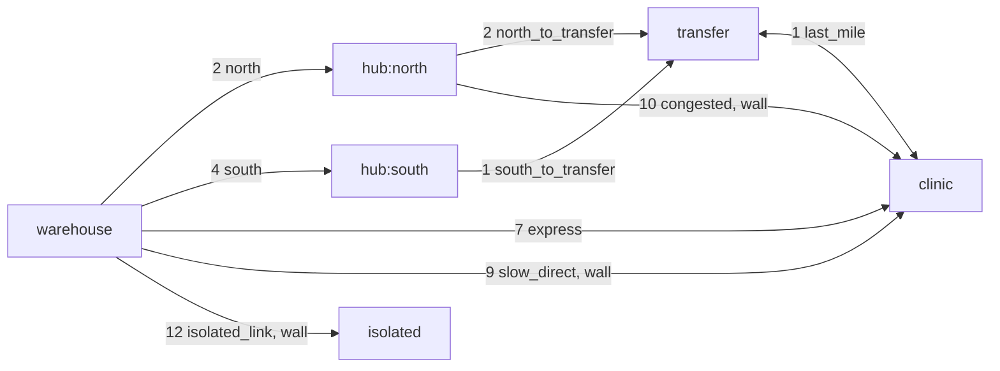
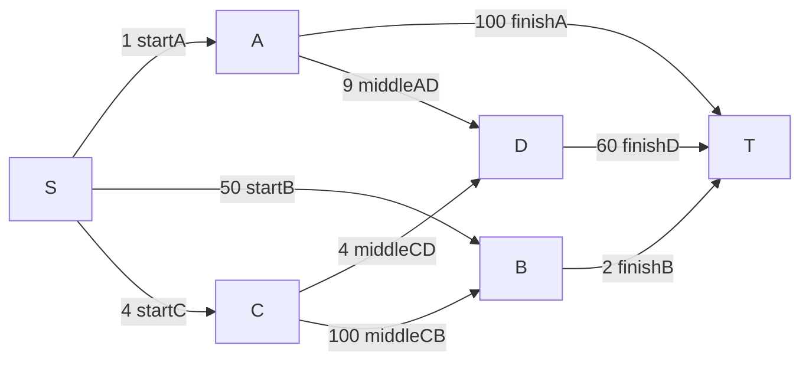

<!--
  lvlath - Repository Documentation

  Purpose:
    This document is the repository-level specification, tutorial, and contract map
    for lvlath/dijkstra. It explains the weighted shortest-path kernel, numeric
    policy, determinism laws, traversal-policy gates, result-surface semantics,
    and safe production usage.

  Contract status:
    - Determinism rules (graph-surface order, heap tie-break, strict improvement)
      are part of the public contract.
    - Numeric policy (finite non-negative graph-edge weights, `+Inf` result and
      option semantics, non-finite input rejection, and explicit arithmetic-overflow
      classification) is part of the public contract.
    - Sentinel-error governance and errors.Is-first matching are part of the
      public contract.
    - Result-surface semantics (detached ownership, tracking-enabled path witness,
      partial-result suppression) are part of the public contract.
    - Any incompatible change must be explicit, documented, and versioned.

  Scope:
    - Deterministic full-SSSP Dijkstra and four target-directed search kernels.
    - Consistent and balanced bidirectional A* over non-negative weighted core.Graph.
    - Separate numeric laws for legacy SSSP and target Search.
    - Snapshot, original EdgeID, result ownership and policy-aware path witnesses.
    - Three independently executable scenarios, runner tests and regime benchmarks.

  License:
    The lvlath repository is licensed under AGPL-3.0-only. See LICENSE.
-->

# 5. Weighted Shortest Paths: Dijkstra & Consistent A*

> **Package:** `github.com/lvlath/go/dijkstra` | **Focus:** Full SSSP, target-directed search, consistent potentials, original EdgeIDs, exact target arithmetic, deterministic witnesses

The `dijkstra` package provides a deterministic, contract-driven implementation of **full single-source Dijkstra** and **four target-directed shortest-path methods** over `core.Graph`. It is designed not as a throwaway priority-queue snippet, but as a reusable weighted shortest-path kernel for downstream packages and applications that require reproducible costs, stable witnesses, explicit unreachable semantics, strict numeric governance, and detached caller-owned result artifacts.

Unlike naive implementations that silently drift under unstable ordering, blur unknown-vs-unreachable states, or become semantically unsafe under concurrent graph mutation, `lvlath/dijkstra` treats traversal as a strict mathematical protocol.

---

## 5.1. What & Why

Why use `lvlath/dijkstra` instead of a custom heap loop?

### Five laws shared by the shortest-path family

1. **Deterministic Weighted Routing**
    *   *Others:* Return one of several equal-cost paths depending on incidental adjacency map order or unstable heap behavior.
    *   *Lvlath:* Preserves the deterministic graph-surface order from `core`, adds an explicit heap tie-break on vertex ID, and applies strict-improvement-only predecessor updates. The chosen witness is binary-stable for the same graph state and runtime policy.
2. **Explicit Numeric-Domain Separation**
    *   *Others:* Reuse one numeric sentinel across storage, options, arithmetic, and results, making it impossible to distinguish corrupted input from valid unreachability.
    *   *Lvlath:* Requires finite non-negative graph-edge weights. `+Inf` is valid only as an unbounded option value or a known-unreachable result value. If finite distance arithmetic overflows to `+Inf`, the package returns `ErrDistanceOverflow` and publishes no partial result.
3. **Traversal Policy Without Topology Mutation**
    *   *Others:* Force callers to physically delete edges or clone the graph to model "blocked" roads or "out-of-radius" conditions.
    *   *Lvlath:* Applies `WithInfEdgeThreshold` and `WithMaxDistance` as runtime policy gates. The topology remains unchanged by the call.
4. **Detached Result Surface**
    *   *Others:* Return ad-hoc internal maps or couple result semantics to implementation detail.
    *   *Lvlath:* Publishes a detached `*Result` that exposes explicit distance, reachability, and path-witness queries.
5. **Graph-Semantics Fidelity**
    *   *Others:* Assume the traversable destination is always `edge.To`, which silently breaks on undirected or mixed-edge relations.
    *   *Lvlath:* Resolves the effective opposite endpoint relative to the current vertex. Mixed and undirected traversal therefore remains mathematically correct even when internal edge storage orientation differs from the traversal direction.

---

## 5.2. Domain Scope & Non-Goals

### 5.2.1. Domain Scope
The package answers weighted shortest-path questions such as:
*   "What is the minimum total cost from this source to every known vertex?"
*   "What is the minimum cost to this one target without computing full SSSP?"
*   "Is this known target reachable under the active traversal policy?"
*   "What is one deterministic shortest-path witness to this target?"

### 5.2.2. Explicit Non-Goals
`lvlath/dijkstra` is intentionally **not**:
*   **A negative-weight solver:** If any traversed edge can have a negative finite weight, Dijkstra is mathematically the wrong tool. The package actively rejects this input.
*   **An all-pairs solver:** It does not provide Floyd-Warshall or Johnson-style orchestration.
*   **An exhaustive enumerator:** It returns exactly *one* deterministic witness, not a catalog of all possible shortest paths.
*   **A universally snapshot-isolated SSSP engine:** Legacy `Dijkstra` traverses live `core` surfaces; **target `Search` performs one `core.Clone`** before its graph preparation. Direct unsynchronized writes through live `*core.Edge` pointers remain unsupported.

---

## 5.3. Mathematical Formulation

The package differentiates between classic theoretical definitions and our strict runtime application. Let $G = (V, E)$ be a graph whose edge-weight function is:

$$
w: E \rightarrow \mathbb{R}_{\ge 0}
$$

with the additional storage law:

$$
\forall e \in E,\quad w(e)\ \text{is finite}
$$

The extended result distance belongs to:

$$
dist(s,v) \in \mathbb{R}_{\ge 0} \cup \{+\infty\}
$$

Here `+Inf` belongs to the result domain and means that `v` is known but no
admissible representable path was published.

### 5.3.1. Classical Shortest-Path Objective
For a source $s$ and target $v$, the weighted shortest-path objective is the infimum of the sum of edge weights over all possible paths $\mathcal{P}(s,v)$:
$$ dist(s,v) = \inf_{P \in \mathcal{P}(s,v)} \sum_{e \in P} w(e) $$
If no admissible path exists, $dist(s,v) = +\infty$.

### 5.3.2. Legacy full-SSSP implementation (strict improvement)
For the known result domain, initialization dictates $dist(s,s) = 0$ and $dist(s,v) = +\infty$ for all $v \neq s$.
During relaxation of a relation from $u$ to $v$ via edge $e$:
$$ candidate = dist(s,u) + w(e) $$
The package updates state **only** on strict improvement:
$$ \text{If } candidate < dist(s,v) \implies dist(s,v) \leftarrow candidate, \quad \pi(v) \leftarrow u $$
If $candidate == dist(s,v)$, predecessor state is intentionally **not** overwritten.

### 5.3.3. Traversal-Policy Impact (Cutoff Publication Law)
Options geometrically restrict the admissible graph and the publication domain at runtime.

*   **Wall-Threshold Admissibility (`WithInfEdgeThreshold` $\tau$):**
    $$ E_{\text{admissible}} = \{ e \in E \mid w(e) < \tau \} $$
    Edges where $w(e) \ge \tau$ are skipped.
*   **Cutoff Publication Law (`WithMaxDistance` $M$):**
    Candidate paths $> M$ are not explored. The publication domain enforces:
    $$ dist_{\text{pub}}(s,v) = \begin{cases} dist(s,v), & \text{if } v \text{ is finalized under effective policy within } M \\ +\infty, & \text{otherwise} \end{cases} $$

### 5.3.4. Legacy full-SSSP deterministic tie-break
The legacy frontier priority uses the following tuple:
$$ Priority(v) = \langle candidateDistance(v), \text{VertexID}(v) \rangle $$

### 5.3.5. Legacy representability law
Two valid finite operands can still exceed the representable `float64` range:
$$ finite(a) \land finite(b) \not\Rightarrow finite(a+b) $$

When:
$$ dist(s,u) + w(u,v) = +\infty $$

for an otherwise admissible candidate, the run fails with `ErrDistanceOverflow`.

Overflow is not converted into ordinary unreachable state.

### 5.3.6. Effective complexity of legacy SSSP
*   **Validation Phase:** Depends on option validation and $O(E \log E)$ graph-surface numeric pre-scans.
*   **Kernel Phase:** Effective time $\mathcal{O}(V \log V + E \log V + E_{\text{surface}})$. Space $\mathcal{O}(V + E_{\text{heap}})$.
*   **Result Surface:** `DistanceTo` is $\mathcal{O}(1)$. `PathTo` is $\mathcal{O}(k)$ where $k$ is path length.

---

## 5.4. Public API & Result Contract

### 5.4.1. Full-SSSP entry points and wrapper semantics
```go
// 1. Canonical Execution
func Dijkstra(g *core.Graph, sourceID string, opts ...Option) (*Result, error)

// 2. Convenience Wrappers (Facades over the canonical result model)
func Distances(g *core.Graph, sourceID string, opts ...Option) (map[string]float64, error)
func DistanceTo(g *core.Graph, sourceID, targetID string, opts ...Option) (float64, error)
func ShortestPathTo(g *core.Graph, sourceID, targetID string, opts ...Option) ([]string, float64, error)
```
*   `Distances(...)` publishes a detached distance map only.
*   `DistanceTo(...)` is a convenient point-query **but still runs full SSSP**. Use `Search` or one of its target-method wrappers when only one destination matters.
*   `ShortestPathTo(...)` forces `WithPathTracking` internally and returns one witness.

### 5.4.2. Legacy `Result` artifact
```go
type Result struct {
	SourceID  string
	Distances map[string]float64
	Prev      map[string]string
}
```

Field semantics:

* `SourceID` is the explicit source vertex identifier used for the run.
* `Distances` stores finalized shortest-path costs for the known result domain.
* `Prev` stores predecessor links only when path tracking is enabled.
* `Prev == nil` means path tracking was disabled, not that the graph has no reachable paths.


### 5.4.3. Known/unknown target states
For a queried vertex, domain membership determines the primary outcome:

| Target State          | Meaning                                        | Result Action                         |
|:----------------------|:-----------------------------------------------|:--------------------------------------|
| **Unknown Target**    | Vertex is absent from the result domain.       | Returns `ErrTargetNotFound`           |
| **Known Reachable**   | Exists in domain, reachable under policy.      | Returns finite `float64`, `nil` error |
| **Known Unreachable** | Exists in domain, walled off or out-of-bounds. | Returns `+Inf`, `nil` error           |

### 5.4.4. Path-Tracking States
Path reconstruction depends on a separate, independent axis:

| Tracking State               | Meaning                                 | `PathTo` Action                            |
|:-----------------------------|:----------------------------------------|:-------------------------------------------|
| **Enabled (`Prev != nil`)**  | Tracked during kernel run.              | Yields path (if reachable), or `ErrNoPath` |
| **Disabled (`Prev == nil`)** | Explicitly disabled to save allocation. | Returns `ErrPathTrackingDisabled`          |

---

## 5.5. Options, Numeric & Error Policies

### 5.5.1. Legacy and target numeric domains

Numeric values have different meanings in different package domains.

| Domain              | Valid values            | Meaning of `+Inf`         |
|:--------------------|:------------------------|:--------------------------|
| `core.Edge.Weight`  | finite values           | invalid                   |
| Dijkstra edge input | finite `w >= 0`         | invalid                   |
| `MaxDistance`       | finite `>= 0` or `+Inf` | no distance cutoff        |
| `InfEdgeThreshold`  | finite `> 0` or `+Inf`  | no finite edge is blocked |
| `Result.Distances`  | finite `>= 0` or `+Inf` | known but unreachable     |

Edge classification:

```text
NaN             -> ErrInvalidWeight
+Inf edge       -> ErrInvalidWeight
-Inf edge       -> ErrInvalidWeight
finite w < 0    -> ErrNegativeWeight
finite w >= 0   -> accepted
```

Arithmetic classification:

```text
Legacy full SSSP:
  admitted rounded finite cost       -> stored distance
  admitted sum overflows to +Inf     -> ErrDistanceOverflow, nil Result

Target Search (all four methods):
  exact represented-binary sum > finite MaxDistance -> pruned
  admitted sum exactly representable in float64     -> stored distance
  admitted finite but inexact sum                   -> ErrInexactArithmetic
  admitted unbounded positive overflow             -> ErrDistanceOverflow
  A* exact key/offset overflow                      -> ErrSearchKeyOverflow
  A* finite but inexact key/offset                  -> ErrInexactArithmetic
  every runtime error                              -> nil PathResult
```

**Compatibility boundary:** Legacy SSSP uses its established rounded candidate/cutoff policy. Target Search uses exact binary-value comparison and refuses inexact stored labels or keys. The two policies intentionally do not pretend to be numerically identical on arbitrary fractional weights. Even a dominated admitted inexact candidate may currently cause `ErrInexactArithmetic` during target relaxation; callers should not assume that the existence of an exact optimal witness suppresses every numeric error.

`InfEdgeThreshold` is not permission to store infinite edges. It filters valid
finite edges by policy.

### 5.5.2. Option Governance
Options are explicit runtime policy inputs, not hidden mutable state.

- options are applied sequentially,
- last-writer-wins per field,
- nil options are invalid,
- invalid explicit option input fails before traversal begins.

Legacy full-SSSP policy surface:
```go
WithPathTracking()
WithMaxDistance(max)
WithInfEdgeThreshold(threshold)
```

Target-specific policy surface:
```go
WithSearchMethod(method)
WithSearchContext(ctx)
WithSearchMaxDistance(max)
WithSearchInfEdgeThreshold(threshold)
WithTraversalPolicy(legacyOptions)
WithHeuristic(toTarget)
WithBalancedHeuristics(toTarget, fromSource)
```

These are two **different** functional-option types: `Option` and `SearchOption`. The legacy `TrackPaths` field does not transfer: a reachable `PathResult` always carries a verified route.

Default runtime policy:

* `TrackPaths       = false`
* `MaxDistance      = +Inf`
* `InfEdgeThreshold = +Inf`

Important separation:

* `sourceID` is **not** an option,
* `sourceID` is an explicit required public API argument.

Because `Option` is publicly constructible, canonical assembly revalidates the
entire `Options` state after every option. A custom option cannot bypass
`MaxDistance` or `InfEdgeThreshold` numeric invariants merely by returning `nil`.

### 5.5.3. Error Law

Exported sentinels are the single source of truth for protocol matching.

Callers must use:

```
errors.Is(err, ...)
```

and must not parse error strings.

Primary sentinels include:

* `ErrNilGraph`
* `ErrEmptySourceID`
* `ErrSourceNotFound`
* `ErrTargetNotFound`
* `ErrUnweightedGraph`
* `ErrNilOption`
* `ErrBadMaxDistance`
* `ErrBadInfEdgeThreshold`
* `ErrNegativeWeight`
* `ErrInvalidWeight`
* `ErrDistanceOverflow`
* `ErrPathTrackingDisabled`
* `ErrNoPath`
* `ErrEmptyTargetID`
* `ErrNilResult`

Error-class separation is intentional:

* missing source != missing target,
* invalid numeric input != negative finite weight,
* tracking disabled != no path,
* unknown target != known unreachable target.

When additional context is attached, the sentinel must be preserved with `%w`.

`ErrDistanceOverflow` is intentionally distinct from both `ErrInvalidWeight`
and a published `+Inf` distance:

* `ErrInvalidWeight` means the edge input itself is non-finite;
* `ErrDistanceOverflow` means valid finite operands produced an unrepresentable sum;
* published `+Inf` means no admissible representable route was found.

Panic-based option validation is forbidden.

---


## 5.6. Determinism Law

Determinism is a package-level contract.

The following four subsections describe **legacy full SSSP**. Target search has its own prepared-arc order described in §5.12.

### 5.6.1. Vertex-Domain Initialization
The known result domain is initialized by iterating:
```go
g.Vertices()
```

as surfaced by `core.Graph`.

### 5.6.2. Relation Enumeration

Relaxation processes candidate relations in the exact order returned by:

```go
g.Neighbors(u)
```

The package does not inject a second hidden neighbor-sorting layer.

### 5.6.3. Heap Ordering

Equal-distance frontier items are ordered by:
$$
(candidateDistance,\ vertexID)
$$

That means:

* smaller candidate distance wins,
* equal candidate distance is broken by lexicographically smaller vertex IDs.

### 5.6.4. Strict-Improvement Predecessor Law

Relaxation updates predecessor state only when:
$$
candidate < currentDistance
$$

Equal-cost candidates do **not** overwrite predecessor state.

### 5.6.5. Consequence

For the same:

* graph state,
* `sourceID`,
* and runtime policy,

the package publishes stable:

* finalized distances,
* predecessor selection,
* and reconstructed path witnesses.

---


## 5.7. Legacy SSSP architecture and pseudocode

The legacy implementation utilizes a **Lazy Decrease-Key Min-Heap** bounded by a strict **Visited-Finalization** loop. Duplicates are allowed in the heap; non-authoritative frontier entries are discarded cleanly by the visited-finalization model.

```text
FUNCTION Dijkstra(g, sourceID, opts...):

  Stage 1: Validate admission
    - reject nil graph
    - reject empty or missing source
    - require weighted graph
    - apply options in call order
    - revalidate finalized state after every option
    - pre-scan all edges in deterministic Edge.ID order:
        reject NaN
        reject +Inf and -Inf
        reject finite negative weights

  Stage 2: Initialize result domain
    for each vertex v in g.Vertices():
      distances[v] = +Inf
      visited[v] = false

    distances[sourceID] = 0

    if TrackPaths:
      allocate Prev
    else:
      Prev = nil

  Stage 3: Seed frontier
    push (sourceID, 0)

    heap order:
      (candidateDistance, vertexID)

  Stage 4: Visited-finalization loop
    while frontier is not empty:
      item = pop minimum

      if visited[item.id]:
        continue

      if item.dist > MaxDistance:
        break

      visited[item.id] = true

      for each edge in g.Neighbors(item.id):
        neighborID, ok = otherEndpoint(edge, item.id)

        if not ok or visited[neighborID]:
          continue

        weight = edge.Weight

        reclassify weight defensively:
          reject NaN
          reject +/-Inf
          reject finite negative value

        if weight >= InfEdgeThreshold:
          continue

        currentDistance = distances[item.id]

        if MaxDistance is finite and
           weight > MaxDistance - currentDistance:
          continue

        candidate = currentDistance + weight

        if candidate == +Inf:
          return nil Result + ErrDistanceOverflow

        if candidate < distances[neighborID]:
          distances[neighborID] = candidate

          if TrackPaths:
            Prev[neighborID] = item.id

          push (neighborID, candidate)

  Stage 5: Publish
    return detached Result only after complete success
```

---

## 5.8. ASCII Diagrams: Routing Mechanics

### 5.8.1. Complex 11-Vertex Logistics & Policy Network
This diagram demonstrates how thresholds, cutoffs, and +Inf semantics interact with a complex topology.

```text
         [Gateway](1) ──2──▶[Hub:N](2) ──3──▶ [Sort:River](4) ──2──▶[City:Aurora](8)
              │                   │                   │
              4                   5                   2
              │                   ▼                   ▼
              └────────────▶ [Hub:S](3) ──2──▶ [Sort:Valley](5) ──3─▶ [City:Delta](9)
                                  │                   │
                     (Wall >= 8) 10                   3
                                  ▼                   ▼
                            [Backup:1](6) ──2─▶[City:Ember](10)
                                  │
                                  1
                                  ▼
                            [Backup:2](7) ──2─▶ [City:Isolated](11)
```

*   **Scenario A (Unlimited):** All vertices reached. `City:Ember` is reached via `Sort:Valley` (Cost: $4+2+3 = 9$).
*   **Scenario B (`WithInfEdgeThreshold(8.0)`):** `Hub:S -> Backup:1` is a wall. `Backup:1`, `Backup:2`, and `City:Isolated` are now Known but Unreachable (`+Inf`).
*   **Scenario C (`WithMaxDistance(7.0)`):** `Gateway -> Hub:N -> Sort:River -> City:Aurora` finishes at cost $7.0$. `City:Delta` requires cost $9.0$, which exceeds $7.0$, so it remains `+Inf` (Policy Cutoff).

### 5.8.2. Equal-Cost Determinism
```text
                [relay:alpha]
               /             \
(c=2)         / (c=2)        (c=2)
             /                  \
          [start]           [target]
             \                  /
(c=2)         \ (c=2)        (c=2)
               \             /
                 [relay:beta]
```
Equal candidate distance to `target` (cost $4$) occurs through both `relay:alpha` and `relay:beta`. The heap tie-break on `VertexID` processes `alpha` first. When `beta` is processed, $4 \not< 4$ (Strict Improvement Law). `Prev` is **not** overwritten. The witness `[start -> relay:alpha -> target]` is universally stable.

### 5.8.3. Endpoint Law on Undirected Storage
```text
Stored edge record in core.Graph:
  From: "B", To: "A", Directed: false

Current finalized vertex context in Dijkstra:
  u = "A"

Wrong interpretation (Silent failure):
  v = edge.To = "A"   // Incorrectly points back to self

Correct interpretation (lvlath endpoint law):
  v = otherEndpoint(edge, "A") = "B"
```

### 5.8.4. Result-State Distinctions
```text
Result query priority:

  [receiver == nil]
        -> ErrNilResult

  [targetID == ""]
        -> ErrEmptyTargetID

  [target absent from Distances]
        -> ErrTargetNotFound

  [DistanceTo / HasPathTo]
        |
        +-- finite distance
        |      -> DistanceTo = finite
        |      -> HasPathTo  = true
        |
        +-- distance is +Inf
               -> DistanceTo = +Inf
               -> HasPathTo  = false

  [PathTo]
        |
        +-- Prev == nil
        |      -> ErrPathTrackingDisabled
        |
        +-- target distance is +Inf
        |      -> ErrNoPath
        |
        +-- valid source-anchored predecessor chain
        |      -> deterministic path
        |
        +-- missing, cyclic, or out-of-domain predecessor
               -> ErrNoPath
               -> nil path
```

---

## 5.9. Compilable scenarios and their runner tests

The three standalone Go programs below use only exported `core` and `dijkstra` symbols. Their source files live in `examples/`, have `//go:build ignore` to prevent multiple `main` declarations in directory builds, and **are launched by filename**. `dijkstra/scenario_test.go` runs all three through `go run`, requires a clean exit and compares complete output transcripts. A normal `go test ./dijkstra` therefore exercises real compilation and runtime execution, not just package examples.

| Scenario | Public calls and mathematical regime | Command |
|:--|:--|:--|
| [Logistics mixed multigraph](../examples/dijkstra_scenario_logistics.go) | `Dijkstra`, `Search`, `Bidirectional`; wall, +Inf, original parallel IDs, undirected reverse segment | `go run ./examples/dijkstra_scenario_logistics.go` |
| [Warehouse Manhattan A*](../examples/dijkstra_scenario_grid_astar.go) | `AStar` vs `Search` on a 5×5 grid; blocked center, consistency, full EdgeID verification | `go run ./examples/dijkstra_scenario_grid_astar.go` |
| [Balanced service failover](../examples/dijkstra_scenario_balanced_failover.go) | `BidirectionalAStar` vs `Bidirectional`; asymmetric arcs, nonzero potentials, 101→52 trap, exact cutoff | `go run ./examples/dijkstra_scenario_balanced_failover.go` |

### 5.9.1. Logistics: original route identity and runtime policy



The inclusive wall policy blocks every edge weighing 8 or more without
removing it from the graph. The unique cheapest admissible route is
`warehouse → hub:north → transfer → clinic`, cost 5, using original IDs
`north`, `north_to_transfer`, and `last_mile`.

Canonical successful output:

```text
sssp: 5 [warehouse hub:north transfer clinic]
target: 5 [north north_to_transfer last_mile]
bidirectional: 5 [north north_to_transfer last_mile]
isolated: +Inf
reverse: 1 [last_mile]
```

The result demonstrates an important distinction: `Result.PathTo` returns only vertex IDs, while `PathResult.EdgeIDs` preserves the **original selected edge record**. Do not reconstruct edge identity from two adjacent IDs in a multigraph.

### 5.9.2. Warehouse grid: why a consistent heuristic is a contract

A five-by-five undirected warehouse grid has cardinal unit-cost links. The four links around the center `r2c2` have finite cost 9 and are excluded by `InfEdgeThreshold=5`. The admissible Manhattan heuristic is:

```text
h(row, column) = (4 - row) + (4 - column)

For every admitted cardinal arc u -> v:
    h(u) <= 1 + h(v)

Start r0c0: h=8. Target r4c4: h=0.
```

The program runs `AStar` and baseline target `Search`; it verifies each original `EdgeID` against `core.Graph.GetEdge`, including orientation and wall membership, and checks exactly **25** synchronous heuristic evaluations.

```text
astar: 8 hops=8 evaluated=25
reference: 8
witness: original-edge-ids-verified
closed-center: avoided
```

### 5.9.3. Asymmetric service network: balanced potentials and cutoff



The exact optimum is `S → B → T = 52`; alternatives through `A → T`
and `A → D → T` cost 101 and 70, respectively. The reverse traversal
uses the original incoming relations; no symmetric edges are inferred.

Both heuristics in the example are exact integer shortest-path distances for their respective directional problem. They satisfy terminal anchors and all oriented-edge inequalities, so balanced search is well-defined. The `MaxDistance=51` run returns known unreachability even though the unbounded shortest route costs 52.

```text
balanced: 52 [S B T] [startB finishB]
bidirectional: 52 [startB finishB]
cutoff-51: +Inf
heuristic-calls: 6 6
```

The older five scenario-oriented GoDoc examples are retained in `dijkstra/example_test.go` for legacy SSSP (`logisticsRouting`, `failoverNetwork`, `serviceRadiusCutoff`, `mixedTransitGraph`, `equalCostDeterminism`). The standalone programs above cover the new target-search family and should not be replaced by speculative Playground URLs. Playground badges require a separately published, verified snippet; local `go run` commands are the executable source of truth.

---

## 5.10. Ownership, Concurrency & Partial-Result Laws

### 5.10.1. Detached Ownership Law
Published results are detached and caller-owned.

This means:
- the package does not retain a live mutable link from `Result` back to the graph,
- the package does not mutate published result maps after return,
- callers may read, clone, cache, or transform the result after return.

The graph itself remains externally owned by the caller.

### 5.10.2. Concurrency Law

- **Legacy `Dijkstra`:** uses the live `core` graph surfaces; keep topology stable for a coherent full-SSSP problem instance.
- **Target `Search` and its three wrappers:** call `core.Clone` once, then validate and traverse the same private prepared graph. `Search` no longer reads the caller's original topology during its kernels.
- Properly synchronized `core` mutators may overlap with the snapshot operation according to `core`'s locking contract. **Direct unsynchronized writes to retained `*core.Edge` aliases are unsupported** for either family.
- Callback and cancellation processing is cooperative; synchronous `Clone` and a blocking heuristic callback cannot be forcibly preempted.

Detached `PathResult` values hold neither graph pointers nor callback references.

### 5.10.3. Partial-Result Suppression Law
On failure, the package does **not** publish a partial `Result`.

Publication rule:
- validation failure $\implies$ `nil` result + error
- runtime kernel failure $\implies$ `nil` result + error
- successful completion $\implies$ detached finalized result publication

A non-nil published `Result` therefore means the run completed successfully.

### 5.10.4. Caller-Owned Witness Integrity

`Result.Distances` and `Result.Prev` belong to the caller after publication.

This ownership permits mutation, but mutation can invalidate result invariants.

`PathTo` therefore fails closed:

* every predecessor must exist in `Distances`;
* every non-source path vertex must have a non-empty predecessor;
* no predecessor vertex may repeat;
* the chain must terminate at `SourceID`;
* no partial path is returned on failure.

Broken, cyclic, or out-of-domain witness state returns `ErrNoPath`.

`Clone()` provides independent map ownership, but cloning does not repair
semantically invalid caller-created data.

---

## 5.11. Pitfalls & Best Practices (Architectural Mastery)

### 5.11.0. Operational pitfalls
* **Do not store `+Inf` as a graph-edge wall.**
  Store only finite edge weights. Use `WithInfEdgeThreshold` to block finite heavy
  edges, or omit the relation from topology.

* **Do not reinterpret overflow as unreachable.**
  `ErrDistanceOverflow` means a representable path cost could not be produced.
  It is not equivalent to a successful `+Inf` result.

* **Do not mutate `Prev` casually.**
  It is caller-owned, but `PathTo` will reject cycles, foreign IDs, and broken chains.

### 5.11.1. Do not parse error strings
Use `errors.Is` with exported sentinels only.
String matching is not part of the contract.

### 5.11.2. Do not run Dijkstra on negative-weight graphs
Finite negative weights are mathematically invalid for Dijkstra and are rejected by the package.
If the domain allows negative weights, switch algorithms rather than forcing this package to answer the wrong question.

### 5.11.3. Do not treat `Prev == nil` as “no path exists”
`Prev == nil` means path tracking was disabled.
Reachability must be queried independently through the result surface.

### 5.11.4. Do not collapse unknown targets and unreachable targets
These are different operational states:
- missing target -> `ErrTargetNotFound`
- known unreachable target -> `+Inf` with `nil` error

### 5.11.5. Do not simplify mixed or undirected traversal to `edge.To`
The effective traversable endpoint must be resolved relative to the current vertex.
Reducing traversal to `edge.To` breaks endpoint correctness on undirected and mixed-edge graphs.

### 5.11.6. Use policy gates instead of topology mutation when the problem is operational
Use:
- `WithInfEdgeThreshold(...)` for degraded or impassable links,
- `WithMaxDistance(...)` for bounded traversal radius or bounded weighted reachability.

Do not mutate graph topology merely to simulate runtime routing policy.

### 5.11.7. Keep `+Inf` as semantic data
Do not rewrite it into synthetic finite sentinels such as `-1` or arbitrary “large” numbers.
`+Inf` is part of the numeric contract.

### 5.11.8. Choose the correct result domain before calling a wrapper

- `Distances(...)` and `Dijkstra(...)` for a complete SSSP result domain.
- Legacy `DistanceTo(...)` or `ShortestPathTo(...)` for compatibility with legacy options/results; both **run full SSSP**, even when only one destination is queried.
- Target `Search(...)` or `Bidirectional(...)` for one destination without claiming every distance was finalized.
- `AStar(...)` with a demonstrably consistent target heuristic; `BidirectionalAStar(...)` when two directional consistent estimates are available.

Do not claim that a reduced heap key is an original-cost distance, or that a target `PathResult` contains an SSSP distance map.

### 5.11.9. Keep examples and documentation contract-faithful
Examples should:
- use only current public API,
- keep graph-construction errors explicit,
- print deterministic ordered output,
- and avoid implying stronger guarantees than the package actually provides.

---

## 5.12. Target Search contract: four real, compatible methods

### 5.12.1. Public surface and dispatch

```go
// Canonical target facade; methods are explicit and never auto-selected.
func Search(g *core.Graph, sourceID, targetID string, opts ...SearchOption) (*PathResult, error)

// Three optional convenience wrappers over Search.
func Bidirectional(g *core.Graph, sourceID, targetID string, opts ...SearchOption) (*PathResult, error)
func AStar(g *core.Graph, sourceID, targetID string, toTarget Heuristic, opts ...SearchOption) (*PathResult, error)
func BidirectionalAStar(g *core.Graph, sourceID, targetID string, toTarget, fromSource Heuristic, opts ...SearchOption) (*PathResult, error)
```

| SearchMethod | Kernel | Required callbacks | Stopping certificate |
|:--|:--|:--|:--|
| `SearchDijkstra` | `runTarget` | none | first valid *settled* target |
| `SearchBidirectional` | `runBidirectional` | none | first certified incumbent μ **and** clean-frontier bound |
| `SearchAStar` | `runTarget` with frozen target offsets | `ToTarget` | first valid settled target after whole-graph consistency validation |
| `SearchBidirectionalAStar` | same `runBidirectional` with balanced offsets | `ToTarget`, `FromSource` | certified original-cost μ with **shifted** stopping bound |

`SearchMethod` is an executed method, not a fallback preference. `Search` and all wrappers publish the same `PathResult` shape. `Bidirectional`, `AStar` and `BidirectionalAStar` copy the caller's option slice before appending wrapper-required settings; none writes into the caller's spare slice capacity.

`SearchOptions` holds `Method`, `Context`, `MaxDistance`, `InfEdgeThreshold`, `ToTarget` and `FromSource`. Setters validate scalar domains immediately. Method-specific heuristic completeness is checked **after** all options have been applied, allowing either order of `WithSearchMethod(...)` and `WithHeuristic(...)`.

### 5.12.2. One coherent topology and two classes of result

```text
Caller core.Graph
   |
   +-- Dijkstra  ----------------------> live core surfaces -> full SSSP Result
   |
   +-- Search -------------------------> one core.Clone
                                          |
                                          +-- validated lexical vertex IDs
                                          +-- original edge ID records
                                          +-- admitted oriented out/in arcs
                                          |
                                          +-- SearchDijkstra / SearchAStar
                                          |      common forward kernel
                                          |
                                          +-- SearchBidirectional / SearchBidirectionalAStar
                                                 common two-frontier engine
                                                        |
                                                exact original-cost witness
                                                        |
                                             PathResult + original EdgeIDs
```

Prepared vertex and edge IDs are lexically sorted. One original undirected edge can produce two oriented arcs, but both retain the same `Edge.ID`. Backward traversal indexes the original **incoming** arcs. The target family does not read from the caller's live graph after preparation.

### 5.12.3. `PathResult` publication law

| State | `Reachable` | `Distance` | `Vertices` | `EdgeIDs` | `error` |
|:--|:--:|:--|:--|:--|:--|
| Source equals target | true | `0` | `[source]` | `nil` | nil |
| Certified reachable | true | finite original cost | owned source-to-target route | owned original IDs | nil |
| Known but inadmissible/unreachable | false | `+Inf` | nil | nil | nil |
| Unknown target | no result | — | — | — | `ErrTargetNotFound` |
| Invalid graph, options, arithmetic or callback | no result | — | — | — | matching error |

`PathResult.Path()` returns *copies* of both witness slices. `PathResult.Clone()` deep-copies both slices. The original graph, frozen heuristic caches, frontier labels and context do not escape into the returned result.

---

## 5.13. Consistent single-frontier A*: proof and numerical constraints

Let `hT(v)` be a target estimate on the exact effective graph after wall admission. `hT(t)=0` and consistency is checked over **every** oriented admitted arc:

$$ h_T(u) \le w(u,v)+h_T(v). $$

With non-negative weights and the terminal anchor, consistency implies admissibility: follow any valid path to the target and telescope the inequalities. This justifies target settlement without reopening; **merely admissible but inconsistent** heuristics are rejected.

The queue receives a normalized key:

$$ K(v)=d_F(v)+h_T(v)-h_T(s). $$

In the implementation the offset `hT(v)-hT(s)` is materialized once after exact consistency checking. `runTarget` continues to store and relax **original** `dF(v)` values. Neither cutoff nor result publication compares against `K(v)`.

A* callback contract:

- `Heuristic` is `func(vertexID string) (float64, error)`; original vertex IDs are passed in lexical order.
- Every vertex is evaluated exactly once, including disconnected vertices. Values are frozen before heap execution.
- Values must be finite; negative finite values are legal when they satisfy consistency.
- `hT(target)==0` is exact. Nonfinite values and a nonzero terminal estimate return `ErrInvalidHeuristic`.
- Consistency is verified using exact error-free two-sum predicates, not `epsilon`, rounded equality or `math/big` in the production hot loop.
- Offsets and queue keys require exact finite binary64 storage. `ErrInexactArithmetic` and `ErrSearchKeyOverflow` are real outcomes even if the heuristic is mathematically consistent in real arithmetic.

---

## 5.14. Bidirectional Dijkstra: why the first meeting is not enough

The two-frontier engine holds original-cost labels `dF(s,v)` and `dB(v,t)`. Forward expansion scans `out[v]`; backward expansion scans original `in[v]`. A settled prefix and a settled suffix (or immutable zero-cost roots) form a complete certified crossing via a vertex or a concrete original arc.

The incumbent μ is the cost of the cheapest such **complete** witness found so far. It is not the cost of a tentative meeting point.

```text
S --1--> A --100--> T     first complete path cost 101
 \                       ^
  \--50--> B -----2------/   later complete path cost 52

At the first cost-101 meeting:
    minForward = 50
    minBackward = 2
    50+2 = 52 < 101
    STOP IS INVALID.
```

With clean heap minima `mF`, `mB`, the classic stopping rule is:

$$ m_F+m_B \ge \mu. $$

Every stale item is discarded before reading the bound. With one exhausted frontier the already explored side has certified that no undiscovered admissible path can improve the incumbent. The same engine is reused by balanced A*; only the queue-key domain and threshold translation differ.

The strict-improvement rule protects zero-weight cycles and freezes parent chains after settlement. Reconstruction checks all original `EdgeIDs`, orientations, acyclicity and exact original-cost total before publication.

---

## 5.15. Balanced bidirectional A*: potentials and exact stopping

The balanced kernel requires two **separately consistent** directional heuristics. For every admitted original arc `u → v`:

$$ h_T(t)=0,\qquad h_S(s)=0, $$

$$ h_T(u)\le w(u,v)+h_T(v),\qquad h_S(v)\le w(u,v)+h_S(u). $$


The source-oriented inequality is reversed relative to the target-oriented one because the backward frontier represents original `v → target` costs and traverses original incoming arcs.

Define the balanced potential:

$$ p(v)=\frac{h_T(v)-h_S(v)}{2}. $$


Both consistency inequalities together give a nonnegative reduced cost, which is the necessary label-setting invariant:

$$ w(u,v)-p(u)+p(v)\ge 0. $$

The implementation **does not mutate or store reduced edge weights**. It stores exact original-cost `dF`, `dB` and precomputes normalized per-vertex offsets:

$$ K_F(v)=d_F(v)+p(v)-p(s) $$

$$ K_B(v)=d_B(v)+p(t)-p(v). $$

Both root keys are zero, and the incumbent remains original `μ`. The sum of normalized frontier keys is translated by the constant endpoint shift:

$$ K_F(v)+K_B(v)=d_F(v)+d_B(v)+p(t)-p(s). $$

Consequently, the **correct** stopping bound is:

$$ \min K_F+\min K_B\ge\mu+p(t)-p(s). $$


**Do not compare reduced minima directly with μ.** That silently breaks optimality when the endpoint shift is nonzero. The production engine stores the original incumbent and its exactly certified translated key separately.

Potential construction uses a compensated half-difference. Computing `hT-hS` first and dividing afterward is unsafe: an intermediate subtraction may overflow even if `(hT-hS)/2` is representable. Conversely, dividing both operands independently may lose a subnormal half and falsely appear exact; the numerical helper must certify the represented-binary result. `math/big.Rat` is used only by independent tests, not by production search.

---

## 5.16. Error law and precise numeric-policy boundaries

| Stage | Distinct failure | Public classification |
|:--|:--|:--|
| Facade | nil graph / empty source or target | `ErrNilGraph`, `ErrEmptySourceID`, `ErrEmptyTargetID` |
| Graph validation | absent endpoints / unweighted graph | `ErrSourceNotFound`, `ErrTargetNotFound`, `ErrUnweightedGraph` |
| Original edge scan | NaN, infinity, negative finite weight | `ErrInvalidWeight`, `ErrNegativeWeight` |
| Options | bad method, cutoff, wall, nil context/callback, incompatible fields | `ErrInvalidSearchMethod`, `ErrBadMaxDistance`, `ErrBadInfEdgeThreshold`, `ErrNilContext`, `ErrNilHeuristic`, `ErrInvalidSearchOptions` |
| Frozen heuristic | nonfinite value or nonzero anchor; inconsistent effective arc | `ErrInvalidHeuristic`, `ErrInconsistentHeuristic` |
| Original-cost search | finite but inexact admitted sum; unbounded positive overflow | `ErrInexactArithmetic`, `ErrDistanceOverflow` |
| A*/balanced key | inexact priority, offset, potential or shifted threshold; overflow | `ErrInexactArithmetic`, `ErrSearchKeyOverflow` |
| Cancellation | canceled/deadline context and optional distinct cause | `errors.Is(err, context.Canceled)` / caller cause |
| Witness verification | malformed internal chain or invalid crossing | `ErrNoPath` with nil result |

All error-bearing stages suppress `PathResult` publication. Custom callback errors are preserved for `errors.Is`, and an independent cancellation cause is retained alongside the context sentinel. Do not parse error text.

**Exact target arithmetic is intentionally strict.** `float64(0.9)+float64(0.1)` may round to 1 although the sum of the represented binary operands is greater than 1. With an inclusive `MaxDistance=1`, the target search must exclude that candidate; with a larger or unbounded cutoff it may return `ErrInexactArithmetic` rather than quietly publish 1. This differs from legacy full-SSSP rounding policy.

---

## 5.17. Benchmark regimes and honest measurement

The existing legacy benchmarks remain in `dijkstra/bench_test.go`: sparse directed chain, directed grid, mixed corridor, tracking on/off, finite cutoff and wall-threshold corridor. Two additional target-family benchmark suites in `dijkstra/search_bench_test.go` now compare **complete public method execution**:

| Benchmark | Shape | Comparison and measured work |
|:--|:--|:--|
| `BenchmarkSearch_GridFourMethods` | One 32×32 directed unit grid (`V=1024`, `E=1984`) | `SearchDijkstra`, `Bidirectional`, consistent `AStar`, balanced `BidirectionalAStar` on the **same** graph and terminals |
| `BenchmarkSearch_CutoffDirectedChain` | One 6001-vertex directed unit chain (`E=6000`) | Target Dijkstra vs bidirectional Dijkstra with cutoff 256, where the target is known but policy-unreachable |

Before timing, each subbenchmark verifies reachability and exact original-cost results. Graph construction and heuristic-table generation are excluded from timing. Within each iteration, execution includes **snapshot cloning, option validation, frozen heuristic preparation (for A*), the actual kernel, witness verification and detachment**. These are end-to-end API measurements; no fabricated pure-heap speedups or synthetic MB/s throughput are claimed.

```bash
go test ./dijkstra -run '^$' -bench '^BenchmarkSearch_' -benchmem -benchtime=5x
go test ./dijkstra -run '^TestDijkstraScenarios_Run$' -count=1
go test ./dijkstra -count=1
go test -race ./dijkstra -count=1
go vet ./...
```

Benchmarks are not correctness proofs, and a single graph shape cannot establish a global ranking between methods. Always compare `ns/op`, `B/op` and `allocs/op` across matched sizes and policies.

---

## 5.18. Package naming and source-file boundaries

The public import path remains `github.com/lvlath/go/dijkstra`. This is intentional backward compatibility: Dijkstra, bidirectional Dijkstra and consistent A* all implement the same nonnegative weighted label-setting shortest-path family; changing the import path for a documentation release would break consumers without improving the mathematics.

If a future major version introduces a broader routing domain, `shortestpath` is a precise prospective umbrella name. Generic alternatives such as `search` or `pathfinding` lose the mathematical cost criterion; `routing` also risks confusion with traffic policy, tours and optimization.

Source files are grouped by **responsibility**, not by an arbitrary file-count quota:

- `impl_dijkstra.go` and `options.go` preserve the legacy SSSP contract.
- `search_graph.go`, `search_queue.go`, `search_numeric.go`, `search_path.go` own common target preparation, queue, exact arithmetic and result publication.
- `impl_target.go`, `impl_astar.go`, `impl_bidirectional.go`, `impl_balanced.go` own one algorithm-selection concern each while **sharing exactly one forward and one bidirectional engine**.
- `heuristic.go` and `search_options.go` own frozen potentials and target-policy validation.
- `*_test.go`, `bench_test.go` and `search_bench_test.go` own external contract validation, executable examples and shape-based measurements.

Standalone `examples/dijkstra_scenario_*.go` files are invoked individually by the external runner test. All real `Test*` declarations live in `package dijkstra_test`; test-only bridge functions do not extend the production API.

---

> Next: [6. Minimum Spanning Trees: Prim & Kruskal](MST.md)
