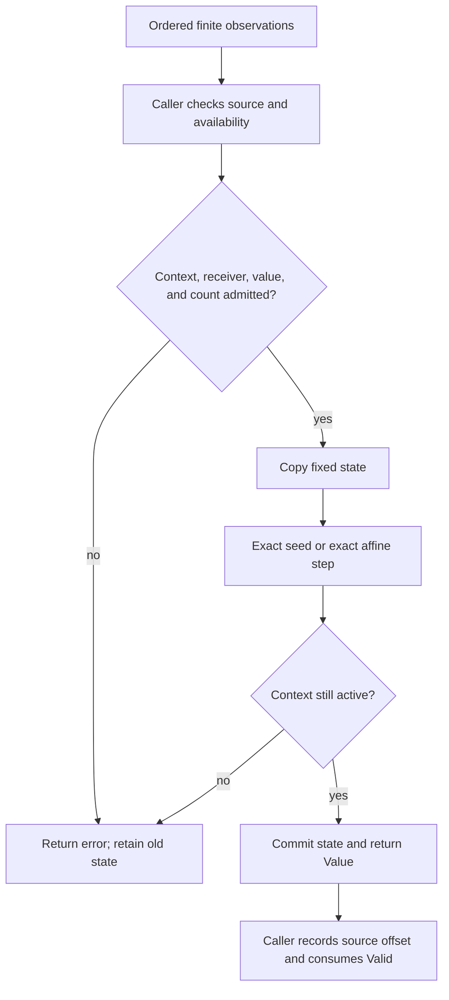

<!--
  SPDX-License-Identifier: AGPL-3.0-only
  Copyright (C) 2025-2026 katalvlaran

  File: docs/EMA.md
  Package reference: github.com/lvlath/go/ema
  Purpose: Explain exact affine EMA, seed readiness, error-atomic streaming,
    bounded checkpoint state, and safe application composition.
  Contract status: Operational guide to the implemented public API.
    ema/doc.go, public GoDoc, and executable examples define the package contract.
  Scope: Finite binary64 observations; explicit integer period and seed policy;
    batch/stream continuation. No calendars, forecasting model, ATR, or execution.
  License: AGPL-3.0-only; see ../LICENSE.
-->

# EMA: exact affine smoothing and recoverable streams

`github.com/lvlath/go/ema` measures the exponentially smoothed level of an
already ordered finite scalar series. It accepts negative values, zero, and
subnormals as well as positive prices. It returns a level in the input's units,
not a normalized oscillator, a confidence interval, or a decision.

The numerical contract has three deliberate parts: an exact SMA seed or an
explicit first-value seed; one correctly rounded affine step per accepted
observation; and a bounded snapshot that preserves unfinished seed information.
The same transition serves batch and stream processing.

**Start here:** [package contract](../ema/doc.go), [public facades](../ema/api.go),
[executable scenarios](../ema/example_test.go), [tutorial](TUTORIAL.md#11w-ema-foundations-exact-levels-readiness-and-replay),
[troubleshooting](FAQ_%26_TIPS.md#13v-ema-faq-exact-smoothing-seeds-and-checkpoints).

## Contents

1. [Purpose and package boundaries](#1-purpose-and-package-boundaries)
2. [Choose the public facade](#2-choose-the-public-facade)
3. [Exact mathematics and finite-range proof](#3-exact-mathematics-and-finite-range-proof)
4. [Readiness, values, and error precedence](#4-readiness-values-and-error-precedence)
5. [Streaming transactions and cancellation](#5-streaming-transactions-and-cancellation)
6. [Snapshot ABI and bounded seed state](#6-snapshot-abi-and-bounded-seed-state)
7. [Complete checkpoint-and-replay program](#7-complete-checkpoint-and-replay-program)
8. [Compose without changing the mathematical question](#8-compose-without-changing-the-mathematical-question)
9. [Complexity, ownership, and allocation boundaries](#9-complexity-ownership-and-allocation-boundaries)
10. [Executable verification and benchmarks](#10-executable-verification-and-benchmarks)
11. [Pitfalls and operational AI-hints](#11-pitfalls-and-operational-ai-hints)

## 1. Purpose and package boundaries

Use EMA for a causal level estimate: quote-noise smoothing, a signed telemetry
baseline, or the centerline of a separately implemented channel. The output at
index `i` uses no observation after `i`. This causality says nothing about whether
a vendor revision or unfinished bar was available at a historical decision time;
the caller must establish that provenance before passing the slice.

| Concern | Owner | Boundary |
|:--|:--|:--|
| Exact EMA state transition | `ema` | Period, seed, finite values, readiness, rounding, and rollback. |
| Timestamp cadence and gaps | Caller, optionally `series` | EMA receives no timestamps and performs no interpolation. |
| Duplicate events and offsets | Caller | `Count` is accepted sample count, not event identity. |
| ATR, channel width, execution | Separate caller-selected components | An EMA centerline alone is not a Keltner channel or a trading rule. |
| Statistical normalization | Caller, optionally `stats` | EMA keeps physical units and fits no distribution. |
| MACD composition | `macd` under its own contract | Related mathematics does not authorize replacing its private kernel. |
| Persistence security | Caller | Snapshot validation is not authentication or exactly-once delivery. |

Production EMA imports only `context`, `errors`, `math`, and `math/bits` across
its files. It has no mandatory dependency on `core`, `series`, `stats`, or `macd`.
A conceptual dataflow arrow does not mean a Go import dependency.

## 2. Choose the public facade

| Need | Public call | Policy |
|:--|:--|:--|
| Batch with explicit options | `Compute(ctx, x, Options{Period: p, Seed: seed})` | Canonical facade; keeps values and masks. |
| SMA-seeded batch | `ComputeSMA(ctx, x, p)` | Delegates to `Compute` with `SeedSMA`. |
| Immediately ready batch | `ComputeFirst(ctx, x, p)` | Delegates to `Compute` with `SeedFirst`. |
| Stream with explicit options | `New(Options{Period: p, Seed: seed})` | Canonical constructor. |
| SMA-seeded stream | `NewSMA(p)` | Delegates to `New` with `SeedSMA`. |
| Immediately ready stream | `NewFirst(p)` | Delegates to `New` with `SeedFirst`. |
| Accept an observation | `stream.Push(ctx, x)` | Returns detached `Value`; commits only on success. |
| Start another history | `stream.Reset()` | Preserves options, clears count/current/seed. |
| Save or resume a history | `stream.Snapshot()`, `stream.Restore(state)` | Versioned, detached state; matching target options required. |

`Options.Period` must satisfy `1 <= Period < MaxInt` on the executing platform.
The upper bound ensures `Period+1` fits the admitted integer range. `Seed` must
be `SeedSMA` or `SeedFirst`. There is no default period: `Options{}`, period zero,
negative periods, `MaxInt`, and unknown seed values are errors.

`Period` counts **accepted observations**. EMA(20) over ticks is not EMA(20)
over one-minute bars. Changing cadence, units, or instrument normally requires
a separately initialized stream and a caller-defined history boundary.

### A minimal numerical law, not a market strategy

This complete program contrasts the two seed policies. The small input is
intentional: each output can be checked directly without a tolerance.

```go
package main

import (
	"context"
	"fmt"

	"github.com/lvlath/go/ema"
)

// main compares two explicitly selected initialization policies.
// It retains the readiness masks instead of treating warmup zeros as observations.
// Implementation:
//   - Stage 1: define one ordered finite fixture and an explicit period.
//   - Stage 2: call both named facades and check each error.
//   - Stage 3: print aligned values and readiness.
//
// Behavior highlights:
//   - Both modes use the same mature recurrence, but different initial states.
//
// Inputs:
//   - Four dimensionless fixture values; no external feed or clock.
//
// Returns:
//   - Deterministic value/mask output on standard output.
//
// Errors:
//   - Library failures are printed before reading any returned result.
//
// Determinism:
//   - Original input order and fixed formatting determine publication.
//
// Complexity:
//   - Time O(n*W), space O(n+W), with two owning results and W=34.
//
// Notes:
//   - The program does not mutate either result or the input.
//
// AI-Hints:
//   - Do not infer readiness from whether a value equals zero.
func main() {
	const period = 3                                // The initial arithmetic mean needs three observations.
	values := []float64{1, 2, 3, 4}                 // Fixed ordered values make the laws inspectable.
	ctx := context.Background()                     // Reuse a valid, nonallocating context.
	sma, err := ema.ComputeSMA(ctx, values, period) // Select full SMA seeding.
	if err != nil {                                 // A failed batch never supplies a partial result.
		fmt.Println("error:", err)
		return
	}
	first, err := ema.ComputeFirst(ctx, values, period) // Select immediate readiness.
	if err != nil {                                     // Preserve the same error-first consumption discipline.
		fmt.Println("error:", err)
		return
	}
	fmt.Println("SMA:", sma.Values, sma.Valid)       // Preserve original index alignment.
	fmt.Println("First:", first.Values, first.Valid) // Report the second seed policy.
	// Output:
	// SMA: [0 0 2 3] [false false true true]
	// First: [1 1.5 2.25 3.125] [true true true true]
}
```

## 3. Exact mathematics and finite-range proof

Write `RN64` for one round-to-nearest, ties-to-even operation on an exact rational
number, followed by canonicalization of a zero result to `+0`. Each input is its
**represented binary64 value**, not the real decimal number that originally
produced it.

### The seed and mature recurrence

For `SeedSMA`, the first valid output is at zero-based index `P-1`:


For `SeedFirst`, the first valid output is `x[0]`, with zero canonicalized.
Subsequent steps in either mode use:


The coefficient `alpha=2/(P+1)` explains exponential smoothing, but the kernel
does **not** first round alpha to `float64`. It forms exact integer-weighted
binary64 operands and rounds the resulting rational once. The `previous` value
is already rounded from the preceding step. Expanding all history into one
unrounded rational expression would therefore compute a different function.

Period is not a rolling-window capacity. Earlier accepted observations influence
the state through the recurrence after the first P samples; the implementation
stores that state, not their entire history.

### Why opposite extremes do not overflow

The exact weights `(P-1)/(P+1)` and `2/(P+1)` are nonnegative and sum to one.
Therefore the exact mature result lies between the two finite operands. Since
both interval endpoints are representable, nearest rounding cannot escape that
interval. An exact SMA mean likewise lies between the extrema of its inputs.

At `P=3`, equal opposite `MaxFloat64` operands have equal weights and their exact
numerator cancels to zero. No `x-previous` is evaluated. By contrast,
`previous + alpha*(x-previous)` can overflow the difference before weighting;
FMA cannot repair a difference that has already become infinite.

Even the affine formula is unsafe when its numerator is evaluated naively in
`float64`: an unscaled product may overflow before division. The fixed-width
integer numerator, not merely the algebraic spelling, provides the guarantee.

### Why a small seed contribution survives

Every finite binary64 is an integer multiple of the smallest subnormal unit:


`binaryUnits` extracts the represented significand and exponent without rounded
floating-point arithmetic. Signed integer accumulation then preserves every bit.
For `[1e308, 1, -1e308]`, the two represented extremes cancel exactly, leaving
one. Only division by three rounds: the result is `0.33333333333333331`.
A running binary64 mean or compensated approximation is not a replacement for
this exact-sum contract.

The maximum finite input in these units is:


`M` needs 2098 bits. Any `uint64` count adds at most 64 bits, so 34 uint64 words
provide 2176 bits with room to spare. The admitted affine denominator is at most
`MaxInt`, giving a similarly bounded numerator. Arithmetic cost is fixed with
respect to stream length and period; it is not arbitrary-precision growth.

### Rounding, P1, and representability

The rounding path takes enough high bits for a binary64 significand, divides
by the exact integer denominator, and combines the remainder with lower bits.
It distinguishes values below, at, and above a midpoint; exact ties select the
even significand. Lower discarded bits are part of that decision, not noise.

For `P=1`, `Push` selects the current input directly and never combines it with
old state. Thus `[1e308, 1, -1e308, 0]` is preserved bitwise. The explicit
exception is input `-0`, which becomes `+0` in both seed modes. A tiny nonzero
exact average that rounds to zero is a successful valid measurement, not an
overflow or an unfinished seed.

## 4. Readiness, values, and error precedence

A successful `Result` owns `Values []float64` and `Valid []bool`, each of length
`len(x)`. An unavailable entry is exactly `+0/false`. A measured zero is
`+0/true`; the payload alone cannot distinguish the two.

| Mode and accepted count C | Published value | Valid | Retained seed |
|:--|:--|:--|:--|
| Either mode, C=0 | No observation yet; Snapshot.Current=+0 | No Value yet | Zero |
| SMA, 0<C<P | +0 | false | Exact sum of C inputs |
| SMA, C=P | Correctly rounded exact mean | true | Cleared to zero |
| SMA, C>P | One rounded affine step | true | Zero |
| First, C=1 | First input, zero-canonical | true | Zero |
| First, C>1 | One rounded affine step | true | Zero |
| Either seed, P=1 and C>0 | Current input, zero-canonical | true | Zero |

Nil and allocated-empty input slices both succeed after context/options checks:
non-nil `*Result`, non-nil empty `Values`, non-nil empty `Valid`. A nonempty
history shorter than the SMA period also succeeds. It is not `ErrInsufficient`.
All values are still checked for finiteness during warmup and at period one.

`(*Result).IsNil()` returns only `r == nil`. It is safe through a typed-nil
`interface{ IsNil() bool }`; it does not validate shape or count ready rows.
No production dependency on a particular interface-declaring package is needed.

### Failure table

| Condition | Error | Returned artifact / mutation |
|:--|:--|:--|
| Nil context in Compute/Push | `ErrNilContext` | nil batch / Value{}; no stream mutation |
| Context already canceled or cancellation detected later | `ctx.Err()` | Same no-partial-result/rollback rule |
| Invalid period or seed at Compute/New | `ErrInvalidOption` | nil result or stream |
| Batch output byte count would exceed admission bound | `ErrOverflow` | nil result before allocating outputs |
| Any input NaN or infinity | `ErrNonFinite` | nil batch / Value{}; no stream mutation |
| Nil Push/Restore receiver | `ErrNilInput` | No dereference or mutation |
| Zero-value Stream Push/Restore | `ErrStateVersion` | Must construct using New first |
| Snapshot schema/options/numeric/phase violation | `ErrStateVersion` | Entire existing stream remains unchanged |
| Push at Count==MaxUint64 | `ErrOverflow` | Value{}; count does not wrap |

There are six package sentinels: `ErrNilContext`, `ErrNilInput`,
`ErrInvalidOption`, `ErrNonFinite`, `ErrOverflow`, and `ErrStateVersion`.
There is no `ErrShape` for this one-input API. Restore options mismatch is a
**state** error, not the constructor's `ErrInvalidOption`. Match through
`errors.Is`, never by error text.

The fixed admission orders are:

```text
Compute:
  context -> options -> output capacity -> finite scan -> calculation -> final context

New:
  options -> initialized empty state

Push:
  context -> receiver -> finite input -> count capacity -> candidate -> final context -> commit

Restore:
  receiver -> version/algorithm/options -> Current -> phase/SeedSum -> commit
```

An invalid context takes precedence even on a nil Push receiver. After work
starts, cancellation racing with an input error has no deterministic ordering:
the first failure detected by the implementation is returned. Error atomicity
is not a guarantee to catch cancellation occurring after the final check.

## 5. Streaming transactions and cancellation

Each successful Push accepts one observation, including a warmup observation.
A successful warmup returns `Value{}, nil`; a failed Push returns `Value{}, err`.
Check the error first. Only a success may advance the caller's source checkpoint.



Pseudocode mirrors the implementation, including the unit-period projection:

```text
PUSH(ctx, x):
    validate ctx, receiver, finite x, and capacity to increment Count
    candidate = value-copy of current stream
    candidate.Count++
    output = (+0, false)
    if Period == 1:
        candidate.Current = zeroCanonical(x)
    else if Seed == SMA and candidate.Count <= Period:
        candidate.Seed += exactBinary64Units(x)
        if candidate.Count < Period:
            output = (+0, false)
        else:
            candidate.Current = RN64(candidate.Seed * 2^-1074 / Period)
            candidate.Seed = 0
            output = (candidate.Current, true)
    else if candidate.Count == 1:
        candidate.Current = zeroCanonical(x)
    else:
        candidate.Current = RN64(((Period-1)*Current + 2*x)/(Period+1))
    if Seed == First or candidate.Count >= Period:
        output = (candidate.Current, true)
    check ctx immediately before publication
    commit candidate and return output
```

`Compute` performs a complete finite-input validation scan, then one numerical
scan using that same transition. It is two linear scans, not one total pass.
Context is checked at entry, at least every 1024 observations in both passes,
and immediately before publication. It returns no partial prefix on failure.

`Reset` preserves options and clears all recurrence fields, including unfinished
seed data. It is equivalent to starting another history with `New` and the same
configuration; it is not a change-period method. Nil and zero-value Reset are
no-ops. Concurrent Push, Reset, Restore, or Snapshot on one stream requires an
external lock or ownership discipline. Independent streams do not share state.

## 6. Snapshot ABI and bounded seed state

### Fields and phases

| Field | Required meaning |
|:--|:--|
| `Version uint32` | Exactly 1. |
| `Algorithm string` | Exactly `ema/affine-rn/v1`. |
| `Options Options` | Exact match to the target stream constructed by New. |
| `Count uint64` | Number of successfully accepted observations since the history origin. |
| `Current float64` | Finite, canonical +0 when zero; +0 throughout incomplete SMA warmup. |
| `SeedSum string` | Exact signed integer in 2^-1074 units during incomplete SMA warmup; otherwise `"0"`. |

At Count zero, both Current and the mathematical seed must be zero. In
`SeedFirst`, SeedSum is always `"0"`. In SMA, the exact seed is cleared as soon
as Count reaches Period; its rounded Current is then sufficient for continuation.

`Snapshot()` on nil or Stream{} returns the all-zero `Snapshot{}`. That sentinel
is **not** a valid snapshot of an initialized empty stream: its Version,
Algorithm, Options, and empty SeedSum differ. Call New first.

A mature snapshot at Count==MaxUint64 is valid to restore. A subsequent Push
fails with `ErrOverflow`; Reset explicitly starts a new history. Restore may
select an older saved state, so it is not a monotonic feed-cursor guard.

### Parsing and rejection

SeedSum's whole-string grammar is `0|-?[1-9][0-9]*`, ASCII only, with at most
660 bytes including the optional minus. `+1`, `-0`, `00`, whitespace, an empty
string, Unicode digits, and exponent notation are not accepted. Length and
grammar checks precede bounded multiply-by-ten parsing; machine-integer overflow
is detected, and the parsed magnitude must satisfy `abs(sum) <= Count*M`.

No `big.Int` or dynamically sized parse buffer is used by Restore. An oversized
preexisting caller string is rejected without allocating another buffer. This
cannot undo an allocation already performed by the caller's transport or decoder;
apply message-size limits **before** deserializing untrusted input too.

### What continuation guarantees, and what it does not

A valid warmup restore reconstructs exactly the same integer sum. A mature
restore reconstructs exactly the same rounded Current. Equal options and equal
future inputs therefore produce equal next states, and induction gives identical
subsequent binary64 outputs and masks.

The validation checks necessary structural and magnitude conditions, **not**
proof that an authentic history produced those values. There is no MAC,
signature, checksum, timestamp, instrument ID, or source cursor in Snapshot.
Authenticate the external envelope; store it atomically with source identity,
cadence, units, revision policy, and the last accepted offset.

### Serialization discipline

Decode into a typed `Snapshot` or a typed envelope containing one. `Current`
needs a lossless finite binary64 round trip; `Count` needs exact uint64 storage;
`SeedSum` must remain a string. Default decoding into `map[string]any` turns
JSON numbers into float64 and can lose integer counts above 2^53. The typed
encoding/json round trip is exercised by `TestSnapshot_TypedJSONPreservesFiniteBits`.
See [Go's JSON decoding contract](https://pkg.go.dev/encoding/json#Unmarshal).

A snapshot with a 64-bit-period Options value outside a 32-bit target's `int`
range is not portable to that target. ABI version equality alone does not erase
platform option limits. For periods representable on both targets, preserve
values/counts exactly and validate through New/Restore; never coerce a period.

## 7. Complete checkpoint-and-replay program

The following deterministic sensor fixture has 20 observations in kilowatts.
The service fails over after five accepted observations of an EMA(14) seed.
One event is replayed twice. Feed admission happens outside EMA; every accepted
continued value is compared to the uninterrupted batch with exact bits/masks.
The JSON round trip is illustrative persistence, **not authenticated storage**.

```go
package main

import (
	"context"
	"encoding/json"
	"fmt"
	"math"

	"github.com/lvlath/go/ema"
)

// main resumes an incomplete SMA seed with an explicit source cursor.
// Replay duplicates do not become new observations in the smoothing history.
// Implementation:
//   - Stage 1: compute an uninterrupted reference and checkpoint five observations.
//   - Stage 2: serialize typed state and restore a separately configured stream.
//   - Stage 3: admit consecutive events and compare every continued output.
//
// Behavior highlights:
//   - Source metadata is outside Snapshot and remains caller-owned.
//
// Inputs:
//   - Synthetic fixed-cadence power readings in kilowatts, not live plant data.
//
// Returns:
//   - Deterministic replay counts and bitwise continuation status.
//
// Errors:
//   - Every library/codec error aborts before consuming dependent state.
//
// Determinism:
//   - Source indexes determine sequence IDs; no wall clock or map traversal is used.
//
// Complexity:
//   - Time O(n*W+D*W), space O(n+W+D), W=34 and D<=660.
//
// Notes:
//   - A production envelope must be authenticated and committed with the offset.
//
// AI-Hints:
//   - Never derive source identity from Count or trust remote Options as local policy.
func main() {
	const period = 14                  // A fully seeded baseline needs fourteen accepted readings.
	const warmCount = 5                // Persist before the first ready EMA value exists.
	const firstSequence = uint64(1001) // Source identity is independent of EMA Count.
	const sourceID = "DEMO/POWER/1s"   // Explicit fixture identity, not a real device.
	readings := []float64{             // Caller has already validated cadence and engineering units.
		200, 201, 199, 202, 201, 203, 202, 204, 203, 205,
		204, 206, 205, 207, 206, 208, 207, 209, 208, 210,
	}
	ctx := context.Background()                             // Reuse one valid context outside measured work.
	reference, err := ema.ComputeSMA(ctx, readings, period) // Uninterrupted reference.
	if err != nil {                                         // Do not inspect a failed batch result.
		fmt.Println("error:", err)
		return
	}
	primary, err := ema.NewSMA(period) // Local policy is explicit on each service.
	if err != nil {                    // Reject configuration before admitting any event.
		fmt.Println("error:", err)
		return
	}
	for _, reading := range readings[:warmCount] { // Admit exactly five readings.
		if _, err := primary.Push(ctx, reading); err != nil {
			fmt.Println("error:", err)
			return
		}
	}
	// The envelope binds numeric state to caller-owned event metadata.
	type checkpoint struct {
		Source       string       // Instrument, cadence, and units identity for this fixture.
		LastSequence uint64       // Last successfully accepted source event.
		EMA          ema.Snapshot // Exact unfinished numeric state.
	}
	saved := checkpoint{sourceID, firstSequence + warmCount - 1, primary.Snapshot()}
	payload, err := json.Marshal(saved) // Snapshot I/O is outside any Push hot loop.
	if err != nil {                     // Serialization failures do not advance the source offset.
		fmt.Println("error:", err)
		return
	}
	var restored checkpoint // Typed fields preserve uint64 and finite binary64 values.
	if err := json.Unmarshal(payload, &restored); err != nil {
		fmt.Println("error:", err)
		return
	}
	if restored.Source != sourceID || restored.LastSequence != saved.LastSequence {
		fmt.Println("error: incompatible replay envelope") // Caller-level admission.
		return
	}
	standby, err := ema.NewSMA(period) // Never select policy from untrusted saved Options.
	if err != nil {
		fmt.Println("error:", err)
		return
	}
	if err := standby.Restore(restored.EMA); err != nil { // Checks numeric compatibility.
		fmt.Println("error:", err)
		return
	}
	duplicates, accepted := 0, 0                     // Count feed-level decisions separately from EMA Count.
	identical := true                                // Accumulate bit/mask equality over every accepted replay step.
	for i := warmCount - 1; i < len(readings); i++ { // Replay includes the saved tail event.
		sequence := firstSequence + uint64(i)  // i is nonnegative and bounded by fixture size.
		if sequence <= restored.LastSequence { // Do not feed duplicates into the recurrence.
			duplicates++
			continue
		}
		if sequence != restored.LastSequence+1 { // A gap is a caller policy error.
			fmt.Println("error: nonconsecutive replay")
			return
		}
		value, err := standby.Push(ctx, readings[i]) // One accepted sequence, one transition.
		if err != nil {                              // The stored source cursor remains unchanged on failure.
			fmt.Println("error:", err)
			return
		}
		restored.LastSequence = sequence // Advance only after the numeric commit succeeds.
		accepted++
		identical = identical && value.Valid == reference.Valid[i] &&
			math.Float64bits(value.Value) == math.Float64bits(reference.Values[i])
	}
	final := standby.Snapshot() // Checkpoint formatting occurs after replay, not inside it.
	fmt.Printf("checkpoint=%d pending-seed=%t\n", saved.EMA.Count, saved.EMA.SeedSum != "0")
	fmt.Printf("duplicates=%d accepted-after-restart=%d count=%d identical=%t\n",
		duplicates, accepted, final.Count, identical)
	// Output:
	// checkpoint=5 pending-seed=true
	// duplicates=1 accepted-after-restart=15 count=20 identical=true
}
```

The consecutive-sequence increment above is safe for the small fixed fixture.
A general feed adapter must additionally guard its own offset overflow and define
partition changes, reordering, correction, and duplicate semantics. No comparison
to a batch reference authenticates the persisted envelope.

## 8. Compose without changing the mathematical question

**Closed bars and Keltner centerlines.** Select only observations available at
the decision time before calling Compute. Keep original timestamps and indexes
when selecting `Valid` rows. Join the EMA mask with the readiness mask of any
separately computed width series. EMA alone neither estimates ATR nor chooses
channel multipliers, trade direction, or risk limits.

**Event-time quote filtering.** Validate quote geometry and source sequencing
first, then select a finite scalar such as a midpoint. Dropping an event changes
sample-index time and therefore the filter's weighting; make that policy explicit.
Do not call Push on every revision of a still-forming bar and expect closed-bar
EMA equivalence. Rebuild from a checkpoint before the changed observation.

**Anomaly review.** If a residual should be measured against the prior baseline,
read the prior state before Push. The returned `Value` has already incorporated
the current observation. EMA is not a calibrated anomaly probability. Keep raw
safety-limit checks separate so smoothing cannot hide an instantaneous breach.

**Neighboring algorithms.** RSI's Wilder factor `1/P`, MACD's own seeding and
rounding, and a rolling SMA are different contracts. A matching period number is
not sufficient for equality. No hidden import or replacement connects these
packages. Similarly, exact fixed-input arithmetic does not imply bitwise
commutation with arbitrary translations or scaling after binary64 rounding.

## 9. Complexity, ownership, and allocation boundaries

Let `W=34` fixed uint64 words, `D<=660` decimal bytes, and `n=len(x)`.

| Operation | Time | Storage / allocation boundary |
|:--|:--|:--|
| New and named constructors | O(W) | Fixed O(W) state; allocate a new owning stream. |
| Push, including seed completion | O(W) | Fixed O(W) local candidate; no internal heap allocation. |
| Reset | O(W) | Reinitializes existing state; no retained history. |
| Compute and named batch facades | O(n*W) | O(n+W), including owning output arrays; two scans. |
| Snapshot, nonzero seed | O(D*W) | O(D+W); returned decimal string may allocate. |
| Snapshot, zero/mature seed | O(W) upper bound | Scalar/string snapshot; no price-history copy. |
| Restore | O(D*W) upper bound | O(W) local work; no heap allocation, including rejected strings. |
| Result.IsNil | O(1) | Pure pointer check; no allocation. |

Fixed W/D make per-stream operations O(1) in history length and period. This is
not a constant-time cryptographic primitive or a hard-real-time latency promise.
The constructor, JSON, logging, transport, and a custom allocating `Context.Err`
are outside the Push allocation guarantee. Measure them separately.

Returned slices do not alias input or separately computed outputs. A value-copy
of `Result` still copies slice headers and therefore shares its arrays. Snapshot
contains detached scalar/string values; strings are immutable. Stream has no
internal synchronization. Parallel independent streams/batches are supported with
stable inputs; sharing a mutable stream or mutating inputs during reads is not.

Compute checks the output byte-count arithmetic before allocation. It does not
accept a memory budget, recover from runtime out-of-memory termination, or split
a failed batch into a usable prefix. Use a single streaming owner when retaining
all output arrays is unnecessary.

## 10. Executable verification and benchmarks

The six public scenarios in [example_test.go](../ema/example_test.go) are the
canonical executable reference, using deterministic synthetic engineering data:

| Example | Operational question |
|:--|:--|
| `ExampleCompute_keltnerCenterline` | Exclude the forming tail bar, preserve indexes, consume readiness. |
| `ExampleStream_Push_tickNoise` | Reject duplicates/crossed quotes before accepting midpoints. |
| `ExampleStream_Restore_warmupFailover` | Retain exact seed and caller cursor across restart and overlapping replay. |
| `ExampleComputeFirst_latencyIncidentReview` | Compare completed intervals to the previous baseline without current-sample leakage. |
| `ExampleStream_Push_rejectedObservation` | Retry invalid/canceled telemetry without a state advance. |
| `ExampleCompute_extremeCancellation` | Preserve the unit term after opposite huge seed terms cancel. |

Run from the repository root with the toolchain required by `go.mod`:

```bash
# Run validation, numerical oracles, rollback, ownership, and examples.
go test -count=1 ./ema
# Check independent-call concurrency and the documented ownership discipline.
go test -race -count=1 ./ema
# Execute only the public scenario examples.
go test -count=1 -run '^Example' ./ema
# Record statement coverage; enforce the per-file threshold separately.
go test -count=1 -coverprofile=ema.coverage ./ema
go tool cover -func=ema.coverage
# Exercise each fuzz boundary independently; a timed run is not exhaustive proof.
go test -run '^$' -fuzz '^FuzzEMA_RationalParity$' -fuzztime=10s ./ema
go test -run '^$' -fuzz '^FuzzSnapshot_RestoreBoundary$' -fuzztime=10s ./ema
# Separate batch allocation from warmup and mature streaming costs.
go test -run '^$' -bench '^BenchmarkCompute$' -benchmem ./ema
go test -run '^$' -bench '^BenchmarkPush' -benchmem ./ema
```

The batch benchmark matrix is `n={1000,100000,1000000}`, `P={14,64,512}`.
Streaming benchmarks separate mature recurrence, seed accumulation, and
adversarial magnitudes. Record Go version, OS/architecture, CPU, GOMAXPROCS,
command, `ns/op`, `B/op`, and `allocs/op`; do not copy another machine's timing as
a latency guarantee. Setup, serialization, and printing belong outside the timer.

The independent `big.Rat` oracle rounds **each** seed/affine output separately.
Tests compare bits and masks, not an offset-scaled tolerance. Snapshot admission
also has an independent bounded `big.Int` model in the external test package.
Important anchors include the P1 identity, `[1e308,1,-1e308]` seed, opposite
MaxFloat64 recurrence, subnormal ties, every restart split, rejected-input
rollback, Count exhaustion, malformed decimal states, and zero-allocation Push.
All tests use `package ema_test`; shared helpers stay in `test_helper_test.go`.
No internal function is exported solely to increase coverage.

Package checks do not replace repository gates:

```bash
# Run the full repository with its real dependencies and declared toolchain.
go test ./...
go test -race ./...
go vet ./...
golangci-lint run
govulncheck ./...
```

An unavailable tool or blocked target toolchain is not a passing gate. Coverage
is a measured property of a particular run, not a permanent percentage embedded
in this operational guide.

## 11. Pitfalls and operational AI-hints

- **Do not change the arithmetic under the same Algorithm identifier.** Replacing
  the exact seed, rounded-step sequence, or zero policy changes continuation.
- **Do not solve overflow with a clamp or a rounded coefficient.** Convexity keeps
  the exact result finite; fixed-width integer work protects its intermediates.
- **Do not infer validity or nilness from numeric zero or slice length.** Check
  error, Result presence, and the relevant Valid bit as separate questions.
- **Do not serialize SeedSum as a JSON number or Current with a display format.**
  Decimal seed strings and lossless scalar/count codecs serve different roles.
- **Do not call Restore on Stream{} or trust a remote Options object as local policy.**
  Construct the expected configuration first and let Restore enforce equality.
- **Do not update offsets on failure or call Snapshot concurrently with mutation.**
  Numeric atomicity is local; external persistence and synchronization remain yours.
- **Do not resume corrected history from a checkpoint after the correction.**
  Replay from a preceding checkpoint or reset and recompute the corrected history.
- **Do not assume MACD, RSI, or another charting package has this exact EMA law.**
  Compare seed, input domain, period, and rounding policy before claiming parity.

Further reading: [Tutorial](TUTORIAL.md), [FAQ](FAQ_%26_TIPS.md),
[engineering standard](lvlath_UES.md), and [documentation index](README.md).
