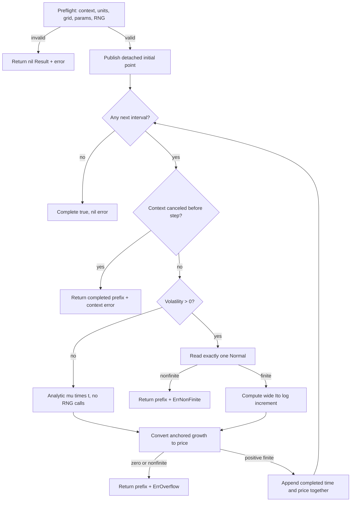

<!--
  SPDX-License-Identifier: AGPL-3.0-only
  Copyright (C) 2025-2026 katalvlaran

  File: docs/GBM.md
  Package reference: github.com/lvlath/go/gbm
  Purpose: operational reference for exact-in-distribution GBM paths, numerical
    boundaries, error/prefix governance, deterministic RNG and Monte Carlo composition.
  Contract status: documents the implemented public gbm API; gbm/doc.go and source
    remain authoritative for the running implementation.
  Scope: fixed-coefficient GBM on explicit time grids, not model calibration,
    market-calendar conversion, trading strategies or portfolio fitting.
  License: AGPL-3.0-only. See ../LICENSE.
-->

# GBM - exact-in-distribution geometric Brownian motion

> Generate auditable, positive-price stochastic trajectories on nonuniform time grids, with explicit physical units and error-safe partial publication.

**Package:** `github.com/lvlath/go/gbm` · **Canonical facade:** `gbm.Simulate` · **Companions:** [`rng`](RNG.md) supplies draws; [`montecarlo`](MONTECARLO.md) schedules and reduces independent paths.

## Contents

1. [What the package solves](#1-what-the-package-solves)
2. [The mathematical law](#2-the-mathematical-law)
3. [API selection and input carriers](#3-api-selection-and-input-carriers)
4. [Units and irregular time grids](#4-units-and-irregular-time-grids)
5. [Validation and error precedence](#5-validation-and-error-precedence)
6. [Numerical integrity of the lognormal step](#6-numerical-integrity-of-the-lognormal-step)
7. [Cancellation, partial results and ownership](#7-cancellation-partial-results-and-ownership)
8. [Determinism and RNG consumption](#8-determinism-and-rng-consumption)
9. [Executable application: irregular quotes](#9-executable-application-irregular-quotes)
10. [Monte Carlo option-pricing bridge](#10-monte-carlo-option-pricing-bridge)
11. [Other operational scenarios](#11-other-operational-scenarios)
12. [Testing, benchmarking and limitations](#12-testing-benchmarking-and-limitations)
13. [References and next steps](#13-references-and-next-steps)

---

## 1. What the package solves

`gbm` models **one scenario** for a positive scalar process whose proportional drift and instantaneous volatility are constant over the requested horizon. The caller chooses the time coordinates and supplies an RNG stream. The package returns a `*gbm.Result` containing each successfully simulated `(time,price)` pair, including the initial observation.

Useful scenarios include risk-neutral terminal share-price draws, counterfactual foreign-exchange or procurement-cost stress, explicit-grid synthetic quote generation and Monte Carlo integration tests. These are **model outputs**, not evidence of realistic returns, calibrated volatility, exchange liquidity or any trading signal.

The responsibility split is intentional:

```text
 physical assumptions / optional calibration / observation calendar
                    (caller-owned)
                            |
                 gbm.Parameters + TimeGrid
                            |
 rng.RNG -- Normal() --> gbm.Simulate --> *gbm.Result
                            |                |
                    one scalar path      complete or
                                       valid prefix + error
                            |
                caller's payoff/risk model
                            |
                      montecarlo.Run
                            |
            ordered means / variance / SE / quantiles
```

`gbm` does **not** estimate `mu` or `sigma`, infer a calendar, introduce jumps, implement mean reversion or stochastic volatility, compute option payoffs, or run parallel experiments. `montecarlo` does **not** supply the GBM model. A complete simulation does not imply that GBM is appropriate for observed market data.

## 2. The mathematical law

The continuous-time model is

$$
  dS_t = \mu S_t\,dt + \sigma S_t\,dW_t,\qquad S_0>0,\ \sigma\geq0.
$$


Applying Itô's formula to `log(S)` gives an arithmetic Brownian motion in log coordinates:

$$
  d\log S_t=\left(\mu-\frac{\sigma^2}{2}\right)dt+\sigma\,dW_t.
$$

For an interval `dt = grid.Values[i] - grid.Values[i-1] > 0`, use a single independent standard-normal draw `Z[i]`:

$$
\Delta\log S_i = \mu\,dt - \frac12\bigl(\sigma\sqrt{dt}\bigr)^2
                   + \sigma\sqrt{dt}\,Z_i,\qquad Z_i\sim\mathcal{N}(0,1).
$$


Thus conditional on `S[i-1]`, the mathematical ratio `S[i]/S[i-1]` is lognormal. **Exact in distribution** means the requested endpoints follow the exact constant-parameter transition law *assuming ideal independent standard normals*, rather than the numerical SDE discretization of Euler–Maruyama. It does not mean infinite arithmetic precision, exact sampling from an arbitrary custom RNG, or a correct financial model for every asset.

For `sigma == 0`, the deterministic solution is

$$
  S_t=S_0\exp(\mu t).
$$

The real-arithmetic marginal moments, which provide useful **independent test oracles**, are

$$
\mathbb E[S_t]=S_0e^{\mu t},\qquad
\operatorname{Var}(S_t)=S_0^2e^{2\mu t}\bigl(e^{\sigma^2 t}-1\bigr).
$$

These formulas may individually overflow ordinary floating arithmetic even if other desired statistics remain representable. Statistical Monte Carlo assertions should use prespecified tolerances, enough paths, and reproducible seeds; they do not replace deterministic zero-shock or analytic oracles.

**Finance interpretation.** Under a chosen risk-neutral model of a share with constant dividend yield `q` and interest rate `r`, a caller may choose `mu = r-q` and separately discount a European payoff by `exp(-r*T)`. The Itô term `-sigma²/2` is already computed by GBM: **do not subtract it again from `Parameters.Drift`**. Without dividends (`q=0`), the risk-free discounted spot is a risk-neutral martingale under the model; for `q>0`, the relevant dividend-adjusted total-return interpretation differs from treating `exp(-r*t)*S_t` alone as a martingale.

## 3. API selection and input carriers

The following APIs are implemented; each wrapper delegates to exactly the same canonical `Simulate` kernel:

| Purpose                                | Public call                                                              | Distinct behavior                                        |
|:---------------------------------------|:-------------------------------------------------------------------------|:---------------------------------------------------------|
| Explicit full or irregular grid        | `gbm.Simulate(ctx, p, grid, random)`                                     | Canonical validation, simulation and result              |
| Convenient scalar construction         | `gbm.SimulatePath(ctx, initial, drift, volatility, unit, times, random)` | Builds matching `Parameters` and `TimeGrid`; no defaults |
| European-terminal or one-horizon model | `gbm.SimulateTerminal(ctx, p, horizon, random)`                          | `[0,horizon]`; `horizon==0` produces `[0]`               |
| Standalone deterministic replay        | `gbm.SimulateSeeded(ctx, p, grid, seed, pathID)`                         | Creates `rng.NewStream(seed,pathID)` before delegating   |

The public carriers are:

```go
// TimeUnit has only three admissible enumerators: TimeYears, TimeDays, TimeSeconds.
type TimeGrid struct {
    Values []float64 // Finite elapsed timestamps, starting at zero; read-only input.
    Unit   TimeUnit  // Exactly matches Parameters.Unit.
}

type Parameters struct {
    Initial    float64 // Finite, strictly positive starting value.
    Drift      float64 // Finite drift per Unit; negative values are allowed.
    Volatility float64 // Finite sigma >= 0, per sqrt(Unit).
    Unit       TimeUnit
}

type Result struct {
    Times    []float64 // Detached, completed timestamps.
    Values   []float64 // Detached, positive finite prices.
    Complete bool      // True only when the entire grid completed.
}

func (r *Result) IsNil() bool // Reports pointer absence, NOT completion.
```

The comments above summarize real exported types; **the compilable definitions** are in [`gbm/types.go`](../gbm/types.go). No additional `Options` mode is needed: the public `options.go` file intentionally defines no tunable GBM policies.

### Wrapper choices with precise semantics

- **`SimulatePath`** takes a time unit explicitly. It never derives units from the magnitude of timestamp values, converts an annual drift or obtains random entropy itself.
- **`SimulateTerminal`** returns the canonical `*Result`, not a bare terminal scalar. A negative finite horizon produces `ErrOrder`; a nonfinite horizon produces `ErrNonFinite`; `horizon==0` consumes no `Normal()` samples, even when `sigma>0`. A path-dependent payoff requires a real observation grid rather than a terminal-only shortcut.
- **`SimulateSeeded`** is appropriate for standalone replay. The Monte Carlo driver already passes one per-path `rng.RNG`: in a `Sampler.Sample`, use `Simulate` or `SimulateTerminal` with that stream; do not reseed it or create a new stream inside every sample.

All wrappers retain the canonical error classes and partial-result law. None turns a numerical error into a completed synthetic observation.

## 4. Units and irregular time grids

Time labels represent a **caller-defined physical measurement scale**, not a calendar-conversion service:

| Unit              | `grid.Values` measure                         | `p.Drift`  | `p.Volatility`         |
|:------------------|:----------------------------------------------|:-----------|:-----------------------|
| `gbm.TimeYears`   | elapsed model years or chosen year fractions  | per year   | per square root year   |
| `gbm.TimeDays`    | elapsed days                                  | per day    | per square root day    |
| `gbm.TimeSeconds` | elapsed seconds, including fractional seconds | per second | per square root second |

For example, if a model defines one year as `C` seconds and measurements arrive in seconds, **the caller must decide `C` and convert everything consistently**:

$$
 t_s=Ct_y,\qquad \mu_s=\frac{\mu_y}{C},\qquad
 \sigma_s=\frac{\sigma_y}{\sqrt C}.
$$


A selected `365.25*24*60*60` constant is an **application convention**, not an exchange-session approximation enforced by the library. Multiplying seconds by `1/252`, dividing volatility by 365 rather than `sqrt(365)`, or passing `TimeYears` parameters with `TimeSeconds` grid values violates the model's dimensions.

A valid irregular grid could be:

```go
// Elapsed seconds since the first event; these are not Unix epoch seconds.
times := []float64{0, 0.003, 0.007, 0.012, 0.030, 0.043}
grid := gbm.TimeGrid{Values: times, Unit: gbm.TimeSeconds}
```

Each adjacent floating timestamp defines one interval. GBM **never** sorts timestamps, interpolates unobserved prices, inserts weekend observations, checks missing exchange sessions, or synchronizes the grid with `series` timestamps. For an `int64` nanosecond telemetry feed, first establish provenance/cadence using [`series`](SERIES.md); then explicitly rebase and convert to `float64` elapsed times with an error policy suitable for the required time resolution. Strictly increasing original integer times can collapse to equal `float64` values when timestamps are large: GBM will correctly reject such a converted grid with `ErrOrder`.

The grid `[0]` is a first-class valid case: it reports the current value with no evolution. The zero timestamp may be either IEEE-754 `+0` or `-0`; the original element is copied, not normalized.

## 5. Validation and error precedence

Validation runs before trajectory allocation and before any `Normal()` call. When multiple input violations exist, **the first check in the following order wins**:

| Stage | Check                                                                         | Error classification                      |
|:------|:------------------------------------------------------------------------------|:------------------------------------------|
| 1     | `ctx == nil`                                                                  | `ErrInvalidOption`                        |
| 1     | `ctx.Err() != nil` at preflight                                               | Original `ctx.Err()`; nil Result          |
| 2     | Either unit enum invalid or `p.Unit != grid.Unit`                             | `ErrInvalidOption`                        |
| 3     | `random == nil` or cooperative typed nil with `IsNil() == true`               | `ErrNilInput`                             |
| 4     | `grid.Values == nil`                                                          | `ErrNilInput`                             |
| 4     | Non-nil grid of length zero                                                   | `ErrEmptyInput`                           |
| 5     | `grid.Values[0]` is NaN/Inf                                                   | `ErrNonFinite`                            |
| 5     | Finite initial timestamp is not zero                                          | `ErrOrder`                                |
| 5     | Subsequent timestamps scanned ascending: first nonfinite value or nonincrease | `ErrNonFinite` or `ErrOrder` respectively |
| 6     | Any nonfinite `Initial`, `Drift`, `Volatility`                                | `ErrNonFinite`                            |
| 7     | Finite `Initial <= 0` or `Volatility < 0`                                     | `ErrDomain`                               |
| 8     | A later `Normal()` returns nonfinite                                          | `ErrNonFinite` + incomplete prefix        |
| 8     | A computed price becomes zero or nonfinite                                    | `ErrOverflow` + incomplete prefix         |

This is the **actual validation order** implemented in [`gbm/validators.go`](../gbm/validators.go). A finite negative drift is valid. A NaN timestamp is not an order violation merely because IEEE comparisons behave unusually. A custom typed-nil RNG without an optional `IsNil() bool` method cannot be reliably discovered without reflection: custom RNG providers should follow that optional nilability convention.

Classify with `errors.Is`:

```go
trajectory, err := gbm.Simulate(ctx, parameters, grid, random)
switch {
case errors.Is(err, gbm.ErrInvalidOption):
    // Examine the caller's unit or context configuration.
case errors.Is(err, gbm.ErrOrder):
    // Correct the grid; do not sort it inside the simulation.
case errors.Is(err, gbm.ErrOverflow):
    // Inspect the completed prefix; the failed endpoint was not published.
case err != nil:
    // Handle other GBM sentinels or context cancellation.
case trajectory == nil || !trajectory.Complete:
    // Defensive guard against misinterpreting an incomplete result.
default:
    // Consume the full-horizon model outcome.
}
```

This snippet assumes `ctx`, `parameters`, `grid` and `random` have already been defined; see the complete runnable examples below.

## 6. Numerical integrity of the lognormal step

The tempting implementation

```go
// DO NOT use this as the trajectory recurrence.
next := previous * math.Exp(logIncrement)
```

is not the canonical kernel. If `Initial=1e-300` and the log increment is `1000`, `math.Exp(1000)` overflows despite the product being a valid positive finite `float64` value. The physical outcome is governed by the *sum of logarithms*, not the representability of each intermediate exponent.

The implementation accumulates **log growth relative to the exact original starting `float64`**:

$$
 g_0=0,\qquad g_i=g_{i-1}+\Delta\log S_i,
 \qquad S_i\approx S_0\,e^{g_i}.
$$


The last formula describes the mathematical result, **not** an instruction to form `math.Exp(g_i)` and multiply in ordinary float64. Publication chooses one of two numeric paths:

1. **Safe-range price conversion**: when the initial value and log growth are far from float64 exponent boundaries, use a fast `math.Exp` multiplication.
2. **Extended-range conversion**: otherwise compute a reduced, fixed-precision exponential, restore its magnitude by squaring, multiply by the exact starting value in wide arithmetic and round to `float64` at publication.

The stochastic increment is computed by first forming `scale = sigma*sqrt(dt)` in wide arithmetic and then `correction = scale*scale/2`. The implementation does **not** compute `sigma*sigma` in `float64`. For `sigma=1e160`, `dt=1e-320`, ordinary `sigma*sigma` overflows, but the diffusion scale is approximately one; that path must not be rejected because of the avoidable intermediate overflow. A very large representable `sigma` can still produce a genuinely unrepresentable final price, for which `ErrOverflow` is correct.

`logstep.go` uses fixed precision (`workingBits=2304`) for its state and arithmetic; the extended exponential uses a separate fixed precision (`expBits=384`). These are **implementation details**, not configurable accuracy modes or arbitrary-precision real-number guarantees. Fast-path conversion can differ in the last bit from extended evaluation; platform math routines and the underlying RNG algorithm also influence binary replay portability. There is no guarantee of correctly rounded exact-real prices for every finite input.

**Boundary policy:** every published price must be strictly positive and finite. A positive subnormal is accepted. A computed zero or infinity is rejected with `ErrOverflow`; the package does not silently replace zero with `math.SmallestNonzeroFloat64`, use a configurable epsilon or invent a price ceiling. Neither an extreme nonfinite shock nor a failed conversion may be converted into a successful Monte Carlo payoff.

## 7. Cancellation, partial results and ownership

After successful preflight, the initial `(t=0,S0)` pair is committed. Then each step follows the same sequence:



| Stage                                   | `Result` | `Complete`     | Published length                   |
|:----------------------------------------|:---------|:---------------|:-----------------------------------|
| Validation or pre-canceled context      | `nil`    | Not applicable | 0                                  |
| Valid `[0]` only                        | Non-nil  | `true`         | 1                                  |
| Runtime cancellation before step `k`    | Non-nil  | `false`        | Exactly `k` prior completed points |
| Nonfinite draw or failed numerical step | Non-nil  | `false`        | No entry for the failed step       |
| All requested steps complete            | Non-nil  | `true`         | Exactly `len(grid.Values)`         |

The runtime prefix always contains `t0`, and `len(Times)==len(Values)` is an invariant. The caller owns both returned slices; neither aliases the input grid, and no mutable result is retained by GBM. A previously completed price is useful for diagnosing an incident, **not** as a substitute for the requested terminal horizon.

Cancellation is **cooperative at step boundaries**. The package checks `ctx.Err()` before each new interval but does not forcibly interrupt `random.Normal()` or wide arithmetic already executing. If cancellation occurs during the final step after its entry check, a complete result may still be returned; there is no stronger real-time abort guarantee. A failed attempted step may have consumed one normal draw; RNG state is **not** rolled back.

## 8. Determinism and RNG consumption

| Grid and model                            | `Normal()` consumption      | Notes                                               |
|:------------------------------------------|:----------------------------|:----------------------------------------------------|
| `[0]`, any valid volatility               | Exactly 0                   | Still requires a non-nil RNG argument               |
| `sigma == 0`, any valid grid              | Exactly 0                   | Neither `Uint64` nor `UniformOpen` is called        |
| `sigma > 0`, successful `n`-point grid    | Exactly `n-1`               | One `Normal` per interval, ascending index          |
| `sigma > 0`, nonfinite draw at step `k`   | Exactly `k` attempted draws | The failed endpoint is not published                |
| `sigma > 0`, cancellation before step `k` | `k-1` for prior steps       | Context checked before requesting step `k`'s normal |

These counts refer to GBM calls to `RNG.Normal()`, not raw `Uint64()` consumption **inside** a generator: the pinned Box–Muller RNG caches a spare Gaussian value. A custom provider is responsible for the distribution and operational quality of its draws. `gbm` neither detects non-Gaussian finite values nor proves statistical independence of different streams.

For a reproducible standalone path, `SimulateSeeded` uses a fresh stream identified by **both** `seed` and logical `pathID`. Persist the `rng.Factory.Version()` string along with model parameters, grid, seed and pathID when replay across deployed versions matters. A Monte Carlo driver allocates its own stream by `(Seed,pathID)` and performs ordered reductions; worker scheduling must not select RNG identities. Full-run bitwise worker-count parity is an orchestration guarantee **in the same backend/environment and with a concurrency-safe deterministic sampler**, not a promise of cross-platform transcendental equality.

## 9. Executable application: irregular quotes

This program simulates **counterfactual** subsecond stock quotes, then quantifies the largest consecutive model-implied tick gap. Measured timestamps are explicitly converted from milliseconds to elapsed seconds; the model volatility is already specified per square root second. This demonstrates **synthetic execution-risk stress**, not exchange liquidity estimation or a trading rule.

```go
package main

import (
    "context"
    "fmt"
    "math"

    "github.com/lvlath/go/gbm"
)

func main() {
    // Static measurement offsets; the caller supplies the ms-to-second conversion.
    milliseconds := []float64{0, 3, 7, 12, 30, 43, 65, 82, 116, 135, 169, 212, 257, 303}
    seconds := make([]float64, len(milliseconds))
    for i, ms := range milliseconds {
        seconds[i] = ms / 1000
    }

    params := gbm.Parameters{
        Initial: 184.32, Drift: 0.00001, Volatility: 0.0018,
        Unit: gbm.TimeSeconds,
    }
    path, err := gbm.SimulateSeeded(context.Background(), params,
        gbm.TimeGrid{Values: seconds, Unit: gbm.TimeSeconds},
        20261118, 987,
    )
    if err != nil {
        fmt.Println("simulation:", err)
        return
    }
    if path == nil || !path.Complete {
        fmt.Println("incomplete quote path")
        return
    }

    maxGapBP := 0.0
    for i := 1; i < len(path.Values); i++ {
        gapBP := math.Abs(path.Values[i]/path.Values[i-1]-1) * 10_000
        maxGapBP = math.Max(maxGapBP, gapBP)
    }
    fmt.Printf("observations=%d, span=%.3fs, max-gap=%.2f bp\n",
        len(path.Values), path.Times[len(path.Times)-1], maxGapBP)
}
```

Run in the existing module with `go run ./examples/gbm`; the maintained runnable program additionally prices a European call and checks worker-count replay. In production, use real timestamp provenance and independently assessed GBM assumptions. A large synthetic one-tick move does not establish a real-world market impact or order-book slippage estimate.

## 10. Monte Carlo option-pricing bridge

A GBM path is **not** a Monte Carlo estimate. A caller-owned `montecarlo.Sampler` converts a complete path into a finite payoff; `montecarlo.Run` samples independent logical paths and computes ordered statistics.

The following is a complete, compiling example of a dividend-paying European call. It uses one terminal interval per path and propagates every incomplete GBM outcome as a sampler error.

```go
package main

import (
    "context"
    "errors"
    "fmt"
    "math"

    "github.com/lvlath/go/gbm"
    "github.com/lvlath/go/montecarlo"
    "github.com/lvlath/go/rng"
)

// callSampler is immutable while the Monte Carlo driver invokes it concurrently.
type callSampler struct {
    model gbm.Parameters
    years float64
    strike float64
    rate float64
}

func (callSampler) Dimension() int { return 1 }

func (s callSampler) Sample(ctx context.Context, _ uint64, random rng.RNG) ([]float64, error) {
    path, err := gbm.SimulateTerminal(ctx, s.model, s.years, random)
    if err != nil {
        return nil, err // Preserve the original context or GBM sentinel.
    }
    if path == nil || !path.Complete {
        return nil, errors.New("call sampler: incomplete GBM path")
    }
    terminal := path.Values[len(path.Values)-1]
    discounted := math.Exp(-s.rate*s.years) * math.Max(terminal-s.strike, 0)
    if math.IsInf(discounted, 0) || math.IsNaN(discounted) {
        return nil, errors.New("call sampler: unrepresentable payoff")
    }
    return []float64{discounted}, nil
}

func main() {
    const rate, dividend, sigma, years = 0.04, 0.01, 0.23, 0.75
    sampler := callSampler{
        model: gbm.Parameters{
            Initial: 100, Drift: rate-dividend,
            Volatility: sigma, Unit: gbm.TimeYears,
        },
        years: years, strike: 105, rate: rate,
    }
    plan := montecarlo.Plan{Paths: 8192, Seed: 20261118, Workers: 4}
    result, err := montecarlo.Run(context.Background(), plan, sampler)
    if err != nil {
        fmt.Println("pricing:", err)
        return
    }
    if result == nil || !result.Complete {
        fmt.Println("incomplete Monte Carlo experiment")
        return
    }
    fmt.Printf("paths=%d, discounted-call=%.4f, sampling-SE=%.4f\n",
        result.Completed, result.Mean[0], result.MeanStandardError[0])
}
```

`mu=r-q` is a caller-selected **risk-neutral** hypothesis, not historical return fitting. Monte Carlo sampling error is not option-model risk, market calibration error or transaction-cost uncertainty. `SimulateTerminal` is sufficient for European payoffs depending only on `S(T)`; path-dependent options require a full observation grid. Even a complete grid of exact-distribution endpoints does **not** capture an unobserved continuous-time barrier crossing between grid points; special barrier-bridge mathematics belongs outside this basic sampler.

For exact quantiles or retained path vectors, use the explicit [`montecarlo.RunWithQuantiles`](MONTECARLO.md) or `RunWithSamples` facades and respect the driver's optional-buffer limits. Do not hand an interrupted `gbm.Result.Values` prefix to the aggregator as though maturity had been reached.

## 11. Other operational scenarios

The five checked examples in [`gbm/example_test.go`](../gbm/example_test.go) represent distinct workflows and are independently executable with `go test ./gbm -run Example -count=1`:

| Example                                           | Operational decision aid                                                                          | Critical boundary                                                   |
|:--------------------------------------------------|:--------------------------------------------------------------------------------------------------|:--------------------------------------------------------------------|
| `ExampleSimulate_intradayExecutionGuard`          | Count synthetic consecutive price gaps above a chosen basis-point threshold on 33 irregular ticks | Explicit milliseconds → seconds; model gap is not measured slippage |
| `ExampleSimulate_europeanCallHedgingCheck`        | Compare a discounted call-payoff experiment with Black–Scholes analytic sanity and worker replay  | Risk-neutral `r-q`, complete paths only                             |
| `ExampleSimulate_foreignExchangeReserveStress`    | Translate severe five-year FX path maxima into reserve-liability exposure                         | Annual units, synthetic tail scenario, no market inference          |
| `ExampleSimulate_zeroVolatilityProcurementBudget` | Compute twenty quarterly contractual escalation payments                                          | Zero Gaussian draws, but RNG remains validated                      |
| `ExampleSimulate_explicitTelemetryUnitConversion` | Reject annual-parameter/seconds-grid mismatch, then convert explicitly                            | `mu/C` versus `sigma/sqrt(C)`                                       |

The separate [`examples/gbm/main.go`](../examples/gbm/main.go) program combines terminal European-call pricing and subsecond quote stress, checking Monte Carlo worker-count replay. Example figures are fixed, synthetic demonstrations; none is a certified market forecast, real liquidity observation or calibration result.

## 12. Testing, benchmarking and limitations

Recommended gates from the root of the existing single Go module:

```bash
gofmt -l gbm/*.go examples/gbm/*.go
go test ./gbm -count=1
go test -race ./gbm -count=1
go test ./gbm -cover -count=1
go test ./...
go vet ./...
golangci-lint run
go test ./gbm -run '^$' -bench . -benchmem
```

Tests must remain in `package gbm_test` and use public `gbm.` APIs. The present suite covers deterministic/zero-volatility analytic cases, fixed Gaussian fixtures, irregular intervals, extreme scale cancellation, smallest positive prices, nonfinite samples, unit and ordering refusal, immutable result ownership, cancellation prefixes, nilability, fuzz inputs, and a real `montecarlo` consumer in the full repository. Use `errors.Is` for error classification and focus coverage on real policy branches instead of exposing internal numeric helpers merely for testing.

The shape-aware benchmark distinguishes **`n=100` versus `n=10,000`** and **`sigma=0` versus `sigma>0`** on fixed irregular grids. High-precision square-root arithmetic has a substantial constant cost, so `O(n)` is not a claim of allocation-free or low-latency simulation. Benchmarks must report allocation counts, environment, workload and Go version; do not transplant isolated-stub timing results into production capacity guidance.

### Practical limits and traps

- **No hidden fit or calendars.** GBM does not tell you how to estimate parameters or choose an observation horizon; the caller must justify both.
- **Not real-number exactness.** Fixed-precision wide arithmetic protects important dynamic-range cases, but does not certify correctly rounded exact-real prices for every finite input.
- **No RNG distribution policing.** One finite draw is accepted as input; normality and reproducibility of a custom `rng.RNG` are its provider's responsibility.
- **No cross-asset covariance.** Independent scalar GBM calls do not produce a calibrated correlated portfolio process.
- **No continuous-path bridge.** A grid samples endpoints, not every continuous excursion between them. An unobserved barrier hit is not ruled out.
- **No forced stop during a call.** Context checks happen before each step; `Normal()` itself receives no context and cannot be interrupted by this API.
- **No successful zero.** Positive subnormals are valid; `0`, NaN and infinity cannot be published as price success.
- **No unsafe stream sharing.** One mutable RNG stream belongs to one path and one goroutine. Immutable Parameters and read-only grids may be shared while stable.
- **No successful partial Monte Carlo payoff.** Always gate on `err==nil` and `Complete==true`, then apply the caller's payoff model.

## 13. References and next steps

- [`gbm/doc.go`](../../../../Downloads/lvlath_gbm_phase22_docs/gbm/doc.go): authoritative package charter, error/ownership/complexity laws.
- [`gbm/api.go`](../gbm/api.go) and [`gbm/types.go`](../gbm/types.go): exact exported signatures and result interpretation.
- [`gbm/example_test.go`](../gbm/example_test.go): five deterministic operational examples with checked `Output` blocks.
- [`examples/gbm/main.go`](../examples/gbm/main.go): standalone complete scenario runner.
- [`RNG.md`](RNG.md): stream identity, Gaussian draw consumption and versioned replay.
- [`MONTECARLO.md`](MONTECARLO.md): per-path scheduling, ordered moments, exact quantiles, resource limits and partial experiments.
- [`SERIES.md`](SERIES.md): timestamp provenance and strict nanosecond-grid validation before explicit conversion.
- [`TUTORIAL.md`](TUTORIAL.md) and [`FAQ_&_TIPS.md`](FAQ_%26_TIPS.md): package selection and troubleshooting.
- [`lvlath_UES.md`](lvlath_UES.md): universal contract, testing, documentation and ownership standards.
