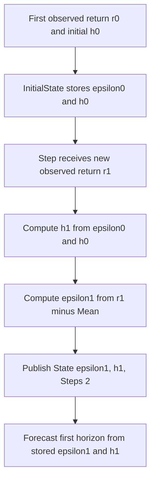
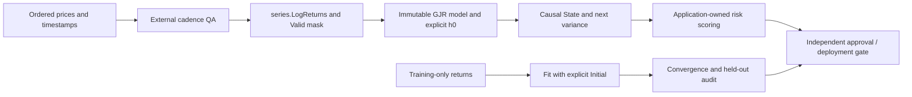

<!--
File: docs/GJRGARCH.md
Package: github.com/lvlath/go/gjrgarch
Purpose: Conditional volatility filtering, forecasting, and constrained Gaussian QMLE.
Contract status: Implemented GJR-GARCH(1,1) symmetric-innovation numeric policy.
Scope: One stationary GJR-GARCH(1,1) regime; no option pricing or trading strategy.
License: SPDX-License-Identifier: AGPL-3.0-only
Copyright (C) 2025-2026 katalvlaran
-->

# GJR-GARCH(1,1): Causal Volatility and Constrained Gaussian QMLE

## 1. What the package solves

Financial returns frequently exhibit **volatility clustering**: high-variance
intervals tend to follow other high-variance intervals. Equity-index losses may
also precede larger next-period variance than equal-sized gains. `gjrgarch`
models those two effects by combining a lagged conditional variance with a
sign-dependent quadratic innovation.

Use it for **conditional variance measurement**, stable online updates,
parametric volatility scenarios, and disciplined Gaussian quasi-likelihood
estimation. It does **not** make trading decisions, fit asymmetric innovation
*distributions*, certify VaR/ES coverage, or calculate a future-return quantile.

### Financial units and time step

| Quantity                           | Units                           | Example                                                   |
|------------------------------------|---------------------------------|-----------------------------------------------------------|
| `returns` / `Mean`                 | Return per observation          | `-0.03` means a -3% return                                |
| `Omega` / `VarianceFloor` / `h[t]` | Squared return                  | `0.0004` corresponds to 2% conditional standard deviation |
| `Alpha`, `Gamma`, `Beta`, `rho`    | Dimensionless                   | `0.70` is a weight, not 70% annual volatility             |
| `ForecastVolatility`               | Return per observation          | `0.02` means 2% one-step sigma                            |
| `State.Steps`                      | Number of consumed observations | First posterior has `Steps == 1`                          |

Every observation must represent a consistently sampled return from the **same
frequency** (daily, hourly, five-minute, etc.). Annualizing a daily sigma is a
separate, assumption-dependent presentation step, not part of this package.

## 2. Recurrence, stationarity and leverage

**Canonical conditional-variance recurrence:**


The **strictly negative** indicator is one for `epsilon[t] < 0`, and zero
otherwise. Both positive and negative signed zeros select the nonnegative-shock
branch. With `Gamma > 0`, equal-sized negative shocks increase subsequent
variance more than positive shocks. With `Gamma < 0`, the asymmetry is reversed;
negative Gamma is valid as long as `Alpha + Gamma >= 0`.

The model enforces:


For unit-variance **symmetric standardized innovations**, the unconditional
squared-innovation expectation yields:


The half-Gamma law is specifically the consequence of
`E[1(z<0)*z²] = 1/2` under a symmetric innovation distribution. Do **not**
reuse this stationarity/forecast contract with skewed standardized innovations
without deriving a new expectation and extending the model.

**Reduction to symmetric GARCH:** setting `Gamma=0` gives the usual
GARCH(1,1) recursion with `rho=Alpha+Beta`.

## 3. Strictly causal State, Step and Filter

The first observation is assigned the specified variance `h[0]` *before* the
first observed residual can influence a variance. The residual observed at
time `t` determines **the next variance**, not the current one.



The operational pseudocode is:

```text
state = InitialState(return[0], initialVariance)
output[0] = initialVariance
for t = 1 .. len(returns)-1:
    h[t] = Omega + shockCoefficient(state.LastResidual) *
           state.LastResidual² + Beta * state.LastVariance
    residual[t] = returns[t] - Mean
    state = State(ModelID, residual[t], h[t], Steps+1)
    output[t] = h[t]
```

`Step` is value-based: it does not mutate the supplied `State`, and its
successful hot path does not allocate. `Filter` allocates a detached result
slice, validates inputs, and returns **nil output** if canceled or if any
numeric operation fails. Changing future returns must never change an already
computed variance prefix.

### Initialization options

For a user-supplied starting variance:

```go
model, err := gjrgarch.New(gjrgarch.Parameters{
    Omega: 0.00002, Alpha: 0.08, Gamma: 0.14, Beta: 0.72,
})
if err != nil { return err }
variances, err := model.Filter(ctx, returns, 0.0003)
if err != nil { return err }
_ = variances
```

For a stationary pre-sample initialization, use `FilterStationary`, which
calls `UnconditionalVariance` and then the same canonical `Filter` kernel.
The stationary choice does not estimate a hidden pre-sample state from future
observations.

## 4. Forecasting conditional expected variances

At the **first forecast horizon**, the last residual is already known:


At later horizons the future standardized innovation is unknown; the
conditional expectation follows:


`ForecastVariance(state, H)` emits a detached horizon-length slice. `H >= 1`
and a valid model-bound posterior are required. The resulting expected
variances converge toward `Omega/(1-rho)` for stationary models. `ForecastNextVariance`
returns the first point with **no result-slice allocation**. `ForecastVolatility`
returns the **square roots of expected variances**; mathematically,
`sqrt(E[h])` must not be relabeled `E[sqrt(h)]`.

An approximate ten-day Gaussian planning proxy of `quantile*sqrt(sum(h[k]))`
may be calculated by an application. It is **not** the full ten-day GJR
predictive-tail distribution; future innovations make that distribution a
nontrivial mixture. Regulatory VaR/ES and margin calibration require separate
model validation, distribution assumptions, and backtesting.

## 5. Conditional Gaussian QMLE and analytic score

With `T = len(returns)` the objective is **negative average** Gaussian
conditional quasi-log-likelihood:


Crucially, for **every** parameter candidate, including every line-search
trial, the initial variance is **parameter-dependent**:


The conditional gradient of each observation is:


The derivative of the one-step variance recurrence includes the previous
variance sensitivity and the derivative of the squared innovation. The
indicator is evaluated from the previous residual; its boundary at zero does
not justify introducing future returns.

`EvaluateGaussianQMLE(ctx, returns, parameters, varianceFloor)` exposes:

- `Objective`: the negative **average** log-likelihood in original return units;
- `LogLikelihood`: the total (non-negated) log-likelihood;
- `Gradient`: derivatives of `Objective` in `Mean, Omega, Alpha, Gamma, Beta` order;
- `Observations`: the number of scored returns.

A zero `varianceFloor` selects `1e-12` squared-return units. An invalid
candidate or a computed `h[t]` below the floor is rejected; there is **no
post-hoc variance clamp**. This facade evaluates **fixed parameters** and
does not optimize them or implicitly project them.

### Analyst workflow: analytic score versus causal held-out score

`EvaluateGaussianQMLE` is useful for auditing the objective and gradient of a
**fixed parameter candidate**. Its initialization is always `h[0]=Omega/(1-rho)`.
This is appropriate for a separately initialized evaluation window but **not**
a continuation of a training-state conditional predictive likelihood. Simply
calling it on a held-out slice silently resets volatility history and can
misrepresent the first held-out day's risk after a selloff.

For a strictly chronological out-of-sample predictive log-score, continue the
posterior from the last training observation. The complete, compiled example
is [`ExampleFit_modelValidationGate`](../gjrgarch/example_test.go):

```go
// Evaluate the frozen model on training returns without refitting it.
trainingH, err := candidate.FilterStationary(ctx, trainingReturns)
if err != nil { return err }
state, err := candidate.InitialState(
    trainingReturns[len(trainingReturns)-1], trainingH[len(trainingH)-1],
)
if err != nil { return err }
mean := candidate.Parameters().Mean
heldOutLoss := 0.0
for _, observed := range heldOutReturns {
    // Forecast BEFORE incorporating this observed return.
    nextH, err := candidate.ForecastNextVariance(state)
    if err != nil { return err }
    z := (observed - mean) / math.Sqrt(nextH)
    heldOutLoss += 0.5 * (math.Log(2*math.Pi) + math.Log(nextH) + z*z)
    state, err = candidate.Step(state, observed)
    if err != nil { return err }
}
heldOutLoss /= float64(len(heldOutReturns))
```

The shown loop assumes validated nonempty training and held-out series. For
extreme inputs production risk tooling should additionally check every score
accumulation for representability and classify overflow. The negative average
log-score is a *density* loss and may legitimately be negative. In all cases,
nonconverged candidates must not be deployed merely because their held-out
score is finite or better than a baseline.

## 6. Deterministic constrained Projected BFGS

`Fit` begins exclusively at the **explicit** caller-supplied `Options.Initial`.
No time-based seed, global RNG, hidden data-derived starting point, fallback
optimizer, or implicit parameter guess is provided.

Default controls:

| Option          | Zero-value behavior     | Constraint                                                              |
|-----------------|-------------------------|-------------------------------------------------------------------------|
| `MaxIterations` | 200                     | Nonnegative integer                                                     |
| `Tolerance`     | `1e-7`                  | Finite, nonnegative                                                     |
| `VarianceFloor` | `1e-12` squared returns | Finite, nonnegative                                                     |
| `Initial`       | **No default**          | Valid stationary model with `Omega>=floor` and QMLE stationarity margin |

### Feasible polytope and KKT projection

The constrained variance-weight vector is `x=(Alpha,Gamma,Beta)`.
The linear inequalities are `A*x >= b`, with rows fixed as follows:

```text
A row 0: [ 1,  0,  0 ] >=  0                   (Alpha >= 0)
A row 1: [ 0,  0,  1 ] >=  0                   (Beta >= 0)
A row 2: [ 1,  1,  0 ] >=  0                   (Alpha+Gamma >= 0)
A row 3: [-1,-1/2,-1 ] >= -(1 - 64*epsilon)  (rho <= 1-64*epsilon)
```

`Omega` has an independent lower bound (`Omega>=VarianceFloor`), while
`Mean` is unrestricted. For each enumerated active face, the Euclidean
projection solves the equality KKT system:


The small Gram equality is solved through the existing
`matrix.SolveLeastSquares` pivoted-QR facade, not a custom inverse or blind
componentwise clipping. Active sets are visited in ascending binary-mask
order; rank-deficient faces are skipped. Tiny rounding of an active equality
is repaired **within the projection**, followed by a strict feasibility
check; this does not alter any likelihood variance.

### BFGS, Armijo and termination

The inverse Hessian starts at identity. When a secant update has invalid or
insufficient curvature it restarts from identity; the last accepted candidate
and its objective remain unchanged. A projected direction is accepted only if
the objective satisfies Armijo sufficient decrease. At most 20 halvings
follow the full-step trial.

**Only the projected-gradient criterion certifies convergence:**


A short iteration budget or stalled Armijo search returns the latest validated
model and `ErrNotConverged`, with `Diagnostics.Converged=false`. The objective
history contains the starting value and **accepted** steps only. A late
cancellation may similarly return an existing validated candidate plus
`ctx.Err()`; before initial evaluation, cancellation returns `nil, ctx.Err()`.
A partial candidate must never be deployed as if training succeeded.

### Safe handling of incomplete fits

```go
result, err := gjrgarch.Fit(ctx, trainingReturns, gjrgarch.Options{
    Initial: gjrgarch.Parameters{Omega: 0.00002, Alpha: 0.08, Gamma: 0.13, Beta: 0.7},
    MaxIterations: 200,
    Tolerance: 1e-7,
    VarianceFloor: 1e-12,
})
if errors.Is(err, gjrgarch.ErrNotConverged) {
    // Candidate model exists, but the optimizer has not established convergence.
    // Keep the already approved model in production.
    return err
}
if err != nil { return err }
if result == nil || !result.Diagnostics.Converged { return errors.New("unverified model") }
_ = result.Model // Send to independent model-risk review, not directly to trading.
```

## 7. Numerical policy and scale equivalence

A multiplication of `residual*residual` can overflow even when its product
with a very small shock coefficient is representable. The conditional
variance kernel decomposes coefficients and absolute innovations into binary
mantissas/exponents, then reconstructs `coefficient*residual²` through
`math.Ldexp`. Unrepresentable final arithmetic produces `ErrOverflow`.
The analytic QMLE gradient can also become nonrepresentable, in which case
the candidate is rejected rather than silently shortened.

For any constant `a > 0`, a rescaling of return units obeys:


VarianceFloor must scale by `a²` as well. The negative average Gaussian
objective shifts by `log(a)`, while the total log-likelihood shifts by
`-T*log(a)`. Derivatives in original units scale by `1/a` for `Mean`,
`1/a²` for `Omega`, and remain unchanged for the dimensionless weights.

`Fit` uses one deterministic private return-unit normalization throughout
all iterations. Its output parameters, likelihood and objective history are
restored to original return units. Scaling is an arithmetic policy, not a
second statistical model.

## 8. Error protocol and ownership

| Sentinel                                        | Typical caller response                                                      |
|-------------------------------------------------|------------------------------------------------------------------------------|
| `ErrInvalidOption`                              | Repair nil context, iteration/tolerance/floor or explicit initial parameters |
| `ErrNilInput` / `ErrEmptyInput`                 | Supply a present, nonempty return series                                     |
| `ErrNonFinite`                                  | Clean invalid NaN/infinite caller-supplied observations or coefficients      |
| `ErrDomain`                                     | Repair invalid stationarity, shock sign constraints or floor infeasibility   |
| `ErrStateVersion`                               | Reinitialize State with the exact model identity and valid h/Steps           |
| `ErrOverflow`                                   | Revisit input units, parameter regime or output range; do not silently clamp |
| `ErrNotConverged`                               | Retain only a diagnostic candidate; defer production release                 |
| `context.Canceled` / `context.DeadlineExceeded` | Stop processing; inspect explicitly documented partial Fit semantics         |

Classify all failures with `errors.Is`; error strings are not machine protocol.
Inputs are read-only during the call; concurrent caller mutation is unsupported.
Models are immutable and can be shared among goroutines performing independent
calls. `State` values belong to the caller and should be updated serially
per stream. Returned filter/forecast slices and objective histories own their
storage. `FitResult.Clone` duplicates mutable history while safely sharing
the immutable model pointer. `IsNil` returns true **only for a nil pointer**,
including a typed-nil interface receiver.

## 9. Integration with lvlath/series

`series.LogReturns(prices)` returns a masked `TransformResult`. Its first
position is an invalid warmup entry, **not** a usable zero return. Respect
that validity mask before feeding `gjrgarch`:

```go
transformed, err := series.LogReturns(prices)
if err != nil { return err }
returns := make([]float64, 0, len(prices)-1)
for i, value := range transformed.Values {
    if transformed.Valid[i] { returns = append(returns, value) }
}
variances, err := model.FilterStationary(ctx, returns)
if err != nil { return err }
_ = variances
```

See [the complete standalone equity-risk scenario](../examples/gjrgarch/main.go)
and the five executable public-API cases in
[`gjrgarch/example_test.go`](../gjrgarch/example_test.go).

## 10. Operational index and information-set ledger

A common GARCH integration mistake is to blur the *observation index* with the
*forecast horizon index*. The following is the complete, caller-visible map:

| Event                                              | Known information                         | Public operation                      | Variance being returned        |
|----------------------------------------------------|-------------------------------------------|---------------------------------------|--------------------------------|
| Before first observation                           | Caller-selected `h[0]`                    | `Filter(ctx,returns,h0)`              | First element `h[0]`           |
| Immediately after observing `r[0]`                 | `epsilon[0]`, `h[0]`                      | `InitialState(r0,h0)`                 | State's `LastVariance=h[0]`    |
| Before observing `r[1]`                            | State from `r[0]`                         | `ForecastNextVariance(state)`         | `h[1]`                         |
| After observing `r[1]`                             | State from `r[0]` plus incoming `r[1]`    | `Step(state,r1)`                      | State's `LastVariance=h[1]`    |
| After observing the final training return `r[T-1]` | All training observations, **no holdout** | `InitialState(r[T-1], filtered[T-1])` | Last in-sample `h[T-1]`        |
| Before the first held-out observation              | Last training State                       | `ForecastNextVariance(state)`         | First held-out variance `h[T]` |
| After observing the first held-out return          | State and first held-out return           | `Step(state,heldout[0])`              | State's `LastVariance=h[T]`    |

Do not treat `State.Steps` as a calendar timestamp: it counts consumed returns
since this state was initialized. If a feed drops bars, `gjrgarch` does not
reconstruct them; the caller must preserve sampling frequency and detect
gaps before running the recurrence.

The source of time indexing is **caller observation order**. There is no
internal sorting, resampling, timestamp normalization, retrospective
smoothing or batch endpoint recalibration. A future suffix cannot alter a
validated earlier prefix with the same parameters and `h[0]`.

## 11. Production control plan and reproducibility ledger

A production-facing variance service should keep four responsibilities
separate. The package provides the first two mathematical parts; the caller
supplies the operational and statistical controls.



### Model and stream evidence to record

| Evidence                                                 | Why it matters                                                                     |
|----------------------------------------------------------|------------------------------------------------------------------------------------|
| Return units and bar frequency                           | `Omega` and the floor are squared-return quantities; time scaling is not automatic |
| Feed identity, last committed index and raw timestamp    | `Steps` does not authenticate provenance or missing observations                   |
| Model `ID()` and `Parameters()`                          | Distinguishes a frozen parameter revision and its versioned numerical policy       |
| Initial variance and initialization choice               | A change in `h[0]` changes the filtered path without violating causality           |
| `State` after each committed observation                 | Supports deterministic restart under the **same** model identity                   |
| Fit options and objective history                        | Makes initialization, accepted updates and convergence auditable                   |
| Out-of-sample log-score and standardized residual checks | Establishes evidence beyond optimization success                                   |
| Independent rollout decision                             | Neither a Gaussian score nor QMLE convergence approves a trading model             |

`ModelID` is a deterministic compatibility digest, **not a message
signature**. Persisted states also require application-owned integrity and
source-cursor controls. A model parameter change requires a newly initialized
posterior state or an explicit replay of historical returns under the new
model; transplanting the old state is deliberately rejected.

### Choosing among companion packages

| Objective                                          | Tool                                    | Boundary                                                                  |
|----------------------------------------------------|-----------------------------------------|---------------------------------------------------------------------------|
| Validate ordered prices and derive log returns     | `series`                                | Preserve the `Valid` mask; caller owns market calendar QA                 |
| Audit serial dependence in a fixed residual window | `acf`                                   | Retrospective fixed-window statistic, not a causal live volatility filter |
| Infer latent regimes                               | `hmm`                                   | Filtering is causal; smoothing is future-conditioned and not live-safe    |
| Simulate scenario paths                            | `gbm` / `jumpdiffusion`                 | Distribution and time-grid assumptions must be chosen externally          |
| Estimate asymmetric conditional return variance    | `gjrgarch`                              | A validated `Model` is not a calibrated tail distribution                 |
| Fit or evaluate the Gaussian quasi-likelihood      | `gjrgarch.Fit` / `EvaluateGaussianQMLE` | A fixed evaluation is not held-out state continuation                     |

### Verification commands

Run the following from the repository root and record each exit status. A
passing unit suite is not sufficient evidence of a well-calibrated model:

```sh
gofmt -w gjrgarch/*.go
go test -count=1 ./gjrgarch
go test -race -count=1 ./gjrgarch
go test -coverprofile=gjrgarch.cover ./gjrgarch
go tool cover -func=gjrgarch.cover
go vet ./gjrgarch
golangci-lint run
go test ./...
```

If your release policy requires file-level coverage, inspect the
authoritative per-function cover profile rather than inferring it from the
aggregate percentage. Benchmark `Step`, `Filter` and the bounded Fit regime
separately; do not mistake a one-iteration Fit benchmark for full numerical
convergence. The stand-alone operational scenario lives at
[`examples/gjrgarch/main.go`](../examples/gjrgarch/main.go).

## 12. Verification and operational boundaries

The package's external tests (`package gjrgarch_test`) validate hand-computed
positive/negative shocks, prefix causality, symmetric GARCH reduction,
return-unit scaling, independent `math/big` likelihood values, analytic
five-coordinate finite differences, one-sided active-face derivatives,
stationarity and state sentinels, deterministic budget behavior,
allocation-free `Step`, result detachment, and concurrent read-only use.

Run from the repository root, using its existing **single** `go.mod`:

```sh
go test -count=1 ./gjrgarch
go test -race -count=1 ./gjrgarch
go test -coverprofile=gjrgarch.cover ./gjrgarch
go tool cover -func=gjrgarch.cover
go test -run '^$' -bench . -benchmem ./gjrgarch
go vet ./gjrgarch
golangci-lint run
```

`Step` benchmarks measure one successful posterior update; `Filter`
benchmarks exercise 1,000- and 10,000-sample stress-clustered regimes; Fit
benchmarks expressly measure **one optimizer iteration budget**, not full
convergence. Benchmark construction runs before `ResetTimer`.

**Limitations before real-world risk deployment:** use a sufficiently long
training series, compare symmetric and asymmetric conditional models on
held-out samples, check standardized-residual dependence and tail behavior,
validate the forecast horizon and risk metric under a defensible innovation
distribution, and apply independent model approval. Do not extrapolate a
Gaussian quasi-likelihood to an exact tail-risk guarantee.
