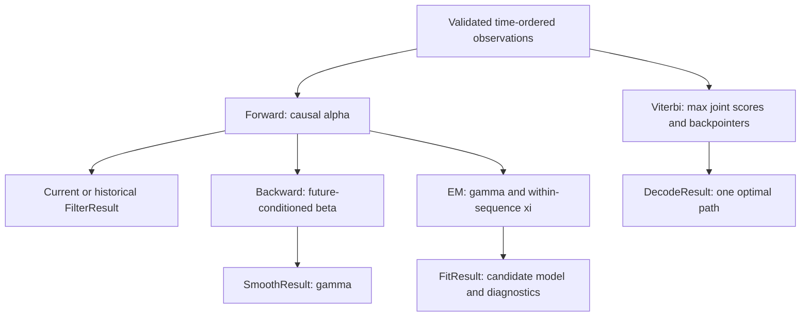

<!--
  SPDX-License-Identifier: AGPL-3.0-only
  Copyright (C) 2025-2026 katalvlaran

  File: docs/HMM.md
  Contract: lvlath-spec-12-v1; implements the current public lvlath/hmm surface.
  Scope: probability theory, numerical law, causal inference, training, errors,
         ownership, complexity, and executable engineering scenarios.
  Source of truth: ../hmm/doc.go, ../hmm/api.go, ../hmm/types.go.
-->

# HMM — causal filtering, retrospective smoothing, Viterbi and Baum–Welch

> **Discrete hidden states, two typed observation families, one explicit probability contract.**
> Import: `github.com/lvlath/go/hmm` · minimum declared module Go version: **1.23.4**.

`hmm` answers four distinct questions. Given observations from a process whose internal operating regime cannot be measured directly, it (1) estimates the regime using only evidence currently available, (2) retrospectively attributes regimes using the complete recorded sequence, (3) finds one most likely *joint* regime path, and (4) learns a transition/emission model from **independent** recorded sequences. These operations share model parameters but deliberately do **not** share the same conditioning information or output semantics.

All examples in this chapter are deterministic engineering fixtures—not calibrated investment advice, fault certification, a claim of verified real-world datasets, or a substitute for domain validation. The Go examples use the current public API; the six executable scenarios live in [`hmm/example_test.go`](../hmm/example_test.go).

## Contents

1. [Which operation do I need?](#1-which-operation-do-i-need)
2. [Mathematical object and typed inputs](#2-mathematical-object-and-typed-inputs)
3. [Log-domain numerical kernel](#3-log-domain-numerical-kernel)
4. [Causal Forward and stateful replay](#4-causal-forward-and-stateful-replay)
5. [Backward smoothing and transition expectations](#5-backward-smoothing-and-transition-expectations)
6. [Viterbi: maximum joint path](#6-viterbi-maximum-joint-path)
7. [Multi-sequence Baum–Welch and MAP objective](#7-multi-sequence-baumwelch-and-map-objective)
8. [Public Go API and result semantics](#8-public-go-api-and-result-semantics)
9. [Validation, error precedence and failure policy](#9-validation-error-precedence-and-failure-policy)
10. [Memory, performance and concurrency](#10-memory-performance-and-concurrency)
11. [Production-oriented recipes and lvlath integration](#11-production-oriented-recipes-and-lvlath-integration)
12. [Verification, counterexamples and limitations](#12-verification-counterexamples-and-limitations)

---

## 1. Which operation do I need?

| Question                                                            | Call                                                                   | Mathematical object                 | Future observations allowed? |
|:--------------------------------------------------------------------|:-----------------------------------------------------------------------|:------------------------------------|:-----------------------------|
| What is the current risk/operating regime?                          | `FilterStep` / `FilterDefault`                                         | `P(z_t \| x_0:t)`                   | **No**                       |
| What would the risk monitor have believed at each historical step?  | `FilterWithHistory` / `Filter(..., FilterOptions{ReturnHistory:true})` | Causal `P(z_t \| x_0:t)` for each t | **No**                       |
| With the entire incident log, what likely happened earlier?         | `Smooth`                                                               | `P(z_t \| x_0:T-1)`                 | **Yes**                      |
| What single valid hidden-state trajectory best explains the record? | `Decode`                                                               | `argmax_z P(z_0:T-1, x_0:T-1)`      | **Yes**                      |
| How should fixed-seed parameters be updated from independent runs?  | `FitCategorical` / `FitGaussian`                                       | Constrained MAP / Baum–Welch EM     | Training observations only   |

A smoothed posterior is **not** a real-time alert probability from the historical instant, and independent per-time argmaxes are **not** necessarily a valid Viterbi path. This distinction is part of the API rather than a naming preference.



**Causal publication rule:** any live decision at time `t` must be computed from `FilterStep` or the `t`th `FilterWithHistory` row. Replacing these with `Smooth` introduces look-ahead bias.

## 2. Mathematical object and typed inputs

Let `K>=1` be the number of hidden states. For a discrete-time index `t=0,...,T-1`:

- `Prior[i] = πᵢ = P(z₀=i)`, a stochastic `K`-vector.
- `Transition[i,j] = Aᵢⱼ = P(zₜ=j | zₜ₋₁=i)`, a row-stochastic `K×K` matrix. **Row = current; column = next.**
- `bⱼ(xₜ)` is the emission probability (categorical) or probability **density** (Gaussian) in hidden state `j`.

In [`CategoricalSpec`](../hmm/types.go), `Emission` is `K×A`, where `A>=1` is the fixed alphabet size and every input `uint32` must satisfy `0<=symbol<A`. The symbol identifies a *column*, not a scalar sensor magnitude. A clickstream encoder may map `view`, `compare`, `checkout` to `0`, `1`, `2`; its mapping and version are application-owned. For categorical observations,


In [`GaussianSpec`](../hmm/types.go), `Means` and `Variances` are `K×D`, where `D>=1` is the fixed feature count and each observation is a finite `D`-vector. Each hidden state models **conditional independence across feature coordinates** (diagonal covariance); that assumption does not imply unconditional independence. The log emission density is


Every variance is strictly positive and measured in the **square** of its corresponding feature's unit. `Variances` stores variances, **not** standard deviations. The Gaussian PDF can be greater than 1; therefore `LogLikelihood` can be positive and must not be constrained to `<=0`.

### Constructor rules

`NewCategorical(spec)` and `NewGaussian(spec)` validate all dimensions and finite domains, then **copy** the prior, transitions, and emissions into private row-major arrays. The HMM cannot be changed by later edits to the supplied `matrix.Matrix` or `Prior` slice. A stochastic row with absolute sum error no larger than `1e-12` is normalized *on the copy*; larger deviations are `ErrProbability`. Exact zero probabilities remain zero: constructors do not add epsilon or pseudocounts. `NewGaussian` accepts any finite positive variance; `FitGaussian` imposes the additional starting-domain rule `variance>=VarianceFloor`.

The public matrix abstraction is `Rows()`, `Cols()`, `At()`, `Set()`, `Clone()`. Internally, the HMM copies cells into its own `[]float64` arrays, so `K²` kernels do not repeatedly dispatch through `Matrix.At`. No cross-package access to the private `*matrix.Dense` backing storage is assumed or needed. Caller-supplied matrices remain read-only during an operation.

Model identity is computed from SHA-256 over a versioned domain, emission family, dimensions, length-prefixed parameter parts and normalized IEEE-754 bits in deterministic order (signed zero canonicalized). `ModelID` detects accidental mismatches between a state checkpoint and its model; it is **not** authenticated storage or a stable cross-release serialization guarantee.

## 3. Log-domain numerical kernel

A naive probability product collapses to zero for long, perfectly valid sequences: in binary64, the product of thousands of emissions below 1 eventually underflows. Instead, every transition or emission contributes a log score; the sum of many alternative hidden paths is computed with **LogSumExp**:


If `m` is finite, each exponent has argument at most zero, so none requires `exp(large positive)`. `LogSumExp(all -Inf)` is explicitly `-Inf`; attempting `(-Inf) - (-Inf)` is forbidden. The exported `LogSumExp(a,b)` and `LogSumExpSlice(values)` intentionally return floating-point values without an `error` channel; callers must validate ordinary model/observation data before entering these operations.

Important distinctions:

| Numeric situation                                                        | Interpretation                                   | Correct response                                     |
|:-------------------------------------------------------------------------|:-------------------------------------------------|:-----------------------------------------------------|
| `ln(0)` on a valid categorical transition/emission                       | Impossible path contribution                     | `-Inf` internal score                                |
| All possible hidden paths have `-Inf` evidence                           | Observation sequence impossible under this model | `ErrImpossibleSequence`, nil inference result        |
| Finite Gaussian observation yields unrepresentable quadratic/log density | Arithmetic range failure                         | `ErrOverflow`, not impossible support                |
| Caller supplied NaN or `±Inf` as a parameter/observation                 | Invalid input data                               | `ErrNonFinite`                                       |
| Long sequence's evidence would underflow if multiplied directly          | Ordinary log evidence                            | Finite accumulated log-likelihood when representable |
| Positive Gaussian log density                                            | Small-variance PDF greater than one              | Valid; do not clamp to zero                          |

The Gaussian squared residual is evaluated with its half factor before multiplication, reducing avoidable overflow for representable negative log densities. Extreme cancellation, very distant initialization, or unrepresentable final values still require error checks; there is no universal arbitrary-precision guarantee.

## 4. Causal Forward and stateful replay

Let `aₜ(j)` denote the **normalized log-filtering posterior**. Initialize from the prior and first observation:


For later observations:


where `cₜ=LSEⱼ(uₜ(j))`, and total evidence is `log P(x₀:T-1)=Σₜcₜ`. Each recursion needs **only** `aₜ₋₁`, `A`, and `b(xₜ)`: the expression contains no `xₜ₊₁`. By induction over `t`, extending the observation series cannot change any old filtering result when both calls succeed. This is the invariant tested by `TestFilter_PrefixInvariant` and bitwise batch/stream replay tests.

### A small exact fixture

Prior `[0.5,0.5]`, identity transitions, and categorical emissions `[[0.9,0.1],[0.1,0.9]]`:

| Observations | State-0 filtered probability | Evidence |
|:-------------|-----------------------------:|---------:|
| `[0]`        |                        `0.9` |    `0.5` |
| `[1]`        |                        `0.1` |    `0.5` |
| `[0,0]`      |        `81/82 ≈ 0.987804878` |   `0.41` |

Changing only the observed symbol changes the posterior; the algorithm is *not* simply propagating transition probabilities. For `T=100000`, raw products would underflow; the implementation retains the cumulative log evidence.

### Streaming state contract

`FilterStep(ctx,nil,observation)` publishes `Steps=1`. Every subsequent call returns **new** state storage and validates `prev`:

- `ModelID` matches the exact model; `Steps>=1` and `Steps<MaxUint64`.
- `len(LogPosterior)==K`, with no NaN or positive infinity and no log mass above `+1e-12`.
- `LogSumExp(LogPosterior)` is finite and within `1e-12` of zero; `-Inf` may denote individual impossible states, never an all-impossible vector.
- `LogLikelihood` is finite. On any error `prev` is untouched and the returned state is nil.

`FilterState` is a public Go struct, so copying the struct alone retains its slice alias. To modify an archived state, deep-copy `LogPosterior`; for ordinary replay, keep the original unchanged. Restoring snapshots from untrusted storage requires **external** integrity and version controls; the package validates state math/identity but supplies no durable binary serializer.

`FilterDefault` delegates to `Filter(ctx,x,FilterOptions{})`: `Posterior=nil`, `Last` populated. `FilterWithHistory` delegates to `Filter(ctx,x,FilterOptions{ReturnHistory:true})`: a caller-owned `T×K` **probability** matrix plus identical final state/evidence. The return flag changes retention, never the causal computation.

## 5. Backward smoothing and transition expectations

Define the backward log message


The implementation shifts each beta row by a state-independent constant for stability. Such a shift cancels in the posterior normalization. Smoothed probabilities are


Unlike `aₜ`, `γₜ` conditions on the complete series, and **may change after new observations arrive**. For an absorbing two-state model with initial `[0.5,0.5]` and emission rows `[0.9,0.1]` and `[0.1,0.9]`, an initial normal symbol `0` yields filtered normal probability `0.9`; three later alarm symbols `1,1,1` change the *smoothed first-step* normal probability to roughly `0.0122`. Neither value is incorrect: they answer different questions.

For EM only, the expected responsibility of a transition is


with normalization over all `i,j` **within the same sequence and time step**. `Smooth` uses `γ` but deliberately does not allocate `ξ`. This avoids retaining a `(T-1)×K×K` transition table for simple retrospective inference. `posteriorTables` is private to the EM E-step and constructs those transition counts only when required.

## 6. Viterbi: maximum joint path

Define maximum log-joint score `δₜ(j)` and predecessor `ψₜ(j)`:


The first row uses `log πⱼ + log bⱼ(x₀)`. Backpointers occupy `T×K` integers, while only two `K`-length score rows are needed at once. At the last time choose the greatest final score, preferring the **lowest final-state index** when tied. At each recurrence, strict `>` rather than `>=` preserves the **lowest predecessor index** on ties. Backtracking produces `DecodeResult.States` and `LogJointProbability`.

This yields a single consistent whole-trajectory witness. Applying `argmax` independently to each row of `SmoothResult.Posterior` can produce illegal transitions (zero `A[i,j]`) and does not optimize the joint probability. Decoder complexity: `O(TK²)` time, `O(TK)` memory; Gaussian emission calculation adds `O(TKD)` time.

## 7. Multi-sequence Baum–Welch and MAP objective

Training requires **caller-supplied initial model parameters**; there is no hidden random seed, initialization, retraining, or feature scaling. Let `s` index independent sequences with lengths `T_s` and let `θ` denote all model parameters. A batch log evidence factorizes as `Σ_s log P(X⁽ˢ⁾|θ)`.

### E-step: the boundary invariant


A sequence of length one contributes a prior and emission observation but **zero** transitions. Concatenating two length-one sequences would fabricate a transition absent from the data. This is not a harmless efficiency optimization; it changes the likelihood model.

Categorical emissions accumulate `Nⱼₐ = Σ_s Σ_t γₜ⁽ˢ⁾(j) 1[xₜ⁽ˢ⁾=a]`. Gaussian emissions accumulate weighted centered means and second moments for each hidden state/feature. Occupancy `Nⱼ=Σ_s Σ_t γₜ⁽ˢ⁾(j)` counts *all* observations, not only those with outgoing transitions. Expected state counts and transition counts are not interchangeable denominators.

### Penalized M-step

`Pseudocount = λ >= 0` means a symmetric Dirichlet prior with `α=1+λ`. The objective is


where `S` contains all prior/transition categorical simplex cells, and additionally categorical emissions for the categorical model. It does **not** include Gaussian means/variances. For a `K`-way transition row,


The same normalized expected-count-plus-λ rule applies to the `K` prior probabilities and each `A`-way categorical emission row. For `λ=0`, the regularizer is **disabled before any logarithm**, so `0*log(0)` never produces NaN. For `λ>0`, a zero cell in the initial model produces initial objective `-Inf`; a later finite candidate is a valid improvement and must not be declared converged because of an infinite-relative-change calculation.

For a Gaussian state `k`, feature `d`, write `Wₖ=Σ_s,t γₜ⁽ˢ⁾(k)` and the centered weighted estimates:


The code uses centered moments relative to the previous mean and applies the equivalent variance correction after shifting the mean. `VarianceFloor` is a lower bound in **feature²**, never `variance+epsilon`. `FitGaussian` validates the **initial** variances against this floor; `NewGaussian` alone only requires `>0`.

If a hidden state has zero occupancy, the previous Gaussian means and variances remain unchanged. Categorical emission or transition rows with zero expected counts likewise stay unchanged at `λ=0`; at `λ>0` the Dirichlet row becomes uniform. No state is dropped or randomly reseeded.

### Objective progress, stopping and error-partial results

The mathematically monotone quantity for MAP-EM is `J(θ)`, **not** raw data likelihood. The current implementation strictly rejects *any* negative finite `J_new-J_old` with `ErrNumerical` and keeps the last accepted model. It does not implement a tolerant one-ULP rollback band; avoid documenting such a band as existing. When the improvement is nonnegative and `<=Tolerance*max(1,|oldObjective|)`, convergence is reported. `FitOptions{}` supplies `MaxIterations=100`, `Tolerance=1e-6`, `Pseudocount=0`, `VarianceFloor=1e-8`. Option fields must be nonnegative and finite (except the integer iteration count is simply nonnegative).

`Diagnostics.Objective[0]` is the initial objective, followed by one entry per accepted iteration. Thus `len(Objective)==Iterations+1` on a valid fit result. `Diagnostics.Occupancy` belongs to the final accepted model. Exhaustion returns that model **with** `ErrNotConverged` and `Converged=false`; a rejected objective decrease returns the last accepted model **with** `ErrNumerical`. These are explicit partial-result exceptions. Context cancellation and input/observation errors return a nil result; callers must never silently deploy a nonconverged partial model.

## 8. Public Go API and result semantics

| Public surface                                            | Input                                       | Output / law                                            |
|:----------------------------------------------------------|:--------------------------------------------|:--------------------------------------------------------|
| `NewCategorical(CategoricalSpec)`                         | Prior, K×K transitions, K×A probabilities   | Immutable `*CategoricalModel`                           |
| `NewGaussian(GaussianSpec)`                               | Prior, K×K transitions, K×D means/variances | Immutable `*GaussianModel`                              |
| `CategoricalModel.Filter(ctx, []uint32, FilterOptions)`   | Nonempty categorical series                 | `*FilterResult`                                         |
| `GaussianModel.Filter(ctx, matrix.Matrix, FilterOptions)` | Nonempty finite T×D matrix                  | `*FilterResult`                                         |
| `FilterDefault(ctx,x)` on either model                    | Typed same as `Filter`                      | `Posterior == nil`, no history                          |
| `FilterWithHistory(ctx,x)` on either model                | Typed same as `Filter`                      | Detached causal T×K history                             |
| `FilterStep(ctx,prev,x)`                                  | Typed next symbol / D-vector                | New `*FilterState`, never mutates prev                  |
| `Smooth(ctx,x)`                                           | Typed sequence                              | `*SmoothResult` with retrospective T×K gamma            |
| `Decode(ctx,x)`                                           | Typed sequence                              | `*DecodeResult` with joint-optimal path                 |
| `FitCategorical(ctx,[][]uint32,initial,FitOptions)`       | Independent nonempty symbol series          | `*CategoricalFitResult`, diagnostics                    |
| `FitGaussian(ctx,[]matrix.Matrix,initial,FitOptions)`     | Independent T_s×D matrices                  | `*GaussianFitResult`, diagnostics                       |
| `LogSumExp`, `LogSumExpSlice`                             | Log scores                                  | Stable scalar reductions; no error channel              |
| `ModelID()` on either model                               | No parameters                               | Canonical model identity string; empty for nil receiver |

`FilterResult.Last` holds `Steps`, `ModelID`, `LogPosterior` and cumulative `LogLikelihood`; the outer `LogLikelihood` is the same value. `FilterResult.Posterior=nil` is **intentional** when history was not requested. `SmoothResult.Posterior` contains smoothed gamma; `DecodeResult.States` are integer state indices. Fit results contain immutable model pointers and caller-owned diagnostics. All five `*XxxResult` types implement `core.Nilable` through `IsNil()`; `(&hmm.FilterResult{}).IsNil()==false` because the pointer exists, even if the value has never been populated.

### Runnable categorical usage

```go
package main

import (
	"context"
	"fmt"

	"github.com/lvlath/go/hmm"
	"github.com/lvlath/go/matrix"
)

func newMatrix(rows [][]float64) (matrix.Matrix, error) {
	m, err := matrix.NewZeros(len(rows), len(rows[0]))
	if err != nil {
		return nil, err
	}
	for i, row := range rows {
		for j, value := range row {
			if err := m.Set(i, j, value); err != nil {
				return nil, err
			}
		}
	}
	return m, nil
}

func main() {
	transitions, err := newMatrix([][]float64{{0.95, 0.05}, {0.2, 0.8}})
	if err != nil {
		fmt.Println(err)
		return
	}
	emissions, err := newMatrix([][]float64{{0.9, 0.1}, {0.2, 0.8}})
	if err != nil {
		fmt.Println(err)
		return
	}
	model, err := hmm.NewCategorical(hmm.CategoricalSpec{
		Common:   hmm.Common{Prior: []float64{0.8, 0.2}, Transition: transitions},
		Emission: emissions,
	})
	if err != nil {
		fmt.Println(err)
		return
	}
	events := []uint32{0, 0, 1, 0, 1, 1}
	result, err := model.FilterWithHistory(context.Background(), events)
	if err != nil {
		fmt.Println(err)
		return
	}
	probability, err := result.Posterior.At(len(events)-1, 1)
	if err != nil {
		fmt.Println(err)
		return
	}
	fmt.Printf("observations=%d high-intent=%t\n", result.Last.Steps, probability > 0.5)
}
```

The event categories are application-encoded; do not interpret `uint32` as a continuous float input. The example prints a boolean instead of embedding a fragile exact floating-point expectation; inspect the returned probability and log evidence for application thresholds. See the tested scenarios for a more complete event dictionary, state meanings, and operational decision flow.

## 9. Validation, error precedence and failure policy

The new API follows **context → options → nil/typed-nil → shape/size → nonfinite → probability/domain → compute**, subject to the concrete wrapper's actual validation sequence. Constructor calls have no context; inference calls have no separate numeric option validation for `FilterOptions` (its only field is boolean). `FitGaussian` validates the seed model and its variance-floor domain before reading observations.

| Condition                                                              | Package-owned sentinel / error | Result policy                                                      |
|:-----------------------------------------------------------------------|:-------------------------------|:-------------------------------------------------------------------|
| Nil `ctx`                                                              | `ErrInvalidOption`             | `nil`                                                              |
| Canceled or expired `ctx`                                              | `ctx.Err()`                    | `nil`                                                              |
| Nil/typed-nil supported Matrix, nil model, nil required slice          | `ErrNilInput`                  | `nil`                                                              |
| Non-nil empty sequence or sequence collection                          | `ErrEmptyInput`                | `nil`                                                              |
| Wrong K/A/D, wrong row/column count, out-of-alphabet symbol            | `ErrShape`                     | `nil`                                                              |
| NaN/`±Inf` in supplied finite parameter/observed feature               | `ErrNonFinite`                 | `nil`                                                              |
| Negative probability, nonstochastic row, nonpositive Gaussian variance | `ErrProbability`               | `nil`                                                              |
| Negative/nonfinite FitOptions, seed variance below VarianceFloor       | `ErrInvalidOption`             | `nil`                                                              |
| Invalid checkpoint ID, Steps, shape, normalization or likelihood       | `ErrStateVersion`              | `nil`                                                              |
| Every current categorical hidden path has zero mass                    | `ErrImpossibleSequence`        | `nil`                                                              |
| Checked allocation size or arithmetic result not representable         | `ErrOverflow`                  | `nil` unless fitting error policy explicitly states otherwise      |
| Invalid smoothing/xi normalization, declining MAP-EM objective         | `ErrNumerical`                 | `nil` for inference; last accepted `FitResult` on M-step rejection |
| EM exhausted iteration limit                                           | `ErrNotConverged`              | Last accepted `FitResult`, `Converged=false`                       |

All error categories are public sentinel variables; classify with `errors.Is(err,hmm.ErrXxx)`. Matrix `At`/`Set` errors are wrapped where encountered, preserving their own sentinel identity. A custom pointer-backed implementation of `matrix.Matrix` should implement a nil-safe `IsNil() bool` method to participate in reflect-free typed-nil detection. The package does not claim to detect an arbitrary third-party typed nil that violates this convention.

The package never calls `panic`, `recover`, or `reflect`. Checked integer sizes do **not** promise immunity from process-level OOM; host applications must still enforce memory budgets on large T×K operations.

## 10. Memory, performance and concurrency

| Operation                                  | Time (dense A)                                           | Additional live space (excluding immutable model, caller inputs)                                                              |
|:-------------------------------------------|:---------------------------------------------------------|:------------------------------------------------------------------------------------------------------------------------------|
| Construct categorical model                | `O(K²+K*A)`                                              | `O(K²+K*A)` owned copy                                                                                                        |
| Construct diagonal-Gaussian model          | `O(K²+K*D)`                                              | `O(K²+K*D)` owned copy                                                                                                        |
| Categorical `FilterStep`                   | `O(K²)`                                                  | `O(K)` next checkpoint                                                                                                        |
| Gaussian `FilterStep`                      | `O(K²+K*D)`                                              | `O(K)` next checkpoint plus emission vector                                                                                   |
| Categorical `FilterDefault`                | `O(TK²)`                                                 | `O(K)` live, no history matrix                                                                                                |
| Gaussian `FilterDefault`                   | `O(T(K²+KD))`                                            | `O(TD+K)` including detached input copy                                                                                       |
| `FilterWithHistory` categorical / Gaussian | Above + `O(TK)` materialization                          | `O(TK)` + optional `O(TD)` Gaussian input copy                                                                                |
| `Smooth`                                   | `O(T(K²+KD))` Gaussian / `O(TK²)` categorical            | `O(TK)` + optional `O(TD)` input copy                                                                                         |
| `Decode`                                   | Same dense time regimes                                  | `O(TK)` backpointers + `O(K)` scores (+ Gaussian input copy)                                                                  |
| EM iteration across sequences              | `O(Σ_s T_s(K²+KD))` Gaussian, categorical has no KD term | `O(max_s T_s*K² + K² + K*A)` categorical; Gaussian additionally retains `Σ_s T_s*D` detached feature values and `K*D` moments |

The current batch filter allocates a new `FilterState` on each step even with history disabled; peak **live** state remains `O(K)` but `allocs/op` can be nontrivial. Benchmarks must report `ns/op`, `B/op`, `allocs/op`, Go version, CPU and K/T/D, and must exclude fixture construction from timed loops. A `*matrix.Dense` is useful at the interface copy boundary, but the HMM's heavy transition loops already use private flat arrays; do not promise a direct cross-package Dense backing-slice fast path.

Successfully constructed models are immutable. Independent `Filter`/`Smooth`/`Decode`/`FilterStep` calls use their own workspace, so concurrent inference is safe with **stable** caller inputs. Returned snapshots and `matrix.Matrix` histories are mutable objects: coordinate writes and shared-result mutation require external synchronization. Batch training itself iterates sequences deterministically and does not mutate the supplied observation matrices; it is not a concurrent mutable accumulator.

## 11. Production-oriented recipes and lvlath integration

### A. Financial or operational live regime detection

Fit parameters from a chronological training period **outside inference**. For each new closed bar/telemetry observation, apply the same frozen feature transform and then call `FilterStep(ctx,prev,features)`. Use `exp(next.LogPosterior[stressIndex])` only if the application independently maintains the mapping from state index to stress regime. Record the event time, model ID, decision threshold, and evidence known at that instant. Do not replace the filtering posterior with a smoothed one in historical decision-backtests.

**Avoid silent policy failures:** telemetry NaN must be rejected, not imputed by HMM; a gap between calendar bars is not implicitly a zero-return observation; probability thresholds must be calibrated on heldout data, not chosen from the example output.

### B. Retrospective industrial fault attribution

Use `GaussianModel.Smooth` on a completed `T×D` sensor matrix to infer *when* an abnormal regime likely began. For one coherent offline state trajectory, use `Decode` instead. Training can use several independent machine cycles (`[]matrix.Matrix`), not one concatenated fictional cycle. In the diagonal model, channel residual correlation is not modeled; if coupling matters, choose an explicitly different statistical model rather than claiming full covariance support here.

### C. Clickstream and independent session intent

Map event categories to a stable alphabet. `CategoricalModel.FilterWithHistory` shows the probability of purchase intent after **each event actually observed so far**; `Smooth` can retrospectively label a completed funnel. Train with `[][]uint32` where each inner slice is one session. Do not join unrelated sessions: a checkout at the end of session A is not a transition to the first browse of session B.

### D. Cross-package bridge without invented dependencies

```text
raw time/value pairs
    |
    +--> series.Validate: explicit grid and gaps policy
    |
    +--> series.Difference/LogReturns: Values + Valid mask
               |
       caller selects valid, correctly aligned training-only features
               |
     stats.FitStandardizer on the *training portion* when scaling is needed
               |
    categorical symbol encoder (external) OR finite T-by-D matrix
               |
      hmm.NewCategorical / NewGaussian; fixed ModelID
               |
    live FilterStep ------------> alerts/decisions (causal)
    offline Smooth / Decode ----> audit and retrospective diagnostics
    multiple independent runs -> FitCategorical / FitGaussian
```

`series` does not buffer a streaming HMM. `stats` does not make feature scaling causal by magic; the application must fit on training data only and never refit on future observations. SAX can build symbolic words for fixed windows, but its PAA-based window compression uses complete windows that may contain later samples than the decision instant; never feed such words to a supposed earlier causal decision. This package imports only `matrix` and the Go standard library; cross-package workflow decisions belong to callers.

### E. Demonstration and runnable tests

From a complete lvlath checkout:

```bash
go test ./hmm -run '^Example' -count=1 -v
go run ./examples/hmm
go test ./hmm -count=1
go test -race ./hmm -count=1
go test ./...
go vet ./...
golangci-lint run
```

The standalone `examples/hmm` program (where present in the repository) streams a small synthetic financial return fixture; the package examples illustrate a wider clickstream, manufacturing and training context. Do not interpret the example output as an operationally validated threshold.

## 12. Verification, counterexamples and limitations

The regression suite uses **only `package hmm_test`**, calling exported HMM methods through the public package. The independent tiny-path enumerator uses ordinary probability products only for K/T small enough to avoid underflow, to verify that production log-domain results agree with the mathematical joint distribution. Tested contract targets include:

| Invariant                                                   | Representative executable test                                           |
|:------------------------------------------------------------|:-------------------------------------------------------------------------|
| Observations alter posterior and evidence                   | `TestCategorical_ObservationSymbolsChangeLikelihood`                     |
| Complete path enumeration K=3,T=5                           | `TestForward_TinyPathEnumeration`                                        |
| Deterministic optimal joint path                            | `TestDecode_TinyMaxPathOracle` / tiny-path oracle                        |
| Future append leaves causal prefix unchanged                | `TestFilter_PrefixInvariant`                                             |
| Streaming state reproduces batch arithmetic                 | `TestFilterStep_RestoreMatchesBatch`                                     |
| 100,000 steps do not cause raw probability collapse         | `TestFilter_LongSequenceNoUnderflowCollapse`                             |
| Singleton sequences cannot create cross-session transitions | `TestFit_MultipleSequencesDoNotJoin`                                     |
| MAP objective is nondecreasing on accepted EM steps         | `TestEM_PenalizedObjectiveMonotonic`                                     |
| Variances obey squared-unit lower bound                     | `TestGaussian_VarianceFloorUnits`, `TestGaussian_ProjectedVarianceFloor` |
| Impossible categorical support never publishes NaN history  | `TestImpossibleSequence_NoNaN`                                           |
| Concurrent immutable inference                              | `TestModel_ConcurrentInferenceRace`                                      |
| Returned values do not alias fitted model parameters        | `TestConstructor_DetachedParameters`                                     |

**Limitations worth keeping visible:** (1) EM converges to a stationary/local solution, not necessarily a global maximum; (2) hidden-state labels are exchangeable; (3) diagonal covariance may misfit correlated features; (4) extreme initial Gaussian offsets can cause representability failures in centered moment arithmetic; (5) the log-domain implementation is finite-precision, not arbitrary precision; (6) ModelID is neither authentication nor a durable state serialization protocol; (7) all input data must be held stable for the duration of each call; (8) the current EM stores private pair responsibilities for each sequence, which increases peak memory relative to smoothing; (9) no built-in probabilistic calibration or decision threshold is supplied.

For the library's general engineering policies, see [`lvlath_UES.md`](lvlath_UES.md), [`TUTORIAL.md`](TUTORIAL.md), [`FAQ_&_TIPS.md`](FAQ_%26_TIPS.md), and the package charter in [`hmm/doc.go`](../hmm/doc.go).
