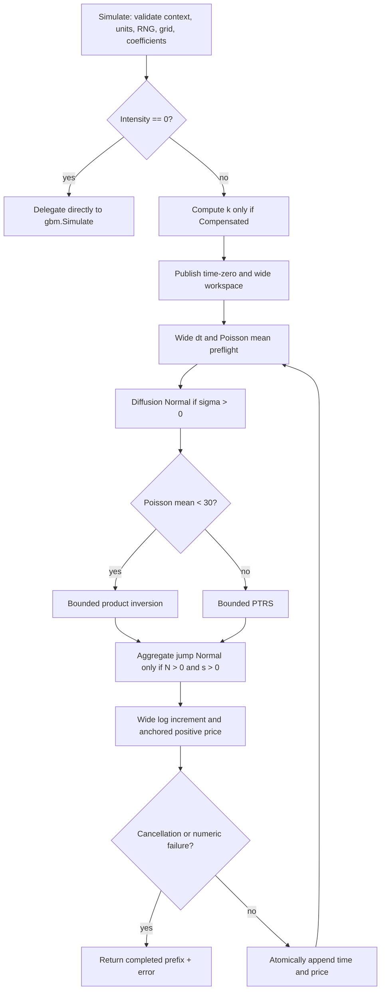

<!--
  SPDX-License-Identifier: AGPL-3.0-only
  Copyright (C) 2025-2026 katalvlaran

  File: docs/JUMPDIFFUSION.md
  Package reference: github.com/lvlath/go/jumpdiffusion
  Purpose: Merton jump-diffusion mathematics, API selection, numerical law,
           reproducibility, partial-result policy, and practical integration.
  Contract status: implemented experimental model; lvlath-spec-23-v1.
  Scope: grid-observed compound Poisson lognormal jumps over GBM; no calibration,
         continuous barrier monitoring, event-time output, or tail prediction.
  License: AGPL-3.0-only; see ../LICENSE. PTRS provenance is recorded in
           ../jumpdiffusion/THIRD_PARTY_NOTICES.txt.
-->

# JUMPDIFFUSION — Merton Compound-Poisson Lognormal Jump-Diffusion

> **An exact-in-distribution model of fixed-grid endpoints, not a calibrated predictor.**
> The package adds discrete Poisson jump counts and Gaussian log-jump marks to
> `gbm`; `rng` supplies path-owned entropy, and `montecarlo` schedules/reduces
> independent scenarios. The caller selects the model, time units and measure.

## Contents

1. [Purpose and model boundaries](#1-purpose-and-model-boundaries)
2. [Mathematical law and drift conventions](#2-mathematical-law-and-drift-conventions)
3. [Public API and physical units](#3-public-api-and-physical-units)
4. [Poisson sampling: inversion and PTRS](#4-poisson-sampling-inversion-and-ptrs)
5. [Numeric policy and representability](#5-numeric-policy-and-representability)
6. [RNG consumption and exact GBM parity](#6-rng-consumption-and-exact-gbm-parity)
7. [Validation, errors and incomplete results](#7-validation-errors-and-incomplete-results)
8. [Executable application examples](#8-executable-application-examples)
9. [Monte Carlo integration and uncertainty](#9-monte-carlo-integration-and-uncertainty)
10. [Implementation outline, complexity and benchmarks](#10-implementation-outline-complexity-and-benchmarks)
11. [Pitfalls, assumptions and non-goals](#11-pitfalls-assumptions-and-non-goals)
12. [Validation matrix and reproducibility](#12-validation-matrix-and-reproducibility)
13. [Algorithm provenance and license notices](#13-algorithm-provenance-and-license-notices)

---

## 1. Purpose and model boundaries

Geometric Brownian motion has continuous price paths and lognormal transition
laws. It cannot, by itself, represent discrete discontinuities. The Merton
model supplements a GBM diffusion with an **independent homogeneous Poisson
arrival process** and independent normally distributed *logarithmic* jump
sizes. `jumpdiffusion.Simulate` returns values **only at explicitly supplied
observation times**, not the individual arrival times or marks.

This makes it useful as an **assumption-driven scenario generator** for
collateral stress tests, jump-sensitive European option payoffs, gap-risk
sensitivity and synthetic reliability experiments. It does *not* estimate a
crash probability from market observations, learn an intensity, model Hawkes
clustering, fit a volatility smile, or monitor a continuously hit barrier.
Calibration, pricing-measure selection, dependence between assets, decision
thresholds and feed-time integrity belong to the application.

The process is strictly positive in mathematical real arithmetic. A successful
binary64 result contains only positive, finite prices; a requested price that
rounds to zero or infinity is a **classified failure**, not a clamped value.

## 2. Mathematical law and drift conventions

Write `Initial=S0>0`, `Drift=mu`, `Volatility=sigma>=0`, `Intensity=lambda>=0`,
`LogJumpMean=m`, `LogJumpStdDev=s>=0`, and let `N(t)` be a Poisson process of
intensity `lambda`. All coefficients are constant in one simulation. For one
jump, `Y~Normal(m,s^2)` is the **logarithm of the multiplicative price
change**; the price multiplier is `exp(Y)`.

The *arithmetic mean relative price jump* is **not** `m`:

$$
  k=\mathbb E[\exp(Y)-1]
    =\exp\left(m+\tfrac12s^2\right)-1
    =\operatorname{expm1}\left(m+\tfrac12s^2\right).
$$


For each consecutive grid interval `dt=t[i]-t[i-1]>0`, independently draw
`Z_diff~N(0,1)`, `N~Poisson(lambda*dt)`, and (only if needed)
`Z_jump~N(0,1)`. The independent jump marks satisfy

$$
  \sum_{j=1}^{N}Y_j\mid N
       \sim \mathcal N(Nm,Ns^2),\qquad
  J_N=Nm+s\sqrt{N}\,Z_{\mathrm{jump}},\quad J_0=0.
$$

Thus **one normal** is sufficient for all marks on the interval, even when
`N` is enormous. This is equality of conditional *distributions*, not
reconstruction of `N` individual Gaussian calls or event timestamps.

### 2.1. Compensated (default, enum value 0)

The deterministic log increment and the full step are

$$
 \Delta X=\left(\mu-\tfrac12\sigma^2-\lambda k\right)dt
   +\sigma\sqrt{dt}\,Z_{\mathrm{diff}}+J_N,\qquad
 S(t_i)=S_0\exp\left(\sum_{j=1}^{i}\Delta X_j\right).
$$

For independently distributed Poisson marks, their exponential generating
identity is

$$
 \mathbb E\!\left[e^{\sum_{j=1}^{N(t)}Y_j}\right]
 =\exp\left(\lambda t(\mathbb E[e^Y]-1)\right)=e^{\lambda kt}.
$$

The Brownian exponential contributes `exp((mu-lambda*k)*t)` to the expected
price, so the jump factor cancels the drift adjustment:

$$
 \boxed{\mathbb E[S_t]=S_0\exp(\mu t)}.
$$

This is a **theoretical moment identity for the mathematical model**. It does
not make a particular finite Monte Carlo sample martingale-valued or ensure
that a numerically failed/filtered subset of paths remains unbiased.

### 2.2. Uncompensated (enum value 1)

This explicit convention omits the `lambda*k` subtraction:

$$
 \Delta X=(\mu-\tfrac12\sigma^2)dt
       +\sigma\sqrt{dt}\,Z_{\mathrm{diff}}+J_N,
 \qquad \mathbb E[S_t]=S_0e^{(\mu+\lambda k)t}.
$$

The implementation does **not** evaluate `k` for `Uncompensated`. This is
intentional: a finite `m,s` pair with an unrepresentable arithmetic mean
multiplier need not cause a compensator error when no compensation is used.
The process can still encounter unrepresentable simulated prices.

**Financial interpretation.** Neither enum automatically establishes a
risk-neutral measure. In a chosen dividend-adjusted risk-neutral Merton model,
`Compensated` with `Drift=r-q` makes the theoretical ex-dividend asset
expectation grow at rate `r-q`, provided the jump distribution is specified
*under the same pricing measure*. Calibrating that distribution, choosing a
jump-risk premium, discounting by `exp(-r*T)` and calculating payoffs remain
outside this package.

## 3. Public API and physical units

The single canonical public operation is:

```go
// Canonical signature in package jumpdiffusion.
func Simulate(ctx context.Context, p Parameters, grid gbm.TimeGrid,
    random rng.RNG) (*Result, error)
```

The exported model is `Parameters{Diffusion gbm.Parameters, Intensity,
LogJumpMean, LogJumpStdDev float64, Convention DriftConvention}`. The result
is `*Result{Times, Values []float64; Complete bool}` and `(*Result).IsNil()`
implements `core.Nilable` pointer semantics.

| Task                                | Actual public facade                          | Meaning                                   |
|:------------------------------------|:----------------------------------------------|:------------------------------------------|
| Full irregular scenario             | `Simulate(ctx,p,grid,random)`                 | Canonical model/kernel and error contract |
| Use already typed model, timestamps | `SimulatePath(ctx,p,times,random)`            | Constructs a grid in `p.Diffusion.Unit`   |
| Price only initial and expiry       | `SimulateTerminal(ctx,p,T,random)`            | `[0,T]`, or `[0]` if `T==0`               |
| Stand-alone reproducible path       | `SimulateSeeded(ctx,p,grid,seed,pathID)`      | New `rng.NewStream(seed,pathID)`          |
| Reproducible expiry                 | `SimulateTerminalSeeded(ctx,p,T,seed,pathID)` | Seeded wrapper around `SimulateTerminal`  |

Every wrapper delegates to `Simulate` or a thin wrapper of it, preserves
`*Result` (including incomplete-prefix metadata), and does not reinterpret
coefficients or introduce an alternative numerical kernel. No exported
`Options` struct or public Poisson-count sampler exists: `Convention` is the
explicit mathematical policy.

| Value                  | Physical dimension                        | Valid domain                                                 |
|:-----------------------|:------------------------------------------|:-------------------------------------------------------------|
| `Diffusion.Initial`    | Price / index units                       | finite and `>0`                                              |
| `Diffusion.Drift`      | `1 / Diffusion.Unit`                      | finite, signed                                               |
| `Diffusion.Volatility` | `1 / sqrt(Diffusion.Unit)`                | finite and `>=0`                                             |
| `Intensity`            | Expected counts per `Diffusion.Unit`      | finite and `>=0`                                             |
| `LogJumpMean`          | Dimensionless log return per jump         | finite, signed                                               |
| `LogJumpStdDev`        | Dimensionless standard deviation per jump | finite and `>=0`                                             |
| `grid.Values`          | Elapsed time in `grid.Unit`               | nonnil, nonempty, starts at `0`, strictly increasing, finite |
| `Convention`           | Explicit policy                           | `Compensated` or `Uncompensated` only                        |

`Diffusion.Unit` and `grid.Unit` must match **exactly**, each belonging to
`gbm.TimeYears`, `TimeDays`, or `TimeSeconds`. There is no automatic
annualization, market-session calendar, timestamp rebasing, or 252/365-day
conversion. For a deliberately selected `D` elapsed-day year:

```text
mu_per_day     = mu_per_year / D
sigma_per_day  = sigma_per_year / sqrt(D)
lambda_per_day = lambda_per_year / D
m_per_jump and s_per_jump are unchanged
```

A full year-to-day conversion also converts each grid timestamp. Do not use
`series` integer-nanosecond ticks directly as elapsed years; the caller must
validate, rebase and convert timestamps consistently.

## 4. Poisson sampling: inversion and PTRS

For every interval, `a=lambda*dt`. This **mean** is a nonnegative real
parameter, while the sampled count is an integer. The package never replaces
Poisson counts with rounded Gaussian draws.

| Admitted mean `a` | Sampler                | Uniform consumption                         |
|:------------------|:-----------------------|:--------------------------------------------|
| `a==0`            | Constant `N=0`         | None; for `Intensity==0`, dispatches to GBM |
| `0<a<30`          | Product inversion      | One `UniformOpen` per attempt               |
| `30<=a<=2^40`     | Hörmann PTRS           | Two `UniformOpen` per attempt               |
| `a>2^40`          | Rejected (`ErrDomain`) | None for that interval                      |

The threshold `30`, the attempts bound `2^20`, and the maximum accepted
integer `2^53-1` are **fixed numeric-contract values**, not tunable user
options. Raising them or changing the acceptance formula changes the replay
protocol and requires a documented compatibility decision.

### 4.1. Small mean: product inversion

Let `product=1` and `threshold=exp(-a)`, then repeat up to `2^20` times:

```text
count := 0
repeat:
    check context
    u := UniformOpen()                // require 0 < u < 1
    product *= u
    if product <= exp(-a): return count
    count++                           // after the stopping comparison
if no success within budget: ErrBudget
```

The restriction `a<30` ensures `exp(-a)` is representable and prevents the
unbounded expected `O(a)` cost of applying this product method to huge means.
This algorithm is distributionally exact under ideal uniform draws; real RNG
and floating-point rounding are the declared computational approximation.

### 4.2. Large mean: PTRS transformed rejection with squeeze

Let `r=sqrt(a)` and form the fixed envelope parameters

$$
\begin{aligned}
 b&=0.931+2.53r, & c&=-0.059+0.02483b,\\
 A&=1.1239+\frac{1.1328}{b-3.4},
 &v_R&=0.9277-\frac{3.6224}{b-2}.
\end{aligned}
$$

For each attempt, draw `u=UniformOpen()-0.5`, `v=UniformOpen()`, let
`u_s=0.5-|u|`, and propose

$$
 K=\left\lfloor \left(\frac{2c}{u_s}+b\right)u+a+0.43\right\rfloor.
$$

If `u_s<=0`, reject the proposal. For `K<0`, reject without converting to an
unsigned integer. Reject unrepresentable or out-of-range nonnegative counts
with `ErrDomain`. The **fast acceptance** region is `u_s>=0.07 && v<=v_R`;
the **thin-edge rejection** is `u_s<0.013 && v>u_s`.
All remaining candidates are accepted when

$$
 \log(v)+\log(A)-\log\left(\frac{c}{u_s^2}+b\right)
       \le \log\Pr\{N=K\}.
$$

The stable count log-PMF is

$$
\log\Pr\{N=K\}=
\begin{cases}
-a,&K=0,\\
-D(K,a)-\frac12\log(2\pi K)-\operatorname{StirlErr}(K),&K>0,
\end{cases}
$$

where `D(K,a)=K*log(K/a)+a-K`. Near `K≈a`, the direct subtraction is
ill-conditioned. For `d=(K-a)/a` with `|d|<1/8`, the implementation instead
uses the fixed, bounded expansion

$$
 D(K,a)=a\sum_{j=2}^{64}\frac{(-1)^j d^j}{j(j-1)}
        +\text{truncation remainder}.
$$

`StirlErr` uses tabulated integer corrections for `1<=K<=15`, then a fixed
alternating Stirling expansion. Rejecting candidates is **not** a sample
error; exhausting `2^20` attempts is `ErrBudget`. Each attempt checks
`ctx.Err()`; invalid (closed or nonfinite) uniforms return `ErrDomain` or
`ErrNonFinite` rather than entering an uncontrolled loop. Floating-point PTRS
acceptance is numerically approximated, independently checked by regression
oracles; this is not a claim of arbitrary-precision exactness.

## 5. Numeric policy and representability

Several individually finite `float64` coefficients can form a product or
sum that overflows before the final mathematical answer is evaluated. The
implementation therefore keeps intermediate quantities outside binary64:

1. `m+s^2/2` is constructed at 2304-bit precision before conversion and
   `math.Expm1`, avoiding premature `s*s` overflow and loss near zero.
2. Both `dt` and `lambda*dt` are formed at wide precision. The **exact binary
   inputs'** product is compared with `2^40` before rounding to binary64.
   A strictly positive mean that rounds to zero is `ErrOverflow`, not `N=0`.
3. The deterministic drift, `sigma*sqrt(dt)`, Itô correction, Gaussian shock,
   aggregated jump and cumulative log growth are formed with wide operands.
   The initial `float64` is retained as an exact price anchor instead of
   calculating `log(S0)` and rounding it back.
4. For publication, a safe central region uses `initial*math.Exp(growth)`;
   boundary cases use bounded argument reduction, a 384-bit exponential
   series and a single final `float64` conversion. Valid positive subnormals
   are accepted; rounded zero and infinity are `ErrOverflow`.

**Important limitations.** Fixed high precision is not arbitrary-precision
real arithmetic, and its conversion does not certify correct rounding for
all possible inputs. There is no floating-point epsilon used to create a
fake positive price, no Gaussian fallback for high Poisson means, and no
silent ignored jump when a positive Poisson mean underflows to zero.

`Compensated` explicitly rejects a nonrepresentable *compensator* with
`ErrOverflow` **before the first observation is published**, even if a
particularly small intensity could make `lambda*k` finite. This is a
supported-domain choice, not a claim that the underlying model has no
mathematical solution. `Uncompensated` and `Intensity==0` skip this
unnecessary calculation; `Intensity==0` still validates `m,s`.

## 6. RNG consumption and exact GBM parity

`rng.RNG` is the existing minimal interface `Uint64()`, `UniformOpen()`,
`Normal()`. The jump kernel consumes only `Normal` and `UniformOpen`; no
`reflect`, `panic`, `recover`, system clock, global RNG or NumPy runtime is
involved.

| Condition on a step              | Draw protocol                                                 |
|:---------------------------------|:--------------------------------------------------------------|
| `Intensity==0`                   | **Direct `gbm.Simulate` delegation**; zero Poisson/jump draws |
| `Intensity>0 && Volatility>0`    | Diffusion `Normal()` before any Poisson draw                  |
| `Intensity>0` and admitted `a>0` | Poisson `UniformOpen()` attempts after diffusion              |
| `N>0 && LogJumpStdDev>0`         | Exactly one aggregate-jump `Normal()` after Poisson           |
| `Volatility==0`                  | No diffusion normal                                           |
| `N==0` or `LogJumpStdDev==0`     | No aggregate-jump normal                                      |
| One-point `[0]` grid             | Zero interval draws in either convention                      |

`Intensity==0` does **not** rerun a separately written GBM recurrence:
it calls `gbm.Simulate` after validating the jump parameter domain. Its
`Times`/`Values` have the same floating-point bits and stochastic draw
consumption as the GBM call on the identical stream state. A new `Result`
wrapper is constructed; it is not the same pointer as a `gbm.Result`.
GBM sentinel causes are preserved by `errors.Is` alongside the jumpdiffusion
error category when applicable.

A fixed `(seed,pathID)` and unchanged model/grid/kernel/RNG version provide
reproducibility on a specified runtime/backend. **Normal draws may use a
cached Box–Muller spare**, so matching only the total number of method calls
without preserving their *order* is not sufficient for stream parity.
Changing the Poisson cutoff, rejection algorithm, acceptance constants or
draw sequence changes replay identity even if probability laws still match.
An abandoned step does not roll back RNG state.

## 7. Validation, errors and incomplete results

The public preflight uses a defined stage order; within timestamp scanning,
the **first offending index** determines whether nonfinite or ordering
failure is returned. There is no global retrospective prioritization of
`ErrOrder` over a nonfinite value at a later index.

| Stage    | Condition                                                        | `errors.Is` target            | Result          |
|:---------|:-----------------------------------------------------------------|:------------------------------|:----------------|
| 1        | `ctx==nil`; unsupported units/convention; unit mismatch          | `ErrInvalidOption`            | `nil`           |
| 1        | Context canceled before validation                               | `ctx.Err()`                   | `nil`           |
| 2        | Missing RNG, recognized typed-nil RNG, or `grid.Values==nil`     | `ErrNilInput`                 | `nil`           |
| 2        | Allocated zero-length `grid.Values`                              | `ErrEmptyInput`               | `nil`           |
| 3        | Nonfinite timestamp                                              | `ErrNonFinite`                | `nil`           |
| 3        | Origin not zero, duplicate or decreasing timestamp               | `ErrOrder`                    | `nil`           |
| 4        | Nonfinite model/jump coefficient                                 | `ErrNonFinite`                | `nil`           |
| 4        | Nonpositive `Initial`, negative volatility/intensity/jump stddev | `ErrDomain`                   | `nil`           |
| 5        | Unrepresentable `Compensated` `k`                                | `ErrOverflow`                 | `nil`           |
| Interval | `lambda*dt>2^40`; oversized PTRS count                           | `ErrDomain`                   | Complete prefix |
| Interval | Positive `lambda*dt` rounded to zero; unrepresentable price      | `ErrOverflow`                 | Complete prefix |
| Interval | Malformed `Normal` or `UniformOpen`                              | `ErrNonFinite` or `ErrDomain` | Complete prefix |
| Interval | Exhausted Poisson attempts                                       | `ErrBudget`                   | Complete prefix |
| Interval | Cancellation during sampling or before publishing next point     | `ctx.Err()`                   | Complete prefix |

A nil context is always `ErrInvalidOption`, not a panic; a pre-canceled
context wins over every input check. Unit/convention checks precede RNG and
grid checks. An unknown typed-nil custom RNG *without* the optional
`IsNil() bool` hook cannot be diagnosed reflect-free: implementers must
respect the interface's ownership and nil behavior.

When a runtime error occurs after valid preflight, the returned non-nil
`Result` contains **only the completed prefix** `[0,...,i-1]`:

```text
Grid:         [t0, t1, t2, t3, t4]
Completed:    [S0, S1, S2]
Failed step:                t2 -> t3      (discarded, including t3)
Returned:      Times=[t0,t1,t2], Values=[S0,S1,S2]
               Complete=false, err != nil
```

`Times` and `Values` always have identical lengths, are detached from the
grid, and may be modified by the caller after return. The model parameters
are copied, not retained; the RNG remains caller-owned and must not be
shared between simultaneous goroutines. No input snapshot-isolation is
promised if the caller mutates grid data concurrently.

`(*Result).IsNil()` is safe on a nil pointer and classifies **pointer
absence**, not successful completion. Never use `IsNil()` or the last
available price to substitute a completed-maturity result. Zero-intensity
failures preserve the applicable underlying `gbm` sentinel in addition to
the public jumpdiffusion classification when the error is translated.

## 8. Executable application examples

### 8.1. Replayable irregular-grid crypto stress path

This complete `main` program simulates a *hypothetical* year-denominated
portfolio mark over nonuniform scenario review dates. It reports observable
metadata without treating a single simulated trajectory as crash odds.

```go
package main

import (
    "context"
    "errors"
    "fmt"

    "github.com/lvlath/go/gbm"
    "github.com/lvlath/go/jumpdiffusion"
)

func main() {
    params := jumpdiffusion.Parameters{
        Diffusion: gbm.Parameters{
            Initial: 60_000, Drift: 0.03, Volatility: 0.65,
            Unit: gbm.TimeYears,
        },
        Intensity: 2.0, LogJumpMean: -0.20, LogJumpStdDev: 0.10,
        Convention: jumpdiffusion.Compensated,
    }
    grid := gbm.TimeGrid{
        Values: []float64{0, 1.0 / 365, 7.0 / 365, 30.0 / 365, 90.0 / 365},
        Unit:   gbm.TimeYears,
    }
    result, err := jumpdiffusion.SimulateSeeded(
        context.Background(), params, grid, 2026, 17,
    )
    if err != nil {
        if errors.Is(err, jumpdiffusion.ErrOverflow) {
            fmt.Println("model result left the representable price domain")
            return
        }
        fmt.Println("simulation error:", err)
        return
    }
    if result == nil || !result.Complete {
        fmt.Println("reject incomplete risk scenario")
        return
    }
    fmt.Printf("checkpoints=%d initial=%.0f days=%.0f complete=%t\n",
        len(result.Values), result.Values[0], result.Times[len(result.Times)-1]*365,
        result.Complete,
    )
    // Output:
    // checkpoints=5 initial=60000 days=90 complete=true
}
```

Five executable, distinct package examples are in
[`jumpdiffusion/example_test.go`](../jumpdiffusion/example_test.go):

| Executable example                       | Practical model boundary                                                                  |
|:-----------------------------------------|:------------------------------------------------------------------------------------------|
| `ExampleSimulate_flashCrashCollateral`   | Preselected crash replay and collateral drawdown; **not** crash likelihood                |
| `ExampleSimulateTerminal_optionPricing`  | Independent Monte Carlo call/put comparison and pathwise put–call parity                  |
| `ExampleSimulate_highIntensityCapacity`  | PTRS at 50 arrivals/second encoded in a synthetic price index; **not** a native queue API |
| `ExampleSimulateSeeded_scenarioReplay`   | Bitwise replay keyed by stable logical path IDs                                           |
| `ExampleSimulatePath_creditEventReserve` | Irregular time grid and explicit downward-jump credit reserve model                       |

Run the tested package examples with
`go test ./jumpdiffusion -run '^Example' -count=1` from the repository root.
A standalone scenario may also live at `examples/jumpdiffusion/main.go`; use it
only when that file is present in your checkout, and run it with
`go run ./examples/jumpdiffusion`.

### 8.2. Choose one-point versus terminal versus full-grid paths

`SimulateTerminal` takes one step for `T>0`, regardless of whether `T` is one
second or one year; it is appropriate for **terminal-only** claims. A
path-dependent drawdown needs sufficiently granular observations and can
still miss jumps or barrier crossings within intervals. A `[0]` grid returns
the initial mark without entropy draws but still enforces parameter checks.

## 9. Monte Carlo integration and uncertainty

`montecarlo.Run` owns indexed path streams and deterministic reduction; it
never generates a Merton process itself. An application implements
`montecarlo.Sampler` with a **fixed positive dimension**, stores the
immutable parameters in its adapter, and calls `SimulateTerminal` or
`Simulate` using the *supplied* RNG. If a simulation returns an error or
`!Complete`, the adapter returns **error**, not a shortened successful
sample. Do not call a seeded wrapper inside a `Sampler.Sample`: the driver
has already created `rng.Factory.Stream(Seed,pathID)`.

For a simple European call under an explicitly chosen measure, the trial
output is `exp(-r*T)*max(S_T-K,0)` and the Monte Carlo estimate is its sample
mean. The actual executable adapter and side-by-side Merton/GBM comparison
are in `ExampleSimulateTerminal_optionPricing`, including call/put prices,
a discounted terminal-asset component and the pathwise identity

$$
 C-P=e^{-rT}(S_T-K).
$$

The Monte Carlo mean standard error estimates sampling variability **under
the model**, not misspecification, parameter uncertainty, stochastic
volatility, execution slippage or unobserved event risk. Independent
experiments use independent `(seed,pathID)` streams; reporting a difference
between two model estimates should include its estimated uncertainty.
Choose scenario counts and model parameters by separately justified
research, not by tuning until tests pass.

## 10. Implementation outline, complexity and benchmarks



One interval requires `O(A)` Poisson proposals and `O(1)` fixed-precision
working storage (`A<=2^20`). Product inversion has expected work `O(a+1)`
for `a<30`; PTRS has a small mean-dependent expected attempt count without
a hard *constant-time* acceptance guarantee, but a hard `2^20` budget.
With `n` timestamps, validation and copies cost `O(n)`, expected time is
`O(n * expected attempts)` (plus bounded wide arithmetic), **worst-case
`O(n*2^20)`** and output space is `O(n)`; numeric scratch is fixed-size.
The computation does not create `N` Gaussian marks individually.

`jumpdiffusion/bench_test.go` measures **100 and 10,000 intervals**, each
with per-interval Poisson means **0.1 (inversion)** and **50 (PTRS)**. Setup
is outside the timed region; seeded stream creation and successful full
trajectory generation are included. It is incorrect to read the mean=50
case as 50 *executed Gaussian jump draws per interval*: the conditional
aggregate uses one Normal for every nonzero sampled count.

Run:

```bash
go test ./jumpdiffusion -count=1
go test ./jumpdiffusion -race -count=1
go test ./jumpdiffusion -run '^$' -bench '^BenchmarkSimulate$' -benchmem
go vet ./jumpdiffusion
golangci-lint run ./jumpdiffusion/...
```

For repository admission also run `go test ./...`, `go vet ./...`, and the
repository's configured `golangci-lint run`. An unavailable check is **NOT
RUN**, not PASS; a benchmark must include OS, Go version and CPU to be
comparable. No project document can substitute for executed CI.

## 11. Pitfalls, assumptions and non-goals

| Temptation                                                       | Why it is wrong                                      | Correct handling                                    |
|:-----------------------------------------------------------------|:-----------------------------------------------------|:----------------------------------------------------|
| Set compensator to `m`                                           | `E[e^Y-1] != E[Y]`; option prices drift              | Use `k=expm1(m+s^2/2)`                              |
| Replace PTRS by `round(a+sqrt(a)*Z)`                             | Alters the count law, zero mass and tails            | Keep discrete inversion/PTRS                        |
| Reconstruct GBM at `Intensity=0`                                 | Changes floating bits and cached RNG draws           | Delegate to `gbm.Simulate`                          |
| Sample `N` normals one by one                                    | Costs `O(N)`, changes draw consumption               | Use `Nm+sqrt(N)*s*Z`                                |
| Treat one terminal endpoint as a barrier path                    | Intrastep crossings are invisible                    | Supply a finer grid; still no continuous monitoring |
| Use an incomplete prefix as maturity                             | Failed step not published                            | Reject in `montecarlo.Sampler`                      |
| Reuse one RNG in several workers                                 | Data race and reproducibility loss                   | Per-path `rng.Factory.Stream`                       |
| Interpret sample mean stability as calibration                   | Model structure may be wrong                         | Separate statistical calibration/validation         |
| Change year to seconds without coefficient scaling               | Wrong expected jump frequency and drift              | Convert drift, volatility, intensity and grid       |
| Remove the third-party notice merely because Go imports no NumPy | Attribution may still be required for derived source | Retain and audit source provenance                  |

**Excluded**: parameter fitting, non-homogeneous arrivals, Hawkes/self-exciting
jumps, stochastic volatility, cross-asset jump dependence, power-law claims,
exact intrastep event times, continuous-time barrier crossing, market strategy,
external network calls and crypto-secure randomness. Those require separately
specified models and source data.

## 12. Validation matrix and reproducibility

| Anchor | Assertion                                                                                  |
|:-------|:-------------------------------------------------------------------------------------------|
| JD01   | `Intensity=0` matches `gbm.Simulate` price/time bits and RNG draw sequence                 |
| JD02   | Count=3 and `m=log(2), s=0` yield the deterministic `N*m` law without jump Normal          |
| JD03   | `sigma=m=s=0` consumes no normals and jumps multiply by exactly one                        |
| JD04   | `m=1e-12, s=0` resolves the correct small compensator using `Expm1`                        |
| JD05   | Fixed-seed ensemble supports compensated expectation within declared statistical tolerance |
| JD06   | `a=29.999` and `30` exercise independent inversion/PTRS distribution oracles               |
| JD07   | `a>2^40` is rejected before generating a step's entropy                                    |
| JD08   | Cancellation inside the Poisson loop discards the incomplete step                          |

Additional external-package tests validate malformed RNG draws, count
representability, independent high-precision PTRS acceptance thresholds,
positive-mean underflow, anchored price boundaries, context precedence,
result detachment, wrapper parity, `core.Nilable` and absence of in-progress
publication. All tests are in `package jumpdiffusion_test` and exercise only
the exported facade; no internal kernel is promoted to production API solely
to serve a test.

**Replay boundary.** Persist at least: package/numeric revision, RNG
`Factory.Version()`, model coefficients and `TimeUnit`, grid values, drift
convention, base seed and logical path ID. Algorithm parameters such as
Poisson cutoff and PTRS rejection math are part of versioned determinism.
One seed by itself is not a complete experiment identifier.

## 13. Algorithm provenance and license notices

The PTRS algorithm originates with **W. Hörmann**, *The transformed rejection
method for generating Poisson random variables* (1993), *Insurance:
Mathematics and Economics*, 12, pp. 39–45. The proposal and squeeze
parameterization in this Go package were cross-checked against NumPy 2.2.0's
`random_poisson_ptrs` implementation; see
[`jumpdiffusion/THIRD_PARTY_NOTICES.txt`](../jumpdiffusion/THIRD_PARTY_NOTICES.txt).
NumPy's code is published under **BSD-3-Clause** and the attribution/license
notice is retained for source-provenance compliance. **NumPy is not an import,
Go module dependency, runtime library, or sampler backend**: the Go
implementation uses `rng.RNG` and standard-library math. Removing an attribution
file without reviewing whether copied/adapted protected source is present
would be a licensing decision, not a performance optimization.

For companion contracts: [`gbm/doc.go`](../gbm/doc.go),
[`rng/doc.go`](../rng/doc.go), [`montecarlo/doc.go`](../montecarlo/doc.go),
[`docs/GBM.md`](GBM.md), [`docs/RNG.md`](RNG.md),
[`docs/MONTECARLO.md`](MONTECARLO.md),
[`docs/TUTORIAL.md`](TUTORIAL.md) and
[`docs/FAQ_&_TIPS.md`](FAQ_%26_TIPS.md).
