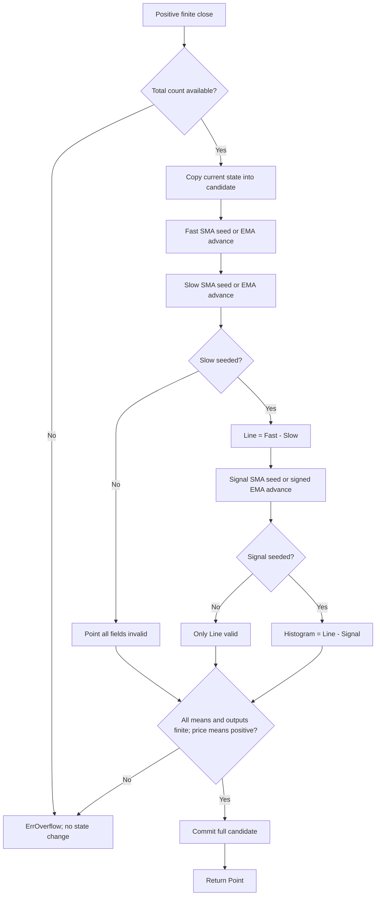
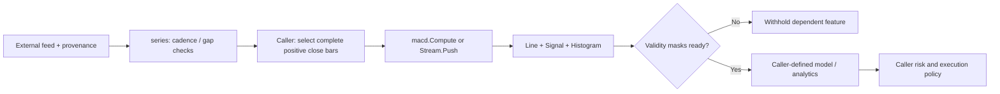

<!--
  SPDX-License-Identifier: AGPL-3.0-only
  Copyright (C) 2025-2026 katalvlaran

  File: docs/MACD.md
  Package: github.com/lvlath/go/macd
  Purpose: rigorous mathematical and operational reference for the SMA-seeded MACD engine.
  Contract status: implemented batch/stream API; same canonical recurrence and versioned state.
  Scope: positive scalar closes; signed Line/Signal/Histogram; exact period-one identity; v2 replay.
  License: AGPL-3.0-only.
-->

# MACD - SMA-seeded convergence/divergence, batch and streaming

> **Primary rule:** Price EMAs and the MACD signal EMA are all seeded with a **simple average of their first corresponding samples**. The signal starts after the first *valid* MACD line, never at the first input price. A valid numeric zero and an invalid warmup placeholder are different states. Period-one EMAs are exact binary64 identities. The current checkpoint identity is `macd/sma-ema/v2`; legacy v1 checkpoints must be rebuilt from original prices.

## Contents

1. [Scope and operational model](#1-scope-and-operational-model)
2. [Public API and wrappers](#2-public-api-and-wrappers)
3. [Mathematics and warmup proof](#3-mathematics-and-warmup-proof)
4. [Canonical deterministic computation](#4-canonical-deterministic-computation)
5. [Numerical policy and representability](#5-numerical-policy-and-representability)
6. [Error precedence and nil receivers](#6-error-precedence-and-nil-receivers)
7. [Snapshot and recovery protocol](#7-snapshot-and-recovery-protocol)
8. [Ownership, concurrency and complexity](#8-ownership-concurrency-and-complexity)
9. [Executable workflows](#9-executable-workflows)
10. [Integration with the lvlath ecosystem](#10-integration-with-the-lvlath-ecosystem)
11. [Testing, benchmarks and limitations](#11-testing-benchmarks-and-limitations)
12. [Production checklist](#12-production-checklist)

---

## 1. Scope and operational model

`macd` computes three descriptive indicators from **one event-ordered sequence of strictly positive closing prices**:

- **Line**: the difference of a fast and a slow exponential moving average of closes.
- **Signal**: a third exponential moving average driven only by already valid Line values.
- **Histogram**: Line minus Signal, which measures the local separation between those two signed lines.

This is a numeric feature generator, **not** a trading recommendation, a market-data adapter, a classifier, a volatility estimator, or an execution engine. A positive histogram is neither a guaranteed future price rise nor a calibrated probability. Price units, sample cadence, provenance, exchange corrections, session boundaries, gaps and label leakage are application responsibilities.

The package does not inspect wall-clock timestamps. The caller must define what one observation means: an equally spaced daily close, a minute bar, or a separately governed event-time tick. Two streams with identical `Options` but different bar cadences are **not** the same statistical feature. The library does not infer instrument identity, session boundaries, corporate-action adjustments or what a feed sequence number means. Treat all of those as part of the caller's persisted data contract.

The public API has two forms: `Compute` for a batch with aligned masks and `Stream.Push` for constant-state causal updates. Both rely on the **same numerical composition step**, preserving matching binary64 results for the same price sequence, options and implementation environment.

---

## 2. Public API and wrappers

```go
package macd

type Options struct { Fast, Slow, Signal int }
type Series struct { Values []float64; Valid []bool }
type Result struct { Line, Signal, Histogram Series }
type Point struct {
    Line, Signal, Histogram float64
    LineValid, SignalValid bool
}
type Snapshot struct {
    Algorithm string
    Config string
    Count uint64
    FloatState []float64
    IntState []uint64
}

func DefaultOptions() Options
func Compute(closes []float64, opts Options) (*Result, error)
func ComputeDefault(closes []float64) (*Result, error)
func ComputeWithPeriods(closes []float64, fast, slow, signal int) (*Result, error)
func New(opts Options) (*Stream, error)
func NewDefault() (*Stream, error)
func NewWithPeriods(fast, slow, signal int) (*Stream, error)
func (s *Stream) Push(price float64) (Point, error)
func (s *Stream) Reset()
func (s *Stream) Snapshot() Snapshot
func (s *Stream) Restore(state Snapshot) error
func (r *Result) IsNil() bool
```

The wrappers are deliberately narrow:

| Task                                 | Entry point                            | Mathematical policy                          |
|--------------------------------------|----------------------------------------|----------------------------------------------|
| One complete batch, explicit options | `Compute(closes, Options{...})`        | Canonical batch facade                       |
| One complete batch, 12/26/9          | `ComputeDefault(closes)`               | Exactly `Compute(closes, Options{})`         |
| Separate period integers             | `ComputeWithPeriods(closes, 5, 35, 5)` | Same `Compute` kernel; no alternative seed   |
| Start a stateful feed                | `New(Options{...})`                    | Canonical streaming constructor              |
| Start default 12/26/9 feed           | `NewDefault()`                         | Exactly `New(Options{})`                     |
| Start feed with supplied periods     | `NewWithPeriods(5, 35, 5)`             | Same normalized `New` configuration          |
| Recover one stream                   | `New` followed by `Restore`            | Requires same version and normalized periods |

Each zero period independently chooses its default (`Fast=12`, `Slow=26`, `Signal=9`). After normalization, require `1 <= Fast < Slow` and `Signal >= 1`. The first signal index `Slow+Signal-2` must fit `int`, checked without overflowing that expression. No hidden first-price seeding or signal smoothing convention is selectable. `Fast=1` and `Signal=1` are both valid, provided `Slow>Fast`. **Only a period of one** has a first-sample seed equal to its first observation.

The smoothing factor is the Appel-style EMA value **`2/(P+1)`**. It is *not* Wilder's `1/P` smoothing coefficient used in [`rsi`](../rsi/doc.go). Reusing equal integer periods across those packages does not make the smoothing operators identical.

The result's `Line`, `Signal` and `Histogram` each have **two slices of length exactly `len(closes)`**. Every invalid numerical entry is positive `0.0` with `Valid=false`. Readiness is independent: `Line.Valid` may be true while `Signal.Valid` is false. `Histogram.Valid[i] == Signal.Valid[i]` at every index.

`(*Result).IsNil()` implements the `core.Nilable` convention: a typed-nil `*Result` reports true; an allocated empty `&Result{}` reports false. This tests pointer presence, not whether data are complete or ready.

---

## 3. Mathematics and warmup proof

### 3.1. Price EMA and its SMA seed

For a period `P>=1`, the **first `P` input observations** define the initial seed, with zero-based EMA indices:


The later EMA recurrence is:


The **fast** and **slow** price EMAs each start at **the same first close** (`close[0]`). If the periods differ, one seed finishes earlier; the fast EMA continues updating while the slow EMA is still seeding.

The three published indicators are:


Here `S_t` is seeded from the **first `Signal` valid M samples**, not the first `Signal` closes and not a sequence padded with invalid zero values.

### 3.2. Exact warmup positions

`Slow` positive closes are required to seed the slow EMA, so the first `Line` is published at zero-based index `Slow-1`. The signal then requires `Signal` consecutive valid line values, starting at `Slow-1`. Its first index is therefore:


| Configuration     | First Line index | First Signal/Histogram index | Minimum fully ready closes |
|-------------------|-----------------:|-----------------------------:|---------------------------:|
| 12/26/9 (default) |               25 |                           33 |                         34 |
| 5/35/5            |               34 |                           38 |                         39 |
| 2/3/2             |                2 |                            3 |                          4 |
| 2/3/1             |                2 |                            2 |                          3 |

A shorter **nonempty** history is successful: the arrays retain their original length and all still-unready fields have false masks. `Signal=1` is a meaningful special case: **every** valid Signal is bitwise equal to the corresponding Line, and every valid Histogram is numerically zero; its mask is still **true**. `Fast=1` likewise preserves the current accepted close exactly. These identities apply to finite binary64 values without tolerance.

In terms of **accepted close count** rather than zero-based indexes, the slow price EMA becomes ready at `Count=Slow`, and the signal becomes ready at `Count=Slow+Signal-1`. At any accepted count `C`, the three saturated seed counters satisfy:


This identity also governs `Snapshot.IntState` at every warmup boundary. Counters remain saturated after readiness, **but the EMA means continue evolving**. A consumer must never infer the number of processed prices by adding those three counters.

### 3.3. Why SMA seed choice matters

Suppose two EMA implementations receive the same future observations but have different seeds at the same starting index. In **exact arithmetic**, the difference between their EMA values after `k` further updates is:


Because `alpha` lies in `(0,1]`, the seed effect decays geometrically. It does **not** disappear immediately; for practical warmup lengths, different seed policies produce different indicators. This is why an external charting library may disagree even when both use the same period numbers. Some implementations restart fast and slow seeds from different windows; this package intentionally does **not**.

This equality is a real-number recurrence identity, **not** a proof that different floating-point operation orders produce bit-identical outputs. In binary64, the online warmup mean is intentionally computed in a fixed safe order; it approximates the mathematical SMA, not a universally correctly rounded exact-rational average. Parity comes from sharing the same executed kernel, **not** from a claim that all algebraically equivalent EMA implementations round alike.

### 3.4. Independent rational fixture

For `Fast=2`, `Slow=3`, `Signal=2` and closes `[1,2,3,2,5]`, exact arithmetic yields:

| Index | Close |    Line |  Signal | Histogram |
|------:|------:|--------:|--------:|----------:|
|     0 |     1 | invalid | invalid |   invalid |
|     1 |     2 | invalid | invalid |   invalid |
|     2 |     3 |   `1/2` | invalid |   invalid |
|     3 |     2 |   `1/6` |   `1/3` |    `-1/6` |
|     4 |     5 |   `5/9` | `13/27` |    `2/27` |

These fractions are **independent mathematical oracles**, whereas comparing `Compute` with `Push` alone would only show that both reuse the same implementation. Floating results are compared with a justified IEEE-754 tolerance against the exact fractions; batch/stream output is compared **bitwise**.

An independent positive-ramp fixture, `Fast=2, Slow=3, Signal=2` and `[1,2,3,4,5]`, yields `Line=1/2` at indexes 2–4, `Signal=1/2` at indexes 3–4, and a **valid zero** histogram at indexes 3–4. By contrast, for five constant closes near `math.MaxFloat64`, every valid output must be zero without overflowing the seed. Together these cases separate phase alignment from arithmetic representability.

---

## 4. Canonical deterministic computation



A single internal `nextStep` coordinates the phases. `Push` first validates its receiver and close, passes a **value copy** of the stream state to the kernel, and only after a full successful calculation does it assign `*stream = candidate`. The private `advanceEMA` performs candidate-only arithmetic. Before publication, one gate checks all three candidate means, positive observed price means, Line and Histogram. A computed Signal is exactly the checked signal mean. This includes warmup states and zero placeholders. An invalid numeric candidate therefore **never** leaves fast/slow counters or EMA values partially advanced. Total count exhaustion is checked before any arithmetic. No candidate arithmetic indexes or allocates storage, so even a nonfinite temporary remains confined to the rejected candidate.

`Compute` validates all input closes before allocating its result, constructs a private fresh Stream and invokes `Push` once per close, in **ascending index order**. On a failed later price or arithmetic operation, the public batch result is `nil`, not a misleading partial result. This extra whole-history validation is intentional: a `NaN` at index 40 must not be hidden by an earlier negative price at index 2, even though a streamed `Push` checks only its current price.

For fixed binary64 inputs, options, package version, Go target and floating-point behavior, the same `Push` path guarantees the same values and masks between batch and stream. Different compiler/architecture transformations are **not** promised to reproduce arbitrary final mantissa bits.

---

## 5. Numerical policy and representability

**Input domain:** every close must be finite and strictly positive; this includes tiny positive subnormals and very large finite values. `NaN`, `+Inf`, `-Inf` fail with `ErrNonFinite`; `+0.0`, `-0.0` and all negative finite prices fail with `ErrDomain`. No special policy for negative interest rates, prices after arbitrary detrending, or signed returns is supplied: those are different input objects and cannot be passed as closes.

**Arithmetic/result domain:** `Line`, `Signal` and `Histogram` are **signed**. An EMA price validator must never be applied to them. Their values may be negative, zero or positive. Successful outputs and stored means are finite.

### 5.1. Online SMA seed without avoidable sum overflow

A naive `sum += price` may overflow when every price is individually finite and the mean is entirely representable. The warmup therefore maintains an **online mean** for its first `P` samples:


The implementation applies a sign-aware equivalent grouping when signed samples have opposite signs. This prevents a raw sum from overflowing for constant near-`MaxFloat64` prices. It is a bounded-memory IEEE-754 algorithm, **not** a promise of exact real-number summation or correctly rounded arbitrary-precision SMA for every possible input.

### 5.2. Exact EMA period-one identity

For period `P=1`, `alpha=2/(1+1)=1` and the mathematical recurrence reduces to:


The same-sign difference formula is not an IEEE-754 identity at unit weight.
For `old=1e308, sample=1`, `sample-old` rounds to `-1e308`, so
`old + 1*(sample-old)` produces zero rather than one. The v2 common
weighted-mean helper returns `sample` directly when `weight == 1.0`, before
any arithmetic involving the old mean. The first seed observation is already
copied directly. All remaining weights retain the same sign-aware operation
order as the prior recurrence.

This is an exact projection of the input binary64 bits, not a rounded
approximation. With Fast=1, the stored fast price mean is the current close,
including `math.SmallestNonzeroFloat64`. With Signal=1, the signed Line is
copied exactly, and the Histogram is obtained by the usual subtraction;
there is no artificial zeroing or price-domain validation of Signal.

For a numerical stress replay `[1e308,1]` with 1/2/1, both updates succeed,
Fast becomes exactly 1, and a fresh stream accepts the emitted checkpoint.
The repeat of `[1,1e270,1e-270,1e-100,1e100,1,3,2]` with 2/26/1 exposes
the former cancellation at index 26; repeating is necessary because eight
prices alone cannot reach Slow=26. The exact identity now holds at every
ready index. See `ExampleStream_Push_periodOneIdentity` for a runnable test.

### 5.3. Signed signal EMA and cancellation risk

For `0 < weight < 1` and same-sign `old` and `sample`, the recurrence uses a difference update `old + weight*(sample-old)`. This is safe from the opposite-sign subtraction overflow because the difference lies within the larger magnitude. For opposite signs it instead computes:


With `0<w<1`, the two terms have opposite signs; a raw `sample-old` could overflow even though their weighted combination is finite. The signed branch avoids that avoidable loss.

Under the admitted state domain, a seed update uses `1/k <= 1/2` for `k>=2`; a mature nonidentity update uses `2/(P+1) <= 2/3` for `P>=2`. The exact convex mean is bounded by its operands. For binary64 same-sign subtraction, nearby magnitudes have an exact difference (Sterbenz's lemma); distant magnitudes retain ample headroom under these weights. For opposite signs, each weighted term is finite and addition is subtractive. The seed count increments only while below an admitted period, itself no greater than `MaxInt`. Thus separate private error-return branches for these arithmetic transitions or their seed counters are not reachable by valid public inputs merely by selecting large finite prices. Line also subtracts two positive finite price means and is bounded by `MaxFloat64` in magnitude.

Histogram is different: two signed finite outputs can have opposite signs and an unrepresentable difference, for example in a structurally admitted but adversarial restored state. The common numeric commit gate checks all means and derived outputs, regardless of reachability under an ordinary history. It returns `ErrOverflow`, a zero Point, and the unchanged previous stream. This is a defense at the public transaction boundary, not permission to admit nonfinite snapshots.

### 5.4. No misleading cross-library parity

- Different price histories, starting windows or gap policies do not define the same MACD input.
- Different SMA seed locations do not define the same EMA recurrence state.
- Correct real-number formulas are not sufficient for binary64-bit parity.
- A histogram close to zero should not automatically trigger an order: an application must define instrument-specific noise thresholds, execution costs and risk controls.

---

## 6. Error precedence and nil receivers

`Compute` follows this order: **option normalization/validation → nil slice → empty slice → full nonfinite scan → full nonpositive-price scan → recurrence**. Hence a later NaN/Inf takes precedence over an earlier negative or zero price. Each scan runs in ascending index order; no output is allocated before both succeed.

| Condition                                                | Classification with `errors.Is` | Result/state law                        |
|----------------------------------------------------------|---------------------------------|-----------------------------------------|
| `Fast>=Slow`, negative period, unsafe first signal index | `ErrInvalidOption`              | Batch result nil; New returns nil       |
| `Compute(nil, ...)`                                      | `ErrNilInput`                   | Batch result nil                        |
| Non-nil `[]float64{}`                                    | `ErrEmptyInput`                 | Batch result nil                        |
| Price NaN or infinity                                    | `ErrNonFinite`                  | Batch result nil; failed Push unchanged |
| Price `<=0` (finite)                                     | `ErrDomain`                     | Batch result nil; failed Push unchanged |
| Count/EMA/line/histogram unrepresentable                 | `ErrOverflow`                   | No partial result or stream commit      |
| Snapshot version, hash, phase, shape or value invalid    | `ErrStateVersion`               | Restore leaves stream unchanged         |
| Nil `*Stream` Push/Restore                               | `ErrNilInput`                   | No panic                                |
| Uninitialized `&Stream{}` Push/Restore                   | `ErrStateVersion`               | No panic                                |
| Nil/zero `Stream.Reset()`                                | No error                        | No-op                                   |
| Nil/zero `Stream.Snapshot()`                             | No error                        | Empty `Snapshot{}`                      |

**Price validation takes precedence over count overflow** inside `Push`, because the price is validated before entering the arithmetic step. Likewise, a malformed snapshot cannot replace a valid state even if some of its fields happen to be compatible. Errors do not expose the input price vector or untrusted snapshot content.

---

## 7. Snapshot and recovery protocol

`Snapshot` contains the **entire recurrence**, including partial SMA seeds. The schema is fixed:

| Field           | Encoding/invariant                        |
|-----------------|-------------------------------------------|
| `Algorithm`     | Exact literal `macd/sma-ema/v2`           |
| `Config`        | Lowercase SHA-256 hex of `ASCII Algorithm || LE64(Fast) || LE64(Slow) || LE64(Signal)` |
| `Count`         | Number of *accepted* closes, uint64       |
| `FloatState[0]` | Fast online SMA / EMA mean                |
| `FloatState[1]` | Slow online SMA / EMA mean                |
| `FloatState[2]` | Signed signal online SMA / EMA mean       |
| `IntState[0]`   | `min(Count,Fast)`                         |
| `IntState[1]`   | `min(Count,Slow)`                         |
| `IntState[2]`   | `min(max(Count-Slow+1,0),Signal)`         |

All six state elements are finite/count-bounded. Before an EMA sees any sample, its mean must be canonical **positive zero**, including the IEEE-754 sign bit. A seeded fast/slow mean is strictly positive; a seeded signal mean may be negative, positive or zero.

`Snapshot()` copies both slices, so mutations to an exported snapshot cannot change the original stream. `Restore(snapshot)` verifies algorithm ID, target configuration, slice lengths, phase identities, numeric state and canonical inactive phases; it builds a candidate and commits **only after** all checks pass. The state remains untouched after rejection. Restoration requires a new Stream constructed with the **same normalized periods**. Neither a successful `Restore` nor an equal configuration digest proves that stored means came from a particular historical close sequence.

**Portable persistence warning:** `Count` is a `uint64`, not an IEEE-754 `float64`. Avoid round-tripping it through an intermediary that treats all numbers as JavaScript `Number` (integers above `2^53` lose exactness). Preserve each finite `FloatState` binary64 value without rounding, including signed zero on active phases, and ensure the receiving process enforces the same algorithm revision and execution environment before claiming last-bit replay.

### Migration from v1 to v2

The public Go API, field order, phase counters, warmup masks and period
normalization are unchanged. The numerical identity changes because period
one must preserve the current sample without cancellation. The versioned
configuration bytes are now exactly:

```text
ASCII("macd/sma-ema/v2") || LE64(Fast) || LE64(Slow) || LE64(Signal)
```

Hash this byte sequence with SHA-256 and encode the digest as lowercase hex.
For normalized 12/26/9, the v2 digest is
`445b75fd55d24a7e556a9028d92e9bff144f4c8bc4b16b7cea0425c9f7655e21`.
The v1 digest for those same periods is different. `Restore` rejects **every
v1 checkpoint** with `ErrStateVersion`, even when neither period equals one
and the stored numbers happen to be valid. It also rejects a label-only
change with the old digest. A successful v2 restore still verifies structure,
not provenance: replacing both label and digest could make a fabricated state
structurally plausible, but would not make it a legitimate migration.

Migration procedure for one logical feed:

1. Keep the accepted close log and its exact source offset, instrument,
   adjustments, cadence and original normalized options. Freeze the old
   checkpoint and the corresponding feature generation; do not delete the log.
2. Initialize a fresh v2 `Stream` with those same options. Replay exactly the
   accepted prefix in original order, using the original binary64 inputs.
   Verify every `Push` error and final Count against the original event log.
3. Produce a new v2 Snapshot. Validate `Restore` into a fresh v2 standby and
   compare continuation Points with a continuous v2 replay, including masks.
4. Recompute dependent stored MACD features, derived crossings, labels or
   model inputs when their provenance depends on the old indicator values.
   Histories without unit-weight updates preserve the original arithmetic
   expressions, but still need the new checkpoint identity. Do not mix
   artifacts with different numerical revision labels without validation.
5. At an application-controlled handover boundary, catch up buffered unseen
   events in order, publish the authenticated v2 checkpoint and next offset
   together, and switch ownership. Resume only at the first unseen event.
   Zero downtime is a deployment design goal, not a library guarantee.

If the original accepted price prefix is unavailable, lossless migration
cannot be certified. Either recover the authoritative input log or explicitly
start a new history with a fresh warmup and mark that discontinuity in
all downstream data. Never replace a zero mean with epsilon or relabel an
old snapshot as v2. A separate legacy executor would be a different versioned
product; the current package does not implement one.

### Important security boundary

The `Config` digest identifies the **algorithm and options only**. It does **not** authenticate the other snapshot fields. An adversary could fabricate numerically plausible means and counts and recompute or reuse the same config digest. Therefore:

1. Use authenticated and access-controlled storage/transport for snapshots.
2. Persist checkpoint identity, feed identity, period configuration and next expected sequence offset separately.
3. Reject unexpected versions/owners before loading state, then use `Restore` for structural validation.
4. Enforce exactly-once *application* of each accepted event upstream: record the next source offset with the checkpoint, reject duplicates, and make event-log and state publication atomic at the service boundary. The MACD package itself cannot provide transport-level exactly-once delivery.
5. Do not call a restored state a proof of matching historical prices: the snapshot schema cannot certify that property.

### Operational failover sequence

```mermaid
sequenceDiagram
    participant Feed as Ordered bar feed
    participant Active as Active Stream
    participant Store as Authenticated checkpoint store
    participant Standby as Standby Stream
    Feed->>Active: Push bar 0..28
    Active->>Store: Snapshot + external feed offset 29
    Store->>Standby: Verified checkpoint + offset
    Standby->>Standby: New(same Options), Restore(snapshot)
    Feed->>Standby: Push bar 29 (not 28 again)
    Note over Standby: Full SMA/EMA state continued; no price history replay
```

For executable bitwise replay checks, see `ExampleStream_Restore_warmupFailover` in [`macd/example_test.go`](../macd/example_test.go) and the standalone `go run ./examples/macd` scenario. Both use a typed JSON round trip for v2 state; transport authentication remains external.

---

## 8. Ownership, concurrency and complexity

| Operation                  |          Time |                      Additional space | Mutation / aliasing                                |
|----------------------------|--------------:|--------------------------------------:|----------------------------------------------------|
| `Compute`                  |          O(n) |               O(n), six result slices | Does not mutate or retain closes; Results detached |
| `New` / `NewDefault`       |          O(1) |                                  O(1) | Returns a new single-owner Stream                  |
| `Push`                     |          O(1) | O(1), **0 hot-path heap allocations** | Mutates Stream only after success                  |
| `Reset`                    |          O(1) |                                  O(1) | Clears seed/phase data; retains normalized Options |
| `Snapshot`                 |          O(1) |  O(1), two fixed three-element copies | Read only; exported slices detached                |
| `Restore`                  |          O(1) |                                  O(1) | Validates and atomically replaces state            |
| `DefaultOptions`, wrappers | O(1) overhead |       O(1) beyond delegated operation | No second numerical kernel                         |

The package does not use a synchronization lock. One Stream belongs to one goroutine at a time; if ownership changes across workers, snapshot/restore at an externally synchronized boundary. `Snapshot` and `Push` must not race. Distinct Streams may run on distinct goroutines. After `Compute` returns, independent immutable reads of a Result are safe; simultaneous caller writes require caller synchronization. `Compute` cannot tolerate concurrent mutation of its input.

The **0 allocations** promise applies specifically to `Stream.Push` after construction, not to `New`, `Snapshot`, `Compute`, logging, serialization, feed adapters or user-defined alert handling. A system cannot infer low end-to-end latency from the kernel benchmark alone.

---

## 9. Executable workflows

### 9.1. Batch features with mask-aligned training labels

The following complete program prepares **historical supervised examples** for
an external model; the MACD package does not fit that model. Synthetic closes
are ordered and positive; a fixed training split at index 40 requires that
both feature index `i` and its `i+1` outcome remain **inside training**.
The historical next-bar label is intentionally unavailable to a live
`Stream.Push` consumer, and it must never be used as part of the feature.

```go
package main

import (
    "fmt"

    "github.com/lvlath/go/macd"
)

func main() {
    closes := make([]float64, 48)
    for index := range closes {
        closes[index] = 43.8 + 0.055*float64(index) + float64(index%6-2)*0.08
    }

    result, err := macd.ComputeDefault(closes)
    if err != nil {
        fmt.Println("macd:", err)
        return
    }

    // This completed training block is closed before any held-out observations.
    const trainingEnd = 40
    type labeledFeature struct {
        closeIndex int
        histogram float64
        nextCloseHigher bool
    }
    var training []labeledFeature
    for index := 0; index+1 < trainingEnd; index++ {
        if !result.Histogram.Valid[index] {
            continue // Keep exact index alignment and omit unready MACD rows.
        }
        training = append(training, labeledFeature{
            closeIndex: index,
            histogram: result.Histogram.Values[index],
            nextCloseHigher: closes[index+1] > closes[index],
        })
    }

    // Guard the consumer against an unexpectedly empty training set.
    if len(training) == 0 {
        fmt.Println("no ready training features")
        return
    }
    rising := 0
    for _, row := range training {
        if row.nextCloseHigher {
            rising++
        }
    }
    fmt.Printf("training=%d first=%d last=%d next-up=%d\n",
        len(training), training[0].closeIndex,
        training[len(training)-1].closeIndex, rising)
    // Output:
    // training=6 first=33 last=38 next-up=5
}
```

```text
training=6 first=33 last=38 next-up=5
```

Only indices 33–38 are used: indices 0–32 lack a valid Histogram, while a
feature from index 39 has no next-close label *within the training split*.
The final eight closes remain outside this training block. The example
shows the shape of an auditable labeled feature ledger, **not** a trading
backtest or a promise of predictive signal quality.

### 9.2. Batch period screening without false cross-asset normalization

`ComputeDefault` is conventional 12/26/9; `ComputeWithPeriods(...,5,35,5)` is useful when a longer slow trend is required for a separate analytical policy. Both are the same kernel and use the same SMA seed rule. Histograms are expressed in instrument price units. Comparing raw histogram magnitudes across assets without price normalization and liquidity/risk assumptions is not meaningful.

See [`ExampleComputeDefault_crossAssetScreen`](../macd/example_test.go) for a fixed three-instrument nightly feature report. Its synthetic fixture is deterministic and transparent; it is **not** real-time or independently sourced exchange data. Raw MACD is denominated in *price units*: a `$300` stock and a `$3` stock do not have comparable histogram scales merely because they share EMA periods. If the analysis requires cross-instrument ranking, choose and validate a normalization in the application layer, keeping the original unmodified indicator alongside it.

### 9.3. Streaming observation alert with valid crossover gate

`ExampleStream_Push_intradayMomentumMonitor` runs a 40-event positive mid-price replay through `NewWithPeriods(3,7,4)`. The first valid histogram arises at index 9, so the example waits for a **previous valid** histogram before comparing signs. The recorded events are **review markers**, not orders. An application is still responsible for order-book checks, latency limits, spread, slippage, anti-whipsaw policy and risk admission.

For a strict *negative-to-positive* review marker, an application might apply `previous < 0 && current > 0` **only when both observations have `SignalValid=true`**. Alternative conventions (`>=0`, threshold bands, debouncing) are application decisions; the package intentionally does not choose one. In particular, a newly ready histogram is not automatically a crossover because there is no previous valid signal to compare.

### 9.4. Warmup failover and invalid tick isolation

The failover example snapshots a 12/26/9 stream at accepted price count 29, when Line is ready and Signal is still warming. A standby created with the same options decodes the typed v2 JSON snapshot, restores it and matches each future line/signal/histogram bitwise. The invalid-tick example classifies NaN/Inf and zero/negative closes using `errors.Is`, proves rejected ticks do not increment Count, and validates that a subsequent accepted tick matches an uncorrupted reference.

Run the larger operational demonstration:

```bash
go run ./examples/macd
```

Its deterministic output covers a mid-signal-warmup v2 checkpoint, 40-event replay with 32 post-checkpoint points compared bitwise and three valid crossover review markers, and concurrent screening of three instruments at actual 1-minute and 5-minute cadences. Each 5-minute close is the last close of a complete block; the default 12/26/9 and alternative 5/35/5 configurations are independent sample-count policies. Six batch jobs publish in stable instrument/cadence order, not goroutine completion order. The OHLC admission and corrupt-tick cases remain in the package's executable examples. All market-style data are deterministic synthetic fixtures, not observed exchange histories.

---

## 10. Integration with the lvlath ecosystem



- **`series`**: validation of sampling grids and explicit missing-slot semantics belongs here. Do not feed placeholder invalid zeros into `macd`, which requires strictly positive real closes. The caller must choose complete bars and preserve original index mapping. Validating a feed's timestamps does not automatically invoke `series.Validate` from inside `macd`.
- **`rsi`**: another causal price indicator, but its Wilder gain/loss averages use `1/P` rather than MACD's `2/(P+1)` Appel EMA. Their readiness boundaries and output domains differ; align both masks rather than assuming equal periods imply equal warmup.
- **`stats`**: once MACD feature values are valid, statistical summaries or train-only scaling can be computed on explicitly selected samples. MACD performs no normalization or variance estimation.
- **`ols`, `ridge`, `pca`, `hmm`**: downstream features may be used for modeling under each package's own training/causality contract. Histogram readiness is **not** evidence against lookahead leakage from the model's other features or labels.
- **`acf`**: analyzes *a fixed completed window* of signed indicator values to inspect lag dependence; it must not treat the invalid warmup prefix as ordinary zeros. ACF is retrospective and does not become a causal forecast by consuming a MACD output.
- **`dtw` and `sax`**: waveform comparison and symbolic encoding use their own input and distance/normalization laws. MACD does not alter those mathematical guarantees.
- **`rng` and `bootstrap`**: can support independent simulation or resampling upstream/downstream. MACD itself has no random state and does not imply statistically calibrated uncertainty.

No hard dependency on these packages is needed inside `macd`; each boundary is explicit and caller-owned.

---

## 11. Testing, benchmarks and limitations

The test suite is entirely in `package macd_test` and uses public `macd.*` surfaces. Mathematical oracles are **independent rational fixtures**, not self-comparisons of the kernel. Regression coverage includes:

| Group          | Invariant                                                                 |
|----------------|---------------------------------------------------------------------------|
| MACD01         | Increasing sequence, first valid indices and constant Line=1/2            |
| MACD02         | Changing direction, rational Line/Signal/Histogram oracle                 |
| MACD03         | Constant very large prices, bounded SMA seed and exactly zero valid lines |
| MACD04         | Signal=1, identical Line/Signal values and zero Histogram                 |
| MACD05         | Period validation, overflow-safe warmup index and sentinel precedence     |
| MACD06         | Snapshot/Restore at all critical warmup boundaries                        |
| MACD07         | Failed Push cannot partially advance Fast/Slow/Signal state               |
| MACD08         | Representable positive scaling preserves mathematical values/masks        |
| MACD09         | Fast=1 and Signal=1 rational oracle with alternating signed Line          |
| Facade parity  | All wrappers preserve canonical masks, values and error classification    |
| Ownership      | Input untouched; Result's distinct slices independent; snapshots detached |
| State encoding | Inactive phase uses canonical +0, corrupt snapshots rejected atomically   |
| Race/fuzz      | Immutable Result reads and stream parity under varied input histories     |
| Period-one repair | Fast mean preserves every input bit; Signal=1 matches signed Line exactly, Histogram zero |
| Commit admission | Both signed Histogram overflows, invalid phase means, saturated Count and retry rollback |
| v1/v2 migration | Independently encoded digest goldens, old version/hash rejection, prefix replay |

Useful commands from the actual repository root:

```bash
gofmt -w macd/*.go examples/macd/main.go
go test ./macd -count=1 -coverprofile=macd.cover
go tool cover -func=macd.cover
go test -race ./macd -count=1
go test ./macd -run '^Example' -count=1 -v
go test ./macd -run '^TestFIXMACD' -count=1
go test ./macd -run '^$' -fuzz '^FuzzStream_ParityNoPanic$' -fuzztime=5s
go test ./macd -run '^$' -fuzz '^FuzzStream_SnapshotRoundTrip$' -fuzztime=5s
go test -run '^$' -bench . -benchmem ./macd
go vet ./...
go test ./...
golangci-lint run
```

The package targets at least 92% statement coverage overall and per file/function with executable statements. Go statement coverage does not imply exhaustive execution of every short-circuit condition. Unreachable private failure branches must not be made reachable by weakening public validation or adding production test hooks. Tests exercise the actual arithmetic commit gate through finite structural overflow witnesses and independently reject malformed snapshots at the input boundary.

**Benchmark integrity:** batch measurements run at 1,000 and 1,000,000 closes (default and Signal=1), with input setup outside the timer. A steady-state streaming benchmark reports time and `allocs/op` for successful Push. Do not claim allocator performance for snapshot serialization or the surrounding service from this hot-path result.

**Portability and reproducibility:** retain exact Go version, architecture, package source revision and options when comparing last-bit values. Historical price source, corporate-action adjustment, bar type and missing-data policy must also match for meaningful cross-system comparisons.

---

## 12. Production checklist

1. Require externally validated instrument, source, timezone, bar cadence, provenance and monotonically ordered observation identity.
2. Reject nonfinite or nonpositive closes; do not silently replace corrupt/missing prices with zeros or last-known values.
3. Use the same normalized periods and v2 numerical identity for every shard that compares or restores the same logical stream. Rebuild v1 checkpoints from accepted price history before cutover.
4. Gate dependent features and crossover logic on `SignalValid` / `Histogram.Valid`.
5. Keep one mutable Stream owner; transfer ownership with explicitly synchronized snapshot/restore and source offset.
6. Authenticate snapshots in storage/transit and detect duplicated/missing events independently of `macd`.
7. Preserve unrounded binary64 values and fixed calculation order until all required outputs are consumed.
8. Classify failures using `errors.Is`; no usable partial Result or half-committed state exists on error.
9. Validate with independent math oracles plus bitwise batch/stream comparisons, and run race/fuzz/benchmark/CI gates on the exact release toolchain.
10. Treat MACD as a descriptive lagging feature. Any production decision requires independent domain policy, execution/risk admission and proper holdout/backtest governance.

Related references: [`macd/doc.go`](../macd/doc.go), [`macd/example_test.go`](../macd/example_test.go), [`examples/macd/main.go`](../examples/macd/main.go), [`TUTORIAL.md`](TUTORIAL.md), [`FAQ_&_TIPS.md`](FAQ_%26_TIPS.md), and the package-level [`README.md`](../README.md).
