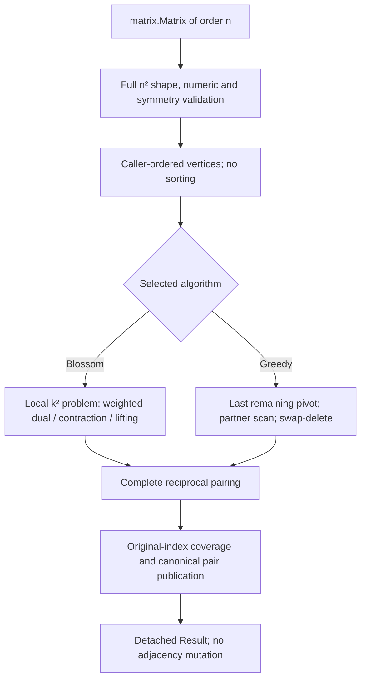
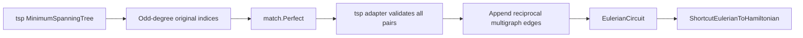

<!--
SPDX-License-Identifier: AGPL-3.0-only
Copyright (C) 2025-2026 katalvlaran

Package: github.com/lvlath/go/match
Authority: match/doc.go and the implemented exported Go API.
Focus: exact-or-error weighted Blossom; deterministic explicit Greedy;
       ordered original-index subsets; detached results; error classification.
-->

# Minimum-weight perfect matching: `match`

> **Independent combinatorial primitive.** `match` pairs an even number of
> selected matrix vertices. It does not construct a route, consume an MST,
> mutate a multigraph or invoke a weaker algorithm after a failed exact solve.

## 1. The mathematical question and its limits

Let `D` be an `n × n` finite, symmetric, nonnegative cost matrix and let
`vertices = [v₀, …, vₖ₋₁]` be an **ordered** list of `k` **distinct** original
matrix indices. The caller selects `k`, and a perfect matching covers every
selected vertex exactly once with exactly `k/2` unordered pairs.


The two supported algorithms answer different questions:

| Policy          | What a successful result establishes                                                                             | What it does **not** establish                                                                        |
|:----------------|:-----------------------------------------------------------------------------------------------------------------|:------------------------------------------------------------------------------------------------------|
| `match.Blossom` | A complete minimum-weight matching under the existing finite-`float64` numerical model and internal state checks | Independently exportable dual certificate; a universal runtime bound for this concrete implementation |
| `match.Greedy`  | A complete deterministic last-pivot pairing                                                                      | Global minimum, approximation ratio, Christofides guarantee                                           |

The input need **not** obey triangle inequality. Matching accepts a complete
*general* weighted graph and is not restricted to bipartite assignment.
Negative-weight matching, maximum-cardinality matching on an incomplete graph,
capacity constraints, time windows and sparse backends are not this API's
implemented domain.

**Operational units:** a weight can represent travel distance, relocation cost,
network latency, spare-part compatibility effort or a dimensionless penalty.
Every entry must use compatible units. Large finite penalties mean a pair is
*discouraged but possible*; this API has no forbidden-edge/`+Inf` matching mode.

## 2. Public API and safe entrypoints

```go
// Canonical facade; Blossom is selected by default.
func Perfect(dist matrix.Matrix, vertices []int, opts ...Option) (*Result, error)

// Value-policy facade: useful when a service stores its full Options object.
func PerfectWithOptions(dist matrix.Matrix, vertices []int, policy Options) (*Result, error)

// Explicit feasible heuristic; never claims optimality.
func GreedyPerfect(dist matrix.Matrix, vertices []int) (*Result, error)

type Algorithm uint8
const (
    Blossom Algorithm = iota
    Greedy
)

type Pair struct { U, V int }
type Result struct {
    Pairs     []Pair
    Cost      float64
    Algorithm Algorithm
    Optimal   bool
}

type Options struct { Algorithm Algorithm; Eps float64 }
type Option func(*Options) error

func DefaultOptions() Options
func WithAlgorithm(algorithm Algorithm) Option
func WithEpsilon(epsilon float64) Option
func (r *Result) IsNil() bool
func (r *Result) Clone() *Result
```

`DefaultOptions()` returns `{Algorithm: Blossom, Eps: 1e-12}`. A literal
`Options{}` is **not** a valid complete policy: zero epsilon is rejected. Use
`PerfectWithOptions` when the caller already owns a fully specified value;
otherwise choose `Perfect` with zero or more functional options.

```go
// No explicit options: exact-or-error.
exact, err := match.Perfect(dist, selected)

// Explicit heuristic: exactly the same Greedy kernel as WithAlgorithm(Greedy).
heuristic, err := match.GreedyPerfect(dist, selected)

// Stored policy: no additional kernel, no hidden fallback.
policy := match.DefaultOptions()
policy.Algorithm = match.Blossom
policy.Eps = match.DefaultEpsilon
fromPolicy, err := match.PerfectWithOptions(dist, selected, policy)
```

The declarations `dist` and `selected` in this illustration represent a
previously constructed `matrix.Matrix` and an ordered even vertex subset.
All production callers must check each `err` and the successful result before
reading fields. Functional options are applied *left to right*; a nil callback,
callback error or invalid intermediate policy stops the request **before any
matrix read**. Later callbacks cannot repair a previously rejected state.

### Result ownership and nilability

- `Result.Pairs` has length `k/2`, with each `Pair.U < Pair.V` and strictly
  increasing `U`. The entries are **original matrix indices**, not positions
  in the submitted subset.
- `Result.Cost` is the *unrounded* finite `float64` sum of the selected original
  weights. It is not the sum of transformed Blossom profits and not a TSP tour cost.
- `Result.Optimal` is true for successfully verified Blossom, false for Greedy.
  It does not contain an independently auditable dual witness.
- `Result.IsNil()` implements the common Nilable pointer contract; an empty
  but non-nil successful matching is **not nil**.
- `Result.Clone()` copies every scalar and detaches the pair slice; modifying a
  caller-owned `Result.Pairs` otherwise invalidates the relationship to `Cost`.
- The package does not mutate `dist` or `vertices` and does not retain either.
  Concurrent mutation of source matrix storage during solving is unsupported.

## 3. Exact subset semantics: local versus original indices

```text
Source cost matrix:  0 1 2 3 4 5 6 7
Caller vertices:     [5, 1, 7, 3]   (DO NOT sort)
Local Blossom ID:      0  1  2  3

Induced cost:
  local[0,2] == source[5,7]
  local[1,3] == source[1,3]

An example local matching: (0,2) and (1,3)
Result.Pairs: [{1 3}, {5 7}]
```

`match` validates the **entire original matrix** before accepting a nonempty
subset. Corruption in a matrix cell outside the selected vertices remains an
error. It then copies the ordered local `k × k` problem for Blossom; Greedy
uses the validated full-matrix copy directly. Neither the local search order
nor the solver's numerical tie-break uses sorted published pair order.



### Empty and malformed requests

1. Options are checked first, even on an empty request.
2. `len(vertices)==0` returns `&Result{Pairs: []Pair{}, Cost:0, ...}` without
   dereferencing the matrix. This never means “match all matrix vertices”.
3. Odd cardinality fails with `ErrOddVertices` **before** matrix access.
4. For a nonempty even subset, matrix validation and full copy precede
   duplicate/out-of-range subset validation.
5. On any failure `Perfect` returns `(nil, err)`; no partial pairing is
   presented as complete.

For the empty subset, Blossom publishes `Optimal=true` and Greedy publishes
`Optimal=false`, consistently with the selected algorithm's policy.

## 4. Weighted Blossom: preserved numerical mechanism

The engine first transforms the minimization objective to equivalent
maximization profits using the largest accepted local edge cost. Since every
perfect matching has exactly `k/2` edges, the transformation does not alter
which complete pairings minimize the original objective.

For a local edge `uv`, the doubled reduced-slack convention of the existing
engine is:


Tight edges, an alternating forest, contractions of odd cycles, dual-delta
updates and expansion/lifting of nested blossoms are handled by the original
migrated engine. Its core files remain package-private; a consumer never
constructs or mutates dual variables, blossom nodes, matching edges or mates.

```text
unmatched original vertices
    -> alternating forest rooted at exposed vertices
    -> scan tight edges in deterministic dense order
       -> GROW: label a new inner node and matched outer continuation
       -> SHRINK: contract an odd cycle whose outer endpoints share a root
       -> AUGMENT: connect distinct exposed roots; lift nested path choices
       -> DELTA: shift duals to expose a new tight event
       -> EXPAND: reopen eligible zero-dual inner blossoms in the forest
    -> commit a complete symmetric mate update
    -> repeat until k/2 disjoint edges exist
    -> verify matching and dual state; return raw original-edge cost
```

**Exact-or-error:** no fallback to Greedy exists. An engine invariant failure,
failed augmentation, missing finite dual movement, or arithmetic failure
must remain visible through `errors.Is`.

**Runtime caution:** the implementation has dense `O(k²)` edge storage but its
existing nested path-lifting can explore multiple alternating candidates.
Do **not** present the classic theoretical cubic weighted-Blossom bound as a
measured or proven worst-case bound of this particular code. Benchmark the
actual workload and Go toolchain.

## 5. Greedy: selection order is part of the contract

Unlike globally sorting all available edges, this heuristic repeatedly:

1. Takes the **last** vertex of its private `remaining` slice as pivot.
2. Scans potential partners from left to right.
3. Chooses the strictly cheaper candidate, or breaks a near tie by the smaller
   **original** endpoint under the fixed `symTol=1e-12` rule.
4. Removes the chosen partner by **swap-delete**, not stable deletion.
5. Accumulates the selected pivot-to-partner directional cost; then repeats.

```text
remaining = copy(vertices)
while len(remaining) > 1:
    pivot = pop_last(remaining)
    best = none
    for partner in remaining:
        if best is none or weight(pivot, partner) < bestWeight or
           (abs(weight(pivot, partner)-bestWeight) <= symTol and
            partner < bestPartner):
            best = partner
    append (pivot,best)
    remaining[bestIndex] = remaining[lastIndex]
    remove lastIndex
return complete pairing and selected-weight sum
```

For example, the symmetric four-vertex matrix

```text
      0    1    2    3
0     0    2    2    1
1     2    0  100    2
2     2  100    0    3
3     1    2    3    0
```

has three possible perfect matching costs: `5`, `4`, and `101`. The
historical last-pivot greedy selection specifically returns `{0,3}` and
`{1,2}` with cost **101**. Blossom returns `{0,2}` and `{1,3}` with cost
**4** (one valid minimum). `Greedy.Optimal` remains false even if it happens
to pick an optimum on another input.

## 6. Numerics, matrix admission and typed failures

The whole-matrix structural tolerance `symTol` is fixed at `1e-12` in the
current matching domain. `Options.Eps` independently controls Blossom's
numerical dual and local symmetry checks, and may be stricter. Accepted
near-symmetric original directional values are **not averaged**. This means
the raw published sum follows the algorithm's chosen original directions:
Blossom traverses pairs in increasing *local* index, while Greedy uses
last-pivot selection order. Reorienting output pairs does not recompute Cost.

| Sentinel                                               | Meaning                                                                           | Action                                                         |
|:-------------------------------------------------------|:----------------------------------------------------------------------------------|:---------------------------------------------------------------|
| `ErrInvalidOptions`                                    | Unknown strategy, invalid Eps, nil callback or invalid intermediate configuration | Fix the policy before retry                                    |
| `ErrOddVertices`                                       | Odd subset size                                                                   | Correct the selected vertex set; do not drop a vertex silently |
| `ErrInvalidVertices`                                   | Duplicate or invalid original indices                                             | Preserve unique original matrix indices                        |
| `ErrNilMatrix`, `ErrNonSquare`, `ErrInvalidDimensions` | Nonempty input cannot define a valid source square                                | Correct shape and nil state                                    |
| `ErrDimensionMismatch`                                 | Matrix backend read failure                                                       | Inspect preserved backend cause with `errors.Is`               |
| `ErrNaNInf`, `ErrNegativeWeight`, `ErrIncompleteGraph` | Dirty or disallowed edge-cost domain                                              | Repair source data; missing edges are not accepted             |
| `ErrAsymmetry` (`ErrNonSymmetric`)                     | Pairwise original symmetry violates tolerance                                     | Fix the model, not the tie rule                                |
| `ErrNonZeroDiagonal`                                   | Invalid self-distance                                                             | Make diagonal zero within accepted tolerance                   |
| `ErrInvalidMatching`, `ErrNoMatching`                  | Engine cannot publish reciprocal full coverage                                    | Investigate kernel failure; no fallback                        |
| `ErrNumericOverflow`                                   | Finite selected edge costs sum to a nonfinite number                              | Reassess physical units and magnitude                          |
| `ErrSizeOverflow`                                      | Integer allocation/address capacity cannot be represented                         | Reduce problem size or change algorithm class                  |

Some errors preserve multiple classifications with `errors.Join`, and matrix
read failures can retain the original backend cause. Compare with `errors.Is`;
error text is not a machine interface. `math.MaxFloat64`-scale finite edge
inputs are not rejected just because display rounding might overflow: matching
Cost is unrounded. Conversely, an actually overflowing sum returns an error.

**Allocation/ownership limits:** checked multiplication rejects impossible
sizes before `make`; there is no configurable memory quota, no recovery from
runtime out-of-memory, no context cancellation and no source snapshot-isolation
against concurrent mutation. These limitations must be handled by the caller's
resource admission policy.

## 7. Real workflow: dispatch pairing with an explicit safety decision

Consider a fleet coordinator with twenty scheduled vehicle handoff jobs. The
planning matrix expresses compatibility and repositioning effort in *score
units*, not distance; some cross-role assignments are expensive but permitted.
The executable [`match/example_test.go`](../match/example_test.go) embeds the
complete 20×20 fixture and compares two deterministic policies:

```text
handoffs=10 exact-score=12 greedy-score=109 avoidable-penalty=97
urgent assignment: airport-pickup <-> hospital-pickup
urgent assignment: airport-relay <-> hospital-relay
```

**Decision:** if ten assignments must be committed together and total
repositioning effort is the objective, use Blossom; if a feasible plan is
sufficient under a hard latency budget, request Greedy explicitly and treat the
output as a heuristic proposal. The interface does not check technician shift
availability, hard time windows or legal equipment incompatibility; incorporate
those in an upstream model or choose a constrained solver.

The same executable example file contains:

- Twelve geographically separated industrial radio endpoints: compute a
  greedy maintenance pairing, then **independently** check every selected link
  against an operational range policy; matching cost alone does not establish
  RF reliability.
- Twelve pump, rail and substation locations: compute an MST, take its
  odd-degree vertices, call `match.Perfect`, add reciprocal edges to the
  *caller-owned* multigraph, traverse an Eulerian circuit and shortcut it into
  a closed inspection route. All algorithm interfaces remain separate.
- Empty and odd-subset examples that demonstrate the different result/error laws.

### Minimal standalone four-job decision example

```go
package main

import (
    "fmt"
    "log"

    "github.com/lvlath/go/match"
    "github.com/lvlath/go/matrix"
)

func main() {
    data := []float64{
        0, 2, 2, 1,
        2, 0, 100, 2,
        2, 100, 0, 3,
        1, 2, 3, 0,
    }
    distances, err := matrix.NewDense(4, 4)
    if err != nil { log.Fatal(err) }
    if err = distances.Fill(data); err != nil { log.Fatal(err) }

    selected := []int{0, 1, 2, 3}
    exact, err := match.Perfect(distances, selected)
    if err != nil { log.Fatal(err) }
    heuristic, err := match.GreedyPerfect(distances, selected)
    if err != nil { log.Fatal(err) }

    fmt.Printf("exact=%v cost=%.0f optimal=%v\n", exact.Pairs, exact.Cost, exact.Optimal)
    fmt.Printf("greedy=%v cost=%.0f optimal=%v\n", heuristic.Pairs, heuristic.Cost, heuristic.Optimal)
    // Output:
    // exact=[{0 2} {1 3}] cost=4 optimal=true
    // greedy=[{0 3} {1 2}] cost=101 optimal=false
}
```

## 8. Integration boundary: Christofides belongs to `tsp`



`tsp.MatchingAlgo` is a **different enum** from `match.Algorithm`. The adapter
maps them explicitly; never cast enum integers. The TSP adapter validates
complete coverage, global endpoints and bounds before appending any half edge.
If validation fails, no matching edge is added. Since each selected endpoint
receives exactly one new neighbor, canonical ordering of disjoint public pairs
does not change any individual adjacency row.

The Christofides `1.5` theorem assumes a **complete symmetric metric** input
and **exact minimum-weight matching**. `match` does not test triangle inequality;
`tsp` cannot certify metricity merely because it got a successful matching.
Explicit Greedy matching in Christofides publishes no formal ratio.

## 9. Complexity and test gates

Let `n` be the whole source order and `k` the selected even subset size.

| Stage                                              | Time                                             | Additional memory                |
|:---------------------------------------------------|:-------------------------------------------------|:---------------------------------|
| Whole-matrix validation and dense copy             | `O(n²)`                                          | `O(n²)`                          |
| Blossom induced local cost copy                    | `O(k²)`                                          | `O(k²)`                          |
| Dense weighted Blossom edge and forest preparation | `O(k²)`                                          | `O(k²)`                          |
| Complete Blossom execution                         | Input/state-dependent; nested lifting may branch | Engine buffers beyond dense prep |
| Greedy last-pivot selection                        | `O(k²)`                                          | `O(k)` after source copy         |
| Coverage verification and pair normalization       | `O(k log k)`                                     | `O(k)`                           |
| Empty subset                                       | `O(number of supplied options)`                  | `O(1)`                           |

Executable public tests live **only in `package match_test`** and exercise:
small independent exact-rational/integer oracles, original-index permutation,
odd/empty inputs, error precedence, tiny/huge finite costs, greedy traps,
metamorphic vertex potentials, difficult nested-cycle families, stability,
Clone/nilability, fuzz seeds and public API benchmarks for
`k ∈ {10, 50, 100, 200}`.

```sh
go test ./match -count=1
go test -race ./match -count=1
go test ./match -coverprofile=match.cover
go tool cover -func=match.cover
golangci-lint run
```

Percentage coverage **alone** is not an optimality certificate. Contract tests
must continue validating independent objectives and error behavior even if
additional internal defensive branches remain unreachable via the public API.

## 10. Frequent mistakes

1. Sorting the input subset before solving, thereby changing numerical ties.
2. Treating `Pair.U` or `Pair.V` as local positions `0..k-1`.
3. Claiming Greedy exactness or a Christofides guarantee without a metric input.
4. Using epsilon to bypass whole-matrix structural symmetry admission.
5. Reading `Result.Pairs` without first checking `err` and the nonnil result.
6. Forgetting that a zero-length subset means **no selected vertices**.
7. Mutating matrix storage concurrently while a multi-pass solver is reading.
8. Conflating TSP's rounded tour cost with matching's unrounded raw Cost.
9. Assuming a formal polynomial runtime bound for this concrete nested lifting.
10. Modifying detached pairs after publication without recomputing domain cost.

For tour optimization read [`TSP.md`](TSP.md). For general library conventions
read [`TUTORIAL.md`](TUTORIAL.md) and [`FAQ_&_TIPS.md`](FAQ_%26_TIPS.md).
