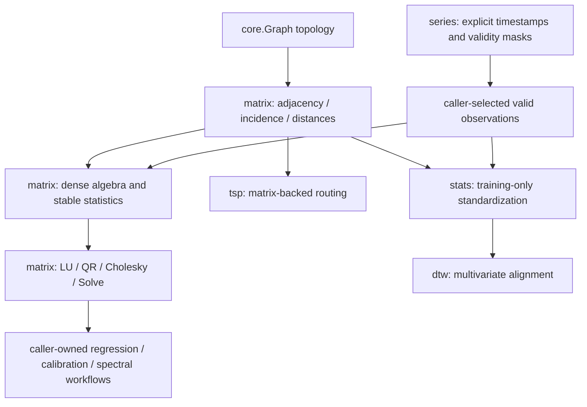

<!--
  SPDX-License-Identifier: AGPL-3.0-only
  Copyright (C) 2025-2026 katalvlaran

  File: docs/MATRICES.md
  Package reference: github.com/lvlath/go/matrix
  lvlath - Repository Documentation

  Purpose:
    This document is the repository-level specification, tutorial, and contract map
    for lvlath/matrix. It explains the deterministic dense matrix model, row-major
    memory layout, numeric policy, graph-to-matrix adapters, metric-closure workflow,
    zero-shape law, statistical transforms, and operational patterns that downstream
    graph and math algorithms rely on.

  Contract status:
    - Matrix shape, zero-shape, and row-major storage rules described here are part
      of the matrix contract.
    - Deterministic loop-order and graph-adapter publication rules described here
      are part of the matrix contract.
    - Numeric policy rules for NaN, -Inf, and +Inf described here are part of the
      matrix contract.
    - Adjacency, incidence, zero-weight, and metric-closure semantics described here
      are part of the matrix contract.
    - Sentinel-error semantics described here are part of the matrix contract.
    - Any incompatible change must be explicit, documented, and versioned.

  Scope:
    - Deterministic row-major dense matrices and no-copy views.
    - Graph-to-matrix and matrix-to-graph transformations.
    - Dense algebra facades, APSP/metric closure, sanitization, comparison, and statistics.
    - Reusable pivoted LU/Householder QR/Cholesky factors and strict solves.
    - Zero-shape behavior for structural matrix pipelines and sample-statistics constraints.
    - Allocation-aware patterns for reproducible computation.

  License:
    The lvlath repository is licensed under AGPL-3.0-only. See LICENSE.
-->

# 10. Matrices: Computational Engine & Graph Algebra

> **Package:** `lvlath/matrix` | **Focus:** Determinism, Cache Locality, Numeric Discipline, Graph-Semantics Fidelity

The `lvlath/matrix` package is the deterministic dense-algebra layer of `lvlath`. It turns graph topology into strict numeric artifacts, runs matrix kernels with reproducible traversal order, and preserves edge-case semantics that casual matrix helpers usually lose: zero-weight edges, empty shapes, incidence signs, `+Inf` unreachable sentinels, and caller-owned results.

This is not a bag of `[][]float64` snippets. It is a contract-driven matrix subsystem for algorithms that must be debuggable, deterministic, and mathematically explicit.

---

## 10.1. What & Why: The Architectural Paradigm

Why use `lvlath/matrix` instead of generic multidimensional slices, mutation-heavy math objects, or ad-hoc graph exporters?

### The Five Laws of Matrix

1. **Pure Functional Determinism**
    *   **The Problem:** Many libraries hide mutation behind method calls (`A.Mul(B)` mutates `A`) or rely on unstable map iteration while converting graph topology into numeric arrays.
    *   **The lvlath Way:** Public algebra facades such as `Product`, `Sum`, `Diff`, `T`, and `ScaleBy` publish new result artifacts instead of mutating their operands. Builders scan vertices and edges in stable order, and Floyd-Warshall updates only on strict improvement (`cand < current`) so equal-cost alternatives never create accidental tie drift.

2. **Hardware Sympathy Without API Leaks**
    *   **The Problem:** `[][]float64` scatters rows across the heap, increasing allocation count and destroying cache locality.
    *   **The lvlath Way:** `Dense` stores an entire matrix in one row-major `[]float64`. Hot kernels can unwrap `*Dense` and scan the flat buffer, while callers still use the safe `Matrix` interface.

3. **Safe Numeric Discipline**
    *   **The Problem:** Dirty floats (`NaN`, `+Inf`, `-Inf`) often leak into a pipeline and silently poison every downstream statistic or shortest-path result.
    *   **The lvlath Way:** `Dense` validates scalar writes through one gate. By default it rejects `NaN` and infinities. `+Inf` becomes legal only under an explicit distance/absence policy, where it means “no path” or “no edge”, never “unknown dirty value”.

4. **Graph-Semantics Fidelity**
    *   **The Problem:** Dense adjacency has one cell per vertex pair, so it can easily erase parallel edges, confuse zero-weight edges with absence, or export shortest-path distances as if they were literal graph edges.
    *   **The lvlath Way:** Adapters document and enforce their compression law: first-edge-wins or last-write-wins for dense adjacency, signed edge columns for incidence, `+Inf` absence for zero-weight preservation, and explicit refusal to export metric-closure matrices.

5. **Zero-Shape and Ownership Correctness**
    *   **The Problem:** Many libraries treat empty matrices as errors even when they are valid structural results, or return views that look like copies.
    *   **The lvlath Way:** `0×0`, `0×N`, and `N×0` are legal. `Clone` and `Induced` produce independent storage; `View` intentionally shares storage. Statistical metadata stays shape-correct even when there are no elements to process.

---

## 10.2. Architecture: Memory Model & Fast-Paths

To write high-performance matrix algorithms on top of `lvlath/matrix`, you must understand the storage law. A `Dense` matrix of size `R×C` is backed by a checked contiguous `[]float64` allocation (or a nil buffer for zero area). Elements of each row are contiguous.

$$ \text{offset}(i, j) = i \times C + j $$

where `C = Cols()`.

> [!NOTE]
> **Why this matters:** Row-major storage turns matrix scans into predictable sequential memory reads. This is the difference between a cache-friendly kernel and a heap-fragmented collection of row slices.

### 10.2.1. Visualization A: Logical Matrix to Physical Slice

```text
      Logical 2D Matrix (3x3)                     Physical 1D Flat Slice (len=9)
      ┌────────┬────────┬────────┐
Row 0 │ A[0,0] │ A[0,1] │ A[0,2] │ ─────┐
      ├────────┼────────┼────────┤      │   ┌──── Row 0 ───┐  ┌──── Row 1 ───┐  ┌──── Row 2 ───┐
Row 1 │ A[1,0] │ A[1,1] │ A[1,2] │ ───┐ └─►[ 0,0 | 0,1 | 0,2 | 1,0 | 1,1 | 1,2 | 2,0 | 2,1 | 2,2 ]
      ├────────┼────────┼────────┤    │                               ▲                 ▲
Row 2 │ A[2,0] │ A[2,1] │ A[2,2] │ ─┐ └───────────────────────────────┘                 │
      └────────┴────────┴────────┘  └───────────────────────────────────────────────────┘
                                        contiguous rows maximize CPU prefetching
```

### 10.2.2. Visualization B: Zero-Shape Matrices

Zero-shape matrices are structural matrices with no addressable cells. They are not failed allocations.

```text
Dense(0,4)                                                Dense(4,0)
┌ no rows ┐                                               ┌──── empty row 0 ────┐
│         │  cols = 4                                     ├──── empty row 1 ────┤  cols = 0
└─────────┘  data = nil                                   ├──── empty row 2 ────┤  data = nil
             CenterColumns -> means len 4: [0 0 0 0]      ├──── empty row 3 ────┤  CenterRows -> means len 4
             At(0,0) -> ErrOutOfRange                     └────────────────────┘  NormalizeRowsL1 -> norms len 4
```

### 10.2.3. The Hardware-Sympathy Rules

1. **Cache locality:** Row scans read contiguous floats.
2. **Allocation efficiency:** `Dense` needs one flat allocation for non-zero area.
3. **Fast-path unwrapping:** Kernels may type-assert `Matrix` to `*Dense` and run flat loops.
4. **Semantic equivalence:** Fast-path and generic fallback must produce the same result contract.

---

## 10.3. Core API Surface & Math Formulation

### 10.3.1. Matrix Interface

```go
type Matrix interface {
	Rows() int
	Cols() int
	At(i, j int) (float64, error)
	Set(i, j int, v float64) error
	Clone() Matrix
}
```

Contract:

* `Rows` and `Cols` are `O(1)`;
* `At` returns `ErrOutOfRange` on invalid coordinates;
* `Set` returns `ErrOutOfRange` or numeric-policy errors;
* `Clone` returns an independent matrix.

### 10.3.2. Dense Constructors and Ownership

```go
func NewDense(rows, cols int) (*Dense, error)
func NewPreparedDense(rows, cols int, opts ...Option) (*Dense, error)

func (m *Dense) Fill(data []float64) error
func (m *Dense) Clone() Matrix
func (m *Dense) Induced(rowsIdx, colsIdx []int) (*Dense, error)
func (m *Dense) View(r0, c0, rows, cols int) (*View, error)
func (m *Dense) Apply(f func(i, j int, v float64) float64) error
func (m *Dense) Do(f func(i, j int, v float64) bool)
```

`Clone` and `Induced` own new buffers. `View` shares base storage. `Apply` mutates in-place and is intentionally not all-or-nothing: earlier accepted writes remain if a later value violates policy.

### 10.3.3. Public Facades

| Group                  | Facades                                                                                          |
|:-----------------------|:-------------------------------------------------------------------------------------------------|
| Construction           | `NewZeros`, `NewIdentity`, `ZerosLike`, `IdentityLike`, `CloneMatrix`                            |
| Algebra                | `Sum`, `Diff`, `Product`, `HadamardProd`, `T`, `ScaleBy`, `MatVecMul`                            |
| Factorization          | `LUDecompose`, `QRDecompose`, `FactorLU`, `FactorQR`, `FactorCholesky`, `SolveLeastSquares`, `InverseOf`, `EigenSym` |
| Graph adapters         | `BuildAdjacency`, `GraphFromAdjacency`, `AdjacencyToGraph`, `BuildMetricClosure`, `DegreeVector` |
| APSP                   | `APSPInPlace`, `MetricClosure`                                                                   |
| Sanitization / compare | `Clip`, `ReplaceInfNaN`, `AllClose`                                                              |
| Statistics             | `CenterColumns`, `CenterRows`, `NormalizeRowsL1`, `NormalizeRowsL2`, `Covariance`, `Correlation` |

### 10.3.4. Math Formulation Summary

The public API is intentionally thin: facades delegate to canonical kernels and preserve their validation, loop order, and allocation model. The Jacobi eigensolver scans O(n²) entries to select each maximal off-diagonal pivot and updates O(n) entries, so its O(k*n²) bound is per k requested rotations; this is not a guarantee of convergence within k rotations.

| Facade API           | Operation             | Complexity             | Formulation & Notes                                                            |
|:---------------------|:----------------------|:-----------------------|:-------------------------------------------------------------------------------|
| `Sum(A, B)`          | Matrix sum            | $O(R \cdot C)$         | $$ C_{ij} = A_{ij} + B_{ij} $$                                                 |
| `Diff(A, B)`         | Matrix difference     | $O(R \cdot C)$         | $$ C_{ij} = A_{ij} - B_{ij} $$                                                 |
| `HadamardProd(A, B)` | Element-wise product  | $O(R \cdot C)$         | $$ C_{ij} = A_{ij}B_{ij} $$                                                    |
| `T(A)`               | Transposition         | $O(R \cdot C)$         | $$ C_{ij} = A_{ji} $$                                                          |
| `Product(A, B)`      | Matrix multiplication | $O(R \cdot N \cdot C)$ | $$ C_{ij} = \sum_k A_{ik}B_{kj} $$                                             |
| `ScaleBy(A, α)`      | Scalar scale          | $O(R \cdot C)$         | $$ C_{ij} = \alpha A_{ij} $$                                                   |
| `MatVecMul(A, x)`    | Matrix-vector product | $O(R \cdot C)$         | $$ y_i = \sum_j A_{ij}x_j $$                                                   |
| `LUDecompose(A)`     | Legacy unpivoted LU   | $O(N^3)$               | `A=L*U`; use `FactorLU` for row-pivoted solves.                                |
| `InverseOf(A)`       | Matrix inverse        | $O(N^3)$               | Delegates to the inverse kernel; singular matrices return sentinel errors.     |
| `EigenSym(A,tol,k)`  | Symmetric eigensolver | $O(k \cdot N^2)$       | Maximum-off-diagonal pivot scan per Jacobi rotation, with checked convergence. |
| `APSPInPlace(D)`     | Floyd-Warshall        | $O(N^3)$               | $$ D_{ij} \leftarrow \min(D_{ij}, D_{ik}+D_{kj}) $$                            |
| `Covariance(X)`      | Sample covariance     | $O(R \cdot C^2)$       | Scaled triangular moments; exact cancellation rescue when needed.              |
| `Correlation(X)`     | Pearson correlation   | $O(R \cdot C^2)$       | Direct normalized moments; zero row for constant features.                     |

> [!NOTE]
> **On determinants:** `lvlath/matrix` does not expose a determinant facade in the provided API. Use factorization-level workflows when you need structural information about singularity or invertibility.

---

## 10.4. Numeric Policy, Options & Configuration Visualized

Options are assembled left-to-right and finalized once by `NewMatrixOptions` / internal option gathering. They are runtime policy objects; they do not mutate graph topology.

```go
func NewMatrixOptions(opts ...Option) (Options, error)

func WithDirected() Option
func WithUndirected() Option
func WithWeighted() Option
func WithUnweighted() Option
func WithAllowMulti() Option
func WithDisallowMulti() Option
func WithAllowLoops() Option
func WithDisallowLoops() Option
func WithMetricClosure() Option

func WithValidateNaNInf() Option
func WithNoValidateNaNInf() Option
func WithAllowInfDistances() Option
func WithDisallowInfDistances() Option
func WithPreserveZeroWeights() Option
func WithAutoZeroWeights() Option
func WithEdgeThreshold(t float64) Option
func WithKeepWeights() Option
func WithBinaryWeights() Option
```

### 10.4.1. Numeric Admissibility

| Value        | Default Dense | `+Inf`-policy Dense |
|:-------------|:-------------:|:-------------------:|
| finite value |   accepted    |      accepted       |
| `NaN`        |   rejected    |      rejected       |
| `-Inf`       |   rejected    |      rejected       |
| `+Inf`       |   rejected    |      accepted       |

Finalization rules:

* `WithMetricClosure` forces `allowInfDistances=true`;
* `WithUnweighted` clears zero-weight preservation;
* `WithBinaryWeights` and `WithKeepWeights` are mutually exclusive;
* nil option slots return `ErrNilOption`.

### 10.4.2. Configuration Options: ON vs OFF

#### Directed vs Undirected

```text
Graph edge: A --5--> B

WithDirected                         WithUndirected
        A   B                                A   B
A     [ 0   5 ]                      A     [ 0   5 ]
B     [ 0   0 ]                      B     [ 5   0 ]

Directed writes one ordered cell. Undirected mirrors non-loop edges.
```

#### AllowMulti vs DisallowMulti

```text
Input edges in stable order:
  e1: A -> B weight 2
  e2: A -> B weight 8

WithAllowMulti                       WithDisallowMulti
        A   B                                A   B
A     [ 0   8 ]                      A     [ 0   2 ]
B     [ 0   0 ]                      B     [ 0   0 ]

Dense adjacency has one cell. AllowMulti means deterministic last-write-wins.
DisallowMulti means deterministic first-edge-wins.
```

#### AllowLoops vs DisallowLoops

```text
Input edge: A -> A weight 3

WithAllowLoops                       WithDisallowLoops
        A                                   A
A     [ 3 ]                         A     [ 0 ]

For +Inf-no-edge weighted adjacency, a missing loop remains +Inf in ordinary adjacency.
Metric closure normalizes distance diagonals later.
```

#### Weighted vs Unweighted

```text
Input edge: A -> B weight 42.5

WithWeighted                         WithUnweighted
        A     B                              A   B
A     [ 0   42.5 ]                   A     [ 0   1 ]
B     [ 0    0   ]                   B     [ 0   0 ]
```

#### PreserveZeroWeights

```text
Input edges:
  A -> B = 4
  A -> C = 0   real edge

Default weighted mixed profile selects +Inf absence automatically:
        A     B     C
A     [Inf    4     0]
B     [Inf   Inf   Inf]
C     [Inf   Inf   Inf]

All-zero weighted graphs need WithPreserveZeroWeights to avoid binary auto-degrade.
```

#### MetricClosure

```text
Normal adjacency                     Metric closure distance matrix
        A   B   C                            A      B      C
A     [ 0   5   0 ]                  A     [ 0      5     Inf ]
B     [ 0   0   2 ]                  B     [ Inf    0      2  ]
C     [ 0   0   0 ]                  C     [ Inf   Inf     0  ]

Metric closure is not adjacency anymore. ToGraph refuses it.
```

---

## 10.5. Graph-to-Matrix Adapters

Graph adapters convert string vertex IDs into integer coordinates. The low-level builders preserve the caller-provided vertex order; constructors that consume `core.Graph` rely on the deterministic order returned by `core`, while internal test helpers may defensively sort when canonical layouts are needed.

### 10.5.0. Conversion Pipeline

```text
 [core.Graph]              Stable Vertex Order               [matrix.AdjacencyMatrix]
 String IDs                Integer Mapping                   Dense Tensor Coordinates

  "Fiona"   ──────────►    0: "Alice"  ───────────────────► Row 0 / Col 0
  "Bob"     ──────────►    1: "Bob"    ───────────────────► Row 1 / Col 1
  "Alice"   ──────────►    2: "Fiona"  ───────────────────► Row 2 / Col 2

The adapter does not store vertex IDs inside cells. It stores numeric cells plus metadata.
```

### 10.5.1. Social Network Scenario

Consider a social platform where users send weighted directed messages.

```text
  [User Network Example]

           Fiona
       ↙︎    ↓    ↖
      ↓   ↗ Bob ↘︎  ↑
    Alice    ↓    Carol
      ↓     Eva     ↓
       ↘︎    ↑    ↙︎
           Dave
```

Edges:

* `Alice -> Bob = 5`
* `Alice -> Dave = 3`
* `Bob -> Carol = 2`
* `Bob -> Eva = 1`
* `Carol -> Dave = 4`
* `Carol -> Fiona = 6`
* `Dave -> Eva = 3`
* `Fiona -> Alice = 4`
* `Fiona -> Bob = 2`

### 10.5.2. Adjacency Matrix

Adjacency is a `V×V` matrix. It gives `O(1)` cell lookup and `O(V)` row scans for neighbors.

$$ A_{ij} =
\begin{cases}
w_{ij}, & (i,j) \in E \\
0, & \text{absent under classic encoding} \\
+\infty, & \text{absent under zero-preserving weighted encoding}
\end{cases} $$

#### Example: Weighted Adjacency (6×6)

|           | Alice | Bob | Carol | Dave | Eva | Fiona |
|-----------|:-----:|:---:|:-----:|:----:|:---:|:-----:|
| **Alice** |   0   |  5  |   0   |  3   |  0  |   0   |
| **Bob**   |   0   |  0  |   2   |  0   |  1  |   0   |
| **Carol** |   0   |  0  |   0   |  4   |  0  |   6   |
| **Dave**  |   0   |  0  |   0   |  0   |  3  |   0   |
| **Eva**   |   0   |  0  |   0   |  0   |  0  |   0   |
| **Fiona** |   4   |  2  |   0   |  0   |  0  |   0   |

Complexity:

* build: $O(V^2 + E)$ time, $O(V^2)$ space;
* lookup: $O(1)$;
* neighbors: $O(V)$ row scan.

### 10.5.3. Incidence Matrix

Incidence is a `V×E'` matrix where columns are effective edges after loop/multi filtering. It is the correct representation when edge identity matters.

$$ B_{u,k} = -1,\quad B_{v,k}=+1 \quad \text{for directed } u \to v $$

$$ B_{u,k} = +1,\quad B_{v,k}=+1 \quad \text{for undirected } u-v $$

$$ B_{u,k}=+2 \quad \text{for undirected self-loop } u-u $$

Directed self-loops are skipped because `-1` and `+1` cancel in the same row.

#### Example: Social Network Incidence (6×9)

Labeling edges $e_1$ to $e_9$ in the listed directed order:

|         | e₁ | e₂ | e₃ | e₄ | e₅ | e₆ | e₇ | e₈ | e₉ |
|---------|:--:|:--:|:--:|:--:|:--:|:--:|:--:|:--:|:--:|
| Alice   | -1 | 0  | -1 | 0  | 0  | 0  | 0  | 0  | +1 |
| Bob     | +1 | -1 | 0  | -1 | 0  | 0  | +1 | 0  | 0  |
| Carol   | 0  | +1 | 0  | 0  | -1 | -1 | 0  | 0  | 0  |
| Dave    | 0  | 0  | +1 | 0  | +1 | 0  | 0  | -1 | 0  |
| Eva     | 0  | 0  | 0  | +1 | 0  | 0  | 0  | +1 | 0  |
| Fiona   | 0  | 0  | 0  | 0  | 0  | +1 | -1 | 0  | -1 |

Complexity:

* build: $O(V + E)$ metadata/filtering plus $O(V \cdot E')$ dense storage;
* vertex incidence row copy: $O(E')`;
* endpoint lookup: $O(1)`.

---

## 10.6. Metric Closure & Floyd-Warshall

Metric closure converts direct adjacency into all-pairs shortest-path distances.

Distance matrix contract:

$$ D_{ii} = 0 $$

$$ D_{ij}=+\infty \quad \text{means no path from } i \text{ to } j $$

Relaxation law:

$$ D_{ij} \leftarrow \min(D_{ij}, D_{ik}+D_{kj}) $$

The implementation writes only on strict improvement:

$$ D_{ik}+D_{kj} < D_{ij} $$

Equal-cost alternatives do not overwrite existing values.

```text
Routing graph:

A ──5──▶ B ──2──▶ C
│        │        │
│        └─10──▶ D
└─12──▶ C ──2──▶ D

Initial distances:
        A     B     C     D
A       0     5    12    Inf
B      Inf    0     2     10
C      Inf   Inf    0      2
D      Inf   Inf   Inf     0

After APSP:
        A     B     C     D
A       0     5     7      9
B      Inf    0     2      4
C      Inf   Inf    0      2
D      Inf   Inf   Inf     0
```

Negative-cycle detection scans the final diagonal:

$$ \exists i: D_{ii} < -\epsilon \Rightarrow ErrNegativeCycle $$

`ToGraph` on metric closure returns `ErrMatrixNotImplemented`, because shortest-path distances are derived facts, not original edges.

---

## 10.7. Stable Statistical Operations

The statistical unit is **one observation per row and one feature per column**. The four finite-only public operations are:

```go
func CenterColumns(X Matrix) (Matrix, []float64, error)
func NormalizeRowsL2(X Matrix) (Matrix, []float64, error)
func Covariance(X Matrix) (Matrix, []float64, error)
func Correlation(X Matrix) (Matrix, []float64, []float64, error)
```

`CenterRows` and `NormalizeRowsL1` remain supported compatibility operations; do not infer that they use exactly the same finite-only, scaled-arithmetic contract.

### 10.7.1. Input shape, validation order, and ownership

| Input                                        | `CenterColumns`                           | `NormalizeRowsL2`                                                        | `Covariance` / `Correlation`        |
|:---------------------------------------------|:------------------------------------------|:-------------------------------------------------------------------------|:------------------------------------|
| `nil` or recognized typed nil                | `ErrNilMatrix`                            | `ErrNilMatrix`                                                           | `ErrNilMatrix`                      |
| Invalid dimensions / overflowing `rows*cols` | `ErrInvalidDimensions`                    | `ErrInvalidDimensions`                                                   | `ErrInvalidDimensions`              |
| `0×d`                                        | no-op, original Matrix and `d` zero means | no-op, original Matrix and empty norms                                   | `ErrDimensionMismatch`              |
| `n×0`, `n=1`                                 | no-op, empty means                        | no-op, original Matrix and `n` zero norms                                | `ErrDimensionMismatch`              |
| `n×0`, `n>=2`                                | no-op, original Matrix                    | no-op, original Matrix                                                   | new `0×0` result, empty metadata    |
| `n×d`, `n>=2`, `d>=1`                        | new owning Dense, `d` means               | new owning Dense, `n` norms                                              | new owning `d×d` Dense and metadata |
| NaN / either infinity in an addressable cell | `ErrNaNInf`                               | `ErrNaNInf`                                                              | `ErrNaNInf`                         |
| Required output outside finite binary64      | `ErrOverflow`                             | `ErrOverflow` (also matches historical `ErrNaNInf` for overflowing norm) | `ErrOverflow`                       |

Shape checks occur before reading elements. For covariance/correlation, the insufficient-sample check (`rows < 2`) precedes the zero-feature result path. Custom `Matrix.At` errors preserve their underlying error identity through wrapping. **No partial output or metadata is published on error.**

For nonempty transforms, output matrices and numeric metadata are detached from the input. For zero-element `CenterColumns` and `NormalizeRowsL2`, the returned `Matrix` intentionally **aliases the original**; the accompanying metadata is still freshly created. Concurrent modification of the input during any read pass is unsupported, including modification through a `View`.

### 10.7.2. Stable column means and centering

For a column of `n` observations, the mathematical target is:


Naively computing `sum(x)` before dividing overflows for `[1e308,1e308]`, even though the correct mean is `1e308`. The kernel first chooses an anchor `a_j` and a column-wide scale `s_j`, then accumulates bounded coordinates `v_ij=(x_ij-a_j)/s_j` using Neumaier compensation. The column mean is reconstructed **after** dividing by `n`.

```text
     finite input X[n×d]
            │
     nil + shape checks
            │
  read each finite x[i,j]
            │
  per-column anchor, scale
            │
  compensated relative sum
            │
  divide before rescaling
            │
  cancellation-sensitive mean?
         ┌──┴──┐
       yes     no
        │       │
  exact binary    scaled mean
  sum rescue      reconstruction
        └───┬───┘
            │
  center in stable coordinates
            │
     fresh Dense + means
```

A rounded mean does not necessarily equal the exact midpoint between adjacent large floating-point values. `CenterColumns` therefore centers in normalized coordinates or uses a retained high/low exact-mean representation rather than simply recomputing `x - publishedMean`. Do **not** reconstruct the centered matrix independently from the returned `means` slice when sub-ULP changes matter.

### 10.7.3. Sample covariance without an overflowing Gram matrix

The sample covariance is:


A conventional `Xcᵀ Xc` builds an intermediate sum of cross-products before division by `n-1`. That sum may overflow even when the final sample covariance fits. For `[-1e154,0,1e154]`, the desired sample variance is about `1e308` rather than infinity.

The implementation uses **one compact upper-triangular accumulator** for every pair `j <= k`. For normalized centered coordinates `u_ij`, it accumulates `M_jk=sum_i(u_ij*u_ik)` with compensation. Division by `n-1` occurs before restoring `s_j*s_k`; exponent-aware multiplication uses `math.Frexp`/`math.Ldexp`. The resulting one authoritative value is assigned to both `(j,k)` and `(k,j)`, preserving **bit-identical symmetry**.

```text
             feature columns
            0    1    2    3
         ┌────┬────┬────┬────┐
      0  │ M00│ M01│ M02│ M03│  Only this upper triangle
         ├────┼────┼────┼────┤  is accumulated.
      1  │    │ M11│ M12│ M13│
         ├────┼────┼────┼────┤  Publication mirrors each
      2  │    │    │ M22│ M23│  computed float64 exactly.
         ├────┼────┼────┼────┤
      3  │    │    │    │ M33│
         └────┴────┴────┴────┘

  No centered n×d copy, no transpose, no Gram n×d product copy.
```

The standard floating path is `O(nd²)` time with `O(d²+d)` extra state, excluding the `d×d` output. The rare exact-recovery path performs additional multiprecision work; do not claim constant-cost element arithmetic for every input.

### 10.7.4. Why scaled compensation alone is insufficient

Large signed terms may cancel while the only surviving cross-covariance is tiny. For observations `[(1e150,1),(-1e150,1),(1,-2)]`, the cross-covariance is exactly `-1` when the **original binary64 values** are interpreted mathematically; naive normalization can erase this contribution.

The selective rescue maps each finite IEEE binary64 number to an exact integer on the `2^-1074` lattice. For exact integer sums `S_j`, `S_k` and products `S_jk`, it evaluates:


The exact rational value is converted to float64 only at the output boundary. Exact integer accumulation avoids the per-observation allocation of a `big.Rat` and preserves a small signed survivor. **The fast-path trigger is an engineering roundoff heuristic**, not a proof of correctly rounded covariance over every possible binary64 input; independent rational and fuzz oracles guard the known regimes.

### 10.7.5. Pearson correlation without requiring finite covariance

For nonconstant features, Pearson correlation is the dimensionless ratio of the centered cross-moment and the geometric mean of the two centered sums of squares:


`Correlation` does not call `Covariance` and divide its materialized output. This separation matters when a covariance of order `1e400` cannot be represented but the correlation is `-1` and the returned standard deviations are finite (for example two perfectly anticorrelated columns with magnitude `1e200`).

A constant feature has correlation **zero with every feature, including itself**. A nonconstant feature has diagonal correlation exactly one. Small roundoff overshoots outside `[-1,1]` may be clipped only within the implementation's bounded machine-roundoff allowance; larger invalid coefficients cause `ErrOverflow`. For exceptional cancellation, the exact cross-covariance **and both exact variances** are reconstructed and the final ratio is evaluated at 512-bit `big.Float` precision. This still is not a universal correctly-rounded square-root oracle.

### 10.7.6. Row L2 normalization without premature squaring


The Blue/Golub recurrence maintains the largest encountered magnitude `scale` and a sum of squared ratios `ssq`; it never squares a raw `1e308` or prematurely underflows a subnormal coordinate. After validating each row's representable norm, it produces normalized cells using `(x/scale)/sqrt(ssq)` instead of a potentially overflowing or underflowing reciprocal.

* `[1e308]` has norm `1e308` and normalizes to `[1]`.
* `[math.SmallestNonzeroFloat64]` retains its smallest subnormal norm and normalizes to `[1]`.
* `[0,0]` stays `[0,0]` with norm `0`.
* `[math.MaxFloat64,math.MaxFloat64]` has an unrepresentable true norm and returns `ErrOverflow`, never a successful `+Inf` result.

### 10.7.7. Statistical use cases and boundaries

| Task                                             | Preferred API           | Key boundary                                                                  |
|:-------------------------------------------------|:------------------------|:------------------------------------------------------------------------------|
| Remove sensor baseline before anomaly scoring    | `CenterColumns`         | Use the returned centered matrix, not a second subtraction from rounded means |
| Estimate cross-channel variability               | `Covariance`            | Sample denominator `n-1`; symmetric `d×d`; may fail on true output overflow   |
| Identify signed relationships despite huge units | `Correlation`           | Can succeed when covariance overflows; constant feature → zero row            |
| Normalize geometric feature rows                 | `NormalizeRowsL2`       | Preserve exact zero row; report original norms                                |
| Fit immutable training-only feature scaling      | `stats.FitStandardizer` | Different package and semantics; no refit on heldout data                     |
| Compute streaming/partitioned scalar moments     | `stats.Moments`         | Separate 1-D accumulator contract                                             |

---

## 10.8. Go Usage Examples

### 10.8.1. Social Network Matrix Workflow

This example demonstrates the updated contracts: zero-weight preservation, loop policy, adjacency neighbors, incidence shape, metric-closure export refusal, and zero-feature covariance.

```go
package main

import (
	"errors"
	"fmt"
	"math"

	"github.com/lvlath/go/core"
	"github.com/lvlath/go/matrix"
)

func main() {
	g, err := core.NewGraph(core.WithDirected(true), core.WithWeighted(), core.WithLoops())
	if err != nil {
		fmt.Println("new graph:", err)
		return
	}

	// Example setup only: construction errors are intentionally ignored below to keep
	// the scenario readable. Do not repeat this shortcut in production code.
	_, _ = g.AddEdge("Alice", "Bob", 5)
	_, _ = g.AddEdge("Alice", "Dave", 3)
	_, _ = g.AddEdge("Bob", "Carol", 2)
	_, _ = g.AddEdge("Bob", "Eva", 1)
	_, _ = g.AddEdge("Carol", "Dave", 4)
	_, _ = g.AddEdge("Carol", "Fiona", 6)
	_, _ = g.AddEdge("Dave", "Eva", 3)
	_, _ = g.AddEdge("Fiona", "Alice", 4)
	_, _ = g.AddEdge("Fiona", "Bob", 2)
	_, _ = g.AddEdge("Grace", "Heidi", 0) // real zero-weight edge
	_, _ = g.AddEdge("Heidi", "Heidi", 0) // directed loop kept by adjacency when loops are allowed

	opts, err := matrix.NewMatrixOptions(
		matrix.WithDirected(),
		matrix.WithWeighted(),
		matrix.WithAllowLoops(),
		matrix.WithPreserveZeroWeights(),
	)
	if err != nil {
		fmt.Println("matrix options:", err)
		return
	}

	adj, err := matrix.NewAdjacencyMatrix(g, opts)
	if err != nil {
		fmt.Println("adjacency:", err)
		return
	}

	grace := adj.VertexIndex["Grace"]
	heidi := adj.VertexIndex["Heidi"]
	alice := adj.VertexIndex["Alice"]

	zeroEdge, err := adj.Mat.At(grace, heidi)
	if err != nil {
		fmt.Println("read Grace->Heidi:", err)
		return
	}
	absent, err := adj.Mat.At(grace, alice)
	if err != nil {
		fmt.Println("read Grace->Alice:", err)
		return
	}

	neighbors, err := adj.Neighbors("Grace")
	if err != nil {
		fmt.Println("neighbors:", err)
		return
	}

	inc, err := matrix.NewIncidenceMatrix(g, opts)
	if err != nil {
		fmt.Println("incidence:", err)
		return
	}
	erows, err := inc.VertexCount()
	if err != nil {
		fmt.Println("incidence rows:", err)
		return
	}
	ecols, err := inc.EdgeCount()
	if err != nil {
		fmt.Println("incidence cols:", err)
		return
	}

	metricOpts, err := matrix.NewMatrixOptions(
		matrix.WithDirected(),
		matrix.WithWeighted(),
		matrix.WithAllowLoops(),
		matrix.WithPreserveZeroWeights(),
		matrix.WithMetricClosure(),
	)
	if err != nil {
		fmt.Println("metric options:", err)
		return
	}
	closure, err := matrix.NewAdjacencyMatrix(g, metricOpts)
	if err != nil {
		fmt.Println("metric closure:", err)
		return
	}
	_, exportErr := closure.ToGraph()

	zeroFeatures, err := matrix.NewZeros(8, 0)
	if err != nil {
		fmt.Println("zero features:", err)
		return
	}
	cov, means, err := matrix.Covariance(zeroFeatures)
	if err != nil {
		fmt.Println("covariance:", err)
		return
	}

	fmt.Printf("Grace->Heidi weight: %.1f\n", zeroEdge)
	fmt.Printf("Grace->Alice absent: %t\n", math.IsInf(absent, 1))
	fmt.Printf("Grace neighbors: %v\n", neighbors)
	fmt.Printf("incidence shape: %dx%d\n", erows, ecols)
	fmt.Printf("metric export refused: %t\n", errors.Is(exportErr, matrix.ErrMatrixNotImplemented))
	fmt.Printf("zero-feature covariance: %dx%d means=%d\n", cov.Rows(), cov.Cols(), len(means))

	// Output:
	// Grace->Heidi weight: 0.0
	// Grace->Alice absent: true
	// Grace neighbors: [Heidi]
	// incidence shape: 8x10
	// metric export refused: true
	// zero-feature covariance: 0x0 means=0
}
```

The maintained runnable examples are in [`../matrix/example_test.go`](../matrix/example_test.go); run `go test ./matrix -run Example -count=1` from the repository root.

### 10.8.2. Field Sensor Calibration with Reusable Pivoted QR

A field team measures a response at five operating levels. Instead of multiplying by an inverse or constructing normal equations, it factors one tall design and solves **two simultaneously calibrated response channels**. The intercept and slope are returned in original predictor-column order, regardless of column pivoting.

```go
package main

import (
	"context"
	"fmt"
	"github.com/lvlath/go/matrix"
)

func main() {
	design, err := matrix.NewDense(5, 2)
	if err != nil {
		fmt.Println("design:", err)
		return
	}
	if err := design.Fill([]float64{1, 0, 1, 1, 1, 2, 1, 3, 1, 4}); err != nil {
		fmt.Println("fill design:", err)
		return
	}
	observations, err := matrix.NewDense(5, 2)
	if err != nil {
		fmt.Println("responses:", err)
		return
	}
	if err := observations.Fill([]float64{
		8, 5, 11, 7, 14, 9, 17, 11, 20, 13,
	}); err != nil {
		fmt.Println("fill responses:", err)
		return
	}
	ctx := context.Background()
	factor, err := matrix.FactorQR(ctx, design, matrix.FactorOptions{})
	if err != nil {
		fmt.Println("factor:", err)
		return
	}
	result, err := factor.Solve(ctx, observations)
	if err != nil {
		fmt.Println("solve:", err)
		return
	}
	for channel := 0; channel < result.Solution.Cols(); channel++ {
		baseline, err := result.Solution.At(0, channel)
		if err != nil {
			fmt.Println("baseline:", err)
			return
		}
		slope, err := result.Solution.At(1, channel)
		if err != nil {
			fmt.Println("slope:", err)
			return
		}
		fmt.Printf("channel %d: offset %.0f, slope %.0f\n", channel, baseline, slope)
	}
	fmt.Printf("rank %d; residuals %d; condition measured %t\n",
		result.Rank, len(result.ResidualNorms), result.ConditionEstimate >= 1)

	// Output:
	// channel 0: offset 8, slope 3
	// channel 1: offset 5, slope 2
	// rank 2; residuals 2; condition measured true
}
```

This example illustrates **factor reuse and multiple RHS**, not a promise that all future samples remain linear. A new design matrix requires a new factor; a new response matrix with unchanged design can reuse the same factor. Every result matrix and residual slice is detached. For the full calibration and rank-rejection examples, see [`../matrix/example_test.go`](../matrix/example_test.go).

---

## 10.9. Laws of Ownership, Concurrency & Publication

### Ownership

* Allocation-producing algebra and statistics functions return caller-owned matrices.
* `Clone` deep-copies `Dense` storage and preserves numeric policy.
* `Induced` materializes an independent copied submatrix.
* `View` returns a shared window. Mutations through the view are visible in the base matrix.

### Concurrency

`Dense` does not contain locks. Concurrent read-only access is safe when no goroutine mutates the matrix. Concurrent writes or read/write races require external synchronization.

Safe read-style operations include shape reads and `At` when the matrix is not being mutated. Unsafe concurrent operations include `Set`, `Fill`, `Apply`, and writes through `View`.

### Publication on Failure

Construction and transform functions return `nil` result artifacts with an error when validation or kernel execution fails. In-place functions may mutate before returning an error if the contract explicitly permits partial writes, as with `Apply`.

---

## 10.10. Pitfalls & Best Practices (Architectural Mastery)

> [!IMPORTANT]
> **1. Strict Error Policy: check sentinels, never parse strings.**
> Matrix errors are wrapped with operation context. Use `errors.Is(err, matrix.ErrOutOfRange)`, `errors.Is(err, matrix.ErrNaNInf)`, `errors.Is(err, matrix.ErrDimensionMismatch)`, and related sentinels. Error text is for diagnostics, not branching.

> [!CAUTION]
> **2. Zero is not always absence.**
> In classic adjacency, `0` means no edge. In zero-preserving weighted adjacency, finite `0` is a real edge and `+Inf` means no edge. Always interpret cells using the adjacency encoding selected by options.

> [!IMPORTANT]
> **3. `+Inf` can be semantic, but not in finite-only statistics or factors.**
> Use `WithAllowInfDistances` or `WithMetricClosure` only when `+Inf` means “no path” or “no edge”. Do not use it to smuggle invalid measurements through statistics. Sanitize dirty data with `ReplaceInfNaN` and domain-specific replacement values.

> [!WARNING]
> **4. Do not run Floyd-Warshall on raw `0/weight` adjacency.**
> A raw `0` would be interpreted as a zero-cost path if passed directly as a distance. Use metric-closure builders or distance initialization so off-diagonal absence becomes `+Inf` and diagonal entries become `0`.

> [!CAUTION]
> **5. Dense adjacency is not an edge ledger.**
> It has one cell per vertex pair. If you need edge-column identity, parallel-edge visibility, or incidence algebra, use `IncidenceMatrix` instead of trying to infer identity from adjacency values.

> [!NOTE]
> **6. Choose copy vs view deliberately.**
> Use `Induced` or `Clone` when downstream code needs independent lifetime. Use `View` only for intentional shared windows. Treat `View.Set` as a write into the base matrix.

> [!IMPORTANT]
> **7. Respect zero-shape matrices.**
> Do not reject `0×N` or `N×0` just because they contain no elements. They are valid structural results for pipelines, especially feature extraction and empty graph transformations.

> [!NOTE]
> **8. Avoid eager materialization in hot loops.**
> Algebra facades allocate result matrices. For repeated transformations, preallocate staging matrices with `ZerosLike`, use `Apply` for in-place transformations when partial-write semantics are acceptable, and keep `*Dense` operands in hot paths to unlock fast loops.

> [!IMPORTANT]
> **9. Resolve options once near the boundary.**
> `Options` are the policy snapshot. Build them once with `NewMatrixOptions`, check the error, and pass the resolved value through builders. This prevents split-brain behavior between adjacency, incidence, and export steps.

> [!CAUTION]
> **10. Do not export derived distances as topology.**
> Metric closure answers “what is the shortest distance?”, not “which edge exists?”. `ToGraph` refuses it intentionally with `ErrMatrixNotImplemented`.

---

## 10.11. Reusable Factorizations: Different Problems, Different Contracts

The new factors are **additive** to the existing algebra API. They are private, reusable snapshots of the accepted coefficient matrix, with per-call workspaces for solving many systems. They are not aliases to the historical two-matrix decomposition functions.

| Question                                                           | Use                                       | Mathematical relation  | Admissible shape |
|:-------------------------------------------------------------------|:------------------------------------------|:-----------------------|:-----------------|
| Solve nonsingular square `A*X=B`, with possible zero leading pivot | `FactorLU` → `LUFactor.Solve`             | `P*A=L*U`              | `n×n`, `n>=1`    |
| Fit full-column-rank model, many observations                      | `FactorQR` → `QRFactor.Solve`             | `A[:,perm]=Q*R`        | `m×n`, `m>=n>=1` |
| Solve a symmetric positive-definite coupling system                | `FactorCholesky` → `CholeskyFactor.Solve` | `A_accepted=L*Lᵀ`      | `n×n`, `n>=1`    |
| One-off least-squares coefficients                                 | `SolveLeastSquares`                       | Pivoted Householder QR | `m×n`, `m>=n>=1` |
| Preserve historical unpivoted two-matrix outputs                   | `LUDecompose` / `QRDecompose`             | `A=L*U` / `A≈Qᵀ*R`     | Square only      |

The relative rank cutoff is a **numerical decision**, not an exact algebraic rank certificate. Neither rank-deficient least squares nor an underdetermined (`m<n`) minimum-norm solution is silently replaced by regularization or SVD.

**Scale convention (important for reconstruction):** the table states mathematical relations in *original physical coordinates*. Internally each constructor divides its copied matrix by one positive global scale `s` to avoid premature arithmetic overflow. The packed LU obeys `P*(A/s)=L*U_packed`; therefore `P*A=L*(s*U_packed)`. Pivoted QR stores `A[:,perm]/s=Q*R_packed`, so the original-coordinate triangular factor is `s*R_packed`. Cholesky stores `A_accepted/s=L_packed*L_packedᵀ`; its physical lower factor is `sqrt(s)*L_packed`. These packed matrices are private and intentionally have no raw public getters. Never interpret their normalized entries as unscaled coefficients.

### 10.11.1. FactorOptions and validation order

```go
type FactorOptions struct {
    RankTolerance  float64
    ConditionLimit float64
}
```

* `RankTolerance == 0` means `2^-52 * max(m,n)`; a positive value is a finite relative cutoff against the largest absolute pivoted diagonal. Equality counts as rank loss. Negative or nonfinite values return `ErrInvalidOption`.
* `ConditionLimit == 0` disables **rejection**, not condition measurement. Nonzero values must be finite and `>=1`; a measured condition **strictly greater** than the limit returns `ErrIllConditioned`.
* `FactorLU`, `FactorQR`, and `SolveLeastSquares` accept a non-nil `context.Context`, validate options, then matrix presence, dimensions and finite input, followed by domain and computation. `FactorCholesky` takes explicit `absTol,relTol` rather than `FactorOptions`.
* All factor constructors and `Solve` return `nil` on error/cancellation, without a partial factor or partially published solution. A nil context is `ErrInvalidOption`; a canceled context preserves the original `context` error.

### 10.11.2. LU with deterministic partial row pivoting


For column `k`, choose the row with largest `abs(packed[i,k])` among `i>=k`. If magnitudes tie exactly, prefer the candidate whose **original row index is smallest**; then exchange the packed rows and their permutation entries. Store the multipliers below the diagonal and the upper panel above it. The reusable factor normalizes the copied coefficients by a positive scale to reduce avoidable intermediate overflow, and reports a measured `kappa_1(A)`.

```text
                     A (caller-owned)
                            │
                validate + detached copy
                            │
                  normalize by max magnitude
                            │
                 for k = 0,1,...,n-1:
                            │
                 choose |pivot| maximum
                 tie -> min original row
                            │
                 swap packed rows + P
                            │
                 eliminate trailing block
                            │
                 numerical rank test
                            │
                basis-solve condition test
                            │
                    immutable LUFactor
                            │
            ┌───────────────┴──────────────┐
         Solve(B1)                      Solve(B2)
      private workspace              private workspace
```

`LUFactor.Permutation()[i]` is the **original row index now at position `i`**. It is not the inverse map. A zero pivot is classified as `ErrRankDeficient` with `ErrSingular` also detectable via `errors.Is`; a nonzero pivot can still fail the relative numerical rank policy. `LUDecompose(A)` is historical **unpivoted** Doolittle and may refuse a matrix accepted by `FactorLU`; do not rewrite or reinterpret its old contract.

**Use case:** composition recovery when a laboratory assay equation has an initially zero sensitivity in the first measurement row. A stable LU row pivot solves the physical system without changing the meaning of its three unknown quantities. See `ExampleFactorLU_supplyBlend` in `matrix/example_test.go`.

### 10.11.3. Pivoted Householder QR for least squares


For `m>=n`, the factor stores the upper triangular `R`, compact below-diagonal Householder vectors and their scalar coefficients. Each step **recomputes the trailing column norms** to choose a pivot; exact norm ties are resolved by the smallest original column index. Applying the reflectors to `B` computes `Qᵀ*B` implicitly. After back substitution in pivoted coordinates, the solution is unpermuted into the original feature order.

```text
   observations A[m×n], responses B[m×r]
                     │
      column-norm pivot + Householder H₀
                     │
      column-norm pivot + Householder H₁
                     │
                    ...
                     │
      compact R + reflectors + perm
                     │
           apply Qᵀ to each RHS
                     │
            back substitute R
                     │
        undo column permutation
                     │
          coefficients X[n×r]
```

**Important:** recomputing norms every pivot is a stability-first strategy with a larger constant than the norm-downdate/recompute design of LAPACK `DGEQP3`. It has the same `O(mn²)` leading asymptotic regime, but is **not** literally DGEQP3. No full `m×m` matrix `Q` or normal equations `AᵀA` are constructed for the production solve.

For QR, `QRFactor.Permutation()[j]` is the original feature column at the pivoted position `j`. `SolveResult.Solution` is already returned in **original column order**. `Rank < n` rejects construction with `ErrRankDeficient`; `m<n` returns `ErrBadShape`. Condition diagnostics describe `kappa_1(R)`, **not** `kappa_2(A)`.

**Use case:** fit calibration coefficients from eight operating conditions for two physical sensor channels using the same eight-by-three design matrix. Call `FactorQR` **once**, then `Solve` for two RHS columns; see `ExampleFactorQR_multichannelCalibration`.

### 10.11.4. Cholesky with explicit symmetry and SPD checks


`FactorCholesky(ctx,A,absTol,relTol)` accepts a pair `(i,j)` only if:


Exactly symmetric pairs are accepted without evaluating a possibly overflowing tolerance expression. For accepted asymmetric pairs, the algorithm factorizes their **stable arithmetic midpoint**, published internally in both positions. It then checks each Cholesky diagonal update is strictly positive; no pivot is replaced by a guessed epsilon and no diagonal regularization is added.

```text
         A[n×n] and explicit tolerances
                       │
      validate finite entries, square shape
                       │
       compare off-diagonal (i,j) pairs
                /              \
         within tolerance     exceeded
               │                 │
         symmetric midpoint   ErrAsymmetry
               │
       normalize accepted matrix
               │
       each lower-triangle pivot > 0 ?
            /                 \
          yes                  no
           │                   │
       build L          ErrNotPositiveDefinite
           │
      immutable CholeskyFactor
           │
      Solve against accepted A
```

The order of these errors is important: symmetry tolerance failure (`ErrAsymmetry`) does not mean lack of positive definiteness (`ErrNotPositiveDefinite`). `absTol` is in matrix-entry units; `relTol` is dimensionless. Two zero tolerances require exact symmetry. A symmetric matrix with positive diagonal is **not necessarily SPD**.

**Use case:** correction of correlated sensor channels using a validated symmetric positive-definite coupling matrix; see `ExampleFactorCholesky_correlatedSensorFusion`.

## 10.12. SolveResult, Residuals, Conditioning and Concurrency

### 10.12.1. Ownership and geometry of a multi-RHS solution

```go
type SolveResult struct {
    Solution          Matrix
    Rank              int
    ResidualNorms     []float64
    ConditionEstimate float64
}
```

For `A` with `n` unknown coefficients and `r>=1` RHS columns, `Solution` is an owning `n×r` `*Dense`. `ResidualNorms` has length `r` and reports one Euclidean residual for **each** original RHS, preserving their order. `Rank` is the accepted numerical rank `n` on a successful full-column-rank factor. `ConditionEstimate` is a finite calculated diagnostic at least one; it is never an uncomputed default `0`.

The residual uses the original (or, for Cholesky, accepted symmetrized) coefficients:


Unlike a naive `float64` dot product, the current residual implementation converts each source coefficient and solution value to exact integers on the binary64 lattice, accumulates products and differences with `math/big.Int`, sums exact residual squares, then performs one high-precision square root and finite conversion. Thus an intermediate `A*x` can exceed the float64 range without silently corrupting a representable final residual. The cost is substantially higher than a float64/FMA dot product; there is no automatically selected FMA shortcut promising identical error behavior.

### 10.12.2. What ConditionEstimate does — and does not — certify


The implementation computes `||M||₁` and obtains columns of `M⁻¹` by solving `M*x=e_j` in ascending basis order, retaining the largest column absolute sum. Here `M=A` for LU and Cholesky and `M=R` for QR. It is an **`O(n³)` reference computation** on the computed factors, not an `O(n²)` Hager/Higham iterative estimator and not the ratio between the largest and smallest diagonal. Its finite binary64 result remains an approximate numerical diagnostic, not an exact certificate about the real-number system.

A small residual can coexist with a large forward coefficient error. When numerical quality matters, interpret both residuals and conditioning, and if needed compute a scale-aware backward error:


The package returns the residual and condition estimate; it does **not** presently publish this normalized backward-error formula as a separate API.

### 10.12.3. Cancellation and goroutine sharing

`FactorLU`, `FactorQR`, `FactorCholesky`, and `factor.Solve` periodically check `ctx.Err()` at column/row boundaries. They return no partial factor or `SolveResult` when canceled. A successfully constructed factor is an immutable owning snapshot, so two goroutines can safely call `Solve` concurrently with distinct **stable** RHS matrices; the factor never retains a mutable shared solve buffer.

```text
       immutable factor (A snapshot)
                  │
           ┌──────┴──────┐
           ▼             ▼
    goroutine A      goroutine B
       RHS-A           RHS-B
       work-A          work-B
          │               │
     result-A          result-B
    (detached)        (detached)
```

The original input `A`, a RHS `B`, and any `View` backed by these must remain unchanged during their respective reads. Factor safety **does not** make `Dense.Set`, `Fill`, `Apply` or concurrent writes through `View` race-safe.

### 10.12.4. Complexity and allocation planning

Let `m` be observations, `n` unknowns/features, `r` RHS columns, and `d` statistical feature count.

| Operation                      | Ordinary floating arithmetic  | Persistent / extra storage         | Caveat                                                 |
|:-------------------------------|:------------------------------|:-----------------------------------|:-------------------------------------------------------|
| `CenterColumns`                | `O(md)`                       | `O(md+d)` output and metadata      | Exceptional exact-mean recovery                        |
| `NormalizeRowsL2`              | `O(md)`                       | `O(md+m)`                          | Exact zero-row policy                                  |
| `Covariance` / `Correlation`   | `O(md²)`                      | `O(d²+d)` workspace + `d²` result  | Exact cross-moment rescue is more expensive            |
| `FactorLU`                     | `O(n³)`                       | `O(n²)`                            | Includes inverse-basis condition diagnostic            |
| `FactorQR`                     | `O(mn²+n³)`                   | `O(mn)`                            | Recomputed norms; no full Q                            |
| `FactorCholesky`               | `O(n³)`                       | `O(n²)`                            | Includes accepted-matrix copy and condition diagnostic |
| LU / Cholesky `Solve`, `r` RHS | `O(n²r)` before residuals     | `O(nr+n)` result and per-call work | Exact residual `O(n²r)` big-integer arithmetic         |
| QR `Solve`, `r` RHS            | `O(mnr+n²r)` before residuals | `O(mr+nr+n)` work/result           | Exact residual `O(mnr)` big-integer arithmetic         |

Theoretical element counts are checked before `make`, but the package does not promise that arbitrary memory demands fit the machine's available RAM. Benchmarks must separate factor construction from repeated `Solve`, compare `*Dense` and a generic `Matrix.At` fallback on identical fixtures, and report `allocs/op` as well as execution time.

## 10.13. Error Classification and Decision Table

Use `errors.Is(err, matrix.ErrXxx)`. Do not parse error strings or turn an error into an acceptable numerical result.

| Condition                                           | Sentinel / behavior                                        | Recommended caller action                                       |
|:----------------------------------------------------|:-----------------------------------------------------------|:----------------------------------------------------------------|
| Nil input or factor receiver                        | `ErrNilMatrix`                                             | Fix caller wiring                                               |
| Integer shape product overflows / invalid dimension | `ErrInvalidDimensions`                                     | Reject the requested size before allocation                     |
| Non-square LU or Cholesky                           | `ErrNonSquare`                                             | Choose an admissible solver/model                               |
| Wide or zero-size QR design                         | `ErrBadShape`                                              | Revisit the model; SVD is not implemented here                  |
| Right-hand-side row mismatch                        | `ErrDimensionMismatch`                                     | Align the observation count                                     |
| NaN / infinity in finite-only input                 | `ErrNaNInf`                                                | Validate or explicitly clean upstream data                      |
| Final arithmetic/diagnostic not finite              | `ErrOverflow`                                              | Rescale or reformulate the physical model; do not clip silently |
| LU zero pivot or deficient diagonal                 | `ErrRankDeficient`; exact singular case also `ErrSingular` | Remove redundancy or choose a different mathematical method     |
| QR numerical rank loss                              | `ErrRankDeficient`                                         | Inspect duplicated/collinear predictors                         |
| Symmetry exceeds explicit tolerance                 | `ErrAsymmetry`                                             | Fix the input or explicitly justify tolerances                  |
| Accepted symmetric matrix is not SPD                | `ErrNotPositiveDefinite`                                   | Do not silently apply diagonal jitter                           |
| Measured condition greater than `ConditionLimit`    | `ErrIllConditioned`                                        | Assess model scale/identifiability                              |
| Canceled context                                    | `context.Canceled` / `context.DeadlineExceeded`            | Retry with a new context if still relevant                      |
| Generic Matrix.At failed                            | Root error wrapped                                         | Use `errors.Is` on the original cause                           |

**No hidden fallback:** `SolveLeastSquares` never substitutes normal equations, ridge regularization, pseudo-inversion or SVD when QR rejects rank. A failed `FactorCholesky` is not silently retried with LU. Changing the optimization objective is a separate caller decision.

## 10.14. Validation Checklist and Operational Diagnostics

Independent tests should target the mathematical identity, not merely successful construction:

1. **Statistical truth:** `[1e308,1e308]` → finite exact constant mean and zero covariance; `[-1e154,0,1e154]` → finite sample variance; hidden cancellation → the signed surviving cross-moment. Check diagonal/constant-column correlation policy and bit-identical mirrored covariance cells.
2. **LU truth:** apply permutation to original `A`, reconstruct lower/upper factors with known small oracle fixtures, and compare the solved `A*X` to `B` using input-scale-aware residual bounds. Check equal-magnitude pivot tie-breaking by original row identity.
3. **QR truth:** validate column permutation mapping, `QᵀQ≈I`, `A[:,perm]≈QR`, and original-order solution coefficients. Do not construct `AᵀA` in the production algorithm merely because a small independent test oracle can do so.
4. **Cholesky truth:** check symmetry and SPD separately; compare with the *accepted midpoint* when tolerances are nonzero. Test indefinite-but-symmetric matrices, not just negative diagonals.
5. **Ownership and concurrency:** verify detached permutations, means, deviations, solutions and residuals; run `go test -race ./matrix` with multiple concurrent `Solve` calls and read-only inputs.
6. **Boundary classifications:** validate zero shapes, nil/typed-nil, nonfinite input, true output overflow, option precedence, rank rejection, canceled contexts, and condition-limit equality.
7. **Performance:** benchmark construction independently of solve, including large/tall shapes and exceptional exact-arithmetic paths. Recheck allocations after numerical changes.

The public examples in `matrix/example_test.go` exercise physical blending with LU, multichannel calibration with QR, correlated sensor correction with Cholesky, rank refusal, extreme row norms, and cancellation-sensitive covariance. They use actual public APIs and fixed `Output` expectations.

## 10.15. Package Boundaries and Downstream Integration



`matrix` does not import `stats` or `series`. `stats` may consume `matrix.Matrix`; therefore reversing that dependency would create an import cycle. `series` supplies ordered values and validity masks, not implicit interpolation. PCA, OLS, Ridge, and spectral clustering are downstream **workflows**, not automatically promised by `FactorQR` or `Covariance` alone; for example, PCA still requires a suitable eigendecomposition and a numerical validation strategy.

**Next reading:** [`TUTORIAL.md`](TUTORIAL.md) for the learning path, [`FAQ_&_TIPS.md`](FAQ_%26_TIPS.md) for failure handling, and [`../matrix/doc.go`](../matrix/doc.go) for the package charter and public law.

---

**lvlath/matrix**: deterministic dense algebra, explicit statistical and factorization contracts, and graph semantics without ambiguity.

> Next: [11. Traveling Salesman (TSP) →](TSP.md)
