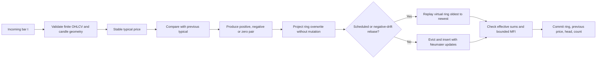

<!--
  SPDX-License-Identifier: AGPL-3.0-only
  Copyright (C) 2025-2026 katalvlaran

  File: docs/MFI.md
  Package reference: github.com/lvlath/go/mfi
  Purpose: mathematical, numerical, operational and API reference for Money Flow Index.
  Contract status: implemented mfi/rolling-neumaier/v1; aligned with the package's public Go API.
  Scope: fixed-transition OHLCV windows, batch/stream equivalence, state persistence,
         numerical limits, ownership, validation, applications and verification.
  License: AGPL-3.0-only; see ../LICENSE.
-->

# Money Flow Index (MFI): compensated rolling OHLCV analytics

> **One instrument, one volume unit, one causal rolling recurrence.** `mfi` computes a volume-weighted price-direction feature; it neither infers who traded nor decides what to trade.

## Contents

1. [Purpose and package boundaries](#1-purpose-and-package-boundaries)
2. [Public API and choosing a facade](#2-public-api-and-choosing-a-facade)
3. [Mathematical definition](#3-mathematical-definition)
4. [Precise window semantics and warmup](#4-precise-window-semantics-and-warmup)
5. [Stable floating-point arithmetic](#5-stable-floating-point-arithmetic)
6. [Compensated ring and deterministic rebase](#6-compensated-ring-and-deterministic-rebase)
7. [Validation, error precedence and atomicity](#7-validation-error-precedence-and-atomicity)
8. [Streaming lifecycle and ownership](#8-streaming-lifecycle-and-ownership)
9. [Snapshot wire layout, integrity and failover](#9-snapshot-wire-layout-integrity-and-failover)
10. [Executable Go usage](#10-executable-go-usage)
11. [Integration with other lvlath packages](#11-integration-with-other-lvlath-packages)
12. [Numerical and resource constraints](#12-numerical-and-resource-constraints)
13. [Performance and operational capacity](#13-performance-and-operational-capacity)
14. [Testing and independent mathematical oracles](#14-testing-and-independent-mathematical-oracles)
15. [Pitfalls and troubleshooting](#15-pitfalls-and-troubleshooting)
16. [Further reading](#16-further-reading)

---

## 1. Purpose and package boundaries

MFI combines the **direction of a typical-price change** with the **current candle's traded volume**. The output is a bounded numeric feature on `[0,100]`, calculated from the most recent `Period` transitions. It is suitable as one input to market-data dashboards, reproducible feature stores, risk-monitoring research and feed-quality reconciliation.

It is **not** evidence of institutional participation, a trade recommendation, a volume imbalance at the order-book level, a market microstructure model or a causal explanation of price movement. A high MFI means the rolling volume-weighted flow is dominated by transitions whose typical prices increased; it does not identify a participant or predict the next observation.

The package consumes either five aligned columns (`Bars`) or a chronological row slice (`[]Bar`). It does not inspect instrument IDs, exchange timestamps, source sequence numbers or trading sessions. This separation matters: a missing candle is not equivalent to a legitimate candle with `Volume=0`. Validate cadence and decide when to call `Reset` **outside** `mfi`.

Input-price unit must be consistent across all OHLC fields. Volume must use the same **base-asset unit** for every bar of a given series. Converting or mixing a base volume with quote notional midway through the window changes the numerical meaning. Independent instruments need independent streams.

### Contract at a glance

| Property            | Implemented guarantee                                                              |
|---------------------|------------------------------------------------------------------------------------|
| Mathematical window | Last `P` consecutive typical-price **transitions**, including zero contributions   |
| Warmup              | First bar seeds previous typical; first valid output is at zero-based index `P`    |
| Batch/stream        | Batch delegates each observation to the same `Stream.Push` recurrence              |
| Missing bar         | Caller responsibility; call `Reset` after a known gap when continuity is required  |
| Price/volume inputs | Finite, positive OHLC; finite, nonnegative base-unit volume; valid candle geometry |
| Results             | Detached `Values` and `Valid`, both length `n`; no partial batch result on error   |
| Stream              | Single-owner, mutable, no locks; failed `Push` is transactional                    |
| Persistence         | Detached, versioned snapshot with exact ring and compensation state                |
| Configuration       | `Period=0` means `14`; accepted explicit range `[1, 1<<20]`                        |
| Security            | Configuration hash establishes compatibility, **not** checkpoint authenticity      |

---

## 2. Public API and choosing a facade

The canonical entry points remain `Compute` and `New`. Convenience functions select arguments or project a canonical result; no convenience function implements an independent price/flow formula.

| Task                                                    | API                               | Cost and behavior                                                                 |
|---------------------------------------------------------|-----------------------------------|-----------------------------------------------------------------------------------|
| Produce a complete aligned OHLCV feature history        | `mfi.Compute(bars, opts)`         | Amortized `O(n+P)` time, `O(n+P)` memory                                          |
| Use the default 14-transition window                    | `mfi.ComputeDefault(bars)`        | Exact delegation to `Compute(bars, Options{})`                                    |
| Select a particular window without an `Options` literal | `mfi.ComputePeriod(bars, period)` | Exact delegation to `Compute`                                                     |
| Consume row-oriented market-data records                | `mfi.ComputeCandles([]Bar, opts)` | `O(n)` column transposition **plus** canonical computation                        |
| Read the final element of a complete batch              | `mfi.Latest(bars, opts)`          | Still scans and allocates for the full `Compute`; returns `(value, valid, error)` |
| Create a long-lived online filter                       | `mfi.New(opts)`                   | `O(P)` one-time allocation for two sign rings                                     |
| Create a standard-period stream                         | `mfi.NewDefault()`                | Same engine as `New(Options{})`                                                   |
| Create an explicit-period stream                        | `mfi.NewPeriod(period)`           | Same engine as `New(Options{Period:period})`                                      |
| Feed one current candle                                 | `stream.Push(bar)`                | Amortized `O(1)` time, zero allocation on the successful hot path                 |
| Establish a new continuous segment                      | `stream.Reset()`                  | `O(P)` clear; no new ring allocation                                              |
| Export a checkpoint                                     | `stream.Snapshot()`               | `O(P)` time **and detached allocation**                                           |
| Restore compatible state                                | `stream.Restore(snapshot)`        | `O(P)` validation and ring copy, atomic on error                                  |

### Public carriers and their ownership

```go
type Options struct { Period int }
type Bar struct { Open, High, Low, Close, Volume float64 }
type Bars struct { Open, High, Low, Close, Volume []float64 }
type Result struct { Values []float64; Valid []bool }
type Snapshot struct {
    Algorithm string
    Config string
    Count uint64
    FloatState []float64
    IntState []uint64
}
```

These declarations abbreviate the existing source for orientation; use [`../mfi/types.go`](../mfi/types.go) for the complete GoDoc. Input slices are caller-owned and read-only for the duration of a call. The package never retains them. The `Result` slices are new and caller-owned; they do not alias input columns or each other. `(*Result).IsNil()` reports pointer nilness, even when the pointer is held inside an interface; a valid allocated result containing empty fields is **not** nil.

**Selection rule:** use `Compute` if five columns already exist, `ComputeCandles` if a decoder already produces `[]Bar`, and a persistent `Stream` for high-frequency incremental processing. Repeated `Latest` calls for each arriving candle cost increasingly more than keeping one stream.

---

## 3. Mathematical definition

For valid bar `t`, the typical price is the arithmetic mean of the high, low and close:


**Open** is deliberately absent from that mean, but must still satisfy candle geometry. Let `V_t` denote the nonnegative base-unit traded volume, and define the raw money flow:


For `t >= 1`, compare the *current* typical price with the immediately preceding accepted one:


If typical prices are equal, **both** contributions are zero. With `V_t=0`, both contributions are also zero, regardless of the direction, but `TP_t` still becomes the baseline for the next transition. There is no tolerance-based equality rule: comparison is exact for the computed binary64 typical prices.

For the newest fully available window:


The fraction describes the **real-arithmetic objective**. The float64 implementation uses a stabilized equivalent instead of directly forming `P_t+N_t`, which could overflow. When both rolling sums are zero, the defined MFI is **50**, not NaN or an error.

Unlike a price-only RSI or the signed MACD line, MFI uses the magnitude of volume attached to each directional typical-price transition. It does **not** classify buy-initiated versus sell-initiated trades.

---

## 4. Precise window semantics and warmup

`Period=P` counts transitions, not candles and not nonzero flows. A first candle only initializes `previousTypical`. Consequently, `P+1` accepted bars are needed to publish the first valid value.

For `P=2`, fixed flat candles with `O=H=L=C` and `Volume=1`:

| Bar index | Typical | Classified transition    | Window after insertion | MFI / `Valid`   |
|----------:|--------:|--------------------------|------------------------|-----------------|
|         0 |       1 | no transition: seed only | empty                  | `0`, `false`    |
|         1 |       2 | positive 2               | `[+2]`                 | `0`, `false`    |
|         2 |       1 | negative 1               | `[+2, -1]`             | `200/3`, `true` |
|         3 |       3 | positive 3               | `[-1, +3]`             | `75`, `true`    |

Now replace the fourth candle with typical `1`, volume `100`. Typical has **not changed** from the third candle, so its contribution is `(0,0)`. Nevertheless it evicts the original `+2`, leaving `[-1,0]` and MFI **0**. Skipping this candle would yield a stale and incorrect signal.

Likewise, an authentic zero-volume candle must advance the window **and** update `previousTypical`. Do not treat it as a missing timestamp. If a feed truly lost a candle, its timestamp/sequence validator must make that decision; MFI cannot infer an absent observation from OHLCV values.

### Ring cursor visualization



`head` always points at the **next slot to overwrite**. Before the ring is full, `used` grows from 0 to `P`; then it remains `P`, and each transition replaces precisely one oldest slot. Physical slots are not sorted by price or by sign.

---

## 5. Stable floating-point arithmetic

### 5.1 A typical price near the float64 limit

Do **not** implement typical price as `(High + Low + Close) / 3`. When three finite prices are close to `math.MaxFloat64`, the intermediate sum overflows to `+Inf` while the final mean is representable.

With validated positive prices, `High` is the largest of the three operands. The implementation uses the High-anchored mean:


Both offsets are nonpositive and no intermediate exceeds the positive finite anchor. The arithmetic still rounds as binary64; it is an overflow-avoiding formula, **not** an exact-rational implementation. A computed nonfinite or nonpositive typical price results in `ErrOverflow`, without changing stream state.

### 5.2 Raw flow and representable sums

Every `TP_t * Volume_t` contributing to an upward or downward transition must be finite. The compensated sums and their effective `sum+correction` values must also be finite. The contract permits `ErrOverflow` when a raw flow or a necessary window sum is unrepresentable, **even if an arbitrary-precision final ratio would be representable**.

When typical price is unchanged or volume is zero, the contribution is exactly `(0,0)` without evaluating a potentially overflowing `TP*Volume`. This is a justified zero fast path, not dropped data.

### 5.3 MFI without a money-ratio overflow

For `P_t, N_t >= 0`, the implementation selects the branch with a bounded quotient:


| Effective sums         |               Published MFI |
|------------------------|----------------------------:|
| `P_t == 0`, `N_t == 0` |                `50` exactly |
| `P_t > 0`, `N_t == 0`  |               `100` exactly |
| `P_t == 0`, `N_t > 0`  |                 `0` exactly |
| Both strictly positive | Finite float64 in `[0,100]` |

The denominator in the general branch lies in `[1,2]`. Tiny quotients may underflow to zero in binary64; neither artificial clamping nor a domain-specific epsilon is introduced. A positive global rescaling of all volumes leaves the real-arithmetic ratio invariant **when the scaled flows and sums remain representable**; floating-point outputs need not have identical bits under scaling.

---

## 6. Compensated ring and deterministic rebase

A naïve update, `sum += new - old`, can accumulate rounding error for millions of evictions. Here positive and negative flows are kept separately in two float64 rings. Each rolling accumulator stores the pair `(sum, correction)` and processes signed updates in a fixed order:

1. Evict the old contribution as a **negative** update, but only when the ring is already full.
2. Insert the new nonnegative contribution.
3. Recover and validate the effective sum as `sum + correction`.
4. Detect negative drift and perform a bounded emergency rebase when permitted.
5. Compute the MFI and commit **only when every step succeeds**.

For an addition of `x` to accumulator sum `s`, Neumaier compensation is:


In code, `x` may be negative for eviction; the two compensators and ring arrays together define the true continuation state. Every intermediate and effective result is checked for finiteness.

### Scheduled full rebase

After every `P` **successful classified transitions**, the candidate sums are rebuilt from the virtual post-insertion ring. Elements are visited from the **logical oldest to newest**, even when their physical indices have wrapped. This path bypasses a soon-to-be-discarded incremental update, avoiding a preventable intermediate overflow when the new window is representable.

### Emergency rebase

If an incremental effective sum becomes negative, the implementation performs the same full replay **before commit**. Only one extra replay is permitted between scheduled boundaries. A second negative-drift event in that epoch returns `ErrOverflow` instead of issuing another unbounded `O(P)` pass. If a reconstructed effective sum remains negative, `ratio` rejects it with `ErrOverflow`; no clamp fabricates a nonnegative sum.

### Complexity proof

For `N` accepted transitions and fixed `P`, the number of scheduled scans is at most `floor(N/P)`. Each scan visits at most `P` entries, so scheduled work is `O(N)`. At most one emergency scan occurs in each epoch between scheduled scans, contributing another `O(N)` in aggregate. Other transitions do `O(1)` arithmetic. Therefore:

```text
New:                O(P) time and O(P) state
Push:               amortized O(1) time, O(P) worst-case when rebasing
Compute n bars:     O(n+P) amortized time, O(n+P) memory
Snapshot/Restore:   O(P) time; Snapshot allocates O(P), Restore reuses storage
Reset:              O(P) time, O(1) additional memory
```

The amortized guarantee is **not** a per-message latency bound. At `P=1<<20`, a scheduled rebase traverses more than a million slots; account for that in event-loop deadlines.

---

## 7. Validation, error precedence and atomicity

### 7.1 Batch admission

`Compute` uses the following precedence **before any candle is read**: invalid period, nil column, empty Open column, unequal column lengths. Thereafter bars are processed in ascending input index order. **Within a bar**, all five finiteness checks precede OHLCV geometry/domain checks; the **first failing bar** determines the returned sentinel. The implementation does not globally scan all bars for `NaN` before identifying an earlier domain error. This distinction matters when batches contain more than one type of fault.

`ComputeCandles` applies the same period check, then distinguishes `nil` and non-nil empty `[]Bar` before transposing rows. It delegates individual candle validation to canonical `Compute`/`Push`.

### 7.2 Domain

| Field                          | Accepted domain                                  |
|--------------------------------|--------------------------------------------------|
| `Open`, `High`, `Low`, `Close` | Finite and strictly positive                     |
| Geometry                       | `Low <= Open <= High`, `Low <= Close <= High`    |
| `Volume`                       | Finite and nonnegative, one consistent base unit |
| `Period`                       | `0` (normalizes to 14), or `[1, MaxPeriod]`      |
| Batch input                    | All five slices non-nil, same positive length    |

`NaN`, `+Inf` and `-Inf` are always invalid input data, even if a nonfinite field would not otherwise enter the typical-price formula. Negative volumes and malformed candles are **not** sanitized or clipped.

### 7.3 Sentinel protocol

| Sentinel           | Meaning and operational response                                                |
|--------------------|---------------------------------------------------------------------------------|
| `ErrInvalidOption` | Period outside admission range; validate the configuration before retrying      |
| `ErrNilInput`      | Missing batch slice, missing row slice or nil receiver for Push/Restore         |
| `ErrEmptyInput`    | Present but zero-length batch or row input                                      |
| `ErrShape`         | Parallel batch column lengths disagree; repair alignment at the data source     |
| `ErrNonFinite`     | At least one field of the current bar is NaN/Inf; reject the record             |
| `ErrDomain`        | Nonpositive price, negative volume or impossible OHLC geometry                  |
| `ErrOverflow`      | Raw flow, sum, typical arithmetic, unresolved drift or Count is unrepresentable |
| `ErrStateVersion`  | Incompatible or internally inconsistent Snapshot, or uninitialized Stream       |

Callers should use `errors.Is(err, mfi.ErrXxx)`, not parse error strings. `Push` checks nil/uninitialized receiver first, then bar validity, then Count overflow and arithmetic; a corrupted bar on a max-count stream is rejected for its bar fault first.

### 7.4 Transaction boundaries

`Push` stages candidate totals, cursor updates and the computed MFI **without** modifying the current rings. The only committed changes occur after all checks succeed. On error the returned pair is `(0,false)`, and every counter, ring slot, compensator and previous typical price remains unchanged. A failed `Compute` returns a nil `*Result`, not an incomplete prefix. `Restore` validates the entire candidate checkpoint before replacing any live field.

A short but valid input (`len(bars) <= Period`) is **success**, not a shape error: it produces length-aligned zeros plus an all-false `Valid` mask.

---

## 8. Streaming lifecycle and ownership

```text
Create New(opts)
   |
   v
Count=0, used=0, zero ring
   |
   +-- Push(first bar) --> Count=1, previous typical set, valid=false
   |
   +-- Push(next bar) --> one signed/zero pair added, valid after P transitions
   |
   +-- Snapshot --------> detached copy, can be authenticated and persisted externally
   |
   +-- Restore ---------> validate period, cursor, ring and totals before commit
   |
   +-- Reset -----------> clear history after a real feed gap; repeat warmup
```

`Stream` has no mutex and is **not safe for concurrent mutation**. Its canonical ownership model is one goroutine per stream. Concurrent `Push`, `Reset`, `Restore` or `Snapshot` on the same instance is unsupported. Distinct streams are independent and may run on different goroutines. The caller must synchronize any concurrent modifications to its own input arrays.

A nil `*Stream` accepts `Reset()` as a no-op and returns zero `Snapshot{}`. `Push`/`Restore` on nil receivers return `ErrNilInput`. A zero-value `Stream{}` has no configured ring: `Push`/`Restore` return `ErrStateVersion`; it must be constructed with `New`, not by assigning fields to an unexported struct.

For fault-tolerant ingestion, persist the **market source offset/sequence ID** alongside an authenticated Snapshot. On recovery, resume **after** the last bar represented by `Snapshot.Count`. Replaying the same bar twice is mathematically a second transition, so deduplication belongs to the feed consumer.

---

## 9. Snapshot wire layout, integrity and failover

The public ABI is intentionally fixed:

```text
Algorithm = "mfi/rolling-neumaier/v1"
Config    = lowerhex(SHA256(ASCII(Algorithm) || LE64(effective Period)))
Count     = number of accepted bars since New or Reset

FloatState = [previousTypical, sumPositive, sumNegative,
              correctionPositive, correctionNegative,
              positiveRing[0:P], negativeRing[0:P]]
IntState   = [used, head, extraRebaseUsed]
```

`Count` includes the seeding bar; transitions are `0` for `Count=0`, otherwise `Count-1`. For a valid checkpoint:

```text
used = min(transitions, P)
head = transitions mod P
extraRebaseUsed is either 0 or 1
```

The previous typical price is zero only before the first accepted bar. Ring entries are finite and nonnegative, and positive and negative entries may not both be strictly positive in the same physical slot. Unused slots remain zero. Effective saved sums must be finite, nonnegative and numerically consistent with the occupied ring.

### Validation and exact continuation

`Restore` checks the version/configuration/array sizes, Count-dependent cursor, epoch flag, prior typical price, sign exclusivity, unused slots and independently recomputed ring sums. The latter comparison uses a bounded normalized roundoff envelope:


Here `S` is the saved effective sum, `R` the replayed compensated sum and `M` the maximum relevant magnitude scale. This is a conservative corruption screen, **not** a proof that the state is reachable from a genuine market history or a cryptographic integrity check. No arbitrary epsilon is applied to live rolling sums.

An accepted restore copies the **saved** Neumaier `sum` and `correction`, both physical rings, count, cursor and previous typical. It does **not** replace saved data with the replayed validation sum. That distinction is necessary for bitwise continuation under the same implementation and floating-point environment.

### Configuration identity is not authentication

The `Config` SHA-256 covers only a public algorithm name and effective period; it does **not** cover the ring, counters or other floating-point state. A malicious actor can construct another self-consistent checkpoint with the same `Config`. For data sourced from storage, network or an untrusted worker, authenticate a canonical serialization of **all** checkpoint fields (for example using HMAC-SHA-256 or a digital signature) *before* calling `Restore`. Key management, replay protection and source offsets belong to the application.

Also preserve float64 precision through transport. A lossy decimal format, manual rounding of ring contributions or reordering of array slots can spoil exact continuation. The package does not supply its own encoding, storage service or secret management.

For an executable authenticated JSON/HMAC demonstration, see [`../mfi/example_test.go`](../mfi/example_test.go), `ExampleStream_Snapshot_authenticatedFailover`. For a standalone primary/standby scenario, run `go run ./examples/mfi` from the repository root.

---

## 10. Executable Go usage

### 10.1 A full batch with an explicit warmup mask

The following small program demonstrates the exact two-transition math; the larger executable example suite covers production-shaped workflows.

```go
package main

import (
    "fmt"

    "github.com/lvlath/go/mfi"
)

func main() {
    values := []float64{1, 2, 1, 3}
    bars := mfi.Bars{
        Open: values, High: values, Low: values, Close: values,
        Volume: []float64{1, 1, 1, 1},
    }
    result, err := mfi.ComputePeriod(bars, 2)
    if err != nil {
        fmt.Println("mfi:", err)
        return
    }
    fmt.Printf("valid=%v first=%.2f last=%.2f\n",
        result.Valid, result.Values[2], result.Values[3])
    // Output: valid=[false false true true] first=66.67 last=75.00
}
```

### 10.2 A live feed with a time-grid boundary

```go
// The market-data adapter is responsible for checking timestamps and source IDs.
stream, err := mfi.NewPeriod(14)
if err != nil {
    return err
}
for _, event := range events { // events are ordered by a caller-enforced sequence.
    if event.HasGap {
        stream.Reset() // A missing candle is not a zero-volume candle.
    }
    value, valid, err := stream.Push(event.Bar)
    if err != nil {
        return err // The state is unchanged; handle ingestion policy upstream.
    }
    if valid {
        consumeFeature(event.Instrument, event.Offset, value)
    }
}
```

This is **pseudocode showing an adapter boundary** (`events`, `consumeFeature` are application-defined), not a standalone executable program. For a complete runnable scenario, use [`../examples/mfi/main.go`](../examples/mfi/main.go). Never persist just the numerical `value` while discarding the `valid` flag or the source identity.

### 10.3 Five executable operational scenarios

The external `package mfi_test` examples use deterministic synthetic OHLCV fixtures with coherent candle geometry and meaningful volume magnitudes. The data are illustrative, not authenticated live exchange records, and no performance or profit claim is implied.

| Example                                        | Engineering question answered                                                                                                    |
|------------------------------------------------|----------------------------------------------------------------------------------------------------------------------------------|
| `ExampleCompute_crossAssetLiquidityReport`     | Can 50 separate instrument histories be screened with independent states and explicit readiness masks?                           |
| `ExampleStream_Push_tightRangePressure`        | Can a live feature be combined with an externally defined price-range review condition without contaminating the library's math? |
| `ExampleStream_Snapshot_authenticatedFailover` | Can a standby authenticate, restore and continue a compensated rolling state bit-for-bit?                                        |
| `ExampleStream_Reset_marketDataGap`            | How does a missing-minute interval trigger an explicit reset and fresh warmup?                                                   |
| `ExampleComputeCandles_replayReconciliation`   | Can a batch replay detect ingestion divergence caused by incorrectly discarding a valid zero-volume bar?                         |

Run with `go test ./mfi -run '^Example' -count=1 -v`. The canonical source is [`../mfi/example_test.go`](../mfi/example_test.go).

---

## 11. Integration with other lvlath packages

`mfi` stays independent of the other indicators. Compose at the application boundary, not through hidden package imports:

```text
OHLCV + timestamps + source ID
                |
       source validation / series grid policy
                |
        aligned, complete candles
                |
        +-------+--------+----------------+
        |                |                |
        v                v                v
    mfi Stream       rsi Stream       macd Stream
   (OHLCV)          (Close only)     (Close only)
        |                |                |
    MFI + Valid       RSI + Valid     Line/Signal/Histogram masks
        +----------------+----------------+
                         |
             caller-owned aligned feature record
                         |
                 analytics / storage / model
```

- [`series`](SERIES.md): validates cadence and missing whole slots. It does not fabricate candles for MFI or automatically call `Reset`.
- [`rsi`](RSI.md): measures smoothed positive/negative **closing-price changes**, without traded volume. Its warmup and recurrence are not interchangeable with MFI's.
- [`macd`](MACD.md): computes signed, SMA-seeded EMA separation and signal/histogram; it has separate readiness masks and no volume weighting.
- [`acf`](ACF.md): computes a whole-window sample-lag statistic, **not** a causal live MFI replacement. Do not feed MFI warmup placeholders into an estimator as true values.
- [`stats`](STATS.md), [`ols`](OLS.md), [`ridge`](RIDGE.md), [`pca`](PCA.md): downstream summarization and modeling can consume a selected valid feature history. Fit training-only parameters and avoid lookahead/leakage; the package does not define market strategies.

Do not normalize volume independently for each bar, mix instruments' base units or silently forward-fill missing bars. Each changes the mathematical experiment.

---

## 12. Numerical and resource constraints

| Limit               | Detail                                                                                                                  |
|---------------------|-------------------------------------------------------------------------------------------------------------------------|
| Period              | `DefaultPeriod=14`, `MaxPeriod=1<<20` = 1,048,576 transitions                                                           |
| Persistent rings    | `2*P*8` bytes = **16 MiB** at maximum period, excluding Go slice/Stream overhead                                        |
| Snapshot arrays     | Another `2*P` float64 cells plus five prefix fields and three `uint64`s                                                 |
| Time representation | No timestamps are stored or inferred                                                                                    |
| Price magnitude     | Finite, strictly positive binary64; stable typical price avoids three-term overflow                                     |
| Volume magnitude    | Finite, nonnegative binary64 in a consistent base unit                                                                  |
| Flow range          | Individual used products and effective rolling sums must be finite binary64                                             |
| Ratio               | Bounded branch avoids overflowing a combined sum; may round small ratios to zero                                        |
| Count               | `uint64`, checked against `math.MaxUint64` before accepting another bar                                                 |
| Restored indexes    | Untrusted `uint64` wire coordinates are checked and decoded into native `int` before array use                          |
| Runtime OOM         | The period ceiling rejects oversized **requests**; operating-system allocation failures are not converted to a sentinel |

Snapshot validation is `O(P)` and may allocate a small temporary decimal representation of two bounded cursor values as part of portable integer decoding. That path is **not** part of the zero-allocation `Push` hot loop.

---

## 13. Performance and operational capacity

A batch call allocates the output (`n` float64 values and `n` bool masks) and the two `P`-slot rings. `ComputeCandles` additionally transposes five `n`-length columns; where upstream storage already supplies separate columns, prefer `Compute` to avoid the extra copy.

`BenchmarkCompute` distinguishes `n=1,000` and `n=1,000,000`, each at `P=14` and `P=1000`. `BenchmarkStreamPush` measures an already warmed-up ring for `P=14`, `P=1000` and `P=MaxPeriod`. `BenchmarkStreamRebaseLatency` isolates scheduled rebase work and measures an observed p99 sample only once at least 100 measurements are available. These are measurement tools, **not** universal latency guarantees; they depend on CPU, load, Go version, memory pressure and the timer method.

```bash
go test ./mfi -run '^$' -bench '^BenchmarkCompute$' -benchmem
go test ./mfi -run '^$' -bench '^BenchmarkStreamPush$' -benchmem
go test ./mfi -run '^$' -bench '^BenchmarkStreamRebaseLatency$' -benchtime=120x -benchmem
```

For latency-sensitive gateways, size the period based on both steady-state throughput **and** scheduled rebase tail cost. If an event loop cannot tolerate an `O(P)` pause, that is an architectural scheduling question; do not silently disable the promised deterministic rebase to improve a benchmark number.

---

## 14. Testing and independent mathematical oracles

The package's tests live entirely in `package mfi_test` and use exported `mfi.` entry points. The acceptance grid intentionally includes both independent analytic expectations and metamorphic/transactional properties:

| ID         | Independent property                                                                                            |
|------------|-----------------------------------------------------------------------------------------------------------------|
| MFI01      | `P=2`, typical `[1,2,1,3]`, unit volumes -> `[0,0,200/3,75]` and `[F,F,T,T]`                                    |
| MFI02      | An unchanged transition occupies a slot and evicts the correct old contribution                                 |
| MFI03      | Entirely flat prices or zero volumes -> first valid output exactly 50                                           |
| MFI04      | Strict monotone movement -> 100 or 0 after warmup                                                               |
| MFI05      | Positive volume rescaling preserves the exact-real ratio in representable regimes                               |
| MFI06      | Zero-volume price changes update the previous typical and window position                                       |
| MFI07      | Invalid OHLCV yields `ErrDomain` and bit-identical unchanged state                                              |
| MFI08      | Alternating signs and repeated rebases agree with a separate rolling sum oracle                                 |
| MFI09      | Restore at every prefix split reproduces an uninterrupted continuation                                          |
| MFI10      | Oversized periods reject before allocation; unrepresentable flow returns `ErrOverflow`                          |
| Additional | Typical extremes, ratio without total-sum overflow, count saturation, tampered snapshots and typed-nil `Result` |

A batch/stream parity test alone cannot certify mathematical correctness because two consumers of the **same** incorrect kernel would agree. Therefore the suite also uses independent rational oracles for controlled inputs and explicitly checks bit patterns for Snapshot continuation and failed-state rollback.

The public `Result` adheres to `IsNil() bool` pointer-nilability; zero-warmup cells are not nil result values. Corrupt snapshots are rejected using `errors.Is(err, ErrStateVersion)`, without inspecting error strings or relying on reflection.

Recommended gates from the **real repository checkout**:

```bash
gofmt -w mfi/*.go examples/mfi/main.go
go test ./mfi -count=1 -cover
go test -race ./mfi -count=1
go test ./mfi -run '^Example' -count=1 -v
go test ./...
go vet ./...
golangci-lint run
```

If a verification tool or complete repository is unavailable, record that gate as **NOT RUN** rather than claiming success. Fuzzing should target public bar validation and the Snapshot decoder with the receiver's state verified unchanged on rejected candidates.

---

## 15. Pitfalls and troubleshooting

**Q: Why do my MFI values disagree after filtering bars?**

A: Removing zero-volume or unchanged-price candles shortens the transition clock and changes which signed flow expires. Retain every genuine candle and distinguish it from a truly missing observation.

**Q: Why is the first value valid at `P`, not `P-1`?**

A: The first candle provides only a previous typical price. `P` classified transitions require `P+1` bars.

**Q: Why is my valid result 0 or 50?**

A: Zero can be a genuinely negative-only window, while 50 is the documented all-zero-flow case. Use `Valid`; never infer readiness from the numeric value.

**Q: Why did a perfectly finite input fail with `ErrOverflow`?**

A: A product or rolling sum can be unrepresentable even when each individual price and volume is finite. The package refuses to substitute a fake capped number or an unbounded precision policy.

**Q: Why doesn't `Config` detect a forged `FloatState`?**

A: It hashes only the algorithm identity and period. Authenticate the **whole** serialized checkpoint externally and protect against replay.

**Q: Can I call `Latest` for every incoming candle?**

A: You can, but it recomputes and allocates for the entire batch each time. Use a retained `Stream` when incremental latency matters.

**Q: Is zero `Volume` an invalid candle?**

A: No. It contributes a zero pair, consumes one window slot and updates the previous typical price. A missing candle is a separate feed-integrity event.

**Q: May I share one `Stream` across workers?**

A: No unsynchronized concurrent use is supported. Give each worker/instrument a separate stream, or synchronize access outside the package.

**Q: Why might a single `Push` take much longer than its peers?**

A: Every `Period` successful transitions the candidate ring is replayed in `O(P)` time. This is necessary for the bounded numerical-drift policy despite amortized constant work.

**Q: Can MFI identify whale accumulation?**

A: It cannot identify trade participants. An application may combine the numeric feature with independent evidence and its own policies, but such conclusions are outside the algorithm's contract.

---

## 16. Further reading

- [`../mfi/doc.go`](../mfi/doc.go): package charter, real error precedence, ownership and non-goals.
- [`../mfi/api.go`](../mfi/api.go): canonical public operations and additive facades.
- [`../mfi/impl_flow.go`](../mfi/impl_flow.go), [`../mfi/impl_ring.go`](../mfi/impl_ring.go): one price/flow kernel and compensated rolling state.
- [`../mfi/snapshot.go`](../mfi/snapshot.go): exact Snapshot ABI and validation stages.
- [`../mfi/example_test.go`](../mfi/example_test.go): five runnable domain scenarios.
- [`../mfi/bench_test.go`](../mfi/bench_test.go): shape-aware workload definitions.
- [`TUTORIAL.md`](TUTORIAL.md): introduction and cross-package MFI integration.
- [`FAQ_&_TIPS.md`](FAQ_%26_TIPS.md): operational questions, errors, warmup and failover.
- [`lvlath_UES.md`](lvlath_UES.md): repository engineering standard.
