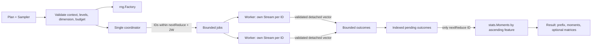

<!--
  SPDX-License-Identifier: AGPL-3.0-only
  Copyright (C) 2025-2026 katalvlaran

  File: docs/MONTECARLO.md
  Package reference: github.com/lvlath/go/montecarlo
  Purpose: reproducible parallel simulation, ordered moment reduction, and exact empirical quantiles.
  Contract status: implemented API; source of truth is ../montecarlo/doc.go and the current exported code.
  Scope: mathematical and operational contracts, public facades, reproducibility,
         memory admission, failures, ownership, performance, and practical models.
  License: AGPL-3.0-only; see ../LICENSE.
-->

# Monte Carlo: Reproducible Parallel Simulation and Streaming Reduction

> **Model-independent simulation driver, path-indexed randomness, canonical reduction order, bounded in-flight memory.**

`github.com/lvlath/go/montecarlo` runs independent, fixed-dimensional trials supplied by an application `Sampler`. Its job is to **execute**, **check**, **reduce**, and **publish** the experiment. It does not define asset returns, equipment failure distributions, confidence levels, pricing assumptions, or an importance-sampling model. Those remain caller responsibilities.

The central distinction is between *independent path generation* (which may be parallel) and *floating-point reduction* (which has one prescribed order). With a deterministic and concurrency-safe sampler, a complete experiment has bit-identical results across worker counts on the same platform and backend. Cancellation and simultaneous errors deliberately have weaker timing-dependent guarantees, described below.

## Contents

1. [Scope, dependencies, and non-goals](#1-scope-dependencies-and-non-goals)
2. [Public API and choosing a facade](#2-public-api-and-choosing-a-facade)
3. [Input validation and error precedence](#3-input-validation-and-error-precedence)
4. [How indexed parallel execution stays reproducible](#4-how-indexed-parallel-execution-stays-reproducible)
5. [Streaming mean, sample variance, and standard error](#5-streaming-mean-sample-variance-and-standard-error)
6. [Exact empirical quantiles](#6-exact-empirical-quantiles)
7. [Memory budget and honest complexity](#7-memory-budget-and-honest-complexity)
8. [Cancellation, terminal failures, and contiguous prefixes](#8-cancellation-terminal-failures-and-contiguous-prefixes)
9. [Ownership, concurrency, and panic boundary](#9-ownership-concurrency-and-panic-boundary)
10. [Runnable Go example: independently checked numerical oracle](#10-runnable-go-example-independently-checked-numerical-oracle)
11. [Operational scenarios and package composition](#11-operational-scenarios-and-package-composition)
12. [Error reference and troubleshooting](#12-error-reference-and-troubleshooting)
13. [Verification and benchmark regimes](#13-verification-and-benchmark-regimes)
14. [Rules that must not be changed by optimization](#14-rules-that-must-not-be-changed-by-optimization)

---

## 1. Scope, dependencies, and non-goals

A Monte Carlo estimate answers a statistical question about a *specified* model. It does not establish that the model is true. Each path is an independently generated vector of quantities the application wants to measure: discounted payoff and exercise indicator, portfolio loss, final crack length and failure indicator, daily unserved energy, or any other finite `float64` observables.

| Concern                                                              | Owner                       | Contract                                                                                 |
|:---------------------------------------------------------------------|:----------------------------|:-----------------------------------------------------------------------------------------|
| Model, units, correlations, calibration, and scenario interpretation | Caller `Sampler`            | `Dimension()` is fixed; `Sample(...)` returns one finite vector or an error              |
| Independent reproducible draws                                       | [`rng`](RNG.md)             | One `Factory.Stream(Seed,pathID)` per logical trial; factory version is recorded         |
| Scheduling and ordered publication                                   | `montecarlo`                | Fixed window relative to `nextReduce`; one coordinator reduces by ascending path ID      |
| Stable coordinate moments                                            | [`stats`](STATS.md)         | `stats.Moments.Update` and `Summary(1)` per feature, never worker-partition merges       |
| Optional returned matrices                                           | [`matrix`](MATRICES.md)     | `matrix.Matrix`; full data use an owning `*matrix.Dense` backend                         |
| Dependent-data block resampling                                      | [`bootstrap`](BOOTSTRAP.md) | Different operation: sample indices from existing data; not the Monte Carlo model/driver |

Non-goals include stochastic differential equation solvers, rare-event sampling schemes, cross-platform bitwise equality, random-number security, multivariate covariance, automatic confidence intervals, VaR/Expected Shortfall as built-in APIs, distribution fitting, and approximate memory-saving quantiles. An application can *model* these quantities in `Sampler` where the underlying mathematics warrants them.

### Execution architecture



The coordinator and worker pools have distinct ownership. Neither completion order nor the number of goroutines changes the order in which numeric values enter `stats.Moments`.

---

## 2. Public API and choosing a facade

The complete canonical surface is intentionally small:

```go
// Caller supplies a model whose output dimension never changes during Run.
type Sampler interface {
    Dimension() int
    Sample(ctx context.Context, pathID uint64, random rng.RNG) ([]float64, error)
}

type Plan struct {
    Paths           uint64
    Seed            uint64
    Workers         int
    RetainSamples   bool
    Quantiles       []float64
    MaxSamplesBytes uint64
}

func Run(ctx context.Context, plan Plan, sampler Sampler) (*Result, error)
func Estimate(ctx context.Context, paths, seed uint64, sampler Sampler) (*Result, error)
func EstimateParallel(ctx context.Context, paths, seed uint64, workers int, sampler Sampler) (*Result, error)
func RunWithQuantiles(ctx context.Context, plan Plan, levels []float64, sampler Sampler) (*Result, error)
func RunWithSamples(ctx context.Context, plan Plan, sampler Sampler) (*Result, error)
```

These are declarations for orientation; import the types and functions from the real package rather than copying declarations into your application.

| Facade                                      | Exact policy applied before `Run`           | Intended use                                           |
|:--------------------------------------------|:--------------------------------------------|:-------------------------------------------------------|
| `Run(ctx,plan,sampler)`                     | Use every field of `Plan`                   | Canonical experiment and the only numeric driver       |
| `Estimate(ctx,n,seed,sampler)`              | `Plan{Paths:n,Seed:seed}`                   | Serial mean/sample variance/SE without stored paths    |
| `EstimateParallel(ctx,n,seed,w,sampler)`    | `Plan{Paths:n,Seed:seed,Workers:w}`         | Parallel mean-only experiment                          |
| `RunWithQuantiles(ctx,plan,levels,sampler)` | **Replaces** `plan.Quantiles` with `levels` | Exact requested quantiles, other plan fields preserved |
| `RunWithSamples(ctx,plan,sampler)`          | Sets `plan.RetainSamples=true`              | Publish an addressable path-by-feature matrix          |

The `Plan` is passed by value. However, its `Quantiles` field is a slice: the caller must not concurrently mutate that backing array while `Run` validates and copies it. After successful validation, the driver uses its own detached levels. A zero seed is meaningful and **does not** select an ambient clock/entropy source.

### Meaning of `Result`

| Field                         | Contract                                                                                                         |
|:------------------------------|:-----------------------------------------------------------------------------------------------------------------|
| `Requested uint64`            | Original `Paths`                                                                                                 |
| `Completed uint64`            | Number of **successfully reduced consecutive IDs** `[0,Completed)`, never an arbitrary count of finished workers |
| `Complete bool`               | True only when all paths and requested final statistics complete with no error                                   |
| `Mean []float64`              | Feature-wise sample mean; nil with fewer than two committed paths or an unsuccessful final summary               |
| `SampleVariance []float64`    | Bessel-corrected sample variance (`ddof=1`), not a population variance                                           |
| `MeanStandardError []float64` | Standard error of each *mean*, not the standard deviation of individual outcomes                                 |
| `Samples matrix.Matrix`       | Non-nil only if retention requested and at least one path committed; shape `Completed × d`                       |
| `Quantiles matrix.Matrix`     | Non-nil only for **complete success with nonempty levels**; shape `q × d`                                        |
| `QuantileLevels []float64`    | Detached copy of requested levels on an execution result, including a partial result                             |
| `Seed uint64`, `RNG string`   | Seed and `rng.Factory.Version()` used to derive path streams                                                     |
| `(*Result).IsNil() bool`      | Nil pointer identity, implementing `core.Nilable`; **not** a success test                                        |

On success `Complete=true`, `Completed=Requested>=2`, all three moment vectors have length `d`, and no required published numeric output is nonfinite. Always check `err` **and** `Complete`: final statistics may fail after every path has been reduced, so `Completed==Requested` alone is insufficient.

---

## 3. Input validation and error precedence

The order is part of the contract. A cheap invalid option outranks a nil sampler, and preflight errors must prevent **every** `Sample` call.

```text
context presence / pre-cancellation
         |
Plan.Paths, Plan.Workers, ordered Quantiles
         |
Sampler presence / optional IsNil() check
         |
Sampler.Dimension() exactly once (>0)
         |
checked int/uint64 sizing and MaxSamplesBytes admission
         |
worker launch and Sample / reduction / quantiles
```

| Check                      | Allowed                                                                     | Failure                                                                          |
|:---------------------------|:----------------------------------------------------------------------------|:---------------------------------------------------------------------------------|
| `ctx`                      | Non-nil and active before validation                                        | Nil: `ErrInvalidOption`; pre-canceled: `ctx.Err()`                               |
| `Paths`                    | `>=2`                                                                       | `ErrInvalidOption`                                                               |
| `Workers`                  | `>=0`; 0 means 1; positive values capped by `Paths`                         | Negative: `ErrInvalidOption`; unrepresentable resource arithmetic: `ErrOverflow` |
| `Quantiles`                | Nil/empty or finite **strictly increasing** unique values in `[0,1]`        | `ErrInvalidOption`; input order is never changed                                 |
| `sampler`                  | Non-nil; recognized typed-nil when it implements `IsNil() bool` is rejected | `ErrNilInput`                                                                    |
| `Dimension()`              | Strictly positive and stable for the whole experiment                       | `ErrInvalidOption`                                                               |
| Raw/sort/output dimensions | Must fit checked integer arithmetic and native Go indexing                  | `ErrOverflow`                                                                    |
| Optional-buffer request    | Must not exceed configured `MaxSamplesBytes`                                | `ErrBudget`                                                                      |
| Each returned sample       | Exactly `d` finite components                                               | `ErrShape` or `ErrNonFinite`                                                     |

Go interface caveat: a third-party `Sampler` whose dynamic value is a typed-nil pointer but does *not* support `IsNil()` cannot be reliably detected without reflection. Such an input is a programmer-invalid sampler, not an authorization to use `reflect` or silently fabricate a dimension.

The sampler may return its own domain/context error. `Run` preserves the original identity for `errors.Is`. For unexpected dependency failures, `ErrDomain` or `ErrOverflow` can be joined with the underlying cause. Error text must not be parsed as a protocol.

---

## 4. How indexed parallel execution stays reproducible

Define the logical trial result with an explicit stream key:


Worker assignment does not appear in the formula. For a model whose `Sample` depends only on its declared inputs and its own stream, path `i` yields the same binary64 vector whether worker 1 or worker 8 happens to execute it.

Let `S_k` denote the coordinator's moment state after **exactly** the first `k` paths. It makes one prescribed update per coordinate:


*Base case:* the initial `stats.Moments` states are fixed, independent of worker count.

*Induction step:* the next eligible value is always `X_k` and the update order is `j=0..d-1`, so the same transition receives the same inputs and prior state. Thus full-success moment bit patterns are identical under the same implementation/backend. `Samples` retain row `k` at index `k`, and exact quantiles sort the same per-coordinate data. No floating-point associativity assumption is required.

**What this does not prove:** equivalence across different architectures or math libraries; equality for a sampler reading a global mutable counter; equality of the *partial length* after cancellation; or a deterministic winner when several independent paths fail concurrently. The first observed terminal cause wins, and observation order depends on scheduling.

### The sliding in-flight window is a resource invariant

For `W=min(Paths,max(1,Workers))`, the coordinator issues only:


```text
Example: W = 4, Paths = 1,000,000, path 0 is blocked

nextReduce = 0
allowed issue window: [0,8)

0: running slowly          4: completed and buffered
1: completed and buffered  5: completed and buffered
2: completed and buffered  6: completed and buffered
3: completed and buffered  7: completed and buffered

8, 9, 10, ..., 999999: NOT DISPATCHED
```

Until path 0 is reduced, `nextReduce` cannot advance. Therefore at most `2W` IDs can be issued within the window and pending/copy storage remains `O(W*d)`, not `O(Paths*d)`. The dispatcher does not enqueue every pending trial or allow faster workers to run arbitrarily far ahead.

A received success with ID above the first gap can be temporarily buffered; it is **never** reduced before the gap closes. A received error closes further dispatch, cancels the child context and initiates accepted-job drain.

---

## 5. Streaming mean, sample variance, and standard error

For `n=Completed>=2`, feature `j` has the following estimators:


The coordinator delegates each column to `stats.Moments.Update`. That implementation uses a compensated, scaled Welford central moment and separately protects the final mean using the exact sum of finite binary64 observations. The variance remains an approximation in finite precision, not a universal correctly rounded rational moment.

Its conceptual update for existing `n` observations and one new value `x` is:


The actual `stats` implementation uses extended-range arithmetic instead of evaluating all these intermediate quantities in plain binary64. This matters for constant `math.MaxFloat64` observations (mean `MaxFloat64`, variance `0`) and for finite sample variance where unnormalized `M2` would overflow ordinary float64.

After `Summary(1)`, the driver computes `MeanStandardError` as `sqrt(variance)/sqrt(n)`. Algebraically this is `sqrt(variance/n)`; the chosen evaluation avoids an avoidable underflow when `variance/n` falls below the smallest subnormal value while the standard error itself remains representable.

A successful variance of zero does not prove that the model has no uncertainty: it describes dispersion of the **sampled outputs**. Likewise a small SE reflects sampling precision under the model and independence assumptions, not parameter confidence or validation of the model.

### Mathematical oracle: four two-dimensional paths

For the path outputs `[id,2*id]`, IDs `0,1,2,3`:

| Quantity            |    Feature 0 |   Feature 1 |
|:--------------------|-------------:|------------:|
| Mean                |        `1.5` |         `3` |
| Sample variance     |        `5/3` |      `20/3` |
| Mean standard error | `sqrt(5/12)` | `sqrt(5/3)` |

These values can be obtained independently of the RNG and are protected by `MC01` and related tests.

---

## 6. Exact empirical quantiles

Quantile levels are **probabilities of sorted observations**, not percent labels automatically sorted by the driver. For each column, the driver gathers its `N` path values into one scratch slice, sorts that copy and applies the continuous type-7 empirical rule:


The exactness claim means **all N observations participate**, rather than a histogram/t-digest approximation. Binary64 interpolation still rounds. Sorting a private column buffer never reorders `Samples` rows (which remain indexed by original `pathID`).

### Avoid overflowing a representable interpolation

The tempting identity `a + f*(b-a)` can overflow when `a=-math.MaxFloat64` and `b=+math.MaxFloat64` despite the mathematical midpoint being zero. The implementation uses:

```text
fraction == 0 or a == b -> a
fraction == 1           -> b
opposite signs           -> (1-fraction)*a + fraction*b
same sign                -> a + fraction*(b-a)
```

The difference of two finite same-sign ordered endpoints is bounded; the convex combination of opposite-sign endpoints avoids the overflowing subtraction. Exact endpoints are preserved at levels 0 and 1. This is sign-aware *float64* interpolation, not a claim of arbitrarily precise rational quantiles.

For the four-path oracle above and levels `[0,.25,.5,1]`:

| Probability | Feature 0 | Feature 1 |
|:------------|----------:|----------:|
| `0`         |       `0` |       `0` |
| `.25`       |     `.75` |     `1.5` |
| `.5`        |     `1.5` |       `3` |
| `1`         |       `3` |       `6` |

**Important limitation:** if the *required sample variance* cannot be represented as finite binary64, `Run` returns `ErrOverflow` even when a standalone quantile is representable. For the two-point set `[-MaxFloat64,+MaxFloat64]`, the mathematical median is zero but the sample variance is unrepresentable. The driver must not quietly publish a complete result as though that other output succeeded.

---

## 7. Memory budget and honest complexity

Let `N=Paths`, `d=Dimension()` and `q=len(Quantiles)`. The default `MaxSamplesBytes` is **64 MiB**; a zero plan value selects that default rather than unlimited memory.

The admission limit applies to **optional sample, sort and quantile backing buffers**:

| Mode                            | Preflight-counted raw buffer | Column sort scratch | Quantile matrix |
|:--------------------------------|:-----------------------------|:--------------------|:----------------|
| Mean-only, no retained samples  | `0`                          | `0`                 | `0`             |
| `RetainSamples=true`, no levels | `8*N*d`                      | `0`                 | `0`             |
| Levels requested, no retention  | `8*N*d`                      | `8*N`               | `8*q*d`         |
| Both retention and levels       | `8*N*d` **once**, not twice  | `8*N`               | `8*q*d`         |


Every product and sum is checked before the first `Sample` call. A native `int` representation is also required for dense/slice-backed dimensions. Overflow returns `ErrOverflow`; a representable request greater than the ceiling returns `ErrBudget`.

For `N=100,000`, `d=5`, `q=3`, the counted allocation is `4,000,000 + 800,000 + 120 = 4,800,120` bytes (about 4.58 MiB). The output `Samples` is still `nil` if `RetainSamples=false`, even though a private raw sample buffer is necessarily used to compute exact quantiles.

**The limit is not a physical RSS ceiling.** It excludes `stats.Moments` state, worker goroutine stacks, channel/map metadata, bounded detached in-flight vectors, arbitrary sampler allocations, and runtime overhead. It also cannot convert OS/runtime out-of-memory failure into a guaranteed recoverable Go error. Applications must account for those costs separately.

### Time and space by regime

Let `C_sample` represent user-model work across all paths, and let `W` denote effective workers.

| Mode                              | Total driver work excluding model                       | Additional driver memory (excluding model) |
|:----------------------------------|:--------------------------------------------------------|:-------------------------------------------|
| Mean-only                         | `O(N*d)`                                                | `O(d+W*d)`                                 |
| Retained, no quantiles            | `O(N*d)`                                                | `O(N*d+W*d)`                               |
| Exact quantiles (retained or not) | `O(N*d log N)` sorting plus `O(N*d)` sampling/reduction | `O(N*d+N+q*d+W*d)`                         |

Parallel worker scheduling can reduce elapsed *sampler* time but it does not parallelize moment reduction and does not promise linear speedup. A blocked low-ID path can stall reduction of higher IDs while still respecting the finite window.

Partial retained results expose only `Completed × d` addressable cells but keep the original full allocated `N × d` Dense backing alive. `Samples.Clone()` makes a new detached compact matrix containing only visible rows if the calling application needs to free the original larger backing.

---

## 8. Cancellation, terminal failures, and contiguous prefixes

There are three materially different outcomes:

| Phase/outcome                                      | `Result`                                    | Error                  | Observable payload                                             |
|:---------------------------------------------------|:--------------------------------------------|:-----------------------|:---------------------------------------------------------------|
| Validation or budget failure before compute        | `nil`                                       | Sentinel/context error | No trial started                                               |
| Complete success                                   | Non-nil; `Complete=true`, `Completed=Paths` | `nil`                  | All finite summaries; requested quantiles and/or sample matrix |
| Runtime sampler, context, or final numeric failure | Non-nil; `Complete=false`                   | Original/joined error  | Only committed consecutive path prefix; quantiles nil          |

At the first **observed** terminal failure, dispatch stops, the child context is cancelled, already accepted jobs are drained and the pool is joined. A successful later outcome cannot bridge a missing earlier ID. The coordinator may still commit earlier *already issued* successful outcomes that arrive while draining, so `Completed` is a true contiguous prefix, not necessarily the number complete at the instant cancellation was first seen.

```text
Issued:       0  1  2  3  4  5  6
Outcomes:     ✓  ✓  ✕  ✓  ✓  ?  ?
Published:    0  1
Completed:    2
Discarded:          3  4  (cannot skip failed path 2)
Quantiles:    nil
Complete:     false
```

If `Completed<2`, all moment vectors are `nil`; if `Completed>=2` and the partial summary succeeds, the moment vectors describe exactly that prefix. If the **final numeric summary** itself fails, the vectors can remain nil even when `Completed` equals `Paths`. Thus `Complete` and `err`, not only `Completed`, control consumer decisions.

A parent context cancelled *before* validation returns `(nil,ctx.Err())`. A cancellation during execution can return a partial result. A cancellation during final quantile sorting also prevents `Complete=true` and quantiles publication. The exact prefix length can differ with scheduling or worker count; bitwise-worker parity is promised only for full successful runs.

**Shutdown latency is cooperative.** Go cannot stop a user `Sampler` that loops forever or ignores `ctx.Done()`. The driver waits for accepted work to terminate; it does not offer a guaranteed timeout for uncooperative arbitrary model code.

---

## 9. Ownership, concurrency, and panic boundary

### Who owns what?

- A single path invocation owns its freshly constructed `rng.RNG`. It must not be shared with other goroutines, future paths, or a pool-wide cache.
- A worker **copies** the returned `Sample` slice before validating and sending it. A sampler must not mutate the returned slice asynchronously after return; that is a race even if the driver copies promptly.
- `Plan.Quantiles` is caller-owned on entry, then copied into internal configuration; `Result.QuantileLevels` is detached again for public ownership.
- After return, `Result.Mean`, `SampleVariance`, `MeanStandardError`, `QuantileLevels`, `Samples` and `Quantiles` are caller-owned artifacts. They are detached from the sampler's reusable buffers and do not point to mutable active driver state.
- On successful retention, `Samples` is a dense matrix. A partial retained result exposes a private Matrix-compatible prefix view of the original budgeted Dense allocation. Its rows outside `[0,Completed)` are inaccessible. `Clone()` returns a detached compact matrix.
- `Result.IsNil()` classifies a nil receiver, not `Complete=false`, absent quantiles, zero mean, or insufficient sample count.

The driver is safe to invoke independently from multiple goroutines when each run's sampler contract and input ownership are obeyed. A shared sampler instance must be reentrant for concurrent `Sample` calls. A single `stats.Moments` inside the coordinator is **not** shared with workers. No user callbacks are given access to the coordinator's mutable reduction state.

### Panic is not an ordinary error

There is no `reflect`, `panic()`, or `recover()` in the package. A panic from a sampler called in a worker goroutine is not caught, transformed to `ErrDomain`, or treated as a zero vector. Under Go's semantics it is an unhandled goroutine panic, which normally terminates the process; it cannot be promised to unwind into the original `Run` caller and perform guaranteed orderly pool cleanup without an explicit recovery mechanism.

**Production implication:** use `error` for recoverable model conditions, check context cooperatively and do not run untrusted panic-prone sampler code expecting `Run` to sandbox it. If isolation from crashing models is required, use a separate process supervised by your application.

---

## 10. Runnable Go example: independently checked numerical oracle

This complete program uses four deterministic **two-feature** trials so its output can be checked by hand. It demonstrates the canonical result, exact type-7 quantiles, wrapper policy, and no unnecessary `Samples` retention. Replace the sampler with a real model only after the accounting and shape contracts are understood.

```go
package main

import (
    "context"
    "fmt"

    "github.com/lvlath/go/montecarlo"
    "github.com/lvlath/go/rng"
)

type controlledBatch struct{}

func (controlledBatch) Dimension() int { return 2 }

func (controlledBatch) Sample(_ context.Context, pathID uint64, _ rng.RNG) ([]float64, error) {
    x := float64(pathID)
    return []float64{x, 2 * x}, nil
}

func main() {
    result, err := montecarlo.RunWithQuantiles(
        context.Background(),
        montecarlo.Plan{Paths: 4, Seed: 17, Workers: 4},
        []float64{0, 0.25, 0.5, 1},
        controlledBatch{},
    )
    if err != nil {
        fmt.Println("run:", err)
        return
    }
    if !result.Complete {
        fmt.Println("incomplete trial ensemble")
        return
    }

    median, err := result.Quantiles.At(2, 0)
    if err != nil {
        fmt.Println("median:", err)
        return
    }
    fmt.Printf("paths=%d mean=[%.1f %.1f] samplevar=[%.3f %.3f]\n",
        result.Completed, result.Mean[0], result.Mean[1],
        result.SampleVariance[0], result.SampleVariance[1])
    fmt.Printf("median=%.1f raw_retained=%t complete=%t\n",
        median, result.Samples != nil, result.Complete)

    // Output:
    // paths=4 mean=[1.5 3.0] samplevar=[1.667 6.667]
    // median=1.5 raw_retained=false complete=true
}
```

The example's values do not depend on random draws, so they are an independent sanity check of the reduction, type-7 index and public matrix shape. The RNG is still created per path, as it would be for a genuine stochastic sampler.

---

## 11. Operational scenarios and package composition

The package's five executable examples are in [`../montecarlo/example_test.go`](../montecarlo/example_test.go). Each has a fixed seed, a complete setup-to-consumption pipeline and a checked `// Output:` block; the models and observations are **illustrative engineering fixtures**, not claimed historical market data or certified safety cases.

| Scenario                                         | Sampler returns                                                   | Which public result matters                                    | Interpretation boundary                                                                                     |
|:-------------------------------------------------|:------------------------------------------------------------------|:---------------------------------------------------------------|:------------------------------------------------------------------------------------------------------------|
| Five-asset European basket option                | `[discountedPayoff,exerciseFlag]`                                 | Mean price, SE-based Monte Carlo half-width, exercise fraction | Pricing assumes risk-neutral GBM and the fixture's independence assumptions; SE does not verify calibration |
| Portfolio VaR and conditional Expected Shortfall | First pass `[portfolioLoss]`; second replay `[tailLoss,tailFlag]` | `Quantiles.At(1,0)` for 99% loss VaR, second-run means for ES  | Quantile alone is not Expected Shortfall; same seed/path streams and loss model are replayed                |
| Paris-law fatigue screening                      | `[finalCrackLengthMM,inspectionFlag]`                             | Mean, p99 crack length, threshold exceedance fraction          | Not a certified maintenance or airworthiness decision                                                       |
| 24-hour microgrid reserve stress                 | `[unservedMWh,outageHours]`                                       | Expected unserved energy, p95, mean outage hours               | Dispatch/resource assumptions belong to Sampler; no power-flow optimization is implicit                     |
| Interrupted laboratory calibration               | `[acceleration,temperatureBias]`                                  | `Completed`, prefix `Samples`, classified context cancellation | A partial prefix is auditable but is not a completed experiment or valid quantile ensemble                  |

The basket fixture intentionally uses independent shocks. If the application needs correlated assets, the `Sampler` must supply and verify its own correlation factor (for example, a separately validated Cholesky factor from the relevant matrix workflow). The driver cannot infer or repair missing covariance assumptions.

These are applications of the driver, not newly exported montecarlo model types. In a risk service, the sensible composition is:

```text
historical training and model validation (application)
                  |
calibrated, versioned physical/financial Sampler
                  |
rng.Factory.Stream(Seed, pathID) per independent trial
                  |
montecarlo.Run -> ordered moments / exact sample quantiles
                  |
application decision threshold + independent validation
```

For a long Monte Carlo workflow, retain the exact model parameters, units, revision, `Seed`, and `Result.RNG`; a seed alone does not pin a model or a later RNG implementation revision. A reproducible *numerical result* is not a verified market price, safety certificate, or calibrated predictive interval.

### Reading errors and partial results safely

```go
result, err := montecarlo.Run(ctx, plan, sampler)
if err != nil {
    if result == nil {
        // Validation or admission failed; no Sample call began.
        return err
    }
    // An execution error may still leave an auditable prefix.
    // Use result.Completed rows only if that partial-data policy is acceptable.
    return err
}
if !result.Complete {
    // A correct consumer does not silently treat a partial run as a full one.
    return montecarlo.ErrDomain
}
// Consume means, optional quantiles or retained samples here.
```

This fragment belongs inside a function returning `error`; `ctx`, `plan`, and `sampler` are provided by the application. It demonstrates result handling, not a second computation path. A runtime error can arise in finalization even when `Completed==Requested`.

---

## 12. Error reference and troubleshooting

| `errors.Is` target                              | Meaning and stage                                                              | Returned result                                           |
|:------------------------------------------------|:-------------------------------------------------------------------------------|:----------------------------------------------------------|
| `montecarlo.ErrInvalidOption`                   | Invalid context, path/worker count, dimension or quantile level                | Nil before work                                           |
| `montecarlo.ErrNilInput`                        | Nil or recognized nilable typed-nil sampler                                    | Nil before work                                           |
| `montecarlo.ErrOverflow`                        | Preflight size overflow, unrepresentable final moment or quantile              | Nil before work; partial/incomplete Result if during work |
| `montecarlo.ErrBudget`                          | Optional buffer demand exceeds the selected byte ceiling                       | Nil before work                                           |
| `montecarlo.ErrShape`                           | A Sample yielded a vector of wrong length                                      | Incomplete Result, bad row excluded                       |
| `montecarlo.ErrNonFinite`                       | A Sample returned `NaN`, `+Inf`, or `-Inf`                                     | Incomplete Result, bad row excluded                       |
| `montecarlo.ErrDomain`                          | Unexpected dependency/storage or summary failure; original cause may be joined | Incomplete Result                                         |
| `context.Canceled` / `context.DeadlineExceeded` | Context ended before or during work                                            | Nil if already canceled; otherwise incomplete Result      |
| Caller-sampler sentinel                         | Model-specific error                                                           | Incomplete Result; preserved through `errors.Is`          |

Do not parse `err.Error()` strings. Multi-layer errors may classify with both montecarlo and dependency sentinel identities. Multiple simultaneous errors are not aggregated into a deterministic all-failures list: the first *observed* terminal cause is retained.

### Operational pitfalls

- **“Workers=8 changed my result.”** Inspect the sampler for mutable shared state, worker-derived seeds, time-dependent branches or incomplete cancellation results. Full successful deterministic runs must agree; partial runs need not.
- **“I set RetainSamples=false but received ErrBudget.”** Exact quantiles still require all `N*d` numeric observations and a sortable column buffer.
- **“Completed equals Paths but Quantiles is nil.”** Check `err` and `Complete`; a final-moment overflow or a cancellation during quantile finalization may invalidate success.
- **“My median should be zero for `[-MaxFloat64,+MaxFloat64]`.”** The interpolation is zero, but the mandatory sample variance overflows; the full run correctly fails.
- **“Cancellation did not return promptly.”** The sampler must honor context. A permanently blocked `Sample` cannot be force-terminated by the driver.
- **“A partial one-row result has no Mean.”** All moment vectors intentionally require `Completed>=2`; no Bessel-corrected sample variance exists for one observation.
- **“I freed other variables but memory stays high after interruption.”** A retained prefix view still owns its original full budgeted Dense allocation; clone the visible prefix and release the original if necessary.
- **“The model's confidence interval looks tiny.”** `MeanStandardError` measures *sampling* variability only. Parameter, structural and distributional model risk remain unquantified unless the caller adds their own method.

---

## 13. Verification and benchmark regimes

The package's tests use `package montecarlo_test`, the exported facades and `errors.Is`. The primary contract grid is `MC01–MC09`, supplemented by deterministic worker-count parity, cancellation barriers, allocation checks, ownership regression tests and fuzzing.

| Test group               | What it must protect                                                                                  |
|:-------------------------|:------------------------------------------------------------------------------------------------------|
| `MC01–MC02`              | Analytical two-feature means, Bessel variance, SE and type-7 quantiles                                |
| `MC03` / determinism     | Bitwise equality of **complete** outputs for workers `1,2,4,8`                                        |
| `MC04`                   | Path zero blocked: at most `2W` issued paths; no `O(Paths)` queue growth                              |
| `MC05–MC06`              | Exact quantiles without public sample retention; budget rejected before sampler calls                 |
| `MC07` / cancellation    | Contiguous prefix and classification of context cancellation                                          |
| `MC08–MC09`              | Opposite-sign quantile interpolation and separate variance overflow; shape/nonfinite rejection        |
| Nilability and ownership | `Result.IsNil()`, detached levels/rows, prefix matrix bounds and clone behavior                       |
| Numerics and overflow    | Constant MaxFloat, checked preflight arithmetic, tiny positive SE, all-or-nothing published summaries |

Useful local gates (run in a real repository checkout with its declared Go toolchain and dependencies):

```bash
go test ./montecarlo -count=1
go test -race ./montecarlo -count=1
go test ./... -count=1
go vet ./...
golangci-lint run
go test ./montecarlo -run '^$' -bench 'BenchmarkRun' -benchmem
```

The benchmark modes are explicitly `mean`, `retained`, and `quantiles`, with dimensions 1/32, path counts 1,000/100,000 and workers 1/4. Report setup, Go/OS/CPU version, allocations and shape-specific throughput. Do not turn microbenchmark results into a cross-platform or linear-parallel-speedup guarantee.

---

## 14. Rules that must not be changed by optimization

1. **Path IDs are the experiment's stable coordinates.** Never derive streams from worker slots or global RNG draw order.
2. **Canonical reduction is serial and ordered.** Per-worker moment merging does not preserve the same floating-point recurrence.
3. **The window follows `nextReduce`, not the largest completed ID.** Otherwise path zero can cause `O(Paths)` pending storage.
4. **Copies and budgets are part of correctness.** Never retain a sampler's mutable slice or introduce a second `N*d` buffer without changing checked accounting.
5. **The statistics are distinct.** Sample variance, mean SE, exact sample quantiles, and model uncertainty are not synonyms.
6. **Context/runtime errors permit only the committed prefix.** Quantiles must remain nil on every unsuccessful run.
7. **No panic swallowing.** An error-aware sampler must return an error; the driver must not disguise a panic or use reflection to classify arbitrary typed nils.
8. **Document the actual dependency boundaries.** See [`../montecarlo/doc.go`](../montecarlo/doc.go), [`../montecarlo/api.go`](../montecarlo/api.go), [`../montecarlo/types.go`](../montecarlo/types.go), [`../montecarlo/example_test.go`](../montecarlo/example_test.go) and the shared [`lvlath_UES.md`](lvlath_UES.md).
