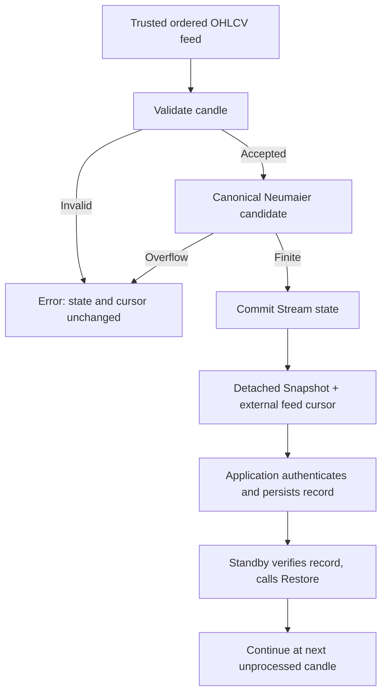

<!--
  SPDX-License-Identifier: AGPL-3.0-only
  Copyright (C) 2025-2026 katalvlaran

  File: docs/OBV.md
  Package reference: github.com/lvlath/go/obv
  Purpose: Mathematical, API, numerical and operational reference for On-Balance Volume.
  Contract status: obv/neumaier/v1; published semantics of the current package.
  Scope: chronological OHLCV, cumulative signed base volume, deterministic replay,
         transactional streaming and checkpoint compatibility. No trading strategy.
  License: AGPL-3.0-only
-->

# OBV — compensated cumulative On-Balance Volume

`github.com/lvlath/go/obv` computes a **causal cumulative signed-volume series**.
The direction is determined by whether the *current closing price* is higher,
lower or equal to the previous accepted closing price. The quantity added or
subtracted is the *current candle's volume*; no price times volume multiplication
occurs in OBV. This differs from the fixed-window Money Flow Index (`mfi`).

The implementation exposes a five-column batch facade, a row-oriented adapter,
and a transactional, allocation-free streaming facade sharing one recurrence.
The result is an engineering feature; it does **not** establish the identity of
institutional participants, a predictive probability or a trading instruction.

## Contents

1. [Scope, conventions and non-goals](#1-scope-conventions-and-non-goals)
2. [Mathematics and the first-bar invariant](#2-mathematics-and-the-first-bar-invariant)
3. [Strict input validation and error precedence](#3-strict-input-validation-and-error-precedence)
4. [Neumaier accumulation and overflow boundaries](#4-neumaier-accumulation-and-overflow-boundaries)
5. [Public API, ownership and complexity](#5-public-api-ownership-and-complexity)
6. [Canonical batch/stream example](#6-canonical-batchstream-example)
7. [Checkpoint ABI, trust and deterministic continuation](#7-checkpoint-abi-trust-and-deterministic-continuation)
8. [Operational patterns and independent checks](#8-operational-patterns-and-independent-checks)
9. [FAQ and failure modes](#9-faq-and-failure-modes)
10. [Verification and related documentation](#10-verification-and-related-documentation)

---

## 1. Scope, conventions and non-goals

A candle consists of five finite `float64` values: `Open`, `High`, `Low`,
`Close` and `Volume`. All prices share one quotation unit; volumes share one
caller-defined physical **base-volume unit** within a series. A derivatives
feed may report contract counts rather than asset units; conversion to an
appropriate, explicitly chosen unit must occur *before* calling OBV, if needed.
The package does not guess whether a source volume is base, quote, contracts
or notional value.

The caller owns observation order, completeness, timestamps, feed offsets and
session continuity. This package neither imports `series`/`mfi` nor joins their
mutable state. A missing observation must be handled by the upstream feed
policy; calling `Reset` is an explicit decision to start a **new OBV epoch**.

OBV is cumulative and unbounded in mathematical range, but restricted to
finite binary64 output in this API. It has **no** warmup period, window length,
`Options`, hidden threshold, RNG, global engine, built-in security key or
market-strategy logic. Cross-instrument raw OBV levels are not comparable
without a documented unit and normalization policy.

## 2. Mathematics and the first-bar invariant

Let `C[t]` and `V[t]` denote the closing price and volume of accepted candle `t`.
The first accepted candle **only** records the baseline price:


For every later observation:


No first-candle comparison is possible: there is no earlier `Close`. Therefore
`Volume[0]` must **never** reach the accumulator, even when it is
`math.MaxFloat64`. For a valid one-candle batch, `Values=[+0]` and `Valid=[true]`.

| Index | Close | Volume | Action                                     | Effective OBV |
|------:|------:|-------:|--------------------------------------------|--------------:|
|     0 |    10 |      5 | Seed `previousClose`; ignore seed volume   |             0 |
|     1 |    11 |      3 | `11 > 10` → add current volume             |             3 |
|     2 |    11 |      8 | `11 == 11` → add zero, still advance Count |             3 |
|     3 |     9 |      2 | `9 < 11` → subtract current volume         |             1 |

A zero-volume candle similarly advances the observation index and stores its
new close even if its contribution is zero. Thus a later transition compares
against the *immediately preceding accepted candle*, not the last candle with
nonzero volume. The comparison uses exact `float64` `>` and `<` operators,
without an epsilon, smoothing or tick-size normalization.

A positive affine price transform preserves the signed-volume sequence **only
when its rounded float64 closes retain every relevant comparison outcome**.
Large offsets or tiny scaling factors can erase price differences on rounding.

## 3. Strict input validation and error precedence

The canonical column facade accepts:

```go
obv.Bars{
    Open:   []float64{10, 11, 11, 9},
    High:   []float64{10, 11, 11, 9},
    Low:    []float64{10, 11, 11, 9},
    Close:  []float64{10, 11, 11, 9},
    Volume: []float64{5, 3, 8, 2},
}
```

All five slices must be non-nil and of the same **positive** length. `Compute`
performs shape checks *before* indexing any column and validates the **entire
batch** in increasing index order before allocating the result. In contrast,
`ComputeCandles([]obv.Bar)` accepts a non-nil, nonempty row slice and has no
column-length mismatch possibility.

Every candle must satisfy all of the following:

- `Open`, `High`, `Low`, `Close` are finite and strictly greater than zero;
- `Volume` is finite and greater than or equal to zero;
- `High >= Low`, `Low <= Open <= High`, `Low <= Close <= High`.

`Open`, `High` and `Low` are validated even though only `Close` and `Volume`
enter the recurrence. Otherwise malformed candles could silently be published
as valid analytical observations and diverge from the strict OHLCV ingestion
boundary used elsewhere in the library.

**Canonical error ordering:**

```text
Nil receiver / nil column or row slice
           |
           v
Empty present input
           |
           v
Shape mismatch (column facade only)
           |
           v
First invalid candle, in increasing input index order
       nonfinite before domain *within that candle*
           |
           v
Arithmetic and Count representability in the recurrence
```

The same `ErrNilInput` applies to `Push` or `Restore` on a nil `*Stream`; those
methods validate the receiver before inspecting input fields or state.

| Sentinel          | Trigger and caller-visible behavior                                                                           |
|-------------------|---------------------------------------------------------------------------------------------------------------|
| `ErrNilInput`     | Any missing `Bars` column, nil `[]Bar`, or nil stream receiver for a mutating operation                       |
| `ErrEmptyInput`   | Present but empty `Bars.Open` or row slice, after nil validation                                              |
| `ErrShape`        | Differing column lengths after all columns are present and `Open` is nonempty                                 |
| `ErrNonFinite`    | Any NaN or infinity in the first invalid candle                                                               |
| `ErrDomain`       | Finite nonpositive price, negative volume or invalid OHLC geometry                                            |
| `ErrOverflow`     | Unrepresentable effective balance, unsupported finite compensation representation or exhausted `uint64` Count |
| `ErrStateVersion` | Snapshot identity, schema, count relation or numeric coordinate invalidity                                    |

Use `errors.Is(err, obv.ErrXxx)`; never classify by string matching. No input
observation values are interpolated into the sentinel messages. A failing
batch returns `nil` result and error, never an incomplete `Result`.

## 4. Neumaier accumulation and overflow boundaries

Repeated ordinary binary64 addition can lose lower-order contributions when
large volumes temporarily dominate the running sum. The fixed OBV kernel uses
a **two-component Neumaier accumulator**, storing `sum` and `compensation`.
For signed contribution `x`, with prior high component `s` and correction `c`:


The public value is `sum + compensation`, after finite checks. `sum` and
`compensation` are not interchangeable with the displayed value: later
cancellation can expose a correction that an ordinary `float64` sum lost.

For prices `[1,2,3,2]` and volumes `[0,1e16,1,1e16]`, signed contributions
are `+1e16`, `+1`, `-1e16`. The independent exact arithmetic sum equals `1`.
A plain running `float64` total loses that unit when it adds `1` to `1e16`;
Neumaier compensation retains it and the final OBV is exactly `1`.

### Transactional overflow

1. `Push` validates the entire incoming candle before changing state.
2. It constructs a local `Stream` candidate, including the next count and close.
3. It checks whether the high sum, low correction and effective total can be
   represented as finite `float64` values. When a direct intermediate sum
   overflows, the kernel tries a fixed cancellation-first rebase rather than
   silently dropping a contribution.
4. Only after all checks succeed is the candidate committed. An overflowed
   operation yields `(0,false,ErrOverflow)` and changes **no state field**.

Two successive positive additions of `math.MaxFloat64` (after a seed) reject
the second one. Conversely, when `sum=MaxFloat64`, `compensation=-MaxFloat64`
and a new positive `MaxFloat64` arrives, a finite effective result can be
recovered by cancellation before addition. This is a representability path,
not an arbitrary-precision mode.

**Precision boundary:** Binary64 holds 53 bits of significand precision.
Neumaier compensation is beneficial but does not promise exact large-integer
arithmetic, exact decimal money, or correctly rounded infinite-precision sums
for every possible history. Applications requiring such guarantees need a
separately designed integer/decimal/big-number contract and snapshot format.

## 5. Public API, ownership and complexity

| Public surface                                  | Purpose                                    | Time | Extra space / ownership                               |
|-------------------------------------------------|--------------------------------------------|------|-------------------------------------------------------|
| `Compute(bars Bars) (*Result,error)`            | Validated five-column historical series    | O(n) | O(n) detached `Values`/`Valid`; two sequential passes |
| `ComputeCandles(candles []Bar) (*Result,error)` | Validated row-oriented historical series   | O(n) | O(n) detached outputs; no five-column transposition   |
| `New() *Stream` / `Stream{}`                    | Create independently owned accumulator     | O(1) | O(1)                                                  |
| `(*Stream).Push(bar)`                           | Validate, calculate, commit one candle     | O(1) | O(1), zero heap allocations after construction        |
| `(*Stream).Reset()`                             | Discard history and begin a new epoch      | O(1) | O(1), nil receiver is harmless                        |
| `(*Stream).Snapshot()`                          | Export detached versioned checkpoint       | O(1) | O(1) newly owned slice storage                        |
| `(*Stream).Restore(state)`                      | Validate/import checkpoint transactionally | O(1) | O(1), retains no caller-owned slices                  |
| `(*Result).IsNil()`                             | Test result pointer presence               | O(1) | O(1), safe on nil pointer                             |

A successful batch `Result` always has equally sized, nonempty `Values` and
`Valid`, with every `Valid[i] == true`. There is **no warmup mask** in OBV;
`Values[0] == +0.0` is valid and a later zero can be a real cancellation. An
allocated `&obv.Result{}` has `IsNil()==false` despite empty slices; a typed
nil pointer has `IsNil()==true` even inside an interface.

Both batch forms borrow their inputs read-only and retain no reference to
them. Returned slices can be mutated without affecting callers' input data
or subsequent calculations. Concurrent input mutation while computing is
unsupported. Stream is single-owner mutable state and has **no internal locks**;
transfer detached snapshots between workers rather than sharing one mutable
stream across goroutines.

## 6. Canonical batch/stream example

The following is a complete executable program. It demonstrates the
independent four-candle arithmetic oracle and bitwise parity of both facades:

```go
package main

import (
    "fmt"
    "math"

    "github.com/lvlath/go/obv"
)

func main() {
    candles := []obv.Bar{
        {Open: 10, High: 10, Low: 10, Close: 10, Volume: 5},
        {Open: 11, High: 11, Low: 11, Close: 11, Volume: 3},
        {Open: 11, High: 11, Low: 11, Close: 11, Volume: 8},
        {Open: 9, High: 9, Low: 9, Close: 9, Volume: 2},
    }
    result, err := obv.ComputeCandles(candles)
    if err != nil {
        fmt.Println("batch error:", err)
        return
    }

    stream := obv.New()
    identical := true
    for index, candle := range candles {
        value, valid, pushErr := stream.Push(candle)
        if pushErr != nil {
            fmt.Println("stream error:", pushErr)
            return
        }
        identical = identical && valid == result.Valid[index] &&
            math.Float64bits(value) == math.Float64bits(result.Values[index])
    }
    fmt.Printf("OBV=%v valid=%v parity=%t\n", result.Values, result.Valid, identical)
    // Output: OBV=[0 3 3 1] valid=[true true true true] parity=true
}
```

For columns already decoded into separate arrays, use `Compute(obv.Bars{...})`
without forcing a row transposition. The two entry points return the same
mathematical values and do not share writable result storage. See
[`../obv/example_test.go`](../obv/example_test.go) for five operational
scenarios and `go run ./examples/obv` for the stand-alone gateway example.

## 7. Checkpoint ABI, trust and deterministic continuation

`Snapshot()` preserves the **actual recurrence components**, not a recomputed
scalar. Its versioned v1 structure is:

```text
Algorithm  = "obv/neumaier/v1"
Config     = lowercase hex(SHA-256(ASCII("obv/neumaier/v1")))
Count      = accepted candle count (including the seed)
FloatState = [previousClose, sum, compensation]     // length exactly 3
IntState   = []                                     // length exactly 0
```

`Snapshot(nil)` returns unversioned `Snapshot{}`. An actual zero-value
`Stream{}` returns a **versioned** Count=0 checkpoint with all-zero floats.
These are intentionally different. `Reset(nil)` does nothing; `Push(nil)` and
`Restore(nil)` return `ErrNilInput`.

| Accepted `Count`      | Valid numerical relations                                                        |
|-----------------------|----------------------------------------------------------------------------------|
| 0                     | `previousClose == sum == compensation == 0`                                      |
| 1                     | `previousClose > 0`, `sum == compensation == 0`                                  |
| 2 through `MaxUint64` | `previousClose > 0`; `sum`, `compensation`, and their effective total are finite |

All three numeric coordinates must be finite. Restore validates identity,
Config, array lengths, count-related invariants and numeric representability
**before** assigning the candidate. It never retains the input slices; callers
may safely reuse or mutate the Snapshot after restoration. `Count=MaxUint64`
is structurally restorable but the next `Push` returns `ErrOverflow` without
altering it.

**Security boundary:** `Config` is only a static version/configuration
fingerprint. Anyone knowing the public algorithm identifier can reproduce it.
It neither authenticates mutable `FloatState`/`Count` nor binds the state to a
market feed offset, market identifier, venue, unit, or historical observations.
For distributed recovery, the surrounding service must persist a **coherent**
checkpoint-plus-source-cursor record; authenticate the complete serialized
record using a keyed MAC or digital signature, enforce ordering/anti-replay,
and resume from the next *unprocessed* candle. The package intentionally does
not implement keys, persistence, transport, encryption or clocks.



The diagram assumes the application enforces a coherent cursor/state boundary.
If external storage is not transactional, the service must implement its own
replay/deduplication protocol; successful `Restore` by itself does not solve
exactly-once message delivery.

## 8. Operational patterns and independent checks

**A. Consolidation with positive signed volume.** Compare closing-price
containment against cumulative signed base volume over the same explicit
epoch. `ExampleCompute_accumulationWatch` shows a fixed twelve-candle
surveillance fixture. A rising OBV during consolidation warrants analysis,
but cannot identify “smart money” participants or establish a causal forecast.

**B. Multi-instrument breakout screening.** Use `ComputeCandles` independently
per instrument and keep its own volume unit. `ExampleComputeCandles_futuresBasket`
processes 100 separate 16-bar fixtures with four regimes; the caller tests
the last close against the preceding candles' highs before classifying
volume-supported and unsupported breakouts. It does
not add raw OBV across contracts or attach implicit trading rules to the package.

**C. Gateway hot failover.** Persist versioned `Snapshot` and the input-stream
cursor as an authenticated application record. `ExampleStream_failoverRecovery`
shows that `sum` and `compensation` both survive handoff; independently compare
the resumed value with uninterrupted processing during commissioning.

**D. Bad feed correction.** A candle with impossible OHLC geometry returns
`ErrDomain`, even if its `Close` and `Volume` alone look plausible. The next
corrected candle must compare against the last **accepted** close. Capture a
snapshot before a rejected `Push` and compare all fields and float bits after
rejection to prove transactional rollback.

**E. Explicit discontinuity handling.** An observed `Volume=0` or flat close
is not a timestamp gap. When an upstream validator proves a genuine feed
continuity break, use `Reset` and start a new epoch, or invoke an explicit
application replay policy; do not silently add a fabricated zero-volume bar.

For independent arithmetic tests, compare selected fixture prefixes against
hand-calculated signed contributions and, where appropriate, exact rational
arithmetic (`math/big.Rat` over the *actual binary64 values*). Batch/stream
parity is **necessary but insufficient**: both facades deliberately share one
kernel and could otherwise share the same numerical mistake.

## 9. FAQ and failure modes

### Why does a single candle return a valid zero, not “not ready”?

OBV needs only the preceding accepted close to classify future transitions.
The first candle establishes that baseline and the OBV zero origin. Unlike
`rsi`, `macd` or windowed `mfi`, there is no smoothing/warmup interval.

### Why can an unchanged close have `Volume=MaxFloat64` without overflow?

Its signed contribution is **zero**. The candle still advances `Count` and
stores `Close`, but the volume is never added to either accumulator component.

### Is a zero-volume bar interchangeable with a missing candle?

No. A zero-volume bar has a real close that determines the next transition's
reference price; a missing candle has no observation and cannot be invented.

### Why is OBV not MFI?

OBV is an unbounded **cumulative signed volume** based on consecutive closes.
MFI is a bounded `[0,100]` **fixed-transition rolling ratio** of typical-price
money flows and has a warmup mask. They measure different objects and cannot
reuse one another's checkpoint or numeric policy.

### Can I compare raw OBV of BTC and an equity future?

Not safely without an explicitly defined common unit and normalization. A
futures venue may report contracts; spot venues may report base assets or quote
notional. OBV cannot infer or correct source-unit mismatches.

### What if a valid finite contribution is too large to accumulate?

`ErrOverflow` rejects that observation atomically. Do not clamp to MaxFloat64,
introduce infinity as a value, skip the bar or retry with a hidden alternate
formula. Choose an explicitly specified higher-precision domain if required.

### Can I share a Stream between ingest and analytics goroutines?

Not concurrently without external synchronization. Each Stream is mutable,
single-owner state. Share an authenticated, detached checkpoint or an external
message stream and assign one owner to each mutable instance.

### Can I use `Snapshot.Config` as a tamper-proof checksum?

No. It hashes a **fixed public algorithm string**, not the payload. A valid
snapshot is not proof that its contents represent any particular exchange feed
history. Authenticate the full record and enforce source cursor consistency.

## 10. Verification and related documentation

The package tests belong to `package obv_test` and interact only through the
exported facade. Independent acceptance anchors include OBV01–OBV08, full
OHLCV validation, overflow rollback, exact-bit batch/stream equivalence,
compensation-preserving failover, snapshot alias isolation, zero-allocation
Push and row/column facade equivalence. Benchmarks exercise rising, flat
and alternating close regimes at `n=10^3` and `n=10^6`, plus a nonzero-volume
Push path. Code coverage is a gate, not a substitute for independent oracles.

From the **repository root** with the repository's declared Go toolchain:

```bash
go test ./obv -count=1
go test ./obv -race -count=1
go test ./obv -cover -count=1
go test ./obv -run '^Example' -count=1 -v
go test ./obv -run '^$' -bench . -benchmem
go test ./...
go vet ./...
golangci-lint run
```

The last three commands require a complete checkout and the repository's
pinned toolchain/linter configuration. A local package-only PASS does **not**
prove the whole-repository CI gate. See [`../obv/doc.go`](../obv/doc.go),
[`../obv/example_test.go`](../obv/example_test.go),
[`TUTORIAL.md`](TUTORIAL.md#11m-obv-foundations-cumulative-signed-volume-and-checkpointed-streams),
[`FAQ_&_TIPS.md`](FAQ_%26_TIPS.md#13l-obv-faq-cumulative-signed-volume-and-replay-safety),
and the [UES](lvlath_UES.md).
