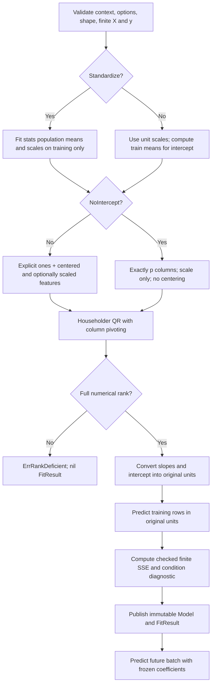

<!--
  SPDX-License-Identifier: AGPL-3.0-only
  Copyright (C) 2025-2026 katalvlaran

  File: docs/OLS.md
  Package reference: github.com/lvlath/go/ols
  Purpose: mathematical derivation, API contracts, validation, numerical
           failure modes, and operational least-squares workflows.
  Contract status: implemented full-column-rank OLS surface; exact behavior is
                   governed by ols/doc.go and public GoDoc.
  Scope: finite, unweighted OLS via matrix's pivoted Householder QR;
         no confidence intervals, pseudoinverse, or regularization.
  License: AGPL-3.0-only; see ../LICENSE.
-->

# OLS — stable full-rank linear regression through rectangular QR

> Learn a linear model **once**, retain parameters in their physical units, and evaluate later observations without fitting on the future. `ols` is a statistical modeling boundary over the existing `matrix` and `stats` numerical kernels, not a second linear-algebra implementation.

## Contents

1. [Problem and package responsibilities](#1-problem-and-package-responsibilities)
2. [Public API and choosing a facade](#2-public-api-and-choosing-a-facade)
3. [Mathematics: model, rank, and projection](#3-mathematics-model-rank-and-projection)
4. [Why Householder QR rather than normal equations](#4-why-householder-qr-rather-than-normal-equations)
5. [Design-matrix construction and the intercept law](#5-design-matrix-construction-and-the-intercept-law)
6. [Training statistics and numeric transformation](#6-training-statistics-and-numeric-transformation)
7. [Recovering physical coefficients: an algebraic proof](#7-recovering-physical-coefficients-an-algebraic-proof)
8. [SSE, numerical error, and conditioning diagnostics](#8-sse-numerical-error-and-conditioning-diagnostics)
9. [Validation precedence and error classification](#9-validation-precedence-and-error-classification)
10. [Ownership, nilability, concurrency, and cancellation](#10-ownership-nilability-concurrency-and-cancellation)
11. [Runnable Go integration](#11-runnable-go-integration)
12. [Five executable operational scenarios](#12-five-executable-operational-scenarios)
13. [Counterexamples and operational pitfalls](#13-counterexamples-and-operational-pitfalls)
14. [Algorithm stages, pseudocode, and dataflow](#14-algorithm-stages-pseudocode-and-dataflow)
15. [Complexity and performance measurement](#15-complexity-and-performance-measurement)
16. [Verification matrix and integration checklist](#16-verification-matrix-and-integration-checklist)
17. [Related contracts and non-goals](#17-related-contracts-and-non-goals)

---

## 1. Problem and package responsibilities

Given an observation matrix `x` of shape `n × p`, with feature column `j` expressed in a particular unit, and a response vector `y` of length `n`, ordinary least squares chooses slopes `β` and optionally an intercept `b` to minimize total **unweighted** squared residual energy:

$$
\min_{\beta,b}\;\mathrm{SSE}(\beta,b)=\sum_{i=1}^{n}\left(y_i-b-\sum_{j=1}^{p}x_{ij}\beta_j\right)^2.
$$


`ols` delegates **the only solving operation** to `matrix.SolveLeastSquares`, which already implements column-pivoted Householder QR. `stats.FitStandardizer` is the only fitting source for population feature scales when `Options.Standardize` is enabled. `ols` owns the semantic adaptation: intercept choices, design construction, recovered original-unit parameters, training SSE, and immutable prediction.

| Responsibility                               | Package   | Boundary                                                          |
|----------------------------------------------|-----------|-------------------------------------------------------------------|
| Dense storage and `matrix.Matrix`            | `matrix`  | Row-major `Dense`, `View`, checked `At`/`Set`, rectangular QR     |
| Population variance and constant policy      | `stats`   | `DDOF=0`, `UnitScaleConstant`, train-only moments                 |
| Regression design, fitted model, diagnostics | **`ols`** | Full rank, original units, frozen inference, package-owned errors |
| Timestamp grid and causal sample masks       | `series`  | External preprocessing; no implicit gaps or missing-value removal |

Use OLS for independent predictors and a linear response model. **“Independent” here means full numerical column rank**, not that successive observations are statistically independent. In particular, a design can be invertible while its time-series residuals are autocorrelated.

## 2. Public API and choosing a facade

The canonical entry point is:

```go
func Fit(ctx context.Context, x matrix.Matrix, y []float64, opts ols.Options) (*ols.FitResult, error)
```

`Options` has exactly three public fields:

```go
type Options struct {
    NoIntercept   bool
    Standardize   bool
    RankTolerance float64
}
```

`RankTolerance` is a dimensionless relative threshold for numerical rank selection on the QR triangular diagonal. `0` delegates to `matrix.FactorOptions`' default (`2^-52 * max(n,q)` for the design). Values less than zero, `NaN`, and `±Inf` are rejected as `ols.ErrInvalidOption`. **Positive values are not regularization strengths**; increasing tolerance can reject additional near-dependent columns.

| Use case                              | Public call                                 | Model basis                       |
|---------------------------------------|---------------------------------------------|-----------------------------------|
| Ordinary affine fit, all defaults     | `ols.FitDefault(ctx,x,y)`                   | `[1, x - trainMean]`, unit scales |
| Affine fit with population scaling    | `ols.FitStandardized(ctx,x,y)`              | `[1, (x-trainMean)/trainScale]`   |
| Zero-intercept physical model         | `ols.FitThroughOrigin(ctx,x,y)`             | `x`                               |
| Zero-intercept with normalized scales | `ols.FitThroughOriginStandardized(ctx,x,y)` | `x/trainScale`, **no centering**  |
| Caller-selected relative rank cutoff  | `ols.Fit(ctx,x,y,ols.Options{...})`         | Depends on explicit options       |

The four convenience functions are **thin wrappers over `Fit`**, not distinct estimators or hidden algorithm selections. They preserve the full `FitResult`, including numerical diagnostics and error classification.

A successful result contains:

| Field                        | Invariant                                                                                            |
|------------------------------|------------------------------------------------------------------------------------------------------|
| `Model *ols.Model`           | Non-nil fitted model with private, unchanged coefficients; safe for concurrent read-only predictions |
| `Rank int`                   | Exactly `q = p + 1` with intercept or `q = p` without it                                             |
| `ResidualSumSquares float64` | Finite, nonnegative, **unnormalized** training SSE in squared response units                         |
| `ConditionEstimate float64`  | Finite numerical estimate of `κ₁(R)` for the QR of the **transformed design**                        |

`(*ols.FitResult).IsNil() bool` implements `core.Nilable`: it is `true` only for a nil receiver. A non-nil `&ols.FitResult{}` is *present*, but has not necessarily been created by a successful `Fit`.

The model API is intentionally narrow:

```go
func (m *ols.Model) Coefficients() ([]float64, float64)
func (m *ols.Model) Predict(ctx context.Context, x matrix.Matrix) ([]float64, error)
```

The returned slopes have length `p`, are independent of private storage, and correspond to the **original column order**. The intercept is in the response's physical units. `Predict` evaluates those original-unit parameters; it never calls `Fit`, `FitStandardizer`, or any heldout-specific transform.

## 3. Mathematics: model, rank, and projection

Let `q` denote the number of unknown fitted parameters:

$$
q=\begin{cases}p+1,&\text{intercept enabled},\\p,&\text{NoIntercept=true}.\end{cases}
\qquad p\geq 1,\ n\geq q.
$$

A **square** `n=q` system is legal if the design has full numerical rank. It can yield essentially zero training SSE without creating valid residual-based confidence intervals. Conversely, `n>q` does not guarantee rank: redundant features can destroy identifiability even with millions of rows.

In transformed coordinates let `A` be the `n × q` design and `θ` its coefficient vector. The QR calculation solves

$$
\min_{\theta\in\mathbb R^q}\|A\theta-y\|_2^2.
$$

For full-column-rank `A`, the minimizer is unique in exact arithmetic. If numerical rank is smaller than `q`, `ols` returns `ErrRankDeficient`: it does **not** remove a column, produce a minimum-norm pseudoinverse solution, or quietly switch to Ridge.

The matrix library uses a stable column-pivot order `P` and a Householder orthogonal factor:

$$
AP=QR,\qquad R\in\mathbb R^{q\times q}.
$$

Here `R` is upper triangular; the packed QR factor does not materialize a full `n × n` `Q`. On success the result is unpermuted into the original design-column order before `ols` converts units.

## 4. Why Householder QR rather than normal equations

For full rank, the spectral condition number obeys:

$$
\kappa_2(A^TA)=\kappa_2(A)^2.
$$


A design whose smallest relevant singular direction is already hard to distinguish becomes *quadratically* harder to resolve after forming the Gram matrix. Forming and inverting `AᵀA` is therefore prohibited in production `ols`; direct Householder orthogonal transformations avoid this unnecessary squaring. Column pivoting additionally exposes numerically dependent columns under an explicit cutoff.

A quick counterexample is a design with two identical columns. There are infinitely many coefficient pairs with the same combined effect, but no unique parameter estimate. `ols` returns `ErrRankDeficient`, preserving both `ols` and `matrix` sentinel identities when the error originates from QR. Silently selecting an arbitrary pair would misrepresent a dependent factor model as identified.

**Limits:** pivoted QR is not a certificate that all coefficient estimates are accurate in an ill-conditioned design. The reported `ConditionEstimate` is `κ₁(R)` and must not be substituted for `κ₂(A)` or for a confidence bound.

## 5. Design-matrix construction and the intercept law

### Intercept enabled (`NoIntercept=false`)

Training uses a **literal column of ones**; even when `Standardize=false`, each feature is centered by its training mean. With scaling enabled:

$$
A_{i,0}=1,\qquad A_{i,j+1}=\frac{x_{ij}-\mu_j}{s_j}.
$$

When scaling is off, `s_j=1`. This centering is a change of basis, not a change of the affine function class: any intercept offset is recovered after solving.

### Physical zero origin (`NoIntercept=true`)

The hypothesis space is instead `y≈Xβ`, with `b≡+0` fixed. Therefore the design has **exactly p columns** and

$$
A_{ij}=\frac{x_{ij}}{s_j}\quad\text{(or }x_{ij}\text{ without scaling)}.
$$

**There is no centering, even when Standardize=true.** Consider `x=[1,2]` and `y=[1,2]`: `β=1,b=0` exactly solves the origin-constrained model. Centering `x` to `[-0.5,0.5]` changes the feasible functions and introduces a hidden constant after back-conversion. A model that returns `b=0` but internally used a centered no-intercept basis would be mathematically wrong.

### Constant columns

With `Standardize=true`, `stats.UnitScaleConstant` assigns *exactly* `s=1` to a feature that is constant in training. It is **not dropped**:

- A constant feature together with an intercept duplicates the column-of-ones direction and must be rejected by QR as rank-deficient.
- A single **nonzero** constant feature without an intercept is a valid rank-one basis, and OLS may fit its coefficient.
- An all-zero feature provides no identifiable parameter and is rank-deficient with or without an intercept.

A constant training feature is determined by the `stats` internal moment policy, not by comparing a rounded published variance to an arbitrary epsilon.

## 6. Training statistics and numeric transformation

The `stats` dependency receives **training rows only** and uses:

```go
stats.ScaleOptions{
    DDOF: 0,
    ConstantPolicy: stats.UnitScaleConstant,
}
```

Population scaling divides by `n`, not `n-1`. The training model preserves private copies of transformed parameters, but `Predict` operates on already reconstructed physical coefficients. This is equivalent to using the frozen transformation algebraically and avoids a second preprocessing pass on heldout rows.

`normalizePredictor` evaluates the usual `(x-mean)/scale` when the subtraction is finite. If the intermediate subtraction itself overflows, it uses the mathematically equivalent `x/scale-mean/scale`, then verifies the computed value. This distinction matters for huge but finite magnitudes whose *standardized difference* remains representable. A finite normalized result is still an approximation in binary64; no incorrectly rounded exactness guarantee is implied.

If an original-unit coefficient or the recovered intercept cannot be represented as a finite `float64`, `Fit` returns `ErrOverflow` even if the normalized-coordinate `θ` happened to be finite. `Coefficients` must never return an implicit `+Inf` coefficient to make an otherwise numerically invalid fit appear successful.

## 7. Recovering physical coefficients: an algebraic proof

For intercept-enabled scaling the QR model is

$$
\hat y_i=\theta_0+\sum_{j=1}^{p}\theta_j\frac{x_{ij}-\mu_j}{s_j}.
$$

Distribute terms, grouping coefficients of the original predictors:

$$
\hat y_i=\underbrace{\left(\theta_0-\sum_j\mu_j\frac{\theta_j}{s_j}\right)}_{b}+
\sum_{j=1}^p x_{ij}\underbrace{\frac{\theta_j}{s_j}}_{\beta_j}.
$$

Thus `beta[j]=theta[j+1]/scales[j]` and `b=theta[0]-∑(means[j]*beta[j])`. The implementation visits features in their original order, uses FMA for the intercept correction, and checks the published `float64` values for finiteness.

With `NoIntercept`, there is no `θ₀`; `beta[j]=theta[j]/scales[j]`, `b=+0`, and `means[j]=0` for the design. There is **no extra intercept correction**. Caller-visible `Coefficients` and all `Predict` outputs therefore use one consistent physical coordinate system.


## 8. SSE, numerical error, and conditioning diagnostics

`FitResult.ResidualSumSquares` is computed **after** the physical-coordinate conversion using the same `Model.rowPrediction` law as public prediction:

$$
\mathrm{SSE}=\sum_i\left(y_i-\hat y_i\right)^2.
$$

It is neither `sum residuals`, `sqrt(SSE)`, `SSE/n`, nor `SSE/(n-q)`. QR's own `ResidualNorms` answer a different diagnostic question; they are not substituted for this field. The package accumulates squared residuals using a scaled sum-of-squares recurrence so that a finite output is not rejected merely because an intermediate unscaled square overflowed. Final unrepresentable SSE returns `ErrOverflow`; extremely tiny positive SSE can underflow to zero in binary64.

`math.FMA(x,beta,accumulator)` reduces rounding of each multiply-add, but does not make a long dot product exactly associative or eliminate every possible loss of significance. Therefore **never write exact-equality assertions for general fitted floating-point predictions**. Compare against an independent oracle with a tolerance justified by the data and conditioning:

```text
acceptable = abs(got-want) <= absTol + relTol*max(abs(got),abs(want))
```

For `y=[3,5,7,9]`, a fit can legitimately predict `2.999999999999999` instead of exactly `3`. Do not change QR, round internal parameters, or set small residuals to zero merely to pass an incorrect test.

`ConditionEstimate` inherits `matrix`'s induced `1`-norm triangular factor measurement `κ₁(R)`, including the chosen feature scaling and column pivoting. Its meaning changes if `Standardize` changes, **even when both models produce nearly identical physical predictions**. Do not compare its value directly between differently scaled designs as though it were a physical property of the raw features.

These numerical diagnostics are **not** p-values, t-statistics, F-statistics, R², standard errors, or evidence of causal relationships. Financial or telemetry residuals may be dependent, nonstationary, or heteroskedastic; modeling those features requires an explicit downstream statistical contract.

## 9. Validation precedence and error classification

The canonical `Fit` order is context → options → nil/typed-nil → shape/size → finite observations → rank/domain → calculation. The order is intentional and is part of the public contract. `errors.Is` is the primary classification mechanism.

| Condition                                             | `errors.Is(err, ...)`                                           | Result |
|-------------------------------------------------------|-----------------------------------------------------------------|--------|
| `ctx == nil`                                          | `ols.ErrInvalidOption`                                          | nil    |
| `ctx.Err()!=nil`                                      | `context.Canceled` or `context.DeadlineExceeded`                | nil    |
| invalid `RankTolerance`                               | `ols.ErrInvalidOption`                                          | nil    |
| nil `x`, supported typed-nil matrix, nil `y`          | `ols.ErrNilInput`                                               | nil    |
| `Rows()==0`, `Cols()==0`, `len(y)==0`                 | `ols.ErrEmptyInput`                                             | nil    |
| `len(y)!=n`, `n<q`, invalid dimensional arithmetic    | `ols.ErrShape`                                                  | nil    |
| `NaN`, `+Inf`, `-Inf` observation or response         | `ols.ErrNonFinite`                                              | nil    |
| numerically dependent design                          | `ols.ErrRankDeficient` plus preserved `matrix.ErrRankDeficient` | nil    |
| unrepresentable design, coefficients, prediction, SSE | `ols.ErrOverflow`, preserving dependency root if present        | nil    |
| underlying `matrix.At` failure                        | underlying error, unmodified identity                           | nil    |

In `Predict`, nil context is checked before the model; nil or unfitted Model returns `ErrNilInput`. A present `x` must have the fitted number of columns and representable dimensions; zero rows are allowed if columns match. **An empty prediction batch returns a detached non-nil `[]float64{}`** and nil error. `Predict` validates all input cells before performing any row prediction, so a nonfinite cell takes precedence over a potential arithmetic overflow from earlier rows.

No error publishes a partial `FitResult` or prediction prefix. Always distinguish underlying `matrix`/`stats` root errors from `ols` domain errors through `errors.Is`, never by searching strings.

## 10. Ownership, nilability, concurrency, and cancellation

| Value                                 | Who owns it?                      | Safe to mutate?                                                              |
|---------------------------------------|-----------------------------------|------------------------------------------------------------------------------|
| Input `x` and `y`                     | Caller                            | Not during `Fit` or a concurrent reader's `Predict`                          |
| `FitResult` exported fields           | Caller                            | Yes, but changes affect **that result**, not an independently retained Model |
| `Model` private `beta/means/scales`   | Package-created fitted Model      | Not exposed; immutable after successful Fit                                  |
| `Coefficients()` returned `[]float64` | Caller                            | Yes; changes never alter the Model                                           |
| `Predict()` result                    | Caller                            | Yes; each call creates independent storage                                   |
| A `matrix.View` passed as input       | Caller-owned shared parent window | Not concurrently; it is *not* a snapshot                                     |

A Model successfully returned from Fit can serve hundreds of independent Predict calls concurrently, with no shared mutable workspace. Caller mutation of the *same* input matrix during an inference operation remains unsupported and may cause a data race. Model immutability is not matrix snapshot isolation.

`nil (*Model).Coefficients()` safely returns `(nil,0)`, because this signature cannot return an error. `nil (*Model).Predict(ctx,x)` returns `ErrNilInput` after context validation. `nil (*FitResult).IsNil()` returns `true`; this method measures pointer presence, not fit validity.

Cancellation is cooperative: `Fit` checks at validation, design, RHS assembly, QR pivots, and SSE stages; `Predict` checks at fixed row/feature boundaries. The delegated `stats.FitStandardizer` currently has no context parameter, so cancellation is rechecked after it returns. Cancellation never publishes an incomplete model or prediction slice.

## 11. Runnable Go integration

This complete `main` function shows the canonical options surface, an independent holdout batch, and error classification. The data are illustrative, with a pressure compensation model (bar and °C).

```go
package main

import (
    "context"
    "errors"
    "fmt"

    "github.com/lvlath/go/matrix"
    "github.com/lvlath/go/ols"
)

func main() {
    // One row is an observation: pressure (bar), temperature (C).
    training, err := matrix.NewDense(6, 2)
    if err != nil {
        fmt.Println("allocate:", err)
        return
    }
    if err = training.Fill([]float64{
        5, 20,
        10, 27,
        15, 22,
        20, 31,
        25, 19,
        30, 29,
    }); err != nil {
        fmt.Println("training:", err)
        return
    }
    response := []float64{1.22, 1.78, 2.25, 2.86, 3.18, 3.78}

    fit, err := ols.Fit(context.Background(), training, response,
        ols.Options{Standardize: true})
    if errors.Is(err, ols.ErrRankDeficient) {
        fmt.Println("reject dependent pressure/temperature channels")
        return
    }
    if err != nil {
        fmt.Println("fit:", err)
        return
    }

    slopes, intercept := fit.Model.Coefficients()
    fmt.Printf("pressure slope=%.4f V/bar, thermal slope=%.4f V/C\n",
        slopes[0], slopes[1])
    fmt.Printf("intercept=%.4f V, rank=%d, SSE=%.6f\n",
        intercept, fit.Rank, fit.ResidualSumSquares)

    heldout, err := matrix.NewDense(1, 2)
    if err != nil {
        fmt.Println("allocate heldout:", err)
        return
    }
    if err = heldout.Fill([]float64{12, 26}); err != nil {
        fmt.Println("holdout:", err)
        return
    }
    predicted, err := fit.Model.Predict(context.Background(), heldout)
    if err != nil {
        fmt.Println("predict:", err)
        return
    }
    fmt.Printf("predicted voltage at 12 bar, 26 C: %.3f V\n", predicted[0])
}
```

**Important:** `Coefficients` already returns original-unit values, so the application must not divide them by training scales a second time. Do not learn scaling parameters from this holdout observation.

## 12. Five executable operational scenarios

The canonical, compiled `// Output:` fixtures live in [`ols/example_test.go`](../../../../Downloads/lvlath_ols_phase09_v2/ols/example_test.go); they use generated-but-operationally-shaped data, not live feeds. Each example includes its domain premise, model limitation, and useful consumer action:

| Executable example              | Data and decision                                                                               | Contract it protects                                                 |
|---------------------------------|-------------------------------------------------------------------------------------------------|----------------------------------------------------------------------|
| `ExampleFit`                    | 24 monthly market/asset excess returns; CAPM beta, monthly alpha, stress-return forecast        | Explicit intercept; nonzero training SSE; holdout not used to fit    |
| `ExampleFit_sensorCalibration`  | 24 pressure/temperature measurements; voltage offset at 25 °C; compare scaled and unscaled fits | Train population scaler; conversion back to physical units           |
| `ExampleFit_chargeEnergy`       | 16 charger/fan duration records; predict future kWh including the zero-duration law             | `NoIntercept` plus **scale-only**, exact +0 intercept                |
| `ExampleFit_redundantTelemetry` | 18 telemetry rows; duplicate feature rejection; explicit reduced-schema refit                   | QR rank gate and no silent fallback/column dropping                  |
| `ExampleModel_Predict`          | 18 training days followed by six holdout days; MAE and model-copy isolation                     | No look-ahead scaling, reproducible inference, detached coefficients |

A longer standalone factor-model application is available in [`examples/ols/main.go`](../examples/ols/main.go) where that scenario has been installed in the repository. Its output and error classification must be reviewed against the same public API before deploying.

## 13. Counterexamples and operational pitfalls

**A. Normal equations hide numerical dependence.** A near-duplicate pair of features can make `κ₂(A)` large; forming `AᵀA` squares the condition number. Call the pivoted QR solver through `ols.Fit`; treat `ErrRankDeficient` as a data-contract incident instead of lowering the cutoff until an answer appears.

**B. Centering a through-origin model invents a constant.** With `NoIntercept`, even `Standardize=true` may change only scales, never means. If your physical system has a nonzero offset, choose the intercept-enabled model; do not fake an origin law.

**C. A perfect training line still rounds.** `2.999999999999999` is an acceptable `float64` approximation of 3 from QR and FMA. Verify approximate values numerically, exact metadata structurally.

**D. A high-fit score does not prove explanatory power.** A small training SSE can coexist with future drift, omitted variables, dependent residuals, regime shifts, or an unstable coefficient vector. Evaluate on a properly separated holdout and monitor future distribution shift outside this package.

**E. SSE can overflow although every observation is finite.** A residual near `1e200` has an unrepresentable squared magnitude. `Fit` must return `ErrOverflow`, never a successful `+Inf` SSE.

**F. Feature order is a schema.** `Predict` expects exactly the same feature **meaning and column order** used for training, not merely the same number of columns. The package can check dimension, but not semantic mislabeled columns. Persist schema versions alongside serialized coefficients externally.

**G. Time-series masks require explicit filtering.** A `series.TransformResult.Values` warmup placeholder can be a finite zero with `Valid=false`. OLS does not know those masks; the caller must construct a valid training design before Fit. Do not interpret synthetic padded zeros as measured observations.

## 14. Algorithm stages, pseudocode, and dataflow



```text
Fit(ctx,x,y,opts):
    reject invalid ctx / opts / nil inputs / shape / nonfinite data
    p = x.Cols; n = x.Rows; q = p + (0 if NoIntercept else 1)
    means = zeros(p); scales = ones(p)
    if Standardize:
        fitted = stats.FitStandardizer(x, {DDOF:0, UnitScaleConstant})
        scales = fitted.Scales
        if not NoIntercept: means = fitted.Means
    else if not NoIntercept:
        means = training means
    if NoIntercept:
        design[i,j] = x[i,j]/scales[j]
    else:
        design[i,0] = 1
        design[i,j+1] = (x[i,j]-means[j])/scales[j]
    solve = matrix.SolveLeastSquares(ctx,design,yColumn,FactorOptions{RankTolerance:opts.RankTolerance})
    if solve rejects rank: return nil, ErrRankDeficient preserving matrix cause
    if solve.Rank != q: return nil, ErrRankDeficient
    beta = original-unit slopes obtained by dividing theta by scales
    b = +0 if NoIntercept else thetaIntercept - sum(means[j]*beta[j])
    reject any unrepresentable beta, b, original-unit prediction, or SSE
    return &FitResult{Model: frozen(beta,b), Rank:q, ResidualSumSquares:SSE,
                      ConditionEstimate:solve.ConditionEstimate}, nil

Model.Predict(ctx,future):
    validate context, fitted Model, Matrix width and all finite input cells
    return independently allocated predictions in ascending row order
```

## 15. Complexity and performance measurement

Let `n` be training rows, `p` features, `q=p+1` or `p`, and `m` inference rows:

| Phase                                        | Time (nominal floating operations) | Extra memory                                                                   |
|----------------------------------------------|------------------------------------|--------------------------------------------------------------------------------|
| Input validation                             | `O(n*p)`                           | `O(1)`                                                                         |
| Fitted population feature scaling (optional) | `O(n*p)`                           | `O(p)` state (plus external exact-moment work)                                 |
| Design materialization and RHS               | `O(n*q)`                           | `O(n*q)`                                                                       |
| Pivoted QR                                   | `O(n*q²)`                          | `O(n*q)` factor storage                                                        |
| Triangular condition measurement             | `O(q³)`                            | `O(q)` per basis solve                                                         |
| Original-unit coefficient mapping            | `O(p)`                             | `O(p)`                                                                         |
| Training SSE                                 | `O(n*p)` arithmetic                | `O(1)` above Model; QR's own exact residual computation may use multiprecision |
| Predict m rows                               | `O(m*p)`                           | `O(m)` detached output                                                         |

The published asymptotic envelope is `O(n*q²+q³)` for fitting and `O(m*p)` for prediction. **Real runtime** includes `matrix`'s pivot norm recomputation, exact binary residual diagnostics, and `stats`'s numerical routines; operation counts alone do not predict allocation cost. Repeated OLS fits currently refactor the matrix; there is no publicly promised retained incremental QR updater.

Benchmarks in `ols/bench_test.go` measure representative shapes `(n,p)=(100,2),(1000,16),(10000,64)` without including fixture construction in `b.N`. Record `ns/op`, `B/op`, `allocs/op`, CPU, Go toolchain, and benchmark command before claiming an improvement. Do not infer speed from an isolated mock dependency.

## 16. Verification matrix and integration checklist

Acceptance tests should defend at least these independent laws:

| Test class                         | Representative fixtures                                            | Expected                                                       |
|------------------------------------|--------------------------------------------------------------------|----------------------------------------------------------------|
| Exact linear recovery              | Small full-rank line and multivariate rational oracle              | Parameters near mathematical oracle, training SSE near zero    |
| No-intercept affine counterexample | `[1,2]` predicting `[1,2]` with standardization                    | `b==+0` exactly and slope near 1                               |
| Rank loss                          | Identical columns, constant-with-intercept, zero column            | `ErrRankDeficient`, nil FitResult                              |
| Shape/finite/option precedence     | nil/typed-nil, `n<q`, invalid rank tolerance, NaN/Inf              | Correct `errors.Is` classification and nil result              |
| Original-unit holdout              | Training centering and scale, heldout shifted far away             | No refit; physical coefficients predict same values repeatedly |
| Ownership                          | Mutate returned beta, `FitResult.Model`, input after completed fit | Retained Model remains usable and independent                  |
| Concurrency                        | 50+ Predict workers on same Model with fixed input                 | Race-clean, independent output slices                          |
| Numeric overflow                   | Finite residuals whose SSE does not fit binary64                   | `ErrOverflow`, no partial publication                          |
| Independent oracle                 | `math/big.Rat` on small exactly represented inputs                 | Compare values with scale-aware error budgets                  |

Recommended repository verification (run with the actual `go.mod` toolchain, not mocks):

```bash
gofmt -w ols/*.go
go test ./ols -count=1
go test -race ./ols -count=1
go test ./...
go vet ./...
golangci-lint run
```

The quality gate is at least 80% coverage measured against the **real** package and its **real** dependencies, not a stand-in QR solver. Keep all OLS tests in external `package ols_test`. Prefer UES-compatible helpers in `test_helpers_test.go` over production-only test exports or reflection.

## 17. Related contracts and non-goals

- [`ols/doc.go`](../../../../Downloads/lvlath_ols_phase09_v2/ols/doc.go) — normative domain, nil, concurrency, numeric, and error charter.
- [`ols/api.go`](../../../../Downloads/lvlath_ols_phase09_v2/ols/api.go) — canonical Fit and four option-transparent wrappers.
- [`ols/types.go`](../../../../Downloads/lvlath_ols_phase09_v2/ols/types.go) — options, immutable Model, FitResult and `core.Nilable`.
- [`ols/example_test.go`](../../../../Downloads/lvlath_ols_phase09_v2/ols/example_test.go) — five runnable engineering scenarios with stable `// Output:`.
- [`MATRICES.md`](MATRICES.md) — pivoted QR internals, condition estimate, row-major matrix ownership.
- [`STATS.md`](STATS.md) — DDOF=0, population scales, `UnitScaleConstant`, and train-only fitted transforms.
- [`SERIES.md`](SERIES.md) — exact timestamp grids, validity masks, and explicit preparation before regression.
- [`TUTORIAL.md`](TUTORIAL.md) and [`FAQ_&_TIPS.md`](FAQ_%26_TIPS.md) — package selection, practical usage and common failures.
- [`lvlath_UES.md`](lvlath_UES.md) — engineering, result, documentation, test and error governance.

**Outside OLS:** Ridge/Lasso/weighted and generalized least squares, SVD-based rank-deficient minimum-norm estimates, robust regression, missing-value repair, cross-validation, automatic model selection, and any automatic IID-based t/F/p-value or confidence interval. Such capabilities must be explicit separate contracts, never invented hidden fallbacks inside Fit.
