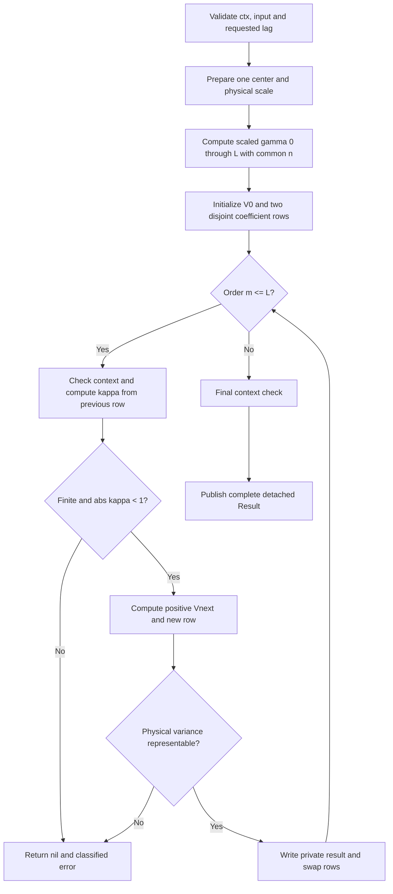

<!--
  SPDX-License-Identifier: AGPL-3.0-only
  Copyright (C) 2025-2026 katalvlaran

  File: docs/PACF.md
  Package reference: github.com/lvlath/go/pacf
  Purpose: finite-window partial autocorrelation, Durbin-Levinson mathematics,
    numerical policy, error protocol, ownership, performance and operational use.
  Contract status: implemented public API; package doc.go and source are authoritative.
  Scope: biased (common-n) sample autocovariance with explicit centering only.
  License: AGPL-3.0-only; see ../LICENSE.
-->

# PACF: Durbin–Levinson Partial Autocorrelation

> **One finite observation window. One common autocovariance denominator. One
> Durbin–Levinson recurrence.** No hidden estimator, noise model, or AR-order choice.

`github.com/lvlath/go/pacf` computes the partial autocorrelation at each lag
from zero through a caller-specified maximum and returns the corresponding
sequence of *one-step linear prediction-error variances*. It is useful for
examining remaining linear lag dependence after accounting for intermediate
lags, screening candidate autoregressive orders, and reviewing residual
whitening after a separately fitted model.

It is an **in-sample descriptive estimator**. It does not fit an AR or ARIMA
model, perform statistical significance tests, create confidence bands,
diagnose stationarity, compute a frequency-domain spectrum, or validate
out-of-sample forecasting accuracy. Read [`../pacf/doc.go`](../pacf/doc.go)
for the exact package charter and [`../pacf/example_test.go`](../pacf/example_test.go)
for executable domain examples.

## Contents

1. [When to use PACF](#1-when-to-use-pacf)
2. [Public API and configuration](#2-public-api-and-configuration)
3. [Mathematics: covariance and Toeplitz structure](#3-mathematics-covariance-and-toeplitz-structure)
4. [Durbin–Levinson derivation and recurrence](#4-durbinlevinson-derivation-and-recurrence)
5. [Numerical safeguards and failure boundaries](#5-numerical-safeguards-and-failure-boundaries)
6. [Deterministic execution and ownership](#6-deterministic-execution-and-ownership)
7. [Errors, precedence and degenerate inputs](#7-errors-precedence-and-degenerate-inputs)
8. [Practical Go workflows](#8-practical-go-workflows)
9. [Complexity and performance](#9-complexity-and-performance)
10. [Verification and independent oracles](#10-verification-and-independent-oracles)
11. [Pitfalls and cross-package composition](#11-pitfalls-and-cross-package-composition)

---

## 1. When to use PACF

Ordinary autocorrelation measures the relationship of a signal with a lagged
copy. **Partial autocorrelation at lag `m`** measures the additional linear
relationship of the two endpoints after the contributions of lags
`1..m-1` have been accounted for through a Yule–Walker prediction model.

Typical investigations:

- **Industrial telemetry:** find whether a vibration or temperature residual
  still has one-step or two-step dependence after calibration.
- **Forecast-model development:** screen a *candidate* AR order before an
  independent model-fitting and chronological validation step.
- **Regression diagnostics:** compare PACF of held-out residuals against the
  original signal without claiming that small coefficients prove independence.
- **Physical-zero signals:** inspect signed event-time order-flow imbalance or
  a zero-referenced sensor without silently fitting a new mean.

PACF consumes scalar observations **in supplied index order**. Lag `m` means
`m` sample positions; the package does not inspect timestamps, infer cadence,
fill gaps, or determine whether observations are equally spaced. If physical
lag duration matters, validate time-grid integrity with `series` upstream.

### ACF and PACF are related, not interchangeable

| Question                                | `acf`                                      | `pacf`                                                                              |
|:----------------------------------------|:-------------------------------------------|:------------------------------------------------------------------------------------|
| Ordinary lag correlation                | `acf.ComputeDefault` or explicit estimator | `Values[1]` agrees mathematically at lag one for the same centered/common estimator |
| Influence of lags between the endpoints | Not removed                                | Removed by the Yule–Walker recursion                                                |
| Denominator modes                       | `CommonDenominator` **or** `LagAdjusted`   | **Common `n` only**                                                                 |
| Centering zero value                    | `acf.Options{}` centers (`NoCenter=false`) | `pacf.Options{}` does **not** center (`Center=false`)                               |
| Additional returned evidence            | PairCounts, Mean, estimator metadata       | `PredictionVariance` and original Count                                             |
| Automatically fit an AR model?          | No                                         | No                                                                                  |

The numerical results from the two packages may differ by floating-point
rounding even when their **mathematical** lag-one estimands coincide. Never
feed an `acf.LagAdjusted` sequence into a Toeplitz-PSD-dependent recurrence.

---

## 2. Public API and configuration

The canonical entry point is `Compute`; all other public computation helpers
delegate to it. No wrapper chooses another covariance convention or solver.

```go
package pacf

import "context"

type Options struct {
    MaxLag int
    Center bool
}

type Result struct {
    Values             []float64
    PredictionVariance []float64
    Count              int
}

func Compute(ctx context.Context, values []float64, options Options) (*Result, error)
func ComputeCentered(ctx context.Context, values []float64, maxLag int) (*Result, error)
func ComputeUncentered(ctx context.Context, values []float64, maxLag int) (*Result, error)
func ComputeAtLag(ctx context.Context, values []float64, lag int, center bool) (float64, error)
func (r *Result) IsNil() bool
func (r *Result) Clone() *Result
```

These are API signatures, not an alternative package implementation. Use
`import "github.com/lvlath/go/pacf"` from consuming code.

| Call                                              | Purpose                                | Important behavior                                              |
|:--------------------------------------------------|:---------------------------------------|:----------------------------------------------------------------|
| `Compute(ctx, x, Options{MaxLag:L, Center:true})` | Explicit center and lag                | Canonical validation and calculation                            |
| `ComputeCentered(ctx, x, L)`                      | One fitted full-window mean            | Equivalent to canonical `Center:true`                           |
| `ComputeUncentered(ctx, x, L)`                    | Raw second moments about physical zero | Equivalent to canonical `Center:false`                          |
| `ComputeAtLag(ctx, x, m, center)`                 | Obtain only `Values[m]`                | **Still computes all orders `0..m`**; no O(n) lag-only shortcut |
| `result.Clone()`                                  | Independent copy                       | Deep-copies both exported slices; preserves scalar Count        |
| `result.IsNil()`                                  | Typed-nil presence check               | Safe for nil receiver and `core.Nilable` interface              |

### Input shape and default semantics

Let `n=len(values)` and `L=options.MaxLag`:

- `values` must be **non-nil, nonempty, finite** (`NaN` and both infinities
  are rejected); the input remains caller-owned and read-only during the call.
- `0 <= L < n`. `MaxLag=0` means **only lag zero**, not an automatically
  estimated lag limit or a request for all lags.
- `Options{}` requests `L=0` and `Center=false`.
- `Center=true` subtracts exactly one fitted mean over the **entire supplied
  window**; `Center=false` preserves physical zero and uses raw moments.
- A singleton `[]float64{2}`, uncentered with `L=0`, is valid and returns
  `Values=[1]`, `PredictionVariance=[4]`, `Count=1`.
- The same singleton, when centered, has zero energy and fails with
  `ErrZeroVariance`. A nonzero constant input is likewise valid *only* for
  uncentered analysis; an all-zero input has no valid lag-zero energy in
  either mode.

### Result interpretation

For every successful call:

```text
Count                     = n
len(Values)               = L + 1
len(PredictionVariance)   = L + 1
Values[0]                 = 1  (exactly)
Values[m]                 = partial autocorrelation at order m, m>=1
PredictionVariance[m]     = V_m > 0, in squared observation units
PredictionVariance[0]     = biased lag-zero covariance / raw second moment
```

Each exported slice has its **own backing array**; neither aliases input,
kernel workspaces, the other slice, or a later computation. They are mutable
by the receiving caller after success, but such mutation changes that Result.
`Clone()` supplies an independent copy when consumers need separate ownership.
A zero-value `&pacf.Result{}` is non-nil (`IsNil()==false`), **not** a valid
completed computation. A `(*pacf.Result)(nil)` is nil-safe for `IsNil` and
`Clone`, with `Clone()` returning nil.

Unlike `acf.Result`, `pacf.Result` does **not** store the mean or a centering
policy marker. Retain `Options` and the window identity alongside the result
if persistent records must identify the estimand.

---

## 3. Mathematics: covariance and Toeplitz structure

Let the input window be `x[0],...,x[n-1]`. Define

$$
\bar{x}=\frac{1}{n}\sum_{t=0}^{n-1}x_t,\qquad
c_t=\begin{cases}x_t-\bar{x}, & \text{Center=true},\\ x_t,&\text{Center=false}.\end{cases}
$$

The only implemented covariance estimator is the **biased/common-denominator**
finite-sample autocovariance:

$$
\boxed{\gamma_k=\frac{1}{n}\sum_{t=k}^{n-1}c_tc_{t-k}},
\qquad 0\le k\le L<n.
$$


### Why all lags must share `n`

Extend `c_t` by zero outside `0<=t<n`. For any real
`z=(z_0,...,z_m)`, the symmetric Toeplitz matrix with entries
`Gamma_m[i,j]=gamma[|i-j|]` satisfies, **in exact arithmetic**,

$$
z^\mathsf{T}\Gamma_m z
=\frac{1}{n}\sum_{t\in\mathbb Z}
  \left(\sum_{j=0}^{m}z_jc_{t-j}\right)^2\ge0.
$$

The right side is a sum of squares, so `Gamma_m` is positive
semidefinite. In fact, for a nonzero finite sequence `c`, its finitely
many shifted copies are linearly independent; hence the relevant finite
Toeplitz systems are positive definite in exact arithmetic. This does
**not** guarantee a well-conditioned binary64 factorization.

Replacing `n` by `n-k` gives different scale factors on different diagonals
and destroys the above Gram identity in general. Even if a lag-adjusted
ordinary autocorrelation appears statistically appealing, it is **not**
interchangeable with this PACF estimator.

### First-lag identity with ACF

For positive `gamma[0]`, the order-one recursion has an empty intermediate
sum, so

$$
\operatorname{PACF}(1)=\kappa_1=\frac{\gamma_1}{\gamma_0}.
$$

This agrees with the mathematical lag-one `acf.CommonDenominator` ratio if
both calls use the **same centering and observation window**. For orders
`m>1`, ordinary ACF and PACF answer different questions.

---

## 4. Durbin–Levinson derivation and recurrence

At prediction order `m`, the Yule–Walker coefficients `a[m,j]` solve

$$
T_m a_m=(\gamma_1,\ldots,\gamma_m)^\mathsf{T},
$$

where the `m x m` Toeplitz matrix satisfies
`T_m[i,j]=gamma[|i-j|]` for `i,j=1..m`.
The last fitted coefficient `a[m,m]` is precisely the PACF at lag `m`.
The Durbin–Levinson recurrence incrementally solves that system without a
generic dense matrix factorization.

**Base step:**

$$
V_0=\gamma_0,\qquad \operatorname{Values}[0]=1,
\qquad\operatorname{PredictionVariance}[0]=\gamma_0.
$$

**For each order `m=1..L`:**

$$
\boxed{\kappa_m=
  \frac{\gamma_m-\sum_{j=1}^{m-1}a_{m-1,j}\gamma_{m-j}}
       {V_{m-1}}},\qquad a_{m,m}=\kappa_m,
$$

$$
a_{m,j}=a_{m-1,j}-\kappa_m a_{m-1,m-j},
\quad 1\le j<m,
$$

$$
V_m=V_{m-1}(1-\kappa_m^2)
=V_{m-1}(1-|\kappa_m|)(1+|\kappa_m|).
$$


A successful update requires a positive previous variance, finite
coefficient arithmetic, `abs(kappa_m)<1`, and positive next variance.
`PredictionVariance` therefore measures the residual quadratic scale of
one-step *linear* prediction under the sample Yule–Walker equations; it is
**not** a confidence interval, a forecast RMSE, or a prediction band.

### Why two coefficient rows are required

For order `m`, the new coefficient at position `j` depends on **both**
`a[m-1,j]` and `a[m-1,m-j]`. Updating the old row in place would corrupt the
mirrored operand of later updates. The canonical kernel holds two arrays of
`L+1` float64 values and swaps their roles **after** the complete row has
succeeded. This is a correctness requirement, not a performance optionality.



**Contract-accurate pseudocode** (the calculation is performed in a shared,
normalized covariance frame; only public variances are in physical units):

```text
validate(ctx, values, MaxLag, Center)
frame = prepareOneGlobalCenterAndScale(values, Center)
for k = 0..MaxLag:
    gammaScaled[k] = compensatedSum_{t=k..n-1}(
        normalizedCenter(values[t]) * normalizedCenter(values[t-k]) / n
    )
require gammaScaled[0] > 0
previous, next = twoDisjointCoefficientArrays(MaxLag + 1)
V = gammaScaled[0]
result.Values[0] = 1
result.PredictionVariance[0] = restorePhysicalVariance(V, frame.scale)
for m = 1..MaxLag:
    checkContext()
    require positiveFinite(V)
    residual = compensatedSum(gammaScaled[m],
                  -previous[j] * gammaScaled[m-j] for j=1..m-1)
    require finite(residual)
    kappa = residual / V
    require finite(kappa) and abs(kappa) < 1
    Vnext = V * (1 - abs(kappa)) * (1 + abs(kappa))
    require Vnext > 0
    for j = 1..m-1:
        next[j] = fma(-kappa, previous[m-j], previous[j])
        require finite(next[j])
    next[m] = kappa
    result.PredictionVariance[m] = restorePhysicalVariance(Vnext, frame.scale)
    result.Values[m] = kappa
    previous, next = next, previous
    V = Vnext
checkContext()
return complete detached result
```

### Two exact small fixtures

| Window    | Center | `L` | `gamma` (exact arithmetic) | `Values`     | `PredictionVariance` |
|:----------|:------:|----:|:---------------------------|:-------------|:---------------------|
| `[1,2,3]` |  true  |   2 | `[2/3,0,-1/3]`             | `[1,0,-1/2]` | `[2/3,2/3,1/2]`      |
| `[1,1]`   | false  |   1 | `[1,1/2]`                  | `[1,1/2]`    | `[1,3/4]`            |

These are mathematical expectations; binary64 outputs are compared under
explicit numerical tolerances. The theoretical stationary AR(1) covariance
`gamma[k]=rho^k` has PACF `rho` at lag one and zero at higher lags **in the
population**. A *finite generated AR(1) sample* does **not** have exact
zero sample PACF beyond lag one.

---

## 5. Numerical safeguards and failure boundaries

1. **Stable global origin.** For centered windows, the kernel finds the
   finite min/max and chooses a bounded midpoint, with an overflow-safe
   fallback for extreme opposite-signed endpoints. It never calculates
   the covariance as `E[x*y]-mean^2` or subtracts a separately rounded
   public mean from every observation.
2. **Shared physical scale.** All cross-products use deviations divided by
   one positive scale. The normalized center is fitted once, using a
   Neumaier compensated signed sum. The package does **not** allocate an
   `n`-element deviation vector.
3. **Compensated lag products.** For lag `k`, only the `n-k` available pairs
   are multiplied, but every product is weighted by **the same `1/n`**.
   Endpoint and lag scans are in increasing index order.
4. **FMA coefficient updates.** The next AR row uses `math.FMA` to limit
   avoidable rounding in the coefficient difference. It reads only the
   previous row and does not mutate the previous row in place.
5. **Cancellation-resistant variance decrement.** Computing
   `(1-abs(kappa))*(1+abs(kappa))` avoids the most severe subtraction loss
   associated with `1-kappa*kappa` near unit magnitude.
6. **Physical-unit reconstruction.** The recurrence runs on scaled moments.
   Before publication, `restoreVariance` uses `math.Frexp` and `math.Ldexp`
   to combine binary exponents and reduce premature overflow/underflow of
   `scale*scale` and a small normalized variance.
7. **Conservative failure.** A nonpositive next prediction variance or
   `abs(kappa)>=1` fails with `ErrSingular` rather than replacing the
   residual with an arbitrary epsilon. An unrepresentable *physical*
   variance fails with `ErrOverflow` rather than publishing zero or infinity.

**Limits.** The kernel uses finite-precision binary64 operations, not exact
rational accumulation or a certified Cholesky factorization. Consequently,
common-denominator Toeplitz PSD **in exact arithmetic** is not a promise that
every rounded intermediate preserves positive definiteness or that every
well-conditioned theoretical input is accepted under extreme rounding.
Positive values below the smallest representable positive float64 cannot be
published. The implementation does not silently saturate them.

### Scaling and translation: mathematical versus machine guarantees

For a nonzero scalar `a`, whenever inputs **and all required results** are
representable, the exact mathematical estimator obeys

$$
\operatorname{PACF}(a x)=\operatorname{PACF}(x),
\qquad V_m(a x)=a^2 V_m(x).
$$

Centered PACF is also mathematically invariant under an additive constant,
provided the shifted samples remain distinguishable in their floating-point
representation. **Uncentered** PACF is not invariant under additive shifts.
Machine results are subject to rounding; compare with conditioning-aware
tolerances rather than asserting universal bitwise identity.

---

## 6. Deterministic execution and ownership

The implementation traverses:

```text
validation:   input indices 0..n-1
preparation:  full-window extrema, then scale, then normalized center
covariance:   lag k = 0..L; for each k, endpoint t = k..n-1
recurrence:   order m = 1..L; previous-row products j = 1..m-1
publication:  lag-indexed arrays only after final context check
```

There are no package-global mutable accumulators, no RNG or time-dependent
branch, no reflection, and no panic/recover control flow. Independent calls
may safely share an **unchanging** observation slice; concurrent mutation of
the input during Compute, or mutation of one published `Result` while it is
read concurrently, is unsupported. The package neither stores nor modifies
inputs. `Clone()` is read-only on the receiver and cannot make a concurrent
write to that same receiver safe.

Context checks occur during validation, preparation, covariance pair scans,
and recursion loops (including a fixed cooperative polling interval). An
already canceled context is checked before input inspection; cancellation
during calculation aborts publication. Cancellation latency is cooperative,
not a guaranteed wall-clock deadline.

---

## 7. Errors, precedence and degenerate inputs

Every error returns **`nil, error`** from the canonical result APIs. No
successful prefix is published on a later-lag failure. `ComputeAtLag`
returns an unusable zero scalar and the classified error on failure.

|            Priority | Condition                                                         | `errors.Is` classification                      | Result behavior |
|--------------------:|:------------------------------------------------------------------|:------------------------------------------------|:----------------|
|                   1 | `ctx==nil`                                                        | `ErrInvalidOption`                              | nil result      |
|                   2 | `ctx.Err()!=nil` before work                                      | `context.Canceled` / `context.DeadlineExceeded` | nil result      |
|                   3 | `values==nil`                                                     | `ErrNilInput`                                   | nil result      |
|                   4 | non-nil `len(values)==0`                                          | `ErrEmptyInput`                                 | nil result      |
|                   5 | `MaxLag<0` or `MaxLag>=n`                                         | `ErrInvalidOption`                              | nil result      |
|                   6 | any `NaN`, `+Inf`, `-Inf` observation                             | `ErrNonFinite`                                  | nil result      |
|                   7 | required workspace byte product cannot fit `int`                  | `ErrOverflow`                                   | nil result      |
|                   8 | zero lag-zero energy / second moment                              | `ErrZeroVariance`                               | nil result      |
|                   9 | recurrence has `abs(kappa)>=1` or nonpositive next variance       | `ErrSingular`                                   | nil result      |
|                  10 | arithmetic becomes nonfinite or physical variance unrepresentable | `ErrOverflow`                                   | nil result      |
| any computing stage | context becomes canceled                                          | `ctx.Err()`                                     | nil result      |

The table describes validation order and possible later failures, **not**
a guarantee that all mathematical failures are detectable before computation.
For a compound-invalid input, earlier checks win. Ordinary runtime OOM is
not converted into a recoverable sentinel; only explicitly checked integer
products receive `ErrOverflow` before allocation.

```go
result, err := pacf.ComputeCentered(ctx, samples, 12)
switch {
case errors.Is(err, pacf.ErrZeroVariance):
    // The selected centered window contains no usable lag-zero energy.
case errors.Is(err, pacf.ErrSingular):
    // The requested recursion cannot continue safely in float64.
case errors.Is(err, pacf.ErrOverflow):
    // A required numeric result cannot be published as finite float64.
case err != nil:
    // Includes context cancellation, invalid input and invalid options.
    return err
default:
    // Only here is result a complete, detached profile.
    _ = result
}
```

The snippet assumes the caller already has a `ctx`, `samples`, and an
error-returning function. Use [`example_test.go`](../pacf/example_test.go)
for self-contained runnable examples.

---

## 8. Practical Go workflows

### 8.1. Operational residual-memory diagnostic (complete program)

A plant records consecutive, equally spaced compressor residual readings
in one stable analysis window. The following reproducible **illustrative**
data are residuals in sensor units, not imported live plant measurements.
They demonstrate how to consume the PACF and the in-window prediction
variance without claiming an alert threshold or a statistically significant
AR order.

```go
package main

import (
    "context"
    "fmt"

    "github.com/lvlath/go/pacf"
)

func main() {
    compressorResidual := []float64{
        0.42, 0.31, 0.18, -0.02, -0.15, -0.26, -0.19, 0.02,
        0.16, 0.29, 0.21, 0.05, -0.13, -0.24, -0.20, -0.04,
        0.11, 0.25, 0.28, 0.12, -0.04, -0.21, -0.23, -0.08,
        0.09, 0.24, 0.19, 0.04, -0.14, -0.22, -0.16, 0.01,
    }

    profile, err := pacf.ComputeCentered(context.Background(), compressorResidual, 4)
    if err != nil {
        fmt.Println("diagnostic error:", err)
        return
    }

    improvement := 100 * (1 - profile.PredictionVariance[2]/profile.PredictionVariance[0])
    fmt.Printf("samples=%d PACF(1)=%.3f PACF(2)=%.3f\n",
        profile.Count, profile.Values[1], profile.Values[2])
    fmt.Printf("in-window variance reduction through order 2: %.1f%%\n", improvement)
}
```

Output (reproducible synthetic window):

```text
samples=32 PACF(1)=0.681 PACF(2)=-0.739
in-window variance reduction through order 2: 75.6%
```

A high absolute `Values[m]` suggests the corresponding order merits further
investigation. **It is not itself a validated alert, a p-value, or a fitted
AR coefficient at any other order.** Preserve the selected time window,
sampling cadence, `Center` value and inclusive `MaxLag` with stored outputs.

### 8.2. AR-order screening with a chronological holdout

The standalone [`examples/pacf/main.go`](../examples/pacf/main.go) provides a
reproducible AR(2) synthetic telemetry workflow with `8192` training and
`4096` holdout observations. It computes a centered training PACF through
lag `12`, uses an **explicitly heuristic** `3/sqrt(n)` screening threshold,
and then examines serial dependence in later residuals. The fixture's known
coefficients are used to generate and evaluate the example signal; PACF is
**not** claimed to have fitted those coefficients. Its held-out residual
PACF is descriptive, not proof of innovation independence.

```bash
go run ./examples/pacf
```

### 8.3. Preserving physical zero in event-time order flow

For signed order-book imbalance, zero can encode balanced demand. Use
`ComputeUncentered(ctx, imbalance, L)` when that is the intended estimand.
Applying `ComputeCentered` would instead ask a different question by
fitting the mean of the selected window. Event-time lags must still be
interpreted against an upstream event-index policy; one lag is **one
observation**, not automatically a fixed duration. The runnable order-flow
case is in `pacf/example_test.go`.

### 8.4. Avoiding repeated work for several lags

Use `ComputeAtLag` for a **single** point query. For many lag queries, call
`Compute` once with the largest necessary `MaxLag` and read `result.Values`
by index; otherwise each point query recomputes its own covariance scans and
recursion. A missing or invalid index is not a zero-value coefficient.

---

## 9. Complexity and performance

For `n` samples and inclusive maximum lag `L`:

| Stage                       | Time               | Additional memory | Explanation                                                  |
|:----------------------------|:-------------------|:------------------|:-------------------------------------------------------------|
| Context, shape, finite scan | `O(n)`             | `O(1)`            | No output allocation before validation                       |
| Stable centering frame      | `O(n)`             | `O(1)`            | Three full scans when centered; no `n`-sized deviation slice |
| Biased sample covariance    | `O(n*(L+1))`       | `O(L+1)`          | Exactly `sum_{k=0}^L (n-k)` lag-pair products                |
| Durbin–Levinson             | `O(L^2)`           | `O(L+1)`          | Two coefficient rows, up to `sum_{m=1}^L (m-1)` updates      |
| Final result                | `O(1)` publication | `O(L+1)` retained | Two separate caller-owned curves                             |
| `Result.Clone()`            | `O(L+1)`           | `O(L+1)`          | Copies both curves                                           |
| `ComputeAtLag(...,m,...)`   | `O(n*(m+1)+m^2)`   | `O(m+1)`          | Computes entire prefix then returns one scalar               |

**Overall:** time `O(n*(L+1)+L^2)`, space `O(L+1)` including public
result, with fixed input storage excluded. For `L=0`, the computation
still validates and scans the `n` observations. Asking for `L=n-1`
can be quadratic in sample count; choose a scientifically meaningful
maximum lag instead of using every available lag by default.

The published benchmarks explore `n=1,000` and `100,000`, lags `1`, `20`,
`200`, and both centering regimes. Fixture construction must remain outside
timed loops. Benchmarks measure this direct implementation, not a promised
FFT acceleration or an estimated real-time deployment throughput.

---

## 10. Verification and independent oracles

The external tests (`package pacf_test`) exercise the real public surface.
They compare short windows with an **independently constructed rational
Toeplitz system**, solving `Gamma_m a = (gamma_1,...,gamma_m)` using
`math/big.Rat`, and checking that the last coefficient and residual variance
match the published PACF and prediction-variance curves.

The executable suite additionally covers:

- Exact canonical small samples, invalid lags, `nil` versus empty inputs,
  both centered and raw nonzero constants, and context precedence.
- Nonzero scaling, large representable additive offsets under centering,
  extreme magnitudes with representable final variances, and conservative
  singular/overflow classification.
- `IsNil()` for direct and interface-wrapped nil pointers, deep-copy
  ownership through `Clone()`, read-only concurrent calls, and cancellation
  during long product/recurrence scans without partial publication.
- Finite AR(1) sample behavior **versus** an independent theoretical AR(1)
  covariance recurrence; no incorrect claim of exact finite-sample cutoff.
- Five operational, deterministic, executable `Example` functions and a
  standalone training/holdout demonstration.

Do not mistake package coverage percentages or agreement with a duplicated
implementation for a mathematical proof. The independent Toeplitz oracle
is specifically meant to detect sign errors, in-place coefficient corruption,
and estimator-convention changes that superficial parity tests would miss.

---

## 11. Pitfalls and cross-package composition

| Misuse                                                                | Why it is wrong                                       | Correct approach                                                         |
|:----------------------------------------------------------------------|:------------------------------------------------------|:-------------------------------------------------------------------------|
| Replace denominator `n` by `n-k`                                      | May destroy Toeplitz PSD                              | Keep the common denominator in every covariance                          |
| Feed lag-adjusted `acf` output to PACF                                | Different estimand                                    | Call `pacf.Compute` on original fixed-window samples                     |
| Update AR coefficients in place                                       | Corrupts mirrored previous-order terms                | Use disjoint previous and next rows                                      |
| Clamp `V[m]` to epsilon on failure                                    | Manufactures a false successful factorization         | Check `errors.Is(err, pacf.ErrSingular)`                                 |
| Treat the theoretical AR(p) cutoff as an exact finite-sample property | Random estimation fluctuations persist                | Investigate candidate orders with held-out validation                    |
| Interpret `PredictionVariance` as a confidence interval               | It measures in-sample one-step linear residual energy | Use a separate inference model if uncertainty quantification is required |
| Use PACF as a causal online update                                    | It fits an entire supplied window                     | Form a permitted historical window; never include future observations    |
| Assume `Center=false` means a default fitted mean                     | `Options{}` is uncentered by design                   | Choose `ComputeCentered` explicitly                                      |
| Discard an error and read `Values`                                    | Failed operations publish no usable result            | Check error first; result is nil on failure                              |
| Refit a center or AR coefficient on holdout data                      | Information leakage and inconsistent evaluation       | Freeze training policy and model before holdout scoring                  |
| Compare PACF lag index directly to elapsed seconds                    | The package uses sample indices                       | Validate cadence via `series` or retain explicit event-time provenance   |
| Share writable input or Result across goroutines                      | No snapshot isolation of caller-owned memory          | Freeze input during the call and synchronize result mutation             |

### Integration guidance

```text
series.Validate -> caller selects a complete chronological training window
       |                          |
       +----> acf.ComputeDefault (ordinary common-denominator dependence)
       |
       +----> pacf.ComputeCentered (partial lag dependence and V_m)
                                  |
                         candidate AR order review
                                  |
             separate ARIMA Fit / chronological holdout evaluation
                                  |
                       residual PACF diagnostics
```

**No implicit imports or automatic calibration are hidden in the diagram.**
`pacf` does not call `acf`, `stats`, `series` or `arima` internally. Their
concepts are composable at application boundaries, but each package retains
its own validation, numeric policy and results. For ordinary ACF conventions
see [`ACF.md`](ACF.md); for timestamp grids see [`SERIES.md`](SERIES.md);
for downstream conditional modeling see [`ARIMA.md`](ARIMA.md). The repository
[`TUTORIAL.md`](TUTORIAL.md#11u-pacf-foundations-partial-dependence-and-prediction-variance)
and [`FAQ_&_TIPS.md`](FAQ_%26_TIPS.md#13t-pacf-faq---covariance-recurrence-and-safe-interpretation)
provide shorter operational guidance.
