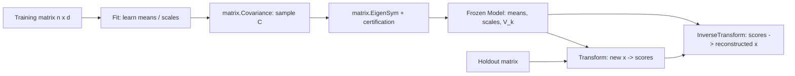

<!--
  SPDX-License-Identifier: AGPL-3.0-only
  Copyright (C) 2025-2026 katalvlaran

  File: docs/PCA.md
  Package: github.com/lvlath/go/pca
  Purpose: Fitted covariance PCA mathematics, public API, numerical acceptance,
           leakage prevention, diagnostics, and engineering usage.
  Contract status: Implemented CovarianceEigen reference solver; ThinSVD unavailable.
  Scope: PCA only; anomaly thresholds and supervised models are downstream policy.
  License: AGPL-3.0-only.
-->

# PCA — Fitted Principal Component Analysis

> Package: [`pca`](../pca/) | Contract: immutable fitted transform, covariance-based reference solver | Go 1.23.4+

The `pca` package learns an **orthogonal latent coordinate system** from a training matrix and reuses that fixed coordinate system on future data. It provides dimensionality reduction, controlled reconstruction, a variance spectrum, and training-space reconstruction diagnostics. It does **not** choose alert thresholds, forecast future observations, estimate Nelson–Siegel parameters, or perform direct singular-value decomposition. Rows are observations, but temporal independence, stationarity and causal interpretations are not inferred by this algorithm.

**Numerical admission is strict.** PCA does not compensate for corrupted sample covariance by symmetrizing it, does not clip a materially negative eigenvalue, and does not publish an unconverged Jacobi result. The `CovarianceEigen` solver is a reference implementation; nearly rank-deficient data can require a future direct SVD solver rather than a looser tolerance.

## 1. Quick navigation

1. [Data and fitted ownership](#2-data-and-fitted-ownership)
2. [Mathematics and dimensions](#3-mathematics-and-dimensions)
3. [Solver, rank, and numerical certification](#4-solver-rank-and-numerical-certification)
4. [Public Go API](#5-public-go-api)
5. [Production patterns](#6-production-patterns)
6. [Errors and precedence](#7-errors-and-precedence)
7. [Determinism, performance, and concurrency](#8-determinism-performance-and-concurrency)
8. [Tests and operational constraints](#9-tests-and-operational-constraints)
9. [Operational decision checklist](#10-operational-decision-checklist)

## 2. Data and fitted ownership

Each row of `X` is one observation; each column is one ordered feature. `Fit` requires `n >= 2`, `d >= 1`, and all cells to be finite `float64`. The caller must not modify `X` while a call is reading it; `Fit` never changes or retains `X`.

`FitResult` contains a `Model` with **private fitted** means, scales, and `d×k` loadings, and caller-owned detached `Eigenvalues`/`ExplainedVarianceRatio` slices. The mutable public diagnostics cannot modify the model's private buffers. `(*FitResult)(nil).IsNil()` is true; `(&FitResult{}).IsNil()` is false. The latter does not mean an unfitted result is a valid trained model.



A production workflow should keep **chronological or entity-based** separation as appropriate: `train` to fit the basis, `calibration` to choose downstream alert thresholds, and `holdout` to measure final performance. Neither calibration nor holdout data may influence training means/scales, chosen `k`, tolerances, or solver selection after their roles have been declared.

## 3. Mathematics and dimensions

### 3.1. Fitted affine preprocessing

For training observation `i` and feature `j`, define

$$
Y_{ij}=\frac{X_{ij}-\mu_j}{s_j},\quad
\mu_j=\operatorname{mean}_{i\in train}X_{ij}.
$$

With `Standardize=false`, every `s_j=1`. With `Standardize=true`, `stats.FitStandardizer` supplies a **population** (`DDOF=0`) standard deviation and `RejectConstant` policy. An exactly constant training feature fails with `ErrZeroVariance`; it is not silently dropped. A constant column is legal without standardization if other features carry nonzero variance.

The sample covariance always uses the sample denominator `n-1`, regardless of the scale convention:

$$
C=\frac{1}{n-1}\,(Y-\overline{Y})^{\mathsf T}(Y-\overline{Y}),\qquad
C\,v_j=\lambda_j v_j.
$$

For correctly centered training data, `mean(Y)` is numerically near zero; `matrix.Covariance` performs the stable sample-centering itself. These two conventions are intentionally different (`DDOF=0` for fitted scales; `n-1` for covariance).


### 3.2. Frozen projection and reconstruction

For an inference matrix `Xnew` with the original `d` columns:

$$
Z = \left[(X_{new}-\mu)\oslash s\right] V_k,
\qquad
\widehat{X}_{new}=(Z V_k^{\mathsf T})\odot s+\mu.
$$


`Transform(ctx,x)` returns `nnew×k` scores. `InverseTransform(ctx,scores)` returns `nnew×d` values in the **original feature units**. `Reconstruct(ctx,x)` calls these two operations in sequence. Every output is detached; valid zero-row inference returns an allocated zero-row matrix with correct width. When `k` is truncated, reconstruction is intentionally lossy.

`Components()` returns an independent `d×k` matrix. Mutating that return value cannot modify subsequent `Transform` results. The method returns nil for nil/unfitted receivers because its signature has no error return.

### 3.3. Variance ratios and training reconstruction diagnostic

Let the accepted eigenvalues be sorted `λ1 >= ... >= λd >= 0`. For each of the **retained** `k` components:

$$
r_i=\frac{\lambda_i}{\sum_{j=1}^{d}\lambda_j},\qquad i=1,\ldots,k.
$$

The denominator includes **all** accepted nonnegative eigenvalues, even positive modes excluded from the detected numerical rank by a chosen rank tolerance. Hence the retained `r_i` are **not renormalized** to sum to one when `k<rank`; even `k=Rank` need not account for every strictly positive numerical tail. For high-range values, the implementation divides by `lambdaMax` before forming the normalized trace to avoid an unnecessary overflow.

The training diagnostic is the Frobenius norm of reconstruction error in **prepared** coordinates:

$$
R=\left\|Y-YV_kV_k^{\mathsf T}\right\|_F,\qquad
R^2\approx(n-1)\sum_{j=k+1}^{d}\lambda_j.
$$


This identity is a *test oracle*, not an instruction to replace the direct residual kernel with the eigenvalue tail. The residual is measured across **all n training observations**, not on a single row. A heldout per-observation squared prediction error (SPE) instead starts from the difference between the **measured** row and its `Model.Reconstruct` output. With `Standardize=false` and physically homogeneous features, `SPE(x)=sum_j (x_j-xhat_j)^2` has squared sensor units; with `Standardize=true`, the corresponding optimization-space score requires frozen training scales and is not obtained by naively adding mixed-unit raw squares. The current `Model` intentionally exposes no fitted-scale getter: downstream code must explicitly define and freeze its own independently auditable weighting policy when such a metric is needed.

Hotelling's `T²` is a *different* retained-score statistic, typically proportional to `sum_i score_i^2/lambda_i` with validated positive retained eigenvalues. It requires independent threshold calibration, a defensible near-zero-eigenvalue policy and population assumptions. The package exports no `SPE`, `T²`, Nelson–Siegel or alarm-threshold API.

## 4. Solver, rank, and numerical certification

### 4.1. Supported and unsupported factorization methods

| Solver            | Behavior                                                      | Suitability                                                             |
|-------------------|---------------------------------------------------------------|-------------------------------------------------------------------------|
| `CovarianceEigen` | Builds `matrix.Covariance`, then calls `matrix.EigenSym` once | Deterministic reference mode when covariance conditioning is acceptable |
| `ThinSVD`         | Immediately returns `ErrUnsupportedSolver`; **no fallback**   | Reserved API enum only, not an available algorithm                      |
| Unknown `Solver`  | `ErrInvalidOption`                                            | Never guessed or converted                                              |

`matrix.EigenSym` is a Jacobi solver accepting an **absolute maximum off-diagonal pivot tolerance**, while `pca.Options.EigenTolerance` is **relative** to the covariance infinity norm. The adapter computes `absoluteTol=relativeTol*||C||∞`; zero selects `1e-12`, with an underflow guard. The independent eigenpair verification bound is no weaker than the default quality criterion even if a user requests an excessively loose stopping tolerance.

`MaxRotations=0` means **checked `50*d*d` individual Jacobi rotations**; this is not a sweep count. `MaxRotations>0` is an explicit budget. Exhaustion returns `nil, ErrNotConverged`, with `matrix.ErrMatrixEigenFailed` also discoverable via `errors.Is`. The eigensolver does not accept a `context.Context`; cancellation is checked before/after the solver call and throughout cancellable PCA loops, not inside Jacobi rotations.

### 4.2. PSD rule and precision limits

By construction, a mathematically correct sample covariance is positive semidefinite. Numerical calculation can introduce very small negative eigenvalues. The current strict policy is:

$$
a=\epsilon\,d\,\lambda_{max},\quad \epsilon=2^{-52},\qquad
\lambda_j< -a\Longrightarrow \texttt{ErrNumerical}.
$$

Only `-a <= lambda < 0` may be replaced with positive zero. Exact covariance symmetry is checked because the canonical covariance kernel mirrors its upper triangle into the lower triangle. The eigensolver is not allowed to repair a corrupted covariance. **This allowance is an engineering scale-aware gate, not a proven uniform error bound for every covariance calculation**; especially ill-conditioned data require a direct SVD approach and independent high-precision oracles.

Every retained eigenvector is checked for finite elements, unit norm, mutual orthogonality and its *raw* eigen-equation residual `||Cv-λv||₂` against the original covariance snapshot. A large user-provided `EigenTolerance` cannot certify an unrotated diagonal as an eigenvalue spectrum.

### 4.3. Rank and deterministic basis signs

`RankTolerance=0` selects `tau=epsilon*max(n,d)`; explicit nonnegative values use the same **covariance-eigenvalue** interpretation. The numerical rank is the number of values strictly satisfying `lambda > tau*lambdaMax`, and may not exceed `min(n-1,d)`. `Components=0` selects that rank. A requested positive `k>rank` fails with `ErrRankDeficient`, rather than padding the basis with null modes.

Eigenvalues are stably sorted descending; equal values keep their Jacobi column indices. Each column sign is oriented so the greatest-absolute entry is positive; equal absolute magnitudes choose the lowest feature row index. For a repeated eigenvalue, an **entire invariant subspace** has multiple valid orthonormal bases: compare `P=V_k*V_kᵀ`, not individual loading columns, **when the selected k retains that complete eigenspace**. A `k` boundary that cuts through a repeated eigenspace does not guarantee cross-solver projector identity.

### 4.4. Complexity and limits

For `n` rows, `d` features, `k` retained components and at most `R` Jacobi rotations:

| Stage                            | Time          | Additional storage                 |
|----------------------------------|---------------|------------------------------------|
| Finite scans and fitted scaling  | `O(nd)`       | `O(nd+d)` if standardized          |
| Stable sample covariance         | `O(nd²)`      | `O(d²)` plus matrix workspaces     |
| Max-pivot Jacobi                 | `O(Rd²)`      | `O(d²)`                            |
| Eigenpair certification          | `O(d³)`       | `O(d²)` covariance/basis snapshots |
| Training reconstruction residual | `O(ndk)`      | `O(d+k)` row buffers               |
| Inference transform              | `O(nnew*d*k)` | `O(nnew*k)` output/workspace       |
| Inverse transform                | `O(nnew*d*k)` | `O(nnew*d+k)` output/workspace     |

`R=50d²` is an **upper bound** when omitted, not a claim that every dataset needs that many rotations. Covariance formation squares the condition number: poorly separated tiny eigenmodes can disappear even when a direct SVD would retain them. The current implementation does not promise a condition-number certificate or high-condition rank reliability.

### 4.5. Canonical computation and publication order

The kernel separates numeric obligations rather than equating a returned eigenvector matrix with a successful fit:

```text
validate context -> validate options -> validate input/size -> finite scan
  -> (optional) fit population scales on TRAINING data only
  -> matrix.Covariance(prepared training matrix) [sample n-1]
  -> require finite, exactly symmetric covariance; preserve original snapshot
  -> matrix.EigenSym(C, absolute pivot threshold, checked rotations)
  -> stable descending eigenpair order + first-max-abs sign orientation
  -> verify PSD allowance and all d original-C eigenpair equations
  -> determine covariance numerical rank; reject impossible k
  -> freeze mean, scale, loading copies; calculate direct training residual
  -> publish complete FitResult OR nil result + classified error
```

**Why verify all d directions?** Even if a caller requests `k=1`, an inaccurate discarded eigenvector or a materially negative omitted eigenvalue may signal invalid covariance or premature Jacobi termination. Checking only the retained prefix could conceal that failure. A loose `EigenTolerance` changes the *solver's* pivot stopping rule; it does not grant a looser publication certificate.

**Why does the default rotation budget matter?** The kernel scans a d-by-d off-diagonal surface to find each Jacobi pivot. With `R <= 50*d*d` the scan alone has an `O(R*d*d)` upper bound, i.e. `O(d^4)` under the default maximum. This is a worst-case budget bound, not evidence that typical data need all rotations. A direct thin SVD, once actually implemented, would have different conditioning and complexity contracts.

## 5. Public Go API

### 5.1. Training entry points

```go
fit, err := pca.Fit(ctx, train, pca.Options{
    Components:     3,
    Standardize:    false,
    Solver:         pca.CovarianceEigen,
    RankTolerance:  0, // epsilon * max(n,d)
    EigenTolerance: 0, // relative 1e-12
    MaxRotations:   0, // checked 50*d*d
})
```

Convenience wrappers **delegate to the same `Fit` and diagnostics**; they are not distinct kernels:

| Wrapper                                      | Equivalent policy                         |
|----------------------------------------------|-------------------------------------------|
| `FitDefault(ctx,train)`                      | `Options{}`                               |
| `FitWithComponents(ctx,train,k)`             | `Options{Components:k}`                   |
| `FitStandardized(ctx,train)`                 | `Options{Standardize:true}`               |
| `FitStandardizedWithComponents(ctx,train,k)` | `Options{Standardize:true, Components:k}` |

Use the full `Fit` when a numerical rank policy or rotation budget must be explicit. In code handling errors, `errors.Is(err,pca.ErrNumerical)`, `errors.Is(err,pca.ErrNotConverged)`, and `errors.Is(err,pca.ErrRankDeficient)` are part of the public protocol; error strings are not.

### 5.2. An executable leakage-safe pipeline

This example compiles against the actual public functions. For richer scenarios with physical units and independent validation, use [`pca/example_test.go`](../pca/example_test.go) and [`examples/pca/main.go`](../examples/pca/main.go).

```go
package main

import (
	"context"
	"fmt"

	"github.com/lvlath/go/matrix"
	"github.com/lvlath/go/pca"
)

func main() {
	ctx := context.Background()
	training, err := matrix.NewDense(4, 2)
	if err != nil {
		fmt.Println(err)
		return
	}
	if err = training.Fill([]float64{
		10, 3, 12, 5, 14, 7, 16, 9,
	}); err != nil {
		fmt.Println(err)
		return
	}

	fit, err := pca.FitWithComponents(ctx, training, 1)
	if err != nil {
		fmt.Println(err)
		return
	}
	holdout, err := matrix.NewDense(1, 2)
	if err != nil {
		fmt.Println(err)
		return
	}
	if err = holdout.Fill([]float64{20, 13}); err != nil {
		fmt.Println(err)
		return
	}

	projected, err := fit.Model.Transform(ctx, holdout)
	if err != nil {
		fmt.Println(err)
		return
	}
	reconstructed, err := fit.Model.InverseTransform(ctx, projected)
	if err != nil {
		fmt.Println(err)
		return
	}
	fmt.Printf("rank=%d score=%dx%d restored=%dx%d\n",
		fit.Rank, projected.Rows(), projected.Cols(),
		reconstructed.Rows(), reconstructed.Cols())
	// Output: rank=1 score=1x1 restored=1x2
}
```

There is no computation of the holdout mean. This is essential: a single new observation remains located relative to the training origin, rather than being mapped to zero by accidental test-batch centering.

## 6. Production patterns

### 6.1. Yield-curve factor decomposition and stress

Rows represent time-ordered curves; columns represent fixed maturities such as 6 months, 1, 2, 3, 5, 10, 20, and 30 years. Train the factor model on an initial window, reconstruct future **observed** curves without refitting, and compare out-of-sample RMSE to a **frozen training-mean curve**. A reconstruction check is not a forward forecast: the full future curve is already an input to `Reconstruct`. Inspect loading shapes before assigning economic *level/slope/curvature* labels: PCA does not promise the Nelson–Siegel functional form and cannot forecast yield changes from scores alone. Apply a deliberate parallel-rate shock to a heldout curve and analyze the displacement in the frozen factor coordinates. See `ExampleFit_yieldCurveFactorRisk`.

### 6.2. Industrial fault review using squared prediction error

For a bank of vibration sensors sharing mm/s RMS units, train on healthy windows, calibrate the SPE threshold on **separate healthy validation data**, and flag a subsequent out-of-envelope reading for maintenance review. When sensor channels share units, physical-unit SPE from `Model.Reconstruct` can be compared within a documented operating regime; changing the units or channel set invalidates a threshold calibrated for the previous metric. A useful operator trace includes `(normal SPE, threshold, fault SPE, fault/threshold)` rather than a lone boolean. The threshold is domain policy outside `pca`; it must be revalidated under changes in sensor noise, operating regimes, and false-alarm cost. See `ExampleFit_turbineBearingSPE`.

### 6.3. Multichannel ECG denoising

Train a 12-channel latent basis and reconstruct withheld correlated leads. If an independent clean synthetic reference is available, compare noisy-vs-clean and reconstructed-vs-clean **holdout RMSE**; a low training reconstruction error alone cannot prove noise reduction. PCA removes components of **cross-channel** variability, not arbitrary high-frequency noise, and is not a clinical detection or safety guarantee. See `ExampleFit_multichannelECGDenoising`.

### 6.4. Power-network load compression

Ten correlated feeder measurements can be represented by three scores per hour if independent holdout reconstruction accuracy is sufficient. Compare the restored feeder readings with a training-only frozen-mean baseline; `Reconstruct` describes already observed rows and **is not a forecast** or dispatch recommendation. See `ExampleFit_substationLoadCompression`.

### 6.5. Mixed-unit water-treatment instrumentation

Temperature, flow, pH and conductivity have incompatible physical units. Fit `Standardize=true`, then evaluate a **specific conductivity-channel** reconstruction deviation in μS/cm against a separately calibrated threshold. The model returns original-unit reconstructed features, so a single-channel physical error is interpretable without pretending to recover hidden fitted scaling parameters. Never sum raw squared residuals across heterogeneous units and call the result dimensionless SPE. See `ExampleFit_standardizedWaterQuality`.

## 7. Errors and precedence

For `Fit`, the externally observable validation order is **context → options → nil/typed-nil input → shape/checked sizes → nonfinite cells → domain/rank → numerical computation**. A requested `ThinSVD` mode is rejected before reading even a nil matrix. Successful `Fit` publishes a complete model; **any error returns a nil result**, not a partially trained artifact.

| Package sentinel       | Meaning                                                                           |
|------------------------|-----------------------------------------------------------------------------------|
| `ErrInvalidOption`     | Nil context, negative count/tolerance, nonfinite tolerance, or unknown solver     |
| `ErrUnsupportedSolver` | Reserved ThinSVD was requested; no fallback                                       |
| `ErrNilInput`          | Absent or recognized typed-nil matrix, or nil/unfitted Model receiver             |
| `ErrEmptyInput`        | Zero rows during training or a zero-width matrix                                  |
| `ErrShape`             | Too few training rows or inconsistent feature/score width                         |
| `ErrNonFinite`         | Caller-provided NaN or infinity                                                   |
| `ErrZeroVariance`      | No training variance; or constant column under Standardize                        |
| `ErrRankDeficient`     | Requested `k` exceeds numerical rank or no modes pass rank cutoff                 |
| `ErrNotConverged`      | Jacobi exhausted its rotation budget; matrix root cause retained                  |
| `ErrOverflow`          | Unrepresentable sizes or finite arithmetic results                                |
| `ErrNumerical`         | Asymmetric/invalid covariance, material negative eigenvalue, or invalid eigenpair |

`errors.Is` is the primary classification method. When dependency failures are remapped to PCA sentinels, their original `matrix` or `stats` error identity remains discoverable. Generic `Matrix.At` failures are propagated without parsing error strings. For inference with valid feature width, an empty **row** dimension is accepted; a zero **column** dimension is not.

## 8. Determinism, performance, and concurrency

- Input scans follow ascending observation index then ascending original feature index. Sorted eigenpairs use stable descending eigenvalues with Jacobi source-index tie breaks. The loading sign pivot chooses the first maximum-absolute row.
- All persisted `Model` arrays are privately owned after `Fit`; exported diagnostics and getter/inference matrices are detached. Concurrent `Model.Transform`, `InverseTransform` and `Reconstruct` calls are safe with distinct, non-mutated input matrices; each call creates its own workspace.
- `*matrix.Dense` benefits from inexpensive `At` calls; its private backing storage is **not** accessible from `pca`. Introducing unsafe direct slice access as an optimization would require a separately admitted matrix API change.
- Projection/reconstruction returns `ErrOverflow` when intermediate or final results are not finite. Input NaN/±Inf remains `ErrNonFinite`, not an arithmetic overflow or a missing-data sentinel.
- Benchmark `BenchmarkPCA_CovarianceEigen` measures n=100/1000 and d=10/50/100 with all dataset construction excluded from timing; measurements depend on the real matrix/statistics implementation, CPU and toolchain.

## 9. Tests and operational constraints

The external `package pca_test` suite checks low rank, requested rank errors, holdout leakage, repeated-eigenspace projectors, detached components, typed-nil `core.Nilable`, zero variance, unsupported ThinSVD, exhausted rotations, numerical error on loose-tolerance false convergence, checked allocation sizes and concurrent inference. It also includes a high-precision rational 2×2 covariance oracle and original-space reconstruction checks.

**Required acceptance commands in the actual repository**:

```bash
gofmt -l pca/*.go examples/pca/main.go
go test ./pca -count=1
go test -race ./pca -count=1
go test ./... -count=1
go vet ./...
golangci-lint run
go test ./pca -coverprofile=pca.cover -count=1
go tool cover -func=pca.cover
```

A package that only passes against compatibility stand-ins is **not** verified against the real `matrix.Covariance`, `matrix.EigenSym`, and `stats.FitStandardizer` dependency versions. In particular, test behavior and benchmark figures from alternate kernels must not be reported as real-repository CI results.

## 10. Operational decision checklist

Before publishing PCA-based compression or an anomaly signal, record these application-owned decisions:

1. **Feature schema:** fixed ordered columns, physical units, finite-value policy and verified sample provenance. PCA does not verify temporal stationarity or repair missing observations.
2. **Data partition:** fit the basis on a declared training partition; use separate calibration/validation for `k` and thresholds; reserve untouched final holdout for a performance claim. Do not select `k` from the reporting holdout.
3. **Solver admission:** use `CovarianceEigen` only when the covariance rank is credible for the condition regime. On near-singular data, `ThinSVD` is unavailable, not a fallback to enable by lowering tolerances.
4. **Independent numerical evidence:** check eigen-equation residuals, repeated-eigenspace projectors, scale-extreme covariance oracles and direct reconstruction residuals. Do not declare PSD from clipping alone.
5. **Physical metric:** decide whether the alarm uses original-unit channel errors, homogeneous-channel SPE or an explicitly weighted dimensionless score. `ReconstructionResidual` does not provide a ready-made per-row anomaly metric.
6. **Alert interpretation:** a threshold exceedance initiates a documented investigation; it does not identify the failing component, predict a price move or authorize an automatic safety action.
7. **Operational verification:** run full-module tests, race, vet and the repository's pinned lint configuration against real dependencies; inspect resource usage for representative `n`, `d` and rotation budgets.

A useful audit record retains training/calibration/holdout boundaries, source feature names and units, `Options` (including resolved defaults), selected `k`, numerical rank, method version, runtime Go version and the threshold/calibration policy. The current `FitResult` exposes spectral diagnostics but is **not** itself a serialized model provenance record; applications must retain those metadata separately.

---

**Related reading:** [`MATRICES.md`](MATRICES.md) (covariance, eigensystems), [`STATS.md`](STATS.md) (fitted scaling), [`OLS.md`](OLS.md) and [`RIDGE.md`](RIDGE.md) (supervised downstream models), [`TUTORIAL.md`](TUTORIAL.md), [`FAQ_&_TIPS.md`](FAQ_%26_TIPS.md).
