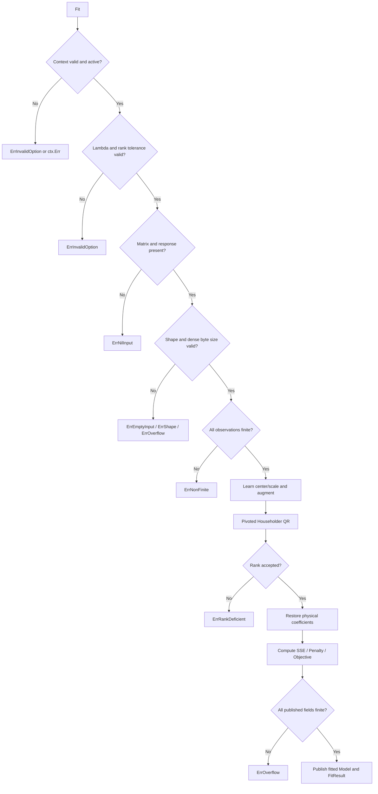

<!--
File: docs/RIDGE.md
Package: github.com/lvlath/go/ridge
Purpose: executable API map, mathematical derivation, numeric limits, error and ownership laws
Contract: lvlath-spec-10-v1; describes public symbols implemented by ridge
License: SPDX-License-Identifier: AGPL-3.0-only
Copyright (C) 2025-2026 katalvlaran
-->

# Ridge: augmented-QR Tikhonov regularization

## 1. Purpose and mathematical boundary

`ridge` estimates a *linear* predictor with explicit L2 slope regularization. It is appropriate for factor designs with correlated predictors, highly redundant sensor channels, and wide matrices where `p > n`. Unlike unregularized `ols`, `ridge` requires strictly positive `Lambda`; there is no hidden fallback to OLS, a pseudoinverse, an automatically chosen penalty, or normal equations.

**The central promise is not “a small residual at any cost.”** The package minimizes an explicitly normalized tradeoff between training residual energy and the length of the coefficient vector **in the optimization coordinate system**. The user chooses `Lambda`; production code must justify that choice using validation outside this package.

Let `n` denote training rows, `p` the original number of features, `Z` the transformed design, and `theta` the optimization slopes. With an optional *unpenalized* intercept `b`, the objective is:


The `NoIntercept=true` policy removes `b` completely, constraining it to **exactly positive zero** in original predictor units. In every mode, `Lambda > 0` is finite and mandatory.

### Penalty basis, not scale-invariance

With `Standardize=false`, `theta=beta` and the penalty uses physical-unit slopes. With `Standardize=true`, the training transform fits a population (`DDOF=0`) standard deviation per predictor. The penalty uses standardized *optimization* slopes `theta`, while `Model.Coefficients()` returns physical-unit slopes `beta`. These are two different optimization problems; equal `Lambda` values do not make their solutions scale-invariant.

## 2. Proving the augmented least-squares equivalence

The package builds **exactly `p` penalty rows**, regardless of intercept mode. It never inserts a penalty coefficient into the intercept column.

With an intercept (`q=p+1`):

```text
           q = p + 1 columns
           intercept  p feature columns
                |              |
           +----+--------------+--+
           |  1 |      Z       |  |  <- n observation rows
   A_aug = +----+--------------+--+
           |  0 | sqrt(nλ) I_p |  |  <- p penalty rows
           +----+--------------+--+

   w = [ b, theta_1, ..., theta_p ]ᵀ
   y_aug = [ y_1, ..., y_n, 0, ..., 0 ]ᵀ
```

Without an intercept (`q=p`), the first column of ones and the all-zero intercept penalty column are absent. The upper block is `Z`, the lower block is `sqrt(n*Lambda)*I_p`.


Dividing by `2*n` yields exactly the specified objective. Thus **`matrix.SolveLeastSquares` remains the only production linear solver**. It receives a numerically equilibrated, orthogonally row-permuted representation of this same augmented system. The returned QR coordinates are inverted before producing public slopes, intercept, SSE, and penalty. This matters: a stable augmented weight alone is insufficient to keep strongly shrunken but finite coefficients from rounding to zero in a naive Householder right-hand-side transformation.

For `Lambda>0`, the slope subspace is algebraically strictly convex. With `n>=1`, a free intercept is identifiable because the ones column is nonzero in the original rows and zero in the penalty block. However, mathematical uniqueness does **not** promise that every extremely small representable `Lambda` survives a finite-precision QR rank threshold. If the numerical rank is rejected, `ridge.ErrRankDeficient` is returned rather than changing the penalty.

### 2.1. Why the QR representation needs its own coordinate system

The **canonical optimization system** still uses original observations first, followed by exactly `p` penalty rows:

```text
With intercept (canonical parameter order):
  rows 0..n-1:   [1, Z]        RHS = y
  rows n..n+p-1: [0, w*I_p]    RHS = 0
  w = sqrt(n) * sqrt(Lambda)
```

However, *feeding that row order directly into Householder QR* can lose a nonzero slope when the penalty dominates the original design. For example, with `n=2`, `X=[1,2]ᵀ`, `y=[1,2]ᵀ`, `NoIntercept=true`, and `Lambda=1e100`, the exact scalar optimum is:

```text
beta = (1*1 + 2*2) / (1*1 + 2*2 + 2*Lambda)
     = 5 / (5 + 2e100)
     ~= 2.5e-100    (finite and nonzero)
```

The naive order `[1, 2, sqrt(2*Lambda)]ᵀ` can produce a computed `-0` under the current Householder RHS update: large changes to the first observation component cancel, washing out the much smaller projection that should determine the coefficient. This is **not** a correct regularized optimum and must not be excused as expected shrinkage.

The actual factor uses a shared maximum for internal scaling, and compares numerical rank using the diagonal of a pivoted QR factor. Therefore both the **row layout** and **column magnitudes** matter to operational robustness. The stable transformation is deterministic and is applied to every fit, not selected through a magic Lambda cutoff.

### 2.2. Equivalent permutation and column equilibration

Let `P` be the orthogonal row permutation that moves all penalty rows *before* observations; let `C` be the column permutation that lists all penalized slopes in their original feature order and puts the optional unpenalized intercept **last**; and let `D` be a strictly positive diagonal with one magnitude per QR column. The solver receives:


Because `PᵀP=I`, and `D` is invertible, this is an exact change of variables:

```text
canonical parameter: c = [b, theta...] or [theta...]
QR parameter:        gamma = D * transpose(C) * c
QR matrix:           A_QR = P * A_aug * C * inverse(D)
QR response:         y_QR = P * y_aug

||A_QR*gamma - y_QR||² = ||A_aug*c - y_aug||²
```

The diagonal is chosen deterministically:

- For each slope, `d_j = max_i(abs(canonicalA[i, slope_j]))`, including its strictly positive penalty row. Computing the maximum avoids the overflow risk of squaring huge design entries just to estimate a norm.
- With an intercept, its divisor is `sqrt(n)`, the exact Euclidean norm of its `n` ones. The intercept remains unpenalized; its column is merely moved to the last QR coordinate.
- QR reads the `p` zero-response penalty rows first. When a large penalty dominates a slope column, the initial Q-transpose RHS contribution starts at zero instead of canceling a large observation response.

After the single QR solve, *undo both operations* before publishing model parameters:

```text
theta[j] = gamma[j] / d_j
beta[j]  = theta[j] / trainingScale[j]

with intercept:
  b_QR       = gamma[p] / d_intercept
  b_physical = b_QR - sum_j(trainingMean[j] * beta[j])

with NoIntercept:
  b_physical = +0.0 exactly
```

**The public penalty still uses `theta`, never `gamma` or physical `beta` when standardized.** Neither row ordering nor balancing is an undocumented change of `Lambda` or a fallback to another optimization criterion. The `RankTolerance` cutoff is applied by `matrix` to the **equilibrated QR system**; it is not a certificate of algebraic rank of raw `X`.

This design deliberately keeps the canonical augmented matrix independent of the balanced QR input. The extra O((n+p)q) storage and copying are visible costs; a faster specialized matrix view may be considered only if it preserves `Matrix` mutability, ownership and error contracts. No private `matrix.Dense` storage is accessed by `ridge`.

### 2.3. Limits of floating-point equilibration

Preconditioning removes the documented large-penalty cancellation, but no binary64 QR algorithm can resolve *every* mathematically distinct column or coefficient. Extremely disparate individual features can underflow when divided by a column divisor; the full augmented system may still fail the chosen numerical-rank cutoff. A required public coefficient, residual, or diagnostic that does not fit finite float64 results in `ErrOverflow`. **Neither case permits secretly increasing Lambda, discarding a column, or switching to OLS.**

## 3. Intercept and preprocessing law

| Options                     | QR top block                      | Physical prediction | Penalty coordinates |
|-----------------------------|-----------------------------------|---------------------|---------------------|
| Default intercept, unscaled | `[1, X - train_mean]`             | `b + X*beta`        | `beta`              |
| Intercept + Standardize     | `[1, (X-train_mean)/train_scale]` | `b + X*beta`        | `theta`             |
| NoIntercept, unscaled       | `X`                               | `X*beta`            | `beta`              |
| NoIntercept + Standardize   | `X/train_scale`                   | `X*beta`, `b=0`     | `theta`             |

The unscaled affine case is *internally centered* for conditioning, even though `Standardize=false`. This is mathematically equivalent to an affine model after the stored coefficients are back-converted. In origin-constrained mode, **centering is always forbidden**: `(x-mu)/scale` would introduce a hidden physical intercept `-sum(mu_j*beta_j)`.

The exact physical coefficient map is:


With `NoIntercept=true`, no correction is applied and `b=+0` regardless of learned scales. The `stats.FitStandardizer` dependency is called with `stats.ScaleOptions{DDOF:0, ConstantPolicy:stats.UnitScaleConstant}`. Exact-constant columns receive scale `1` and are **not removed**. The diagonal penalty makes their slopes identifiable, though the unpenalized intercept can absorb their constant contribution.

The fitted Model privately owns physical slopes and copies of training transform metadata. Future `Predict` calls **do not re-fit means or standard deviations** and **do not reapply** the transform: they use `b + Σ x_j*beta_j` directly. `Coefficients()` returns a fresh copy of `beta` on every call.

## 4. Public API map

```go
type Options struct {
    Lambda        float64
    NoIntercept   bool
    Standardize   bool
    RankTolerance float64
}

func Fit(ctx context.Context, x matrix.Matrix, y []float64, opts Options) (*FitResult, error)
func FitWithLambda(ctx context.Context, x matrix.Matrix, y []float64, lambda float64) (*FitResult, error)
func FitStandardized(ctx context.Context, x matrix.Matrix, y []float64, lambda float64) (*FitResult, error)
func FitThroughOrigin(ctx context.Context, x matrix.Matrix, y []float64, lambda float64) (*FitResult, error)
func FitThroughOriginStandardized(ctx context.Context, x matrix.Matrix, y []float64, lambda float64) (*FitResult, error)

func (m *Model) Predict(ctx context.Context, x matrix.Matrix) ([]float64, error)
func (m *Model) Coefficients() ([]float64, float64)
func (r *FitResult) IsNil() bool
```

The convenience methods only select the following `Options` and return exactly what canonical `Fit` returns:

| Method | Equivalent policy | Purpose |
|---|---|---|
| `FitWithLambda` | `{Lambda:lambda}` | Affine, unscaled regression |
| `FitStandardized` | `{Lambda:lambda, Standardize:true}` | Common scale-aware penalization |
| `FitThroughOrigin` | `{Lambda:lambda, NoIntercept:true}` | Zero-offset sensor or physical model |
| `FitThroughOriginStandardized` | `{Lambda:lambda, NoIntercept:true, Standardize:true}` | Zero-offset model with balanced features |

There is deliberately **no** `FitDefault` that invents a penalty strength: the zero `Options` value is invalid. For advanced rank selection or precise options, call `Fit` directly.

### Small complete usage example

```go
package main

import (
    "context"
    "fmt"
    "log"

    "github.com/lvlath/go/matrix"
    "github.com/lvlath/go/ridge"
)

func main() {
    train, err := matrix.NewDense(4, 2)
    if err != nil { log.Fatal(err) }
    observations := [4][2]float64{{1, 1}, {2, 2}, {3, 3}, {4, 4}}
    for row := range observations {
        for col, value := range observations[row] {
            if err := train.Set(row, col, value); err != nil { log.Fatal(err) }
        }
    }
    fit, err := ridge.FitStandardized(
        context.Background(), train, []float64{1, 2, 3, 4}, 0.25,
    )
    if err != nil { log.Fatal(err) }
    physical, intercept := fit.Model.Coefficients()
    prediction, err := fit.Model.Predict(context.Background(), train)
    if err != nil { log.Fatal(err) }
    fmt.Printf("features=%d predictions=%d intercept=%.4f\n", len(physical), len(prediction), intercept)
}
```

The large, genuinely operational counterpart lives at `examples/ridge/main.go`. It holds out the final 12 months instead of calculating an optimistic in-sample success metric, compares holdout MAE against a training-mean baseline, and scores deterministic macro stress conditions.

## 5. Numeric implementation and overflow counterexamples

### A. Weight calculation

Do **not** form `float64(n)*Lambda` before taking its square root. For example, with `n=2` and `Lambda=math.MaxFloat64`, the product is `+Inf` even though `sqrt(n*Lambda)` is a finite mathematical value. The implementation calculates:

```go
weight := math.Sqrt(float64(n)) * math.Sqrt(lambda)
```

This also avoids prematurely rounding some tiny products to zero. A finite augmented weight is **not** evidence that the QR factor is numerically usable under extreme scaling. That judgment belongs to the declared matrix rank policy.

### B. Objective calculation

`FitResult.ResidualSumSquares` is **unnormalized** original-unit SSE; `FitResult.Penalty` is `Lambda*sum(theta^2)/2` in the optimization basis; `FitResult.Objective` is `SSE/(2*n)+Penalty`. Independent scaled-square accumulation avoids `value*value` overflow where the completed energy is representable. A required field that cannot be expressed as a finite float64 causes `ridge.ErrOverflow` and no partial model publication.

### C. Prediction cancellation

The common physical-unit dot product is compensated and allocation-free. In a *rare* case where products or partial sums overflow but later signed terms cancel, the implementation evaluates the row in exact rational arithmetic over the **supplied float64 bit values**, then rounds the *final* result once. This fallback changes arithmetic representation, **not the fitted model, penalty, or algorithm**. Exact arithmetic is expensive and only entered on an exceptional intermediate overflow; the common `Predict` path remains O(rows*features) with O(rows) output memory.

### D. The high-Lambda nonzero coefficient oracle

A single predictor with `(X, y) = ([1,2], [1,2])` and `Lambda=1e100` must produce `beta≈2.5e-100` under the zero-intercept objective, together with a small but positive penalty. This is a **loss-preserving transformation test**, not a test that tolerates any finite output. A companion affine case with `X=[-1,1]`, `y=[2,4]` must preserve its intercept at `3` while retaining a nonzero slope near `1e-100`. Tests also exercise duplicated predictors and `Lambda=math.MaxFloat64` without forming the overflowing intermediate `n*Lambda`.

The safe weight expression `sqrt(n)*sqrt(Lambda)` protects **assembly**; deterministic row/column preparation protects **QR projection**. Both are required. Precision is checked against independent analytic or rational oracles, rather than against a second copy of the production solver.

### E. Limits the package does not conceal

- Float64 cannot represent every physically plausible coefficient, objective, or residual even when input cells are finite.
- A huge integer-valid dense design may exceed physical memory. Size checks avoid integer and byte-count overflow; they do not recover from system OOM.
- Non-Dense `matrix.Matrix` implementations may have expensive `At` methods. Fast raw-memory access is **not** promised because `matrix.Dense` does not expose a safe public backing-slice accessor.
- Repeated input passes establish error precedence and original-coordinate diagnostics. Inputs must not be mutated concurrently.
- No uncertainty intervals or time-series residual covariance model are returned.

## 6. Error precedence and ownership



Public sentinels: `ErrInvalidOption`, `ErrNilInput`, `ErrEmptyInput`, `ErrShape`, `ErrNonFinite`, `ErrRankDeficient`, `ErrOverflow`. Inspect with `errors.Is`, not error-message matching. QR `matrix.ErrRankDeficient` and `matrix.ErrOverflow` remain in wrapped causes when corresponding package sentinels are reported; `stats.ErrOverflow` is likewise retained. A canceled context yields its original `ctx.Err()`.

Input `x`/`y` is read-only for a call and not retained. `Fit` returns either a fully verified `*FitResult` or `(nil, error)`. `Predict` likewise returns a complete independent slice or `(nil, error)`. The only valid empty prediction has a `0×p` matrix with exactly the trained `p` feature columns. Nil `(*Model).Coefficients()` returns `(nil,0)`; nil/untrained `Predict` returns `ErrNilInput`; `(*FitResult)(nil).IsNil()` is true through `core.Nilable`.

## 7. Oracle fixtures and independent verification

| Fixture                                       | Mathematical expectation                                          |
|-----------------------------------------------|-------------------------------------------------------------------|
| `x=[1,2]`, `y=[1,2]`, `Lambda=1`, origin      | `beta=5/7`, `SSE=20/49`, `Penalty=25/98`, `Objective=5/14`        |
| `x=[-1,1]`, `y=[4,4]`, `Lambda>0`, intercept  | `beta=0`, `b=4`, `Objective=0`                                    |
| `x=[-1,1]`, `y=[-1,1]`, `Lambda=1`, intercept | `beta=1/2`, `b=0`, `SSE=1/2`, `Penalty=1/8`, `Objective=1/4`      |
| Repeated/duplicate feature columns            | Unique regularized optimum; equal duplicate slopes under symmetry |
| `p>n` with finite positive Lambda             | Augmented dimension permits a full-column-rank solve              |
| `n=1`, intercept on, arbitrary `p`            | All slopes zero; intercept equals the single response             |
| Whole training set duplicated at fixed Lambda | Same optimal physical coefficients and objective, within rounding |
| `NoIntercept+Standardize`                     | Scale-only transformation, exact origin prediction                |
| Invalid Lambda                                | `ErrInvalidOption`, not OLS fallback                              |
| Huge individual prediction products cancel    | Exact final prediction accepted if representable                  |
| `Lambda=1e100`, origin scalar `[1,2]`         | Nonzero `beta≈2.5e-100`, not rounded to `-0`                      |
| `Lambda=1e100`, affine `X=[-1,1]`, `y=[2,4]`  | Free intercept `3`, nonzero slope `≈1e-100`                       |
| `Lambda=math.MaxFloat64`, origin scalar       | Nonzero subnormal beta; `n*Lambda` is not formed                  |
| Duplicate correlated columns at huge Lambda   | Slopes remain equal, small and nonzero                            |

The external test package is `ridge_test` only. `oracle_test.go` independently constructs exact multivariate rational normal-equation *oracles* for tiny fixtures; this test method is **not** used for production fitting. The production algorithm remains augmented Householder QR. Six package examples demonstrate a chronological multi-factor holdout and macro stress test, a 64-channel wide optical array with validation MAE, a non-leaking seasonal AR(12) forecast against a seasonal-naive baseline, zero-origin dosimetry with an explicit synthetic alarm threshold, single-sample calibration insufficiency, and the extreme-Lambda nonzero slope oracle. Every example contains executable `// Output:` assertions.

Use the repository Go toolchain declared in `go.mod` and the actual dependency source tree:

```bash
gofmt -w ridge/*.go examples/ridge/main.go
go test ./ridge -count=1
go test -race ./ridge -count=1
go test ./ridge -coverprofile=ridge.coverage.out
go tool cover -func=ridge.coverage.out
go test ./... -count=1
go vet ./...
golangci-lint run
go test ./ridge -run '^$' -bench BenchmarkRidge_Fit -benchmem
go run ./examples/ridge
```

**Verification caution:** tests performed using a substitute local QR and stats implementation are compile/contract smoke evidence only, not proof that the real repository integrations pass. Preserve the result of each real command separately in the integration checkpoint; never claim repository lint or coverage was verified without executing the actual dependency-backed build.

## 8. Complexity and deployment cautions

For `q=p` (NoIntercept) or `q=p+1`, factorization time is approximately `O((n+p)*q²+q³)`, and explicit augmented storage is `O((n+p)*q)` plus solver copies/workspace. Predict is `O(batch_rows*p)` on the ordinary path. These bounds deliberately include `p` extra penalty rows: they must not be misrepresented as an `O(n*p²)` wide-ridge method when `p>>n`.

**Choose Lambda using held-out or temporally ordered validation.** RIDGE reduces coefficient variance under collinearity but introduces shrinkage bias. Example fitted coefficients, holdout metrics, hedge signals, and safety thresholds are not regulatory guarantees or calibrated confidence statements.

## 9. AI-Hints and misuse prevention

- **Intercept:** verify penalty rows are zero in the intercept column; never change `q=p+1` indexing without a mathematical proof.
- **NoIntercept:** population scales are permitted, feature centers are not; a centered zero-intercept regression has a hidden physical offset.
- **Overflow:** never multiply `n*Lambda` before taking square roots; never square a large residual before applying a safe scale.
- **QR coordinate order:** penalty rows first, slope columns first, intercept last; reconstruct theta from gamma using the frozen positive column divisors.
- **Strong regularization:** very small *nonzero* coefficients are not the same as zero. Use analytic oracles to distinguish legitimate shrinkage from lost Householder RHS projections.
- **Error governance:** never treat QR rank failure as permission to increase Lambda, drop predictors, or use OLS.
- **Coordinates:** never calculate standardized penalty from public original-unit `Coefficients()`.
- **Ownership:** never expose Model's private coefficient backing slice or retain a caller-owned training matrix.
- **Performance:** do not advertise an unsafe `Dense` raw-slice fast-path. Profile first and add only dependency-supported accessors with explicit ownership rules.
- **Validation:** do not compare error strings, hide `NaN`, or publish partially filled prediction slices.
