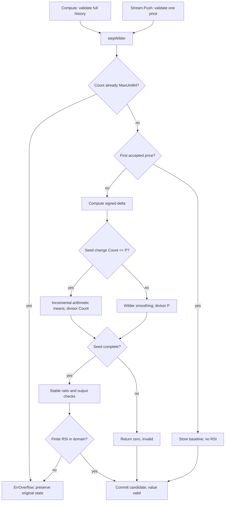

<!--
  SPDX-License-Identifier: AGPL-3.0-only
  Copyright (C) 2025-2026 katalvlaran

  File: docs/RSI.md
  Package reference: github.com/lvlath/go/rsi
  Purpose: Wilder RSI mathematics, batch/stream contracts, checkpoint ABI,
           numerical safeguards, executable usage and integration boundaries.
  Contract status: implemented public API; rsi/doc.go and source are authoritative.
  Scope: finite-positive scalar closes, deterministic Wilder smoothing and replay.
  License: AGPL-3.0-only. See ../LICENSE.
-->

# RSI - Wilder Relative Strength Index

> A causal, period-configured numerical oscillator for ordered, strictly positive prices; not a trading-signal or market-data framework.

`rsi` produces one **Wilder Relative Strength Index** value per accepted closing price after a precisely defined seed. Its batch and streaming entry points share `stepWilder`, so they follow the same floating-point transitions instead of merely implementing similar formulas. It is suitable for offline factor preparation, a single-owner online quote processor, and checkpoint-based continuity across application workers.

The package does **not** select an optimal period, infer timestamps, repair missing quotes, resample bars, issue buy/sell decisions, authenticate checkpoints, or prove profitability. Those decisions belong to the application and, where relevant, to other explicitly selected `lvlath` packages.

## 1. Choose the correct public entry point

| Need                                | API                                   | Observable contract                                                 |
|-------------------------------------|---------------------------------------|---------------------------------------------------------------------|
| Canonical complete history          | `Compute(closes, Options{Period: p})` | Detached `*Result` containing `Values` and `Valid`, both length `n` |
| Standard 14-change history          | `ComputeDefault(closes)`              | Exactly `Compute(closes, Options{})`                                |
| Explicit one-off period             | `ComputePeriod(closes, p)`            | Exactly `Compute(closes, Options{Period:p})`                        |
| Last aligned sample only            | `Latest(closes, opts)`                | Value, readiness and error projected from full `Compute`            |
| Canonical online accumulator        | `New(opts)`                           | Independently initialized, single-owner `*Stream`                   |
| Default/explicit online accumulator | `NewDefault()` / `NewPeriod(p)`       | Thin wrappers over `New`                                            |
| One additional price                | `stream.Push(close)`                  | One scalar candidate step; `(0,false,nil)` during warmup            |
| Explicit feed discontinuity         | `stream.Reset()`                      | Forget all history, retain normalized period/configuration          |
| Export a checkpoint                 | `stream.Snapshot()`                   | Detached versioned scalar state                                     |
| Continue from a checkpoint          | `stream.Restore(snapshot)`            | Validate first; replace state only on success                       |

`Options.Period == 0` selects **14 changes**, not 14 prices. A positive period `P` requires `P+1` accepted closes for the first valid observation; negative periods and periods whose `P+1` does not fit `int` return `ErrInvalidOption`. There is no hidden minimum-history error for a short **nonempty** valid slice.

`Result.IsNil()` is the nil-receiver-safe `bool` method used by the `core.Nilable` convention; it checks pointer presence, not structural validity. `(*Result)(nil).IsNil()` returns `true`, while `(&Result{}).IsNil()` returns `false`. A successful result owns both slices; there is never a usable partial `Result` on a batch error.

## 2. Mathematics: price changes, seed, and Wilder smoothing

Let `p[i]` be the *i*th accepted finite positive price. The first price is a baseline, not a gain or loss. For each later sample, define:

$$
\Delta_i=p_i-p_{i-1},\qquad g_i=\max(\Delta_i,0),\qquad \ell_i=\max(-\Delta_i,0).
$$


Both `g[i]` and `loss[i]` are nonnegative and expressed in the input price unit; they are **not** percentage returns. Because both prices are strictly positive and finite, their binary64 difference cannot overflow through opposite signs (a defensive finite check remains in the kernel).

### 2.1. Seed: the first P differences

In exact arithmetic, the initial means after `P` differences are:

$$
\bar g_P=\frac{1}{P}\sum_{i=1}^{P}g_i,\qquad
\bar\ell_P=\frac{1}{P}\sum_{i=1}^{P}\ell_i.
$$

Rather than forming a potentially overflowing sum, the implementation processes each seed change `k = 1...P` in original order:

$$
\bar g_k=\bar g_{k-1}+\frac{g_k-\bar g_{k-1}}{k},\qquad
\bar\ell_k=\bar\ell_{k-1}+\frac{\ell_k-\bar\ell_{k-1}}{k}.
$$

These are arithmetically equivalent to ordinary seed means over real numbers. In binary64 they are rounded sequentially: **do not claim exactly rounded mathematical means**, or replace them with a sum-based implementation that might overflow and diverge from streaming.

### 2.2. Subsequent changes: Wilder's recurrence

For each additional change (`t>P`):

$$
\bar g_t=\bar g_{t-1}+\frac{g_t-\bar g_{t-1}}{P},\qquad
\bar\ell_t=\bar\ell_{t-1}+\frac{\ell_t-\bar\ell_{t-1}}{P}.
$$


The same two private mean-update operations run in the batch and stream paths. `Count` counts **accepted prices**, not changes; at accepted count `P+1`, the first RSI is valid.

### 2.3. Stable RSI conversion

The classical identity `100*g/(g+loss)` can overflow when the sum does not fit `float64`, and the familiar `RS=g/loss` can overflow when loss is very small. Neither intermediate is needed:

$$
\operatorname{RSI}(g,\ell)=
\begin{cases}
50,& g=\ell=0,\\
100,& \ell=0,\ g>0,\\
0,& g=0,\ \ell>0,\\
\dfrac{100}{1+\ell/g},&g\geq\ell>0,\\
100\dfrac{g/\ell}{1+g/\ell},&0<g<\ell.
\end{cases}
$$

For nonzero inputs, **the smaller mean is divided by the larger**. The quotient is in `(0,1]`, and each denominator is in `[1,2]`; no branch divides by zero or forms a huge gain/loss quotient. On exact ties `g>=loss` chooses the first nonzero branch, yielding 50. A tiny quotient may round to zero, which is a legitimate floating-point limit; it is not arbitrary clamping.

`rsi` rejects nonfinite/negative internal means or an invalid computed RSI with `ErrOverflow`. It never silently clips computational failures into `[0,100]` or invents trading thresholds.

### 2.4. Readiness is separate from the numeric value

| `P` | Accepted closes | `Values`       | `Valid`     | Meaning                                 |
|----:|-----------------|----------------|-------------|-----------------------------------------|
|   2 | `[1,2,3,2]`     | `[0,0,100,50]` | `[F,F,T,T]` | Two rising seed changes, then a decline |
|   1 | `[3,2,2,4]`     | `[0,0,50,100]` | `[F,T,T,T]` | Loss, no change, then gain              |
|   2 | `[5,5,5,5]`     | `[0,0,50,50]`  | `[F,F,T,T]` | Valid neutral flat market               |
|   3 | `[20,21]`       | `[0,0]`        | `[F,F]`     | Successful but incomplete seed          |

A *valid* RSI of `0` represents loss-only history; a *warmup* output of `0` represents **no RSI yet**. Every consumer must inspect `Valid[i]` before reading `Values[i]` as an oscillator feature. No NaN placeholder is emitted for warmup.

### 2.5. Numerical limits and reproducibility

- Positive prices as large as approximately `MaxFloat64/2` can legitimately form a flat, neutral seed; forming a raw sum of these prices would be wrong.
- Loss of sub-ULP changes near a large offset is possible because the input is binary64 and every smoothing operation rounds. An affine transformation `c*p+d` preserves RSI in exact arithmetic when `c>0`, but transformed *binary64* prices need not preserve increments or exact output bits.
- Two valid batch/stream executions of the same prices and normalized period invoke the **same private step** in the same order, giving bitwise-identical values **within the same floating-point execution environment**. This is not a universal guarantee across different toolchains/architectures or independently re-associated arithmetic.
- No optional "more stable" alternative kernel exists. Replacing the recurrence or adding compensation is a behavioral change because checkpoint state and rounding are externally observable.

## 3. One canonical state machine



`Stream.Push` calculates against a local **value copy** of four scalars (`Count`, `previous`, `avgGain`, `avgLoss`). No receiver field is replaced until the transition and all numeric checks succeed. `Compute` first validates **all** prices and then calls the same kernel in ascending index order; any batch failure discards the entire result. A failed `Push` does not consume a price, change the previous close, advance warmup, or increment `Count`.

A rejected price does **not** imply a discontinuity: a caller may report the bad event and feed the next valid price using the unchanged state if that matches the source's continuity policy. A missing market-data sequence is different: a gap cannot be repaired by this package, and the caller must consciously choose whether to `Reset` and start a new seed.

## 4. Validation, errors, and nil receivers

Sentinels are public `var` values; use `errors.Is(err, rsi.ErrXxx)`. Error text is not a machine protocol. Errors do not expose numeric observations.

| Sentinel           | Contract boundary                                                  | Outcome                                                             |
|--------------------|--------------------------------------------------------------------|---------------------------------------------------------------------|
| `ErrInvalidOption` | `Period<0`, or `P+1` unrepresentable                               | No stream/result constructed; options win over batch input failures |
| `ErrNilInput`      | `Compute(nil,...)`, nil `*Stream` for `Push`/`Restore`             | Batch result nil; stream untouched                                  |
| `ErrEmptyInput`    | Non-nil zero-length batch                                          | Batch result nil                                                    |
| `ErrNonFinite`     | Supplied `NaN`, `+Inf`, `-Inf` price                               | No state change; batch result nil                                   |
| `ErrDomain`        | Supplied finite price `<=0`, including `-0`                        | No state change; batch result nil                                   |
| `ErrOverflow`      | Exhausted `Count` or unrepresentable internal result               | No state change; batch result nil                                   |
| `ErrStateVersion`  | `Push`/`Restore` on `Stream{}`, or incompatible/malformed snapshot | No state change                                                     |

**`Compute` ordering:** normalize options → nil slice → allocated empty slice → scan prices in **ascending index order** → recurrence. For a single price, nonfinite classification precedes the nonpositive-domain check; a bad earlier index wins over a later bad index. `Latest`, `ComputeDefault` and `ComputePeriod` preserve the canonical batch error precedence.

**`Push` ordering:** nil receiver → uninitialized stream → current price nonfinite/domain → step (including `Count==MaxUint64`). Thus if the counter is exhausted *and* the supplied price is invalid, the price error is returned first. `Restore` checks destination nil/configuration **before** inspecting the candidate snapshot.

| Receiver or state                             | Behavior              |
|-----------------------------------------------|-----------------------|
| `(*Stream)(nil).Push(...)` or `.Restore(...)` | `ErrNilInput`         |
| `(&Stream{}).Push(...)` or `.Restore(...)`    | `ErrStateVersion`     |
| `(*Stream)(nil).Reset()`                      | Safe no-op            |
| `(*Stream)(nil).Snapshot()`                   | `Snapshot{}`          |
| `(&Stream{}).Snapshot()`                      | `Snapshot{}`          |
| `(&Stream{}).Reset()`                         | Remains uninitialized |
| `(*Result)(nil).IsNil()`                      | `true`, with no panic |

No endpoint takes a `context.Context`. Application cancellation and feed lifecycle management occur outside the RSI kernel.

## 5. Checkpoint ABI, restoration, and integrity

A snapshot is **recurrent numerical state**, not the source price history. It allows an initialized standby stream with the **same normalized period** to continue without replaying all earlier prices.

| Field        | v1 serialization meaning                                                         | Validation                                                  |
|--------------|----------------------------------------------------------------------------------|-------------------------------------------------------------|
| `Algorithm`  | Exact string `rsi/wilder/v1`                                                     | Must match                                                  |
| `Config`     | Lowercase hex SHA-256 of UTF-8 `rsi/wilder/v1` followed by 8-byte LE `uint64(P)` | Must match destination stream fingerprint                   |
| `Count`      | Number of successfully accepted prices, including initial baseline               | Must have phase-consistent scalar state                     |
| `FloatState` | Exactly `[previous, avgGain, avgLoss]`                                           | Length 3, all finite; means nonnegative                     |
| `IntState`   | Reserved for a later ABI                                                         | Length **0**; nil or allocated empty is accepted by Restore |

Exact hash preimage:

```text
UTF8("rsi/wilder/v1") || LE64(uint64(normalizedPeriod))
```

`P=0` normalizes to 14 before hashing, so default and explicit 14 are interoperable. The hash is an **identifier**, not proof of historical provenance or authenticated content. It contains neither `Count` nor the floating state.

Phase validation:

| `Count` | Necessary invariant                                                                                      |
|--------:|----------------------------------------------------------------------------------------------------------|
|     `0` | All three floats compare equal to numeric zero                                                           |
|     `1` | `previous>0`, both averages zero                                                                         |
|     `2` | `previous>0`; average gain and average loss **cannot both be positive** after one signed change          |
|   `>=3` | `previous>0`, both averages finite and nonnegative (past price history cannot be proven from the schema) |

In all nonzero phases the previous price must be finite and positive. Restore validates metadata, lengths, numeric domain and phase **before** assigning a new private state. No caller-owned slice is retained. A fabricated but structurally admissible checkpoint cannot be distinguished from a genuine one by `Restore` alone.

### 5.1. Production checkpoint boundary

1. Capture `Snapshot` only when no other goroutine mutates that stream.
2. Serialize **all** fields with an encoding that preserves each `float64` bit pattern (e.g. a carefully specified binary wire format; `encoding/gob` is used in the executable checkpoint example).
3. Authenticate the **complete encoded checkpoint** using an application-managed HMAC or signature; store the integrity tag separately. A hard-coded secret is not suitable for production.
4. On the standby, authenticate **before** decoding/relying on the state, then call `New` with the intended period and `Restore` the decoded snapshot.
5. Persist and reconcile feed sequence/offset metadata **outside** the RSI ABI. Replaying an already-consumed price after a correct restore would apply the recurrence twice.

```text
Primary                         Trusted transport                   Standby
------                          -----------------                   -------
Push(valid price) --(pause)--> Snapshot -> encode -> authenticate -> verify tag
                                                       |                 |
                                                       |             decode state
                                                       |                 |
                                                       |          New(same period)
                                                       |                 |
                                                       +----------> Restore(state)
                                                                         |
                                                            next unseen valid close
```

`Snapshot(nil)` and `Snapshot(&Stream{})` return `Snapshot{}`, which is **not** a valid versioned checkpoint for `Restore`. A snapshot with `Count==MaxUint64` can pass structural validation, but the next valid `Push` rejects the count increment with `ErrOverflow` and leaves state unchanged.

## 6. Ownership, concurrency, and actual costs

| Operation                                      | Time | Space / allocations                                         | Ownership                                                       |
|------------------------------------------------|------|-------------------------------------------------------------|-----------------------------------------------------------------|
| `Compute` / `ComputeDefault` / `ComputePeriod` | O(n) | O(n) result memory; two result slices                       | Caller owns detached output; input is read-only                 |
| `Latest`                                       | O(n) | O(n) **temporary** result memory                            | Projects completed batch; not a memory-efficient online scanner |
| `New` / `NewDefault` / `NewPeriod`             | O(1) | O(1) state/configuration                                    | Returns new independent stream                                  |
| `Stream.Push`                                  | O(1) | O(1) scalar work, **0 heap allocations per step after New** | Mutates only its own receiver on success                        |
| `Stream.Reset`                                 | O(1) | O(1), no allocation                                         | Retains normalized period/configuration                         |
| `Stream.Snapshot`                              | O(1) | O(1), allocates detached three-element float slice          | Caller owns snapshot arrays                                     |
| `Stream.Restore`                               | O(1) | O(1), does not retain supplied arrays                       | Replaces private state atomically on success                    |
| `Result.IsNil`                                 | O(1) | O(1)                                                        | Pure pointer inspection                                         |

`Compute` validates and processes each price in order (two O(n) traversals). It never writes to or retains the input. A stream is mutable and **single-owner**; `Push`, `Reset`, `Snapshot`, and `Restore` on one stream must not overlap without external synchronization. Independent streams can run concurrently. No locks, internal goroutines, global RNG, network calls or wall-clock interactions exist in `rsi`.

**Latency distinction:** zero allocations in `Push` does not guarantee a hard real-time deadline, network jitter bound, or throughput SLA. It removes an avoidable source of allocator pressure from the scalar update path.

## 7. Complete Go examples

### 7.1. One validated batch and its readiness mask

This small executable contract check shows *why a zero is not enough*:

```go
package main

import (
	"fmt"
	"github.com/lvlath/go/rsi"
)

func main() {
	closes := []float64{1, 2, 3, 2}
	result, err := rsi.ComputePeriod(closes, 2)
	if err != nil {
		fmt.Println("RSI:", err)
		return
	}
	fmt.Println(result.Values)
	fmt.Println(result.Valid)
}
```

```text
[0 0 100 50]
[false false true true]
```

### 7.2. Online continuation with a rejected quote and a standby

A single-owner worker can quarantine an invalid quote without losing its prior seed. A standby on the same application boundary restores a detached checkpoint and consumes **only new** prices. This is a local numeric-continuation demonstration; authenticated transport and exchange-offset reconciliation are still application responsibilities.

```go
package main

import (
	"errors"
	"fmt"
	"math"

	"github.com/lvlath/go/rsi"
)

func main() {
	primary, err := rsi.NewPeriod(2)
	if err != nil {
		fmt.Println("init:", err)
		return
	}
	for _, closeD := range []float64{100, 102, 101, 103} {
		if _, _, err := primary.Push(close); err != nil {
			fmt.Println("seed:", err)
			return
		}
	}

	checkpoint := primary.Snapshot()
	_, _, err = primary.Push(0) // Source rejection is not a completed observation.
	fmt.Println("invalid quote:", errors.Is(err, rsi.ErrDomain))
	fmt.Println("checkpoint preserved:", checkpoint.Count == primary.Snapshot().Count)

	standby, err := rsi.NewPeriod(2)
	if err != nil {
		fmt.Println("standby init:", err)
		return
	}
	if err := standby.Restore(checkpoint); err != nil {
		fmt.Println("restore:", err)
		return
	}
	equal := true
	for _, closeD := range []float64{104, 103, 105} {
		a, va, ea := primary.Push(closeD)
		b, vb, eb := standby.Push(closeD)
		if ea != nil || eb != nil {
			fmt.Println("continuation:", ea, eb)
			return
		}
		equal = equal && va == vb && math.Float64bits(a) == math.Float64bits(b)
	}
	fmt.Printf("standby bitwise=%t count=%d\n", equal, standby.Snapshot().Count)
}
```

```text
invalid quote: true
checkpoint preserved: true
standby bitwise=true count=7
```

For richer **deterministic synthetic operational fixtures** rather than invented live-exchange data, inspect [`../rsi/example_test.go`](../rsi/example_test.go). Its six executable cases cover cross-sectional RSI(7/14/28), collateral-price deterioration, flat FX marks versus feed freshness, HMAC-protected failover, order-book sequence gaps, and new-instrument warmup. They demonstrate application decisions *outside* the oscillator, without adding threshold signals to `rsi` itself.

## 8. Composition and responsibility boundaries

```text
market feed + timestamps / monotonic sequence IDs
                         |
                 caller validates order
                         |
          +--------------+--------------+
          |                             |
       no gap                       verified gap
          |                             |
       Push(close)                 Stream.Reset()
          |                             |
          |                       new baseline and seed
          |                             |
          +--------------+--------------+
                         |
                  (RSI, Valid)
                         |
        application risk/factor/reporting policy
```

- **`series`**: use `series.Validate` to check known timestamp cadence and detect missing whole grid slots. A reported gap is not an inserted price. Decide whether to reject/segment/reset before passing closes to RSI; there is no implicit dependency or adapter.
- **`stats`**: summarize a selected set of valid RSI samples if your statistical question warrants it. Never include warmup `Values==0` with `Valid=false` as genuine measurements.
- **`acf`**: computes whole-window serial dependence, not a streaming causal oscillator. Adding new observations can alter its previously estimated lag coefficients; RSI's successful causal prefix does not change when more valid closes are appended.
- **`paa`, `sax`, `dtw`, `hmm`, `ols`, `ridge`, `pca`**: consumers may explicitly construct valid features/windows from RSI, but **must** respect their own normalization, train/holdout, shape, timestamp and numeric contracts. RSI does not produce a pre-calibrated model or a certified prediction.
- **Market policy**: alert thresholds, positions, fees, slippage, exchange session rules, and claims of predictive performance all remain outside this numeric primitive.

## 9. Verification and operational checks

Run from the **existing repository root**, not a nested module:

```bash
go test ./rsi -count=1 -cover
go test -race ./rsi -count=1
go test ./rsi -run '^$' -bench . -benchmem
go vet ./rsi
golangci-lint run
```

Full acceptance also includes `go test ./...`, `go test -race ./...`, `go vet ./...` and the repository's configured CI. Those are *commands to run*, not claims that a particular environment has already passed them.

Meaningful verification requires **independent** numeric oracles (e.g. rational reference on small representable fixtures), bitwise batch/stream parity at every prefix, rollback tests for rejected inputs, snapshot validation at `Count={0,1,P,P+1,P+2}`, `Count==MaxUint64` rejection, result/snapshot aliasing tests, and zero-allocation benchmarks for warmup and steady state. All tests live in `package rsi_test` and call the public `rsi.` API; no production test-only hooks or `reflect` are necessary.

## 10. Pitfalls and AI-Hints

- **Do not mistake warmup zero for valid RSI zero.** Always propagate the `Valid` mask, including in multi-period factor matrices.
- **Do not normalize `Period=0` to zero changes.** It selects 14, and the first valid sample needs 15 closes.
- **Do not implement a second batch formula.** Shared arithmetic order protects exact parity and checkpoint continuity.
- **Do not clip or suppress `ErrOverflow`.** Numeric errors are not buy/sell signals or saturated oscillator boundaries.
- **Do not change `previous` before a price is accepted.** A failed `Push` must leave the next delta anchored to the last valid quote.
- **Do not restore a checkpoint with an edited `Config`.** It identifies the precise normalized period and ABI; authenticate the *whole* payload separately.
- **Do not replay the final checkpointed close.** `Count` already includes that sample.
- **Do not share a stream across instruments, independent periods or uncoordinated goroutines.** Construct one stream per ordered price series and period.
- **Do not turn repeated closes into proof of a fresh feed.** Validate timestamps and source sequence IDs outside RSI.
- **Do not assume cross-platform bit identity or exact-real affine invariance.** Fixed operation order guarantees same-environment parity, not a universal floating-point equivalence theorem.

See [`../rsi/doc.go`](../rsi/doc.go) for the package charter, [`../rsi/api.go`](../rsi/api.go) for canonical wrappers, and [`FAQ_&_TIPS.md`](FAQ_%26_TIPS.md#13i-rsi-faq-wilder-streaming-and-checkpoints) for troubleshooting.
