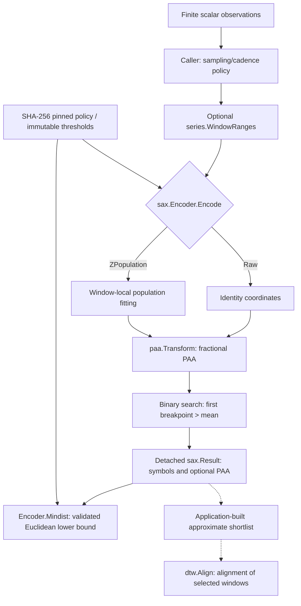
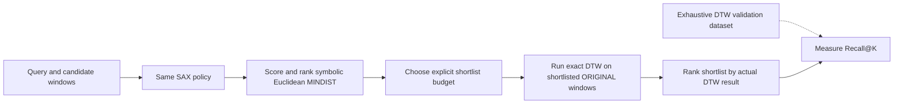

<!--
  SPDX-License-Identifier: AGPL-3.0-only
  Copyright (C) 2025-2026 katalvlaran

  File: docs/SAX.md
  Package: github.com/lvlath/go/sax
  Purpose: implemented API reference, mathematical proof, numerical policies,
    failure contract, examples, and cross-package integration guidance.
  Contract status: implemented; package sax/doc.go and current source are authoritative.
  Scope: SAX encoding, compatible Euclidean MINDIST; no index or DTW certificate.
  License: AGPL-3.0-only; see ../LICENSE.
-->

# SAX - Symbolic Aggregate approXimation and Euclidean MINDIST

> Compress uniformly sampled scalar windows into auditable symbolic signatures. Compare compatible signatures with a **lower bound on transformed Euclidean distance**, never a purported certificate for arbitrary Dynamic Time Warping.

## Contents

1. [What SAX does - and does not do](#1-what-sax-does--and-does-not-do)
2. [Architecture and responsibility boundaries](#2-architecture-and-responsibility-boundaries)
3. [Public API and model lifecycle](#3-public-api-and-model-lifecycle)
4. [Fractional PAA and its mathematical proof](#4-fractional-paa-and-its-mathematical-proof)
5. [Population Z normalization and constant inputs](#5-population-z-normalization-and-constant-inputs)
6. [Pinned Gaussian and custom breakpoints](#6-pinned-gaussian-and-custom-breakpoints)
7. [Canonical EncodingID and compatibility](#7-canonical-encodingid-and-compatibility)
8. [Euclidean MINDIST: definition and proof](#8-euclidean-mindist-definition-and-proof)
9. [Why SAX MINDIST cannot prune arbitrary DTW](#9-why-sax-mindist-cannot-prune-arbitrary-dtw)
10. [Worked fractional example](#10-worked-fractional-example)
11. [Choosing the right facade](#11-choosing-the-right-facade)
12. [Time-series windows and monitoring pipelines](#12-time-series-windows-and-monitoring-pipelines)
13. [Error precedence and sentinel protocol](#13-error-precedence-and-sentinel-protocol)
14. [Result ownership, nilability, and concurrency](#14-result-ownership-nilability-and-concurrency)
15. [Complexity, memory, and benchmarks](#15-complexity-memory-and-benchmarks)
16. [Operational failure modes and safeguards](#16-operational-failure-modes-and-safeguards)
17. [Algorithm pseudocode](#17-algorithm-pseudocode)
18. [Reproducible tests and contract evidence](#18-reproducible-tests-and-contract-evidence)
19. [Further reading](#19-further-reading)

---

## 1. What SAX does - and does not do

SAX is a **fixed-length symbolic representation** of a scalar time-series window. For each input window it (1) optionally normalizes, (2) computes *fractional* Piecewise Aggregate Approximation (PAA), (3) assigns each PAA average to a threshold interval, and (4) returns an ordered vector of `uint16` symbols and auditable metadata.

The package addresses two operational needs:

- **Representation:** produce low-dimensional, repeatable signatures for time-series exploration, approximate retrieval, grouping, indexing by an external system, and diagnostics.
- **Euclidean screening:** evaluate the separation of compatible symbolic intervals without reconstructing the original observations. In exact arithmetic, that separation is bounded above by Euclidean distance between the *transformed* source windows.

SAX **does not** provide a persistent index, sliding-window scheduler, bag-of-patterns builder, Markov transition matrix, quantile fitting/training registry, clinical classifier, DTW engine, or globally exact approximate-shortlist retrieval guarantee. Those are separate application or package concerns. In particular, positive MINDIST is **not** evidence that unrestricted DTW exceeds a cutoff.

The same sequence can produce different words under different normalization, segmentation, alphabet, or threshold policies. Configuration identity is therefore part of the result contract, not optional metadata.

## 2. Architecture and responsibility boundaries



**Dependency direction:** `sax` imports and reuses the public `paa.Transform` kernel. It does not import `dtw`, `series`, `stats`, `matrix`, or `core` to perform encoding; it implements the `core.Nilable` method *structurally*. An application can supply windows from `series.WindowRanges`, pass outputs to its own feature/index layer, and run `dtw.Align` on shortlisted *original* windows. No adapter is silently invoked.

A consumer is responsible for cadence, gaps, missing-value masks, feature units, cross-window comparability, shortlist recall measurement, and any downstream operational threshold. Symbols do not retain timestamps or raw amplitudes under Z normalization.

## 3. Public API and model lifecycle

### 3.1. Exported surface

The following signatures exist in `sax/api.go` and the package model:

```go
func DefaultOptions(segments int) Options
func NewEncoder(opts Options) (*Encoder, error)
func Encode(values []float64, opts Options) (*Result, error)
func EncodeGaussian(values []float64, segments, alphabet int) (*Result, error)
func EncodeRaw(values []float64, segments, alphabet int) (*Result, error)
func EncodeRawWithBreakpoints(values []float64, segments int, breakpoints []float64, breakpointID string) (*Result, error)
func MindistValues(left, right []float64, opts Options) (float64, error)
func (e *Encoder) Encode(values []float64) (*Result, error)
func (e *Encoder) Mindist(left, right *Result) (float64, error)
func (r *Result) IsNil() bool
```

`DefaultOptions(w)` returns `Segments=w`, `Alphabet=8`, `Normalization=ZPopulation`, `ConstantPolicy=RejectConstant`, `Breakpoints=nil`, `ReturnPAA=false`. The zero-value `Options{}` is invalid: the number of segments and the alphabet are deliberately not guessed. `NewEncoder` validates all configuration fields, makes a private threshold copy and computes `EncodingID` once. Reuse one encoder for repeated windows with the same policy; `Encode(values,opts)` constructs one per call.

### 3.2. Options and Result contract

| Field | Meaning and constraints |
|:--|:--|
| `Options.Segments` | Requested `w` PAA cells, `w >= 1`, checked against source length at `Encode` time (`w <= n`). |
| `Options.Alphabet` | Number `a` of bins, `2 <= a <= 256`; emitted symbol indexes are `0..a-1`. |
| `Options.Normalization` | `ZPopulation` (zero enum value) or `Raw`; part of mathematical identity. |
| `Options.ConstantPolicy` | `RejectConstant` (default) or `ZeroWord`; encoded in the identity even when `Raw` ignores its behavior. |
| `Options.Breakpoints` | `nil`: pinned Gaussian table; non-nil: exactly `a-1` finite, strictly ascending custom values. Empty non-nil slice is **not** Gaussian mode. |
| `Options.BreakpointID` | Required nonempty audit label for custom boundaries. Not an identity or security token. |
| `Options.ReturnPAA` | Whether to attach transformed, detached PAA averages to `Result`; no effect on word or `EncodingID`. |
| `Result.Symbols` | Exactly `w` detached `uint16` codes, in time order. |
| `Result.PAA` | `nil` by default; `w` transformed PAA averages when requested. |
| `Result.OriginalLength` | Actual `n` samples of the accepted input window. |
| `Result.Segments`, `Result.Alphabet` | Result dimensions used in compatibility and shape validation. |
| `Result.Mean`, `Result.StdDev` | Window-local population fit for Z; fixed `0` and `1` in Raw. |
| `Result.BreakpointID` | Human label or pinned Gaussian table identifier; not used as compatibility proof. |
| `Result.EncodingID` | Canonical lower-case hex SHA-256 mathematical configuration ID. |
| `Result.NormalizationVersion` | Versioned normalization kernel identifier, checked by `Mindist`. |
| `Result.Degenerate` | `true` only for a constant Z window accepted with `ZeroWord`. |

`Result` is a public data carrier, not an authenticated envelope: manual construction/mutation is possible. `Mindist` explicitly validates fields before using them, but cannot recover authentic source data from a forged symbolic word.

## 4. Fractional PAA and its mathematical proof

### 4.1. Continuous step-function model

For `n` source values `x[0..n-1]`, define `x(t) = x[i]` on each unit sample interval `[i,i+1)`. The `j`th of `w` PAA intervals is

$$ I_j = [jn/w,(j+1)n/w),\qquad |I_j|=n/w. $$

Its exact average is

$$ \bar x_j = \frac{w}{n}\int_{I_j} x(t)\,dt
= \frac{w}{n} \sum_{i=0}^{n-1} x_i\,|[i,i+1)\cap I_j|. $$


The *overlap measure*, not an integer slice length, determines each contribution. For `n=5`, `w=2`, values `[0,2,4,6,8]`:

```text
Sample index:       0      1      2      3      4
Sample values:      0      2      4      6      8
                     |------|------|------|------|------|
PAA interval 0:     [---------------)                       [0, 2.5)
PAA interval 1:                     [---------------)       [2.5, 5)
Segment averages:          1.6              6.4

The source value 4 spans [2,3) and contributes 0.5 to EACH segment.
```

`paa.Transform` provides exact rational interval geometry and computes each cell from weighted overlaps, with one nearest-even binary64 publication of the exact weighted mean. The SAX encoder delegates rather than reimplementing this arithmetic. A floor-divided block average would discard or misweight valid observations and invalidate the Euclidean proof.

### 4.2. Jensen's inequality

For transformed source windows `q(t)` and `c(t)`, let `d(t)=q(t)-c(t)`. Convexity of `u²` gives, for each `I_j`,

$$ \left(\frac{1}{|I_j|}\int_{I_j}d(t)\,dt\right)^2
\le\frac{1}{|I_j|}\int_{I_j}d(t)^2\,dt. $$

Multiplying by `|I_j|=n/w`, summing and taking square roots proves

$$ \sqrt{\frac{n}{w}\sum_{j=0}^{w-1}(\bar q_j-\bar c_j)^2}
\le\sqrt{\int_0^n (q(t)-c(t))^2\,dt}
=\sqrt{\sum_{i=0}^{n-1}(q_i-c_i)^2}. $$

The right side is Euclidean distance of the **actual transformed observations**. For `Raw`, these are original inputs. For `ZPopulation`, each window is separately normalized first; it is incorrect to compare the SAX bound against unnormalized Euclidean distance in that mode.

## 5. Population Z normalization and constant inputs

`ZPopulation` computes a population fit on **the current window**, without retaining state from earlier or later windows:

$$ \mu=\frac{1}{n}\sum_i x_i,\qquad
\sigma=\sqrt{\frac{1}{n}\sum_i(x_i-\mu)^2},\qquad
z_i=\frac{x_i-\mu}{\sigma}. $$

The implementation uses a scaled, centered two-pass-style calculation with compensated accumulation to reduce avoidable intermediate overflow and cancellation. This is **not** the same API or a shared fitted model from `stats.FitStandardizer`: SAX's fit is window-local, whereas the `stats` model can freeze training statistics for heldout data. Only representable finite public metadata and coordinates may be published.

| Input and mode                                                          | Outcome                                  | Metadata                                         |
|:------------------------------------------------------------------------|:-----------------------------------------|:-------------------------------------------------|
| Nonconstant Z, representable fit                                        | Z coordinates then fractional PAA        | `Mean` and positive `StdDev`, `Degenerate=false` |
| Constant Z with default `RejectConstant`                                | `ErrZeroVariance`, nil Result            | No partial artifact                              |
| Constant Z with `ZeroWord`                                              | All normalized coordinates set to `+0.0` | Original mean, `StdDev=0`, `Degenerate=true`     |
| Distinct values but positive sigma underflows or fit is unrepresentable | `ErrOverflow`, nil Result                | Never mislabeled as constant                     |
| Constant or varying `Raw`                                               | Original coordinates passed to PAA       | `Mean=0`, `StdDev=1`, `Degenerate=false`         |

**Important:** `ZeroWord` describes the *normalized vector*. Its symbols are whatever bin contains the number zero. For example, a two-symbol Gaussian alphabet has its threshold at zero, and right-bin equality assigns zero to symbol `1`. Two constant sensors at 44°C and 82°C become identical Z-normalized zero vectors under `ZeroWord`; use `Raw` with temperature-specific boundaries if absolute level matters.

In application-level forecasting or monitoring, window-local normalization may remove amplitude shifts that were themselves the anomaly. Choose `Raw` when absolute magnitude matters; choose Z when normalized shape matters. Do not interpret either mode as a statistically trained classifier.

## 6. Pinned Gaussian and custom breakpoints

### 6.1. Bin convention

For `a` bins and `a-1` strictly increasing thresholds `b[0]...b[a-2]`:

$$ B_0=(-\infty,b_0),\quad
B_k=[b_{k-1},b_k)\;(1\le k<a-1),\quad
B_{a-1}=[b_{a-2},+\infty). $$

For finite `v`, its symbol is the count of thresholds `b[k] <= v`. The kernel uses a binary search for the **first** breakpoint strictly greater than `v`, returning its index. An exact match to a breakpoint goes **right**. The final tail is never clipped or dropped.

```text
b = [0, 1], a = 3

value:   -1     0     0.5     1      2
symbol:   0     1       1     2      2
                 ^             ^
          equality goes right, including the last boundary
```

The result uses `uint16` codes, but `Alphabet<=256` means its largest valid numeric code is **255**; callers should not infer that all 65,536 `uint16` values are accepted. The binary search costs `O(log a)` per PAA cell.

### 6.2. Gaussian mode and reproducibility

`Breakpoints == nil` selects a pinned standard-normal quantile table for every `a in [2,256]`. Its values are not approximated afresh using `erf^{-1}` or downloaded at runtime. The package embeds the compressed `sax/quantiles.bin` asset, verifies the compressed stream's SHA-256 and the decompressed little-endian binary64 table's SHA-256, decodes once via `sync.Once`, then privately copies each requested alphabet row.

The table contains 32,640 thresholds (`sum(a-1), a=2..256`), **261,120 decoded bytes** plus the 161,584-byte compressed embedded asset. Its quantile-table version participates in `EncodingID`. Updating even one binary64 threshold must be treated as versioned mathematical change, not an internal housekeeping refactor. Integrity checks protect the shipped asset; they do not make caller-writable Results authenticated.

Gaussian equiprobability is meaningful for data resembling standard normal coordinates. `EncodeRaw` uses the **same** Gaussian boundaries on unnormalized values; it does not make arbitrary CPU percentages or prices Gaussian. For domain units, select custom thresholds deliberately.

### 6.3. Custom thresholds

```go
opts := sax.Options{
    Segments:      8,
    Alphabet:      5,
    Normalization: sax.Raw,
    Breakpoints:   []float64{20, 40, 60, 80},
    BreakpointID:  "cpu-percent-v1",
}
encoder, err := sax.NewEncoder(opts)
```

The caller must supply exactly `Alphabet-1` finite, strictly increasing thresholds. `BreakpointID` must be nonempty and is useful in logs/audit trails. `NewEncoder` copies the slice before storing it, so changes to the caller's `opts.Breakpoints` after construction do not silently alter the encoder.

An empty-but-non-nil slice means custom mode with incorrect shape, *not* Gaussian defaults. A user label does not participate in mathematical compatibility: two different breakpoint arrays named `"cpu-percent-v1"` are incompatible.

## 7. Canonical EncodingID and compatibility

`EncodingID` is a 64-character lowercase hexadecimal SHA-256 digest over a domain-separated canonical representation of the **mathematical encoding policy**:

```text
"lvlath-sax-encoding-v1\0"  domain separator
+ 8 bytes Segments (little-endian nonnegative integer)
+ 8 bytes Alphabet (little-endian nonnegative integer)
+ 1 byte Normalization enum
+ 1 byte ConstantPolicy enum
+ "zpopulation-scaled-twopass-v1\0" normalization version
+ "gauss-ndtri-f64-v1" (Gaussian mode only)
+ "\0"
+ each threshold's float64 IEEE-754 bits, 8 bytes little-endian
  (-0.0 is encoded as +0.0)
```

The exact content and ordering are fixed by `encoder.go`; there is no native struct-layout hashing or JSON serialization. `ReturnPAA` is excluded because diagnostic materialization does not change the encoded word. User `BreakpointID` is excluded because labels are not mathematical content. `OriginalLength` is checked separately by MINDIST instead of being included in the encoder's policy identity.

**Comparison requires three independent checks:** (1) each result is structurally valid (including symbols, finite diagnostics and zero-variance metadata), (2) its geometry matches the other result and the receiver, and (3) `left.EncodingID == right.EncodingID == encoder.EncodingID` internally. `NormalizationVersion` must also match the implementation. `Mindist` never trusts a matching human label.

**Security boundary:** Because `Result` exports `Symbols`, metadata and `EncodingID`, a caller can forge a structurally valid word and copy somebody else's claimed hash. SHA-256 reduces accidental mathematical collisions between configurations; it is **not a MAC or signature** over the Result. If index entries cross a trust boundary, provide application-level authenticated storage and immutable records.

Persistence note: persist the original sample length and policy/version provenance with every word. Do not compare serialized words from unknown versions or reconstruction logic based solely on their human labels.

## 8. Euclidean MINDIST: definition and proof

Let `r` and `c` be symbol indexes from the same alphabet and threshold table. Write `lo=min(r,c)`, `hi=max(r,c)`. Their minimum interval separation (infimum when an endpoint is open) is

$$
\delta(r,c)=
\begin{cases}
0, & hi-lo\le1,\\
b_{hi-1}-b_{lo}, & hi-lo>1.
\end{cases}
$$

Why adjacent symbols contribute zero: their half-open intervals meet at a common breakpoint, so their **infimum** separation is zero even though the endpoint may belong to only one bin. Nonadjacent intervals are separated by the closest pair of finite boundaries. Thus, for the PAA averages inside their respective bins,

$$
0\le\delta(\hat q_j,\hat c_j)\le |\bar q_j-\bar c_j|.
$$

For equal original lengths `n` and segmentation `w`, the implemented symbolic distance is

$$
\operatorname{MINDIST}(\hat Q,\hat C)
=\sqrt{\frac{n}{w}\sum_{j=0}^{w-1}\delta(\hat q_j,\hat c_j)^2}.
$$


Combining interval separation with the per-segment Jensen inequality from section 4 yields the exact-arithmetic theorem:

$$
\boxed{
\operatorname{MINDIST}(\hat Q,\hat C)
\le D_{\mathrm{PAA}}(\bar Q,\bar C)
\le D_2(Q^*,C^*)
}
$$


where `Q*` and `C*` are the source windows *after the chosen transforms*. The theorem requires equal source lengths, aligned segment time axes, one compatible encoding policy and the defined fractional averaging. With `Raw`, `Q*=Q` and `C*=C`. With `ZPopulation`, the two windows are normalized **independently**. The exact proof holds in real arithmetic; the computed binary64 value uses rounded fit, PAA and `math.Hypot` and is **not a directed-downward rounding certificate**. An exact, machine-level Euclidean pruning implementation needs a separate conservative numerical error policy.

**MINDIST is not a mathematical metric on symbol strings.** Distinct neighboring bins have distance zero, violating the identity-of-indiscernibles property. Even triangle inequality can fail: with thresholds `[0,1]`, `delta(0,1)=0`, `delta(1,2)=0`, but `delta(0,2)=1`. Describe it as a **symbolic Euclidean lower-bound dissimilarity**, not a norm or metric over words. A distance of zero does not prove either equal PAA values or equal raw windows.

## 9. Why SAX MINDIST cannot prune arbitrary DTW

For `Raw`, `w=n=3`, `a=3`, and `b=[0.25,0.75]`:

```text
Q             = [0, 0, 1]   -> SAX [0, 0, 2]
C             = [0, 1, 1]   -> SAX [0, 2, 2]
MINDIST(Q, C) = 0.5

A valid unrestricted DTW warping path:
  (0,0): 0 ↔ 0
  (1,0): 0 ↔ 0
  (2,1): 1 ↔ 1
  (2,2): 1 ↔ 1

Every local difference = 0 -> optimal DTW cost = 0.
```

Therefore `MINDIST > 0` while DTW is zero. **No amount of calibration of the MINDIST threshold repairs this mismatch of objectives.** This is not a rounding problem: the mathematical bound is on Euclidean distance with index-by-index correspondence; DTW changes the correspondence through a warping path. It also does not matter whether DTW reports squared accumulation or its square root in this example: both are zero.

The valid workflow for speed-oriented approximate DTW candidate selection is:



This workflow is **approximate global retrieval**. Each DTW evaluation can be exact for its chosen pair under its own configuration, but candidates excluded by an approximate shortlist may contain the global nearest neighbor. Report `Recall@K` relative to an exhaustive matched-policy DTW reference. To guarantee a globally exact fixed-length DTW search, consider the already implemented `dtw.Search` contract and its DTW-specific certificates rather than grafting SAX MINDIST onto DTW pruning.

## 10. Worked fractional example

Use five uniformly spaced observations (`n=5`), two fractional segments (`w=2`), and calibrated Raw thresholds `[1,3,7]` (`a=4`).

```text
Reference: [0,0,0,0,0]    -> PAA [0,0] -> SAX [0,0]
Candidate: [0,0,0,10,10]  -> PAA [0,8] -> SAX [0,3]

First PAA interval: [0,2.5), average 0.
Second PAA interval: [2.5,5), average (0*0.5+10*2)/2.5 = 8.

Gap(0,3) = b[2]-b[0] = 7-1 = 6.
MINDIST  = sqrt((5/2) * 6^2)  = sqrt(90)  ≈ 9.4868
D_PAA    = sqrt((5/2) * 8^2)  = sqrt(160) ≈ 12.6491
D_2      = sqrt(10^2 + 10^2) = sqrt(200) ≈ 14.1421
```

Complete runnable usage, with every error checked:

```go
package main

import (
	"fmt"

	"github.com/lvlath/go/sax"
)

func main() {
	policy := sax.Options{
		Segments:      2,
		Alphabet:      4,
		Normalization: sax.Raw,
		Breakpoints:   []float64{1, 3, 7},
		BreakpointID:  "load-units-v1",
		ReturnPAA:     true,
	}
	encoder, err := sax.NewEncoder(policy)
	if err != nil {
		fmt.Println("policy:", err)
		return
	}
	reference, err := encoder.Encode([]float64{0, 0, 0, 0, 0})
	if err != nil {
		fmt.Println("reference:", err)
		return
	}
	candidate, err := encoder.Encode([]float64{0, 0, 0, 10, 10})
	if err != nil {
		fmt.Println("candidate:", err)
		return
	}
	bound, err := encoder.Mindist(reference, candidate)
	if err != nil {
		fmt.Println("distance:", err)
		return
	}
	fmt.Printf("reference=%v candidate=%v\n", reference.Symbols, candidate.Symbols)
	fmt.Printf("candidate PAA=%v\n", candidate.PAA)
	fmt.Printf("Euclidean lower bound=%.3f\n", bound)
	// Output:
	// reference=[0 0] candidate=[0 3]
	// candidate PAA=[0 8]
	// Euclidean lower bound=9.487
}
```

A positive score here is a dissimilarity *screen*, not a clinical alert, security incident, or DTW rejection rule. A useful production system calibrates alert thresholds against labeled examples and preserves the original windows for inspection.

## 11. Choosing the right facade

| Situation                                        | API                                                       | Contract benefit / limitation                                                 |
|:-------------------------------------------------|:----------------------------------------------------------|:------------------------------------------------------------------------------|
| One-off window, explicit options                 | `sax.Encode(values, opts)`                                | Canonical facade, returns detached result; reconstructs the encoder per call. |
| Many same-policy windows                         | `sax.NewEncoder(opts)` then `encoder.Encode(values)`      | Shares immutable thresholds/identity; outputs remain per-call detached.       |
| Standard normalized shape signature              | `sax.EncodeGaussian(values,w,a)`                          | ZPopulation + RejectConstant + pinned Gaussian; constant window rejected.     |
| Already standardized values or Raw Gaussian bins | `sax.EncodeRaw(values,w,a)`                               | Identity transform; **does not** validate Gaussianity of input.               |
| Domain-calibrated physical-unit bins             | `sax.EncodeRawWithBreakpoints(values,w,boundaries,label)` | Infers alphabet from boundaries; does not do statistical fitting.             |
| Occasional pairwise numeric bound only           | `sax.MindistValues(left,right,opts)`                      | One-shot two encodings and compare; no result objects returned.               |
| Diagnostic PAA or constant Z policy              | `sax.DefaultOptions(w)` → edit fields → `sax.NewEncoder`  | Explicit `ReturnPAA`/`ZeroWord` choice; result metadata inspectable.          |

For all methods, `w` must satisfy `1<=w<=n` at encode time, `a` must be in `[2,256]`, and every required sample must be finite. One-shot comparisons still require equal original lengths. Custom thresholds must match the units of the transformed samples; never use customer-facing `BreakpointID` text as the comparison key.

## 12. Time-series windows and monitoring pipelines

### 12.1. Causal window selection

SAX accepts scalar samples without timestamps. Upstream code should use `series.Validate` if timestamps/cadence matter, and only then choose complete windows with `series.WindowRanges`. With gaps reported but not filled, an index-contiguous window may still cross a missing timestamp slot; the caller must reject or segment those windows if the downstream model assumes uniform cadence.

The following program shows the package boundary using only existing public APIs; it does not create an index or infer temporal units:

```go
package main

import (
	"fmt"

	"github.com/lvlath/go/sax"
	"github.com/lvlath/go/series"
)

func main() {
	readings := []float64{
		35, 36, 35, 34, 35, 36, 37, 35,
		34, 35, 36, 37, 82, 86, 84, 81,
	}
	ranges, err := series.WindowRanges(len(readings), 8, 4)
	if err != nil {
		fmt.Println("windows:", err)
		return
	}
	policy := sax.Options{
		Segments:      4,
		Alphabet:      4,
		Normalization: sax.Raw,
		Breakpoints:   []float64{30, 50, 75},
		BreakpointID:  "cpu-percent-v1",
	}
	encoder, err := sax.NewEncoder(policy)
	if err != nil {
		fmt.Println("policy:", err)
		return
	}
	for _, interval := range ranges {
		word, encodeErr := encoder.Encode(readings[interval.Start:interval.End])
		if encodeErr != nil {
			fmt.Println("window:", encodeErr)
			return
		}
		fmt.Printf("[%d,%d) -> %v\n", interval.Start, interval.End, word.Symbols)
	}
}
```

The example assumes an upstream guarantee of uniform sampling; `WindowRanges` alone merely enumerates index ranges. Each output word has the same length and policy, but may still be physically incomparable if underlying cadence/units changed unnoticed.

### 12.2. Four useful application stories

**Telemetry:** encode a fixed sampling-rate CPU window in `Raw` with percentage thresholds. Distinguish idle, moderate and saturated intervals. An alerting pipeline still needs a calibrated downstream decision policy; one SAX signature is not root-cause evidence.

**Financial returns:** use per-minute log or simple returns in a consistent unit (for example basis points), not a mixture of unadjusted share prices and returns. Explicit `Raw` breakpoints can preserve directional amplitude. Z normalization instead emphasizes shape and suppresses offset/scale changes.

**ECG morphology:** independently normalize a segmented synthetic heartbeat to compare morphology, but preserve the original electrode/cadence metadata. A SAX score alone cannot diagnose an arrhythmia or certify clinical sensitivity/specificity.

**Industrial sensor faults:** constant/flat-lined channels require a deliberate policy. `ZeroWord` keeps the pipeline running but intentionally erases constant amplitude. Preserve original `Mean`, and run a separate Raw amplitude or sensor-health check when a stuck-hot sensor matters.

Five executable and independently verified scenario examples are in [`sax/example_test.go`](../sax/example_test.go): ECG morphology, market returns, cluster telemetry, grid-frequency deviation, and constant sensors.

## 13. Error precedence and sentinel protocol

All public failures are inspected with `errors.Is`, never by parsing `err.Error()`.

| Sentinel               | Condition                                                                                                                                                     | Typical stage                    |
|:-----------------------|:--------------------------------------------------------------------------------------------------------------------------------------------------------------|:---------------------------------|
| `sax.ErrInvalidOption` | Invalid `Segments`, `Alphabet`, enums, required custom label, nonfinite/nonmonotone custom thresholds; `w>n` after shape checks; uninitialized nonnil Encoder | Policy or shape gate             |
| `sax.ErrShape`         | Custom threshold slice length differs from `a-1`; malformed symbols, Result shape or contradictory metadata                                                   | Policy shape / Result validation |
| `sax.ErrNilInput`      | Nil observation slice, nil Result argument or typed-nil Encoder receiver                                                                                      | Nil gate                         |
| `sax.ErrEmptyInput`    | Non-nil but empty sample slice                                                                                                                                | Input presence                   |
| `sax.ErrNonFinite`     | NaN or infinite source observation; nonfinite externally modified diagnostics/metadata                                                                        | Input scan / Result inspection   |
| `sax.ErrZeroVariance`  | Exactly constant Z window with `RejectConstant`                                                                                                               | Domain/normalization             |
| `sax.ErrIncompatible`  | Different original lengths, symbol geometry, SHA-256 policy identity or normalization version; missing identity metadata                                      | Comparison admission             |
| `sax.ErrOverflow`      | Unrepresentable fit, numeric PAA failure, separated-bin gap/norm or final MINDIST                                                                             | Arithmetic                       |

**Encoder creation:** options and custom breakpoint shape/content are checked before any source values. **Encoding:** receiver validity → nil values → empty values → `w>n` → entire finite scan → normalization/constant policy → PAA → quantization. **Mindist:** receiver → nil results → independent result shape/finite/identity admission → matching length/segments/alphabet/EncodingID → encoder-specific fit and optional PAA consistency → distance calculation. Thus a malformed result can receive `ErrShape` before a later identity mismatch. The exact source implementation is authoritative if several independent defects occur simultaneously.

On `Encode` failure the result is nil. On `Mindist` failure the returned distance is `0` accompanied by an error; **do not interpret that zero as a valid perfect match**. PAA arithmetic overflow is reclassified with `sax.ErrOverflow` while preserving the underlying `paa.ErrOverflow` for `errors.Is` when that underlying cause applies. Other PAA-origin error identities can pass through unchanged.

```go
package main

import (
	"errors"
	"fmt"

	"github.com/lvlath/go/sax"
)

func main() {
	data := []float64{5, 5, 5, 5}
	word, err := sax.EncodeGaussian(data, 2, 8)
	switch {
	case err == nil:
		fmt.Println("word:", word.Symbols)
	case errors.Is(err, sax.ErrZeroVariance):
		// A flat Z window cannot be divided by zero under RejectConstant.
		fmt.Println("constant window rejected")
	case errors.Is(err, sax.ErrNonFinite):
		// Contaminated observations require an upstream data-quality decision.
		fmt.Println("nonfinite input")
	default:
		// Do not replace an error with a fabricated successful SAX word.
		fmt.Println("other error:", err)
	}
	// Output: constant window rejected
}
```

## 14. Result ownership, nilability, and concurrency

- `NewEncoder` copies the supplied custom breakpoints; the Gaussian row returned by the table loader is also detached. No public mutator changes the model after construction.
- Input observation slices are read only during encoding and not retained. The caller must not mutate them concurrently with a call.
- Successful `Result.Symbols` is a new caller-owned slice; `Result.PAA` is `nil` unless requested, and detached when present. Mutating a Result affects that Result only, not the Encoder or independently computed Results.
- `(*Result).IsNil()` returns exactly `r==nil`. It is safe through `core.Nilable` on a typed-nil pointer, and returns `false` for the nonnil zero-value `&sax.Result{}`; it does **not** validate semantic shape.
- One immutable Encoder can be used from multiple goroutines for independent inputs and result objects. Concurrent mutation of a shared Result during Mindist or other reads is unsupported; the package does not snapshot Results and does not synchronize caller-owned buffers.
- Neither `ReturnPAA` nor error handling publishes a partial Result. The program can safely keep successful results after the Encoder's call completes, but must preserve the same policy provenance for later comparisons.

## 15. Complexity, memory, and benchmarks

Let `n` be the source length, `w` the number of segments, and `a` the alphabet size (`a<=256`). Complexity includes validation, fractional PAA, and binary search.

| Operation                                | Time                           | Additional memory                    | Caveat                                                                                             |
|:-----------------------------------------|:-------------------------------|:-------------------------------------|:---------------------------------------------------------------------------------------------------|
| `NewEncoder(opts)`                       | `O(a)`                         | `O(a)` retained                      | First Gaussian use initializes one process-wide `O(32640)` cache and validates its embedded asset. |
| `Encoder.Encode`, `Raw`                  | `O(n+w log a)`                 | `O(w)` result + PAA work             | Input is scanned for finiteness in `O(n)`; `paa.Transform` owns its own output/geometry.           |
| `Encoder.Encode`, `ZPopulation`          | `O(n+w log a)`                 | `O(n+w)`                             | Per-window normalized vector is materialized; not a persistent fitted model.                       |
| One-shot `Encode`                        | Encode plus `O(a)` model setup | Encode plus `O(a)`                   | Prefer reusable Encoder for many windows.                                                          |
| `Encoder.Mindist` without diagnostic PAA | `O(w)`                         | `O(1)`                               | Includes independent symbol/metadata validation.                                                   |
| `Encoder.Mindist` with optional PAA      | `O(w log a)`                   | `O(1)`                               | Verifies diagnostic values quantize to published symbols.                                          |
| `MindistValues`                          | `O(n_left+n_right+w log a+a)`  | `O(n_left+n_right+w+a)` worst Z path | Reencodes both inputs; not suited to pre-indexed large catalogs.                                   |

The lazy Gaussian table uses 261,120 bytes of decoded float64 values plus 161,584 bytes of embedded compressed data, excluding allocation and slice overhead. These are implementation characteristics, not a promise that arbitrary memory pressure can never cause a Go allocation failure. No `panic`/`recover`-based OOM handling exists.

Benchmark relevant regimes separately: `n=10^3` and `10^5`, `w=16/64`, `a=4/8/32`; compare one-time construction, repeated encoding, PAA diagnostics on/off, and separated-bin MINDIST. Prepare all inputs and encoders before the timed loop, check nonzero expected gap for comparison fixtures, use `b.ReportAllocs()`, and report Go toolchain, CPU and setup assumptions. Numerical equivalence precedes speed claims.

## 16. Operational failure modes and safeguards

| Mistake                                           | Why it is wrong                                        | Safer choice                                                         |
|:--------------------------------------------------|:-------------------------------------------------------|:---------------------------------------------------------------------|
| `int(n/w)` truncation or padding                  | Changes sample weights; invalidates PAA bound          | Use the existing `paa.Transform` kernel.                             |
| `v>b[k]` instead of `v>=b[k]` for counting        | Sends equality left; breaks published bin convention   | Search first `b[k]>v`.                                               |
| Trusting `BreakpointID`                           | Two different arrays can share a label                 | Compare with the receiver's `EncodingID` and geometry.               |
| Treating `EncodingID` as data authentication      | Result is caller-writable                              | Authenticate external records at the application boundary.           |
| Calling `ZeroWord` “symbol zero”                  | Threshold bin containing 0 may be nonzero              | Inspect the actual bin; preserve Degenerate.                         |
| Comparing Raw vs window-local Z                   | Different spaces and scale semantics                   | Separate policies, separate identifiers.                             |
| Assuming SAX MINDIST is a metric                  | Adjacent bins have zero gap; triangle can fail         | Call it a lower-bound dissimilarity; avoid metric-index assumptions. |
| Pruning unrestricted DTW using MINDIST            | Warping can reduce cost to zero                        | Use DTW-specific certified bounds or exhaustive DTW.                 |
| Treating approximate shortlist as exact retrieval | Excluded windows can be the true best DTW match        | Report Recall@K against exhaustive ground truth.                     |
| Treating zero floating score as a match           | Symbol discretization loses information                | Inspect raw windows/actual chosen metric.                            |
| Conflating exact proof and binary64 certificate   | Rounded values may not be conservative at the boundary | Use a separately justified error bound before certified pruning.     |
| Reusing a result across conflicting source length | `sqrt(n/w)` changes mathematical scale                 | Check `OriginalLength`, shape and policy identity.                   |
| Indexing with a shared mutable Result             | Another goroutine may change symbols/metadata          | Snapshot or synchronize the owning application state.                |
| Assuming `series.WindowRanges` repairs gaps       | It chooses indices only                                | Validate cadence and handle missing observations explicitly.         |

## 17. Algorithm pseudocode

### Encoding (single canonical kernel)

```text
ENCODE(encoder, observations):
  validate encoder; reject nil, empty or too-short input in public order
  scan all observations for finite values
  if encoder.Normalization == ZPopulation:
      fit population mean and sigma using stable scaled arithmetic
      if all values identical:
          if RejectConstant: return ErrZeroVariance
          else set normalized[] = zeros, sigma=0, Degenerate=true
      else:
          reject unrepresentable fit with ErrOverflow
          publish finite normalized[]
  else:
      transformed[] = read-only observations (identity)
      Mean=0; StdDev=1; Degenerate=false
  PAA = paa.Transform(transformed, Segments)   // fractional overlap
  for j in 0..Segments-1:
      Symbols[j] = first index k with b[k] > PAA[j], or Alphabet-1
  attach EncodingID, OriginalLength, fit metadata
  attach detached PAA values only if ReturnPAA
  return complete detached Result
```

### Comparison (compatible symbolic lower bound)

```text
MINDIST(encoder, left, right):
  validate encoder and nil arguments
  validate independent Result shape, symbol bounds and finite metadata
  require same n,w,a, EncodingID; match encoder's mathematical policy
  validate normalized metadata and optional PAA-to-symbol relation
  norm = 0
  for j in 0..w-1:
      lo,hi = sorted(left.Symbols[j],right.Symbols[j])
      if hi-lo <= 1: continue
      gap = breakpoint[hi-1] - breakpoint[lo]
      reject unrepresentable gap
      norm = hypot(norm, gap)              // avoid naïve sum(gap²)
  result = norm * sqrt(n/w)                // fractional n/w, not floor
  reject overflow; return result
```

## 18. Reproducible tests and contract evidence

The external `package sax_test` suite validates boundary equality and every bin, all 255 alphabet sizes, Gaussian golden identities, negative-zero policy, zero-variance error and ZeroWord metadata, detached results, parallel use of an immutable encoder, malformed caller-constructed Results, and the mandatory DTW counterexample. Fractional PAA/Jensen property tests compare against independent test oracles rather than duplicating the production numeric kernel. These validations exercise *implemented* contracts, not a future ANN index.

Useful local verification commands (execute at repository root on the declared Go toolchain):

```bash
go test ./sax -count=1
go test -race ./sax -count=1
go test ./...
go vet ./...
golangci-lint run
```

Report actual PASS/FAIL/SKIP for your environment instead of presenting these commands as a claim of already passing CI. For the full library policy see [`lvlath_UES.md`](lvlath_UES.md). No test belongs in production `package sax`; examples and contract tests are external `package sax_test`.

## 19. Further reading

- [`sax/doc.go`](../../../../Downloads/sax-phase8-documentation/sax/doc.go): authoritative package charter, error and ownership laws.
- [`sax/api.go`](../sax/api.go), [`sax/types.go`](../sax/types.go): implemented facades and result model.
- [`sax/example_test.go`](../sax/example_test.go): five executable application-style scenarios.
- [`PAA.md`](PAA.md): exact fractional segment geometry and rounding policy.
- [`SERIES.md`](SERIES.md): cadence checking and complete index windows.
- [`STATS.md`](STATS.md): stable moments and training-only normalization (a distinct contract).
- [`DTW.md`](DTW.md), [`DTW_SEARCH.md`](DTW_SEARCH.md): warping costs, exact fixed-length search and **DTW-specific** certificates.
- [`TUTORIAL.md`](TUTORIAL.md), [`FAQ_&_TIPS.md`](FAQ_%26_TIPS.md): learning path and troubleshooting.
- [Original SAX research portal](https://www.cs.ucr.edu/~eamonn/SAX.htm): background on the representation; it does not authorize using ordinary SAX MINDIST as a general DTW bound.
