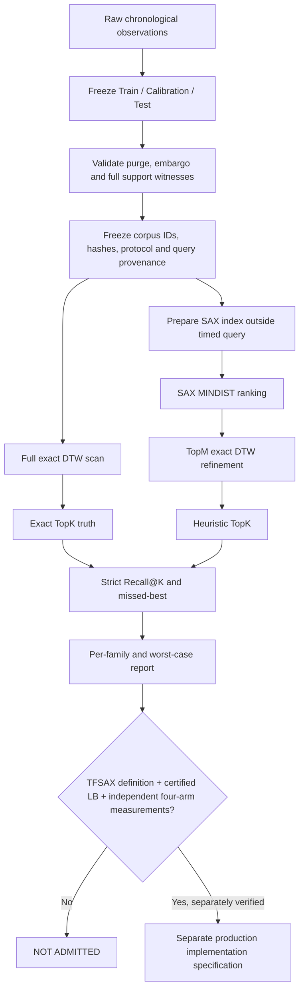

<!--
  SPDX-License-Identifier: AGPL-3.0-only
  Copyright (C) 2025-2026 katalvlaran

  File: docs/TFSAX.md
  Package reference: github.com/lvlath/go/tfsax
  Purpose: Mathematical and operational reference for the reproducible symbolic-retrieval research gate.
  Contract status: Executable exact/SAX research adapters only; TFSAX definition and certified DTW pruning unavailable.
  Scope: Frozen experiments, exact DTW truth, heuristic SAX ranking, temporal audits, acceptance criteria, negative reporting and optional serialization.
  License: AGPL-3.0-only. See ../LICENSE.
-->

# TFSAX: a reproducible research gate, not a production encoder

> **Status: NOT ADMITTED.** This package contains a real exact-DTW reference, classical SAX ranking with exact-DTW refinement, deterministic stress generators and research controls. It does **not** implement a mathematically defined TFSAX encoder or a certified symbolic-DTW pruning rule. No publication or user-defined `Definition.Approved` flag can supply those missing proofs.

## 1. Why the package exists and what is actually implemented

The research question is whether a *future explicitly defined* extended symbolic representation can filter time-warped trajectory candidates more effectively than the existing fractional-PAA/SAX baseline while retaining acceptable strict-ID recall, memory and latency. The name **TFSAX** is a research label, not a canonical published algorithm or an agreed expansion of its initials. An undefined encoder would make any claimed benchmark advantage uninterpretable.

| Branch                    | Mathematical objective                                                 | Current implementation                                         | Claim permitted                                 |
|:--------------------------|:-----------------------------------------------------------------------|:---------------------------------------------------------------|:------------------------------------------------|
| A - exact scan            | Full fixed-endpoint absolute-cost DTW over every corpus member         | `ScanExact`, `RunExactReference`                               | Exact TopK for the validated candidate universe |
| B - certified DTW pruning | Same exact TopK with a proven floating-point-safe exclusion rule       | `ScanLBConservative` rejects with `ErrUncertifiedBound`        | **Not implemented**                             |
| C - standard SAX          | Gaussian fractional PAA/SAX MINDIST ranking, TopM exact-DTW refinement | `PrepareSAXIndex`, `SAXIndex.Search`, `RunAvailableComparison` | Heuristic ranking, empirical recall only        |
| D - proposed TFSAX        | Explicit author/source-defined new representation, TopM refinement     | No encoder exists                                              | **Not implemented**                             |

`Run` is an admission boundary: for an otherwise valid experiment it returns an error matching both `ErrUndefinedRepresentation` and `ErrUncertifiedBound`, and **does not** return fabricated four-branch observations. `RunAvailableComparison` measures only A and C; its result is *not* an approval of D.

### 1.1 Architecture and data flow



The diagram depicts an *admission procedure*, not a call graph in which all the gates already exist. It is incorrect to infer that the package currently runs a four-arm comparison.

## 2. Mathematical target: absolute-cost DTW

For finite scalar query `q` and candidate `c`, the accepted `dtw.Align` reference uses an absolute local cost and fixed start/end points:


Here `P_w` is the set of monotone paths using diagonal, vertical and horizontal steps, constrained by `|i-j| <= w` when `w >= 0`. `window=-1` removes that constraint; `window=0` permits **only diagonal** correspondence. `ExactDTW(a,b,window)` delegates directly to `dtw.Align(a,b,dtw.WithWindow(window))`; it does not normalize, square the local difference, use open endpoints or reinterpret numerical overflow as unreachability.

The exact oracle sorts all *reachable* candidates by `(distance, CandidateID)` ascending. If TopK is greater than the number of reachable candidates, the result is legitimately shorter while `Complete=true` after all members have been evaluated. Equal-length finite windows always admit their diagonal path under a nonnegative band; an all-unreachable query therefore requires a different valid structural regime and must not be fabricated merely to exercise NA.

**Important distinction:** `dtw.Search` has its own certified fixed-length *squared*-cost search contract. It is a different objective and is not interchangeable with the absolute-cost `tfsax.ExactDTW` oracle or with `SAXIndex.Search`. A benchmark must freeze one exact target and keep every branch comparable to it.

### 2.1 Why SAX MINDIST is not a DTW bound

The existing `sax.Encoder.Mindist` computes a lower-bound dissimilarity for compatible **Euclidean** representations (in the selected original or independently normalized space). Allowing nonlinear repetitions in DTW can reduce the distance to zero even when pointwise or Euclidean separation is positive.

For example, `q=[0,0,1,1]` and `c=[0,1,1,1]` have unrestricted absolute-cost DTW of **zero** via repeated alignment of equal values. The diagonal pointwise sum is positive; therefore treating it as a generic DTW lower bound would wrongly exclude a true exact match. More generally, positive SAX Euclidean MINDIST **cannot** certify arbitrary DTW exclusions.

A shortlisting pipeline may still rank by MINDIST. Its returned candidates are exact DTW distances **within the chosen shortlist**, but the selection of that shortlist is heuristic. `RetrievalResult.Diagnostics.Exact` stays `false` even if `RecallAtK` reports 1 on one or many queries.

### 2.2 LB_Keogh: real-arithmetic idea versus machine certificate

For a fixed DTW radius `r`, define the query envelope at each index of candidate `c`:


`L_i` and `U_i` are the minimum and maximum query values among cells admissible for candidate index `i`. Under the stated path, endpoint and absolute-cost assumptions, every candidate index participates in at least one alignment cell, so the sum of the minimum index-local costs is bounded above by every valid alignment's cost **in exact real arithmetic**. This observation does **not** establish that the float64 value returned by `LBKeoghAbsolute` is always safe to compare against a float64 DTW cutoff. Summation order, envelope rounding, upstream distance rounding and finite overflow policies must all be certified.

`LBKeoghAbsolute` currently returns a *diagnostic*. `ScanLBConservative` deliberately refuses exact pruning. Tiny exhaustive counterexample searches are regression tests and falsification tools; even zero found counterexamples on a finite alphabet is not a proof for arbitrary real inputs.

## 3. Public Go API and ownership

| Task                         | API                                                                                                             | Important behavior                                                                                   |
|:-----------------------------|:----------------------------------------------------------------------------------------------------------------|:-----------------------------------------------------------------------------------------------------|
| Scalar DTW oracle            | `ExactDTW(a, b, window)`                                                                                        | Absolute local cost, `distance`, `reachable`, `error`; original DTW error identities preserved       |
| Full universe TopK           | `ScanExact(ctx, corpus, query, window)`                                                                         | Exact ranking by distance then numeric `CandidateID`; detached IDs                                   |
| No-band / diagonal shortcuts | `ScanExactUnbounded`, `ScanExactDiagonal`                                                                       | Thin wrappers around `ScanExact`, `window=-1` / `window=0`                                           |
| Reusable SAX index           | `PrepareSAXIndex(corpus, segments, alphabet)`                                                                   | Clones raw windows and privately retains SAX words                                                   |
| Repeated heuristic search    | `(*SAXIndex).Search(ctx, query, window, shortlist)`                                                             | One query encoding, MINDIST ranking, TopM DTW refinement                                             |
| One-shot heuristic search    | `ScanSAXWithOptions`, `ScanSAX`                                                                                 | Includes index creation; not comparable to prepared-index query latency without accounting for build |
| Custom ranking + DTW         | `RefineShortlist(ctx, corpus, query, window, shortlist, version, ranker)`                                       | Pure nonnegative finite heuristic; `Exact=false` regardless of TopM                                  |
| Available research arms      | `RunExactReference`, `RunAvailableComparison`, `RunAvailableDefault`                                            | Exactly one or two real branches, no TFSAX result                                                    |
| Four-way gate                | `Run`                                                                                                           | Returns an explicit refusal, never invents missing kernels                                           |
| Geometric validity           | `ValidateSplit`, `ValidateWindowRecords`                                                                        | Raw-time memberships and full support/label witnesses                                                |
| Research plan                | `DefaultProtocol`, `UnresolvedDefinition`, `ValidateProtocol`, `ValidateDefinition`                             | Ordinary Go values; no file parsing required                                                         |
| Deterministic identity       | `CorpusHash`, `QueriesHash`, `GeneratorVersion`                                                                 | Exact-bit / stable-ID audit metadata; not authentication of the source importer                      |
| Quality                      | `RecallAtK`, `MissedBest`, `LatencyQuantiles`, `SummarizeByFamily`                                              | NA for empty truth; family-local worst recall                                                        |
| Optional export              | `DigestJSON`, `ParseProtocol`, `WriteJSON`, `WriteCSV`, `WriteCSVStream`, `EvaluateGate`, `WriteNegativeReport` | Audit/provenance I/O; separate from retrieval mathematics                                            |

A `*RetrievalResult` is absent iff `result == nil` or `result.IsNil()`; a **non-nil** result with an empty Candidates slice is not an error and not a successful exact hit. `Complete` means the selected procedure finished; `Diagnostics.Exact` means the full exact target is mathematically preserved. `Examined` counts full-DTW evaluations; `Pruned` counts members not refined, *without* implying those exclusions were safe.

Input slices remain caller-owned and must be stable throughout an operation. Returned candidate IDs and comparison observations are detached from input buffers. A prepared `SAXIndex` owns copied raw samples and private encoded results; it can serve independent concurrent read-only searches. Mutable `rng.RNG` streams are single-owner. A nil context is an invalid option; a canceled context returns `ctx.Err()`. Errors are matched using `errors.Is`; error strings are not a machine protocol.

## 4. JSON artifacts versus a pure Go library

**No JSON file is necessary to use, run or test the current mathematical API.** `Protocol`, `Definition` and `Thresholds` are regular Go structures. The `json:"..."` struct tags are instructions to Go's standard-library `encoding/json` package **only when a caller explicitly serializes the record**. They do not add a new programming language, an external dependency, cgo, dynamic loading or runtime file discovery.

The two checked-in example records serve different roles:

| Optional research artifact | What it records                                                 | Why it exists                                                                                |
|:---------------------------|:----------------------------------------------------------------|:---------------------------------------------------------------------------------------------|
| `tfsax/protocol.json`      | Frozen counts, DTW band, work budget, purge/embargo, thresholds | Allows an independent reviewer to compare the *declared plan* against the executed benchmark |
| `tfsax/definition.json`    | Scientific definition fields and explicit unresolved status     | Prevents an undefined encoder or unproven bound from being misrepresented as implemented     |

They are **not** loaded automatically by `ScanExact`, `PrepareSAXIndex`, `RunExactReference` or `RunAvailableComparison`. The package also provides `DefaultProtocol`, `UnresolvedDefinition` and `ValidateProtocol` for fully Go-native execution; JSON is an optional *artifact boundary*. The file examples are not hidden defaults, training weights or fitted model state.

Could the files and tags be removed? Technically yes: the algorithm runs entirely from Go values. But deleting the two **versioned research artifacts**, `ParseProtocol`/`WriteJSON` or the field tags would change the established experiment interchange/digest semantics and conflict with the current research-record contract. In particular, dropping tags changes JSON keys (for example, `top_k` becomes `TopK`) and therefore the byte identity of previously recorded research protocols. This is not a no-op cleanup. A deliberate future revision would need a new canonical Go-only digest format, version migration, independent reproducibility tests and an explicitly updated research specification. The current stage retains the optional recording surface for compatibility.

### 4.1 Fully in-memory, no files, no marshaling: executable Go example

```go
package main

import (
    "context"
    "fmt"

    "github.com/lvlath/go/tfsax"
)

func main() {
    // Independent corpus and query paths are required for nontrivial retrieval evaluation.
    corpus, err := tfsax.GenerateFamily(tfsax.FamilyMotif, 701, 24, 24)
    if err != nil { fmt.Println("corpus:", err); return }
    queries, err := tfsax.GenerateFamily(tfsax.FamilyMotif, 1701, 1, 24)
    if err != nil { fmt.Println("query:", err); return }
    digest, err := tfsax.CorpusHash(corpus)
    if err != nil { fmt.Println("digest:", err); return }

    protocol := tfsax.DefaultProtocol()
    protocol.Length, protocol.Purge = 24, 24
    protocol.CorpusSize, protocol.QueryCount = 24, 1
    protocol.TopK, protocol.Shortlist = 3, 10
    if err := tfsax.ValidateProtocol(protocol); err != nil {
        fmt.Println("protocol:", err); return
    }

    experiment := tfsax.Experiment{
        Protocol: protocol,
        Definition: tfsax.UnresolvedDefinition(),
        Corpus: corpus,
        CorpusDigest: digest,
        Queries: []tfsax.NamedQuery{{
            ID: 9001, Family: tfsax.FamilyMotif,
            Query: tfsax.Query{Values: queries[0].Values, TopK: 3},
        }},
    }
    result, err := tfsax.RunAvailableComparison(
        context.Background(), experiment,
        tfsax.ComparisonOptions{SAXSegments: 6, SAXAlphabet: 8},
    )
    if err != nil { fmt.Println("comparison:", err); return }
    fmt.Printf("arms=%d exact=%t sax-exact=%t\n",
        len(result.Observations),
        result.Observations[0].Result.Diagnostics.Exact,
        result.Observations[1].Result.Diagnostics.Exact)
    // Output: arms=2 exact=true sax-exact=false
}
```

All the logic above uses Go values, exported APIs and the existing `dtw`, `sax`, `paa`, `rng` **internal-module** packages; it neither reads nor writes `definition.json` or `protocol.json`. Run a complete file-free, Go-only multi-family comparison with `go run ./examples/tfsax_go_only`. The additional executable contract scenarios live in [`../tfsax/example_test.go`](../tfsax/example_test.go). The separate research exporter, when present, may optionally write protocol and measurement artifacts.

## 5. Temporal evidence: split first, window afterward

Raw partitions are half-open intervals `[Start,End)` on a **single integer sample axis**. The package enforces the conservative separation used by its validator:


`ValidateSplit` checks ordered Train → Calibration → Test raw intervals, membership disjointness, `FitIDs ⊆ TrainIDs`, and overflow-safe gap policy. `ValidateWindowRecords` additionally requires **exactly one record** for every declared ID; its `Support` is the full input window and `LabelEnd` must equal `Support.End + horizon`, both contained in the claimed source partition. This catches mislabeled or boundary-crossing windows before a benchmark starts.

```text
Raw sample axis (half-open ranges)

 Train [0,400)          Calibration [460,600)        Test [660,800)
 |================|       |==========|                |==========|
                   <----->                 <----->
              gap >= purge+horizon+embargo         same gap law

 Train window [100,148), label ends at 156
 Cal   window [480,528), label ends at 536
 Test  window [700,748), label ends at 756

 FitIDs = train-only; all window IDs have separate full-support records.
```

It is not enough to test that TrainIDs and TestIDs are different. Two distinct IDs could refer to overlapping source samples, a future-conditioned feature or previously fitted global statistics. Conversely, the validators cannot detect false source timestamps or a dishonest importer: persist trusted original series coordinates and fit provenance outside the package. Window-local SAX population normalization is an explicitly selected observation transform, not a training-set global standardizer. Any global fitted scale, threshold or quantile must be calibrated on Train only and frozen before validation/test.

## 6. Frozen experimental design and eight stress families

`GenerateFamily(family, seed, count, length)` uses `rng.Factory.Stream` per stable logical path; `GeneratorVersion` identifies the exact family equations, path-number assignment and draw order. Values are synthetic, in dimensionless illustrative units, and **not real market, patient or equipment observations**. The caller separately freezes physical domain units and source provenance for any real study.

| Family constant   | Stress mechanism                                                             | How to read a failure                                    |
|:------------------|:-----------------------------------------------------------------------------|:---------------------------------------------------------|
| `FamilyConstant`  | Exactly constant windows and step changes                                    | Normalization/degenerate-symbol policy                   |
| `FamilyHeavyTail` | Normal background plus occasional heavier shocks                             | Robustness to rare local deviations                      |
| `FamilyWarp`      | Smooth monotone local time deformation                                       | Sensitivity to timing variations                         |
| `FamilySlope`     | Piecewise slope change                                                       | Trend-break detection power                              |
| `FamilyMotif`     | Phase-shifted repeated motifs with noise/distractors                         | Distractor ranking and missed-best                       |
| `FamilyPhase`     | Periodic phase shifts                                                        | Misranking under identical frequency content             |
| `FamilyAffine`    | Global positive scale plus offset                                            | Whether normalization erases relevant amplitude          |
| `FamilyPlateau`   | True flat inserted interval with varying level, position and noise elsewhere | Artificially easy identical series must not be generated |

`GeneratorVersion` currently identifies `tfsax-synthetic-eight-families-v2`. The generator accepts `count ∈ [1,100000]`, `length ∈ [4,4096]`, and at most 2²⁵ scalar values per call. The generator's minimum length is **stricter** than the protocol validator's minimum length of two; do not confuse these independent shape contracts.

For each family declare **before** evaluation: corpus size, query count, series length, seeds and logical paths, whether a fixture is heldout or an intentionally implanted functional witness, which families are non-adversarial, TopK/TopM, SAX settings, DTW radius, normalization, acceptance thresholds, and whether build time is included. Queries used to measure search quality must not be literal copies of indexed windows. If you deliberately insert an exact match to test ID ties or regression behavior, label it a functional fixture rather than an unbiased retrieval benchmark.

The exact corpus digest commits to ordered candidate IDs, lengths and binary64 bits (including signed zero). The query digest sorts stable query IDs before hashing. These digests detect changes *relative to a trusted frozen reference*; they do not prove truthful original timestamps or dataset provenance. An identical seed alone is insufficient if `GeneratorVersion`, `rng.Factory.Version()`, shape, order, compiler or float math differ.

## 7. Metrics, statuses, success criteria and report integrity

For exact result IDs `E` and candidate IDs returned by a branch `A`, `RecallAtK` uses the number of **unique** exact IDs as denominator:


`MissedBest` is 1 when the first deterministic exact ID is absent from `A`, else 0. When `E` is empty, **both are NA** (`MetricValue.Applicable=false`), not a synthetic 0 or 1. Scores are strict-ID: accepting a differently tied ID as equivalent would require a **separately labeled** tolerance-based metric, never a post-hoc replacement of the original result.

`SummarizeByFamily` groups by `(Family, Branch)`, reports the **worst applicable** recall per group and the mean of its applicable binary missed-best events, and keeps unmeasured latency distinguishable from genuine zero nanoseconds. `LatencyQuantiles` computes nearest-rank p50/p95/p99 over nonnegative integer nanoseconds, without mutating the input sample. Raw observations include `Examined`, `Pruned`, `Available` (reachable corpus count), `Shortlist`, `IndexBytes` and `DurationNS`.

**Precommitted research gates (engineering criteria; not established outcomes):**

| Criterion                                                               | Minimum acceptance level |
|:------------------------------------------------------------------------|:-------------------------|
| False exclusions in a mathematically certified exact mode               | **0**                    |
| Strict-ID Recall@K for every previously declared non-adversarial family | **≥0.99**                |
| Per-family missed-best rate                                             | **≤0.01**                |
| Median query latency reduction against the real SAX comparator          | **≥2×**                  |
| Actual index memory ratio against SAX                                   | **≤2×**                  |

Adversarial and worst-case families still must be disclosed. Thresholds must be frozen **before** tuning and reevaluation; changing them requires a new protocol/version and a new independent holdout. Passing a one-arm or two-arm test never satisfies the missing TFSAX branch or a certified DTW bound.

### 7.1 Complexity and resource accounting

Let `N` be corpus count, `Q` query count, `L` common length, `w` SAX segments, `a` alphabet size, `M` shortlist count and `W` warmup count.

| Operation                       | Current time bound                                 | Working / retained space                              |
|:--------------------------------|:---------------------------------------------------|:------------------------------------------------------|
| Exhaustive DTW TopK             | `O(N*L² + N log N)` per query                      | `O(N+L)` query workspace                              |
| Prepared SAX build              | `O(N*(L+w log a))`                                 | `O(N*(L+w)+a)` retained, including copied raw windows |
| Prepared SAX Search             | `O(L + N*w + N log N + M*L² + M log M)`            | `O(N+M+L)` per query                                  |
| Two-arm comparison with warmups | `O((W+1)*Q*(N+M)*L² + Q*N log N)` plus index build | Index retained + `O(Q*TopK)` observations             |
| `LatencyQuantiles`              | `O(n log n)`                                       | `O(n)` sorted copy                                    |
| `LBKeoghAbsolute` diagnostic    | `O(L*min(L, 2r+1))`                                | `O(1)` workspace                                      |

`ValidateProtocol` admits the one-arm full-scan work `Q*N*L² ≤ MaxCells`. `RunAvailableComparison` additionally checks **both** arms and warmups: `(W+1)*Q*(N+M)*L² ≤ MaxCells`. Products are guarded by division before multiplication to avoid overflow. This is a declared cell-work admission bound, not a complete wall-clock, memory-allocation or cancellation budget.

`SAXIndex.IndexBytes` counts **only** 8-byte IDs plus 2-byte symbols per segment. The real index also retains copied corpus floats, slice headers, object headers and runtime allocations. Never calculate the actual memory acceptance ratio from `IndexBytes` alone. Report real allocations/heap or resident memory, build time separated from query latency, CPU, GOOS/GOARCH, Go version and repeated p50/p95/p99 per family. Timing samples are not bitwise replay invariants.

## 8. Validation, error classification and ownership checklist

| Failure / result state                                        | Required response                                            |
|:--------------------------------------------------------------|:-------------------------------------------------------------|
| Nil `context.Context`                                         | `ErrInvalidOption`, no calculation                           |
| Already canceled context                                      | Original `ctx.Err()`, no usable partial result               |
| Nil/empty corpus, jagged length, invalid TopK                 | `ErrInvalidInput`                                            |
| Duplicate candidate/query/partition ID                        | `ErrDuplicateID`                                             |
| NaN/Inf in source or result score                             | `ErrNonFinite` or joined upstream classification             |
| Unrepresentable exact floating result                         | `ErrOverflow`, not fabricated `+Inf` unreachable             |
| Invalid options/schema/window                                 | `ErrInvalidOption`                                           |
| Purge/embargo, fit membership or raw window support violation | `ErrLeakage`, with other invalid-shape classes as documented |
| Exceeded checked cell/generation resource budget              | `ErrBudget`                                                  |
| Missing TFSAX definition / proof                              | `ErrUndefinedRepresentation` / `ErrUncertifiedBound`         |
| Empty exact target in recall                                  | `Applicable=false` (NA), not an error                        |
| Successful heuristic shortlist                                | `Complete=true`, `Diagnostics.Exact=false`                   |
| Successful full exact scan                                    | `Complete=true`, `Diagnostics.Exact=true`                    |

Use `errors.Is`, not error-string matching. In all normal public-invalid-input cases the package must not call `panic` or `recover` or import `reflect`. This is a pure-Go library operating on typed records and existing in-module mathematical dependencies.

## 9. Practical research scenarios

The executable suite [`tfsax/example_test.go`](../tfsax/example_test.go) and the standalone [`examples/tfsax_go_only/main.go`](../examples/tfsax_go_only/main.go) demonstrate several distinct research regimes with **fixed deterministic synthetic fixtures**, not live data or proven deployed alert logic:

1. **Minute-pattern retrieval audit:** independent motif query seed against a frozen corpus; compare exact and SAX branch diagnostics, not alleged market performance.
2. **Rotating machinery vibration:** multiple 96-sample gear-cycle signatures and an intentionally implanted known match; exact TopK verifies deterministic identity as a functional integrity check.
3. **Network service latency investigation:** rank candidate burst patterns with SAX then independently audit using exact DTW. The separately generated probe is a *controlled reference-family test*, not a valid independent real-world holdout recall study.
4. **Grid-energy load backtesting:** 48-observation supports with eight-observation prediction labels; detect a Test ID illegally included in fitted parameters.
5. **Alignment counterexample:** distinguish a naive pointwise candidate exclusion from a conservative LB_Keogh diagnostic and show `ErrUncertifiedBound` refusal.
6. **Worst-family reporting:** plateau and phase-shift stress queries remain separate instead of disappearing into a pooled favorable average.
7. **Pump fleet reusable index:** detached index serves independent sensor queries even after ingestion reuses its original memory; no exactness claim is inferred from the shortlist.
8. **Datacenter load-shift oracle:** three independent sorted query IDs establish a reusable exact-reference audit without reading an on-disk protocol.

For application-facing systems, replace synthetic input with authorized and timestamp-audited real measurements, keep original physical units and numerical preprocessing fixed, and measure repeated latency/memory in the actual environment. The package does not contain a trading decision, a patient diagnosis or a safety alarm policy.

## 10. Research verdict and next gates

`EvaluateGate` and `WriteNegativeReport` can produce a **negative/not-admitted** status with an auditable reason. This currently means *missing sufficient evidence*, not a statistical demonstration that no future TFSAX variant can ever improve on SAX. `Definition.Approved=true` is only metadata and cannot certify executable mathematics or bypass the actual four-branch gate.

Before a production package is even proposed, the research must supply: (1) a source-backed or clearly original full mathematical definition and independent reference encoder; (2) fixed numeric, domain, time grid, symbol boundary and ownership policy; (3) real/machine-safe DTW pruning proof when exact exclusion is claimed, with retained finite counterexamples; (4) frozen source provenance, train-only fitted parameters and independent queries; (5) a genuine four-arm comparison, all families/worst cases, resident-memory and latency evidence on declared hardware; and (6) a separate stable typed production API specification. Otherwise record the negative findings and leave the encoder **unpublished**.

**Related references:** [`../tfsax/doc.go`](../tfsax/doc.go), [`SAX.md`](SAX.md), [`PAA.md`](PAA.md), [`DTW.md`](DTW.md), [`DTW_SEARCH.md`](DTW_SEARCH.md), [`TUTORIAL.md`](TUTORIAL.md), [`FAQ_&_TIPS.md`](FAQ_%26_TIPS.md), [`lvlath_UES.md`](lvlath_UES.md).
