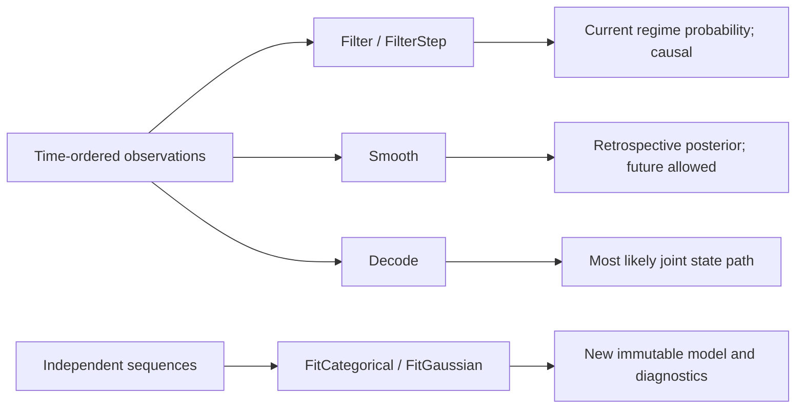

<!--
  SPDX-License-Identifier: AGPL-3.0-only
  Copyright (C) 2025-2026 katalvlaran

  File: docs/TUTORIAL.md
  Package reference: matrix, stats, ols, ridge, acf and the wider lvlath package family
  Contract status: learning guide; package doc.go and source define the public API.
  Scope: graph, matrix, factorization, statistical and temporal workflows.
  lvlath - Repository Tutorial

  Purpose:
    This tutorial is the first educational entry point for lvlath. It introduces
    fundamental graph, matrix, stable-statistics, causal time-series, fixed-window ACF estimators, dependent-data block-bootstrap indices, and symbolic SAX ideas; explains how lvlath
    maps mathematical algorithms into deterministic Go packages, and helps readers move from basic
    graph and series concepts to package-specific documentation. It does not duplicate every
    package specification; instead it teaches the mental model, core entities,
    options, result surfaces, and engineering discipline needed before reading
    docs/{PACKAGE}.md and {package}/doc.go files.

  License:
    lvlath is licensed under AGPL-3.0-only. See ../LICENSE.
-->

# lvlath Tutorial

> **hard math on an easy level**

Welcome to **lvlath**, a deterministic Go library for graph algorithms, dense graph algebra, flows, routing, tours, fixtures, exact time grids, causal series primitives, fractional PAA, symbolic SAX encoding, stable statistical reductions, fixed-window autocorrelation, reproducible block-bootstrap indices, version-pinned RNG streams, fitted feature scaling, covariance PCA, and time-series alignment.

This tutorial is the beginning of the learning path. It introduces the objects and ideas that most packages share: graphs, matrices, options, result artifacts, error contracts, and deterministic algorithm execution.

---

## Table of Contents

1. [Introduction](#1-introduction)
2. [Documentation Map](#2-documentation-map)
3. [Installation](#3-installation)
4. [Mental Model: How lvlath Is Built](#4-mental-model-how-lvlath-is-built)
5. [Graph Foundations](#5-graph-foundations)
6. [First Rich Graph: Build, Inspect, Traverse](#6-first-rich-graph-build-inspect-traverse)
7. [Graph Algorithms on the Same Topology](#7-graph-algorithms-on-the-same-topology)
8. [Matrix Foundations](#8-matrix-foundations)
9. [Graph-to-Matrix Example: Incident Routing, Closure, and Spectral-Ready Data](#9-graph-to-matrix-example-incident-routing-closure-and-spectral-ready-data)
10. [Series Foundations: Exact Grids and Causal Features](#10-series-foundations-exact-grids-and-causal-features)
11. [Stats Foundations: Stable Moments and Fitted Scaling](#11-stats-foundations-stable-moments-and-fitted-scaling)

    11a. [PAA Foundations: Fractional Dimensionality Reduction](#11a-paa-foundations-fractional-dimensionality-reduction)
    11b. [SAX Foundations: Symbolic Words and Euclidean Screening](#11b-sax-foundations-symbolic-words-and-euclidean-screening)
    11c. [OLS Foundations: Stable QR Regression and Frozen Prediction](#11c-ols-foundations-stable-qr-regression-and-frozen-prediction)
    11d. [Ridge Foundations: Correlated Factors, Wide Matrices and Numerical Preconditioning](#11d-ridge-foundations-correlated-factors-wide-matrices-and-numerical-preconditioning)
    11e. [PCA Foundations: Certified Covariance Factors and Frozen Inference](#11e-pca-foundations-certified-covariance-factors-and-frozen-inference)
    11f. [HMM Foundations: Causal Hidden-State Filtering and Independent-Sequence Learning](#11f-hmm-foundations-causal-hidden-state-filtering-and-independent-sequence-learning)
    11g. [ACF Foundations: Fixed-Window Serial Dependence and Estimator Conventions](#11g-acf-foundations-fixed-window-serial-dependence-and-estimator-conventions)
    11h. [Bootstrap Foundations: Reproducible Dependent-Data Index Ensembles](#11h-bootstrap-foundations-reproducible-dependent-data-index-ensembles)
    11i. [RNG Foundations: Version-Pinned Stochastic Streams](#11i-rng-foundations-version-pinned-stochastic-streams)
12. [Algorithm Selection Guide](#12-algorithm-selection-guide)
13. [Professional Best Practices](#13-professional-best-practices)
14. [Where To Go Next](#14-where-to-go-next)

---

## 1. Introduction

### What is lvlath?

`lvlath` is a deterministic Go library for graph algorithms, dense graph algebra, routing, network optimization, time-series alignment, tour planning, and reproducible algorithm fixtures.

It is built around a simple engineering idea:

> Algorithms should publish results you can explain, test, reproduce, and safely compose.

The library covers:

* `core` graph modeling with deterministic topology and explicit capabilities;
* `bfs` hop-distance traversal and weak components;
* `dfs` finish-order traversal, cycle witnesses, and topological sorting;
* `dijkstra` weighted full-SSSP and four target-search methods (Dijkstra, bidirectional Dijkstra, consistent A*, balanced A*), original EdgeIDs, and exact target-cutoff policy;
* `mst` exact Prim/Kruskal MST/MSF, KMB original-edge graph Steiner approximation, and closed/fixed-end edge-covering walks;
* `flow` max-flow / residual-network analysis;
* `matrix` dense graph algebra: adjacency, incidence, metric closure, statistics, factorization, sanitation;
* `dtw` deterministic Dynamic Time Warping, bounded outcomes, and globally exact fixed-length squared-DTW top-K window search;
* `series` exact integer-nanosecond grid validation, causal lag/difference/returns, and complete index windows;
* `stats` stable Welford/Chan moments, mergeable partitions, and immutable fitted feature standardization;
* `ols` immutable full-rank regression models trained by pivoted Householder QR, with exact zero-origin policy and physical-unit coefficients;
* `ridge` explicit positive-Lambda Tikhonov regression for correlated and wide designs, unpenalized intercept, protected augmented QR and physical-unit predictions;
* `pca` immutable train-only principal component projection, certified covariance eigenspectrum, and original-unit reconstruction;
* `hmm` typed categorical/diagonal-Gaussian hidden-state models, causal filtering, noncausal smoothing, Viterbi, and independent-sequence MAP-EM;
* `acf` scaled direct sample autocorrelation, explicit common versus pair-adjusted denominators, and detached per-lag pair counts;
* `bootstrap` reproducible Moving, Circular and Stationary block-index ensembles with per-replicate RNG streams and atomic row publication;
* `rng` local pinned PCG-DXSM streams with SHA-256 seed derivation, strictly open uniforms and cached Box-Muller normals;
* `paa` exact fractional time-series compression, rational segment boundaries and value-only feature projection;
* `sax` symbolic words from fractional PAA and compatible Euclidean MINDIST (not a DTW lower bound);
* `tsp` matrix-backed tour optimization with exact, approximate, matching, and local-search regimes;
* `gridgraph` generated lattice topology;
* `builder` deterministic fixtures for examples, tests, and benchmarks.

```text
Mathematical object        Package surface             Contract idea
────────────────────────────────────────────────────────────────────────────
G = (V,E)                  *core.Graph                 deterministic topology
hop layers                 *bfs.Result                 depth / parent / visited
DFS forest                 *dfs.Result                 finish order, not discovery
weighted SSSP              *dijkstra.Result            all known distances / optional predecessor
weighted target            *dijkstra.PathResult        finite cost / +Inf / original EdgeIDs
full-vertex backbone       *mst.Result                 strict MST or explicit MSF
terminal-only network      *mst.SteinerResult          original EdgeIDs, KMB approximation
cover edges of one tree    *mst.WalkResult             repeated passage IDs, closed/fixed endpoints
flow network               residual *core.Graph        capacity state after flow
dense operator             *matrix.Dense               row-major numeric artifact
warping alignment          *dtw.Result                 distance, reachability, path
causal sample transform    *series.TransformResult     detached Values + Valid mask
timestamp-grid inspection  *series.ValidationResult    exact cadence / missing slots
dependent index ensembles  *bootstrap.Result           detached complete rows / RNG replay revision
versioned stochastic path   rng.RNG                    mutable PCG-DXSM draw stream, owned by one goroutine
sample autocorrelation     *acf.Result                 fixed-window lag coefficients / pair counts
streaming statistics       *stats.Summary              exact-binary-input mean / scaled variance
train-only scaling         *stats.ScaleFitResult       detached fit metadata / immutable model
full-rank regression       *ols.FitResult              physical beta / intercept / rank / SSE / QR condition
L2 regularized regression  *ridge.FitResult            physical beta / SSE / penalty / objective
fitted PCA subspace        *pca.FitResult              verified covariance rank / loadings / reconstruction
causal regime              *hmm.FilterResult           current log posterior / optional causal history
retrospective regime       *hmm.SmoothResult           future-conditioned posterior
joint regime trajectory    *hmm.DecodeResult           optimal path / joint log probability
fractional PAA              *paa.Result                detached means / exact rational segments
SAX symbolic word           *sax.Result                detached symbols / policy identity / optional PAA
closed tour                 *tsp.Result                cost, exactness, timeout, ratio
```

### Why lvlath?

Because real algorithm work fails at the edges, not in the textbook recurrence.

A shortest-path formula is easy. A reliable Go package must also answer:

* Is traversal order stable enough for CI and golden tests?
* Is this graph really directed, weighted, loop-enabled, or multi-edge capable?
* Is a missing target different from a known but unreachable target?
* Is a zero edge a real zero-cost edge or an absent edge?
* In which numeric domain is `+Inf` being used: graph storage, runtime policy, dense representation, or algorithm result?
* Is a disconnected MST request an error or an explicit forest request?
* Am I connecting every vertex (MST), only required terminals (graph Steiner), or covering every edge of an existing tree (SteinerWalk)?
* Is this cost a unique installed-network total or the distance of a route with repeated traversals?
* Is a DTW path recoverable under the selected memory mode?
* Is a TSP result exact, approximate, locally improved, or merely a timed-out incumbent?
* Does the returned result own its data, or does it alias the input?
* Does a time-series zero mean a computed value or an invalid warmup cell?
* Are timestamp gaps merely recorded, or has the application really resampled its data?
* Can a variance be computed without cancellation or premature overflow?
* Are inference features normalized with fixed training parameters, or was the model accidentally refitted?
* Did a live hidden-state decision accidentally use future-conditioned smoothing instead of filtering?
* Were independent HMM training sequences illegally concatenated into fabricated transitions?

`lvlath` treats those questions as the API, not as afterthoughts.

### What makes lvlath different?

1. **Contract-first packages**

   Each package defines its mathematical domain, result artifact, error law, determinism law, and non-goals. A function is not “just an implementation”; it is a public contract.

2. **Deterministic result surfaces**

   Stable graph order, deterministic tie-breaks, strict improvement laws, fixed DP traversal, deterministic matching/local-search policy, and detached result artifacts make outputs reproducible.

3. **Explicit modeling instead of hidden fallback**

   `mst` does not silently turn strict MST into a forest. `tsp` does not silently replace Blossom matching with Greedy matching. `dtw` does not pretend rolling-row memory can reconstruct a path.

4. **Numeric domains are explicit**

   `core.Graph` edge weights are finite. Individual algorithms may impose stricter
   input subsets. `+Inf` may still be valid as an unbounded option, an unreachable
   result, or a dense absence sentinel. Arithmetic overflow is a separate error and
   must not be silently converted into another domain state.

5. **Graph, matrix, and time-series workflows compose**

   `core` owns topology. `matrix` turns topology into dense artifacts. `series` validates ordered observations and produces causal masks without depending on those packages. `stats` provides stable scalar reductions and immutable fitted feature scaling on matrix inputs; it does not fill gaps or refit during inference. `dijkstra`, `mst`, `flow`, `tsp`, and `dtw` solve different mathematical questions without collapsing their result meanings.

---

## 2. Documentation Map

Read these files as a learning path. `doc.go` files define implemented package contracts; `docs/*.md` files teach the theory, diagrams, pitfalls, and recipes.

| Step | Document                                   | What you learn                                                                                                              |
|:-----|:-------------------------------------------|:----------------------------------------------------------------------------------------------------------------------------|
| 1    | [`CORE.md`](CORE.md)                       | Graph capabilities, deterministic topology, ownership, locks, graph invariants.                                             |
| 2    | [`BFS.md`](BFS.md)                         | Hop-distance traversal, `Result`, components, filters, partial-result behavior.                                             |
| 3    | [`DFS.md`](DFS.md)                         | Finish order, DFS forest, deterministic cycle witnesses, topological sort.                                                  |
| 4    | [`DIJKSTRA.md`](DIJKSTRA.md)               | Full SSSP vs target Dijkstra/A*, consistent/balanced potentials, original EdgeIDs, exact cutoff, walls and error contracts. |
| 5    | [`MST.md`](MST.md)                         | Exact Prim/Kruskal MST/MSF, KMB Steiner networks, closed/fixed-end tree walks, original IDs and separate numeric contracts. |
| 6    | [`FLOW.md`](FLOW.md)                       | Capacity networks, residual graph state, Ford-Fulkerson, Edmonds-Karp, Dinic.                                               |
| 7    | [`MATRICES.md`](MATRICES.md)               | Dense storage, graph adapters, zero-weight policy, metric closure, statistics, numeric sanitation.                          |
| 8    | [`SERIES.md`](SERIES.md)                   | Exact signed-nanosecond grids, causal arrays, masks, overflow, and index windows.                                           |
| 8a   | [`STATS.md`](STATS.md)                     | Welford/Chan moments, exact binary-input mean, scaled variance, immutable fitted scaling and error laws.                    |
| 8b   | [`PAA.md`](PAA.md)                         | Exact fractional segment geometry, nearest-even floating arithmetic, wrappers, and SAX-oriented ownership.                  |
| 8c   | [`SAX.md`](SAX.md)                         | Right-bin quantization, SHA-256 policy identity, Euclidean MINDIST, DTW non-pruning law and examples.                       |
| 8d   | [`OLS.md`](OLS.md)                         | Pivoted-QR full-rank regression, scale-only origin policy, frozen coefficients, SSE and error contracts.                    |
| 8e   | [`RIDGE.md`](RIDGE.md)                     | Positive-Lambda augmented Householder QR, unpenalized intercept, stable strongly regularized slopes, immutable models.      |
| 8f   | [`PCA.md`](PCA.md)                         | Strict covariance eigenanalysis, train-only latent factors, reconstruction residuals and solver limitations.                |
| 8g   | [`HMM.md`](HMM.md)                         | Typed hidden-state models, strict online causal filtering, retrospective smoothing, Viterbi, independent-sequence EM.       |
| 8h   | [`ACF.md`](ACF.md)                         | Direct sample ACF, common/pair-adjusted estimators, Toeplitz PSD limits, scaled arithmetic and independent oracle.          |
| 8i   | [`BOOTSTRAP.md`](BOOTSTRAP.md)             | Three block-index laws, unbiased integers, replay, resource admission and partial cancellation.                             |
| 8j   | [`RNG.md`](RNG.md)                         | PCG-DXSM128/64 streams, open uniforms, Box-Muller spare protocol, logical paths and replay.                                 |
| 9    | [`DTW.md`](DTW.md)                         | `Align`, `AlignCostMatrix`, `AlignMatrix`, `AlignBounded`, exact `Search`, numeric and path artifacts.                      |
| 9a   | [`DTW_SEARCH.md`](DTW_SEARCH.md)           | Fixed-length exact top-K, certified LB_Keogh, workers, budgets, and partial-result law.                                     |
| 10   | [`TSP.md`](TSP.md)                         | Matrix-backed tours, exact regimes, Christofides, Blossom matching, local search, timeouts.                                 |
| 11   | [`GRID_GRAPH.md`](GRID_GRAPH.md)           | Lattice topology for traversal/routing demos and pathfinding fixtures.                                                      |
| 12   | [`FAQ_&_TIPS.md`](FAQ_%26_TIPS.md)         | Troubleshooting, package selection, testing/benchmark/documentation pitfalls.                                               |
| 13   | [`lvlath_UES.md`](lvlath_UES.md)           | Universal engineering standard for package quality and contribution discipline.                                             |
| 14   | [`../CONTRIBUTING.md`](../CONTRIBUTING.md) | Branching, tests, linting, examples, docs, benchmark, and PR workflow.                                                      |

Suggested route:

```text
New to lvlath:
  CORE -> BFS -> DFS -> DIJKSTRA -> MATRICES

Working on optimization:
  DIJKSTRA -> MST -> FLOW -> TSP

Working on numeric/time-series workflows:
  SERIES -> PAA -> SAX -> approximate candidate ranking -> DTW refinement
  SERIES -> STATS -> DTW -> MATRICES
  MATRICES -> STATS -> DTW
  MATRICES -> STATS -> OLS -> chronological holdout prediction
  MATRICES -> STATS -> RIDGE -> wide/collinear factor predictions with shrinkage
  MATRICES -> STATS -> PCA -> independent holdout reconstruction and residual review
  SERIES -> STATS -> HMM.FilterStep -> online regime monitoring (no future data)
  SERIES -> ACF.ComputeDefault -> fixed-window lag diagnostics (NOT causal)
  SERIES -> BOOTSTRAP.SampleIndices -> paired matrix/return/sensor resamples -> caller estimators
  RNG.Stream(seed, logicalPath) -> Monte Carlo / fault injection -> indexed reduction
  OLS/RIDGE residual window -> ACF -> investigate serial dependence (NOT a p-value)
  MATRICES -> HMM.Smooth / Decode -> offline incident reconstruction
  SAX (Euclidean screening) != DTW (nonlinear alignment)
  MATRICES -> TSP

Contributing:
  lvlath_UES -> CONTRIBUTING -> package doc.go -> docs/{PACKAGE}.md
```

---

## 3. Installation

```bash
go get github.com/lvlath/go@latest
```

Requires Go 1.23.4 or newer. Pure Go. No cgo. No external runtime dependencies.

---

## 4. Mental Model: How lvlath Is Built

Think of `lvlath` as a contract stack.

```text
                                    ┌──────────────────────────────────┐
                                    │            core.Graph            │
                                    │ deterministic topology substrate │
                                    └────────────────┬─────────────────┘
                                                     │
       ┌──────────────────────┬──────────────────────┼──────────────────────┬──────────────────────┐
       │                      │                      │                      │                      │
 traversal structure     weighted routing      connectivity design      capacity network       dense artifacts
       │                      │                      │                      │                      │
  ┌────▼────┐       ┌─────────▼──────────┐      ┌────▼────┐            ┌────▼────┐            ┌────▼──────┐
  │ bfs     │       │ dijkstra           │      │ mst     │            │ flow    │            │ matrix    │
  │ dfs     │       │ finite weights     │      │ MST/ST  │            │ residual│            │ graph     │
  └────┬────┘       │ +Inf result/policy │      └────┬────┘            └────┬────┘            │ algebra   │
       │            └─────────┬──────────┘           │                      │                 └────┬──────┘
       │                      │                      │                      │                      │
       └──────────────────────┴──────────────────────┴──────────────────────┴────────────┬─────────┘
                                                                                         │
                                                                             ┌───────────▼───────────┐
                                                                             │ tsp                   │
                                                                             │ matrix-backed tours   │
                                                                             └───────────────────────┘

                         ┌──────────────────────────┐       ┌──────────────────────────┐
                         │ dtw                      │       │ builder / gridgraph      │
                         │ temporal alignment       │       │ reproducible input worlds│
                         └──────────────────────────┘       └──────────────────────────┘

                         ┌───────────────────────────────────────────────┐
                         │ series                                        │
                         │ exact time-grid checks, causal arrays/masks   │
                         │ standalone; no core/matrix/dtw dependency     │
                         └───────────────────────────────────────────────┘

                         ┌───────────────────────────────────────────────┐
                         │ sax                                           │
                         │ symbolic words / Euclidean MINDIST            │
                         │ reuses paa, not a certified DTW bound         │
                         └───────────────────────────────────────────────┘

                         ┌───────────────────────────────────────────────┐
                         │ acf                                           │
                         │ fixed-window, scaled direct autocorrelation   │
                         │ common / lag-adjusted; not causal streaming   │
                         └───────────────────────────────────────────────┘

                         ┌───────────────────────────────────────────────┐
                         │ stats                                         │
                         │ Welford / Chan, immutable fitted scaling      │
                         │ consumes matrix.Matrix; no series import      │
                         └───────────────────────────────────────────────┘

                         ┌───────────────────────────────────────────────┐
                         │ ols                                           │
                         │ pivoted QR regression / immutable Model       │
                         │ original units, train-only scaling            │
                         └───────────────────────────────────────────────┘

                         ┌───────────────────────────────────────────────┐
                         │ ridge                                         │
                         │ explicit positive Lambda / augmented QR       │
                         │ unpenalized intercept, stable small slopes    │
                         └───────────────────────────────────────────────┘

                         ┌───────────────────────────────────────────────┐
                         │ pca                                           │
                         │ stable covariance + checked Jacobi spectrum   │
                         │ frozen loadings / inference without refit     │
                         └───────────────────────────────────────────────┘
```

### Repository laws

1. **Topology is modeled before algorithms run**

   Directedness, weights, loops, multi-edges, and mixed edges are graph capabilities. They are not loose comments around a map.

2. **Different algorithms answer different questions**

   BFS minimizes hops. Dijkstra minimizes non-negative route cost. MST minimizes selected backbone cost. Flow maximizes feasible throughput. DTW minimizes temporal alignment cost. TSP minimizes closed-tour cost.

3. **Result artifacts carry meaning**

   Do not reduce results to “a slice and a number.” A result may contain reachability, path tracking, exactness, approximation ratio, timeout state, component roots, residual capacity, matrix policy, or detached IDs. In `mst`, `Result` spans all vertices, `SteinerResult` selects one original-edge terminal network, and `WalkResult` records repeated travel passages. Their costs are not interchangeable.

4. **Policy is explicit and local to the run**

   Filters, thresholds, forest mode, metric closure, local search, matching algorithm, DTW memory mode, and time limits are explicit options. Hidden fallback is not a feature.

5. **Numeric values need domain context**

   `0`, `+Inf`, `NaN`, negative weights, and missing edges are interpreted differently by different packages. In `series`, an invalid warmup is represented by `Values[i] == 0` **and** `Valid[i] == false`, while timestamp gaps are separate records. Correct code respects these different contracts. A statistical result must also distinguish exact binary-input mean accumulation from approximate scaled second moments, and a fitted model must never adapt to heldout values. `acf` uses a whole-window fitted mean (not a causal prefix transform) and must never substitute `LagAdjusted` for `CommonDenominator` in PSD-dependent downstream calculations.

---

## 5. Graph Foundations

A graph is:

$$ G = (V, E) $$

where:

* `V` is a set of vertices;
* `E` is a set of edges between vertices.

In `lvlath/core`, vertices are identified by string IDs, and edges carry direction, weight, ID, and policy-dependent behavior.

### Core capabilities

| Capability           | What it controls                           | Typical use                                              |
|:---------------------|:-------------------------------------------|:---------------------------------------------------------|
| `WithDirected(true)` | Default orientation of edges.              | Dependency graphs, one-way roads, call graphs.           |
| `WithWeighted()`     | Non-zero `float64` edge values.            | Cost, distance, latency, capacity.                       |
| `WithLoops()`        | Self-edges such as `A -> A`.               | State machines, roundabouts, internal transitions.       |
| `WithMultiEdges()`   | Parallel edges between the same endpoints. | Road + rail, multiple network links, redundant channels. |
| `WithMixedEdges()`   | Per-edge direction overrides.              | City maps with one-way streets and two-way roads.        |

### Storage intuition

```text
+------------------------------------------------------------------+
| core.Graph                                                       |
|------------------------------------------------------------------|
| vertices:       map[string]*Vertex                               |
| edges:          map[string]*Edge                                 |
| adjacency:      map[fromID]map[toID]map[edgeID]struct{}          |
| config:         directed / weighted / loops / multi / mixed      |
| locks:          vertex/config lock + edge/adjacency lock         |
+------------------------------------------------------------------+
            │                         │
            │                         └── edge IDs preserve identity
            │
            └── vertex IDs are the stable public coordinate system
```

### Directed vs undirected

```text
Directed edge A -> B:

   [A] ──▶ [B]

Storage intent:
   A can reach B through this edge.
   B does not automatically reach A.

Undirected edge A -- B:

   [A] ◀──▶ [B]

Storage intent:
   Traversal can move both ways.
```

### Weight is not just decoration

```text
Unweighted graph:
  all edges have weight 0;
  BFS/DFS are natural tools.

Weighted graph:
  edge values carry cost/capacity/distance;
  Dijkstra, MST, flow, matrix closure, and TSP become meaningful.
```

---

## 6. First Rich Graph: Build, Inspect, Traverse

The first example should be visually useful, not a toy line. We use a 10-vertex directed service graph with a central loop, two branches, and a storage tail.

```text
                         ┌────────────┐
                         │  incident  │
                         └──────┬─────┘
                                │
                                ▼
                         ┌────────────┐
                         │  gateway   │
                         └───┬────┬───┘
                             │    │
                ┌────────────┘    └──────────┐
                ▼                            ▼
            ┌────────┐                  ┌────────┐
            │  auth  │                  │  api   │
            └───┬────┘                  └────┬───┘
                │                            │
                ▼                            ▼
          ┌──────────┐                 ┌──────────┐
          │ profile  │◀──────┐         │ search   │
          └─────┬────┘       │         └─────┬────┘
                │            │               │
                ▼            │               ▼
           ┌────────┐        │         ┌──────────┐
           │   db   │        └─────────│  index   │
           └────┬───┘                  └─────┬────┘
                │                            │
                ▼                            ▼
           ┌────────┐                  ┌──────────┐
           │ backup │                  │  cache   │
           └────────┘                  └──────────┘

Features:
  - main dependency chain: incident -> gateway -> auth -> profile -> db -> backup
  - parallel branch: gateway -> api -> search -> index -> cache
  - cross-loop: index -> profile
  - 10 vertices, visible depth layers, one meaningful feedback-style structural join
```

```go
package main

import (
	"context"
	"fmt"
	"sort"

	"github.com/lvlath/go/bfs"
	"github.com/lvlath/go/core"
	"github.com/lvlath/go/dfs"
)

func main() {
	g, err := core.NewGraph(core.WithDirected(true))
	if err != nil {
		fmt.Println(err)
		return
	}

	// Static tutorial data. Ignoring AddEdge errors is acceptable only here because
	// the topology is predetermined and the graph is unweighted. Check errors in
	// production and tests.
	_, _ = g.AddEdge("incident", "gateway", 0)
	_, _ = g.AddEdge("gateway", "auth", 0)
	_, _ = g.AddEdge("gateway", "api", 0)
	_, _ = g.AddEdge("auth", "profile", 0)
	_, _ = g.AddEdge("profile", "db", 0)
	_, _ = g.AddEdge("db", "backup", 0)
	_, _ = g.AddEdge("api", "search", 0)
	_, _ = g.AddEdge("search", "index", 0)
	_, _ = g.AddEdge("index", "cache", 0)
	_, _ = g.AddEdge("index", "profile", 0)

	// BFS: hop-distance layers from incident.
	bfsResult, err := bfs.BFS(g, "incident")
	if err != nil {
		fmt.Println(err)
		return
	}

	layers := map[int][]string{}
	for id, depth := range bfsResult.Depth {
		layers[depth] = append(layers[depth], id)
	}
	for depth := 0; depth <= 5; depth++ {
		sort.Strings(layers[depth])
		fmt.Printf("depth %d: %v\n", depth, layers[depth])
	}

	path, err := bfsResult.PathTo("backup")
	if err != nil {
		fmt.Println(err)
		return
	}
	fmt.Println("path-to-backup:", path)

	// DFS: finish order, useful for dependency reasoning.
	dfsResult, err := dfs.DFS(g, "incident")
	if err != nil {
		fmt.Println(err)
		return
	}
	fmt.Println("dfs-finish-order:", dfsResult.Order)

	// Components: direction ignored for weak membership.
	components, err := bfs.Components(context.Background(), g)
	if err != nil {
		fmt.Println(err)
		return
	}
	fmt.Println("weak-components:", components.Count)
}
```

### What to notice

* `BFS.Depth` is a shortest-hop certificate.
* `BFS.PathTo` reconstructs one deterministic shortest path from `StartID`.
* `DFS.Order` is finish order, not discovery order.
* `Components` answers weak connectivity and should not be confused with strongly connected components.

### Layer visualization

```text
Depth 0:   incident
              │
Depth 1:   gateway
           /      \
Depth 2: auth      api
          │         │
Depth 3: profile  search
          │         │
Depth 4: db       index
          │       /    \
Depth 5: backup  cache  profile(already discovered earlier)
```

---

## 7. Graph Algorithms on the Same Topology

The fastest way to misuse graph libraries is to treat every algorithm as “pathfinding.” `lvlath` keeps the objective visible.

### BFS: hop-distance and frontier waves

Use BFS when every edge has equal cost and you care about layers.

```text
Objective:
  minimize number of edges

Result meaning:
  Depth[v] = shortest hop count from start
  Parent[v] = deterministic shortest-hop witness tree
```

Good questions:

* “Which services are within 2 hops?”
* “What is the blast radius wave by wave?”
* “Which weak components exist?”

### DFS: structure, finish order, cycles

Use DFS when completion structure matters.

```text
Objective:
  inspect depth-first structure

Important law:
  dfs.Result.Order = finish order, not discovery order
```

Good questions:

* “Can this dependency graph be topologically sorted?”
* “Where is a deterministic cycle witness?”
* “What is the post-order structure of this graph?”

### Dijkstra and consistent A*: non-negative weighted routing

Use the **full SSSP** method when one source needs distances to many destinations, and a **target method** when only one original-cost route is required.

```text
Full Dijkstra:     Dijkstra(...)         -> Result, all known distances
One target:        Search(...)           -> PathResult, original EdgeIDs
Two frontiers:     Bidirectional(...)    -> certified meeting and lower bound
Consistent A*:    AStar(...)            -> frozen target estimates, no reopening
Balanced A*:      BidirectionalAStar(...) -> two frozen directional estimates
```

All target methods operate on one `core.Clone`, retain original edge identities and have stricter exact-binary64 cost/key requirements than the legacy SSSP runner. A target result contains one complete witness, **not** a map of finalized distances.

Good questions:

* “What are the shortest costs from ingress to every service?” - full `Dijkstra`.
* “What single route uses these particular original multigraph links?” - `Search` / `Bidirectional`.
* “Can my grid Manhattan estimate legally accelerate settlement?” - consistent `AStar`.
* “Do I have reliable, directionally consistent estimates from both endpoints?” - balanced `BidirectionalAStar`.

Run the [three standalone shortest-path scenarios](DIJKSTRA.md#59-compilable-scenarios-and-their-runner-tests) to compare public APIs and exact witness semantics.

### MST, graph Steiner, and tree-covering walks: three different objectives

Use exact MST for **every** graph vertex; KMB graph Steiner for an **explicit required subset**; and `SteinerWalk` when the goal is to **traverse every edge of one validated tree**.

```text
Strict MST, Prim/Kruskal:
  connect every original vertex; Result.TotalWeight counts selected unique links.

Explicit MSF:
  one exact MST per connected component; WithForest() must be requested.

SteinerTree (KMB approximation):
  connect only requested terminals through original graph vertices/edge IDs.
  Every original edge weight must be finite and nonnegative, even on loops/islands.
  SteinerResult.TotalWeight counts unique selected original edges, not closure links.

SteinerWalk:
  closed start=end: cover every tree edge twice.
  fixed start!=end: cover unique spine edges once, off-spine edges twice.
  WalkResult.Distance sums actual repeated original-ID passages.
```

On a simple hub with `AX=BX=CX=1` and direct terminal connections costing 3, `SteinerTree(g, []string{"A", "B", "C"})` chooses original `AX,BX,CX`, total **3**, while the terminal closure MST totals **4**. A closed walk from A costs **6**, a fixed-end walk from A to B costs **4**. Neither is a proof of globally optimal original-graph routing.

The KMB kernel uses source-grouped public Dijkstra SSSP queries and reuses Kruskal selection twice, then prunes unused nonterminal leaves. `SteinerRecomputePaths` favors bounded live predecessor history; `SteinerRetainPaths` retains O(kV) source history for fewer repeated SSSP queries. The walk validates the caller-owned tree independently, including correct `TotalWeight` in original Edge.ID order.

Good questions:

* “What is the cheapest cable, fiber, or relay backbone spanning **all** nodes?” - MST.
* “Which required sensor or chiplet pins can share original relay links?” - `SteinerTree`.
* “How do I inspect every link of the selected tree and finish at a specified endpoint?” - `SteinerWalk`.
* “Are disconnected islands allowed when they contain no required terminal?” - yes, for graph Steiner.

### Flow: maximum feasible throughput

Use flow when weights are capacities.

```text
Objective:
  maximize source-to-sink flow

Residual graph:
  records remaining forward capacity and possible reverse cancellation.
```

Good questions:

* “How much traffic can reach storage?”
* “Which cut limits throughput?”
* “What residual capacity remains after routing maximum flow?”

### TSP: closed tour over a complete cost model

Use TSP when the result must visit every required stop exactly once and return to start.

```text
Objective:
  minimize closed Hamiltonian tour cost

Input model:
  complete finite matrix after optional metric closure
```

Good questions:

* “What is the best inspection/delivery route?”
* “Do I need exact optimality or a heuristic/local-search result?”
* “Can I claim a Christofides ratio, or did I choose weaker matching?”

### DTW: temporal alignment, not graph routing

Use DTW when two sequences describe the same process at different speeds.

```text
Objective:
  minimize accumulated alignment cost through a time-time grid

Path meaning:
  diagonal = both advance
  vertical/horizontal = one side stretches
```

Good questions:

* “Do these two vibration signatures match despite phase drift?”
* “Which phase was stretched?”
* “Can I afford path recovery, or do I only need distance?”
* “Which complete fixed-length windows are my exact top-K matches?” - use `dtw.Search`.
* “Is a score within a known inclusive limit?” - use `dtw.AlignBounded`.

For exact timestamps and causal preprocessing **before** alignment, use `series`; it does not perform DTW or infer a resampling policy.

---

## 8. Matrix Foundations

Graphs describe relationships. Matrices make those relationships computable.

`lvlath/matrix` is the dense layer for:

* adjacency and incidence artifacts;
* metric closure / all-pairs shortest paths;
* degree vectors and reductions;
* row-major dense algebra;
* legacy unpivoted LU/QR, reusable pivoted LU/Householder QR, Cholesky, least-squares, inverse, and symmetric eigen decomposition;
* stable sample covariance, direct Pearson correlation, and scale-aware L2 row normalization;
* numeric sanitation and tolerant comparison.

### Matrix core capabilities

| Capability                 | What it controls                        | Why it matters                                                    |
|:---------------------------|:----------------------------------------|:------------------------------------------------------------------|
| `Dense` row-major storage  | One flat `[]float64` buffer.            | Predictable memory layout and fast loops.                         |
| `Matrix` interface         | `Rows`, `Cols`, `At`, `Set`, `Clone`.   | Kernels can accept dense and wrapped/fallback inputs.             |
| `NewPreparedDense` options | Finite/`+Inf` admissibility.            | Numeric policy is explicit.                                       |
| `View`                     | Shared no-copy submatrix.               | Block assembly and write-through workflows.                       |
| `Induced`                  | Copied submatrix by selected rows/cols. | Independent result artifact.                                      |
| Graph adapters             | Adjacency, incidence, metric closure.   | Topology becomes numeric data without losing policy.              |
| Sanitizers                 | `ReplaceInfNaN`, `Clip`.                | Raw telemetry becomes safe for statistics/algebra.                |
| Comparators                | `AllClose`.                             | Tests compare numeric results by tolerance, not fragile equality. |

### Storage intuition

A dense matrix with `R` rows and `C` columns stores `(i,j)` at:

$$ offset(i,j)=i \times C+j $$

```text
Logical 3×4 matrix:

      c0   c1   c2   c3
r0  [ a00  a01  a02  a03 ]
r1  [ a10  a11  a12  a13 ]
r2  [ a20  a21  a22  a23 ]

Physical row-major storage:

[ a00 a01 a02 a03 | a10 a11 a12 a13 | a20 a21 a22 a23 ]
  row 0 contiguous   row 1 contiguous   row 2 contiguous
```

### Graph-to-matrix semantics

```text
Adjacency matrix: V × V
  cell(i,j) means relation from vertex i to vertex j.

Incidence matrix: V × E
  column(k) means structural contribution of edge k.

Metric closure: V × V
  cell(i,j) means shortest-path distance, not original edge existence.
```

### Zero and infinity law

```text
Classic adjacency:
  0 may mean “no edge”.

Zero-preserving weighted adjacency:
  finite 0 may mean “real zero-cost edge”;
  +Inf means absence.

Metric closure:
  finite value means shortest distance;
  +Inf means unreachable.

Sanitation/statistics:
  NaN and invalid Inf values must be cleaned or rejected before analysis.
```

### Stable statistics and reusable factors: the numerical workflow

Matrix-native statistics and linear solvers answer **different** questions:

```text
      observations X[n×d]               linear model A[m×p], RHS B[m×r]
               │                                      │
       ┌───────┴────────┐                ┌────────────┴──────────────┐
CenterColumns       Covariance     square full rank           tall full rank
       │                │                │                           │
centered data       d×d moments       FactorLU                FactorQR
       │                │                │                           │
NormalizeRowsL2    Correlation    row pivot + Solve      Householder + Solve
       │                │                └───────────┬───────────────┘
feature geometry    pair relations             SolveResult
                                       solution / rank / residuals /
                                         condition estimate

  Symmetric positive definite operator:
      FactorCholesky -> reusable Solve -> accepted-A residuals
```

Use `Covariance` for a sample covariance **with denominator `rows-1`**; use `Correlation` to compare signed feature relationships even when an unscaled covariance is too large to represent. Both require `rows>=2`, including zero-feature requests. A constant feature has an all-zero correlation row and diagonal. `CenterColumns` and `NormalizeRowsL2` use stable finite-only reductions; on zero-element shapes their returned `Matrix` intentionally aliases the source.

For linear systems, select by mathematical structure rather than convenience: pivoted `FactorLU` for square systems, `FactorQR` or `SolveLeastSquares` for tall full-column-rank least squares, and `FactorCholesky` **only** when symmetry and positive definiteness hold. The legacy `LUDecompose` and `QRDecompose` have different, historically preserved output conventions; they are not reusable solver factors. Numerical rank rejection (`ErrRankDeficient`) does not trigger a hidden pseudoinverse, and a positive diagonal is not a proof of SPD.

### An executable calibration example

Five field measurements follow a linear response law. The QR solver recovers the baseline and sensitivity without squaring the design's condition number through normal equations. The result also carries the actual original-coordinate residual and a measured `kappa_1(R)` diagnostic.

```go
package main

import (
	"context"
	"fmt"

	"github.com/lvlath/go/matrix"
)

func main() {
	design, err := matrix.NewDense(5, 2)
	if err != nil {
		fmt.Println("matrix:", err)
		return
	}
	if err := design.Fill([]float64{1, 0, 1, 1, 1, 2, 1, 3, 1, 4}); err != nil {
		fmt.Println("design:", err)
		return
	}
	response, err := matrix.NewDense(5, 1)
	if err != nil {
		fmt.Println("response:", err)
		return
	}
	if err := response.Fill([]float64{8, 11, 14, 17, 20}); err != nil {
		fmt.Println("observations:", err)
		return
	}
	fit, err := matrix.SolveLeastSquares(
		context.Background(), design, response, matrix.FactorOptions{},
	)
	if err != nil {
		fmt.Println("solve:", err)
		return
	}
	intercept, err := fit.Solution.At(0, 0)
	if err != nil {
		fmt.Println("intercept:", err)
		return
	}
	slope, err := fit.Solution.At(1, 0)
	if err != nil {
		fmt.Println("slope:", err)
		return
	}
	fmt.Printf("baseline %.0f, slope %.0f, rank %d\n", intercept, slope, fit.Rank)
	fmt.Printf("residual below 1e-12: %t\n", fit.ResidualNorms[0] < 1e-12)

	// Output:
	// baseline 8, slope 3, rank 2
	// residual below 1e-12: true
}
```

For repeated response batches with the same design, call `FactorQR` once and reuse `factor.Solve(ctx,B)`. Each call receives a separate workspace; inputs must remain unchanged during calculation. `FactorOptions{ConditionLimit: limit}` can reject a measured condition above `limit`; it does not regularize or improve a badly conditioned model.

The full derivation, dimension rules, numerical limits, and the separate LU/QR/Cholesky conventions are in [`MATRICES.md`](MATRICES.md#1011-reusable-factorizations-different-problems-different-contracts).

### Matrix as bridge to other packages

`matrix` is not isolated from graph algorithms:

* Dijkstra-style route outputs can become dense distance surfaces.
* TSP consumes matrix-backed complete cost models.
* Spectral analysis starts from adjacency or symmetrized adjacency.
* Flow/cut analysis can use incidence-style structural thinking.
* DTW can align matrix rows as multivariate time steps through `dtw.AlignMatrix`.
* `series` works directly on 1-D arrays and exact nanosecond timestamps; it has no matrix dependency or implicit timestamp resampler.
* `sax` reuses `paa` for fractional aggregation and publishes symbolic Euclidean lower bounds; its words are not compatible DTW pruning certificates.
* `stats` streams finite scalar data and fits immutable per-feature transforms over `matrix.Matrix`; it never changes the matrix or infers a validity mask.
* `ols` uses the same QR and stats kernels for full-rank linear-factor modeling, preserves physical coefficients and never refits on heldout data.
* `ridge` builds a positive-Lambda augmented system, equilibrates its QR coordinates and accepts collinear/wide designs without hidden OLS fallback; it also predicts from frozen physical parameters.
* `pca` delegates sample covariance and symmetric Jacobi to `matrix`, freezes train-only means/scales and eigenvectors, and reconstructs new observations without recalibrating their coordinate origin.
* `hmm` consumes typed categorical symbols or finite feature matrices, keeps online filtering causal, and trains without crossing independent sequence boundaries.

---

## 9. Graph-to-Matrix Example: Incident Routing, Closure, and Spectral-Ready Data

This example models a small incident-response service network.

The story is intentionally realistic:

* `edge` receives user traffic;
* requests split into authentication and API paths;
* `profile`, `search`, and `index` represent service dependencies;
* `db -> backup` is a real zero-cost replication edge;
* `logs` and `archive` preserve operational evidence;
* the same topology can feed routing, dense matrices, spectral analysis, MST backbone planning, terminal-only Steiner network selection, tree-edge covering walks, flow capacity analysis, TSP inspection tours, and DTW telemetry comparison.

The goal of this section is not to run every package in one oversized code block. The goal is to show the **graph-to-matrix foundation** that later packages can reuse.

```text
Incident-response service graph
weights = latency / operational cost

                   
        ┌──────────2────────────▶ auth ─────1────▶ profile ─────2────▶ db
        │                           └─4─┐                               │
        │                               │                               │0
        │                               ▼                               ▼
      edge ────3────▶ api ─────4────▶ search ─────3────▶ logs ───2──▶ backup
        │              │                 │
        │              │2                │1
        │              ▼                 ▼
        └─────6────▶ cache             index ─────5────▶ archive

Important semantics:
  - `db -> backup = 0` is a real zero-cost replication link.
  - missing edges are not zero-cost edges.
  - metric closure answers shortest reachable distance, not original topology.
  - symmetrized adjacency is a derived operator for spectral inspection.
  
```

```go
package main

import (
	"fmt"

	"github.com/lvlath/go/core"
	"github.com/lvlath/go/matrix"
)

func main() {
	g, err := core.NewGraph(core.WithDirected(true), core.WithWeighted())
	if err != nil {
		fmt.Println(err)
		return
	}

	// Static tutorial data only. In production and tests, check AddEdge errors.
	_, _ = g.AddEdge("edge", "auth", 2)
	_, _ = g.AddEdge("edge", "api", 3)
	_, _ = g.AddEdge("edge", "cache", 6)
	_, _ = g.AddEdge("auth", "profile", 1)
	_, _ = g.AddEdge("auth", "search", 4)
	_, _ = g.AddEdge("api", "search", 4)
	_, _ = g.AddEdge("api", "cache", 2)
	_, _ = g.AddEdge("search", "index", 1)
	_, _ = g.AddEdge("search", "logs", 3)
	_, _ = g.AddEdge("index", "archive", 5)
	_, _ = g.AddEdge("logs", "backup", 2)
	_, _ = g.AddEdge("profile", "db", 2)
	_, _ = g.AddEdge("db", "backup", 0)

	opts, err := matrix.NewMatrixOptions(
		matrix.WithDirected(),
		matrix.WithWeighted(),
		matrix.WithPreserveZeroWeights(),
	)
	if err != nil {
		fmt.Println(err)
		return
	}

	// NewAdjacencyMatrix gives the graph a deterministic dense coordinate system:
	// string vertex IDs become stable matrix row/column indices.
	adj, err := matrix.NewAdjacencyMatrix(g, opts)
	if err != nil {
		fmt.Println(err)
		return
	}
	fmt.Println("vertices:", len(adj.VertexIndex))

	// DegreeVector is a compact topology signal. In this weighted directed example,
	// it summarizes outgoing structure under the adjacency policy.
	degree, err := adj.DegreeVector()
	if err != nil {
		fmt.Println(err)
		return
	}
	fmt.Println("degree-vector-len:", len(degree))

	// PreserveZeroWeights is essential here: db -> backup is a real edge with cost 0,
	// not an absent relation. Missing edges are represented by +Inf under this policy.
	db := adj.VertexIndex["db"]
	backup := adj.VertexIndex["backup"]
	replicationCost, err := adj.Mat.At(db, backup)
	if err != nil {
		fmt.Println(err)
		return
	}
	fmt.Println("replication-cost:", replicationCost)

	// BuildMetricClosure converts direct-edge costs into all-pairs shortest distances.
	// This is a distance artifact. It must not be confused with original topology.
	closure, err := matrix.BuildMetricClosure(g, opts)
	if err != nil {
		fmt.Println(err)
		return
	}

	edge := adj.VertexIndex["edge"]
	distToBackup, err := closure.Mat.At(edge, backup)
	if err != nil {
		fmt.Println(err)
		return
	}
	fmt.Println("distance-edge-backup:", distToBackup)

	// The zero-preserving adjacency contains +Inf for missing relations.
	// Spectral routines require a separate finite numerical operator.
	binaryOptions, err := matrix.NewMatrixOptions(
		matrix.WithDirected(), matrix.WithUnweighted(),
	)
	if err != nil {
		fmt.Println("binary options:", err)
		return
	}
	binaryAdjacency, err := matrix.NewAdjacencyMatrix(g, binaryOptions)
	if err != nil {
		fmt.Println("binary adjacency:", err)
		return
	}
	symmetricOperator, err := matrix.Symmetrize(binaryAdjacency.Mat)
	if err != nil {
		fmt.Println("symmetrize:", err)
		return
	}
	eigenvalues, _, err := matrix.EigenSym(symmetricOperator, 1e-10, 2000)
	if err != nil {
		fmt.Println("spectral analysis:", err)
		return
	}
	fmt.Println("spectral eigenvalues:", len(eigenvalues))

	// Illustrative output when the finite symmetric operator converges:
	// vertices: 11
	// degree-vector-len: 11
	// replication-cost: 0
	// distance-edge-backup: 5
	// spectral eigenvalues: 11
}
```

Run this code in a `main` package inside the repository module. The old Playground snapshot is intentionally not linked because it contains a different numerical-policy example.

### What this example proves

* `core.NewGraph` models topology and capability: directed + weighted.
* `matrix.NewMatrixOptions` is the graph-to-matrix policy boundary.
* `matrix.NewAdjacencyMatrix` gives string vertices deterministic dense coordinates.
* `matrix.WithPreserveZeroWeights` keeps a real zero-cost edge distinct from absence.
* `matrix.BuildMetricClosure` turns topology into shortest-distance data.
* A zero-preserving distance/adjacency encoding containing `+Inf` is **not** a valid spectral input.
* A separate finite binary adjacency can be symmetrized and passed to `matrix.EigenSym` as a derived operator. This does not make it a graph Laplacian or prove causality.

### How the same incident graph connects to other lvlath packages

| Package     | Incident-response use                                                                                       |
|:------------|:------------------------------------------------------------------------------------------------------------|
| `bfs`       | Hop blast radius: “which services are within 2 calls of `edge`?”                                            |
| `dfs`       | Dependency cycle audit before deployment.                                                                   |
| `dijkstra`  | Cheapest failover route from ingress to storage or backup.                                                  |
| `mst`       | Exact full-vertex MST/MSF, or KMB for required service terminals; walk covers all edges of a selected tree. |
| `flow`      | Maximum capacity from ingress tier to storage tier on a capacity version of this topology.                  |
| `matrix`    | Adjacency, incidence, closure, spectral features, statistics, sanitation.                                   |
| `series`    | Validate a service telemetry grid and prepare causal differences/returns before comparing signals.          |
| `dtw`       | Compare incident telemetry signature against historical outages.                                            |
| `tsp`       | Plan a closed inspection / maintenance route over a complete distance matrix.                               |
| `gridgraph` | Model the same incident over a datacenter floor or network zone map.                                        |
| `builder`   | Generate repeatable larger incident fixtures for tests and benchmarks.                                      |

### Spectral interpretation

The eigen step is not “magic centrality.” It is a compact structural signal over a derived symmetric operator.

Use it as:

* a ranking hint for central services;
* a seed for graph clustering;
* a sanity check before heavier analytics;
* a feature source for dashboards or anomaly models.

Do not use it as:

* proof of causality;
* replacement for shortest-path or flow analysis;
* direct evidence that an edge exists in the original directed graph.

---

## 10. Series Foundations: Exact Grids and Causal Features

`series` is the boundary between **the supplied order of observations** and
the time grid that an application expects. It answers two different questions:

1. **Grid validity**: Are signed nanosecond timestamps strictly increasing,
   representable as positive `int64` differences, and (when requested) aligned
   to an exact positive cadence?
2. **Causal preprocessing**: Which values can be computed from current and
   earlier supplied samples, and which positions still lack enough history?

The second answer is carried by both `Values` and `Valid`; never discard the
validity mask and then interpret every zero as a real observation.

### Integer grid versus sample index

```text
Original sample index:    0      1      2               3      4
Timestamp in ns:          0     10     20              40     50
Expected 10-ns grid:      *------*------*------o--------*------*
                                            ^
                                      missing 30-ns slot

Grid validation:  Gap{AfterIndex: 2, MissingCount: 1}
Lag(values, 1):   uses the previous SUPPLIED index, not the 30-ns slot
```

`series.Validate` will reject that grid with `AllowGaps: false`. With
`AllowGaps: true`, it succeeds and reports the missing whole slot. Neither
mode interpolates or changes the input values. `CadenceNS == 0` checks strict
order and delta representability only; it never guesses a frequency.

For cadence `c > 0`, each adjacent positive delta `d` must satisfy the exact
integer rule `d % c == 0`. The number of missing slots is `d/c - 1`.
Even if two timestamps are ordered, their mathematical difference may exceed
`math.MaxInt64`; `Validate` then returns `ErrOverflow`, not a wrapped delta.

### Causal transforms preserve length

For a finite array `x`, `Lag(x,k)` reads `x[i-k]` for `i >= k` and
`Difference(x,k)` reads `x[i] - x[i-k]` for a strictly positive lag.
`SimpleReturns` computes `x[i]/x[i-1] - 1` when its previous denominator is
nonzero; `LogReturns` computes `ln(x[i]) - ln(x[i-1])` when **all** inputs are
positive. Both returns operations mark their first output position invalid.

```text
Input:                [2, 4, 4, 8]
Difference(lag=1):
  Values:             [0, 2, 0, 4]
  Valid:              [F, T, T, T]
                        ^     ^
                 no history   computed zero
```

The output for index `i` uses no future values. Appending more observations
cannot change an already computed prefix **when both full calls succeed**.
This qualification matters for returns: appending after a terminal zero can
make `SimpleReturns` fail because that zero becomes a used denominator.

### Executable grid-and-mask example

```go
package main

import (
	"errors"
	"fmt"

	"github.com/lvlath/go/series"
)

func main() {
	times := []int64{0, 10, 20, 40, 50}
	values := []float64{2, 4, 4, 8, 0}

	grid, err := series.Validate(times, values, series.GridOptions{
		CadenceNS: 10,
		AllowGaps: true,
	})
	if err != nil {
		fmt.Println("validate:", err)
		return
	}

	difference, err := series.Difference(values, 1)
	if err != nil {
		fmt.Println("difference:", err)
		return
	}
	returns, err := series.SimpleReturns(values)
	if err != nil {
		fmt.Println("returns:", err)
		return
	}

	fmt.Println("gaps:", grid.Gaps)
	fmt.Println("difference:", difference.Values, difference.Valid)
	fmt.Println("simple returns:", returns.Values, returns.Valid)

	_, err = series.Validate(times, values, series.GridOptions{CadenceNS: 10})
	fmt.Println("strict cadence rejected:", errors.Is(err, series.ErrGap))
}
```

Output:

```text
gaps: [{2 1}]
difference: [0 2 0 4 -8] [false true true true true]
simple returns: [0 1 0 1 -1] [false true true true true]
strict cadence rejected: true
```

This example intentionally computes an adjacent-index return **across** the
missing timestamp slot; it does not assert that such a return is appropriate
for every downstream model. If uninterrupted cadence matters, require
`AllowGaps: false` or segment the input explicitly.

### Complete windows and subsequent analysis

`WindowRanges(8,3,2)` returns half-open `[0,3)`, `[2,5)`, `[4,7)`;
no partial tail is emitted. The arguments describe **sample indices**, not
durations. Windows can overlap, touch, or be separated, according to stride.
When no complete range exists, the successful return is empty **and non-nil**.

To compose packages, keep the boundaries explicit. A downstream SAX encoder can consume only the valid, uniformly sampled scalar window selected by the application; it never interprets `Valid` masks or repairs reported gaps:

```text
signed timestamps --Validate--> gap policy / alignment proof
                                       |
finite samples -----Lag/Difference/Returns-----> Values + Valid
                                       |
                               caller chooses valid data
                                       |
                         WindowRanges / dtw / matrix / model
```

`series` never synthesizes samples, fills gaps, constructs a DTW alignment,
computes rolling statistics, or provides a streaming buffer. For proofs,
error precedence, float64 stability, and ownership rules, continue to
[`SERIES.md`](SERIES.md) and [`series/doc.go`](../series/doc.go).

---

## 11. Stats Foundations: Stable Moments and Fitted Scaling

`stats` is the layer for **stable scalar reductions** and **training-only feature calibration**. It complements `matrix` (storage and algebra) and `series` (timestamp validation and causal masks); it does not subsume their responsibilities.

A common data pipeline has three distinct mathematical stages:

```text
    raw time-stamped observations
                  |
      series.Validate / Difference
                  |
          Values + Valid mask
                  |
        explicit caller filtering
                  |
        +---------+-------------------+
        |                             |
        v                             v
  stats.Moments                 matrix.Matrix
 Update / Merge                 rows=samples
        |                       cols=features
        v                             |
  Summary(ddof)                       v
                           FitStandardizer(training)
                                      |
                               immutable Model
                              /              \
                       heldout matrix    production batch
                             |                |
                          Transform        Transform
                              \              /
                         standardized features
```

**There is no implicit missing-value filter or refit.** A `series.TransformResult` may contain placeholder zeros with `Valid=false`; `stats` sees only numeric values and therefore requires the caller to select valid observations first.

### 11.1. Why ordinary variance calculations can fail

Subtracting raw second moments, `E[x*x] - E[x]*E[x]`, is mathematically sound in real arithmetic but susceptible to catastrophic floating-point cancellation. For values near `1e12` with a spread of just one or two units, the two large terms can round to the same value even though the variance is positive.

`Moments.Update` uses the centered Welford recurrence:

$$\mu' = \mu + \frac{x-\mu}{n+1},\qquad M'_2=M_2+\frac{n(x-\mu)^2}{n+1}.$$


`Moments.Merge` combines two completed partitions using Chan–Golub–LeVeque:

$$M_{2,A\cup B}=M_{2,A}+M_{2,B}+\frac{n_A n_B}{n_A+n_B}(\mu_B-\mu_A)^2.$$

Internally, `M2` uses compensated extended-exponent arithmetic. A separate fixed-width exact binary sum protects the final mean. The resulting `Variance` is still an **approximate** floating-point central moment, not an exact rational variance or a universal error-bound certificate.

The population variance divides `M2` by `n` (`ddof=0`); sample variance divides by `n-1` (`ddof=1`). Both require `n > ddof`.

### 11.2. Ordinary batches versus independent partitions

```go
package main

import (
	"fmt"

	"github.com/lvlath/go/stats"
)

func main() {
	values := []float64{1e12 + 1, 1e12 + 2, 1e12 + 3}
	summary, err := stats.SummarizeSample(values)
	if err != nil {
		fmt.Println("summary:", err)
		return
	}
	fmt.Printf("count=%d mean=%.0f variance=%.0f\n",
		summary.Count, summary.Mean, summary.Variance)
	// Output: count=3 mean=1000000000002 variance=1
}
```

For streaming input, declare `var moments stats.Moments` and call `Update` on each finite observation. For parallel work, give each worker an **independent** accumulator and combine finished states through `Merge`. Do not call `Update` or `Merge` concurrently on the same mutable accumulator. A fixed merge order improves reproducibility of rounded `M2`.

### 11.3. Fit once, transform heldout data without leakage

Training matrices use **rows as observations** and **columns as features**. `ScaleOptions{}` selects population variance and `RejectConstant`. If a training feature is constant but should remain usable, choose `UnitScaleConstant` explicitly: it retains the feature's training mean, assigns scale `1`, and maps a new value to the deviation from the **training** mean.

```go
package main

import (
	"fmt"

	"github.com/lvlath/go/matrix"
	"github.com/lvlath/go/stats"
)

func main() {
	train, err := matrix.NewDense(4, 2)
	if err != nil {
		fmt.Println(err)
		return
	}
	for row, features := range [4][2]float64{{10, 5}, {12, 5}, {14, 5}, {16, 5}} {
		for col, value := range features {
			if err := train.Set(row, col, value); err != nil {
				fmt.Println(err)
				return
			}
		}
	}

	fit, err := stats.FitPopulationStandardizer(train, stats.UnitScaleConstant)
	if err != nil {
		fmt.Println(err)
		return
	}
	heldout, err := matrix.NewDense(1, 2)
	if err != nil {
		fmt.Println(err)
		return
	}
	for col, value := range []float64{18, 7} {
		if err := heldout.Set(0, col, value); err != nil {
			fmt.Println(err)
			return
		}
	}

	standardized, err := fit.Model.Transform(heldout)
	if err != nil {
		fmt.Println(err)
		return
	}
	constantDelta, err := standardized.At(0, 1)
	if err != nil {
		fmt.Println(err)
		return
	}
	fmt.Printf("constant=%t trainingMean=%.0f heldoutDelta=%.0f\n",
		fit.Constant[1], fit.Means[1], constantDelta)
	// Output: constant=true trainingMean=5 heldoutDelta=2
}
```

What this demonstrates:

* `FitPopulationStandardizer` is an explicit wrapper over the canonical `FitStandardizer`, with `DDOF=0`; `FitSampleStandardizer` selects `DDOF=1`.
* `ScaleFitResult.Means`, `.Scales`, and `.Constant` are detached metadata, not live aliases into `Model`.
* `Transform` does not adjust the training mean on heldout samples, and each successful call allocates its own output matrix.
* `InverseTransform` reconstructs values with `math.FMA`; ordinary rounding prevents a universal bitwise round-trip guarantee.
* A `0×d` inference batch is legal when `d` equals the fitted feature count; fitting a `0×d` matrix is not.

### 11.4. The error and numeric boundary

| Situation                                                 | Contract                                                  |
|:----------------------------------------------------------|:----------------------------------------------------------|
| `NaN` or `±Inf` input                                     | `stats.ErrNonFinite`, not a successful infinite statistic |
| Nil slice, receiver, or supported typed-nil matrix        | `stats.ErrNilInput`                                       |
| Empty non-nil scalar batch or zero-extent training matrix | `stats.ErrEmptyInput`                                     |
| Invalid `ddof` or constant policy                         | `stats.ErrInvalidOption` before inspecting data           |
| `n <= ddof`                                               | `stats.ErrInsufficientSamples`                            |
| Constant training feature with default policy             | `stats.ErrZeroVariance`                                   |
| Count overflow or unrepresentable *final* result          | `stats.ErrOverflow`                                       |
| Inference column count differs from training              | `stats.ErrShape`                                          |

`Summary` divides extended-range `M2` before converting variance to `float64`. `FitStandardizer` takes the square root in the scaled domain. An intermediate `M2` or unsquared variance greater than `MaxFloat64` does not automatically make a representable summary or scale invalid. Conversely, a strictly positive but tiny variance may round to zero when published; fitted constancy is evaluated from internal `M2`, not from the rounded summary or an arbitrary epsilon.

**Concurrency and ownership:** `Moments` mutation is not goroutine-safe. Fitted `Standardizer` inference is safe for simultaneous calls as long as callers keep their input matrices unchanged throughout each call; the model does not snapshot them, and inference scans inputs twice. All returned output matrices are detached.

For detailed derivations, ASCII diagrams, independent-oracle tests, and end-to-end scenarios, continue to [`STATS.md`](STATS.md), [`stats/doc.go`](../stats/doc.go), and [`stats/example_test.go`](../stats/example_test.go).

---

## 11a. PAA Foundations: Fractional Dimensionality Reduction

`paa` compresses a uniformly sampled scalar sequence to `w` equal-duration cells **without dropping the non-divisible tail**. It is distinct from `series`: the latter validates timestamps and creates masks/ranges; PAA assumes the caller has already chosen a valid, uniformly sampled window. It is also distinct from `stats`: each output value is a spatially localized weighted average, not a single global batch statistic.

### Exact fractional overlap (not floor blocks)

Treat the input as a step function: observation `i` lives on `[i,i+1)`. The `j`th output cell lives on `[j*n/w,(j+1)*n/w)` and includes contributions weighted by each input interval's actual overlap.

```text
n = 5, w = 2

source index      0       1       2       3       4
source value      0       2       4       6       8
sample cells    |---0---|---2---|---4---|---6---|---8---|
                        exact split at t=2.5
PAA cells     |--------1.6--------|--------6.4--------|
                              ^
                          t = 2.5
local ranges  [0/2,5/2)            [5/2,10/2)
```

```go
package main

import (
	"fmt"

	"github.com/lvlath/go/paa"
)

func main() {
	observations := []float64{99, 0, 2, 4, 6, 8, 99}
	result, err := paa.TransformRange(observations, 1, 6, 2)
	if err != nil {
		fmt.Println(err)
		return
	}
	fmt.Printf("window=%d PAA=%.1f,%.1f boundary=%d/%d\n",
		result.OriginalLength, result.Values[0], result.Values[1],
		result.Segments[0].RightNumerator, result.Segments[0].Denominator)
	// Output: window=5 PAA=1.6,6.4 boundary=5/2
}
```

`TransformRange` validates `[start,end)` before slicing and publishes **local** coordinates measured from `start`. For a window that is already safe to index, `Transform(values[start:end],w)` is equivalent. `Means(values,w)` returns only detached means and discards the geometry; use the full `Result` whenever SAX segment boundaries or lower-bound scaling matter.

`n/w` is never rounded to an integer block length. An exact fixed-point weighted sum rounds only once at the end of each cell, which keeps large signed inputs finite when their convex average is representable. `w=n` gives a detached bit-preserving identity. Nil, empty, nonfinite and invalid segment count are distinct failures classified through `errors.Is`; all failures return a nil result.

**What this does not prove:** a general `LB_PAA <= DTW` bound. SAX's Euclidean lower-bound construction needs common input lengths, common segmentation and a separate quantization proof. See [`PAA.md`](PAA.md) and [`paa/example_test.go`](../paa/example_test.go) for the full mathematical contract and executable regimes.

---

## 11b. SAX Foundations: Symbolic Words and Euclidean Screening

`paa` represents a window by real-valued segment means; `sax` converts those means into **ordered, fixed-alphabet symbols** and supplies a compatible Euclidean lower bound. The reduced representation is useful for approximate candidate ranking, telemetry pattern exploration and external indexing, but quantization deliberately loses information. An identical SAX word never proves that two original series are identical.

### 11b.1. How the pipeline changes the mathematical object

```text
Source time-series window of n finite uniformly sampled observations
                    │
           choose a coordinate system
             /                    \
Raw (preserve levels)       ZPopulation (window-local shape)
             \                    /
                 fractional PAA
               w equal-duration cells
                    │
           a-1 ordered thresholds
                    │
        w unsigned symbolic bin IDs
                    │
      Result: Symbols, n/w geometry,
      EncodingID, mean/std, optional PAA
                    │
       Euclidean MINDIST of compatible words
                    │
  approximate ranking ONLY - not a DTW pruning certificate
```

Every input interval contributes its complete overlap measure to the PAA. For `n=5, w=2`, `paa.Transform([0,2,4,6,8],2)` yields `[1.6,6.4]`: the middle sample is divided at the fractional boundary `t=2.5`, not discarded. SAX discretizes those same fractional averages. Each bin is half-open **on the right**: threshold equality enters the higher-index bin.

With `a=3`, breakpoints `[0,1]`, and `w=n=5`, the Raw vector `[-1,0,0.5,1,2]` yields symbols `[0,1,1,2,2]`. Binary search finds the first threshold strictly greater than each PAA value. The last symbol is `a-1`, including the upper tail.

### 11b.2. What does MINDIST actually guarantee?

For compatible words from equally long input windows, let `gap_j` be the minimum separation of the two bins in segment `j`. Equal or adjacent bins have `gap_j=0`; separated bins use their nearest breakpoint endpoints. The reported distance is

\[
\operatorname{MINDIST}=\sqrt{\frac{n}{w}\sum_{j=0}^{w-1}gap_j^2}.
\]


In **exact arithmetic**, interval separation and Jensen's inequality establish

\[
\operatorname{MINDIST}\le D_{\mathrm{PAA}}\le D_{\mathrm{Euclidean}}(Q^*,C^*).
\]

`Q*` and `C*` are the source windows *after* their selected transformations; with `ZPopulation`, they are independently normalized, not the original Raw observations. Binary64 rounding is not by itself a directed-rounding certificate for certified Euclidean pruning. MINDIST is also **not a metric on symbolic words**: adjacent but different symbols can have zero separation.

Most importantly, **this proof does not apply to unrestricted DTW**. For `Q=[0,0,1]`, `C=[0,1,1]`, three segments and thresholds `[0.25,0.75]`, SAX MINDIST is `0.5` while unrestricted DTW has a zero-cost warping path. Never use `MINDIST>cutoff` to discard a DTW candidate. If SAX builds an approximate shortlist before `dtw.Align`, measure its retrieval `Recall@K` against exhaustive DTW on the same dataset.

### 11b.3. A runnable infrastructure example: CPU saturation signatures

This small workload intentionally uses `Raw` with boundaries in **CPU percentage points**, not Gaussian Z-scores. The normal window is constant: `ZPopulation` with default `RejectConstant` would reject it, while `Raw` preserves the absolute load and enables comparison.

```go
package main

import (
	"fmt"

	"github.com/lvlath/go/sax"
)

func main() {
	baseline := []float64{35, 35, 35, 35, 35, 35, 35, 35}
	saturated := []float64{35, 35, 35, 35, 90, 90, 90, 90}

	policy := sax.Options{
		Segments:      4,
		Alphabet:      5,
		Normalization: sax.Raw,
		Breakpoints:   []float64{20, 40, 60, 80},
		BreakpointID:  "cpu-percent-v1",
	}
	encoder, err := sax.NewEncoder(policy)
	if err != nil {
		fmt.Println("policy:", err)
		return
	}
	reference, err := encoder.Encode(baseline)
	if err != nil {
		fmt.Println("baseline:", err)
		return
	}
	observation, err := encoder.Encode(saturated)
	if err != nil {
		fmt.Println("saturated:", err)
		return
	}
	bound, err := encoder.Mindist(reference, observation)
	if err != nil {
		fmt.Println("comparison:", err)
		return
	}
	fmt.Printf("reference=%v saturated=%v\n", reference.Symbols, observation.Symbols)
	fmt.Printf("symbolic Euclidean lower bound=%.0f\n", bound)

	// Output:
	// reference=[1 1 1 1] saturated=[1 1 4 4]
	// symbolic Euclidean lower bound=80
}
```

This `80` is a **lower bound on Raw Euclidean distance between two eight-sample windows**, not a percent utilization, a probability, or a certificate that DTW exceeds 80. The true Raw Euclidean distance here is `110`: four source observations differ by 55 percentage points. The example uses a synthetic trace; production monitoring requires validated sampling cadence and an alert policy supported by operational evidence.

### 11b.4. Picking the policy and keeping results comparable

| Question                                                       | Choose                           | Why                                                                        |
|:---------------------------------------------------------------|:---------------------------------|:---------------------------------------------------------------------------|
| Are amplitude and physical units the signal?                   | `Raw` + calibrated `Breakpoints` | No per-window rescaling; easier to audit threshold meaning.                |
| Do offsets and amplitudes vary but shape matters?              | `ZPopulation` + Gaussian         | Per-window population fit emphasizes normalized shape.                     |
| Should an exactly constant normalized window be accepted?      | Explicit `ZeroWord`              | Emits a flagged degenerate result; all normalized coordinates become zero. |
| Do I need threshold diagnostics?                               | `ReturnPAA=true`                 | Publishes a detached PAA slice in the same transformed coordinates.        |
| Do I compare many windows with one policy?                     | `sax.NewEncoder(opts)` reused    | Immutable thresholds and `EncodingID`; per-call detached results.          |
| Do source windows have differing `n`, `w`, `a`, or thresholds? | Do **not** compare with MINDIST  | The geometric scale or symbolic meaning differs; `ErrIncompatible`.        |

`Result.EncodingID` is a SHA-256 identifier of mathematical policy, not of input observations and not an authentication tag. The custom `BreakpointID` label is for human audit, not compatibility. `OriginalLength` is validated separately. `Result.IsNil` implements `core.Nilable` by checking pointer presence; it does not test whether manually edited fields remain valid.

For a full pipeline, validate timestamps with `series.Validate`, explicitly handle any gaps or invalid masks, select complete source-index windows using `series.WindowRanges`, encode with one immutable `sax.Encoder`, and optionally compare/index the resulting words. `series` does not fill missing slots. For DTW refinement, retain the **original windows**, not only their symbols; a shortlist is approximate until recall has been measured.

Read [`SAX.md`](SAX.md) for the formal bin-gap proof, canonical `EncodingID`, complete error-precedence table, numerical limits, benchmarking and examples. Five executed, application-oriented examples live in [`sax/example_test.go`](../sax/example_test.go).

---

## 11c. OLS Foundations: Stable QR Regression and Frozen Prediction

`ols` is the next layer after `matrix` and `stats` when the question is no longer
"what is the variance?" or "how do I solve a linear system?" but **"which
linear factor coefficients explain this response, and how do I reuse the fitted
model on future observations?"** It turns an explicit numerical design into
an independently owned, original-unit `Model` and a `FitResult` containing
rank, SSE, and a QR condition diagnostic. It does **not** promise causal
identification or automatic significance tests.

### 11c.1. From training rows to a fitted physical model

```text
  timestamped telemetry / financial factor observations
                         |
             caller validates timestamps,
               feature order and masks
                         |
         train X[n x p] + response y[n]          heldout X[h x p]
                         |                              |
                   ols.Fit(...)                         |
                         |                              |
     explicit intercept or strict zero-origin basis     |
                         |                              |
        optional stats population train scales          |
                         |                              |
                 pivoted Householder QR                 |
                         |                              |
               full-rank acceptance gate                |
                         |                              |
            physical beta[j] and intercept b            |
                         |                              |
                immutable ols.Model --------------------+
                         |                              |
                   training SSE                 Model.Predict(heldout)
                         |                              |
                QR kappa_1(R)                   no heldout refit or drift
```

OLS minimizes `sum((y[i]-b-sum(x[i,j]*beta[j]))²)`. Let `q=p+1` when
fitting an intercept, otherwise `q=p`: **training needs `p>=1`, `n>=q`, and
rank=q**. The design is solved by `matrix.SolveLeastSquares` with a
column-pivoted Householder QR factor, not by inverting `XᵀX`. The latter
squares the spectral condition number for a full-rank design and is not an
acceptable production shortcut.

There are two crucial scaling laws:

* **Intercept enabled:** always use an explicit ones column and training
  centering; optionally divide predictors by `stats` population scales.
  Convert the QR solution back to physical slopes and intercept.
* **`NoIntercept=true`:** never center. Optional standardization uses
  `x/scale` only, so `b` remains exactly `+0` even with changed holdout
  feature distributions.

`stats.UnitScaleConstant` gives constant training columns unit scale rather
than silently dropping them. QR still rejects a constant predictor alongside
an intercept when it makes the design rank-deficient. A nonzero constant
predictor without an intercept may form a legitimate rank-one design.

### 11c.2. A small executable calibration pipeline

The six measurements below contain pressure in bar, temperature in Celsius,
and the voltage measured from a compensated transducer. Scaling is learned
**only on these six training rows**. The later pressure/temperature pair is
never part of the fit.

```go
package main

import (
    "context"
    "fmt"

    "github.com/lvlath/go/matrix"
    "github.com/lvlath/go/ols"
)

func main() {
    train, err := matrix.NewDense(6, 2)
    if err != nil {
        fmt.Println("allocate:", err)
        return
    }
    if err = train.Fill([]float64{
        5, 20,
        10, 27,
        15, 22,
        20, 31,
        25, 19,
        30, 29,
    }); err != nil {
        fmt.Println("training matrix:", err)
        return
    }
    measured := []float64{1.22, 1.78, 2.25, 2.86, 3.18, 3.78}

    fit, err := ols.FitStandardized(context.Background(), train, measured)
    if err != nil {
        fmt.Println("fit:", err)
        return
    }
    beta, intercept := fit.Model.Coefficients()
    fmt.Printf("gain=%.3f V/bar, drift=%.3f V/C, rank=%d\n",
        beta[0], beta[1], fit.Rank)

    heldout, err := matrix.NewDense(1, 2)
    if err != nil {
        fmt.Println("allocate holdout:", err)
        return
    }
    if err = heldout.Fill([]float64{12, 26}); err != nil {
        fmt.Println("holdout matrix:", err)
        return
    }
    forecast, err := fit.Model.Predict(context.Background(), heldout)
    if err != nil {
        fmt.Println("predict:", err)
        return
    }
    fmt.Printf("intercept=%.3f V; forecast=%.3f V\n", intercept, forecast[0])
}
```

The returned `beta` is a detached copy in **original feature units**: volts
per bar and volts per degree Celsius. The returned intercept is volts.
Repeated inference reads the frozen model and allocates a new output slice;
mutating `beta` after the call cannot change later predictions.

### 11c.3. Choosing a regression entry point

| Need                                    | Public API                          | Important limitation                                             |
|-----------------------------------------|-------------------------------------|------------------------------------------------------------------|
| Unscaled affine calibration             | `ols.FitDefault`                    | Centered design still uses explicit intercept                    |
| Scaled multi-factor regression          | `ols.FitStandardized`               | Train population scales only; returned coefficients are physical |
| Mandatory zero output at zero inputs    | `ols.FitThroughOrigin`              | No hidden centering; intercept **exactly zero**                  |
| Zero-origin with unequal feature scales | `ols.FitThroughOriginStandardized`  | Scale-only transform; no intercept drift                         |
| Custom relative rank selection          | `ols.Fit(ctx,x,y,ols.Options{...})` | Rank tolerance is not Ridge regularization                       |

Unlike `matrix.SolveLeastSquares`, `ols` automates the statistical design and
original-unit parameter mapping. Unlike `stats.FitStandardizer`, it fits
coefficients against a separate `y` vector. The returned SSE is the **sum** of
squared training residuals, not a confidence interval or an out-of-sample
score; `ConditionEstimate` is the QR `kappa_1(R)` for the transformed design,
not a statement about the raw input matrix's `kappa_2`.

For full mathematics, error precedence, rank counterexamples, numerical
limits, and five operational `// Output:` examples, continue to
[`OLS.md`](OLS.md), [`ols/doc.go`](../ols/doc.go), and
[`ols/example_test.go`](../ols/example_test.go).

---

## 11d. Ridge Foundations: Correlated Factors, Wide Matrices and Numerical Preconditioning

`ridge` is appropriate when a linear response depends on **related or redundant predictors** and the application explicitly accepts the bias introduced by L2 shrinkage to reduce coefficient instability. It does not make time-series observations independent, remove leakage, or select a regularization strength automatically. Unlike `ols`, it admits a wide `n × p` feature matrix with `p>n`, provided the *augmented* QR problem is numerically accepted.

### 11d.1. What is being minimized?


Here `n` is the number of training observations, `theta` is the **optimization-coordinate** slope vector, and `Lambda` is finite and strictly positive. The free intercept is never penalized. The extra `p` penalty rows of the canonical least-squares system implement exactly this objective:

```text
  original observations                         p penalty rows
  ┌─────────────────────────────────┐          ┌────────────────────────┐
  │ ones | (X - trainMean)/scale    │          │ zero | sqrt(nλ) * I_p  │
  └─────────────────────────────────┘          └────────────────────────┘
                 n × (p+1)                               p × (p+1)

  with a free intercept:
    A = [1, Z; 0, sqrt(nλ) * I_p]
    yAug = [observed y; zero_p]
    SSE(A*c,yAug) = SSE(original observations) + nλ||theta||²
```

If `NoIntercept=true`, there is **no column of ones**, the physical intercept is exactly zero and the preprocessing is **scale-only** (`x/scale`, never `(x-mean)/scale`). The population standard deviation uses `DDOF=0`; constant training columns are retained with scale one. Calling `ridge.Fit` with `Lambda=0` is always `ErrInvalidOption`, not a request to route into the OLS package.

### 11d.2. Why is a safe penalty weight not enough?

With two observations `X=[1,2]`, `y=[1,2]`, `NoIntercept=true`, and `Lambda=1e100`, the **correct** coefficient is `5/(5+2*Lambda)≈2.5e-100` - exceptionally small but nonzero. Forming `sqrt(n*Lambda)` through the naive floating multiplication can overflow at high Lambda, but even `sqrt(n)*sqrt(Lambda)` alone does not eliminate Householder cancellation: original observation rows placed before a much larger penalty row can lose the tiny `Qᵀ*y` projection and produce `-0`.

The fitted QR input is an *exactly equivalent system* that performs three deterministic operations:

1. Place all `p` **zero-response penalty rows first**, followed by the real observation rows (an orthogonal row permutation).
2. Put penalized slope columns **before** the optional unpenalized intercept column.
3. Divide each slope column by its maximum absolute augmented entry, and divide the intercept by `sqrt(n)`. Undo these positive column divisors **after** the solve.

The independent ordinary least-squares minimization remains `matrix.SolveLeastSquares`; no Gram matrix, OLS fallback, or hidden increase in Lambda is introduced. The trained penalty is computed from recovered `theta`, **not** the temporary QR coordinates `gamma` or public physical-unit slopes after `Standardize=true`.

```text
Canonical A_aug, y_aug                 Stable QR representation
───────────────────────              ───────────────────────────
 original y rows                      p penalty rows, RHS zero
 p diagonal penalty rows    ────>     n original rows, RHS y
 intercept column first               slopes first; intercept last
 raw column magnitudes                positive column equilibration

       matrix.SolveLeastSquares(ctx, A_QR, y_QR, options)
                               │
                    gamma_j / divisor_j
                               │
                      theta and intercept
                               │
                  beta_j = theta_j / scale_j
                               │
                immutable Model + SSE + Penalty + Objective
```

Very small Lambda can still fail the **numerical** rank cutoff, and extremely disparate features can lose representability even under preconditioning. That must return the appropriate sentinel; the package does not invent a stronger numerical guarantee than the QR backend supports. See [`RIDGE.md`](RIDGE.md#2-proving-the-augmented-least-squares-equivalence) for the proof.

### 11d.3. A runnable correlated-factor stress scenario

The following synthetic data contain two perfectly duplicated factor columns. Plain OLS would not identify separate slopes, whereas positive-Lambda Ridge has a unique accepted regularized solution. The heldout observation is not used when fitting feature scales.

```go
package main

import (
    "context"
    "fmt"

    "github.com/lvlath/go/matrix"
    "github.com/lvlath/go/ridge"
)

func main() {
    x, err := matrix.NewDense(6, 3)
    if err != nil { fmt.Println("allocate:", err); return }
    // Feature columns: correlated demand indexes, and capacity utilization (%).
    if err = x.Fill([]float64{
        -2, -2, 38,
        -1, -1, 45,
         0,  0, 51,
         1,  1, 56,
         2,  2, 64,
         3,  3, 70,
    }); err != nil { fmt.Println("training:", err); return }
    responses := []float64{80, 83, 87, 91, 95, 99} // Demand, MWh.

    fit, err := ridge.FitStandardized(context.Background(), x, responses, 0.2)
    if err != nil { fmt.Println("fit:", err); return }

    upcoming, err := matrix.NewDense(2, 3)
    if err != nil { fmt.Println("allocate future:", err); return }
    if err = upcoming.Fill([]float64{4, 4, 73, -3, -3, 35}); err != nil {
        fmt.Println("future:", err)
        return
    }
    predicted, err := fit.Model.Predict(context.Background(), upcoming)
    if err != nil { fmt.Println("predict:", err); return }
    slopes, _ := fit.Model.Coefficients()
    fmt.Printf("features=%d scenarios=%d monotone=%t\n",
        len(slopes), len(predicted), predicted[0] > predicted[1])
    fmt.Printf("SSE=%.2f penalty=%.2f objective=%.2f\n",
        fit.ResidualSumSquares, fit.Penalty, fit.Objective)
}
```

This intentionally prints its diagnostics rather than treating them as calibrated confidence intervals. In an actual deployment, a separate chronological holdout or a live sensor validation program is required; the six training samples alone cannot support an accuracy claim.

### 11d.4. OLS, Ridge and numerical matrix QR are not interchangeable

| Question                | `ols`                              | `ridge`                                      | `matrix.SolveLeastSquares`                              |
|-------------------------|------------------------------------|----------------------------------------------|---------------------------------------------------------|
| Objective               | Minimize original-unit SSE         | Minimize `SSE/(2n) + Lambda*norm(theta)^2/2` | Minimize RHS residual for a supplied matrix             |
| Penalty strength        | None                               | Finite, strictly positive, caller-chosen     | No automatic penalty                                    |
| Duplicated predictors   | Rejected by full-rank QR           | Accepted if augmented numerical rank passes  | Depends on supplied design rank                         |
| `p>n` original features | Rejected by shape for an OLS fit   | Allowed after p penalty rows                 | Original wide QR input rejected                         |
| Intercept               | Optional and unpenalized by nature | Optional and explicitly unpenalized          | Caller must construct any intercept                     |
| Physical Model          | Frozen original-unit slopes        | Frozen original-unit slopes                  | Generic solution Matrix                                 |
| Model diagnostics       | SSE and QR condition estimate      | SSE, slope Penalty, normalized Objective     | Rank, original-coordinate residuals, condition estimate |

Both regression packages use `stats` population scaling and `matrix` QR; neither performs automatic cross-validation or IID statistical inference. An internal shared helper should be introduced only when its numeric, ownership and error contracts are provably identical, not simply because the public signatures look similar.

For six executable examples with real decision workflows (chronological macro holdout, optical spectroscopy, seasonal AR(12), strict-origin detector, single-standard insufficiency and extreme-Lambda shrinkage), read [`ridge/example_test.go`](../ridge/example_test.go). The independent multi-factor command-line experiment is [`examples/ridge/main.go`](../examples/ridge/main.go).

---

## 11e. PCA Foundations: Certified Covariance Factors and Frozen Inference

`stats` tells us what each feature's population spread is; `matrix` forms the covariance and supplies a symmetric eigensolver; `pca` turns those primitives into an **immutable fitted orthogonal transform** and checks whether its returned spectrum can be trusted.

### 11e.1. Train-only origin and scale

Training observations form `X` with `n>=2` rows and `d>=1` features. `Fit` always centers columns; `Standardize=true` additionally fits **population** standard deviations (`DDOF=0`, `stats.RejectConstant`). Sample covariance uses the distinct `n-1` denominator:

$$
Y_{ij}=\frac{X_{ij}-\mu_j}{s_j},\qquad C=\frac{1}{n-1}(Y-\bar{Y})^\mathsf{T}(Y-\bar{Y}).
$$


The frozen fitted map projects **new** rows as `Z=((Xnew-mu)/s) * Vk`, with `k<=rank`. Calling `FitStandardizer` or `Fit` again on holdout data changes the origin, destroys comparability and leaks the future into a trained pipeline.

### 11e.2. Rank, verification, and two different failure causes

`CovarianceEigen` uses `matrix.Covariance` and `matrix.EigenSym`. Jacobi receives a checked `50*d*d` default rotation budget and a norm-scaled absolute pivot threshold. The adapter then independently verifies orthonormality and `C*v=lambda*v` against the **original covariance**. When the solver exhausts rotations, `ErrNotConverged` retains `matrix.ErrMatrixEigenFailed`; when it returns an inaccurate eigenbasis, `ErrNumerical` refuses publication. Materially negative eigenvalues are never blindly clipped, and `ThinSVD` immediately returns `ErrUnsupportedSolver`.

Numerical rank counts `lambda > tau*lambdaMax`, where `tau=epsilon*max(n,d)` by default. `Components=0` selects that rank; a positive request exceeding rank fails. PCA covariance conditioning can be substantially worse than a direct SVD: never loosen tolerances to force high-condition data into an apparently full-rank result.

### 11e.3. What the result means

`FitResult.Model` privately owns means, scales and `d×k` loading matrix; its public diagnostic slices are detached. `Model.Components()` returns a **copy**, not a writable model view. `Model.Transform(ctx,holdout)` gives `holdoutRows×k` scores; `InverseTransform` and `Reconstruct` return original-unit approximations.

`ExplainedVarianceRatio[i]` divides retained eigenvalue `i` by the **complete** accepted spectrum. The returned ratios do not automatically sum to one when dimensions are discarded. `ReconstructionResidual` is the **training Frobenius norm in prepared coordinates**, not a forecast score or an industrial alarm threshold:

$$
\lVert Y-YV_kV_k^\mathsf{T}\rVert_F^2\approx(n-1)\sum_{j>k}\lambda_j.
$$

Repeated-eigenvalue eigenspaces have nonunique bases. Compare `Vk*Vk^T` across implementations if `k` retains the **whole** repeated subspace; comparing individual loading signs is not a valid cross-solver oracle.

### 11e.4. A complete frozen-inference example

The deliberately rank-one training rows below represent three temperature-related sensor channels whose calibrated signals move together. This is a **small ownership-law example**, not a substitute for the full industrial and financial scenarios linked below.

```go
package main

import (
	"context"
	"fmt"
	"math"

	"github.com/lvlath/go/matrix"
	"github.com/lvlath/go/pca"
)

func main() {
	ctx := context.Background()
	train, err := matrix.NewDense(5, 3)
	if err != nil {
		fmt.Println("allocate:", err)
		return
	}
	if err = train.Fill([]float64{
		20, 30, 40,
		22, 32, 42,
		24, 34, 44,
		26, 36, 46,
		28, 38, 48,
	}); err != nil {
		fmt.Println("training:", err)
		return
	}

	fit, err := pca.FitWithComponents(ctx, train, 1)
	if err != nil {
		fmt.Println("fit:", err)
		return
	}

	holdout, err := matrix.NewDense(1, 3)
	if err != nil {
		fmt.Println("allocate holdout:", err)
		return
	}
	if err = holdout.Fill([]float64{32, 42, 52}); err != nil {
		fmt.Println("holdout:", err)
		return
	}
	scores, err := fit.Model.Transform(ctx, holdout)
	if err != nil {
		fmt.Println("transform:", err)
		return
	}
	reconstructed, err := fit.Model.InverseTransform(ctx, scores)
	if err != nil {
		fmt.Println("inverse:", err)
		return
	}
	score, err := scores.At(0, 0)
	if err != nil {
		fmt.Println("score:", err)
		return
	}
	restored, err := reconstructed.At(0, 0)
	if err != nil {
		fmt.Println("restored:", err)
		return
	}
	fmt.Printf("rank=%d scores=%dx%d restored=%dx%d\n",
		fit.Rank, scores.Rows(), scores.Cols(),
		reconstructed.Rows(), reconstructed.Cols())
	fmt.Printf("heldout-offset-preserved=%t recovered-channel=%t\n",
		math.Abs(score) > 1, math.Abs(restored-32) < 1e-8)
	// Output:
	// rank=1 scores=1x1 restored=1x3
	// heldout-offset-preserved=true recovered-channel=true
}
```

A one-row holdout batch does not have its own learned center: the nonzero score retains the displacement from the **training** mean. Output values are tested through stable invariants rather than fragile signs or exact floating-point digits.

### 11e.5. An operational pipeline: fault review without leakage

```text
healthy train  -> pca.FitWithComponents(k=2) -> frozen Model
healthy calibrate -> Model.Reconstruct -> calibrate SPE threshold
heldout normal -> Model.Reconstruct -> residual <= threshold?
heldout suspect -> Model.Reconstruct -> residual > threshold? -> maintenance review
```

When all vibration sensors use mm/s RMS, squared reconstruction errors have consistent `(mm/s)^2` units. Mixed pH, temperature and conductivity readings **do not** have a meaningful unweighted raw SPE; use separate calibrated physical-channel checks or justified dimensionless weighting. PCA identifies deviation from a learned subspace, not its physical root cause or safe machine-action policy.

The complete executable stories in [`pca/example_test.go`](../pca/example_test.go) show chronological bond-curve holdout and rate stress, turbine SPE threshold calibration, 12-lead ECG clean-reference RMSE, electrical-feeder compression and mixed-unit water treatment. The runnable CLI scenario is [`examples/pca/main.go`](../examples/pca/main.go). The full public contract and failure taxonomy are in [`PCA.md`](PCA.md).

---

## 11f. HMM Foundations: Causal Hidden-State Filtering and Independent-Sequence Learning

A Hidden Markov Model models an unobservable regime (`state`) through observable, time-ordered signals. It does **not** infer the state label from a single classification threshold: the posterior combines a **prior**, a **transition law**, and the likelihood or density of what was actually observed.

### 11f.1. Hidden state vs observed data

```text
Hidden regime:    idle ----warmup----active----active----active
                    |        |         |         |         |
Observed signal:   low     medium     high      high      high
                    ^        ^         ^         ^         ^
                  x[0]     x[1]      x[2]      x[3]      x[4]
```

A factory may record motor power and vibration without observing “warm-up” directly. A web analytics system may record browsing/comparison/checkout events without knowing the user's intent. A market monitor may observe returns and a volatility proxy without having an observable “stress regime” flag. These are **model hypotheses** about latent states, not ground-truth labels.

The typed HMM package offers two distinct emission families:

| Family             | Input                                        | Model parameters                   | Domain                                                               |
|:-------------------|:---------------------------------------------|:-----------------------------------|:---------------------------------------------------------------------|
| `CategoricalModel` | `[]uint32` symbol IDs                        | `K×A` row-stochastic `Emission`    | Fixed alphabet `0..A-1`; an event category is not a sensor magnitude |
| `GaussianModel`    | `matrix.Matrix`, rows=time, columns=features | `K×D` means and diagonal variances | Finite feature values; positive variances in squared units           |

Both share `Common{Prior:[]float64, Transition:matrix.Matrix}`, where `Transition[i,j]` means **current state `i` → next state `j`**, not the reverse. `NewCategorical`/`NewGaussian` copy parameters and freeze their `ModelID`. No HMM constructor randomly initializes probabilities.

### 11f.2. Four different questions, not four names for the same output



**Causality law:** `FilterStep` only consumes the previous `FilterState` and the current observation. Appending future observations cannot change the already computed filtered prefix. `Smooth` reads future evidence and **may change** the first-step posterior. Viterbi maximizes the probability of one entire path; taking the highest smoothed state separately at each time is not equivalent and may choose impossible transitions.

The kernels use `LogSumExp`, rather than multiplying thousands of small probabilities. A zero emission/transition has internal log mass `-Inf`; if *all* current categorical paths are impossible, `ErrImpossibleSequence` is returned. A diagonal-Gaussian emission is a **density**, so its log score can be positive; variance is in feature², and arithmetic range failures are `ErrOverflow`.

### 11f.3. Causality example: the incident is understood differently after more evidence

The following deterministic synthetic two-regime equipment model has **absorbing states**. Symbol `0` indicates a normal measurement and symbol `1` an alarm. After the first normal measurement, the causal probability of a normal regime is 0.9. Three later alarms make the **retrospective** first-step probability of normal operation much lower; the historical live decision is unchanged.

```go
package main

import (
	"context"
	"fmt"

	"github.com/lvlath/go/hmm"
	"github.com/lvlath/go/matrix"
)

func makeRowMatrix(rows [][]float64) (matrix.Matrix, error) {
	m, err := matrix.NewZeros(len(rows), len(rows[0]))
	if err != nil {
		return nil, err
	}
	for i, row := range rows {
		for j, value := range row {
			if err := m.Set(i, j, value); err != nil {
				return nil, err
			}
		}
	}
	return m, nil
}

func main() {
	a, err := makeRowMatrix([][]float64{{1, 0}, {0, 1}})
	if err != nil {
		fmt.Println(err)
		return
	}
	b, err := makeRowMatrix([][]float64{{0.9, 0.1}, {0.1, 0.9}})
	if err != nil {
		fmt.Println(err)
		return
	}
	model, err := hmm.NewCategorical(hmm.CategoricalSpec{
		Common:   hmm.Common{Prior: []float64{0.5, 0.5}, Transition: a},
		Emission: b,
	})
	if err != nil {
		fmt.Println(err)
		return
	}

	record := []uint32{0, 1, 1, 1}
	live, err := model.FilterWithHistory(context.Background(), record)
	if err != nil {
		fmt.Println(err)
		return
	}
	reviewed, err := model.Smooth(context.Background(), record)
	if err != nil {
		fmt.Println(err)
		return
	}
	liveNormal, err := live.Posterior.At(0, 0)
	if err != nil {
		fmt.Println(err)
		return
	}
	reviewedNormal, err := reviewed.Posterior.At(0, 0)
	if err != nil {
		fmt.Println(err)
		return
	}
	fmt.Printf("initial live normal=%.1f; after review normal<0.02=%t\n",
		liveNormal, reviewedNormal < 0.02)
	// Output: initial live normal=0.9; after review normal<0.02=true
}
```

This example demonstrates **why a smoother must not be backfilled into a real-time risk dashboard as if it were available at the old timestamp**. The retrospective result is useful for incident reconstruction, not for proving what an operator knew at the time.

### 11f.4. Training separate machines or user sessions

For an application training on independent runs, use `hmm.FitCategorical(ctx, sessions, initial, opts)` or `hmm.FitGaussian(ctx, batches, initial, opts)`. Every inner sequence draws its first state from `Prior`; there is **no** transition from the end of one record into the next. The E-step accumulates `gamma` at the first observation of each record, and `xi` only inside that record. The regularization parameter `Pseudocount=lambda` means symmetric Dirichlet `alpha=1+lambda`; convergence is measured by **penalized** log likelihood, not raw likelihood.

```text
Session A: view → compare → checkout  |END|
Session B: view → compare             |END|
          ^                            ^
        Prior draw                   Prior draw

Forbidden fabricated transition: checkout(A) → view(B)
```

`FitOptions{}` uses 100 EM steps, relative objective tolerance `1e-6`, no Dirichlet pseudocount and Gaussian `VarianceFloor=1e-8` feature². `FitGaussian` requires the supplied *initial* variance to be at least the floor. Failure due to iteration exhaustion (`ErrNotConverged`) or an objective decrease (`ErrNumerical`) can include the **last accepted model** for diagnostics; neither is convergence. Other invalid-input/cancellation failures return nil results.

### 11f.5. A safe operational pipeline

```text
    series.Validate timestamps ----> gap policy, no invented observations
               |
    series transforms + Valid mask --> choose usable causal features
               |
    stats fitted on TRAINING only --> frozen means/scales where needed
               |
    categorically encode OR create a finite T×D matrix
               |
    hmm.NewCategorical / hmm.NewGaussian  ----> immutable ModelID
               |
      +--------+----------------------+-------------------+
      |                               |                   |
      v                               v                   v
FilterStep for live                 Smooth for          Decode for joint
alerts (no future)                 incident review     historical path
      |
 archive snapshot together with model ID; do not edit its shared slice
```

PCA may supply **frozen** train-only features before Gaussian HMM if the application's dimensionality model warrants it; do not fit a fresh PCA basis on each observation. SAX symbols can be categorical observations only with a **stable encoder** and a clear window-end timestamp, and cannot retroactively justify earlier decisions. Full-covariance Gaussian modeling, semantically fixed state labels, threshold calibration and state serialization belong outside the current HMM API.

For the complete log-domain derivation, memory and error tables, MAP-EM objective, and runnable scenarios see [`HMM.md`](HMM.md), [`hmm/doc.go`](../hmm/doc.go), and [`hmm/example_test.go`](../hmm/example_test.go).

---

## 11g. ACF Foundations: Fixed-Window Serial Dependence and Estimator Conventions

`acf` measures **serial dependence within one fixed, equally indexed sample
window**. It complements `series` (time-grid validation and causal transforms),
`stats` (stable moments), and `dtw` (comparison of differently timed sequences).
It does not forecast, create lagged features, fill missing observations, or
certify stationarity. A sample lag is an **index offset**, not a clock duration
unless the application has separately validated cadence.

### 11g.1. One center, two mathematically different conventions

Given the entire observation window `x[0:n]`, fit **one** mean and form
`c_i=x_i-mean`, or select `NoCenter=true` and use `c_i=x_i`:


Here `S_k=sum(c_i*c_(i-k), i=k..n-1)`. `CommonDenominator` divides every
lag by one full-window energy `S_0`; in exact arithmetic its Toeplitz
sequence is positive semidefinite. `LagAdjusted` corrects each lag by the
**number of available pairs** `n-k` and loses the general Toeplitz PSD
property. It may legitimately return values outside `[-1,1]`.

```text
Sample [1,2,3], centered once at mean 2
  c = [-1,0,+1]
  S0 = 2, S2 = -1, pairs at lag 2 = 1

  CommonDenominator:  r2 = -0.5
  LagAdjusted:        r2 = -1.5  (VALID; do not clip)
```

The zero options value selects **centered CommonDenominator**. Convenience
calls make the mathematical choice readable:

| Caller intention                           | Public function                                    |
|:-------------------------------------------|:---------------------------------------------------|
| Ordinary centered sample ACF               | `acf.ComputeDefault(values, maxLag)`               |
| Centered, available-pairs adjustment       | `acf.ComputeLagAdjusted(values, maxLag)`           |
| Raw second-moment ACF around physical zero | `acf.ComputeUncentered(values, maxLag)`            |
| Raw second moment with pair adjustment     | `acf.ComputeUncenteredLagAdjusted(values, maxLag)` |
| Explicit policy and custom combination     | `acf.Compute(values, maxLag, acf.Options{...})`    |

All delegate to the **same direct kernel**. `Result` publishes `Values`,
`PairCounts`, `Mean`, and `Denominator`, with `Values[0]==1` on success and
`PairCounts[k]==n-k`. Its `IsNil()` is a safe `core.Nilable`-compatible
pointer-presence method; `Clone()` copies both result slices. Neither method
modifies the original data. A nonzero constant is valid for an uncentered raw
second moment, but the same constant is `ErrZeroVariance` after centering.

### 11g.2. Operational example: periodic workload in refrigeration telemetry

A cold-storage plant logs equal hourly power-demand samples. A repeat peak at
24 samples suggests a **daily** structure *only after confirming the actual
one-hour grid*. Here the trace is deterministic synthetic data, not measured
plant telemetry; the result is a model-selection clue, not a fault or
forecast-accuracy certificate.

```go
package main

import (
    "fmt"
    "math"

    "github.com/lvlath/go/acf"
)

func main() {
    const (
        hoursPerDay = 24
        days = 21
        weeklyLag = 7 * hoursPerDay
    )
    watts := make([]float64, days*hoursPerDay)
    for hour := range watts {
        daily := 20 * math.Cos(2*math.Pi*float64(hour%hoursPerDay)/hoursPerDay)
        weekly := 6 * math.Cos(2*math.Pi*float64(hour%weeklyLag)/weeklyLag)
        watts[hour] = 120 + daily + weekly
    }
    result, err := acf.ComputeDefault(watts, weeklyLag)
    if err != nil {
        fmt.Println("acf:", err)
        return
    }
    fmt.Printf("samples=%d daily pairs=%d weekly pairs=%d\n",
        len(watts), result.PairCounts[hoursPerDay], result.PairCounts[weeklyLag])
    fmt.Printf("daily stronger than zero: %t\n", result.Values[hoursPerDay] > 0)
}
```

The pair-count metadata helps interpret why late-lag estimates use less
information, but it is **not** a confidence interval or an effective sample
size adjusted for dependence. For a more realistic compressor/dock-load model
and six additional executable scenarios, read
[`acf/example_test.go`](../acf/example_test.go). For a retry-storm incident
investigation, run `go run ./examples/acf`.

### 11g.3. The numerical boundary, ownership and errors

Large finite amplitudes can overflow an unscaled sum of squares. The direct
kernel chooses an overflow-aware midpoint, normalizes observations, subtracts
**one compensated global mean shift**, rescales, and accumulates signed pair
products with Neumaier compensation. `math.FMA` protects final reconstruction
of the reported mean, including certain subnormal rounding cases. The kernel
never forms an unscaled energy that could overflow before ratio division. It
does **not** promise universally correctly rounded ACF coefficients, or
numerically PSD float64 Toeplitz matrices.

Input must be finite, non-nil and nonempty, with `0<=maxLag<n`. Error order is
invalid enum/negative lag, nil, empty, overlarge lag, nonfinite input, zero
energy, arithmetic overflow. Use `errors.Is` for `acf.ErrInvalidOption`,
`ErrNilInput`, `ErrEmptyInput`, `ErrNonFinite`, `ErrZeroVariance`, and
`ErrOverflow`. **Every error yields a nil Result.** No invalid sample is
silently omitted or imputed.

Time is `O(n*(maxLag+1))`, space `O(n+maxLag)`; a full-lag query is quadratic.
The input is read-only and never retained. Returned slices are detached and
caller-owned. Concurrent calls over unchanged input are safe; concurrent
caller mutation is not supported. ACF is a **whole-window fit**: appending an
observation can change every previous coefficient. Never report a historical
ACF as if a live controller knew the future window.

### 11g.4. Integration decision tree

```text
Need timestamp cadence or a validity mask?
  -> series.Validate / Difference / LogReturns (no inferred gaps)
  -> choose complete valid fixed window

Need one-window dependence by exact sample-index lag?
  -> acf.ComputeDefault (centered common)
  -> inspect Values, PairCounts and the fitted window provenance

Need physical-zero raw second moments?
  -> acf.ComputeUncentered (Mean=0 is mode metadata)

Need pair-adjusted covariance ratios?
  -> acf.ComputeLagAdjusted (may exceed unit magnitude; not PSD)

Need an online causal feature at time t?
  -> series, or a separately fitted/updated causal model
  -> NOT the ACF of a window extending into the future

Need PACF, confidence intervals or a spectrum?
  -> separate methods with their own assumptions and error contracts
  -> acf does not claim these outputs
```

`stats` may independently summarize a fitted mean; `ols`/`ridge` residuals
may be examined for fixed-window dependence; `pca` scores may be inspected
without refitting heldout coordinates; `hmm.FilterStep` keeps a different,
causal inference contract. `dtw` aligns **two** time series, while ACF
compares a series against its own shifted values at *fixed* lags. A future
`pacf` solver must require `CommonDenominator` and separately validate
numerical conditioning; common-normalized float64 output is not a machine
PSD certificate.

For the mathematical Gram proof, explicit adjusted-estimator counterexample,
full error table, three executable workflows, independent-oracle strategy and
benchmark guidance, see [`docs/ACF.md`](ACF.md) and [`acf/doc.go`](../acf/doc.go).

---

## 11h. Bootstrap Foundations: Reproducible Dependent-Data Index Ensembles

`bootstrap` helps estimate how a **downstream statistic** might vary when
observations are resampled under an explicitly chosen dependence-preserving
block law. Its own result is strictly an index matrix: it neither gathers
source values nor performs statistical inference. This distinction is vital in
risk management, serially dependent regression and industrial telemetry.

### 11h.1. Why IID shuffling is often inappropriate

Suppose a service's latency is high for several adjacent minutes during an
incident. Independently resampling individual readings discards that temporal
clustering. A block sampler instead chooses a **start position** and copies a
run of consecutive original observations, keeping short-range adjacency
inside each selected block.

```text
Original incident latency (ms):
  time:     0  1  2  3  4  5  6  7  8  9 10 11
  latency: 14 13 16 15 48 52 49 46 17 15 14 16
                         ^ sustained incident ^

Moving blocks, B=4, one valid index replicate:
  [4,5,6,7 | 0,1,2,3 | 8,9,10,11]
   incident  ordinary   recovery

Reconstruct readings outside bootstrap with sampled[i] = source[index[i]].
```

The precise selection rules differ:

| Mode | Start positions | Within-block motion | What B means |
|---|---|---|---|
| `MovingBlocks` | `0 .. rows-B` | Increment without wrap | Fixed block size |
| `CircularBlocks` | `0 .. rows-1` | Increment with wrap | Fixed block size |
| `StationaryBlocks` | Initial uniform, then exact restart decisions | Continue cyclically unless restarting | **Mean** geometric run length |

Stationary restarts occur with exact probability `1/B` using
`UniformInteger(B)==0`, not approximate floating-point thresholds. At `B=1`,
all three modes are the same IID-index mechanism and consume the same
replicate-local random words. There is no implicit IID shuffle for `B>1`.

### 11h.2. A complete public API example

This example models an hourly anomaly-screening workflow over already validated
continuous readings. It gathers candidate traces outside `bootstrap` and
compares their peak values with an independently fixed engineering limit.
The code deliberately prints stable structural facts instead of depending
on an unpinned PRNG's exact numeric samples.

```go
package main

import (
    "context"
    "fmt"

    "github.com/lvlath/go/bootstrap"
)

func main() {
    // Historical vibration in g, with six contiguous elevated observations.
    historical := []float64{
        0.29, 0.31, 0.28, 0.33, 0.30, 0.32,
        0.62, 0.71, 0.76, 0.70, 0.65, 0.61,
        0.31, 0.29, 0.33, 0.30, 0.32, 0.28,
    }
    plan := bootstrap.Plan{
        Kind: bootstrap.MovingBlocks,
        Length: len(historical), BlockLength: 6,
        Replicates: 40, Seed: 0,
    }
    result, err := bootstrap.SampleIndices(context.Background(), len(historical), plan)
    if err != nil {
        // A non-nil result on cancellation may contain only completed rows.
        fmt.Println("resampling:", err)
        return
    }

    peaks := make([]float64, result.Completed)
    for replicate, indices := range result.Indices {
        // This calculation is application-owned, never performed by bootstrap.
        for _, source := range indices {
            if historical[source] > peaks[replicate] {
                peaks[replicate] = historical[source]
            }
        }
    }
    fmt.Printf("histories=%d, peaks=%d, indexed-only=%t\n",
        result.Completed, len(peaks), result.RNG != "")
    // Output: histories=40, peaks=40, indexed-only=true
}
```

**Why it matters:** the result is an ordered and detached `[][]int`. The
same index row can also be used for paired sensor channels, `(X,y)` regression
rows, or a return-plus-hedge vector **without misaligning observations**.
The application must decide whether those measurements can legitimately
be interpreted as equally spaced and jointly sampled.

### 11h.3. Reproducibility and bounded memory

The output row at replicate `r` is generated by the bootstrap package's
versioned replicate-local RNG using `Seed` and the **logical** replicate index.
Its index path does not depend on worker scheduling. `Seed=0` is valid.
`Result.RNG` identifies the actual generator and block-index mapping revision;
store it with the complete `Plan` and source-data provenance. The standalone
`rng.Factory.Stream` contract described next does not, by itself, establish
that an existing bootstrap implementation has migrated to that backend.
An unsuffixed seed alone is insufficient for long-term replay.

Integer selection uses rejection sampling to avoid modulo bias. In particular,
`word % bound` alone is not a uniformly unbiased map for nonpower-of-two
bounds; rejecting words below `2^64 % bound` first restores equal counts.
The rejected-draw loop also checks for context cancellation.

The size of the index matrix is bounded by `MaxResultBytes` (256 MiB),
including outer slice headers. The facade checks native-`int` multiplication
for overflow **before** checking this budget. An overflow returns
`bootstrap.ErrOverflow`; a representable excessive request returns
`bootstrap.ErrBudget`. Neither branch allocates the requested matrix.

### 11h.4. Interrupted execution is not a smaller successful ensemble

```text
Requested:  R=4, L=1000
                    
replicate 0:  [1000 committed indices] ------ published
replicate 1:  [1000 committed indices] ------ published
replicate 2:  [prefix ... cancellation] ----- discarded
replicate 3:  not started

returned result.Completed = 2
len(result.Indices)    = 2
returned error         = context.Canceled (errors.Is)
```

After computation has started, cancellation returns the **complete prefix
plus the native context error**. Before computation starts, invalid options
or a pre-canceled context return a nil result. `Result.IsNil()` is a
reflect-free pointer-presence check through `core.Nilable`, **not** a
substitute for `err == nil`.

### 11h.5. Choosing the right downstream analysis

```text
series.Validate (exact sample cadence / no future data)
          |
training-only source window
          |
bootstrap.SampleIndices (index paths, no statistics)
          |
          +---- gather paired matrix rows + y ----> ols/ridge fit per replicate
          |
          +---- gather training returns ---------> caller VaR/ES estimator
          |
          +---- gather sensor channels ----------> caller alarm threshold review
          |
          +---- gather residual windows ---------> caller ACF investigation
```

`acf.ComputeDefault` describes the ACF of the resampled window but does not
make it a valid Ljung-Box *null* simulation. Block resampling preserves some
dependence; it does not automatically impose zero autocorrelation. Likewise,
OLS/Ridge pairs-bootstrap distributions are not Newey-West HAC estimates.
Do not let resampling cross a chronological train/test boundary.

For proofs of stationary index laws, exact integer mapping, resource admission,
error precedence, replay identity and complete reference implementations,
read [`BOOTSTRAP.md`](BOOTSTRAP.md), [`../bootstrap/doc.go`](../bootstrap/doc.go)
and the five executable examples in [`../bootstrap/example_test.go`](../bootstrap/example_test.go).

---

## 11i. RNG Foundations: Version-Pinned Stochastic Streams

`rng` is the small, deterministic **source of numerical draws**, not a simulator
or cryptographic key generator. It replaces ad hoc local PRNGs when an
application needs repeatable paths under a stable algorithm revision. The
public `RNG` interface intentionally has only `Uint64`, `UniformOpen` and
`Normal`; a `Factory` creates distinct mutable streams for logical trials.

### 11i.1. The identity of a random experiment

The exact replay identity is more than a single seed:

```text
RNG algorithm version
       + experiment seed
       + logical sample/trajectory pathID
       + ordered draw calls (Uint64 / UniformOpen / Normal)
       + physical model parameters and input revision
       + deterministic output reduction order
       = reproducible numerical experiment (within platform math limits)
```

The canonical version is
`pcg-dxsm128-sha256le-u52-boxmuller-v1`. A factory is immutable, including
its nil receiver, and safe for concurrent use. A returned stream is **mutable
and single-owner**. Using worker indexes as `pathID` would bind random samples
to a scheduling decision instead of a logical trial and is therefore wrong.

### 11i.2. What happens to each draw?

```text
(seed, logical pathID)
        |
SHA256("lvlath/rng/pcg-dxsm-v1" || LE64(seed) || LE64(pathID))
        |
  128-bit starting state
        |
 S'=(S*M+C) mod 2^128       <-- state is advanced BEFORE output
        |
     DXSM 64-bit output
        |
        +---------------------------+
        |                           |
     Uint64()                 UniformOpen()
     raw word                 top 52 bits, exact midpoint
        |                           |
        |                  [2^-53, 1-2^-53] inside (0,1)
        |                           |
        |                  Normal() on cache miss:
        |                       2 open uniforms
        |                       cosine returned, sine saved
        |                  Normal() on cache hit:
        |                       sine returned, 0 raw words
        +---------------------------+
```

A 53-bit midpoint conversion is unsafe: the largest code can round to `1.0`.
The specified 52-bit conversion exactly excludes both endpoints. `Normal`
retains its spare even if `Uint64()` or `UniformOpen()` runs in between.

### 11i.3. A complete replayable multi-sensor example

A predictive-maintenance service precomputes 256 synthetic measurement errors
for each of six sensor channels. The output is owned by the caller and can be
replayed with a different worker schedule without renumbering channels.

```go
package main

import (
    "fmt"
    "math"

    "github.com/lvlath/go/rng"
)

func main() {
    const channels, samples = 6, 256
    factory := rng.NewFactory()
    histories := make([][]float64, channels)
    identical := true

    for channel := 0; channel < channels; channel++ {
        histories[channel] = make([]float64, samples)
        factory.FillNormal(0, uint64(channel), histories[channel])

        // This replay owns a fresh stream with the identical logical pathID.
        stream := factory.Stream(0, uint64(channel))
        for _, value := range histories[channel] {
            expected := stream.Normal()
            identical = identical &&
                math.Float64bits(value) == math.Float64bits(expected)
        }
    }

    fmt.Println("channel histories:", len(histories))
    fmt.Println("bitwise batch/stream replay:", identical)
    // Output:
    // channel histories: 6
    // bitwise batch/stream replay: true
}
```

The batch wrapper starts a **fresh stream per call**. For continuing a long
path across chunks, retain a single `RNG` and call `Normal()` directly; an
odd-sized `FillNormal` would otherwise discard the pending spare at its end.

### 11i.4. Parallel Monte Carlo without accidental nondeterminism

A GBM/European-call Monte Carlo pipeline should assign `pathID = uint64(path)`
to each simulation, write `payoff[path]`, join workers, and sum payoffs by
ascending path index. It must **not** sum worker-local floating-point totals
in completion order, which is non-associative and can vary at the last bit.

Run the [100,000-path standalone scenario](../examples/rng/main.go):

```bash
go run ./examples/rng
```

The application owns GBM parameters, dividends, discretization and option
valuation; `rng` owns only draw generation. The executable
[`rng/example_test.go`](../rng/example_test.go) additionally exercises
fulfillment demand stress, latency-block resampling, industrial sensor
faults, Gaussian spare interleaving, and caller-owned vector fills.

### 11i.5. What `rng` intentionally does not claim

* No **cryptographic security**: SHA-256 initializes PCG but does not secure its output.
* No proof that SHA-derived streams are mathematically independent or non-overlapping.
* No last-bit portability promise for `math.Log`, `math.Sin`, `math.Cos` or derived normals across platforms.
* No `Result`, `Options`, `Snapshot`, reseed or bounded-integer sampling API in this revision.
* No assumption that already-released bootstrap index sequences can be replaced without an explicit consumer version and golden-vector migration.

For the complete 128-bit arithmetic derivation, SHA-256 byte layout, exact
endpoint proof, call-consumption table and benchmarks, read [`RNG.md`](RNG.md)
and [`rng/doc.go`](../rng/doc.go).

---

## 12. Algorithm Selection Guide

### If the input is a graph

| Problem                                | Package                    | Main output                                                                           |
|:---------------------------------------|:---------------------------|:--------------------------------------------------------------------------------------|
| Reachability by hop count              | `bfs`                      | BFS `Result` with depth, parent, visited/order state.                                 |
| Weak components                        | `bfs`                      | component artifact and deterministic membership.                                      |
| DFS forest / finish order              | `dfs`                      | DFS `Result` with finish-order semantics.                                             |
| Cycle witness                          | `dfs`                      | deterministic witness, not exhaustive enumeration.                                    |
| Topological execution order            | `dfs`                      | DAG order or cycle error.                                                             |
| Weighted route from one source         | `dijkstra.Dijkstra`        | all known distances, `+Inf` unreachable, optional predecessor tracking                |
| One weighted target / consistent A*    | `dijkstra.Search` family   | one original-cost `PathResult` and ordered original `EdgeIDs`                         |
| Runtime weighted walls/cutoffs         | `dijkstra`                 | `+Inf` publication without mutating topology.                                         |
| Strict connected backbone              | `mst.Kruskal` / `mst.Prim` | Exact full-vertex MST `Result`.                                                       |
| Component-wise backbones               | `mst` with forest policy   | Explicit exact minimum spanning forest.                                               |
| Connect only required graph terminals  | `mst.SteinerTree`          | KMB approximate original-edge `SteinerResult` on nonnegative graph.                   |
| Cover every edge in a selected tree    | `mst.SteinerWalk`          | Closed/fixed-end `WalkResult` with repeated original EdgeIDs and actual passage cost. |
| Max throughput                         | `flow`                     | max-flow value and residual graph.                                                    |
| Grid/lattice topology                  | `gridgraph`                | generated graph world.                                                                |
| Dense topology artifacts               | `matrix`                   | adjacency, incidence, degree vector, metric closure.                                  |
| Complete tour over graph-derived costs | `tsp.SolveGraph`           | TSP `Result` after graph-to-matrix adaptation.                                        |
| Reproducible fixture graph             | `builder`                  | deterministic generated graph.                                                        |

### If the input is numeric data

| Problem                                            | Package                                       | Main output                                                                                |
|:---------------------------------------------------|:----------------------------------------------|:-------------------------------------------------------------------------------------------|
| Dense algebra                                      | `matrix`                                      | matrix result with shape/error policy.                                                     |
| Stable mean and population/sample variance         | `stats.Summarize`                             | detached `Summary`, exact binary-input mean and scaled variance.                           |
| Streaming/partitioned moments                      | `stats.Moments`                               | error-atomic Welford updates and Chan merges.                                              |
| Training-only feature scaling                      | `stats.FitStandardizer`                       | immutable model and detached fit metadata.                                                 |
| Numeric cleaning                                   | `matrix`                                      | sanitized matrix.                                                                          |
| Matrix-native normalization                        | `matrix`                                      | matrix-specific transforms under their own contract.                                       |
| Covariance/correlation                             | `matrix`                                      | stable sample moments and direct Pearson coefficients.                                     |
| Fitted PCA subspace and reconstruction             | `pca.FitWithComponents` / `Model.Reconstruct` | Frozen orthogonal basis, strict eigenpair gate, original-unit reconstruction.              |
| Square linear solve with pivoting                  | `matrix.FactorLU`                             | reusable factor, `P*A=L*U`, exact residual diagnostics.                                    |
| Tall full-column-rank least squares                | `matrix.SolveLeastSquares` / `FactorQR`       | Householder QR; numerical rank and `kappa_1(R)` measurement.                               |
| Regularized regression for collinear/wide features | `ridge.Fit` / `ridge.FitStandardized`         | Positive-Lambda slope shrinkage, unpenalized intercept, frozen original-unit coefficients. |
| Fitted regression for future physical inputs       | `ols.Fit` / `ols.FitStandardized`             | Immutable Model, original-unit coefficients, training SSE, no refit.                       |
| Symmetric positive-definite system                 | `matrix.FactorCholesky`                       | accepted symmetric midpoint, SPD check, reusable solves.                                   |
| Symmetric spectral analysis                        | `matrix`                                      | eigenvalues/eigenvectors.                                                                  |
| Exact nanosecond cadence checks                    | `series.Validate`                             | sample count + ordered gap metadata.                                                       |
| Dependent-data resampling index ensembles           | `bootstrap.SampleIndices`                      | Detached Moving/Circular/Stationary `[][]int`, replay ID, partial completion law.                     |
| Causal lag/difference/returns                      | `series`                                      | length-preserving values + validity mask.                                                  |
| Fractional equal-duration scalar compression       | `paa.Transform` / `paa.TransformRange`        | Detached PAA means, exact rational intervals, original window length.                      |
| Fixed-alphabet symbolic window encoding            | `sax.Encode` / `sax.Encoder.Encode`           | Detached symbol word, policy identity and optional transformed PAA.                        |
| Compatible Euclidean symbolic lower bound          | `sax.Encoder.Mindist` / `sax.MindistValues`   | Lower-bound dissimilarity in the selected transformed space, never a general DTW bound.    |
| Direct sample ACF by integer lag                   | `acf.ComputeDefault` / `acf.Compute`          | One fitted window, explicit denominator convention and pair counts; not causal streaming.  |
| Reproducible stochastic simulation paths           | `rng.NewFactory().Stream` / `rng.NewStream`    | Pinned PCG-DXSM, logical path IDs, one goroutine owner per stream.                           |
| Complete fixed index windows                       | `series.WindowRanges`                         | ordered half-open sample-index intervals.                                                  |
| Hidden-state streaming causal filtering            | `hmm.FilterStep` / `FilterDefault`            | P(z_t given observations through t), no future-sample leakage.                             |
| Retrospective hidden-state attribution             | `hmm.Smooth` / `hmm.Decode`                   | Full-sequence state marginals vs one optimal joint path; different contracts.              |
| Independent categorical/Gaussian sequence training | `hmm.FitCategorical` / `hmm.FitGaussian`      | MAP Baum-Welch with no cross-sequence transitions and explicit convergence diagnostics.    |
| Scalar sequence alignment                          | `dtw.Align`                                   | DTW `Result` with distance/reachability.                                                   |
| Inclusive-limit scalar alignment                   | `dtw.AlignBounded`                            | Exact/above-limit/unreachable status.                                                      |
| Globally exact window top-K                        | `dtw.Search`                                  | Sorted fixed-length squared-DTW matches.                                                   |
| Precomputed local-cost alignment                   | `dtw.AlignCostMatrix`                         | DTW over caller-owned finite cost surface.                                                 |
| Multivariate time-series alignment                 | `dtw.AlignMatrix`                             | squared-L2 row-cost alignment result.                                                      |
| Complete route matrix optimization                 | `tsp.SolveMatrix`                             | tour, cost, exactness/timeout/ratio metadata.                                              |

### If the goal is documentation or testing

| Goal                          | Package/file         |
|:------------------------------|:---------------------|
| Reproducible generated graphs | `builder`            |
| Grid pathfinding fixtures     | `gridgraph`          |
| Package API contract          | `{package}/doc.go`   |
| Theory, diagrams, recipes     | `docs/{PACKAGE}.md`  |
| Contribution discipline       | `CONTRIBUTING.md`    |
| Engineering standard          | `docs/lvlath_UES.md` |

---

## 13. Professional Best Practices

### 13.1. Start from the objective, not the function name

```text
min hops                             -> bfs
post-order / cycle / DAG order       -> dfs
min non-negative route cost          -> dijkstra
min acyclic full backbone cost       -> mst.Kruskal / mst.Prim
approx terminal-only backbone        -> mst.SteinerTree
cover all edges of a given tree      -> mst.SteinerWalk
max feasible throughput              -> flow
all-pairs distances                  -> matrix metric closure
dense topology/covariance            -> matrix
streaming mean/variance              -> stats.Moments / stats.Summarize
train-only standardization           -> stats.FitStandardizer
frozen orthogonal compression        -> pca.FitWithComponents
exact timestamp grid / causal arrays -> series
symbolic Euclidean screening         -> sax
fixed-window sample autocorrelation  -> acf.ComputeDefault / acf.Compute
time-warped sequence similarity      -> dtw
closed tour cost                     -> tsp
```

### 13.2. Model graph capabilities honestly

Do not enable options “just in case.” A directed weighted multi-edge graph is not more correct than a simple graph; it is a different domain model.

### 13.3. Keep topology stable while algorithms run

`core` protects storage. Algorithm meaning still assumes the topology is not being changed underneath the run. Clone, freeze, or synchronize if reproducibility matters.

### 13.4. Prefer policy over destructive graph edits

* Use filters, wall thresholds, max-distance cutoffs, forest mode, metric closure, matrix options, DTW windows, and TSP time limits instead of rewriting input data to simulate one run.
* Use Dijkstra finite wall thresholds for degraded links; do not encode a failed link as a `+Inf` graph-edge weight.

### 13.5. Preserve result meaning

Do not collapse rich result artifacts into anonymous tuples. Inspect the fields that matter:

* BFS: `Depth`, `Parent`, `Visited`, `Order`;
* DFS: finish `Order` and cycle/topology state;
* Dijkstra: known/unreachable/path-tracked states;
* MST/MSF: `Mode`, `ComponentCount`, `ComponentRoots`;
* Graph Steiner: selected `Terminals`, `Vertices`, original `Edges`, unique `TotalWeight`;
* Tree walk: ordered `Vertices` and repeated `EdgeIDs`, distinct `NetworkWeight` and `Distance`;
* Flow: residual graph;
* DTW: `Reachable`, `PathTracked`, `MemoryMode`;
* Stats: `Summary.Count/Mean/Variance`, `ScaleFitResult.Model`, detached metadata and constant flags;
* PCA: `FitResult.Model`, sorted retained eigenvalues and full-trace variance ratios, numerical `Rank`, prepared-space `ReconstructionResidual`;
* TSP: `Exact`, `Optimal`, `TimedOut`, `ApproximationRatio`.

### 13.6. Separate numeric domains explicitly

The same `float64` value can have different meanings in different package domains.

* `core.Graph` edge weights must be finite.
* Dijkstra accepts finite non-negative edge weights.
* Dijkstra may publish `+Inf` for a known unreachable vertex.
* Dijkstra options may use `+Inf` to mean “unlimited”.
* Matrix policies may use `+Inf` for absence or unreachable pairs.
* Arithmetic overflow must remain an error, not an unreachable sentinel.
* Stats rejects nonfinite observations and unrepresentable final statistics with distinct errors; `M2` may exceed binary64 range internally.

Never transfer a sentinel from one domain into another implicitly.

### 13.7. Sanitize before statistics and spectral workflows

Raw telemetry can contain `NaN`, `Inf`, spikes, and unit-scale drift. Clean or reject them at a deliberate input-policy boundary. Use `stats.FitStandardizer` **only on training data** when fitted feature coordinates must be reused for heldout analysis or multivariate DTW; distinguish this from matrix-specific one-batch normalization and covariance/correlation.

### 13.8. Preserve zero-weight edges deliberately

A zero-cost replication or transfer edge is real topology. Use zero-preserving matrix policy when absence must be distinguishable from finite zero.

### 13.9. Be honest about exactness and guarantees

* Prim/Kruskal MST is exact for its full-vertex finite-weight domain.
* KMB graph Steiner is a polynomial-time approximation for finite nonnegative edges, not an exact optimality certificate.
* `SteinerWalk` is optimal for covering the given tree with fixed endpoints, not necessarily for routes allowed to leave it.
* Dijkstra is exact for non-negative single-source routing.
* Flow algorithms solve max-flow under capacity semantics.
* Held-Karp / completed Branch-and-Bound are exact TSP regimes.
* Branch-and-Bound with timeout may return a feasible incumbent, not proof.
* Christofides’ `1.5` ratio requires metric input and exact Blossom matching.
* 2-opt/3-opt are improvements, not optimality certificates.
* DTW distance is not generally a metric.
* Stats mean is correctly rounded from the exact binary-input sum, but its compensated Welford/Chan variance is approximate; no universal `M2` error certificate is implied.
* PCA cannot certify a direct-SVD numerical rank or holdout predictive accuracy from a covariance eigenspectrum alone.

### 13.10. Make examples deterministic and inspectable

Avoid unstable map printing, time-flaky cancellation, hidden random seeds, and helper-heavy examples that obscure public calls. A good example shows:

```text
build input -> choose policy -> run algorithm -> inspect result fields
```

### 13.11. Benchmark the shape you claim

Sparse graph traversal, dense matrix kernels, flow residual pressure, DTW full-matrix mode, TSP exact search, and local search are different regimes. Benchmark them separately and name the regime clearly.


## 14. Where To Go Next

Use this tutorial as the entry point, then move into package-specific material:

> If you are modeling topology first:
>
>    [`CORE.md`](CORE.md) -> [`BFS.md`](BFS.md) -> [`DFS.md`](DFS.md) -> [`DIJKSTRA.md`](DIJKSTRA.md)

> If you are doing routing/optimization:
>
>   [`DIJKSTRA.md`](DIJKSTRA.md) -> [`MST.md`](MST.md) -> [`FLOW.md`](FLOW.md) -> [`TSP.md`](TSP.md)

> If you are validating telemetry or preparing causal features:
>
>   [`SERIES.md`](SERIES.md) -> [`STATS.md`](STATS.md) -> [`stats/example_test.go`](../stats/example_test.go) -> [`DTW.md`](DTW.md)
>
> If you are fitting latent factors to multivariate observations:
>
>   [`MATRICES.md`](MATRICES.md) -> [`STATS.md`](STATS.md) -> [`PCA.md`](PCA.md) -> [`pca/example_test.go`](../pca/example_test.go)

> If you are doing numeric graph analytics:
>
>   [`CORE.md`](CORE.md) -> [`MATRICES.md`](MATRICES.md) -> [`STATS.md`](STATS.md) -> examples/matrix_*.go

> If you are doing sequence comparison:
>
>   [`SERIES.md`](SERIES.md) -> [`PAA.md`](PAA.md) -> [`STATS.md`](STATS.md) -> [`DTW.md`](DTW.md) -> [`DTW_SEARCH.md`](DTW_SEARCH.md)

> If you are contributing:
>
>   [`lvlath_UES.md`](lvlath_UES.md) -> [`CONTRIBUTING.md`](../CONTRIBUTING.md) -> package doc.go -> tests/examples

---

**lvlath** teaches algorithms through contracts: every graph option, traversal field, numeric policy, and matrix cell should have a reason you can explain.

