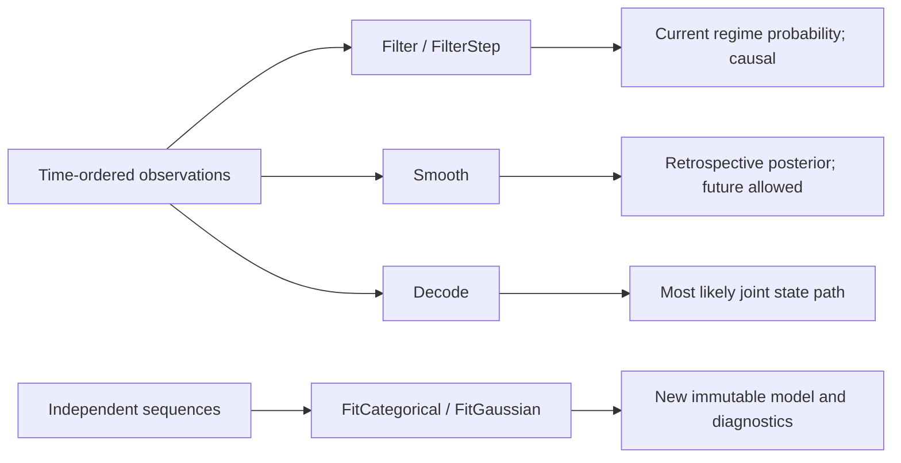

<!--
  SPDX-License-Identifier: AGPL-3.0-only
  Copyright (C) 2025-2026 katalvlaran

  File: docs/TUTORIAL.md
  Package reference: drawdown, sessionlevels, vwap, donchian, atr, ema, matrix, stats, ols, ridge, series, pacf, tfsax, rsi, macd, mfi, obv, ad, montecarlo, gbm, jumpdiffusion, gjrgarch, arima, lstm and the wider lvlath package family
  Contract status: learning guide; package doc.go and source define the public API.
  Scope: graph, matrix, factorization, statistical and temporal workflows, including sampled equity drawdown and recovery, previous completed session levels, exact anchored VWAP, causal Donchian ranges, exact affine EMA, causal MACD, rolling MFI, cumulative OBV, Chaikin A/D, reproducible parallel Monte Carlo, exact-in-distribution GBM, experimental Merton jump diffusion, GJR-GARCH causal volatility with constrained Gaussian QMLE, and fixed-order conditional Gaussian ARIMA with anchored forecasts, and frozen IFGO LSTM recurrent inference, and finite-window Durbin-Levinson PACF estimation, and the TFSAX research-only DTW-versus-SAX retrieval gate.
  lvlath - Repository Tutorial

  Purpose:
    This tutorial is the first educational entry point for lvlath. It introduces
    fundamental graph, matrix, stable-statistics, causal time-series, and symbolic SAX ideas; explains how lvlath
    maps mathematical algorithms into deterministic Go packages, and helps readers move from basic
    graph and series concepts to package-specific documentation. It does not duplicate every
    package specification; instead it teaches the mental model, core entities,
    options, result surfaces, and engineering discipline needed before reading
    docs/{PACKAGE}.md and {package}/doc.go files.

  License:
    lvlath is licensed under AGPL-3.0-only. See ../LICENSE.
-->

# lvlath Tutorial

> **hard math on an easy level**

Welcome to **lvlath**, a deterministic Go library for graph algorithms, dense graph algebra, flows, routing, tours, fixtures, exact time grids, causal series primitives, fractional PAA, symbolic SAX encoding, stable statistical reductions, fitted feature scaling, covariance PCA, exact affine EMA, causal Donchian ranges, exact anchored VWAP, previous completed session levels, sampled equity drawdown, causal Wilder RSI, SMA-seeded MACD, rolling Money Flow Index, compensated On-Balance Volume, Chaikin A/D, reproducible parallel Monte Carlo, exact-lognormal GBM paths, stationary asymmetric GJR-GARCH conditional variance, fixed-order conditional Gaussian ARIMA, frozen LSTM forward inference, time-series alignment, and research-only DTW-versus-SAX retrieval audits.

This tutorial is the beginning of the learning path. It introduces the objects and ideas that most packages share: graphs, matrices, options, result artifacts, error contracts, and deterministic algorithm execution.

---

## Table of Contents

1. [Introduction](#1-introduction)
2. [Documentation Map](#2-documentation-map)
3. [Installation](#3-installation)
4. [Mental Model: How lvlath Is Built](#4-mental-model-how-lvlath-is-built)
5. [Graph Foundations](#5-graph-foundations)
6. [First Rich Graph: Build, Inspect, Traverse](#6-first-rich-graph-build-inspect-traverse)
7. [Graph Algorithms on the Same Topology](#7-graph-algorithms-on-the-same-topology)
8. [Matrix Foundations](#8-matrix-foundations)
9. [Graph-to-Matrix Example: Incident Routing, Closure, and Spectral-Ready Data](#9-graph-to-matrix-example-incident-routing-closure-and-spectral-ready-data)
10. [Series Foundations: Exact Grids and Causal Features](#10-series-foundations-exact-grids-and-causal-features)
11. [Stats Foundations: Stable Moments and Fitted Scaling](#11-stats-foundations-stable-moments-and-fitted-scaling)

    11a. [PAA Foundations: Fractional Dimensionality Reduction](#11a-paa-foundations-fractional-dimensionality-reduction)
    11b. [SAX Foundations: Symbolic Words and Euclidean Screening](#11b-sax-foundations-symbolic-words-and-euclidean-screening)
    11c. [OLS Foundations: Stable QR Regression and Frozen Prediction](#11c-ols-foundations-stable-qr-regression-and-frozen-prediction)
    11d. [Ridge Foundations: Correlated Factors, Wide Matrices and Numerical Preconditioning](#11d-ridge-foundations-correlated-factors-wide-matrices-and-numerical-preconditioning)
    11e. [PCA Foundations: Certified Covariance Factors and Frozen Inference](#11e-pca-foundations-certified-covariance-factors-and-frozen-inference)
    11f. [HMM Foundations: Causal Hidden-State Filtering and Independent-Sequence Learning](#11f-hmm-foundations-causal-hidden-state-filtering-and-independent-sequence-learning)
    11g. [ACF Foundations: Fixed-Window Serial Dependence and Estimator Conventions](#11g-acf-foundations-fixed-window-serial-dependence-and-estimator-conventions)
    11h. [Bootstrap Foundations: Reproducible Dependent-Data Index Ensembles](#11h-bootstrap-foundations-reproducible-dependent-data-index-ensembles)
    11i. [RNG Foundations: Version-Pinned Stochastic Streams](#11i-rng-foundations-version-pinned-stochastic-streams)
    11j. [RSI Foundations: Causal Wilder Momentum and Recoverable Streaming](#11j-rsi-foundations-causal-wilder-momentum-and-recoverable-streaming)
    11k. [MACD Foundations: SMA-Seeded EMA, Signed Momentum and Checkpoint Replay](#11k-macd-foundations-sma-seeded-ema-signed-momentum-and-checkpoint-replay)
    11l. [MFI Foundations: Volume-Weighted Typical Price, Compensated Windows and Recoverable Streams](#11l-mfi-foundations-volume-weighted-typical-price-compensated-windows-and-recoverable-streams)
    11m. [OBV Foundations: Cumulative Signed Volume and Checkpointed Streams](#11m-obv-foundations-cumulative-signed-volume-and-checkpointed-streams)
    11n. [AD Foundations: Close-Location Volume and Deterministic Replay](#11n-ad-foundations-close-location-volume-and-deterministic-replay)
    11o. [Monte Carlo Foundations: Path-Indexed Simulation, Ordered Reduction and Bounded Parallelism](#11o-monte-carlo-foundations-path-indexed-simulation-ordered-reduction-and-bounded-parallelism)
    11p. [GBM Foundations: Exact Lognormal Paths and Explicit Time Units](#11p-gbm-foundations-exact-lognormal-paths-and-explicit-time-units)
    11q. [Jump Diffusion Foundations: Discrete Jumps, Compensated Drift and Replay](#11q-jump-diffusion-foundations-discrete-jumps-compensated-drift-and-replay)
    11r. [GJR-GARCH Foundations: Causal Leverage, Variance Forecasts and Auditable QMLE](#11r-gjr-garch-foundations-causal-leverage-variance-forecasts-and-auditable-qmle)
    11s. [ARIMA Foundations: Conditional Likelihood, Differencing and Anchored Forecasts](#11s-arima-foundations-conditional-likelihood-differencing-and-anchored-forecasts)
    11t. [LSTM Foundations: Frozen IFGO Inference and Masked Streaming](#11t-lstm-foundations-frozen-ifgo-inference-and-masked-streaming)
    11u. [PACF Foundations: Partial Dependence and Prediction Variance](#11u-pacf-foundations-partial-dependence-and-prediction-variance)
    11v. [TFSAX Research Gate: Exact DTW Truth, SAX Ranking and Reproducible Evidence](#11v-tfsax-research-gate-exact-dtw-truth-sax-ranking-and-reproducible-evidence)
    11w. [EMA Foundations: Exact Levels, Readiness, and Replay](#11w-ema-foundations-exact-levels-readiness-and-replay)
    11x. [ATR Foundations: Exact Ranges and Replay](#11x-atr-foundations-exact-ranges-and-replay)
    11y. [Donchian Foundations: Observed Ranges and Information Sets](#11y-donchian-foundations-observed-ranges-and-information-sets)
    11z. [VWAP Foundations: Exact Weights, Explicit Anchors, and Replay](#11z-vwap-foundations-exact-weights-explicit-anchors-and-replay)
    11aa. [SessionLevels Foundations: Previous Completed Session Levels](#11aa-sessionlevels-foundations-previous-completed-session-levels)
    11ab. [Drawdown Foundations: Sampled Equity Risk and Recovery](#11ab-drawdown-foundations-sampled-equity-risk-and-recovery)
12. [Algorithm Selection Guide](#12-algorithm-selection-guide)
13. [Professional Best Practices](#13-professional-best-practices)
14. [Where To Go Next](#14-where-to-go-next)

---

## 1. Introduction

### What is lvlath?

`lvlath` is a deterministic Go library for graph algorithms, dense graph algebra, routing, network optimization, time-series alignment, tour planning, and reproducible algorithm fixtures.

It is built around a simple engineering idea:

> Algorithms should publish results you can explain, test, reproduce, and safely compose.

The library covers:

* `core` graph modeling with deterministic topology and explicit capabilities;
* `bfs` hop-distance traversal and weak components;
* `dfs` finish-order traversal, cycle witnesses, and topological sorting;
* `dijkstra` weighted full-SSSP and four target-search methods (Dijkstra, bidirectional Dijkstra, consistent A*, balanced A*), original EdgeIDs, and exact target-cutoff policy;
* `mst` exact Prim/Kruskal MST/MSF, KMB original-edge graph Steiner approximation, and closed/fixed-end edge-covering walks;
* `flow` max-flow / residual-network analysis;
* `matrix` dense graph algebra: adjacency, incidence, metric closure, stable statistics, reusable factors, direct economy SVD and sanitation;
* `dtw` deterministic Dynamic Time Warping, bounded outcomes, and globally exact fixed-length squared-DTW top-K window search;
* `series` exact integer-nanosecond grid validation, causal lag/difference/returns, and complete index windows;
* `stats` stable Welford/Chan moments, mergeable partitions, and immutable fitted feature standardization;
* `ols` immutable full-rank regression models trained by pivoted Householder QR, with exact zero-origin policy and physical-unit coefficients;
* `ridge` explicit positive-Lambda Tikhonov regression for correlated and wide designs, unpenalized intercept, protected augmented QR and physical-unit predictions;
* `pca` immutable train-only principal component projection, certified covariance eigenspectrum, and original-unit reconstruction;
* `hmm` typed categorical/diagonal-Gaussian hidden-state models, causal filtering, noncausal smoothing, Viterbi, and independent-sequence MAP-EM;
* `acf` scaled direct sample autocorrelation, explicit common versus pair-adjusted denominators, and detached per-lag pair counts;
* `pacf` finite-window Durbin-Levinson partial autocorrelation with common-denominator covariances and one-step prediction variances;
* `ema` exact-binary-input exponential levels with SMA/First seeding, aligned readiness, error-atomic streaming and bounded seed checkpoints;
* `atr` exact True Range and Wilder range smoothing, finite signed candle geometry, ATR-only readiness and exact source-bound continuation;
* `donchian` observed high/low ranges, explicit current-bar inclusion, correctly rounded midpoint and one aligned readiness mask;
* `vwap` exact represented-input price-volume means with explicit anchors, positive-weight readiness, transactional streams and bounded exact-sum continuation;
* `sessionlevels` exact previous completed session high, low and final close over explicit partitions, with one aligned readiness mask and no calendar inference;
* `drawdown` nearest-even sampled equity depth with an exact maximum witness and first full recovery; no cashflow or intrabar inference;
* `rsi` causal Wilder gain/loss smoothing, index-aligned readiness masks, zero-allocation streaming and versioned scalar checkpoints;
* `macd` SMA-seeded Appel EMAs with signed Line/Signal/Histogram, separate readiness masks, transactional streaming and detached restart state;
* `mfi` compensated rolling typical-price money flow over OHLCV, transition-counted zero volumes, batch/stream parity and detached replay state;
* `obv` compensated cumulative signed current-candle volume, exact first-bar zero, valid-all-bars masks and checkpointed streaming;
* `ad` Chaikin close-location-weighted base volume, first-bar inclusion, Neumaier compensation and checkpointed streaming;
* `bootstrap` reproducible Moving, Circular and Stationary block-index ensembles with per-replicate RNG streams and atomic row publication;
* `rng` local pinned PCG-DXSM streams with SHA-256 seed derivation, strictly open uniforms and cached Box-Muller normals;
* `montecarlo` bounded-parallel independent sampling with per-path versioned streams, path-ordered `stats.Moments`, exact empirical quantiles and prefix-only interruption results;
* `gbm` exact-in-distribution lognormal paths on explicit irregular time grids, with strict unit matching, numerical overflow gates and detached completed prefixes;
* `jumpdiffusion` experimental Merton compound-Poisson lognormal shocks on explicit GBM grids, with compensated drift and bounded PTRS;
* `gjrgarch` stationary asymmetric conditional return variance, causal posterior filtering and constrained deterministic Gaussian QMLE;
* `arima` fixed-order conditional Gaussian ARIMA, strict AR/MA Schur roots, anchored level forecasts and marginal innovation variance;
* `lstm` immutable PyTorch IFGO forward inference with frozen numeric weights, masked batch-first sequences and ModelID-verified continuation;
* `paa` exact fractional time-series compression, rational segment boundaries and value-only feature projection;
* `sax` symbolic words from fractional PAA and compatible Euclidean MINDIST (not a DTW lower bound);
* `tfsax` an explicitly unapproved research gate: exact absolute-cost DTW truth, SAX TopM heuristic refinement, temporal provenance checks and reproducible synthetic comparisons; no TFSAX encoder or certified pruning;
* `tsp` matrix-backed tour optimization with exact, approximate, matching, and local-search regimes;
* `gridgraph` generated lattice topology;
* `builder` deterministic fixtures for examples, tests, and benchmarks.

```text
Mathematical object        Package surface             Contract idea
────────────────────────────────────────────────────────────────────────────
G = (V,E)                  *core.Graph                 deterministic topology
hop layers                 *bfs.Result                 depth / parent / visited
DFS forest                 *dfs.Result                 finish order, not discovery
weighted SSSP              *dijkstra.Result            all known distances / optional predecessor
weighted target            *dijkstra.PathResult        finite cost / +Inf / original EdgeIDs
full-vertex backbone       *mst.Result                 strict MST or explicit MSF
terminal-only network      *mst.SteinerResult          original EdgeIDs, KMB approximation
cover edges of one tree    *mst.WalkResult             repeated passage IDs, closed/fixed endpoints
flow network               residual *core.Graph        capacity state after flow
dense operator             *matrix.Dense               row-major numeric artifact
warping alignment          *dtw.Result                 distance, reachability, path
causal sample transform    *series.TransformResult     detached Values + Valid mask
timestamp-grid inspection  *series.ValidationResult    exact cadence / missing slots
dependent index ensembles  *bootstrap.Result           detached complete rows / RNG replay revision
versioned stochastic path  rng.RNG                     mutable PCG-DXSM draw stream, owned by one goroutine
independent path ensemble  *montecarlo.Result          ordered means/variance/SE, optional exact quantiles and detached samples
GBM lognormal path         *gbm.Result                 complete exact-distribution endpoints / valid prefix on error
Merton jump-diffusion path *jumpdiffusion.Result       compensated compound-Poisson endpoints / valid prefix
GJR-GARCH fit candidate    *gjrgarch.FitResult         immutable Model / accepted diagnostics / explicit nonconvergence
ARIMA forecast levels      *arima.ForecastResult       anchored mean / marginal innovation variance / horizon
frozen LSTM features       *lstm.Result                optional zero-padded Sequence / detached Hidden+Cell / ModelID
sample autocorrelation     *acf.Result                 fixed-window lag coefficients / pair counts
sample partial ACF         *pacf.Result                lag reflection coefficients / order-wise V_m
exact affine level         *ema.Result                 original-index Values / Valid; exact seed and rounded recurrence
exact candle range         *atr.Result                 always-present TR / independently ready ATR / Valid
observed rolling range     *donchian.Result            Upper / Middle / Lower / shared Valid; explicit current-bar policy
exact anchored price mean  *vwap.Result                Values / Valid; explicit resets and positive-weight readiness
prior completed session    *sessionlevels.Result       PreviousHigh / PreviousLow / PreviousClose / shared Valid
sampled equity risk        *drawdown.Result            Depth / Maximum / exact peak, trough and first recovery
Wilder RSI factor          *rsi.Result                 aligned oscillator / Valid mask
MACD trend difference      *macd.Result                aligned Line / Signal / Histogram masks
MFI volume-weighted flow   *mfi.Result                 aligned Values / Valid with compensated rolling window
OBV cumulative flow        *obv.Result                 aligned valid Values / Valid with compensated cumulative sum
AD close-location flow     *ad.Result                  aligned, all-valid Values / Valid from bar zero
streaming statistics       *stats.Summary              exact-binary-input mean / scaled variance
train-only scaling         *stats.ScaleFitResult       detached fit metadata / immutable model
full-rank regression       *ols.FitResult              physical beta / intercept / rank / SSE / QR condition
L2 regularized regression  *ridge.FitResult            physical beta / SSE / penalty / objective
fitted PCA subspace        *pca.FitResult              verified covariance rank / loadings / reconstruction
causal regime              *hmm.FilterResult           current log posterior / optional causal history
retrospective regime       *hmm.SmoothResult           future-conditioned posterior
joint regime trajectory    *hmm.DecodeResult           optimal path / joint log probability
fractional PAA             *paa.Result                 detached means / exact rational segments
SAX symbolic word          *sax.Result                 detached symbols / policy identity / optional PAA
closed tour                *tsp.Result                 cost, exactness, timeout, ratio
```

### Why lvlath?

Because real algorithm work fails at the edges, not in the textbook recurrence.

A shortest-path formula is easy. A reliable Go package must also answer:

* Is traversal order stable enough for CI and golden tests?
* Is this graph really directed, weighted, loop-enabled, or multi-edge capable?
* Is a missing target different from a known but unreachable target?
* Is a zero edge a real zero-cost edge or an absent edge?
* In which numeric domain is `+Inf` being used: graph storage, runtime policy, dense representation, or algorithm result?
* Is a disconnected MST request an error or an explicit forest request?
* Am I connecting every vertex (MST), only required terminals (graph Steiner), or covering every edge of an existing tree (SteinerWalk)?
* Is this cost a unique installed-network total or the distance of a route with repeated traversals?
* Is a DTW path recoverable under the selected memory mode?
* Is a TSP result exact, approximate, locally improved, or merely a timed-out incumbent?
* Does the returned result own its data, or does it alias the input?
* Does a time-series zero mean a computed value or an invalid warmup cell?
* Are timestamp gaps merely recorded, or has the application really resampled its data?
* Can a variance be computed without cancellation or premature overflow?
* Are inference features normalized with fixed training parameters, or was the model accidentally refitted?
* Did a live hidden-state decision accidentally use future-conditioned smoothing instead of filtering?
* Were independent HMM training sequences illegally concatenated into fabricated transitions?
* Did an EMA pipeline treat an invalid warmup zero as a measured level, or discard exact unfinished seed state during failover?
* Did a previous-range comparison accidentally include the current high, or normalize by a scale that already includes the same shock?
* Did a VWAP consumer assume a first anchor, lose a small product through cancellation, reset on a rejected row, or mistake Count for the persisted source cursor?
* Did a prior-session feature use a developing current-session extreme, mark an incomplete predecessor complete, or confuse a trading session with a UTC day?
* Did a risk report feed raw balances containing cashflows, pick a rounded argmax instead of the exact drawdown witness, or use final recovery at an earlier decision time?
* Did a market-data loader drop a legitimate zero-volume candle and change the MFI rolling window?
* Did an OBV calculation add the very first candle's volume, lose Neumaier correction, or reuse a mismatched feed cursor after Restore?
* Did an A/D calculation accidentally discard the first contribution, form 2*Close, divide by a flat spread, or authenticate a public Config digest?
* Was a public Snapshot configuration digest mistaken for state authentication?

`lvlath` treats those questions as the API, not as afterthoughts.

### What makes lvlath different?

1. **Contract-first packages**

   Each package defines its mathematical domain, result artifact, error law, determinism law, and non-goals. A function is not “just an implementation”; it is a public contract.

2. **Deterministic result surfaces**

   Stable graph order, deterministic tie-breaks, strict improvement laws, fixed DP traversal, deterministic matching/local-search policy, and detached result artifacts make outputs reproducible.

3. **Explicit modeling instead of hidden fallback**

   `mst` does not silently turn strict MST into a forest. `tsp` does not silently replace Blossom matching with Greedy matching. `dtw` does not pretend rolling-row memory can reconstruct a path.

4. **Numeric domains are explicit**

   `core.Graph` edge weights are finite. Individual algorithms may impose stricter
   input subsets. `+Inf` may still be valid as an unbounded option, an unreachable
   result, or a dense absence sentinel. Arithmetic overflow is a separate error and
   must not be silently converted into another domain state.

5. **Graph, matrix, and time-series workflows compose**

   `core` owns topology. `matrix` turns topology into dense artifacts. `series` validates ordered observations and produces causal masks without depending on those packages. `stats` provides stable scalar reductions and immutable fitted feature scaling on matrix inputs; it does not fill gaps or refit during inference. `dijkstra`, `mst`, `flow`, `tsp`, and `dtw` solve different mathematical questions without collapsing their result meanings.

---

## 2. Documentation Map

The [documentation index](README.md) links the package guides and import boundaries.

Read these files as a learning path. `doc.go` files define implemented package contracts; `docs/*.md` files teach the theory, diagrams, pitfalls, and recipes.

| Step | Document                                   | What you learn                                                                                                                 |
|:-----|:-------------------------------------------|:-------------------------------------------------------------------------------------------------------------------------------|
| 1    | [`CORE.md`](CORE.md)                       | Graph capabilities, deterministic topology, ownership, locks, graph invariants.                                                |
| 2    | [`BFS.md`](BFS.md)                         | Hop-distance traversal, `Result`, components, filters, partial-result behavior.                                                |
| 3    | [`DFS.md`](DFS.md)                         | Finish order, DFS forest, deterministic cycle witnesses, topological sort.                                                     |
| 4    | [`DIJKSTRA.md`](DIJKSTRA.md)               | Full SSSP vs target Dijkstra/A*, consistent/balanced potentials, original EdgeIDs, exact cutoff, walls and error contracts.    |
| 5    | [`MST.md`](MST.md)                         | Exact Prim/Kruskal MST/MSF, KMB Steiner networks, closed/fixed-end tree walks, original IDs and separate numeric contracts.    |
| 6    | [`FLOW.md`](FLOW.md)                       | Capacity networks, residual graph state, Ford-Fulkerson, Edmonds-Karp, Dinic.                                                  |
| 7    | [`MATRICES.md`](MATRICES.md)               | Dense storage, graph adapters, zero-weight policy, statistics, factor solves and one-sided Jacobi economy SVD.                 |
| 8    | [`SERIES.md`](SERIES.md)                   | Exact signed-nanosecond grids, causal arrays, masks, overflow, and index windows.                                              |
| 8a   | [`STATS.md`](STATS.md)                     | Welford/Chan moments, exact binary-input mean, scaled variance, immutable fitted scaling and error laws.                       |
| 8b   | [`PAA.md`](PAA.md)                         | Exact fractional segment geometry, nearest-even floating arithmetic, wrappers, and SAX-oriented ownership.                     |
| 8c   | [`SAX.md`](SAX.md)                         | Right-bin quantization, SHA-256 policy identity, Euclidean MINDIST, DTW non-pruning law and examples.                          |
| 8c1  | [`TFSAX.md`](TFSAX.md)                     | Exact-DTW research truth, classical SAX heuristic ranking, no invented TFSAX codec, reproducible provenance and research gate. |
| 8d   | [`OLS.md`](OLS.md)                         | Pivoted-QR full-rank regression, scale-only origin policy, frozen coefficients, SSE and error contracts.                       |
| 8e   | [`RIDGE.md`](RIDGE.md)                     | Positive-Lambda augmented Householder QR, unpenalized intercept, stable strongly regularized slopes, immutable models.         |
| 8f   | [`PCA.md`](PCA.md)                         | Strict covariance eigenanalysis, train-only latent factors, reconstruction residuals and solver limitations.                   |
| 8g   | [`HMM.md`](HMM.md)                         | Typed hidden-state models, strict online causal filtering, retrospective smoothing, Viterbi, independent-sequence EM.          |
| 8h   | [`ACF.md`](ACF.md)                         | Direct sample ACF, common/pair-adjusted estimators, Toeplitz PSD limits, scaled arithmetic and independent oracle.             |
| 8i   | [`BOOTSTRAP.md`](BOOTSTRAP.md)             | Three block-index laws, unbiased integers, replay, resource admission and partial cancellation.                                |
| 8j   | [`RNG.md`](RNG.md)                         | PCG-DXSM128/64 streams, open uniforms, Box-Muller spare protocol, logical paths and replay.                                    |
| 8k   | [`RSI.md`](RSI.md)                         | Wilder seed and smoothing, readiness masks, snapshot ABI, price domain, batch/stream parity.                                   |
| 8l   | [`MACD.md`](MACD.md)                       | Appel EMA with SMA seed, three signed outputs, exact warmup, bitwise batch/stream parity and checkpoint trust.                 |
| 8m   | [`MFI.md`](MFI.md)                         | Compensated rolling MFI, zero-volume slots, canonical batch/stream parity and checkpoint integrity boundaries.                 |
| 8n   | [`OBV.md`](OBV.md)                         | Cumulative signed volume, first-bar zero, Neumaier accumulation, stream rollback and externally authenticated replay.          |
| 8o   | [`AD.md`](AD.md)                           | Chaikin close-location-weighted volume, first-bar inclusion, stable multiplier, Neumaier rebase and snapshot trust.            |
| 8p   | [`MONTECARLO.md`](MONTECARLO.md)           | Parallel path streams, ordered moments, bounded dispatch, exact quantiles and partial-result policy.                           |
| 8q   | [`GBM.md`](GBM.md)                         | Exact lognormal increments on irregular grids, strict unit matching, stable log-growth publication, RNG/MC bridge.             |
| 8r   | [`JUMPDIFFUSION.md`](JUMPDIFFUSION.md)     | Compensated Merton jumps, inversion/PTRS, RNG order, errors and model limits.                                                  |
| 8s   | [`GJRGARCH.md`](GJRGARCH.md)               | Causal asymmetric variance, stationary forecast, deterministic constrained Gaussian QMLE and risk release gates.               |
| 8t   | [`ARIMA.md`](ARIMA.md)                     | Conditional Gaussian ARIMA, Schur root validation, differenced drift, anchors and innovation-only forecast variance.           |
| 8u   | [`LSTM.md`](LSTM.md)                       | Frozen PyTorch IFGO weights, tensor masks, streaming equivalence, model identity, arithmetic safety and pinned golden oracle.  |
| 8v   | [`PACF.md`](PACF.md)                       | Durbin-Levinson PACF, common-n covariance, stable variances, error law and practical applications.                             |
| 8w   | [`EMA.md`](EMA.md)                         | Exact affine level smoothing, seed modes, readiness masks, bounded snapshots, cancellation and replay.                         |
| 8x   | [`ATR.md`](ATR.md)                         | Exact first-bar/gap ranges, Wilder seed/steps, named period facades, signed candles and lossless continuation.                 |
| 8y   | [`DONCHIAN.md`](DONCHIAN.md)               | Observed rolling ranges, current-bar policy, exact midpoint, masks, bounded deques and consumer arithmetic.                    |
| 8z   | [`VWAP.md`](VWAP.md)                       | Exact products/weights, explicit first anchors, zero-weight phases, error-atomic restart and source-bound replay.              |
| 8aa  | [`SESSIONLEVELS.md`](SESSIONLEVELS.md)     | Explicit day/week manifests, causal reference levels, exact selection, readiness and replay.                                   |
| 8ab  | [`DRAWDOWN.md`](DRAWDOWN.md)               | Observed NAV depth, exact witness ordering, first recovery, errors and caller-side risk audit.                                 |
| 9    | [`DTW.md`](DTW.md)                         | `Align`, `AlignCostMatrix`, `AlignMatrix`, `AlignBounded`, exact `Search`, numeric and path artifacts.                         |
| 9a   | [`DTW_SEARCH.md`](DTW_SEARCH.md)           | Fixed-length exact top-K, certified LB_Keogh, workers, budgets, and partial-result law.                                        |
| 10   | [`TSP.md`](TSP.md)                         | Matrix-backed tours, exact regimes, Christofides, Blossom matching, local search, timeouts.                                    |
| 10a  | [`MATCH.md`](MATCH.md)                     | Ordered subset mapping, weighted Blossom, explicit Greedy, raw costs, nilable results and TSP separation.                      |
| 11   | [`GRID_GRAPH.md`](GRID_GRAPH.md)           | Lattice topology for traversal/routing demos and pathfinding fixtures.                                                         |
| 12   | [`FAQ_&_TIPS.md`](FAQ_%26_TIPS.md)         | Troubleshooting, package selection, testing/benchmark/documentation pitfalls.                                                  |
| 13   | [`lvlath_UES.md`](lvlath_UES.md)           | Universal engineering standard for package quality and contribution discipline.                                                |
| 14   | [`../CONTRIBUTING.md`](../CONTRIBUTING.md) | Branching, tests, linting, examples, docs, benchmark, and PR workflow.                                                         |

Suggested route:

```text
New to lvlath:
  CORE -> BFS -> DFS -> DIJKSTRA -> MATRICES

Working on optimization:
  DIJKSTRA -> MST -> FLOW -> MATRICES -> MATCH -> TSP

Working on numeric/time-series workflows:
  SERIES -> PAA -> SAX -> approximate candidate ranking -> DTW refinement
  SERIES -> STATS -> DTW -> MATRICES
  MATRICES -> STATS -> DTW
  MATRICES -> STATS -> OLS -> chronological holdout prediction
  MATRICES -> STATS -> RIDGE -> wide/collinear factor predictions with shrinkage
  MATRICES -> STATS -> PCA -> independent holdout reconstruction and residual review
  MATRICES.SVD -> rectangular telemetry / finance / RF mode inspection (not automatic PCA)
  SERIES -> STATS -> HMM.FilterStep -> online regime monitoring (no future data)
  SERIES -> ACF.ComputeDefault -> fixed-window lag diagnostics (NOT causal)
  SERIES -> PACF.ComputeCentered -> partial lag memory / V_m (fixed-window, NOT causal)
  SERIES -> EMA.ComputeSMA / ComputeFirst -> aligned level and mask
  source admission -> EMA.NewSMA / NewFirst -> Push -> snapshot + source cursor
  source admission -> ATR.NewPeriod -> Push -> range/readiness -> snapshot + source cursor
  ordered H/L -> DONCHIAN.ComputeIncludeCurrent / ComputeExcludeCurrent -> owning ranges + shared mask
  prior DONCHIAN[t] + separately ready ATR[t-1] -> caller-owned normalized feature (check units and arithmetic)
  admitted price/quantity/reset -> VWAP.ComputeDefault -> owning weighted levels + mask
  admitted H/L/C + day/week partitions -> SESSIONLEVELS.ComputeDaily / ComputeWeekly -> prior triples + shared masks
  caller ledger + admitted NAV -> DRAWDOWN.Compute -> causal Depth + retrospective maximum witness
  source admission -> VWAP.NewDefault -> Push -> exact Snapshot + separate source cursor
  SERIES -> RSI.ComputePeriod / Stream.Push -> causal price-strength factors
  SERIES -> MACD.Compute / Stream.Push -> signed trend-separation features and masks
  SERIES -> MFI.Compute / Stream.Push -> OHLCV volume-weighted transition factor and validity mask
  SERIES -> OBV.ComputeCandles / Stream.Push -> cumulative signed volume, valid from first candle
  SERIES -> AD.ComputeCandles / Stream.Push -> close-location-weighted volume, valid from bar zero
  SERIES -> BOOTSTRAP.SampleIndices -> paired matrix/return/sensor resamples -> caller estimators
  RNG.Stream(seed, logicalPath) -> own sampler model -> MONTECARLO.Run (bounded jobs + indexed moments)
  RNG.Stream(seed, logicalPath) -> GBM.Simulate / SimulateTerminal -> payoff Sampler -> MONTECARLO.Run
  RNG.Stream(seed, logicalPath) -> JUMPDIFFUSION.Simulate / SimulateTerminal -> complete payoff -> MONTECARLO.Run
  SERIES.LogReturns -> GJRGARCH.FilterStationary -> State/Step -> next-session risk forecast
  SERIES + frozen training split -> GJRGARCH.Fit -> holdout predictive log-score -> model review
  SERIES.Validate -> frozen training levels -> ARIMA.Fit -> anchored Forecast -> chronological holdout review
  SERIES.Validate -> caller-fitted training scales -> frozen LSTM.Import -> InferSequence / InferChunk -> caller-owned head and holdout review
  MONTECARLO.Run -> mean/variance/SE / optional exact quantiles -> application decision policy
  OLS/RIDGE residual window -> ACF/PACF -> investigate serial dependence (NOT a p-value)
  MATRICES -> HMM.Smooth / Decode -> offline incident reconstruction
  SERIES -> frozen raw splits -> tfsax.ValidateWindowRecords -> exact DTW oracle vs SAX ranking (research only)
  SAX (Euclidean screening) != DTW (nonlinear alignment)
  TFSAX research gate != production encoder or certified DTW pruning
  MATRICES -> MATCH.Perfect -> detached original-index pair selection
  MATRICES -> TSP (which consumes MATCH inside metric Christofides)

Contributing:
  lvlath_UES -> CONTRIBUTING -> package doc.go -> docs/{PACKAGE}.md
```

---

## 3. Installation

```bash
go get github.com/lvlath/go@latest
```

Requires Go 1.23.4 or newer. Pure Go. No cgo. No external runtime dependencies.

---

## 4. Mental Model: How lvlath Is Built

Think of `lvlath` as a contract stack.

```text
                                    ┌──────────────────────────────────┐
                                    │            core.Graph            │
                                    │ deterministic topology substrate │
                                    └────────────────┬─────────────────┘
                                                     │
       ┌──────────────────────┬──────────────────────┼──────────────────────┬──────────────────────┐
       │                      │                      │                      │                      │
 traversal structure     weighted routing      connectivity design      capacity network       dense artifacts
       │                      │                      │                      │                      │
  ┌────▼────┐       ┌─────────▼──────────┐      ┌────▼────┐            ┌────▼────┐            ┌────▼──────┐
  │ bfs     │       │ dijkstra           │      │ mst     │            │ flow    │            │ matrix    │
  │ dfs     │       │ finite weights     │      │ MST/ST  │            │ residual│            │ graph     │
  └────┬────┘       │ +Inf result/policy │      └────┬────┘            └────┬────┘            │ algebra   │
       │            └─────────┬──────────┘           │                      │                 └────┬──────┘
       │                      │                      │                      │                      │
       └──────────────────────┴──────────────────────┴──────────────────────┴────────────┬─────────┘
                                                                                         │
                                                                             ┌───────────▼───────────┐
                                                                             │ tsp                   │
                                                                             │ matrix-backed tours   │
                                                                             └───────────────────────┘

                         ┌──────────────────────────┐       ┌──────────────────────────┐
                         │ dtw                      │       │ builder / gridgraph      │
                         │ temporal alignment       │       │ reproducible input worlds│
                         └──────────────────────────┘       └──────────────────────────┘

                         ┌───────────────────────────────────────────────┐
                         │ series                                        │
                         │ exact time-grid checks, causal arrays/masks   │
                         │ standalone; no core/matrix/dtw dependency     │
                         └───────────────────────────────────────────────┘

                         ┌───────────────────────────────────────────────┐
                         │ sax                                           │
                         │ symbolic words / Euclidean MINDIST            │
                         │ reuses paa, not a certified DTW bound         │
                         └───────────────────────────────────────────────┘

                         ┌───────────────────────────────────────────────┐
                         │ acf                                           │
                         │ fixed-window, scaled direct autocorrelation   │
                         │ common / lag-adjusted; not causal streaming   │
                         └───────────────────────────────────────────────┘

                         ┌───────────────────────────────────────────────┐
                         │ pacf                                          │
                         │ common-n covariance / Durbin-Levinson         │
                         │ partial lag dependence / prediction variance  │
                         └───────────────────────────────────────────────┘

                         ┌───────────────────────────────────────────────┐
                         │ arima                                         │
                         │ fixed-order conditional ARMA on differences   │
                         │ original-level anchors / impulse variances    │
                         └───────────────────────────────────────────────┘

                         ┌───────────────────────────────────────────────┐
                         │ lstm                                          │
                         │ frozen IFGO weights, masked [B,T,D] batches   │
                         │ optional Sequence + detached Final State      │
                         └───────────────────────────────────────────────┘

                         ┌───────────────────────────────────────────────┐
                         │ rsi                                           │
                         │ causal Wilder price-strength oscillator       │
                         │ batch mask / zero-allocation Push / replay    │
                         └───────────────────────────────────────────────┘

                         ┌───────────────────────────────────────────────┐
                         │ macd                                          │
                         │ SMA-seeded price EMAs, signed signal/histogram│
                         │ aligned masks / atomic Push / checkpoint      │
                         └───────────────────────────────────────────────┘

                         ┌───────────────────────────────────────────────┐
                         │ mfi                                           │
                         │ volume-weighted typical-price transitions     │
                         │ compensated ring / valid mask / replay        │
                         └───────────────────────────────────────────────┘

                         ┌───────────────────────────────────────────────┐
                         │ obv                                           │
                         │ causal signed close-to-close traded volume    │
                         │ no warmup / Neumaier / checkpoint             │
                         └───────────────────────────────────────────────┘

                         ┌───────────────────────────────────────────────┐
                         │ ad                                            │
                         │ close-location-weighted OHLCV volume          │
                         │ first-bar contribution / atomic checkpoint    │
                         └───────────────────────────────────────────────┘

                         ┌───────────────────────────────────────────────┐
                         │ stats                                         │
                         │ Welford / Chan, immutable fitted scaling      │
                         │ consumes matrix.Matrix; no series import      │
                         └───────────────────────────────────────────────┘

                         ┌───────────────────────────────────────────────┐
                         │ ols                                           │
                         │ pivoted QR regression / immutable Model       │
                         │ original units, train-only scaling            │
                         └───────────────────────────────────────────────┘

                         ┌───────────────────────────────────────────────┐
                         │ ridge                                         │
                         │ explicit positive Lambda / augmented QR       │
                         │ unpenalized intercept, stable small slopes    │
                         └───────────────────────────────────────────────┘

                         ┌───────────────────────────────────────────────┐
                         │ pca                                           │
                         │ stable covariance + checked Jacobi spectrum   │
                         │ frozen loadings / inference without refit     │
                         └───────────────────────────────────────────────┘
```

### Previous completed session branch

SessionLevels is a standalone scalar batch kernel. A caller may use series to
check the observed time grid within the chosen calendar policy, but neither
series nor SessionLevels derives a trading calendar or authenticates a feed.

```text
caller-admitted H/L/C + source revision
               |
        explicit manifest
               |
 sessionlevels.ComputeDefault
               |
 PreviousHigh / PreviousLow / PreviousClose / Valid
               |
 caller aligns with other independently computed features
```

Donchian chooses a moving observed-bar window. VWAP chooses a weighted prefix
from an explicit reset. SessionLevels chooses the strictly previous completed
interval. These are data-composition alternatives, not a dependency chain.

### Observed equity risk branch

Price-reference features and account risk have different inputs. No session,
Donchian or VWAP result is an account balance. A caller may compose features
with an execution simulator or ledger, then audit the resulting NAV independently:

```text
admitted H/L/C and optional causal features
                 |
        caller execution / ledger + cashflow policy
                 |
          sampled, admitted equity/NAV
                 |
            drawdown.Compute
                 |
       Depth + exact maximum witness
                 |
       caller report / rounded risk policy
```

These arrows describe data flow, not imports. The caller owns timestamps,
revision evidence, executions and NAV admission. Drawdown does not consume
future feature rows or reconstruct intrabar capital paths.

### Anchored weighted-price branch

VWAP does not depend on graph topology, ATR, Donchian, or series. It consumes
already admitted, unit-compatible price/weight/reset records. The application
owns availability, revisions, instruments, and calendars; the package owns exact
accumulation, readiness, and recoverable arithmetic state.

```text
source records + units + availability + explicit anchor policy
                             |
             application validation / admission / ordering
                             |
          price, volume, reset -> vwap.Compute or Stream.Push
                             |
                   Values / Valid or scalar Value
                             |
        aligned reporting or separately checked consumer arithmetic
```

### Parallel stochastic execution bridge

For an explicitly selected geometric Brownian motion model, `gbm` transforms path-owned normal draws into positive-price endpoints before the application turns a complete trajectory into a payoff. It does not schedule or aggregate paths.

An explicitly selected Merton model instead uses `jumpdiffusion` to add bounded discrete Poisson counts and aggregated normal log jumps to the same physical GBM time grid. The two samplers are different mathematical assumptions; both leave experiment scheduling and payoff calculation to `montecarlo` and the application. Setting `Intensity=0` delegates directly to the GBM sampler.

`rng` creates a deterministic single-owner stream; `montecarlo` adds a path-indexed bounded scheduler and canonical single-owner moments; `stats` provides the numeric recurrence; `matrix` stores optional detached results. The application continues to own the stochastic model and its domain assumptions. `bootstrap` instead returns block-resampled indices from already observed dependent data. These are composable but **not interchangeable** numerical questions.

```text
rng.Factory.Stream(Seed,pathID)      application Sampler
                  \                  /
                   bounded worker pool
                           |
                  indexed path outcomes
                           |
                single ordered coordinator
                           |
                      stats.Moments
                           |
                  *montecarlo.Result
                (optional matrix.Matrix)
```

### Repository laws

1. **Topology is modeled before algorithms run**

   Directedness, weights, loops, multi-edges, and mixed edges are graph capabilities. They are not loose comments around a map.

2. **Different algorithms answer different questions**

   BFS minimizes hops. Dijkstra minimizes non-negative route cost. MST minimizes selected backbone cost. Flow maximizes feasible throughput. MATCH partitions selected matrix vertices into disjoint pairs. DTW minimizes temporal alignment cost. TSP minimizes closed-tour cost.

3. **Result artifacts carry meaning**

   Do not reduce results to “a slice and a number.” A result may contain reachability, path tracking, exactness, approximation ratio, timeout state, component roots, residual capacity, matrix policy, or detached IDs. In `mst`, `Result` spans all vertices, `SteinerResult` selects one original-edge terminal network, and `WalkResult` records repeated travel passages. Their costs are not interchangeable.

4. **Policy is explicit and local to the run**

   Filters, thresholds, forest mode, metric closure, local search, matching algorithm, DTW memory mode, and time limits are explicit options. Hidden fallback is not a feature.

5. **Numeric values need domain context**

   `0`, `+Inf`, `NaN`, negative weights, and missing edges are interpreted differently by different packages. In `series`, an invalid warmup is represented by `Values[i] == 0` **and** `Valid[i] == false`, while timestamp gaps are separate records. Correct code respects these different contracts. A statistical result must also distinguish exact binary-input mean accumulation from approximate scaled second moments, and a fitted model must never adapt to heldout values. `acf` uses a whole-window fitted mean (not a causal prefix transform) and must never substitute `LagAdjusted` for `CommonDenominator` in PSD-dependent downstream calculations.

---

## 5. Graph Foundations

A graph is:

$$ G = (V, E) $$

where:

* `V` is a set of vertices;
* `E` is a set of edges between vertices.

In `lvlath/core`, vertices are identified by string IDs, and edges carry direction, weight, ID, and policy-dependent behavior.

### Core capabilities

| Capability           | What it controls                           | Typical use                                              |
|:---------------------|:-------------------------------------------|:---------------------------------------------------------|
| `WithDirected(true)` | Default orientation of edges.              | Dependency graphs, one-way roads, call graphs.           |
| `WithWeighted()`     | Non-zero `float64` edge values.            | Cost, distance, latency, capacity.                       |
| `WithLoops()`        | Self-edges such as `A -> A`.               | State machines, roundabouts, internal transitions.       |
| `WithMultiEdges()`   | Parallel edges between the same endpoints. | Road + rail, multiple network links, redundant channels. |
| `WithMixedEdges()`   | Per-edge direction overrides.              | City maps with one-way streets and two-way roads.        |

### Storage intuition

```text
+------------------------------------------------------------------+
| core.Graph                                                       |
|------------------------------------------------------------------|
| vertices:       map[string]*Vertex                               |
| edges:          map[string]*Edge                                 |
| adjacency:      map[fromID]map[toID]map[edgeID]struct{}          |
| config:         directed / weighted / loops / multi / mixed      |
| locks:          vertex/config lock + edge/adjacency lock         |
+------------------------------------------------------------------+
            │                         │
            │                         └── edge IDs preserve identity
            │
            └── vertex IDs are the stable public coordinate system
```

### Directed vs undirected

```text
Directed edge A -> B:

   [A] ──▶ [B]

Storage intent:
   A can reach B through this edge.
   B does not automatically reach A.

Undirected edge A -- B:

   [A] ◀──▶ [B]

Storage intent:
   Traversal can move both ways.
```

### Weight is not just decoration

```text
Unweighted graph:
  all edges have weight 0;
  BFS/DFS are natural tools.

Weighted graph:
  edge values carry cost/capacity/distance;
  Dijkstra, MST, flow, matrix closure, and TSP become meaningful.
```

---

## 6. First Rich Graph: Build, Inspect, Traverse

The first example should be visually useful, not a toy line. We use a 10-vertex directed service graph with a central loop, two branches, and a storage tail.

```text
                         ┌────────────┐
                         │  incident  │
                         └──────┬─────┘
                                │
                                ▼
                         ┌────────────┐
                         │  gateway   │
                         └───┬────┬───┘
                             │    │
                ┌────────────┘    └──────────┐
                ▼                            ▼
            ┌────────┐                  ┌────────┐
            │  auth  │                  │  api   │
            └───┬────┘                  └────┬───┘
                │                            │
                ▼                            ▼
          ┌──────────┐                 ┌──────────┐
          │ profile  │◀──────┐         │ search   │
          └─────┬────┘       │         └─────┬────┘
                │            │               │
                ▼            │               ▼
           ┌────────┐        │         ┌──────────┐
           │   db   │        └─────────│  index   │
           └────┬───┘                  └─────┬────┘
                │                            │
                ▼                            ▼
           ┌────────┐                  ┌──────────┐
           │ backup │                  │  cache   │
           └────────┘                  └──────────┘

Features:
  - main dependency chain: incident -> gateway -> auth -> profile -> db -> backup
  - parallel branch: gateway -> api -> search -> index -> cache
  - cross-loop: index -> profile
  - 10 vertices, visible depth layers, one meaningful feedback-style structural join
```

```go
package main

import (
	"context"
	"fmt"
	"sort"

	"github.com/lvlath/go/bfs"
	"github.com/lvlath/go/core"
	"github.com/lvlath/go/dfs"
)

func main() {
	g, err := core.NewGraph(core.WithDirected(true))
	if err != nil {
		fmt.Println(err)
		return
	}

	// Static tutorial data. Ignoring AddEdge errors is acceptable only here because
	// the topology is predetermined and the graph is unweighted. Check errors in
	// production and tests.
	_, _ = g.AddEdge("incident", "gateway", 0)
	_, _ = g.AddEdge("gateway", "auth", 0)
	_, _ = g.AddEdge("gateway", "api", 0)
	_, _ = g.AddEdge("auth", "profile", 0)
	_, _ = g.AddEdge("profile", "db", 0)
	_, _ = g.AddEdge("db", "backup", 0)
	_, _ = g.AddEdge("api", "search", 0)
	_, _ = g.AddEdge("search", "index", 0)
	_, _ = g.AddEdge("index", "cache", 0)
	_, _ = g.AddEdge("index", "profile", 0)

	// BFS: hop-distance layers from incident.
	bfsResult, err := bfs.BFS(g, "incident")
	if err != nil {
		fmt.Println(err)
		return
	}

	layers := map[int][]string{}
	for id, depth := range bfsResult.Depth {
		layers[depth] = append(layers[depth], id)
	}
	for depth := 0; depth <= 5; depth++ {
		sort.Strings(layers[depth])
		fmt.Printf("depth %d: %v\n", depth, layers[depth])
	}

	path, err := bfsResult.PathTo("backup")
	if err != nil {
		fmt.Println(err)
		return
	}
	fmt.Println("path-to-backup:", path)

	// DFS: finish order, useful for dependency reasoning.
	dfsResult, err := dfs.DFS(g, "incident")
	if err != nil {
		fmt.Println(err)
		return
	}
	fmt.Println("dfs-finish-order:", dfsResult.Order)

	// Components: direction ignored for weak membership.
	components, err := bfs.Components(context.Background(), g)
	if err != nil {
		fmt.Println(err)
		return
	}
	fmt.Println("weak-components:", components.Count)
}
```

### What to notice

* `BFS.Depth` is a shortest-hop certificate.
* `BFS.PathTo` reconstructs one deterministic shortest path from `StartID`.
* `DFS.Order` is finish order, not discovery order.
* `Components` answers weak connectivity and should not be confused with strongly connected components.

### Layer visualization

```text
Depth 0:   incident
              │
Depth 1:   gateway
           /      \
Depth 2: auth      api
          │         │
Depth 3: profile  search
          │         │
Depth 4: db       index
          │       /    \
Depth 5: backup  cache  profile(already discovered earlier)
```

---

## 7. Graph Algorithms on the Same Topology

The fastest way to misuse graph libraries is to treat every algorithm as “pathfinding.” `lvlath` keeps the objective visible.

### BFS: hop-distance and frontier waves

Use BFS when every edge has equal cost and you care about layers.

```text
Objective:
  minimize number of edges

Result meaning:
  Depth[v] = shortest hop count from start
  Parent[v] = deterministic shortest-hop witness tree
```

Good questions:

* “Which services are within 2 hops?”
* “What is the blast radius wave by wave?”
* “Which weak components exist?”

### DFS: structure, finish order, cycles

Use DFS when completion structure matters.

```text
Objective:
  inspect depth-first structure

Important law:
  dfs.Result.Order = finish order, not discovery order
```

Good questions:

* “Can this dependency graph be topologically sorted?”
* “Where is a deterministic cycle witness?”
* “What is the post-order structure of this graph?”

### Dijkstra and consistent A*: non-negative weighted routing

Use the **full SSSP** method when one source needs distances to many destinations, and a **target method** when only one original-cost route is required.

```text
Full Dijkstra:     Dijkstra(...)         -> Result, all known distances
One target:        Search(...)           -> PathResult, original EdgeIDs
Two frontiers:     Bidirectional(...)    -> certified meeting and lower bound
Consistent A*:    AStar(...)            -> frozen target estimates, no reopening
Balanced A*:      BidirectionalAStar(...) -> two frozen directional estimates
```

All target methods operate on one `core.Clone`, retain original edge identities and have stricter exact-binary64 cost/key requirements than the legacy SSSP runner. A target result contains one complete witness, **not** a map of finalized distances.

Good questions:

* “What are the shortest costs from ingress to every service?” - full `Dijkstra`.
* “What single route uses these particular original multigraph links?” - `Search` / `Bidirectional`.
* “Can my grid Manhattan estimate legally accelerate settlement?” - consistent `AStar`.
* “Do I have reliable, directionally consistent estimates from both endpoints?” - balanced `BidirectionalAStar`.

Run the [three standalone shortest-path scenarios](DIJKSTRA.md#59-compilable-scenarios-and-their-runner-tests) to compare public APIs and exact witness semantics.

### MST, graph Steiner, and tree-covering walks: three different objectives

Use exact MST for **every** graph vertex; KMB graph Steiner for an **explicit required subset**; and `SteinerWalk` when the goal is to **traverse every edge of one validated tree**.

```text
Strict MST, Prim/Kruskal:
  connect every original vertex; Result.TotalWeight counts selected unique links.

Explicit MSF:
  one exact MST per connected component; WithForest() must be requested.

SteinerTree (KMB approximation):
  connect only requested terminals through original graph vertices/edge IDs.
  Every original edge weight must be finite and nonnegative, even on loops/islands.
  SteinerResult.TotalWeight counts unique selected original edges, not closure links.

SteinerWalk:
  closed start=end: cover every tree edge twice.
  fixed start!=end: cover unique spine edges once, off-spine edges twice.
  WalkResult.Distance sums actual repeated original-ID passages.
```

On a simple hub with `AX=BX=CX=1` and direct terminal connections costing 3, `SteinerTree(g, []string{"A", "B", "C"})` chooses original `AX,BX,CX`, total **3**, while the terminal closure MST totals **4**. A closed walk from A costs **6**, a fixed-end walk from A to B costs **4**. Neither is a proof of globally optimal original-graph routing.

The KMB kernel uses source-grouped public Dijkstra SSSP queries and reuses Kruskal selection twice, then prunes unused nonterminal leaves. `SteinerRecomputePaths` favors bounded live predecessor history; `SteinerRetainPaths` retains O(kV) source history for fewer repeated SSSP queries. The walk validates the caller-owned tree independently, including correct `TotalWeight` in original Edge.ID order.

Good questions:

* “What is the cheapest cable, fiber, or relay backbone spanning **all** nodes?” - MST.
* “Which required sensor or chiplet pins can share original relay links?” - `SteinerTree`.
* “How do I inspect every link of the selected tree and finish at a specified endpoint?” - `SteinerWalk`.
* “Are disconnected islands allowed when they contain no required terminal?” - yes, for graph Steiner.

### Flow: maximum feasible throughput

Use flow when weights are capacities.

```text
Objective:
  maximize source-to-sink flow

Residual graph:
  records remaining forward capacity and possible reverse cancellation.
```

Good questions:

* “How much traffic can reach storage?”
* “Which cut limits throughput?”
* “What residual capacity remains after routing maximum flow?”

### Match: independent assignment of disjoint pairs, not a traveling route

Use `match` when each selected vertex must participate in **exactly one** pair:
for example, pairing 20 handoff appointments, backup radio stations or redundant
control modules. `match.Perfect` accepts an even ordered subset of original
`matrix.Matrix` indices and returns global-index `[]match.Pair` plus raw cost.
It does not output a path or mutate a graph.

```go
// The matrix encodes the costs of three possible pairings of four tasks.
// The example prints an exact optimum; the input order is intentional.
weights, err := matrix.NewDense(4, 4)
if err != nil {
    return err
}
if err := weights.Fill([]float64{
    0, 2, 2, 1,
    2, 0, 100, 2,
    2, 100, 0, 3,
    1, 2, 3, 0,
}); err != nil {
    return err
}
result, err := match.Perfect(weights, []int{0, 1, 2, 3})
if err != nil {
    return err
}
fmt.Println(result.Pairs, result.Cost) // [{0 2} {1 3}] 4
```

The above fragment belongs inside a function that returns `error`; it assumes
imports `fmt`, `github.com/lvlath/go/matrix` and `github.com/lvlath/go/match`.
For a ready-to-run program see [`MATCH.md`](MATCH.md) and
[`match/example_test.go`](../match/example_test.go). By explicit choice,
`match.GreedyPerfect` would instead produce cost **101** for this fixture.
The three possible perfect-matching costs are **5**, **4**, and **101**.

Do not sort a caller-supplied subset before solving: original order controls
local Blossom indices and Greedy tie selection. `Result.Pairs` are normalized
for publication *after* solving, and each index refers to the source matrix,
not an index in the selected subset. A nonempty call validates the **whole**
input matrix; empty selections succeed without matrix reads. Neither mode
checks triangle inequality, and Greedy cannot support a Christofides 1.5
approximation proof.

The direction of dependencies is `tsp -> match -> matrix -> core`. In the
Christofides pipeline, TSP owns MST, adjacency and Eulerian traversal, while
`match` owns only the detached numerical pair selection. The TSP adapter
checks completeness of all pairs before adding any undirected edge.

### TSP: closed tour over a complete cost model

Use TSP when the result must visit every required stop exactly once and return to start.

```text
Objective:
  minimize closed Hamiltonian tour cost

Input model:
  complete finite matrix after optional metric closure
```

Good questions:

* “What is the best inspection/delivery route?”
* “Do I need exact optimality or a heuristic/local-search result?”
* “Can I claim a Christofides ratio, or did I choose weaker matching?”

### DTW: temporal alignment, not graph routing

Use DTW when two sequences describe the same process at different speeds.

```text
Objective:
  minimize accumulated alignment cost through a time-time grid

Path meaning:
  diagonal = both advance
  vertical/horizontal = one side stretches
```

Good questions:

* “Do these two vibration signatures match despite phase drift?”
* “Which phase was stretched?”
* “Can I afford path recovery, or do I only need distance?”
* “Which complete fixed-length windows are my exact top-K matches?” - use `dtw.Search`.
* “Is a score within a known inclusive limit?” - use `dtw.AlignBounded`.

For exact timestamps and causal preprocessing **before** alignment, use `series`; it does not perform DTW or infer a resampling policy.

---

## 8. Matrix Foundations

Graphs describe relationships. Matrices make those relationships computable.

`lvlath/matrix` is the dense layer for:

* adjacency and incidence artifacts;
* metric closure / all-pairs shortest paths;
* degree vectors and reductions;
* row-major dense algebra;
* legacy unpivoted LU/QR, reusable pivoted LU/Householder QR, Cholesky, least-squares, inverse, symmetric eigen decomposition, and direct rectangular economy SVD;
* stable sample covariance, direct Pearson correlation, and scale-aware L2 row normalization;
* numeric sanitation and tolerant comparison.

### Matrix core capabilities

| Capability                 | What it controls                        | Why it matters                                                    |
|:---------------------------|:----------------------------------------|:------------------------------------------------------------------|
| `Dense` row-major storage  | One flat `[]float64` buffer.            | Predictable memory layout and fast loops.                         |
| `Matrix` interface         | `Rows`, `Cols`, `At`, `Set`, `Clone`.   | Kernels can accept dense and wrapped/fallback inputs.             |
| `NewPreparedDense` options | Finite/`+Inf` admissibility.            | Numeric policy is explicit.                                       |
| `View`                     | Shared no-copy submatrix.               | Block assembly and write-through workflows.                       |
| `Induced`                  | Copied submatrix by selected rows/cols. | Independent result artifact.                                      |
| Graph adapters             | Adjacency, incidence, metric closure.   | Topology becomes numeric data without losing policy.              |
| Sanitizers                 | `ReplaceInfNaN`, `Clip`.                | Raw telemetry becomes safe for statistics/algebra.                |
| Comparators                | `AllClose`.                             | Tests compare numeric results by tolerance, not fragile equality. |
| Rectangular SVD            | `SVD` / `SVDDefault` / option wrappers. | Direct singular modes, economy shapes, no Gram-based solver.      |

### Storage intuition

A dense matrix with `R` rows and `C` columns stores `(i,j)` at:

$$ offset(i,j)=i \times C+j $$

```text
Logical 3×4 matrix:

      c0   c1   c2   c3
r0  [ a00  a01  a02  a03 ]
r1  [ a10  a11  a12  a13 ]
r2  [ a20  a21  a22  a23 ]

Physical row-major storage:

[ a00 a01 a02 a03 | a10 a11 a12 a13 | a20 a21 a22 a23 ]
  row 0 contiguous   row 1 contiguous   row 2 contiguous
```

### Graph-to-matrix semantics

```text
Adjacency matrix: V × V
  cell(i,j) means relation from vertex i to vertex j.

Incidence matrix: V × E
  column(k) means structural contribution of edge k.

Metric closure: V × V
  cell(i,j) means shortest-path distance, not original edge existence.
```

### Zero and infinity law

```text
Classic adjacency:
  0 may mean “no edge”.

Zero-preserving weighted adjacency:
  finite 0 may mean “real zero-cost edge”;
  +Inf means absence.

Metric closure:
  finite value means shortest distance;
  +Inf means unreachable.

Sanitation/statistics:
  NaN and invalid Inf values must be cleaned or rejected before analysis.
```

### Stable statistics and reusable factors: the numerical workflow

Matrix-native statistics and linear solvers answer **different** questions:

```text
      observations X[n×d]               linear model A[m×p], RHS B[m×r]
               │                                      │
       ┌───────┴────────┐                ┌────────────┴──────────────┐
CenterColumns       Covariance     square full rank           tall full rank
       │                │                │                           │
centered data       d×d moments       FactorLU                    FactorQR
       │                │                │                           │
NormalizeRowsL2    Correlation    row pivot + Solve         Householder + Solve
       │                │                └───────────┬───────────────┘
feature geometry    pair relations             SolveResult
                                       solution / rank / residuals /
                                         condition estimate

  Symmetric positive definite operator:
      FactorCholesky -> reusable Solve -> accepted-A residuals
```

Use `Covariance` for a sample covariance **with denominator `rows-1`**; use `Correlation` to compare signed feature relationships even when an unscaled covariance is too large to represent. Both require `rows>=2`, including zero-feature requests. A constant feature has an all-zero correlation row and diagonal. `CenterColumns` and `NormalizeRowsL2` use stable finite-only reductions; on zero-element shapes their returned `Matrix` intentionally aliases the source.

For linear systems, select by mathematical structure rather than convenience: pivoted `FactorLU` for square systems, `FactorQR` or `SolveLeastSquares` for tall full-column-rank least squares, and `FactorCholesky` **only** when symmetry and positive definiteness hold. The legacy `LUDecompose` and `QRDecompose` have different, historically preserved output conventions; they are not reusable solver factors. Numerical rank rejection (`ErrRankDeficient`) does not trigger a hidden pseudoinverse, and a positive diagonal is not a proof of SPD.

### An executable calibration example

Five field measurements follow a linear response law. The QR solver recovers the baseline and sensitivity without squaring the design's condition number through normal equations. The result also carries the actual original-coordinate residual and a measured `kappa_1(R)` diagnostic.

```go
package main

import (
	"context"
	"fmt"

	"github.com/lvlath/go/matrix"
)

func main() {
	design, err := matrix.NewDense(5, 2)
	if err != nil {
		fmt.Println("matrix:", err)
		return
	}
	if err = design.Fill([]float64{1, 0, 1, 1, 1, 2, 1, 3, 1, 4}); err != nil {
		fmt.Println("design:", err)
		return
	}
	response, err := matrix.NewDense(5, 1)
	if err != nil {
		fmt.Println("response:", err)
		return
	}
	if err = response.Fill([]float64{8, 11, 14, 17, 20}); err != nil {
		fmt.Println("observations:", err)
		return
	}
	fit, err := matrix.SolveLeastSquares(
		context.Background(), design, response, matrix.FactorOptions{},
	)
	if err != nil {
		fmt.Println("solve:", err)
		return
	}
	intercept, err := fit.Solution.At(0, 0)
	if err != nil {
		fmt.Println("intercept:", err)
		return
	}
	slope, err := fit.Solution.At(1, 0)
	if err != nil {
		fmt.Println("slope:", err)
		return
	}
	fmt.Printf("baseline %.0f, slope %.0f, rank %d\n", intercept, slope, fit.Rank)
	fmt.Printf("residual below 1e-12: %t\n", fit.ResidualNorms[0] < 1e-12)

	// Output:
	// baseline 8, slope 3, rank 2
	// residual below 1e-12: true
}
```

For repeated response batches with the same design, call `FactorQR` once and reuse `factor.Solve(ctx,B)`. Each call receives a separate workspace; inputs must remain unchanged during calculation. `FactorOptions{ConditionLimit: limit}` can reject a measured condition above `limit`; it does not regularize or improve a badly conditioned model.

The full derivation, dimension rules, numerical limits, and the separate LU/QR/Cholesky conventions are in [`MATRICES.md`](MATRICES.md#1011-reusable-factorizations-different-problems-different-contracts).

### Economy SVD: rectangular measurements without normal equations

A calibration design and an observation table are different mathematical
objects. QR solves a **full-column-rank** system against a response; economy SVD
finds singular directions of an **arbitrary finite nonempty rectangular**
matrix without requiring a response or forming `A^T*A`.

```text
  measurements A[m x n]
           |
    matrix.SVDDefault
           |
    +------+------+---------------+
    |             |               |
    U[m x k]   s[0:k]          VT[k x n]
    |             |               |
    +-------------+---------------+
           |
   k = min(m,n); A ~= U diag(s) VT
           |
   rank / truncation / diagnostics belong to caller policy
```

For wide observations with `m<n`, the kernel decomposes `A^T`, then maps the
small factors back. A `5 x 18` instrument experiment therefore returns
`U[5 x 5]` and `VT[5 x 18]`, **not** a needless `18 x 18` right basis.
Each working column retains an independent binary exponent, protecting
representable orthogonal modes with vastly different amplitudes.

**Executable RF calibration example (synthetic fixture).** Five controlled
excitation pulses are sampled at eighteen frequencies. We use singular values
and economy shapes to inspect the observable response subspace; SVD does not
claim to identify eighteen unique physical calibration parameters from only
five independent pulse experiments.

```go
package main

import (
    "context"
    "fmt"

    "github.com/lvlath/go/matrix"
)

func main() {
    const pulses, frequencyBands = 5, 18
    readings, err := matrix.NewDense(pulses, frequencyBands)
    if err != nil {
        fmt.Println("allocation:", err)
        return
    }

    // The fixed deterministic fixture models different pulse/frequency envelopes.
    for pulse := 0; pulse < pulses; pulse++ {
        for frequency := 0; frequency < frequencyBands; frequency++ {
            response := float64((pulse+1)*(1+frequency%7) +
                (pulse*pulse+frequency*frequency)%11)
            if err := readings.Set(pulse, frequency, response); err != nil {
                fmt.Println("observation:", err)
                return
            }
        }
    }
    result, err := matrix.SVDDefault(context.Background(), readings)
    if err != nil {
        // A non-nil diagnostic on ErrNotConverged is not a usable basis.
        fmt.Println("decomposition:", err)
        return
    }
    fmt.Printf("pulses=%d bands=%d U=%dx%d VT=%dx%d rank=%d\n",
        pulses, frequencyBands,
        result.U.Rows(), result.U.Cols(),
        result.VT.Rows(), result.VT.Cols(), result.Rank)

    // Output: pulses=5 bands=18 U=5x5 VT=5x18 rank=5
}
```

`SVDOptions{}` selects 100 full cyclic sweeps and a normalized column
correlation tolerance of `8*2^-52`. A zero-rotation diagonal matrix can still
report `Iterations=0`. `Rank` is a numerical, relative singular-value cutoff;
it **does not** erase modes below that cutoff. Cancellation, nonfinite input,
true output overflow and invalid options return nil results. Exhausted sweeps
instead return `ErrNotConverged` plus a diagnostic `SVDResult{Converged:false}`;
do not feed its factors into a numerical decision.

For already-centered observations, the first `r` singular values can quantify
retained **matrix energy**; for uncentered data, this is not PCA explained
variance. Do not use `means []float64` as a substitute for the actual output
of `CenterColumns` when extreme-offset precision matters. The currently
implemented `pca.Fit` remains a covariance-eigensolver; its reserved `ThinSVD`
mode still rejects the request. Using `matrix.SVD` explicitly does not change
that cross-package contract.

Read the complete [rectangular SVD reference](MATRICES.md#1016-rectangular-economy-svd-direct-singular-mode-analysis)
and the [matrix SVD FAQ](FAQ_%26_TIPS.md#6-matrix-faq). The five runnable
engineering scenarios are in `matrix/example_test.go`, and
the three required tall/wide/square SVD benchmarks are in
`matrix/bench_test.go`. Source, test, and documentation contracts remain separate.

### Matrix as bridge to other packages

`matrix` is not isolated from graph algorithms:

* Dijkstra-style route outputs can become dense distance surfaces.
* `match` consumes validated complete matrix weights to pair an even ordered subset; it publishes original indices, not routes.
* TSP consumes matrix-backed complete cost models; Christofides calls `match` to repair odd MST degrees.
* Spectral analysis starts from adjacency or symmetrized adjacency.
* Flow/cut analysis can use incidence-style structural thinking.
* DTW can align matrix rows as multivariate time steps through `dtw.AlignMatrix`.
* `series` works directly on 1-D arrays and exact nanosecond timestamps; it has no matrix dependency or implicit timestamp resampler.
* `sax` reuses `paa` for fractional aggregation and publishes symbolic Euclidean lower bounds; its words are not compatible DTW pruning certificates.
* `stats` streams finite scalar data and fits immutable per-feature transforms over `matrix.Matrix`; it never changes the matrix or infers a validity mask.
* `ols` uses the same QR and stats kernels for full-rank linear-factor modeling, preserves physical coefficients and never refits on heldout data.
* `ridge` builds a positive-Lambda augmented system, equilibrates its QR coordinates and accepts collinear/wide designs without hidden OLS fallback; it also predicts from frozen physical parameters.
* `pca` delegates sample covariance and symmetric Jacobi to `matrix`, freezes train-only means/scales and eigenvectors, and reconstructs new observations without recalibrating their coordinate origin. The existence of `matrix.SVD` does not activate the reserved `pca.ThinSVD` enum.
* `hmm` consumes typed categorical symbols or finite feature matrices, keeps online filtering causal, and trains without crossing independent sequence boundaries.

---

## 9. Graph-to-Matrix Example: Incident Routing, Closure, and Spectral-Ready Data

This example models a small incident-response service network.

The story is intentionally realistic:

* `edge` receives user traffic;
* requests split into authentication and API paths;
* `profile`, `search`, and `index` represent service dependencies;
* `db -> backup` is a real zero-cost replication edge;
* `logs` and `archive` preserve operational evidence;
* the same topology can feed routing, dense matrices, spectral analysis, MST backbone planning, terminal-only Steiner network selection, tree-edge covering walks, flow capacity analysis, TSP inspection tours, and DTW telemetry comparison.

The goal of this section is not to run every package in one oversized code block. The goal is to show the **graph-to-matrix foundation** that later packages can reuse.

```text
Incident-response service graph
weights = latency / operational cost

                   
        ┌──────────2────────────▶ auth ─────1────▶ profile ─────2────▶ db
        │                           └─4─┐                               │
        │                               │                               │0
        │                               ▼                               ▼
      edge ────3────▶ api ─────4────▶ search ─────3────▶ logs ───2──▶ backup
        │              │                 │
        │              │2                │1
        │              ▼                 ▼
        └─────6────▶ cache             index ─────5────▶ archive

Important semantics:
  - `db -> backup = 0` is a real zero-cost replication link.
  - missing edges are not zero-cost edges.
  - metric closure answers shortest reachable distance, not original topology.
  - symmetrized adjacency is a derived operator for spectral inspection.
  
```

```go
package main

import (
	"fmt"

	"github.com/lvlath/go/core"
	"github.com/lvlath/go/matrix"
)

func main() {
	g, err := core.NewGraph(core.WithDirected(true), core.WithWeighted())
	if err != nil {
		fmt.Println(err)
		return
	}

	// Static tutorial data only. In production and tests, check AddEdge errors.
	_, _ = g.AddEdge("edge", "auth", 2)
	_, _ = g.AddEdge("edge", "api", 3)
	_, _ = g.AddEdge("edge", "cache", 6)
	_, _ = g.AddEdge("auth", "profile", 1)
	_, _ = g.AddEdge("auth", "search", 4)
	_, _ = g.AddEdge("api", "search", 4)
	_, _ = g.AddEdge("api", "cache", 2)
	_, _ = g.AddEdge("search", "index", 1)
	_, _ = g.AddEdge("search", "logs", 3)
	_, _ = g.AddEdge("index", "archive", 5)
	_, _ = g.AddEdge("logs", "backup", 2)
	_, _ = g.AddEdge("profile", "db", 2)
	_, _ = g.AddEdge("db", "backup", 0)

	opts, err := matrix.NewMatrixOptions(
		matrix.WithDirected(),
		matrix.WithWeighted(),
		matrix.WithPreserveZeroWeights(),
	)
	if err != nil {
		fmt.Println(err)
		return
	}

	// NewAdjacencyMatrix gives the graph a deterministic dense coordinate system:
	// string vertex IDs become stable matrix row/column indices.
	adj, err := matrix.NewAdjacencyMatrix(g, opts)
	if err != nil {
		fmt.Println(err)
		return
	}
	fmt.Println("vertices:", len(adj.VertexIndex))

	// DegreeVector is a compact topology signal. In this weighted directed example,
	// it summarizes outgoing structure under the adjacency policy.
	degree, err := adj.DegreeVector()
	if err != nil {
		fmt.Println(err)
		return
	}
	fmt.Println("degree-vector-len:", len(degree))

	// PreserveZeroWeights is essential here: db -> backup is a real edge with cost 0,
	// not an absent relation. Missing edges are represented by +Inf under this policy.
	db := adj.VertexIndex["db"]
	backup := adj.VertexIndex["backup"]
	replicationCost, err := adj.Mat.At(db, backup)
	if err != nil {
		fmt.Println(err)
		return
	}
	fmt.Println("replication-cost:", replicationCost)

	// BuildMetricClosure converts direct-edge costs into all-pairs shortest distances.
	// This is a distance artifact. It must not be confused with original topology.
	closure, err := matrix.BuildMetricClosure(g, opts)
	if err != nil {
		fmt.Println(err)
		return
	}

	edge := adj.VertexIndex["edge"]
	distToBackup, err := closure.Mat.At(edge, backup)
	if err != nil {
		fmt.Println(err)
		return
	}
	fmt.Println("distance-edge-backup:", distToBackup)

	// The zero-preserving adjacency contains +Inf for missing relations.
	// Spectral routines require a separate finite numerical operator.
	binaryOptions, err := matrix.NewMatrixOptions(
		matrix.WithDirected(), matrix.WithUnweighted(),
	)
	if err != nil {
		fmt.Println("binary options:", err)
		return
	}
	binaryAdjacency, err := matrix.NewAdjacencyMatrix(g, binaryOptions)
	if err != nil {
		fmt.Println("binary adjacency:", err)
		return
	}
	symmetricOperator, err := matrix.Symmetrize(binaryAdjacency.Mat)
	if err != nil {
		fmt.Println("symmetrize:", err)
		return
	}
	eigenvalues, _, err := matrix.EigenSym(symmetricOperator, 1e-10, 2000)
	if err != nil {
		fmt.Println("spectral analysis:", err)
		return
	}
	fmt.Println("spectral eigenvalues:", len(eigenvalues))

	// Illustrative output when the finite symmetric operator converges:
	// vertices: 11
	// degree-vector-len: 11
	// replication-cost: 0
	// distance-edge-backup: 5
	// spectral eigenvalues: 11
}
```

Run this code in a `main` package inside the repository module. The old Playground snapshot is intentionally not linked because it contains a different numerical-policy example.

### What this example proves

* `core.NewGraph` models topology and capability: directed + weighted.
* `matrix.NewMatrixOptions` is the graph-to-matrix policy boundary.
* `matrix.NewAdjacencyMatrix` gives string vertices deterministic dense coordinates.
* `matrix.WithPreserveZeroWeights` keeps a real zero-cost edge distinct from absence.
* `matrix.BuildMetricClosure` turns topology into shortest-distance data.
* A zero-preserving distance/adjacency encoding containing `+Inf` is **not** a valid spectral input.
* A separate finite binary adjacency can be symmetrized and passed to `matrix.EigenSym` as a derived operator. This does not make it a graph Laplacian or prove causality.

### How the same incident graph connects to other lvlath packages

| Package     | Incident-response use                                                                                       |
|:------------|:------------------------------------------------------------------------------------------------------------|
| `bfs`       | Hop blast radius: “which services are within 2 calls of `edge`?”                                            |
| `dfs`       | Dependency cycle audit before deployment.                                                                   |
| `dijkstra`  | Cheapest failover route from ingress to storage or backup.                                                  |
| `mst`       | Exact full-vertex MST/MSF, or KMB for required service terminals; walk covers all edges of a selected tree. |
| `flow`      | Maximum capacity from ingress tier to storage tier on a capacity version of this topology.                  |
| `matrix`    | Adjacency, incidence, closure, spectral features, statistics, sanitation.                                   |
| `series`    | Validate a service telemetry grid and prepare causal differences/returns before comparing signals.          |
| `dtw`       | Compare incident telemetry signature against historical outages.                                            |
| `tsp`       | Plan a closed inspection / maintenance route over a complete distance matrix.                               |
| `gridgraph` | Model the same incident over a datacenter floor or network zone map.                                        |
| `builder`   | Generate repeatable larger incident fixtures for tests and benchmarks.                                      |

### Spectral interpretation

The eigen step is not “magic centrality.” It is a compact structural signal over a derived symmetric operator.

Use it as:

* a ranking hint for central services;
* a seed for graph clustering;
* a sanity check before heavier analytics;
* a feature source for dashboards or anomaly models.

Do not use it as:

* proof of causality;
* replacement for shortest-path or flow analysis;
* direct evidence that an edge exists in the original directed graph.

---

## 10. Series Foundations: Exact Grids and Causal Features

`series` is the boundary between **the supplied order of observations** and
the time grid that an application expects. It answers two different questions:

1. **Grid validity**: Are signed nanosecond timestamps strictly increasing,
   representable as positive `int64` differences, and (when requested) aligned
   to an exact positive cadence?
2. **Causal preprocessing**: Which values can be computed from current and
   earlier supplied samples, and which positions still lack enough history?

The second answer is carried by both `Values` and `Valid`; never discard the
validity mask and then interpret every zero as a real observation.

### Integer grid versus sample index

```text
Original sample index:    0      1      2               3      4
Timestamp in ns:          0     10     20              40     50
Expected 10-ns grid:      *------*------*------o--------*------*
                                            ^
                                      missing 30-ns slot

Grid validation:  Gap{AfterIndex: 2, MissingCount: 1}
Lag(values, 1):   uses the previous SUPPLIED index, not the 30-ns slot
```

`series.Validate` will reject that grid with `AllowGaps: false`. With
`AllowGaps: true`, it succeeds and reports the missing whole slot. Neither
mode interpolates or changes the input values. `CadenceNS == 0` checks strict
order and delta representability only; it never guesses a frequency.

For cadence `c > 0`, each adjacent positive delta `d` must satisfy the exact
integer rule `d % c == 0`. The number of missing slots is `d/c - 1`.
Even if two timestamps are ordered, their mathematical difference may exceed
`math.MaxInt64`; `Validate` then returns `ErrOverflow`, not a wrapped delta.

### Causal transforms preserve length

For a finite array `x`, `Lag(x,k)` reads `x[i-k]` for `i >= k` and
`Difference(x,k)` reads `x[i] - x[i-k]` for a strictly positive lag.
`SimpleReturns` computes `x[i]/x[i-1] - 1` when its previous denominator is
nonzero; `LogReturns` computes `ln(x[i]) - ln(x[i-1])` when **all** inputs are
positive. Both returns operations mark their first output position invalid.

```text
Input:                [2, 4, 4, 8]
Difference(lag=1):
  Values:             [0, 2, 0, 4]
  Valid:              [F, T, T, T]
                        ^     ^
                 no history   computed zero
```

The output for index `i` uses no future values. Appending more observations
cannot change an already computed prefix **when both full calls succeed**.
This qualification matters for returns: appending after a terminal zero can
make `SimpleReturns` fail because that zero becomes a used denominator.

### Executable grid-and-mask example

```go
package main

import (
	"errors"
	"fmt"

	"github.com/lvlath/go/series"
)

func main() {
	times := []int64{0, 10, 20, 40, 50}
	values := []float64{2, 4, 4, 8, 0}

	grid, err := series.Validate(times, values, series.GridOptions{
		CadenceNS: 10,
		AllowGaps: true,
	})
	if err != nil {
		fmt.Println("validate:", err)
		return
	}

	difference, err := series.Difference(values, 1)
	if err != nil {
		fmt.Println("difference:", err)
		return
	}
	returns, err := series.SimpleReturns(values)
	if err != nil {
		fmt.Println("returns:", err)
		return
	}

	fmt.Println("gaps:", grid.Gaps)
	fmt.Println("difference:", difference.Values, difference.Valid)
	fmt.Println("simple returns:", returns.Values, returns.Valid)

	_, err = series.Validate(times, values, series.GridOptions{CadenceNS: 10})
	fmt.Println("strict cadence rejected:", errors.Is(err, series.ErrGap))
}
```

Output:

```text
gaps: [{2 1}]
difference: [0 2 0 4 -8] [false true true true true]
simple returns: [0 1 0 1 -1] [false true true true true]
strict cadence rejected: true
```

This example intentionally computes an adjacent-index return **across** the
missing timestamp slot; it does not assert that such a return is appropriate
for every downstream model. If uninterrupted cadence matters, require
`AllowGaps: false` or segment the input explicitly.

### Complete windows and subsequent analysis

`WindowRanges(8,3,2)` returns half-open `[0,3)`, `[2,5)`, `[4,7)`;
no partial tail is emitted. The arguments describe **sample indices**, not
durations. Windows can overlap, touch, or be separated, according to stride.
When no complete range exists, the successful return is empty **and non-nil**.

To compose packages, keep the boundaries explicit. A downstream SAX encoder can consume only the valid, uniformly sampled scalar window selected by the application; it never interprets `Valid` masks or repairs reported gaps:

```text
signed timestamps --Validate--> gap policy / alignment proof
                                       |
finite samples -----Lag/Difference/Returns-----> Values + Valid
                                       |
                               caller chooses valid data
                                       |
                         WindowRanges / dtw / matrix / model
```

`series` never synthesizes samples, fills gaps, constructs a DTW alignment,
computes rolling statistics, or provides a streaming buffer. For proofs,
error precedence, float64 stability, and ownership rules, continue to
[`SERIES.md`](SERIES.md) and [`series/doc.go`](../series/doc.go).

---

## 11. Stats Foundations: Stable Moments and Fitted Scaling

`stats` is the layer for **stable scalar reductions** and **training-only feature calibration**. It complements `matrix` (storage and algebra) and `series` (timestamp validation and causal masks); it does not subsume their responsibilities.

A common data pipeline has three distinct mathematical stages:

```text
    raw time-stamped observations
                  |
      series.Validate / Difference
                  |
          Values + Valid mask
                  |
        explicit caller filtering
                  |
        +---------+-------------------+
        |                             |
        v                             v
  stats.Moments                 matrix.Matrix
 Update / Merge                 rows=samples
        |                       cols=features
        v                             |
  Summary(ddof)                       v
                           FitStandardizer(training)
                                      |
                               immutable Model
                              /              \
                       heldout matrix    production batch
                             |                |
                          Transform        Transform
                              \              /
                         standardized features
```

**There is no implicit missing-value filter or refit.** A `series.TransformResult` may contain placeholder zeros with `Valid=false`; `stats` sees only numeric values and therefore requires the caller to select valid observations first.

### 11.1. Why ordinary variance calculations can fail

Subtracting raw second moments, `E[x*x] - E[x]*E[x]`, is mathematically sound in real arithmetic but susceptible to catastrophic floating-point cancellation. For values near `1e12` with a spread of just one or two units, the two large terms can round to the same value even though the variance is positive.

`Moments.Update` uses the centered Welford recurrence:

$$\mu' = \mu + \frac{x-\mu}{n+1},\qquad M'_2=M_2+\frac{n(x-\mu)^2}{n+1}.$$


`Moments.Merge` combines two completed partitions using Chan–Golub–LeVeque:

$$M_{2,A\cup B}=M_{2,A}+M_{2,B}+\frac{n_A n_B}{n_A+n_B}(\mu_B-\mu_A)^2.$$

Internally, `M2` uses compensated extended-exponent arithmetic. A separate fixed-width exact binary sum protects the final mean. The resulting `Variance` is still an **approximate** floating-point central moment, not an exact rational variance or a universal error-bound certificate.

The population variance divides `M2` by `n` (`ddof=0`); sample variance divides by `n-1` (`ddof=1`). Both require `n > ddof`.

### 11.2. Ordinary batches versus independent partitions

```go
package main

import (
	"fmt"

	"github.com/lvlath/go/stats"
)

func main() {
	values := []float64{1e12 + 1, 1e12 + 2, 1e12 + 3}
	summary, err := stats.SummarizeSample(values)
	if err != nil {
		fmt.Println("summary:", err)
		return
	}
	fmt.Printf("count=%d mean=%.0f variance=%.0f\n",
		summary.Count, summary.Mean, summary.Variance)
	// Output: count=3 mean=1000000000002 variance=1
}
```

For streaming input, declare `var moments stats.Moments` and call `Update` on each finite observation. For parallel work, give each worker an **independent** accumulator and combine finished states through `Merge`. Do not call `Update` or `Merge` concurrently on the same mutable accumulator. A fixed merge order improves reproducibility of rounded `M2`.

### 11.3. Fit once, transform heldout data without leakage

Training matrices use **rows as observations** and **columns as features**. `ScaleOptions{}` selects population variance and `RejectConstant`. If a training feature is constant but should remain usable, choose `UnitScaleConstant` explicitly: it retains the feature's training mean, assigns scale `1`, and maps a new value to the deviation from the **training** mean.

```go
package main

import (
	"fmt"

	"github.com/lvlath/go/matrix"
	"github.com/lvlath/go/stats"
)

func main() {
	train, err := matrix.NewDense(4, 2)
	if err != nil {
		fmt.Println(err)
		return
	}
	for row, features := range [4][2]float64{{10, 5}, {12, 5}, {14, 5}, {16, 5}} {
		for col, value := range features {
			if err := train.Set(row, col, value); err != nil {
				fmt.Println(err)
				return
			}
		}
	}

	fit, err := stats.FitPopulationStandardizer(train, stats.UnitScaleConstant)
	if err != nil {
		fmt.Println(err)
		return
	}
	heldout, err := matrix.NewDense(1, 2)
	if err != nil {
		fmt.Println(err)
		return
	}
	for col, value := range []float64{18, 7} {
		if err := heldout.Set(0, col, value); err != nil {
			fmt.Println(err)
			return
		}
	}

	standardized, err := fit.Model.Transform(heldout)
	if err != nil {
		fmt.Println(err)
		return
	}
	constantDelta, err := standardized.At(0, 1)
	if err != nil {
		fmt.Println(err)
		return
	}
	fmt.Printf("constant=%t trainingMean=%.0f heldoutDelta=%.0f\n",
		fit.Constant[1], fit.Means[1], constantDelta)
	// Output: constant=true trainingMean=5 heldoutDelta=2
}
```

What this demonstrates:

* `FitPopulationStandardizer` is an explicit wrapper over the canonical `FitStandardizer`, with `DDOF=0`; `FitSampleStandardizer` selects `DDOF=1`.
* `ScaleFitResult.Means`, `.Scales`, and `.Constant` are detached metadata, not live aliases into `Model`.
* `Transform` does not adjust the training mean on heldout samples, and each successful call allocates its own output matrix.
* `InverseTransform` reconstructs values with `math.FMA`; ordinary rounding prevents a universal bitwise round-trip guarantee.
* A `0×d` inference batch is legal when `d` equals the fitted feature count; fitting a `0×d` matrix is not.

### 11.4. The error and numeric boundary

| Situation                                                 | Contract                                                  |
|:----------------------------------------------------------|:----------------------------------------------------------|
| `NaN` or `±Inf` input                                     | `stats.ErrNonFinite`, not a successful infinite statistic |
| Nil slice, receiver, or supported typed-nil matrix        | `stats.ErrNilInput`                                       |
| Empty non-nil scalar batch or zero-extent training matrix | `stats.ErrEmptyInput`                                     |
| Invalid `ddof` or constant policy                         | `stats.ErrInvalidOption` before inspecting data           |
| `n <= ddof`                                               | `stats.ErrInsufficientSamples`                            |
| Constant training feature with default policy             | `stats.ErrZeroVariance`                                   |
| Count overflow or unrepresentable *final* result          | `stats.ErrOverflow`                                       |
| Inference column count differs from training              | `stats.ErrShape`                                          |

`Summary` divides extended-range `M2` before converting variance to `float64`. `FitStandardizer` takes the square root in the scaled domain. An intermediate `M2` or unsquared variance greater than `MaxFloat64` does not automatically make a representable summary or scale invalid. Conversely, a strictly positive but tiny variance may round to zero when published; fitted constancy is evaluated from internal `M2`, not from the rounded summary or an arbitrary epsilon.

**Concurrency and ownership:** `Moments` mutation is not goroutine-safe. Fitted `Standardizer` inference is safe for simultaneous calls as long as callers keep their input matrices unchanged throughout each call; the model does not snapshot them, and inference scans inputs twice. All returned output matrices are detached.

For detailed derivations, ASCII diagrams, independent-oracle tests, and end-to-end scenarios, continue to [`STATS.md`](STATS.md), [`stats/doc.go`](../stats/doc.go), and [`stats/example_test.go`](../stats/example_test.go).

---

## 11a. PAA Foundations: Fractional Dimensionality Reduction

`paa` compresses a uniformly sampled scalar sequence to `w` equal-duration cells **without dropping the non-divisible tail**. It is distinct from `series`: the latter validates timestamps and creates masks/ranges; PAA assumes the caller has already chosen a valid, uniformly sampled window. It is also distinct from `stats`: each output value is a spatially localized weighted average, not a single global batch statistic.

### Exact fractional overlap (not floor blocks)

Treat the input as a step function: observation `i` lives on `[i,i+1)`. The `j`th output cell lives on `[j*n/w,(j+1)*n/w)` and includes contributions weighted by each input interval's actual overlap.

```text
n = 5, w = 2

source index      0       1       2       3       4
source value      0       2       4       6       8
sample cells    |---0---|---2---|---4---|---6---|---8---|
                        exact split at t=2.5
PAA cells     |--------1.6--------|--------6.4--------|
                              ^
                          t = 2.5
local ranges  [0/2,5/2)            [5/2,10/2)
```

```go
package main

import (
	"fmt"

	"github.com/lvlath/go/paa"
)

func main() {
	observations := []float64{99, 0, 2, 4, 6, 8, 99}
	result, err := paa.TransformRange(observations, 1, 6, 2)
	if err != nil {
		fmt.Println(err)
		return
	}
	fmt.Printf("window=%d PAA=%.1f,%.1f boundary=%d/%d\n",
		result.OriginalLength, result.Values[0], result.Values[1],
		result.Segments[0].RightNumerator, result.Segments[0].Denominator)
	// Output: window=5 PAA=1.6,6.4 boundary=5/2
}
```

`TransformRange` validates `[start,end)` before slicing and publishes **local** coordinates measured from `start`. For a window that is already safe to index, `Transform(values[start:end],w)` is equivalent. `Means(values,w)` returns only detached means and discards the geometry; use the full `Result` whenever SAX segment boundaries or lower-bound scaling matter.

`n/w` is never rounded to an integer block length. An exact fixed-point weighted sum rounds only once at the end of each cell, which keeps large signed inputs finite when their convex average is representable. `w=n` gives a detached bit-preserving identity. Nil, empty, nonfinite and invalid segment count are distinct failures classified through `errors.Is`; all failures return a nil result.

**What this does not prove:** a general `LB_PAA <= DTW` bound. SAX's Euclidean lower-bound construction needs common input lengths, common segmentation and a separate quantization proof. See [`PAA.md`](PAA.md) and [`paa/example_test.go`](../paa/example_test.go) for the full mathematical contract and executable regimes.

---

## 11b. SAX Foundations: Symbolic Words and Euclidean Screening

`paa` represents a window by real-valued segment means; `sax` converts those means into **ordered, fixed-alphabet symbols** and supplies a compatible Euclidean lower bound. The reduced representation is useful for approximate candidate ranking, telemetry pattern exploration and external indexing, but quantization deliberately loses information. An identical SAX word never proves that two original series are identical.

### 11b.1. How the pipeline changes the mathematical object

```text
Source time-series window of n finite uniformly sampled observations
                    │
           choose a coordinate system
             /                    \
Raw (preserve levels)       ZPopulation (window-local shape)
             \                    /
                 fractional PAA
               w equal-duration cells
                    │
           a-1 ordered thresholds
                    │
        w unsigned symbolic bin IDs
                    │
      Result: Symbols, n/w geometry,
      EncodingID, mean/std, optional PAA
                    │
       Euclidean MINDIST of compatible words
                    │
  approximate ranking ONLY - not a DTW pruning certificate
```

Every input interval contributes its complete overlap measure to the PAA. For `n=5, w=2`, `paa.Transform([0,2,4,6,8],2)` yields `[1.6,6.4]`: the middle sample is divided at the fractional boundary `t=2.5`, not discarded. SAX discretizes those same fractional averages. Each bin is half-open **on the right**: threshold equality enters the higher-index bin.

With `a=3`, breakpoints `[0,1]`, and `w=n=5`, the Raw vector `[-1,0,0.5,1,2]` yields symbols `[0,1,1,2,2]`. Binary search finds the first threshold strictly greater than each PAA value. The last symbol is `a-1`, including the upper tail.

### 11b.2. What does MINDIST actually guarantee?

For compatible words from equally long input windows, let `gap_j` be the minimum separation of the two bins in segment `j`. Equal or adjacent bins have `gap_j=0`; separated bins use their nearest breakpoint endpoints. The reported distance is

$$
\operatorname{MINDIST}=\sqrt{\frac{n}{w}\sum_{j=0}^{w-1}gap_j^2}.
$$


In **exact arithmetic**, interval separation and Jensen's inequality establish

$$
\operatorname{MINDIST}\le D_{\mathrm{PAA}}\le D_{\mathrm{Euclidean}}(Q^*,C^*).
$$

`Q*` and `C*` are the source windows *after* their selected transformations; with `ZPopulation`, they are independently normalized, not the original Raw observations. Binary64 rounding is not by itself a directed-rounding certificate for certified Euclidean pruning. MINDIST is also **not a metric on symbolic words**: adjacent but different symbols can have zero separation.

Most importantly, **this proof does not apply to unrestricted DTW**. For `Q=[0,0,1]`, `C=[0,1,1]`, three segments and thresholds `[0.25,0.75]`, SAX MINDIST is `0.5` while unrestricted DTW has a zero-cost warping path. Never use `MINDIST>cutoff` to discard a DTW candidate. If SAX builds an approximate shortlist before `dtw.Align`, measure its retrieval `Recall@K` against exhaustive DTW on the same dataset.

### 11b.3. A runnable infrastructure example: CPU saturation signatures

This small workload intentionally uses `Raw` with boundaries in **CPU percentage points**, not Gaussian Z-scores. The normal window is constant: `ZPopulation` with default `RejectConstant` would reject it, while `Raw` preserves the absolute load and enables comparison.

```go
package main

import (
	"fmt"

	"github.com/lvlath/go/sax"
)

func main() {
	baseline := []float64{35, 35, 35, 35, 35, 35, 35, 35}
	saturated := []float64{35, 35, 35, 35, 90, 90, 90, 90}

	policy := sax.Options{
		Segments:      4,
		Alphabet:      5,
		Normalization: sax.Raw,
		Breakpoints:   []float64{20, 40, 60, 80},
		BreakpointID:  "cpu-percent-v1",
	}
	encoder, err := sax.NewEncoder(policy)
	if err != nil {
		fmt.Println("policy:", err)
		return
	}
	reference, err := encoder.Encode(baseline)
	if err != nil {
		fmt.Println("baseline:", err)
		return
	}
	observation, err := encoder.Encode(saturated)
	if err != nil {
		fmt.Println("saturated:", err)
		return
	}
	bound, err := encoder.Mindist(reference, observation)
	if err != nil {
		fmt.Println("comparison:", err)
		return
	}
	fmt.Printf("reference=%v saturated=%v\n", reference.Symbols, observation.Symbols)
	fmt.Printf("symbolic Euclidean lower bound=%.0f\n", bound)

	// Output:
	// reference=[1 1 1 1] saturated=[1 1 4 4]
	// symbolic Euclidean lower bound=80
}
```

This `80` is a **lower bound on Raw Euclidean distance between two eight-sample windows**, not a percent utilization, a probability, or a certificate that DTW exceeds 80. The true Raw Euclidean distance here is `110`: four source observations differ by 55 percentage points. The example uses a synthetic trace; production monitoring requires validated sampling cadence and an alert policy supported by operational evidence.

### 11b.4. Picking the policy and keeping results comparable

| Question                                                       | Choose                           | Why                                                                        |
|:---------------------------------------------------------------|:---------------------------------|:---------------------------------------------------------------------------|
| Are amplitude and physical units the signal?                   | `Raw` + calibrated `Breakpoints` | No per-window rescaling; easier to audit threshold meaning.                |
| Do offsets and amplitudes vary but shape matters?              | `ZPopulation` + Gaussian         | Per-window population fit emphasizes normalized shape.                     |
| Should an exactly constant normalized window be accepted?      | Explicit `ZeroWord`              | Emits a flagged degenerate result; all normalized coordinates become zero. |
| Do I need threshold diagnostics?                               | `ReturnPAA=true`                 | Publishes a detached PAA slice in the same transformed coordinates.        |
| Do I compare many windows with one policy?                     | `sax.NewEncoder(opts)` reused    | Immutable thresholds and `EncodingID`; per-call detached results.          |
| Do source windows have differing `n`, `w`, `a`, or thresholds? | Do **not** compare with MINDIST  | The geometric scale or symbolic meaning differs; `ErrIncompatible`.        |

`Result.EncodingID` is a SHA-256 identifier of mathematical policy, not of input observations and not an authentication tag. The custom `BreakpointID` label is for human audit, not compatibility. `OriginalLength` is validated separately. `Result.IsNil` implements `core.Nilable` by checking pointer presence; it does not test whether manually edited fields remain valid.

For a full pipeline, validate timestamps with `series.Validate`, explicitly handle any gaps or invalid masks, select complete source-index windows using `series.WindowRanges`, encode with one immutable `sax.Encoder`, and optionally compare/index the resulting words. `series` does not fill missing slots. For DTW refinement, retain the **original windows**, not only their symbols; a shortlist is approximate until recall has been measured.

Read [`SAX.md`](SAX.md) for the formal bin-gap proof, canonical `EncodingID`, complete error-precedence table, numerical limits, benchmarking and examples. Five executed, application-oriented examples live in [`sax/example_test.go`](../sax/example_test.go).

---

## 11c. OLS Foundations: Stable QR Regression and Frozen Prediction

`ols` is the next layer after `matrix` and `stats` when the question is no longer
"what is the variance?" or "how do I solve a linear system?" but **"which
linear factor coefficients explain this response, and how do I reuse the fitted
model on future observations?"** It turns an explicit numerical design into
an independently owned, original-unit `Model` and a `FitResult` containing
rank, SSE, and a QR condition diagnostic. It does **not** promise causal
identification or automatic significance tests.

### 11c.1. From training rows to a fitted physical model

```text
  timestamped telemetry / financial factor observations
                         |
             caller validates timestamps,
               feature order and masks
                         |
         train X[n x p] + response y[n]          heldout X[h x p]
                         |                              |
                   ols.Fit(...)                         |
                         |                              |
     explicit intercept or strict zero-origin basis     |
                         |                              |
        optional stats population train scales          |
                         |                              |
                 pivoted Householder QR                 |
                         |                              |
               full-rank acceptance gate                |
                         |                              |
            physical beta[j] and intercept b            |
                         |                              |
                immutable ols.Model --------------------+
                         |                              |
                   training SSE                 Model.Predict(heldout)
                         |                              |
                QR kappa_1(R)                   no heldout refit or drift
```

OLS minimizes `sum((y[i]-b-sum(x[i,j]*beta[j]))²)`. Let `q=p+1` when
fitting an intercept, otherwise `q=p`: **training needs `p>=1`, `n>=q`, and
rank=q**. The design is solved by `matrix.SolveLeastSquares` with a
column-pivoted Householder QR factor, not by inverting `XᵀX`. The latter
squares the spectral condition number for a full-rank design and is not an
acceptable production shortcut.

There are two crucial scaling laws:

* **Intercept enabled:** always use an explicit ones column and training
  centering; optionally divide predictors by `stats` population scales.
  Convert the QR solution back to physical slopes and intercept.
* **`NoIntercept=true`:** never center. Optional standardization uses
  `x/scale` only, so `b` remains exactly `+0` even with changed holdout
  feature distributions.

`stats.UnitScaleConstant` gives constant training columns unit scale rather
than silently dropping them. QR still rejects a constant predictor alongside
an intercept when it makes the design rank-deficient. A nonzero constant
predictor without an intercept may form a legitimate rank-one design.

### 11c.2. A small executable calibration pipeline

The six measurements below contain pressure in bar, temperature in Celsius,
and the voltage measured from a compensated transducer. Scaling is learned
**only on these six training rows**. The later pressure/temperature pair is
never part of the fit.

```go
package main

import (
    "context"
    "fmt"

    "github.com/lvlath/go/matrix"
    "github.com/lvlath/go/ols"
)

func main() {
    train, err := matrix.NewDense(6, 2)
    if err != nil {
        fmt.Println("allocate:", err)
        return
    }
    if err = train.Fill([]float64{
        5, 20,
        10, 27,
        15, 22,
        20, 31,
        25, 19,
        30, 29,
    }); err != nil {
        fmt.Println("training matrix:", err)
        return
    }
    measured := []float64{1.22, 1.78, 2.25, 2.86, 3.18, 3.78}

    fit, err := ols.FitStandardized(context.Background(), train, measured)
    if err != nil {
        fmt.Println("fit:", err)
        return
    }
    beta, intercept := fit.Model.Coefficients()
    fmt.Printf("gain=%.3f V/bar, drift=%.3f V/C, rank=%d\n",
        beta[0], beta[1], fit.Rank)

    heldout, err := matrix.NewDense(1, 2)
    if err != nil {
        fmt.Println("allocate holdout:", err)
        return
    }
    if err = heldout.Fill([]float64{12, 26}); err != nil {
        fmt.Println("holdout matrix:", err)
        return
    }
    forecast, err := fit.Model.Predict(context.Background(), heldout)
    if err != nil {
        fmt.Println("predict:", err)
        return
    }
    fmt.Printf("intercept=%.3f V; forecast=%.3f V\n", intercept, forecast[0])
}
```

The returned `beta` is a detached copy in **original feature units**: volts
per bar and volts per degree Celsius. The returned intercept is volts.
Repeated inference reads the frozen model and allocates a new output slice;
mutating `beta` after the call cannot change later predictions.

### 11c.3. Choosing a regression entry point

| Need                                    | Public API                          | Important limitation                                             |
|-----------------------------------------|-------------------------------------|------------------------------------------------------------------|
| Unscaled affine calibration             | `ols.FitDefault`                    | Centered design still uses explicit intercept                    |
| Scaled multi-factor regression          | `ols.FitStandardized`               | Train population scales only; returned coefficients are physical |
| Mandatory zero output at zero inputs    | `ols.FitThroughOrigin`              | No hidden centering; intercept **exactly zero**                  |
| Zero-origin with unequal feature scales | `ols.FitThroughOriginStandardized`  | Scale-only transform; no intercept drift                         |
| Custom relative rank selection          | `ols.Fit(ctx,x,y,ols.Options{...})` | Rank tolerance is not Ridge regularization                       |

Unlike `matrix.SolveLeastSquares`, `ols` automates the statistical design and
original-unit parameter mapping. Unlike `stats.FitStandardizer`, it fits
coefficients against a separate `y` vector. The returned SSE is the **sum** of
squared training residuals, not a confidence interval or an out-of-sample
score; `ConditionEstimate` is the QR `kappa_1(R)` for the transformed design,
not a statement about the raw input matrix's `kappa_2`.

For full mathematics, error precedence, rank counterexamples, numerical
limits, and five operational `// Output:` examples, continue to
[`OLS.md`](OLS.md), [`ols/doc.go`](../ols/doc.go), and
[`ols/example_test.go`](../ols/example_test.go).

---

## 11d. Ridge Foundations: Correlated Factors, Wide Matrices and Numerical Preconditioning

`ridge` is appropriate when a linear response depends on **related or redundant predictors** and the application explicitly accepts the bias introduced by L2 shrinkage to reduce coefficient instability. It does not make time-series observations independent, remove leakage, or select a regularization strength automatically. Unlike `ols`, it admits a wide `n × p` feature matrix with `p>n`, provided the *augmented* QR problem is numerically accepted.

### 11d.1. What is being minimized?


Here `n` is the number of training observations, `theta` is the **optimization-coordinate** slope vector, and `Lambda` is finite and strictly positive. The free intercept is never penalized. The extra `p` penalty rows of the canonical least-squares system implement exactly this objective:

```text
  original observations                         p penalty rows
  ┌─────────────────────────────────┐          ┌────────────────────────┐
  │ ones | (X - trainMean)/scale    │          │ zero | sqrt(nλ) * I_p  │
  └─────────────────────────────────┘          └────────────────────────┘
                 n × (p+1)                               p × (p+1)

  with a free intercept:
    A = [1, Z; 0, sqrt(nλ) * I_p]
    yAug = [observed y; zero_p]
    SSE(A*c,yAug) = SSE(original observations) + nλ||theta||²
```

If `NoIntercept=true`, there is **no column of ones**, the physical intercept is exactly zero and the preprocessing is **scale-only** (`x/scale`, never `(x-mean)/scale`). The population standard deviation uses `DDOF=0`; constant training columns are retained with scale one. Calling `ridge.Fit` with `Lambda=0` is always `ErrInvalidOption`, not a request to route into the OLS package.

### 11d.2. Why is a safe penalty weight not enough?

With two observations `X=[1,2]`, `y=[1,2]`, `NoIntercept=true`, and `Lambda=1e100`, the **correct** coefficient is `5/(5+2*Lambda)≈2.5e-100` - exceptionally small but nonzero. Forming `sqrt(n*Lambda)` through the naive floating multiplication can overflow at high Lambda, but even `sqrt(n)*sqrt(Lambda)` alone does not eliminate Householder cancellation: original observation rows placed before a much larger penalty row can lose the tiny `Qᵀ*y` projection and produce `-0`.

The fitted QR input is an *exactly equivalent system* that performs three deterministic operations:

1. Place all `p` **zero-response penalty rows first**, followed by the real observation rows (an orthogonal row permutation).
2. Put penalized slope columns **before** the optional unpenalized intercept column.
3. Divide each slope column by its maximum absolute augmented entry, and divide the intercept by `sqrt(n)`. Undo these positive column divisors **after** the solve.

The independent ordinary least-squares minimization remains `matrix.SolveLeastSquares`; no Gram matrix, OLS fallback, or hidden increase in Lambda is introduced. The trained penalty is computed from recovered `theta`, **not** the temporary QR coordinates `gamma` or public physical-unit slopes after `Standardize=true`.

```text
Canonical A_aug, y_aug                 Stable QR representation
───────────────────────              ───────────────────────────
 original y rows                      p penalty rows, RHS zero
 p diagonal penalty rows    ────>     n original rows, RHS y
 intercept column first               slopes first; intercept last
 raw column magnitudes                positive column equilibration

       matrix.SolveLeastSquares(ctx, A_QR, y_QR, options)
                               │
                    gamma_j / divisor_j
                               │
                      theta and intercept
                               │
                  beta_j = theta_j / scale_j
                               │
                immutable Model + SSE + Penalty + Objective
```

Very small Lambda can still fail the **numerical** rank cutoff, and extremely disparate features can lose representability even under preconditioning. That must return the appropriate sentinel; the package does not invent a stronger numerical guarantee than the QR backend supports. See [`RIDGE.md`](RIDGE.md#2-proving-the-augmented-least-squares-equivalence) for the proof.

### 11d.3. A runnable correlated-factor stress scenario

The following synthetic data contain two perfectly duplicated factor columns. Plain OLS would not identify separate slopes, whereas positive-Lambda Ridge has a unique accepted regularized solution. The heldout observation is not used when fitting feature scales.

```go
package main

import (
    "context"
    "fmt"

    "github.com/lvlath/go/matrix"
    "github.com/lvlath/go/ridge"
)

func main() {
    x, err := matrix.NewDense(6, 3)
    if err != nil { fmt.Println("allocate:", err); return }
    // Feature columns: correlated demand indexes, and capacity utilization (%).
    if err = x.Fill([]float64{
        -2, -2, 38,
        -1, -1, 45,
         0,  0, 51,
         1,  1, 56,
         2,  2, 64,
         3,  3, 70,
    }); err != nil { fmt.Println("training:", err); return }
    responses := []float64{80, 83, 87, 91, 95, 99} // Demand, MWh.

    fit, err := ridge.FitStandardized(context.Background(), x, responses, 0.2)
    if err != nil { fmt.Println("fit:", err); return }

    upcoming, err := matrix.NewDense(2, 3)
    if err != nil { fmt.Println("allocate future:", err); return }
    if err = upcoming.Fill([]float64{4, 4, 73, -3, -3, 35}); err != nil {
        fmt.Println("future:", err)
        return
    }
    predicted, err := fit.Model.Predict(context.Background(), upcoming)
    if err != nil { fmt.Println("predict:", err); return }
    slopes, _ := fit.Model.Coefficients()
    fmt.Printf("features=%d scenarios=%d monotone=%t\n",
        len(slopes), len(predicted), predicted[0] > predicted[1])
    fmt.Printf("SSE=%.2f penalty=%.2f objective=%.2f\n",
        fit.ResidualSumSquares, fit.Penalty, fit.Objective)
}
```

This intentionally prints its diagnostics rather than treating them as calibrated confidence intervals. In an actual deployment, a separate chronological holdout or a live sensor validation program is required; the six training samples alone cannot support an accuracy claim.

### 11d.4. OLS, Ridge and numerical matrix QR are not interchangeable

| Question                | `ols`                              | `ridge`                                      | `matrix.SolveLeastSquares`                              |
|-------------------------|------------------------------------|----------------------------------------------|---------------------------------------------------------|
| Objective               | Minimize original-unit SSE         | Minimize `SSE/(2n) + Lambda*norm(theta)^2/2` | Minimize RHS residual for a supplied matrix             |
| Penalty strength        | None                               | Finite, strictly positive, caller-chosen     | No automatic penalty                                    |
| Duplicated predictors   | Rejected by full-rank QR           | Accepted if augmented numerical rank passes  | Depends on supplied design rank                         |
| `p>n` original features | Rejected by shape for an OLS fit   | Allowed after p penalty rows                 | Original wide QR input rejected                         |
| Intercept               | Optional and unpenalized by nature | Optional and explicitly unpenalized          | Caller must construct any intercept                     |
| Physical Model          | Frozen original-unit slopes        | Frozen original-unit slopes                  | Generic solution Matrix                                 |
| Model diagnostics       | SSE and QR condition estimate      | SSE, slope Penalty, normalized Objective     | Rank, original-coordinate residuals, condition estimate |

Both regression packages use `stats` population scaling and `matrix` QR; neither performs automatic cross-validation or IID statistical inference. An internal shared helper should be introduced only when its numeric, ownership and error contracts are provably identical, not simply because the public signatures look similar.

For six executable examples with real decision workflows (chronological macro holdout, optical spectroscopy, seasonal AR(12), strict-origin detector, single-standard insufficiency and extreme-Lambda shrinkage), read [`ridge/example_test.go`](../ridge/example_test.go). The independent multi-factor command-line experiment is [`examples/ridge/main.go`](../examples/ridge/main.go).

---

## 11e. PCA Foundations: Certified Covariance Factors and Frozen Inference

`stats` tells us what each feature's population spread is; `matrix` forms the covariance and supplies a symmetric eigensolver; `pca` turns those primitives into an **immutable fitted orthogonal transform**, freezes a two-part covariance center, and checks whether its scaled eigenspectrum can be trusted.

### 11e.1. Two frozen origins, not one rounded mean

Training observations form `X` with `n>=2` rows and `d>=1` features. With
`Standardize=true`, `stats.FitStandardizer` fits population deviations
(`DDOF=0`, `stats.RejectConstant`) and produces the prepared matrix `A`.
Without standardization `A=X`. The covariance then centers these **prepared
binary64 observations**, not the unrounded hypothetical real-number values:

$$
A=(X-\mu_{\mathrm{stats}})\oslash s,\quad
c=\operatorname{mean}_{train}(A),\quad
U=A-c,\quad C=\frac{1}{n-1}U^\mathsf{T}U.
$$

`pca.Model` freezes `muStats`, `s`, and the distinct covariance center `c` as
an anchor plus high/low mean displacement. An ordinary rounded float64 mean
cannot represent `base+g/2` for two adjacent values `base=2^450` and
`base+g`; naive `x-roundedMean` gives scores `[0,g]` instead of the
correct `[-g/2,+g/2]`. The composite center fixes this without changing
`matrix.Covariance` or refitting on a future batch.

New observations always use `Z=(Anew-c)*Vk`. Reconstruction first adds `c`
and only then reverses population scaling. The covariance denominator remains
`n-1` regardless of the fitted scale's `DDOF=0` convention.

### 11e.2. Rank, verification, and two different failure causes

`CovarianceEigen` uses `matrix.Covariance` and `matrix.EigenSym`. Before computing a row-sum infinity norm or invoking Jacobi, it scales the covariance by an exact binary exponent `E` so that `Cs=Ldexp(C,-E)` has bounded entries. Jacobi receives a checked `50*d*d` default rotation budget and a norm-scaled absolute pivot threshold in the scaled coordinates. The adapter then independently verifies orthonormality and `Cs*v=lambdaScaled*v` against the **original scaled snapshot**, restores eigenvalues with `Ldexp(lambdaScaled,E)`, and never forms the potentially overflowing scale `2^E` as a float. When the solver exhausts rotations, `ErrNotConverged` retains `matrix.ErrMatrixEigenFailed`; when it returns an inaccurate eigenbasis, `ErrNumerical` refuses publication. Materially negative eigenvalues are never blindly clipped, and `ThinSVD` immediately returns `ErrUnsupportedSolver`.

Numerical rank counts `lambda > tau*lambdaMax`, where `tau=epsilon*max(n,d)` by default. `Components=0` selects that rank; a positive request exceeding rank fails. PCA covariance conditioning can be substantially worse than a direct SVD: never loosen tolerances to force high-condition data into an apparently full-rank result.

### 11e.3. What the result means

`FitResult.Model` privately owns population means/scales, composite covariance centers and the `d×k` loading matrix; its public diagnostic slices are detached. `Model.Components()` returns a **copy**, not a writable model view. `Model.Transform(ctx,holdout)` gives `holdoutRows×k` scores; `InverseTransform` and `Reconstruct` return original-unit approximations.

`ExplainedVarianceRatio[i]` divides retained eigenvalue `i` by the **complete** accepted spectrum. The returned ratios do not automatically sum to one when dimensions are discarded. `ReconstructionResidual` is the **training Frobenius norm in prepared coordinates**, not a forecast score or an industrial alarm threshold:

$$
\lVert U-UV_kV_k^\mathsf{T}\rVert_F^2\approx(n-1)\sum_{j>k}\lambda_j.
$$

Repeated-eigenvalue eigenspaces have nonunique bases. Compare `Vk*Vk^T` across implementations if `k` retains the **whole** repeated subspace; comparing individual loading signs is not a valid cross-solver oracle.

### 11e.4. A complete frozen-inference example

The deliberately rank-one training rows below represent three temperature-related sensor channels whose calibrated signals move together. This is a **small ownership-law example**, not a substitute for the full industrial and financial scenarios linked below.

```go
package main

import (
	"context"
	"fmt"
	"math"

	"github.com/lvlath/go/matrix"
	"github.com/lvlath/go/pca"
)

func main() {
	ctx := context.Background()
	train, err := matrix.NewDense(5, 3)
	if err != nil {
		fmt.Println("allocate:", err)
		return
	}
	if err = train.Fill([]float64{
		20, 30, 40,
		22, 32, 42,
		24, 34, 44,
		26, 36, 46,
		28, 38, 48,
	}); err != nil {
		fmt.Println("training:", err)
		return
	}

	fit, err := pca.FitWithComponents(ctx, train, 1)
	if err != nil {
		fmt.Println("fit:", err)
		return
	}

	holdout, err := matrix.NewDense(1, 3)
	if err != nil {
		fmt.Println("allocate holdout:", err)
		return
	}
	if err = holdout.Fill([]float64{32, 42, 52}); err != nil {
		fmt.Println("holdout:", err)
		return
	}
	scores, err := fit.Model.Transform(ctx, holdout)
	if err != nil {
		fmt.Println("transform:", err)
		return
	}
	reconstructed, err := fit.Model.InverseTransform(ctx, scores)
	if err != nil {
		fmt.Println("inverse:", err)
		return
	}
	score, err := scores.At(0, 0)
	if err != nil {
		fmt.Println("score:", err)
		return
	}
	restored, err := reconstructed.At(0, 0)
	if err != nil {
		fmt.Println("restored:", err)
		return
	}
	fmt.Printf("rank=%d scores=%dx%d restored=%dx%d\n",
		fit.Rank, scores.Rows(), scores.Cols(),
		reconstructed.Rows(), reconstructed.Cols())
	fmt.Printf("heldout-offset-preserved=%t recovered-channel=%t\n",
		math.Abs(score) > 1, math.Abs(restored-32) < 1e-8)
	// Output:
	// rank=1 scores=1x1 restored=1x3
	// heldout-offset-preserved=true recovered-channel=true
}
```

A one-row holdout batch does not have its own learned center: the nonzero score retains the displacement from the **training** mean. Output values are tested through stable invariants rather than fragile signs or exact floating-point digits.

### 11e.5. An operational pipeline: fault review without leakage

```text
healthy train  -> pca.FitWithComponents(k=2) -> frozen Model
healthy calibrate -> Model.Reconstruct -> calibrate SPE threshold
heldout normal -> Model.Reconstruct -> residual <= threshold?
heldout suspect -> Model.Reconstruct -> residual > threshold? -> maintenance review
```

When all vibration sensors use mm/s RMS, squared reconstruction errors have consistent `(mm/s)^2` units. Mixed pH, temperature and conductivity readings **do not** have a meaningful unweighted raw SPE; use separate calibrated physical-channel checks or justified dimensionless weighting. PCA identifies deviation from a learned subspace, not its physical root cause or safe machine-action policy.

The complete executable stories in [`pca/example_test.go`](../pca/example_test.go) show chronological bond-curve holdout and rate stress, turbine SPE threshold calibration, 12-lead ECG clean-reference RMSE, electrical-feeder compression and mixed-unit water treatment. The runnable CLI scenario is [`examples/pca/main.go`](../examples/pca/main.go). The full public contract and failure taxonomy are in [`PCA.md`](PCA.md).

---

## 11f. HMM Foundations: Causal Hidden-State Filtering and Independent-Sequence Learning

A Hidden Markov Model models an unobservable regime (`state`) through observable, time-ordered signals. It does **not** infer the state label from a single classification threshold: the posterior combines a **prior**, a **transition law**, and the likelihood or density of what was actually observed.

### 11f.1. Hidden state vs observed data

```text
Hidden regime:    idle ----warmup----active----active----active
                    |        |         |         |         |
Observed signal:   low     medium     high      high      high
                    ^        ^         ^         ^         ^
                  x[0]     x[1]      x[2]      x[3]      x[4]
```

A factory may record motor power and vibration without observing “warm-up” directly. A web analytics system may record browsing/comparison/checkout events without knowing the user's intent. A market monitor may observe returns and a volatility proxy without having an observable “stress regime” flag. These are **model hypotheses** about latent states, not ground-truth labels.

The typed HMM package offers two distinct emission families:

| Family             | Input                                        | Model parameters                   | Domain                                                               |
|:-------------------|:---------------------------------------------|:-----------------------------------|:---------------------------------------------------------------------|
| `CategoricalModel` | `[]uint32` symbol IDs                        | `K×A` row-stochastic `Emission`    | Fixed alphabet `0..A-1`; an event category is not a sensor magnitude |
| `GaussianModel`    | `matrix.Matrix`, rows=time, columns=features | `K×D` means and diagonal variances | Finite feature values; positive variances in squared units           |

Both share `Common{Prior:[]float64, Transition:matrix.Matrix}`, where `Transition[i,j]` means **current state `i` → next state `j`**, not the reverse. `NewCategorical`/`NewGaussian` copy parameters and freeze their `ModelID`. No HMM constructor randomly initializes probabilities.

### 11f.2. Four different questions, not four names for the same output



**Causality law:** `FilterStep` only consumes the previous `FilterState` and the current observation. Appending future observations cannot change the already computed filtered prefix. `Smooth` reads future evidence and **may change** the first-step posterior. Viterbi maximizes the probability of one entire path; taking the highest smoothed state separately at each time is not equivalent and may choose impossible transitions.

The kernels use `LogSumExp`, rather than multiplying thousands of small probabilities. A zero emission/transition has internal log mass `-Inf`; if *all* current categorical paths are impossible, `ErrImpossibleSequence` is returned. A diagonal-Gaussian emission is a **density**, so its log score can be positive; variance is in feature², and arithmetic range failures are `ErrOverflow`.

### 11f.3. Causality example: the incident is understood differently after more evidence

The following deterministic synthetic two-regime equipment model has **absorbing states**. Symbol `0` indicates a normal measurement and symbol `1` an alarm. After the first normal measurement, the causal probability of a normal regime is 0.9. Three later alarms make the **retrospective** first-step probability of normal operation much lower; the historical live decision is unchanged.

```go
package main

import (
	"context"
	"fmt"

	"github.com/lvlath/go/hmm"
	"github.com/lvlath/go/matrix"
)

func makeRowMatrix(rows [][]float64) (matrix.Matrix, error) {
	m, err := matrix.NewZeros(len(rows), len(rows[0]))
	if err != nil {
		return nil, err
	}
	for i, row := range rows {
		for j, value := range row {
			if err = m.Set(i, j, value); err != nil {
				return nil, err
			}
		}
	}
	return m, nil
}

func main() {
	a, err := makeRowMatrix([][]float64{{1, 0}, {0, 1}})
	if err != nil {
		fmt.Println(err)
		return
	}
	b, err := makeRowMatrix([][]float64{{0.9, 0.1}, {0.1, 0.9}})
	if err != nil {
		fmt.Println(err)
		return
	}
	model, err := hmm.NewCategorical(hmm.CategoricalSpec{
		Common:   hmm.Common{Prior: []float64{0.5, 0.5}, Transition: a},
		Emission: b,
	})
	if err != nil {
		fmt.Println(err)
		return
	}

	record := []uint32{0, 1, 1, 1}
	live, err := model.FilterWithHistory(context.Background(), record)
	if err != nil {
		fmt.Println(err)
		return
	}
	reviewed, err := model.Smooth(context.Background(), record)
	if err != nil {
		fmt.Println(err)
		return
	}
	liveNormal, err := live.Posterior.At(0, 0)
	if err != nil {
		fmt.Println(err)
		return
	}
	reviewedNormal, err := reviewed.Posterior.At(0, 0)
	if err != nil {
		fmt.Println(err)
		return
	}
	fmt.Printf("initial live normal=%.1f; after review normal<0.02=%t\n",
		liveNormal, reviewedNormal < 0.02)
	// Output: initial live normal=0.9; after review normal<0.02=true
}
```

This example demonstrates **why a smoother must not be backfilled into a real-time risk dashboard as if it were available at the old timestamp**. The retrospective result is useful for incident reconstruction, not for proving what an operator knew at the time.

### 11f.4. Training separate machines or user sessions

For an application training on independent runs, use `hmm.FitCategorical(ctx, sessions, initial, opts)` or `hmm.FitGaussian(ctx, batches, initial, opts)`. Every inner sequence draws its first state from `Prior`; there is **no** transition from the end of one record into the next. The E-step accumulates `gamma` at the first observation of each record, and `xi` only inside that record. The regularization parameter `Pseudocount=lambda` means symmetric Dirichlet `alpha=1+lambda`; convergence is measured by **penalized** log likelihood, not raw likelihood.

```text
Session A: view → compare → checkout  |END|
Session B: view → compare             |END|
          ^                            ^
        Prior draw                   Prior draw

Forbidden fabricated transition: checkout(A) → view(B)
```

`FitOptions{}` uses 100 EM steps, relative objective tolerance `1e-6`, no Dirichlet pseudocount and Gaussian `VarianceFloor=1e-8` feature². `FitGaussian` requires the supplied *initial* variance to be at least the floor. Failure due to iteration exhaustion (`ErrNotConverged`) or an objective decrease (`ErrNumerical`) can include the **last accepted model** for diagnostics; neither is convergence. Other invalid-input/cancellation failures return nil results.

### 11f.5. A safe operational pipeline

```text
    series.Validate timestamps ----> gap policy, no invented observations
               |
    series transforms + Valid mask --> choose usable causal features
               |
    stats fitted on TRAINING only --> frozen means/scales where needed
               |
    categorically encode OR create a finite T×D matrix
               |
    hmm.NewCategorical / hmm.NewGaussian  ----> immutable ModelID
               |
      +--------+----------------------+-------------------+
      |                               |                   |
      v                               v                   v
FilterStep for live                 Smooth for          Decode for joint
alerts (no future)                 incident review     historical path
      |
 archive snapshot together with model ID; do not edit its shared slice
```

PCA may supply **frozen** train-only features before Gaussian HMM if the application's dimensionality model warrants it; do not fit a fresh PCA basis on each observation. SAX symbols can be categorical observations only with a **stable encoder** and a clear window-end timestamp, and cannot retroactively justify earlier decisions. Full-covariance Gaussian modeling, semantically fixed state labels, threshold calibration and state serialization belong outside the current HMM API.

### Numerical correctness is not the same as staying in the logarithmic domain

A log-domain algorithm can still lose its posterior if it forms `-5e15 + log(0.7)` and later subtracts a rounded `-5e15` normalizer. `hmm` first removes a common Gaussian emission offset, then applies the small predictive log scores in that local frame. This keeps restored causal checkpoints normalized within `1e-12`. `Smooth` and the EM transition responsibilities use compatible local scaling, but remain **noncausal** by definition.

For Viterbi, an unrepresentable *score* is not a structurally impossible *path*; `ErrOverflow` and `ErrImpossibleSequence` must remain separate. For Gaussian EM, weighted population variance is measured around the **new** mean in a second old-model responsibility pass, not by subtracting raw squared moments. `Pseudocount` rows also use scaled normalization rather than evaluating `total + columns*lambda` in an overflowing register.

To see these choices in a practical scenario, run `go run ./examples/hmm`. It consumes fifteen synthetic, chronological order-book samples and emits only causal stress-incident transitions. For offline retrospective ECG and independently trained sensor-fleet demonstrations, run `go test -run '^Example' ./hmm`.

For the complete log-domain derivation, memory and error tables, MAP-EM objective, and runnable scenarios see [`HMM.md`](HMM.md), [`hmm/doc.go`](../hmm/doc.go), and [`hmm/example_test.go`](../hmm/example_test.go).

---

## 11g. ACF Foundations: Fixed-Window Serial Dependence and Estimator Conventions

`acf` measures **serial dependence within one fixed, equally indexed sample
window**. It complements `series` (time-grid validation and causal transforms),
`stats` (stable moments), and `dtw` (comparison of differently timed sequences).
It does not forecast, create lagged features, fill missing observations, or
certify stationarity. A sample lag is an **index offset**, not a clock duration
unless the application has separately validated cadence.

### 11g.1. One center, two mathematically different conventions

Given the entire observation window `x[0:n]`, fit **one** mean and form
`c_i=x_i-mean`, or select `NoCenter=true` and use `c_i=x_i`:


Here `S_k=sum(c_i*c_(i-k), i=k..n-1)`. `CommonDenominator` divides every
lag by one full-window energy `S_0`; in exact arithmetic its Toeplitz
sequence is positive semidefinite. `LagAdjusted` corrects each lag by the
**number of available pairs** `n-k` and loses the general Toeplitz PSD
property. It may legitimately return values outside `[-1,1]`.

```text
Sample [1,2,3], centered once at mean 2
  c = [-1,0,+1]
  S0 = 2, S2 = -1, pairs at lag 2 = 1

  CommonDenominator:  r2 = -0.5
  LagAdjusted:        r2 = -1.5  (VALID; do not clip)
```

The zero options value selects **centered CommonDenominator**. Convenience
calls make the mathematical choice readable:

| Caller intention                           | Public function                                    |
|:-------------------------------------------|:---------------------------------------------------|
| Ordinary centered sample ACF               | `acf.ComputeDefault(values, maxLag)`               |
| Centered, available-pairs adjustment       | `acf.ComputeLagAdjusted(values, maxLag)`           |
| Raw second-moment ACF around physical zero | `acf.ComputeUncentered(values, maxLag)`            |
| Raw second moment with pair adjustment     | `acf.ComputeUncenteredLagAdjusted(values, maxLag)` |
| Explicit policy and custom combination     | `acf.Compute(values, maxLag, acf.Options{...})`    |

All delegate to the **same direct kernel**. `Result` publishes `Values`,
`PairCounts`, `Mean`, and `Denominator`, with `Values[0]==1` on success and
`PairCounts[k]==n-k`. Its `IsNil()` is a safe `core.Nilable`-compatible
pointer-presence method; `Clone()` copies both result slices. Neither method
modifies the original data. A nonzero constant is valid for an uncentered raw
second moment, but the same constant is `ErrZeroVariance` after centering.

### 11g.2. Operational example: periodic workload in refrigeration telemetry

A cold-storage plant logs equal hourly power-demand samples. A repeat peak at
24 samples suggests a **daily** structure *only after confirming the actual
one-hour grid*. Here the trace is deterministic synthetic data, not measured
plant telemetry; the result is a model-selection clue, not a fault or
forecast-accuracy certificate.

```go
package main

import (
    "fmt"
    "math"

    "github.com/lvlath/go/acf"
)

func main() {
    const (
        hoursPerDay = 24
        days = 21
        weeklyLag = 7 * hoursPerDay
    )
    watts := make([]float64, days*hoursPerDay)
    for hour := range watts {
        daily := 20 * math.Cos(2*math.Pi*float64(hour%hoursPerDay)/hoursPerDay)
        weekly := 6 * math.Cos(2*math.Pi*float64(hour%weeklyLag)/weeklyLag)
        watts[hour] = 120 + daily + weekly
    }
    result, err := acf.ComputeDefault(watts, weeklyLag)
    if err != nil {
        fmt.Println("acf:", err)
        return
    }
    fmt.Printf("samples=%d daily pairs=%d weekly pairs=%d\n",
        len(watts), result.PairCounts[hoursPerDay], result.PairCounts[weeklyLag])
    fmt.Printf("daily stronger than zero: %t\n", result.Values[hoursPerDay] > 0)
}
```

The pair-count metadata helps interpret why late-lag estimates use less
information, but it is **not** a confidence interval or an effective sample
size adjusted for dependence. For a more realistic compressor/dock-load model
and six additional executable scenarios, read
[`acf/example_test.go`](../acf/example_test.go). For a retry-storm incident
investigation, run `go run ./examples/acf`.

### 11g.3. The numerical boundary, ownership and errors

Large finite amplitudes can overflow an unscaled sum of squares. The direct
kernel chooses an overflow-aware midpoint, normalizes observations, subtracts
**one compensated global mean shift**, rescales, and accumulates signed pair
products with Neumaier compensation. `math.FMA` protects final reconstruction
of the reported mean, including certain subnormal rounding cases. The kernel
never forms an unscaled energy that could overflow before ratio division. It
does **not** promise universally correctly rounded ACF coefficients, or
numerically PSD float64 Toeplitz matrices.

Input must be finite, non-nil and nonempty, with `0<=maxLag<n`. Error order is
invalid enum/negative lag, nil, empty, overlarge lag, nonfinite input, zero
energy, arithmetic overflow. Use `errors.Is` for `acf.ErrInvalidOption`,
`ErrNilInput`, `ErrEmptyInput`, `ErrNonFinite`, `ErrZeroVariance`, and
`ErrOverflow`. **Every error yields a nil Result.** No invalid sample is
silently omitted or imputed.

Time is `O(n*(maxLag+1))`, space `O(n+maxLag)`; a full-lag query is quadratic.
The input is read-only and never retained. Returned slices are detached and
caller-owned. Concurrent calls over unchanged input are safe; concurrent
caller mutation is not supported. ACF is a **whole-window fit**: appending an
observation can change every previous coefficient. Never report a historical
ACF as if a live controller knew the future window.

### 11g.4. Integration decision tree

```text
Need timestamp cadence or a validity mask?
  -> series.Validate / Difference / LogReturns (no inferred gaps)
  -> choose complete valid fixed window

Need one-window dependence by exact sample-index lag?
  -> acf.ComputeDefault (centered common)
  -> inspect Values, PairCounts and the fitted window provenance

Need physical-zero raw second moments?
  -> acf.ComputeUncentered (Mean=0 is mode metadata)

Need pair-adjusted covariance ratios?
  -> acf.ComputeLagAdjusted (may exceed unit magnitude; not PSD)

Need an online causal feature at time t?
  -> series, or a separately fitted/updated causal model
  -> NOT the ACF of a window extending into the future

Need partial lag dependence and prediction variance?
  -> pacf.ComputeCentered (uses biased common-n autocovariance)
  -> NOT a confidence band, a p-value, or a spectral estimate

Need confidence intervals or a spectrum?
  -> separate inference/spectral methods with their own assumptions
  -> neither acf nor pacf claims these outputs
```

`stats` may independently summarize a fitted mean; `ols`/`ridge` residuals
may be examined for fixed-window dependence; `pca` scores may be inspected
without refitting heldout coordinates; `hmm.FilterStep` keeps a different,
causal inference contract. `dtw` aligns **two** time series, while ACF
compares a series against its own shifted values at *fixed* lags. The existing `pacf.ComputeCentered` uses its own biased/common-`n`
autocovariance and Durbin-Levinson recursion; it does not accept an ACF
result as input. The exact-arithmetic Gram property is not a machine
PSD certificate. See [`PACF.md`](PACF.md) for its independent contract.

For the mathematical Gram proof, explicit adjusted-estimator counterexample,
full error table, three executable workflows, independent-oracle strategy and
benchmark guidance, see [`docs/ACF.md`](ACF.md) and [`acf/doc.go`](../acf/doc.go).

---

## 11h. Bootstrap Foundations: Reproducible Dependent-Data Index Ensembles

`bootstrap` helps estimate how a **downstream statistic** might vary when
observations are resampled under an explicitly chosen dependence-preserving
block law. Its own result is strictly an index matrix: it neither gathers
source values nor performs statistical inference. This distinction is vital in
risk management, serially dependent regression and industrial telemetry.

### 11h.1. Why IID shuffling is often inappropriate

Suppose a service's latency is high for several adjacent minutes during an
incident. Independently resampling individual readings discards that temporal
clustering. A block sampler instead chooses a **start position** and copies a
run of consecutive original observations, keeping short-range adjacency
inside each selected block.

```text
Original incident latency (ms):
  time:     0  1  2  3  4  5  6  7  8  9 10 11
  latency: 14 13 16 15 48 52 49 46 17 15 14 16
                         ^ sustained incident ^

Moving blocks, B=4, one valid index replicate:
  [4,5,6,7 | 0,1,2,3 | 8,9,10,11]
   incident  ordinary   recovery

Reconstruct readings outside bootstrap with sampled[i] = source[index[i]].
```

The precise selection rules differ:

| Mode               | Start positions                               | Within-block motion                   | What B means                  |
|--------------------|-----------------------------------------------|---------------------------------------|-------------------------------|
| `MovingBlocks`     | `0 .. rows-B`                                 | Increment without wrap                | Fixed block size              |
| `CircularBlocks`   | `0 .. rows-1`                                 | Increment with wrap                   | Fixed block size              |
| `StationaryBlocks` | Initial uniform, then exact restart decisions | Continue cyclically unless restarting | **Mean** geometric run length |

Stationary restarts occur with exact probability `1/B` using
`UniformInteger(B)==0`, not approximate floating-point thresholds. At `B=1`,
all three modes are the same IID-index mechanism and consume the same
replicate-local random words. There is no implicit IID shuffle for `B>1`.

### 11h.2. A complete public API example

This example models an hourly anomaly-screening workflow over already validated
continuous readings. It gathers candidate traces outside `bootstrap` and
compares their peak values with an independently fixed engineering limit.
The code deliberately prints stable structural facts instead of depending
on an unpinned PRNG's exact numeric samples.

```go
package main

import (
    "context"
    "fmt"

    "github.com/lvlath/go/bootstrap"
)

func main() {
    // Historical vibration in g, with six contiguous elevated observations.
    historical := []float64{
        0.29, 0.31, 0.28, 0.33, 0.30, 0.32,
        0.62, 0.71, 0.76, 0.70, 0.65, 0.61,
        0.31, 0.29, 0.33, 0.30, 0.32, 0.28,
    }
    plan := bootstrap.Plan{
        Kind: bootstrap.MovingBlocks,
        Length: len(historical), BlockLength: 6,
        Replicates: 40, Seed: 0,
    }
    result, err := bootstrap.SampleIndices(context.Background(), len(historical), plan)
    if err != nil {
        // A non-nil result on cancellation may contain only completed rows.
        fmt.Println("resampling:", err)
        return
    }

    peaks := make([]float64, result.Completed)
    for replicate, indices := range result.Indices {
        // This calculation is application-owned, never performed by bootstrap.
        for _, source := range indices {
            if historical[source] > peaks[replicate] {
                peaks[replicate] = historical[source]
            }
        }
    }
    fmt.Printf("histories=%d, peaks=%d, indexed-only=%t\n",
        result.Completed, len(peaks), result.RNG != "")
    // Output: histories=40, peaks=40, indexed-only=true
}
```

**Why it matters:** the result is an ordered and detached `[][]int`. The
same index row can also be used for paired sensor channels, `(X,y)` regression
rows, or a return-plus-hedge vector **without misaligning observations**.
The application must decide whether those measurements can legitimately
be interpreted as equally spaced and jointly sampled.

### 11h.3. Reproducibility and bounded memory

The output row at replicate `r` is generated by the bootstrap package's
versioned replicate-local RNG using `Seed` and the **logical** replicate index.
Its index path does not depend on worker scheduling. `Seed=0` is valid.
`Result.RNG` identifies the actual generator and block-index mapping revision;
store it with the complete `Plan` and source-data provenance. The standalone
`rng.Factory.Stream` contract described next does not, by itself, establish
that an existing bootstrap implementation has migrated to that backend.
An unsuffixed seed alone is insufficient for long-term replay.

Integer selection uses rejection sampling to avoid modulo bias. In particular,
`word % bound` alone is not a uniformly unbiased map for nonpower-of-two
bounds; rejecting words below `2^64 % bound` first restores equal counts.
The rejected-draw loop also checks for context cancellation.

The size of the index matrix is bounded by `MaxResultBytes` (256 MiB),
including outer slice headers. The facade checks native-`int` multiplication
for overflow **before** checking this budget. An overflow returns
`bootstrap.ErrOverflow`; a representable excessive request returns
`bootstrap.ErrBudget`. Neither branch allocates the requested matrix.

### 11h.4. Interrupted execution is not a smaller successful ensemble

```text
Requested:  R=4, L=1000
                    
replicate 0:  [1000 committed indices] ------ published
replicate 1:  [1000 committed indices] ------ published
replicate 2:  [prefix ... cancellation] ----- discarded
replicate 3:  not started

returned result.Completed = 2
len(result.Indices)    = 2
returned error         = context.Canceled (errors.Is)
```

After computation has started, cancellation returns the **complete prefix
plus the native context error**. Before computation starts, invalid options
or a pre-canceled context return a nil result. `Result.IsNil()` is a
reflect-free pointer-presence check through `core.Nilable`, **not** a
substitute for `err == nil`.

### 11h.5. Choosing the right downstream analysis

```text
series.Validate (exact sample cadence / no future data)
          |
training-only source window
          |
bootstrap.SampleIndices (index paths, no statistics)
          |
          +---- gather paired matrix rows + y ----> ols/ridge fit per replicate
          |
          +---- gather training returns ---------> caller VaR/ES estimator
          |
          +---- gather sensor channels ----------> caller alarm threshold review
          |
          +---- gather residual windows ---------> caller ACF investigation
```

`acf.ComputeDefault` describes the ACF of the resampled window but does not
make it a valid Ljung-Box *null* simulation. Block resampling preserves some
dependence; it does not automatically impose zero autocorrelation. Likewise,
OLS/Ridge pairs-bootstrap distributions are not Newey-West HAC estimates.
Do not let resampling cross a chronological train/test boundary.

For proofs of stationary index laws, exact integer mapping, resource admission,
error precedence, replay identity and complete reference implementations,
read [`BOOTSTRAP.md`](BOOTSTRAP.md), [`../bootstrap/doc.go`](../bootstrap/doc.go)
and the five executable examples in [`../bootstrap/example_test.go`](../bootstrap/example_test.go).

---

## 11i. RNG Foundations: Version-Pinned Stochastic Streams

`rng` is the small, deterministic **source of numerical draws**, not a simulator
or cryptographic key generator. It replaces ad hoc local PRNGs when an
application needs repeatable paths under a stable algorithm revision. The
public `RNG` interface intentionally has only `Uint64`, `UniformOpen` and
`Normal`; a `Factory` creates distinct mutable streams for logical trials.

### 11i.1. The identity of a random experiment

The exact replay identity is more than a single seed:

```text
RNG algorithm version
       + experiment seed
       + logical sample/trajectory pathID
       + ordered draw calls (Uint64 / UniformOpen / Normal)
       + physical model parameters and input revision
       + deterministic output reduction order
       = reproducible numerical experiment (within platform math limits)
```

The canonical version is
`pcg-dxsm128-sha256le-u52-boxmuller-v1`. A factory is immutable, including
its nil receiver, and safe for concurrent use. A returned stream is **mutable
and single-owner**. Using worker indexes as `pathID` would bind random samples
to a scheduling decision instead of a logical trial and is therefore wrong.

### 11i.2. What happens to each draw?

```text
(seed, logical pathID)
        |
SHA256("lvlath/rng/pcg-dxsm-v1" || LE64(seed) || LE64(pathID))
        |
  128-bit starting state
        |
 S'=(S*M+C) mod 2^128       <-- state is advanced BEFORE output
        |
     DXSM 64-bit output
        |
        +---------------------------+
        |                           |
     Uint64()                 UniformOpen()
     raw word                 top 52 bits, exact midpoint
        |                           |
        |                  [2^-53, 1-2^-53] inside (0,1)
        |                           |
        |                  Normal() on cache miss:
        |                       2 open uniforms
        |                       cosine returned, sine saved
        |                  Normal() on cache hit:
        |                       sine returned, 0 raw words
        +---------------------------+
```

A 53-bit midpoint conversion is unsafe: the largest code can round to `1.0`.
The specified 52-bit conversion exactly excludes both endpoints. `Normal`
retains its spare even if `Uint64()` or `UniformOpen()` runs in between.

### 11i.3. A complete replayable multi-sensor example

A predictive-maintenance service precomputes 256 synthetic measurement errors
for each of six sensor channels. The output is owned by the caller and can be
replayed with a different worker schedule without renumbering channels.

```go
package main

import (
    "fmt"
    "math"

    "github.com/lvlath/go/rng"
)

func main() {
    const channels, samples = 6, 256
    factory := rng.NewFactory()
    histories := make([][]float64, channels)
    identical := true

    for channel := 0; channel < channels; channel++ {
        histories[channel] = make([]float64, samples)
        factory.FillNormal(0, uint64(channel), histories[channel])

        // This replay owns a fresh stream with the identical logical pathID.
        stream := factory.Stream(0, uint64(channel))
        for _, value := range histories[channel] {
            expected := stream.Normal()
            identical = identical &&
                math.Float64bits(value) == math.Float64bits(expected)
        }
    }

    fmt.Println("channel histories:", len(histories))
    fmt.Println("bitwise batch/stream replay:", identical)
    // Output:
    // channel histories: 6
    // bitwise batch/stream replay: true
}
```

The batch wrapper starts a **fresh stream per call**. For continuing a long
path across chunks, retain a single `RNG` and call `Normal()` directly; an
odd-sized `FillNormal` would otherwise discard the pending spare at its end.

### 11i.4. Parallel Monte Carlo without accidental nondeterminism

The `rng` package supplies streams but does **not** schedule paths or reduce
simulation payoffs. A manually orchestrated GBM experiment must assign stable
logical path IDs, retain outcomes by ID, join workers and reduce in ascending
path order; worker-local or completion-order floating sums are not reproducible.
For ordinary independent-path ensembles, prefer `montecarlo.Run`, which already
implements bounded scheduling and that canonical reduction boundary.

For reproducible bounded-parallel orchestration, continue to the [Monte Carlo driver](#11o-monte-carlo-foundations-path-indexed-simulation-ordered-reduction-and-bounded-parallelism) and the five executable [`montecarlo` examples](../montecarlo/example_test.go). `montecarlo.Run` implements the fixed path-ID reduction order rather than requiring callers to assemble their own queue.

The application owns GBM parameters, dividends, discretization and option
valuation; `rng` owns only draw generation. The executable
[`rng/example_test.go`](../rng/example_test.go) additionally exercises
fulfillment demand stress, latency-block resampling, industrial sensor
faults, Gaussian spare interleaving, and caller-owned vector fills.

### 11i.5. What `rng` intentionally does not claim

* No **cryptographic security**: SHA-256 initializes PCG but does not secure its output.
* No proof that SHA-derived streams are mathematically independent or non-overlapping.
* No last-bit portability promise for `math.Log`, `math.Sin`, `math.Cos` or derived normals across platforms.
* No `Result`, `Options`, `Snapshot`, reseed or bounded-integer sampling API in this revision.
* No assumption that already-released bootstrap index sequences can be replaced without an explicit consumer version and golden-vector migration.

For the complete 128-bit arithmetic derivation, SHA-256 byte layout, exact
endpoint proof, call-consumption table and benchmarks, read [`RNG.md`](RNG.md)
and [`rng/doc.go`](../rng/doc.go).

---

## 11j. RSI Foundations: Causal Wilder Momentum and Recoverable Streaming

`rsi` is a **causal scalar oscillator** over an already selected, chronologically
ordered, finite-positive price series. It retains two smoothed price-change
magnitudes, not a history of market bars. The caller determines what a close
means (daily settlement, minute-bar mark, or explicitly sampled quote midpoint),
validates source continuity, and selects a separate stream for each instrument
and period.

### 11j.1. RSI is not a return, correlation or trading signal

| Question                                                                      | Use                                   | Key difference                                                        |
|-------------------------------------------------------------------------------|---------------------------------------|-----------------------------------------------------------------------|
| What was the most recent relative or logarithmic change?                      | `series.SimpleReturns` / `LogReturns` | One-step transformation, with the series domain and index mask        |
| How strong have smoothed upward price changes been relative to downward ones? | `rsi.Compute` / `Stream.Push`         | Wilder gain/loss recurrence after an explicit seed                    |
| What fixed-window lag pattern does the whole sample contain?                  | `acf.ComputeDefault`                  | Retrospective centered autocorrelation; not a causal online prefix    |
| What hidden regime is supported by observations so far?                       | `hmm` filtering                       | Requires an externally configured probabilistic model; RSI is not one |

There are no RSI trading levels or automatic decisions in `rsi`. A downstream
risk or factor model can consume its numbers, but the model must separately
establish validation, calibration, holdout and decision policy.

### 11j.2. From a price to a fully seeded feature

The first close is the **baseline**. For each later close, calculate one signed
difference, split it into a nonnegative gain and a nonnegative loss, and update
the two running averages in original input order. During the first `P` changes,
use the increasing divisor `1,2,...,P`; for all later changes use the fixed
Wilder divisor `P`.

```text
Accepted closing prices:    p0      p1      p2    ...    pP      p(P+1)
Price changes:              -       d1      d2    ...    dP      d(P+1)
Seed updates:               -       /1      /2    ...    /P      -
Wilder smoothing:           -        -       -    ...     -       /P
Validity:                   F        F       F    ...     T        T
Batch indexes:              0        1       2    ...     P       P+1
```

A `Result` always holds both `Values` and `Valid`, each with the input length.
**`Values[i]==0` does not prove RSI zero**; if `Valid[i]==false`, that zero
means only that the sample is still warming up. On a completely flat **valid**
window, RSI is 50; a strictly falling valid history may genuinely return 0.

The internal RSI conversion uses `min(avgGain,avgLoss)/max(avgGain,avgLoss)`
so it never needs a possibly overflowing sum or the unbounded `gain/loss`
quotient. A nonfinite arithmetic result is an `ErrOverflow`, never an
artificially clamped 0 or 100. See the [mathematical derivation](RSI.md#2-mathematics-price-changes-seed-and-wilder-smoothing).

### 11j.3. One process: batch factor preparation and the live recurrence

The following executable example uses **synthetic, deterministic** US-dollar
price marks for a monitoring pipeline. It checks the readiness count, then
compares every online result bitwise with the separately invoked batch facade
for the *same ordered input*. This tests cross-mode parity, not independent
mathematical correctness. The values do not claim to be
historical exchange prints or trading performance.

```go
package main

import (
	"fmt"
	"math"

	"github.com/lvlath/go/rsi"
)

func main() {
	closes := []float64{
		42120, 42185, 42210, 42165, 42270, 42330, 42305,
		42410, 42370, 42480, 42540, 42490, 42575, 42520,
		42610, 42695, 42620, 42730, 42705, 42800, 42750,
	}
	const period = 7

	batch, err := rsi.ComputePeriod(closes, period)
	if err != nil {
		fmt.Println("batch:", err)
		return
	}
	live, err := rsi.NewPeriod(period)
	if err != nil {
		fmt.Println("stream:", err)
		return
	}

	validCount := 0
	bitwise := true
	for i, closeD := range closes {
		value, valid, err := live.Push(closeD)
		if err != nil {
			fmt.Println("push:", err)
			return
		}
		if valid {
			validCount++
		}
		if valid != batch.Valid[i] || math.Float64bits(value) != math.Float64bits(batch.Values[i]) {
			bitwise = false
		}
	}
	last := len(closes) - 1
	fmt.Printf("closes=%d valid=%d last-ready=%t parity=%t\n",
		len(closes), validCount, batch.Valid[last], bitwise)
}
```

```text
closes=21 valid=14 last-ready=true parity=true
```

`ComputeDefault` selects `P=14`; `ComputePeriod` selects an explicit period;
`Latest` projects the **last** element of the full `Compute` result. In
particular, `Latest` is **O(n) time and O(n) temporary memory**, not a
constant-space historical streaming shortcut. A long-running feed should
initialize a `Stream` once and call `Push` in its one owner goroutine.

### 11j.4. Distinguish an invalid quote from an unseen quote

```text
accepted close A ──> accepted close B ──> invalid close (0 / NaN)
       |                     |                      |
       |                     |                  ErrDomain / ErrNonFinite
       |                     |                  state NOT changed
       |                     └─────────────────────────┐
       |                                               v
       |                                       next valid close C
       |                                       delta uses B, not bad quote

accepted sequence 101, 102, 104 (103 missing):
       upstream knows a gap ──> Stream.Reset() ──> next close becomes baseline
```

`Push` errors are transactional. They do not advance the accepted-price
counter, change `previous`, or alter either gain/loss average. A missing
sequence index or timestamp is a separate application-level continuity
failure: the package cannot recognize it from floating prices and will not
interpolate or guess. `series.Validate` can check a known timestamp cadence;
the caller decides whether to reject the window, segment it, or reset the
stream. A valid stream has no internal clock or source-sequence counter.

### 11j.5. Checkpoint the numeric state, not the exchange position

```text
primary:  NewPeriod(P) -> Push ... -> Snapshot()
                                      |
                            serialized [Algorithm,
                             Config, Count,
                             FloatState, IntState]
                                      |
                             external MAC/signature
                                      |
standby: authenticate -> NewPeriod(P) -> Restore(snapshot)
                                      |
                        next UNSEEN close -> Push
```

The snapshot version is `rsi/wilder/v1`; `FloatState` is exactly
`[previous,avgGain,avgLoss]`; `IntState` has length zero. Its `Config`
fingerprint hashes the algorithm identifier and normalized period in
little-endian order. It is **not** an authentication code for `Count` or
`FloatState`. Use an external authenticated transport or MAC, a
binary64-preserving serialization, and separately persisted feed offsets.
`Restore` rejects malformed or mismatched state with `ErrStateVersion` without
mutating the destination; the schema cannot prove the historical origin of a
well-formed checkpoint. Reset preserves the configured period but starts
warmup anew.

### 11j.6. Complexity, ownership and test criteria

- `Compute` is O(n) time and O(n) detached output; `Latest` has the same
  transient complexity through delegation. No batch error publishes a partial
  `Result`.
- `Push` takes O(1) time and O(1) private state with **zero heap allocations
  per step after `New`**, including warmup and rejection. Snapshot copies
  three float scalars into a detached slice and thus allocates outside the hot
  path.
- A mutable Stream belongs to one goroutine; `Snapshot`, `Restore`, `Reset`
  and `Push` cannot race with each other. Different streams are independent.
- Test a rational reference for small inputs, every batch/stream prefix,
  exact warmup masks, rollback on bad prices, checkpoint transfer at phase
  boundaries, and independently measured allocation regimes. An input/output
  pair agreeing with a second copy of the same algorithm is **not** an
  independent mathematical oracle.

Read [`RSI.md`](RSI.md) for numeric proofs, API and sentinel tables, and
[`../rsi/doc.go`](../rsi/doc.go) for the binding package charter. Six
executable, operational examples are in
[`../rsi/example_test.go`](../rsi/example_test.go), covering multi-period
factors, collateral marks, flat FX marks, authenticated failover,
order-book gaps and instrument warmup.

---

## 11k. MACD Foundations: SMA-Seeded EMA, Signed Momentum and Checkpoint Replay

`macd` turns one **ordered series of finite positive closes** into three causal,
index-aligned features: the difference of fast and slow price EMAs (`Line`),
an EMA of that signed difference (`Signal`), and their signed separation
(`Histogram`). It does not discover timestamp gaps, label observations,
calibrate crossover thresholds or place orders. It stores no price history in
its streaming recurrence.

### 11k.1. Choose the mathematical question before the indicator

| Question                                                                  | Appropriate package                   | Distinguishing law                                                                |
|---------------------------------------------------------------------------|---------------------------------------|-----------------------------------------------------------------------------------|
| What is the adjacent return or log return?                                | `series.SimpleReturns` / `LogReturns` | One-step relative change with an explicit warmup mask                             |
| What is the balance of smoothed positive and negative price changes?      | `rsi.ComputePeriod`                   | Wilder gain/loss averages, coefficient `1/P` after the seed                       |
| How far apart are two price trends, and how is their separation changing? | `macd.Compute` / `Stream.Push`        | SMA-seeded Appel EMA with coefficient `2/(P+1)`, plus signed Signal and Histogram |
| Is a completed window serially dependent at some sample lag?              | `acf.ComputeDefault`                  | Retrospective window statistic, not a streaming causal feature                    |
| What hidden regime is supported by evidence so far?                       | `hmm` filtering                       | Requires an independently fitted and validated probabilistic model                |

The default MACD periods are 12/26/9. Each zero `Options` field independently
selects its default; after normalization require `1<=Fast<Slow` and
`Signal>=1`. The integer periods represent **observation counts**, not
seconds. One-minute and daily bars must never share a live Stream, even when
the periods match. MACD does not use RSI's Wilder coefficient.

### 11k.2. Derive the three readiness boundaries, do not guess them

For every EMA period `P`, collect the **first P observations of that EMA's
own input sequence**, and use their arithmetic mean as its initial seed.
Only after the seed is ready should the standard EMA recurrence begin:


Fast and Slow both start at the **first close**, not at different offsets.
The first valid MACD Line appears only when Slow has consumed `Slow`
prices. Signal begins its *own* SMA seed **there**, using the first `Signal`
*valid* Line observations. This gives the zero-based first-valid indexes:


```text
Default MACD(12,26,9):
  close index                 0 .......... 11 .......... 25 ....... 33 ..... 47
  fast price EMA seed         |---12 samples---|
  slow price EMA seed         |-------------26 samples-------------|
  Line.Valid                  false through 24  | true from 25 onward
  signal EMA seed                                        |--9 Lines--|
  Signal.Valid                false through 32           | true from 33 onward
  Histogram.Valid             same as Signal.Valid
  Count after processing i    i+1 (only accepted closes count)
```

Every `Series` retains the same length as the input close history and has
both `Values` and `Valid`. An unready slot contains numeric `+0` and
`Valid=false`. A **valid** histogram can also be exactly zero: when
`Signal=1`, Signal equals Line and Histogram is identically zero *after*
the Line becomes ready. Never drop or blindly treat the warmup zeros as
real feature rows. The same rule applies to `Point.SignalValid`; a separate
`HistogramValid` field does not exist.

### 11k.3. Numeric safety is distinct from indicator sign

Input closes must be **finite and strictly positive**. However, Line,
Signal and Histogram are **signed**; rejecting a negative Signal would
silently corrupt a valid downward-price phase. A direct seed sum can overflow
for many near-`MaxFloat64` prices even though their average is finite,
so the implementation uses a constant-state online mean. The later
signed Signal EMA avoids a potentially overflowing `sample-old` subtraction
when the operands have opposite signs by using a weighted convex combination.
This is finite-precision numerical protection, **not** an arbitrary-precision
or universally correctly rounded mean.

The canonical batch `Compute` and the streaming `Stream.Push` execute the same
recurrence, in the same order. For the **same binary64 inputs, normalized
options and execution environment**, every result value and validity mask
matches bitwise. This does not establish cross-toolchain last-bit portability
or the correctness of the recurrence by itself; the independent rational
fixtures in [`MACD.md`](MACD.md) establish the latter.

### 11k.4. Executable batch/stream parity and warmup failover

This fixed **synthetic** 48-bar scenario includes a rising price trend,
a drawdown and a recovery. The batch is computed once. A primary stream
processes the first 29 bars, snapshots **after Line is ready but before
Signal is ready**, and an independent standby resumes from bar 29. Both
continued streams are compared bitwise with the batch; none of these
operations proves profitability or a market forecasting advantage.

```go
package main

import (
    "fmt"
    "math"

    "github.com/lvlath/go/macd"
)

func main() {
    // Synthetic 48-bar close history: rising trend, drawdown, and recovery.
    closes := make([]float64, 48)
    for index := range closes {
        switch {
        case index < 26:
            closes[index] = 100 + 0.4*float64(index)
        case index < 36:
            closes[index] = 110 - 0.5*float64(index-25)
        default:
            closes[index] = 104.5 + 0.3*float64(index-35)
        }
    }

    batch, err := macd.ComputeDefault(closes)
    if err != nil {
        fmt.Println("batch:", err)
        return
    }
    primary, err := macd.NewDefault()
    if err != nil {
        fmt.Println("primary:", err)
        return
    }
    matchesBatch := func(index int, point macd.Point) bool {
        return point.LineValid == batch.Line.Valid[index] &&
            point.SignalValid == batch.Signal.Valid[index] &&
            math.Float64bits(point.Line) == math.Float64bits(batch.Line.Values[index]) &&
            math.Float64bits(point.Signal) == math.Float64bits(batch.Signal.Values[index]) &&
            math.Float64bits(point.Histogram) == math.Float64bits(batch.Histogram.Values[index])
    }

    sameBits := true
    for index, closest := range closes[:29] {
        point, pushErr := primary.Push(closest)
        if pushErr != nil {
            fmt.Println("primary push:", pushErr)
            return
        }
        sameBits = sameBits && matchesBatch(index, point)
    }

    // The checkpoint is taken after Line readiness and during Signal warmup.
    standby, err := macd.NewDefault()
    if err != nil {
        fmt.Println("standby:", err)
        return
    }
    if err = standby.Restore(primary.Snapshot()); err != nil {
        fmt.Println("restore:", err)
        return
    }
    for index := 29; index < len(closes); index++ {
        first, pushErr := primary.Push(closes[index])
        if pushErr != nil {
            fmt.Println("primary push:", pushErr)
            return
        }
        second, pushErr := standby.Push(closes[index])
        if pushErr != nil {
            fmt.Println("standby push:", pushErr)
            return
        }
        sameBits = sameBits && matchesBatch(index, first) &&
            first.LineValid == second.LineValid &&
            first.SignalValid == second.SignalValid &&
            math.Float64bits(first.Line) == math.Float64bits(second.Line) &&
            math.Float64bits(first.Signal) == math.Float64bits(second.Signal) &&
            math.Float64bits(first.Histogram) == math.Float64bits(second.Histogram)
    }

    firstLine, firstSignal, readyHistogram := -1, -1, 0
    for index := range closes {
        if firstLine < 0 && batch.Line.Valid[index] {
            firstLine = index
        }
        if batch.Signal.Valid[index] {
            readyHistogram++
            if firstSignal < 0 {
                firstSignal = index
            }
        }
    }
    fmt.Printf("line-index=%d signal-index=%d histogram-rows=%d replay=%t\n",
        firstLine, firstSignal, readyHistogram, sameBits)
    // Output:
    // line-index=25 signal-index=33 histogram-rows=15 replay=true
}
```

```text
line-index=25 signal-index=33 histogram-rows=15 replay=true
```

For online feature consumption, check `SignalValid` before using Histogram,
and require the *previous* point to have been valid before testing for a
zero-line crossover. A newly valid signal is not itself a crossover. The
choice of strict signs, hysteresis, noise threshold or execution policy
belongs to the caller, **not** `macd`.

### 11k.5. Transactional failures, offsets and checkpoint trust

```text
Validated ordered feed, with external instrument/cadence/offset
                   |
           Stream.Push(close)
                   |
           validate one close
                   |
         candidate Fast / Slow
                   |
           Line, then Signal
                   |
      All means and outputs valid?
               /       \
              no        yes
              |          |
     ErrOverflow;       commit whole Stream
     state unchanged    then publish Point

Active source offset K ── authenticate [Snapshot + offset K+1] ──> Standby
                                                                     |
                                                New(same Options), Restore
                                                                     |
                                                 first UNSEEN close (K+1)
```

A failed `Push` leaves **every** counter and mean unchanged; a rejected
`Restore` does not partially replace any state. Invalid closes are not
substitutes for missing bars. `Snapshot.Config` is the SHA-256 identity of
`"macd/sma-ema/v2"` and normalized period integers encoded little-endian;
it does **not authenticate `Count` or the six state values**. Persist the
source offset separately, authenticate the whole record using application
security, and avoid routing `uint64` offsets through lossy JSON/JavaScript
number conversions. `Reset` starts a new history with the **same periods**;
it is not gap interpolation.

For `Fast=1`, the current close is copied exactly into the fast EMA. For
`Signal=1`, Signal is bitwise identical to Line and Histogram is numerically
zero, not an invalid warmup value. The v2 executor rejects v1 checkpoints
through `ErrStateVersion`. Rebuild the original accepted prefix using the
same normalized options; see [MACD migration](MACD.md#migration-from-v1-to-v2)
before switching persisted artifacts or standby workers.

### 11k.6. Error, ownership and performance boundaries

| Situation                                            | Public contract                                                                                             |
|------------------------------------------------------|-------------------------------------------------------------------------------------------------------------|
| Invalid periods, including `Fast>=Slow`              | `ErrInvalidOption` before price access                                                                      |
| Nil batch vs allocated empty batch                   | `ErrNilInput` vs `ErrEmptyInput`                                                                            |
| Nonfinite input anywhere vs finite nonpositive input | Whole-array `ErrNonFinite` scan precedes the `ErrDomain` scan                                               |
| Unrepresentable arithmetic                           | `ErrOverflow`; batch result nil, streaming state unchanged                                                  |
| Nil vs zero-value Stream for `Push`/`Restore`        | `ErrNilInput` vs `ErrStateVersion`; no panic                                                                |
| Malformed/incompatible Snapshot                      | `ErrStateVersion`, with the destination unchanged                                                           |
| Result/Series                                        | Six independently allocated, caller-owned slices on success; `Result.IsNil()` checks pointer presence only  |
| `Compute`                                            | O(n) time and O(n) additional result memory                                                                 |
| `Push`                                               | O(1) time and state, with no heap allocations in the successful hot path                                    |
| `Snapshot`                                           | Two detached three-element slices; copying and serialization are outside the allocation-free `Push` promise |

`Stream` is mutable and belongs to one goroutine; `Snapshot`, `Reset`, `Restore`
and `Push` must not race with each other. Independent results may be read
concurrently while callers leave them unchanged. The caller must validate
sampling cadence and missing data upstream, e.g. with an explicit
`series.Validate` policy; `macd` does not import a timing framework.

For mathematical oracle tables, stable signed arithmetic, exact snapshot
layout and testing gates, continue to [`MACD.md`](MACD.md) and
[`macd/doc.go`](../macd/doc.go). Realistic deterministic usage pipelines
are in [`macd/example_test.go`](../macd/example_test.go).


---

## 11l. MFI Foundations: Volume-Weighted Typical Price, Compensated Windows and Recoverable Streams

`mfi` converts one instrument's aligned OHLCV candles into a **causal,
volume-weighted directional money-flow feature**. Its mathematical purpose is
narrow: measure the recent share of money flow assigned to rising versus falling
**typical prices**. It does not estimate aggressive orders, identify investors,
model market impact or issue trading recommendations.

### 11l.1. MFI, RSI and MACD answer different questions

| Question                                                                  | Indicator and input                             | Numerical output                                      |
|---------------------------------------------------------------------------|-------------------------------------------------|-------------------------------------------------------|
| How do recent positive/negative **closing-price changes** compare?        | `rsi`, positive finite closes                   | Wilder-smoothed oscillator plus one readiness mask    |
| How far apart are two smoothed **price trends**?                          | `macd`, positive finite closes                  | Signed Line, Signal and Histogram with distinct masks |
| Which **typical-price directions** received more *current traded volume*? | `mfi`, valid positive OHLC + nonnegative Volume | Bounded MFI `[0,100]` plus one readiness mask         |

Different inputs imply different meaning. The volume unit must stay coherent
inside one instrument's MFI history. The library never infers whether a trade
was buyer- or seller-initiated from an OHLCV candle.

### 11l.2. A candle is not a transition

For `t >= 1`, define the typical price and two directional contributions:


The first candle only initializes `previousTypical`. From bar 1 onward,
every accepted candle creates **one slot**: positive flow, negative flow, or
zero on both sides. Even an authentic zero-volume candle or an unchanged
price occupies a slot and updates the previous typical price.

For an explicit period `P`, the output is valid after **P transitions**, at
zero-based bar index `P`:


```text
P=2; typical prices 1, 2, 1, 3; volume=1 throughout

bar index:      0           1            2            3
transition:    seed        +2           -1           +3
ring:          empty       [+2]         [+2,-1]      [-1,+3]
Valid:         false       false        true         true
Values:        0           0            66.666...    75
```

When both rolling sums are zero, MFI is exactly 50; positive-only is 100,
negative-only is 0. Validity and the numeric value are separate axes. A genuine
zero MFI is possible; a zero during warmup is a placeholder, not a signal.

### 11l.3. One computation for batch and stream

`Compute(Bars,Options)` validates the five-column shape before any element read,
creates one `Stream` and calls `Push` in ascending bar order. `ComputeCandles`
adapts existing `[]Bar` rows into five columns, then uses exactly the same
facade. `ComputeDefault` and `ComputePeriod` select a period; `Latest` returns
the last value and validity bit from a **full** batch evaluation.

A simple end-to-end example uses an ordered series of eight realistic synthetic
candles. It explicitly verifies batch/stream parity and the warmup boundary:

```go
package main

import (
    "fmt"
    "math"

    "github.com/lvlath/go/mfi"
)

func main() {
    rows := []mfi.Bar{
        {Open: 100, High: 101, Low: 99, Close: 100, Volume: 120},
        {Open: 100, High: 103, Low: 99.5, Close: 102, Volume: 170},
        {Open: 102, High: 102, Low: 99, Close: 100, Volume: 0},
        {Open: 100, High: 100.5, Low: 97, Close: 98, Volume: 200},
        {Open: 98, High: 101, Low: 97.5, Close: 100, Volume: 150},
        {Open: 100, High: 104, Low: 99, Close: 103, Volume: 240},
        {Open: 103, High: 103, Low: 101, Close: 102, Volume: 0},
        {Open: 102, High: 105, Low: 101, Close: 104, Volume: 180},
    }

    const period = 3
    batch, err := mfi.ComputeCandles(rows, mfi.Options{Period: period})
    if err != nil {
        fmt.Println("batch:", err)
        return
    }
    stream, err := mfi.NewPeriod(period)
    if err != nil {
        fmt.Println("stream:", err)
        return
    }
    same := true
    ready := 0
    for i, bar := range rows {
        value, valid, pushErr := stream.Push(bar)
        if pushErr != nil {
            fmt.Println("push:", pushErr)
            return
        }
        same = same && valid == batch.Valid[i] &&
            math.Float64bits(value) == math.Float64bits(batch.Values[i])
        if valid {
            ready++
        }
    }
    fmt.Printf("bars=%d ready=%d first-valid=%t parity=%t last=%.2f\n",
        len(rows), ready, batch.Valid[period], same, batch.Values[len(rows)-1])
    // Output: bars=8 ready=5 first-valid=true parity=true last=100.00
}
```

This data has two **observed** zero-volume candles. They are not missing
records. The complete pipeline and fixed `// Output:` expected text are
maintained by the package examples in [`../mfi/example_test.go`](../mfi/example_test.go).

### 11l.4. How numerical stability affects operational behavior

Avoid calculating `(High+Low+Close)/3` by first adding three near-maximum
float64 prices: their total can overflow even though their average is finite.
The kernel uses a High-anchored convex mean. It also avoids dividing a large
positive total by an almost-zero negative total to form a money ratio; the
smaller effective sum is divided by the larger before computing a bounded
percentage. **Raw money flow and each signed rolling sum must remain finite**.

The ring retains separate positive and negative contributions and Neumaier
compensated accumulators. Every `P` classified transitions, sums are replayed
from the candidate ring in oldest-to-newest order. Negative incremental drift
permits one emergency replay per epoch, not arbitrary clipping. Hence `Push`
has amortized `O(1)` time and no successful hot-path allocation, but a
**scheduled rebase is `O(P)`** and may affect gateway tail latency.

`DefaultPeriod=14` and `MaxPeriod=1<<20` bound memory. The two float64 rings
consume 16 MiB at the maximum period, excluding metadata. Values outside the
limit return `ErrInvalidOption` before allocating the rings.

### 11l.5. Separate feed integrity, numeric state and checkpoint trust

```text
Exchange candle + source offset + timestamp
              |
     timestamp/sequence validation (caller or series)
              |
      mfi.Stream.Push (only complete observed candles)
              |
      value + valid             Snapshot
              |                     |
      feature store         external MAC/signature
                                    |
                          persistent checkpoint + feed offset
                                    |
                         standby Verify -> Restore -> resume
```

An authentic zero-volume bar must be pushed; a *missing* candle must be
handled as a feed gap. If continuity is required, call `Reset` and begin a new
`P+1`-bar warmup. The `mfi` package does not create missing bars, resample a
calendar or store the original market-data timestamp.

`Snapshot` returns detached copies of physical ring slots, the previous
typical price, both Neumaier sums/corrections, cursor, epoch flag and Count.
`Restore` validates all of them before committing. `Snapshot.Config` is only
SHA-256 of public algorithm identity and period: **it is not a signature of
the checkpoint state**. Authenticate the full serialized checkpoint and track
the exchange offset externally to prevent replaying a bar twice after failover.

A `Stream` is mutable and single-owner, with no implicit locks. A failed `Push`
returns `(0,false,error)` and leaves state unchanged; on batch failure,
`Compute` returns a nil `*Result`. `Result.IsNil()` checks pointer presence,
not whether all warmup flags are false.

### 11l.6. Choosing features without leakage

A safe MFI research pipeline preserves index alignment and source provenance:

```text
    OHLCV + timestamps (one coherent volume unit)
                |
      validate known grid and source sequence
                |
  MFI(14)    RSI(14)    MACD(12,26,9)
    |           |             |
 Values+Valid  Values+Valid  three Values+Valid pairs
    +-----------+-------------+
                |
       caller selects only fully valid timestamps
                |
         chronological train/holdout split
                |
        optional stats / OLS / ridge / PCA work
```

No package automatically fills time gaps or transforms an unready feature
value into a real zero. Policies for portfolio screening, thresholds, model
training and trade decisions remain external to `mfi`.

For rigorous equations, validation precedence (including the first failing
bar), numeric bounds, restore ABI and independent oracle tests, continue to
[`MFI.md`](MFI.md) and [`../mfi/doc.go`](../mfi/doc.go). For five runnable
operational stories see [`../mfi/example_test.go`](../mfi/example_test.go)
and `go run ./examples/mfi`.

---

## 11m. OBV Foundations: Cumulative Signed Volume and Checkpointed Streams

**On-Balance Volume (OBV)** answers a narrower question than the neighboring
price/volume indicators: *what is the cumulative amount of volume attached
to upward closing-price transitions, minus the volume attached to downward
transitions, since the selected series origin?* It does not use an EMA, moving
window, typical-price average, or a buyer/seller identity model.

### 11m.1. An observation is not an automatically signed trade

Given accepted closes `C[i]` and contemporaneous base volumes `V[i]`, the
first output is always positive zero. Only later bars are classified:


The very first candle has no previous close. Its volume is validated but
**never added**. There is no warmup mask: every successful `Valid[i]` is true.
A zero at index zero is a legitimate cumulative origin, and another zero may
reflect perfectly balanced contributions after cancellation.

| Close | Current volume | State transition                     | Output |
|------:|---------------:|--------------------------------------|-------:|
|   100 |            700 | Seed only                            |      0 |
|   102 |            400 | Add +400                             |    400 |
|   102 |            900 | Equal close: add zero, advance Count |    400 |
|   101 |            120 | Subtract -120                        |    280 |
|   103 |              0 | Zero volume, update previous close   |    280 |

The final example is subtle: after the last zero-volume candle, the next
close must be compared against `103`, not `101`. Dropping a real candle would
change future signs. The package compares closes as `float64` with **no
price epsilon**; upstream exchange metadata must determine whether a tick
really occurred or a data feed contains a gap.

### 11m.2. The strict OHLCV boundary still matters

`obv.Compute(obv.Bars)` consumes five non-nil, positive-length, equal-length
columns and validates every Open/High/Low/Close/Volume field before calculating.
`obv.ComputeCandles([]obv.Bar)` accepts a non-nil row-oriented feed without
transposing it. Both require finite, strictly positive prices, finite
nonnegative volume, and `Low <= Open,Close <= High`. A malformed Open is
rejected even though the recurrence only reads Close and Volume.

Validation precedes arithmetic: Nil → Empty → Shape → earliest bad candle
(NonFinite before Domain within that candle) → Overflow. A failing batch
returns a **nil** result with a sentinel that callers classify using
`errors.Is`. The result arrays are detached and are not retained as views
into input columns. Do not mutate input buffers concurrently with either
batch facade.

### 11m.3. Why an ordinary running float64 sum loses information

Suppose the accepted signed contributions are `+1e16`, `+1`, `-1e16`.
Ordinary `float64` accumulation loses the `+1` when the high component is
`1e16`, so the final value becomes zero. The `obv` engine retains a
Neumaier low-order **compensation** and publishes `sum+compensation`.
The mathematically expected result is `1` and the test verifies it against
an independent oracle.

This is improved binary64 arithmetic, **not** exact decimal or big-number
arithmetic. An unrepresentable accepted total or an exhausted observation
counter returns `ErrOverflow`. `Push` first computes the entire candidate
locally and leaves all prior state unchanged on any error, including a late
OHLCV validation failure. The exceptional cancellation-first rebase attempts
to avoid declaring overflow solely because an intermediate addition was too
large; it does not make the total unbounded.

### 11m.4. A feed-monitoring pipeline with explicit consumers

The sample below calculates a fixed four-bar market record and validates the
same observation order through streaming. The consumer can use a positive OBV
as an **investigation feature**, but neither this example nor the package
claims predictive accuracy or institutional participant identification.

```go
package main

import (
    "fmt"
    "math"

    "github.com/lvlath/go/obv"
)

func main() {
    session := []obv.Bar{
        {Open: 100, High: 101, Low: 99, Close: 100, Volume: 700},
        {Open: 100, High: 103, Low: 100, Close: 102, Volume: 400},
        {Open: 102, High: 102, Low: 101, Close: 102, Volume: 900},
        {Open: 102, High: 102, Low: 100, Close: 101, Volume: 120},
    }
    result, err := obv.ComputeCandles(session)
    if err != nil {
        fmt.Println("invalid input:", err)
        return
    }
    stream := obv.New()
    exactParity := true
    for index, candle := range session {
        value, valid, pushErr := stream.Push(candle)
        if pushErr != nil {
            fmt.Println("stream rejected candle:", pushErr)
            return
        }
        exactParity = exactParity && valid == result.Valid[index] &&
            math.Float64bits(value) == math.Float64bits(result.Values[index])
    }
    fmt.Printf("values=%v parity=%t\n", result.Values, exactParity)
    // Output: values=[0 400 400 280] parity=true
}
```

This is an independently checkable fixture; for production, upstream services
must establish contiguous source offsets, trustworthy OHLC geometry and a
stable volume unit. Positive affine transforms of prices preserve OBV only
when float64 rounding preserves all close comparisons.

### 11m.5. Handoff without inventing checkpoint authentication

`Stream` contains last accepted close, sum, compensation and accepted Count.
`Snapshot` exposes `FloatState=[previousClose,sum,compensation]`, an empty
`IntState`, `Algorithm="obv/neumaier/v1"` and a `Config` SHA-256 of that
**fixed public algorithm string**. `Restore` validates schema and numeric
relations before atomically replacing the destination. This preserves
bit-equivalent continuation after an accepted snapshot.

However, a fixed public hash cannot authenticate mutable state. Your service
must authenticate the full checkpoint-plus-source-offset payload, enforce
replay protection, and resume at the next *unprocessed* bar. If the data feed
has a verified gap, explicitly `Reset()` and start a new epoch; do not fake
a zero-volume observation. One stream belongs to one goroutine, so detached
checkpoints rather than shared pointer mutation are the handoff boundary.

```text
upstream OHLCV feed --validate timestamps and units--> OBV Stream.Push
       |                                                  |
       | explicit gap policy                              +--> Values/Valid
       +--> Reset/new epoch                               |
                                                          +--> Snapshot
                                                               + external feed cursor
                                                               + application MAC/signature
                                                               --> standby Restore
```

### 11m.6. Combine factors without leaking future observations

Use the same **explicitly aligned chronological index** if pairing OBV with
`rsi`, `macd`, `mfi`, `series` or fitted models. Do not treat an invalid
RSI/MACD/MFI warmup placeholder as a real zero simply because OBV is valid
from index zero. Define split boundaries before training, and derive any
future label only from a historical training region where that label truly
exists. Indicator packages never make the prediction or trading decision.

For the detailed number model, error table, ABI, trust boundary and independent
oracles, continue to [`OBV.md`](OBV.md) and [`../obv/doc.go`](../obv/doc.go).
The five operational examples in [`../obv/example_test.go`](../obv/example_test.go)
cover a bounded price corridor, 100-instrument screening, resumed processing,
corrupt candle rejection and an explicit session reset. Run the independent
feed-offset illustration using `go run ./examples/obv`.

---

## 11n. AD Foundations: Close-Location Volume and Deterministic Replay

**Chaikin Accumulation/Distribution (A/D)** converts one accepted OHLCV candle
into a signed fraction of its own volume. It addresses a different question
from `obv`: *where did this candle close relative to its own high/low range?*
`obv` instead asks whether today's close is above or below the previous close.
`mfi` compares typical prices over a fixed number of transitions and publishes
a bounded ratio with a warmup period.

### 11n.1. Why the first candle matters

For `Low <= Close <= High`, define `left=Close-Low`, `right=High-Close`
and `spread=High-Low`. The close-location multiplier is `(left-right)/spread`
when the spread is positive, and **zero** for a valid flat candle. The
contribution is `multiplier*Volume`. A/D adds it to the running compensated
balance, starting from zero **before** the first candle:


| Accepted candle            | Multiplier | Volume |              Cumulative A/D |
|----------------------------|-----------:|-------:|----------------------------:|
| `High=2, Low=1, Close=2`   |       `+1` |      3 | **3** (already on bar zero) |
| `High=2, Low=1, Close=1`   |       `-1` |      2 |                       **1** |
| `Open=High=Low=Close=1`    |        `0` |    100 |                       **1** |
| `High=2, Low=1, Close=1.5` |        `0` |    100 |                       **1** |

All four observations have `Valid=true`, including the flat and midpoint
candles. There is no period, artificial zero seed, or invalid warmup prefix.
The cumulative balance is measured in **base-volume units**, and its sign
or level is not a direct count of active buying participants.

### 11n.2. A stable multiplier, not a safe-looking algebraic shortcut

Never evaluate `2*Close-High-Low` at large price offsets: doubling a finite
price near `math.MaxFloat64` can overflow when the true multiplier is
perfectly finite. For positive validated OHLC, `left`, `right` and `spread`
are all finite and nonnegative, with `left,right <= spread`. The distance
formula gives a bounded `[-1,1]` multiplier without an epsilon clamp. A flat
candle returns zero **before** division.

For signed contributions `(+1e16,+1,-1e16)`, a plain `sum += delta` loses
the middle unit. The `ad` engine retains a Neumaier correction and publishes
`sum+compensation`; the example's terminal result is exactly `1`. In rare
intermediate-overflow cases, a cancellation-first rebase is attempted, but a
state that cannot be represented by the fixed recurrence returns
`ad.ErrOverflow`, not `+Inf` or a usable partial result. This is improved
floating-point arithmetic, not an unlimited-precision sum.

### 11n.3. Batch and streaming on a realistic-shaped feed

The following eight **illustrative**, fixed intraday OHLCV records use one
share-volume unit and deliberately include upper closes, lower closes, a
flat candle, and a midpoint candle. A research consumer can observe a
positive cumulative A/D while the closing price falls; it must apply its
own separate analysis before interpreting that mismatch.

```go
package main

import (
    "fmt"
    "math"

    "github.com/lvlath/go/ad"
)

func main() {
    candles := []ad.Bar{
        {Open: 100, High: 102, Low: 98, Close: 102, Volume: 1200},
        {Open: 101, High: 103, Low: 99, Close: 100, Volume: 800},
        {Open: 100, High: 103, Low: 99, Close: 103, Volume: 900},
        {Open: 103, High: 104, Low: 100, Close: 101, Volume: 600},
        {Open: 101, High: 101, Low: 101, Close: 101, Volume: 150},
        {Open: 101, High: 102, Low: 98, Close: 100, Volume: 500},
        {Open: 100, High: 101, Low: 97, Close: 97, Volume: 750},
        {Open: 98, High: 102, Low: 96, Close: 99, Volume: 1800},
    }

    batch, err := ad.ComputeCandles(candles)
    if err != nil {
        fmt.Println("invalid feed:", err)
        return
    }
    stream := ad.New()
    bitwiseEqual := true
    for i, bar := range candles {
        online, valid, pushErr := stream.Push(bar)
        if pushErr != nil {
            fmt.Println("push failed:", pushErr)
            return
        }
        bitwiseEqual = bitwiseEqual && valid == batch.Valid[i] &&
            math.Float64bits(online) == math.Float64bits(batch.Values[i])
    }
    last := len(batch.Values) - 1
    fmt.Printf("first=%.0f last=%.0f close-change=%.0f parity=%t\n",
        batch.Values[0], batch.Values[last],
        candles[last].Close-candles[0].Close, bitwiseEqual)

    // Output:
    // first=1200 last=650 close-change=-3 parity=true
}
```

`Compute(Bars)` works on five aligned non-nil columns; `ComputeCandles([]Bar)`
processes rows directly, without five temporary transposition slices. Both
return detached `Values`/`Valid` arrays. `Latest` and `LatestCandles` are
honest **O(n) time and O(n) memory** projections of complete batch results;
for an allocation-free latest value, retain the last `Stream.Push` return.
`Result.IsNil()` reports whether the result **pointer** is nil, not whether
a balance is zero.

### 11n.4. Strict rejection, stream ownership and failover

The batch error order is **Nil -> Empty -> Shape -> any NonFinite -> any
Domain -> arithmetic**. The finiteness and geometry passes each cover the
entire input, so a later NaN outranks an earlier bad Open or Close. In
`Push`, nil receiver, current-bar finiteness, geometry and then arithmetic
are checked. On error, `Push` returns `(0,false,error)` and changes no
state; a failed batch returns nil, with no usable prefix. Use `errors.Is`
with `ad.ErrDomain`, `ad.ErrNonFinite` or `ad.ErrOverflow`, never inspect
error strings.

Snapshot v1 contains `Count`, `FloatState=[sum,compensation]`, empty
`IntState`, `Algorithm="ad/chaikin-neumaier/v1"`, and a fixed SHA-256 `Config`
of that **public algorithm identifier**. It has no previous close, unlike
OBV. The two float coordinates must be retained separately for bit-identical
continuation; `Restore` checks their finiteness, effective total and version
before committing. `Config` proves **schema compatibility only**, not that
a checkpoint has been authenticated. Bind an external feed offset,
instrument, base-volume unit and epoch into your service's authenticated
checkpoint and resume only from the next unprocessed bar.

```text
   ordered OHLCV + timestamps + base-unit metadata
                        |
              caller validates cadence
                        |
                  ad.Stream.Push
                        |
          value + true / error-atomic state
                        |
                detached Snapshot
                        |
       external authentication + source offset
                        |
           standby.Restore -> next source bar
```

A verified missing candle is not an observed zero-volume candle. The caller
must decide whether to reject, replay, or start a new cumulative epoch using
`Reset`; A/D does not interpolate missing bars. A `Stream` has no locks and
requires single-goroutine ownership or external synchronization. Independent
streams can run concurrently on stable input data.

To continue: read [`AD.md`](AD.md) for the numeric proof, sentinel precedence,
checkpoint ABI, complexity and test oracles, or
[`../ad/example_test.go`](../ad/example_test.go) for six executable
operational stories. For adjacent but mathematically different indicators,
see [`OBV.md`](OBV.md) and [`MFI.md`](MFI.md).

---

## 11o. Monte Carlo Foundations: Path-Indexed Simulation, Ordered Reduction and Bounded Parallelism

`montecarlo` is the bridge from one version-pinned `rng` stream to a **reproducible ensemble of independent model outcomes**. Its job is to execute the caller's fixed-dimensional `Sampler`, not to invent an asset model, a random physical process, or a risk threshold. Every returned feature is an application-defined numeric quantity: a payoff in USD, an outage count, a crack length in millimetres, or a fault indicator.

### 11o.1. Model, stream, execution, and statistics are separate responsibilities

```text
application calibration / fixed model parameters
                       |
                       v
                Sampler.Sample
                   ^       ^
      pathID = i --+       +-- rng.Factory.Stream(seed,i)
                       |
             one finite vector [x0,...,xd-1]
                       |
        bounded workers (completion order arbitrary)
                       |
        coordinator waits for nextReduce = i
                       |
      stats.Moments.Update in pathID then feature order
                       |
      Result: Completed / Mean / SampleVariance / SE
              optional Samples and Quantiles
```

The sampler must be deterministic for a given `(pathID, RNG draw sequence)` and safe for simultaneous `Sample` calls when `Workers>1`. The driver constructs a fresh `rng.RNG` for **every logical path**, not every worker, and records `Result.Seed` plus `Result.RNG` (the factory's version string). Never share one mutable RNG across workers, consult global counters for draw selection, or consume wall-clock time as implicit entropy.

The same full successful run is bitwise reproducible on a single platform/backend for `Workers=1,2,4,8` when the sampler satisfies that contract. A change in the *number of completed paths before cancellation* is allowed: it depends on execution timing, not the mathematical full-run sequence.

### 11o.2. The bounded window prevents a slow first path from exhausting memory

The worker pool accepts only logical IDs in a window tied to the first not-yet-reduced ID:


`W=min(Paths,max(1,Workers))`. If path 0 stalls, then `nextReduce` stays zero, so at most `2W` IDs can be dispatched regardless of a million requested paths. Completed later outcomes occupy a bounded reorder buffer; **none** may enter the statistics until every lower ID has been committed.

This is different from creating one goroutine or one queued work item for every path. It also explains why the coordinator, not workers, owns all mutable `stats.Moments` states. Parallel partial sums would change floating-point grouping and undermine worker-count parity.

### 11o.3. Know which uncertainty and which memory policy you asked for

For `n=Completed>=2`, a feature's returned statistics are:


`SampleVariance` is the **sample variance of individual simulated outcomes**. `MeanStandardError` is the **Monte Carlo sampling error of their mean** under independent paths. Neither measures uncertainty from incorrect model dynamics, poor calibration, or future parameter drift. The implementation delegates to `stats.Moments` for numerically protected central moments, then computes the standard error without a premature underflowing division.

Exact empirical quantiles use the sorted observations of **every path**: `h=(n-1)*p`, with linear interpolation between adjacent order statistics. They require O(`Paths*d`) stored values even when the public `Samples` field is nil. Set `RetainSamples` only when your consumer needs individual paths; otherwise prefer mean-only operation or accept the explicit exact-quantile memory cost.

| Regime                             | Public output                       | Main memory behavior                                                                       |
|:-----------------------------------|:------------------------------------|:-------------------------------------------------------------------------------------------|
| `Estimate` / `EstimateParallel`    | Mean, sample variance, SE           | No full path matrix; O(`d + W*d`) driver memory                                            |
| `RunWithQuantiles(...,levels,...)` | Same moments plus `q × d` quantiles | One private `Paths × d` buffer, a `Paths` scratch column and quantile output               |
| `RunWithSamples(...)`              | A `Completed × d` matrix            | One budget-checked dense backing; a partial prefix retains its original backing allocation |

`MaxSamplesBytes=0` selects a **64 MiB optional-buffer budget**, not an RSS limit. Budget rejection and size overflow happen before `Sample` and return nil results. The limit excludes sampler allocations, worker stacks and moment state. See [`MONTECARLO.md`](MONTECARLO.md#7-memory-budget-and-honest-complexity) for the exact byte formula.

### 11o.4. A five-asset basket option: real modeling responsibilities stay in the Sampler

The following complete program evaluates a **one-year European call on a weighted basket of five uncorrelated assets** under a deliberately specified risk-neutral geometric Brownian model. Spots, weights, volatilities, strike and interest rate are illustrative, not live quotes or validated market calibration. The driver knows none of those assumptions; it sees only `[discountedPayoff,exerciseIndicator]`.

```go
package main

import (
    "context"
    "fmt"
    "math"

    "github.com/lvlath/go/montecarlo"
    "github.com/lvlath/go/rng"
)

type basketCall struct {
    spots        [5]float64
    weights      [5]float64
    volatilities [5]float64
    rate         float64
    maturity     float64
    strike       float64
}

func (basketCall) Dimension() int { return 2 }

func (m basketCall) Sample(ctx context.Context, _ uint64, random rng.RNG) ([]float64, error) {
    if err := ctx.Err(); err != nil {
        return nil, err
    }
    basket := 0.0
    for asset := range m.spots {
        sigma := m.volatilities[asset]
        terminal := m.spots[asset] * math.Exp(
            (m.rate-0.5*sigma*sigma)*m.maturity+
                sigma*math.Sqrt(m.maturity)*random.Normal(),
        )
        basket += m.weights[asset] * terminal
    }
    payoff := math.Max(basket-m.strike, 0)
    exercised := 0.0
    if payoff > 0 {
        exercised = 1
    }
    return []float64{math.Exp(-m.rate*m.maturity) * payoff, exercised}, nil
}

func main() {
    model := basketCall{
        spots:        [5]float64{128, 96, 141, 83, 115},
        weights:      [5]float64{0.25, 0.20, 0.20, 0.20, 0.15},
        volatilities: [5]float64{0.22, 0.18, 0.26, 0.16, 0.21},
        rate:         0.035,
        maturity:     1,
        strike:       115,
    }
    result, err := montecarlo.EstimateParallel(
        context.Background(), 60_000, 20261118, 4, model,
    )
    if err != nil {
        fmt.Println("pricing failed:", err)
        return
    }
    if !result.Complete {
        fmt.Println("pricing run incomplete")
        return
    }

    // 1.96*SE is an approximate normal-sampling half-width, conditional on
    // the assumed model and sufficient independent simulation precision.
    approximateHalfWidth := 1.96 * result.MeanStandardError[0]
    fmt.Printf("basket value=%.2f USD; approx MC half-width=%.2f USD; exercised=%.1f%%\n",
        result.Mean[0], approximateHalfWidth, 100*result.Mean[1])
}
```

This example returns two different observables in one path, thus keeping payoff and exercise-frequency estimators on the **same underlying scenarios**. The model must supply correct correlations if assets are not independent: the driver does not invent them. For an output-checked, version-anchored option fixture, see [`../montecarlo/example_test.go`](../montecarlo/example_test.go).

### 11o.5. Partial prefixes are auditable but are not completed experiments

When a context is canceled or any `Sample` returns an error, the driver stops issuing new paths, cancels its child context, drains accepted work and returns a **contiguous committed prefix** `[0,Completed)`. Results for higher IDs beyond the first missing path are never merged. `Quantiles` is nil on every failed run, even when the prefix contains enough observations to compute an empirical statistic separately. For fewer than two committed paths the three moment vectors are nil.

```go
result, err := montecarlo.Run(ctx, plan, sampler)
if err != nil {
    // result == nil: validation/admission failed before any sampling.
    // result != nil: an execution may have published an auditable prefix.
    // Handle both branches explicitly; do not treat partial data as success.
    return err
}
if !result.Complete {
    return montecarlo.ErrDomain // Fail closed in this illustrative caller policy.
}
// Consume result.Mean and optional result.Quantiles or result.Samples.
```

The snippet belongs inside a function returning `error` with `ctx`, `plan` and `sampler` supplied by the application. `Completed==Requested` is not itself a success certificate: final moment materialization or quantile generation can fail after all paths were reduced. In that case `Complete=false`, `err!=nil`, and quantiles are not published.

The driver does **not** recover panics inside sampler workers. An uncaught worker panic has normal Go process-terminating behavior, not a `Result` with an error. An uncooperative sampler that ignores the cancellation context can prevent graceful shutdown. These are explicit application safety boundaries.

For full invariants, per-file GoDoc, precise error precedence, numeric sign-safe interpolation and benchmark regimes, continue to [`MONTECARLO.md`](MONTECARLO.md), [`../montecarlo/doc.go`](../montecarlo/doc.go) and the [Monte Carlo FAQ](FAQ_%26_TIPS.md#13n-monte-carlo-faq-replay-scheduling-numerics-and-partial-results).

---

## 11p. GBM Foundations: Exact Lognormal Paths and Explicit Time Units

`github.com/lvlath/go/gbm` solves a focused stochastic-modeling problem: given a **positive initial value**, fixed proportional drift and volatility, an explicit elapsed-time grid and a path-owned Gaussian stream, produce one **complete positive-price trajectory** or a rigorously delimited prefix plus an error. It is a model sampler rather than a market-price estimator or a Monte Carlo driver.

### 11p.1. What “exact-in-distribution” means

A geometric Brownian motion follows `dS = mu*S*dt + sigma*S*dW`. Its log-price has the exact conditional transition

$$
  \Delta\log S = \mu\,\Delta t
      -\frac12\left(\sigma\sqrt{\Delta t}\right)^2
      +\sigma\sqrt{\Delta t}\,Z, \qquad Z\sim N(0,1).
$$


This uses the exact law at specified endpoints; **unlike Euler–Maruyama**, it does not approximate the SDE with a price-level Euler step. It still uses rounded floating arithmetic and the particular normal distribution delivered by the RNG. It also does not know what the continuous trajectory did between sampled timestamps, which matters for continuously monitored barriers.

**Why the logarithmic state matters:** a naive `S * math.Exp(increment)` can overflow at the exponential while the final product is representable. Likewise, forming `sigma*sigma` before multiplying by a tiny interval can overflow even though `sigma*sqrt(dt)` is finite. The canonical kernel accumulates log growth relative to the unchanged initial price and forms its drift, diffusion scale and Itô correction in fixed-precision wide arithmetic. Only a positive finite final `float64` price may be published; positive subnormals remain valid, while a rounded zero or infinity is `ErrOverflow`.

### 11p.2. Physical units are part of the data contract

Use exactly one of `TimeYears`, `TimeDays` or `TimeSeconds` **in both** `gbm.Parameters` and `gbm.TimeGrid`. `Drift` is per unit, `Volatility` per square root of that unit, and the grid must begin at zero and increase strictly. A single `[0]` is valid. No implicit year-to-second, 252-session, weekend or exchange-calendar conversion occurs.

If a caller changes annual coefficients to seconds with a chosen `secondsPerYear=C`, it must set `muSeconds=muYears/C` and `sigmaSeconds=sigmaYears/sqrt(C)` and convert all elapsed timestamps to seconds. The package never selects `C`. Unlike `series`, GBM receives **floating elapsed time** rather than `int64` nanosecond timestamps and has no cadence/gap detector. Establish data integrity before conversion when it matters.

### 11p.3. Choose a facade deliberately

| Need                                | API                                                   | Distinct contract                                  |
|:------------------------------------|:------------------------------------------------------|:---------------------------------------------------|
| Entire irregular scenario           | `gbm.Simulate(ctx,p,grid,random)`                     | Canonical full path, partial-result/error handling |
| Explicit scalar parameters and grid | `gbm.SimulatePath(ctx,s0,mu,sigma,unit,times,random)` | Creates typed carriers; no hidden unit/default     |
| Endpoint-dependent payoff           | `gbm.SimulateTerminal(ctx,p,T,random)`                | `[0,T]` or `[0]` when `T=0`                        |
| Replayable stand-alone path         | `gbm.SimulateSeeded(ctx,p,grid,seed,pathID)`          | New path-ID-addressed RNG stream                   |

No wrapper adds a second numerical algorithm or silently reinterprets `mu`, `sigma`, time units or errors. For Monte Carlo, **use the stream the driver passes into `Sampler.Sample`**; do not create a new stream inside the sampler through `SimulateSeeded`.

### 11p.4. Runnable example: nonuniform scenario checkpoints

This synthetic five-checkpoint price model uses a **year-based** irregular grid for a quarterly-style risk report with an event-specific intermediate observation. It illustrates replay and successful result interpretation, not a fitted forecast.

```go
package main

import (
    "context"
    "fmt"

    "github.com/lvlath/go/gbm"
)

func main() {
    params := gbm.Parameters{
        Initial: 100,
        Drift: 0.03,
        Volatility: 0.22,
        Unit: gbm.TimeYears,
    }
    grid := gbm.TimeGrid{
        Values: []float64{0, 0.05, 0.25, 0.75, 1.0},
        Unit: gbm.TimeYears,
    }
    result, err := gbm.SimulateSeeded(context.Background(), params, grid, 20261118, 17)
    if err != nil {
        fmt.Println("simulation:", err)
        return
    }
    if result == nil || !result.Complete {
        fmt.Println("incomplete scenario")
        return
    }
    fmt.Printf("points=%d complete=%t initial=%.0f horizon=%.2f years\n",
        len(result.Values), result.Complete, result.Values[0], result.Times[len(result.Times)-1])
    // Output:
    // points=5 complete=true initial=100 horizon=1.00 years
}
```

The two result slices are **detached from the grid and from each other**. The underlying time-step scan order and Gaussian draw order are the ascending input indices. Each positive-volatility step consumes **exactly one** `RNG.Normal()` call; with zero volatility the same path becomes deterministic and consumes **zero**, even though a non-nil RNG remains mandatory.

### 11p.5. Partial results, errors and Monte Carlo integration

An input error returns `nil, error`; a pre-canceled context also returns nil. After valid preflight, the simulator commits time zero. A cancellation observed before a later step, a nonfinite normal draw or an unrepresentable next price returns a **non-nil completed prefix**, `Complete=false`, and the corresponding context or sentinel error. Failed steps do not appear in either slice; lengths remain equal. Cancellation is checked at step boundaries, not forcibly inside `Normal`.

```text
Inputs                 GBM path                         Consumer
---------              -----------------------------    ---------------------------
valid p, grid, RNG --> [initial + ordered increments] --> check error and Complete
                                  |
                         runtime interruption
                                  |
                         valid prefix + error --------> diagnose only;
                                                           never price at maturity
```

`Result.IsNil()` reports pointer absence through `core.Nilable`; it is **not** a substitute for checking `Complete`. Classify sentinels with `errors.Is`, not string comparison: `ErrInvalidOption`, `ErrNilInput`, `ErrEmptyInput`, `ErrOrder`, `ErrNonFinite`, `ErrDomain`, `ErrOverflow` and the original context errors have distinct meanings.

A `montecarlo.Sampler` must turn each complete GBM trajectory into one fixed-size, finite payoff vector and return an **error** instead of a truncated sample. For a dividend-adjusted risk-neutral call, choose `Drift=r-q` in `TimeYears`, simulate a terminal endpoint with the supplied RNG, then discount `max(S(T)-K,0)` by `exp(-r*T)` in the caller's code. The Itô correction is already inside GBM: do not subtract `sigma²/2` from `r-q` a second time. The Monte Carlo driver then supplies per-path RNGs and an ordered aggregator; it does not calibrate the option model.

For the implementation derivation, complete validation precedence, overflow/subnormal policy, a standalone irregular-tick scenario, a complete `montecarlo.Sampler`, and five audited executable examples, continue to [`GBM.md`](GBM.md), [`../gbm/doc.go`](../gbm/doc.go), [`../gbm/example_test.go`](../gbm/example_test.go) and [`../examples/gbm/main.go`](../examples/gbm/main.go).

---

## 11q. Jump Diffusion Foundations: Discrete Jumps, Compensated Drift and Replay

`github.com/lvlath/go/jumpdiffusion` extends the **fixed-grid GBM scenario
model** with an independent compound Poisson process: each elapsed interval
has a discrete event count, and each event multiplies the price by the
exponential of a Gaussian *log jump*. It is a modeling alternative to `gbm`,
not a replacement for `rng` or `montecarlo`, and it does not infer parameters
from observed data. The package is explicitly **experimental** until a
validated scenario need and calibration policy justify its use.

### 11q.1. Model a discontinuity without inventing event timestamps

For elapsed interval `dt`, let `N~Poisson(lambda*dt)` be the jump count and
`Y_j~Normal(m,s^2)` the log-multiplier marks. The aggregate is sampled as

$$
  J_N=Nm+\sqrt N\,sZ_J,\qquad J_0=0.
$$

This identity avoids a loop of `N` Gaussian calls while preserving the
conditional distribution at the next **grid observation**. The returned
`Times` do *not* contain individual event times or reveal intrastep extrema:
a simulated 90-day terminal value cannot certify continuous-barrier
survival. A flash-crash study should therefore choose and document a grid
whose resolution suits the actual question.

```text
                         caller's declared model
               GBM coefficients + lambda, m, s, convention
                                |
                    observation interval dt
                                |
               +----------------+-----------------+
               |                                  |
       diffusion Normal                     discrete Poisson N
       (only if sigma>0)                   (inversion or PTRS)
               |                                  |
               |                           conditional log jump
               |                         Nm + sqrt(N)*s*Z_J
               +----------------+-----------------+
                                |
                    candidate wide log growth
                                |
                  positive finite price check
                                |
                   detached completed prefix
```

### 11q.2. Why the drift compensator matters

A log-jump mean is not a price-jump expectation:

$$
  k=\mathbb E[e^Y-1]=\operatorname{expm1}(m+s^2/2).
$$


With `Convention=jumpdiffusion.Compensated` (the zero-value convention),
the per-interval log increment is

$$
  \Delta\log S=(\mu-\sigma^2/2-\lambda k)dt
     +\sigma\sqrt{dt}Z+J_N.
$$

The Poisson exponential moment is `exp(lambda*k*t)`; it cancels the
compensator's `exp(-lambda*k*t)` contribution, giving the mathematical
identity **`E[S(t)]=S0*exp(mu*t)`**. In the explicitly selected
`Uncompensated` mode, the expected growth becomes
`S0*exp((mu+lambda*k)*t)`. Neither convention chooses a risk-neutral
pricing measure or guarantees empirical calibration.

### 11q.3. Choose an honest Poisson regime and time unit

For `a=lambda*dt`:

| Domain        | What the generator does                         |
|:--------------|:------------------------------------------------|
| `a=0`         | Count zero without Poisson entropy              |
| `0<a<30`      | Product inversion, one open uniform per attempt |
| `30<=a<=2^40` | Hörmann PTRS, two open uniforms per attempt     |
| `a>2^40`      | `ErrDomain` before sampling the interval        |

PTRS never substitutes a Gaussian count. Each interval has an attempt
budget of `2^20`; an exhausted budget is `ErrBudget`, with only previously
completed points returned. The accepted count fits `[0,2^53-1]`.
Changing the algorithm threshold or the RNG draw order is a replay-breaking
change, even if two implementations sample the same mathematical law.

`Intensity` is **per `Diffusion.Unit`**. For `TimeYears`, `lambda=2`
means two expected events per year. For `TimeSeconds`, `lambda=50`
means 50 per second. If you convert years to days or seconds, transform
**drift**, **volatility**, **intensity** and **grid timestamps** together.
The library never assumes a trading calendar.

### 11q.4. Runnable scenario: replay a jump-aware collateral checkpoint

A risk team wants to replay a synthetic mark under a rare-gap model,
inspect a quarter-end price and retain the exact input times for audit.
The example uses explicit year fractions and a fixed `(seed,pathID)`;
its result is a **modeled scenario**, not a measured risk probability.

```go
package main

import (
    "context"
    "fmt"

    "github.com/lvlath/go/gbm"
    "github.com/lvlath/go/jumpdiffusion"
)

func main() {
    model := jumpdiffusion.Parameters{
        Diffusion: gbm.Parameters{
            Initial: 60_000, Drift: 0.03, Volatility: 0.65,
            Unit: gbm.TimeYears,
        },
        Intensity: 2, LogJumpMean: -0.20, LogJumpStdDev: 0.10,
        Convention: jumpdiffusion.Compensated,
    }
    grid := gbm.TimeGrid{
        Values: []float64{0, 1.0 / 365, 7.0 / 365, 30.0 / 365, 90.0 / 365},
        Unit:   gbm.TimeYears,
    }
    path, err := jumpdiffusion.SimulateSeeded(
        context.Background(), model, grid, 2026, 17,
    )
    if err != nil {
        fmt.Println("simulation:", err)
        return
    }
    if path == nil || !path.Complete {
        fmt.Println("incomplete risk scenario")
        return
    }
    fmt.Printf("checkpoints=%d initial=%.0f elapsed-days=%.0f\n",
        len(path.Values), path.Values[0], 365*path.Times[len(path.Times)-1],
    )
    // Output:
    // checkpoints=5 initial=60000 elapsed-days=90
}
```

The five independently checked `jumpdiffusion/example_test.go` scenarios
also demonstrate a preselected collateral flash crash, jump-sensitive
call/put Monte Carlo valuations, a high-intensity PTRS event-flow model,
path-ID audit replay and a credit-event reserve. A deterministic scripted
crash fixture is useful for **stress attribution**, not for estimating crash
frequency.

### 11q.5. Treat failures and ownership as part of the stochastic model

`Simulate` and its wrappers `SimulatePath`, `SimulateTerminal`,
`SimulateSeeded` and `SimulateTerminalSeeded` return detached
`*jumpdiffusion.Result{Times,Values,Complete}`. The nil-safe
`Result.IsNil()` is a pointer-absence check, not evidence of success.
Invalid input returns `nil,error`. After a valid preflight, an interval
cancellation, numeric failure, or `ErrBudget` returns **only completed
observations**, `Complete=false` and the original classified error. Entropy
spent on an abandoned interval is not rolled back.

At `Intensity=0`, the facade **delegates directly to `gbm.Simulate`** for
bitwise output and draw-sequence parity. Otherwise, the per-step calls are
`Normal(diffusion)` if `sigma>0`, Poisson `UniformOpen`, and
`Normal(jump)` if `N>0 && s>0`; one mutable stream belongs to exactly one
path/goroutine. A `montecarlo.Sampler` must use the RNG it receives and
return an error on an incomplete trajectory, never a truncated terminal
payoff. Fixed seed and path ID are not enough for long-term replay without
recording model/grid coefficients and RNG/kernel version.

Continue with [`JUMPDIFFUSION.md`](JUMPDIFFUSION.md) for the independent
Poisson acceptance equations, full error precedence, numeric bounds,
benchmark regimes and licensing attribution, or the
[Jump Diffusion FAQ](FAQ_%26_TIPS.md#13p-jump-diffusion-faq-merton-compensation-poisson-counts-and-replay)
for operational troubleshooting. The original GBM laws remain in
[`GBM.md`](GBM.md).

## 11r. GJR-GARCH Foundations: Causal Leverage, Variance Forecasts and Auditable QMLE

`github.com/lvlath/go/gjrgarch` answers a different question from the price-path
simulators: **given returns observed so far, what variance should be assigned
to the next return, and how strongly does a negative shock change it?**
The immutable model is a stationary GJR-GARCH(1,1) conditional-variance model.
It does not generate price paths, select a trading position, or establish a tail
probability from a Gaussian QMLE fit.

### 11r.1. The information boundary is the algorithm

Let `r[t]` be the return observed at index `t`, `epsilon[t]=r[t]-Mean`, and
`h[t]` the variance assigned **before** observing `r[t]`. Then


For symmetric standardized innovations, `rho=Alpha+Beta+Gamma/2` is less than
one, and `Omega/(1-rho)` is the stationary unconditional variance. The negative
shock coefficient `Alpha+Gamma` must be nonnegative, **but Gamma itself may be
negative**. That allows the model to represent reversed asymmetry without
invalidating variance nonnegativity.

```text
past information                     new information
----------------                     ---------------
return[0], h[0] -> State(epsilon[0], h[0], Steps=1)
                         |            return[1] arrives
                         v                   |
                 compute h[1]                |
                 from epsilon[0], h[0]       |
                         |                   v
                         +------------> record epsilon[1]
                                        State(epsilon[1], h[1], Steps=2)
```

`Filter(returns, initialVariance)` returns `[h[0],...,h[T-1]]` with its first
entry **exactly the supplied** `initialVariance`. `Step(state, newReturn)`
computes the new variance from the *old* state first; the incoming return
cannot change the variance assigned to itself. `ModelID` prevents replaying a
stored state under different parameter bits or a different model policy.
`InitialState` is the explicit, valid first-observation constructor: the zero
`State` is not a valid starting point.

### 11r.2. Three forecasting quantities that must not be confused

| Quantity                             | Public API                           | Interpretation                                                           |
|--------------------------------------|--------------------------------------|--------------------------------------------------------------------------|
| First next variance                  | `Model.ForecastNextVariance(state)`  | Exact conditional variance after the latest **known** shock              |
| `H` future expected variances        | `Model.ForecastVariance(state, H)`   | One known-shock transition, then `Omega+rho*h` for future unknown shocks |
| Expected-variance implied volatility | `Model.ForecastVolatility(state, H)` | `sqrt(E[h])`, **not** `E[sqrt(h)]` and not a VaR distribution            |

The forecast long-run level is `Omega/(1-rho)`; convergence can be very slow
when persistence approaches one. Forecasting is **not** future conditioning:
horizons two and later integrate over future symmetric innovations instead of
inventing their signs. `H >= 1` and a valid model-bound posterior are required.

### 11r.3. Runnable equity-risk workflow: prices, causal state, asymmetric stress

A risk service first converts positive, ordered closing prices into valid log
returns, rejecting the invalid warmup mask entry. It then maintains the same
return frequency throughout filtering and forecasting. The following prices
are a deterministic *illustrative fixture*, not historical market quotations.

```go
package main

import (
	"context"
	"fmt"

	"github.com/lvlath/go/gjrgarch"
	"github.com/lvlath/go/series"
)

func main() {
	closes := []float64{
		100, 100.8, 101.6, 100.4, 99.2, 98.1, 96.5, 95.0, 97.1,
		98.4, 96.2, 94.7, 92.0, 94.4, 95.3, 96.1, 94.5, 95.8, 97.2,
	}
	transformed, err := series.LogReturns(closes)
	if err != nil {
		fmt.Println("prices invalid:", err)
		return
	}
	returns := make([]float64, 0, len(closes)-1)
	for i, v := range transformed.Values {
		if transformed.Valid[i] {
			returns = append(returns, v)
		}
	}

	m, err := gjrgarch.New(gjrgarch.Parameters{
		Mean: 0, Omega: 0.00002, Alpha: 0.08, Gamma: 0.15, Beta: 0.72,
	})
	if err != nil {
		fmt.Println("model invalid:", err)
		return
	}
	variances, err := m.FilterStationary(context.Background(), returns)
	if err != nil {
		fmt.Println("filter failed:", err)
		return
	}
	state, err := m.InitialState(returns[len(returns)-1], variances[len(variances)-1])
	if err != nil {
		fmt.Println("state invalid:", err)
		return
	}
	curve, err := m.ForecastVariance(state, 10)
	if err != nil {
		fmt.Println("forecast failed:", err)
		return
	}

	// Compare signs at precisely the same previous conditional variance.
	down, err := m.InitialState(-0.03, state.LastVariance)
	if err != nil {
		fmt.Println(err)
		return
	}
	up, err := m.InitialState(0.03, state.LastVariance)
	if err != nil {
		fmt.Println(err)
		return
	}
	hDown, err := m.ForecastNextVariance(down)
	if err != nil {
		fmt.Println(err)
		return
	}
	hUp, err := m.ForecastNextVariance(up)
	if err != nil {
		fmt.Println(err)
		return
	}
	fmt.Printf("returns=%d horizon=%d first_positive=%t down_gt_up=%t\n",
		len(returns), len(curve), curve[0] > 0, hDown > hUp)
	// Output:
	// returns=18 horizon=10 first_positive=true down_gt_up=true
}
```

The GJR model is not a market-data ingestion system: the caller must establish
trading-calendar continuity, units, timestamp order, and missing-bar policy
*before* passing returns. A half-hour gap represented as one adjacent return
must not silently masquerade as a five-minute observation.

### 11r.4. Training is a separate, explicitly constrained operation

`Fit(ctx, returns, Options{Initial:...})` deterministically optimizes the
**negative average** Gaussian quasi-log-likelihood. `Initial` has **no**
implicit default. Its objective begins with candidate-dependent
`h[0]=Omega/(1-rho)`; analytic derivatives include that initial condition.
The `VarianceFloor` rejects infeasible candidates and is never a clamp of
computed `h[t]`. The bounded Projected BFGS solver uses active-set KKT
projection through `matrix.SolveLeastSquares`, and 20 Armijo halvings.

`FitResult` contains a model, convergence history and **total** log-likelihood.
A result can coexist with `ErrNotConverged` (or late context cancellation):
**non-nil is not success**. Publish a new model to a production risk service
only after `err == nil`, `Diagnostics.Converged == true`, and independent
out-of-sample and residual checks. `EvaluateGaussianQMLE` evaluates one fixed
candidate's objective and five-coordinate analytic gradient; it is not a
holdout-continuation scorer because its variance initialization resets.

For an out-of-sample log-score, take the **last training** `State`; at each
held-out step, obtain `ForecastNextVariance(state)` *before* calling
`Step(state, observed)`. Compare this strictly chronological density loss with
symmetric GARCH (`Gamma=0`) and simpler risk baselines. Gaussian QMLE does not
certify parametric 99% VaR/ES or regulatory margin coverage by itself.

Continue with [`GJRGARCH.md`](GJRGARCH.md) for the numeric KKT constraints,
analytic gradient, error precedence and deployment checklist, and the
[GJR-GARCH FAQ](FAQ_%26_TIPS.md#13q-gjr-garch-faq-causal-variance-leverage-qmle-and-model-release)
for operational troubleshooting. Five operational examples and a full
prices-to-returns runner are in [`gjrgarch/example_test.go`](../gjrgarch/example_test.go)
and [`examples/gjrgarch/main.go`](../examples/gjrgarch/main.go).

---

## 11s. ARIMA Foundations: Conditional Likelihood, Differencing and Anchored Forecasts

`github.com/lvlath/go/arima` provides an auditable **conditional mean**
forecasting baseline for one scalar series with a fixed nonseasonal order.
It is an estimation-and-forecasting tool, not a simulator, volatility
filter, seasonality detector or missing-timestamp repair system.

### 11s.1. Fix the data origin and the statistical estimand

ARIMA takes differences before applying the ARMA recurrence:


`Order{AR:p,Difference:d,MA:q}` accepts `p,q=0..8` and `d=0..2`.
`Order{}` is **white noise**, not a search for the best order. Its drift
`c` is the intercept *after* differencing. In stationary differenced
coordinates, `E[y]=c/(1-sum(phi))`; with autoregressive terms,
`c` is therefore not the long-run per-period increase.

Conditional Gaussian fitting sets `b=max(p,q)` initial innovations to
zero, excludes these from SSE and uses `EffectiveN=(n-d)-b`. It requires
`EffectiveN > p+q+I(IncludeDrift)+1` to estimate the remaining terms.
Unlike exact diffuse Kalman fitting, this estimand assumes the specified
conditioning history and a profiled innovation variance `SSE/EffectiveN`.

### 11s.2. Two historic coordinates are needed after second differencing

```text
last known level x[n-1]
       |
       +--> d=1: add the future predicted first differences
       |
       +--> d=2: retain x[n-1]-x[n-2] as last known slope
                    |
                    +--> add predicted second difference to slope
                    +--> add updated slope to level

Example: [1, 3, 6], d=2, future accelerations [0, 0, 0]
         slope=3, next levels [9, 12, 15]
```

The forecast's `history` is the **only current origin**; the immutable
`Model` does not carry a live history cursor. It recomputes conditional
historical innovations before forecasting. Previously observed MA shocks
may contribute to short horizons; future expected innovations are zero.
Never integrate from zero or append previous forecasts as if they were
*observed* innovations.

### 11s.3. Predict a level and its marginal innovation uncertainty

The stationary ARMA impulse response has `psi[0]=1` and
`psi[j]=theta[j]+sum(phi_i*psi[j-i])`. After `d` cumulative integrations,
the level-response coefficients `Psi[j]` give
`sigmaSquared*sum_{j=0}^{h-1}Psi[j]^2`. For a zero-drift random walk with
`sigmaSquared=2`, three forecast variances are `[2,4,6]`; for a twice
integrated unit-variance white noise they are `[1,5,14]`.

This variance does **not** incorporate uncertainty about estimated
coefficients, shocks from omitted covariates or operational tail calibration.
The kernel uses `O(H)` horizon memory, not a dense `H x H` covariance.

### 11s.4. Runnable service-queue forecast: drift is measured in tickets/day

The fixture is a regularly sampled, illustrative daily backlog. Its model
is an explicitly drift-enabled integrated white noise, so fitting is
analytical and the public result still exposes the full variance trajectory.

```go
package main

import (
    "context"
    "fmt"

    "github.com/lvlath/go/arima"
)

func main() {
    backlog := []float64{
        200, 204, 207, 211, 215, 218, 222,
        225, 229, 233, 236, 240, 244,
    }
    fit, err := arima.FitIntegrated(context.Background(), backlog, 1, true)
    if err != nil {
        fmt.Println("fit:", err)
        return
    }
    forecast, err := fit.Model.Forecast(context.Background(), backlog, 3)
    if err != nil {
        fmt.Println("forecast:", err)
        return
    }
    fmt.Printf("drift=%.2f tickets/day; day+3=%.1f; variance=%.2f\n",
        fit.Model.Parameters().Drift, forecast.Mean[2], forecast.Variance[2])
    // Output: drift=3.67 tickets/day; day+3=255.0; variance=0.67
}
```

This is a **planning baseline**, not a guarantee of backlog counts or staff
needs. A production service must validate daily cadence (no silent weekend
slots), reserve future decisions for a chronological holdout, and decide
externally how to act on forecast uncertainty.

### 11s.5. Validation, identity and release discipline

`FitWithDrift`, `FitWithoutDrift`, `FitARMA` and `FitIntegrated` only
select policies over `Fit`; `ForecastNext` delegates to `Forecast(H=1)`.
`New` validates supplied parameters through strict AR/MA Schur conditions
and never clips a unit root. An uninitialized model cannot forecast.
`Parameters()` returns detached arrays; `Model.ID()` is a versioned
SHA-256 fingerprint, **not** data provenance or a digital signature.

Fitting uses deterministic bounded L-BFGS when `p+q>0`. An exhausted
solver may return the last accepted model **with** `ErrNotConverged`, which
is a failed deployment gate; cancellation returns no partial result.
A valid immutable model supports concurrent independent forecasting
against stable histories. `FitResult.IsNil()` checks only pointer presence.

For a complete error table, conditional likelihood derivation, independent
AR(1)/MA(1)/integrated oracles, tested operational examples and complexity,
continue to [`ARIMA.md`](ARIMA.md), [`arima/doc.go`](../arima/doc.go),
[`arima/example_test.go`](../arima/example_test.go) and
[`examples/arima/main.go`](../examples/arima/main.go).

---

## 11t. LSTM Foundations: Frozen IFGO Inference and Masked Streaming

`github.com/lvlath/go/lstm` runs **one frozen, single-layer, forward LSTM**
on previously imported `float64` weights. It is the low-level inference
counterpart to training frameworks: the package evaluates recurrent features
without training weights, choosing network architecture, fitting a normalizer,
or producing a calibrated classification or forecast. Model selection belongs
to the caller; a simple ARIMA, HMM or static regression baseline may be more
appropriate for many workloads.

### 11t.1. The contract starts with the weight layout

A `Weights` value contains `Input[4H,D]`, `Recurrent[4H,H]`, a single
already-combined `Bias[4H]` and `Hidden=H>=1`. Four contiguous H-row blocks
are **i, f, g, o**, matching PyTorch's `weight_ih_l0`, `weight_hh_l0` and
`bias_ih_l0+bias_hh_l0`. `Import` checks finiteness and shapes, snapshots
all weights and returns an immutable Model with a canonical SHA-256 ID.

```text
row block       gate              activation
[0, H)          input (i)         sigmoid
[H, 2H)         forget (f)        sigmoid
[2H, 3H)        candidate (g)     tanh
[3H, 4H)        output (o)        sigmoid

Current features x[t] --------+----> [Wx + Uh + b] ----> i, f, g, o
Previous hidden h[t-1] -------+                            |
Previous cell   c[t-1] ------------------------------------+
                                                           |
                              c[t] = f*c[t-1] + i*g        |
                              h[t] = o*tanh(c[t]) <--------+
```

The affine expression must be validated **before** sigmoid/tanh are
considered: an overflowed dot product is `ErrOverflow`, not a legitimately
saturated gate. Normal arithmetic uses fixed-order compensated reductions;
extreme finite products and near-`MaxFloat64` boundaries use exact-rational
classification to avoid hiding mathematically unrepresentable values.

### 11t.2. Rectangular batches do not imply equal-length sessions

The input is a flat batch-first `Tensor3` with `[B,T,D]` geometry and offset
`(b*T+t)*D+d`. `lengths=nil` activates every timestep. Otherwise a B-element
mask marks each row's valid prefix; all later cells are padding. Padding
**never advances** either hidden or cell state. When the caller requests a
sequence, the masked positions are **exactly zero**, not the final hidden
feature repeated. All input values, including padded cells, must be finite.

`Result.Final` holds **both** `[B,H]` state matrices and a `ModelID` matching
the model. `InferFinal` suppresses the `Sequence` allocation;
`InferSequence` emits `[B,T,H]`; `InferDefault` uses all timesteps and
zero initial state. Each of these calls is a wrapper over the same `Infer`.
The returned matrices and slices are detached and independently caller-owned.

For a stream, pass the first result to `InferChunk`. If a session has global
valid length `L`, chunk start `s` and chunk width `C`, the local mask is
`min(C, max(0, L-s))`, computed separately for each batch row. Keeping the
same transitions in chronological order gives bitwise full/chunk equality
of the Go kernel's hidden and cell states for identical backend/inputs.
A PyTorch CPU reference is instead tested at an explicit numeric tolerance:
there is **no** universal bitwise guarantee across backend implementations.

### 11t.3. Runnable two-pump sensor-packet replay

Two independent pumps upload four normalized vibration samples each, but
only three readings from pump A and one from pump B have passed the external
sampling-quality gate. The model coefficients are synthetic and illustrate
*state evolution*, not calibrated fault probabilities. The program runs one
rectangular batch, then the same data as two chunks (`T=2+2`), comparing
both hidden **and** cell states at the binary64 bit level.

```go
package main

import (
	"context"
	"fmt"
	"math"

	"github.com/lvlath/go/lstm"
	"github.com/lvlath/go/matrix"
)

func main() {
	inputWeights, err := matrix.NewDense(4, 1)
	if err != nil {
		fmt.Println(err)
		return
	}
	if err = inputWeights.Fill([]float64{0.10, -0.20, 0.40, 0.05}); err != nil {
		fmt.Println(err)
		return
	}
	recurrentWeights, err := matrix.NewDense(4, 1)
	if err != nil {
		fmt.Println(err)
		return
	}
	if err := recurrentWeights.Fill([]float64{0.02, 0.01, -0.03, 0.04}); err != nil {
		fmt.Println(err)
		return
	}
	model, err := lstm.Import(lstm.Weights{
		Input: inputWeights, Recurrent: recurrentWeights,
		Bias: []float64{0.03, 0.08, 0.05, 0.01}, Hidden: 1,
	})
	if err != nil {
		fmt.Println(err)
		return
	}

	ctx := context.Background()
	fullInput := lstm.Tensor3{
		Batch: 2, Time: 4, Features: 1,
		Data: []float64{0.10, 0.15, 0.20, 0, 0.34, 0, 0, 0},
	}
	full, err := model.InferSequence(ctx, fullInput, []int{3, 1}, nil)
	if err != nil {
		fmt.Println(err)
		return
	}

	// Batch-first chunk arrays contain both pump rows in their own time order.
	first, err := model.InferFinal(ctx, lstm.Tensor3{
		Data: []float64{0.10, 0.15, 0.34, 0}, Batch: 2, Time: 2, Features: 1,
	}, []int{2, 1}, nil)
	if err != nil {
		fmt.Println(err)
		return
	}
	last, err := model.InferChunk(ctx, lstm.Tensor3{
		Data: []float64{0.20, 0, 0, 0}, Batch: 2, Time: 2, Features: 1,
	}, []int{1, 0}, first, lstm.Options{})
	if err != nil {
		fmt.Println(err)
		return
	}

	sameBits := true
	for pump := 0; pump < 2; pump++ {
		for _, pair := range [][2]matrix.Matrix{
			{full.Final.Hidden, last.Final.Hidden},
			{full.Final.Cell, last.Final.Cell},
		} {
			a, errA := pair[0].At(pump, 0)
			b, errB := pair[1].At(pump, 0)
			if errA != nil || errB != nil {
				fmt.Println("state read failed")
				return
			}
			sameBits = sameBits && math.Float64bits(a) == math.Float64bits(b)
		}
	}
	fmt.Println("padding zero:", full.Sequence.Data[3] == 0 &&
		full.Sequence.Data[5] == 0 && full.Sequence.Data[6] == 0 && full.Sequence.Data[7] == 0)
	fmt.Println("stream matches batch:", sameBits)
	// Output:
	// padding zero: true
	// stream matches batch: true
}
```

This example deliberately does not interpret an LSTM hidden dimension as a
fault score. The **application** owns fixed training-time normalization,
units, sampling cadence, source cursor, authenticated artifact provenance,
training/holdout split, supervised head, alert threshold and operational
escalation. See [`lstm/example_test.go`](../lstm/example_test.go) for six
scenario-driven executable examples, including a four-device masked
telemetry batch. Run them with `go test ./lstm -run Example -v` from the
module root.

### 11t.4. Inference failure and ownership are part of the result law

The validation order is context, model, tensor dimensions, checked Data
length, local mask, initial state ID/shape/finite values, full input
finiteness (including padding), then computation. `ErrNilInput`,
`ErrShape`, `ErrInvalidOption`, `ErrStateVersion`, `ErrNonFinite` and
`ErrOverflow` are separate `errors.Is` classes. Cancellation returns
`ctx.Err()`. A failed call returns **nil Result**, never a partial state.
`Result.IsNil()` only identifies a nil pointer and does not replace the
error check.

One immutable `*lstm.Model` can serve concurrent independent calls because
`Infer` uses separate per-call workspaces. The caller must not mutate
inputs or a prior `Final` while another call reads them. Import snapshots
weights so later edits to source `matrix.Matrix` or Bias cannot affect
future inference or `Model.ID`. The ID binds numerical parameters, but does
not authenticate a model file or its training provenance.

For the exact ABI, numerical overflow rules, step-by-step streaming
invariants, error precedence table, external `torch.float64` oracle and
performance/benchmark bounds, continue to [`LSTM.md`](LSTM.md),
[`lstm/doc.go`](../lstm/doc.go) and the
[LSTM FAQ](FAQ_%26_TIPS.md#13s-lstm-faq-ifgo-inference-masking-and-streaming-replay).

---

## 11u. PACF Foundations: Partial Dependence and Prediction Variance

`pacf` estimates **partial** rather than ordinary autocorrelation over one
fully supplied scalar window. At lag `m`, it estimates the remaining linear
relationship between endpoints after accounting for shorter lags `1..m-1`.
It also reports the in-sample one-step linear prediction-error variance at
each order. This supports AR-order **screening**, not automatic ARIMA fitting,
forecast calibration, confidence intervals, or evidence of IID innovations.

### 11u.1. Why lag conventions matter

A single sample origin and the **same divisor `n`** are used for all lags:

$$
\gamma_k=\frac{1}{n}\sum_{t=k}^{n-1}c_tc_{t-k}, \qquad
c_t=\begin{cases}x_t-\bar x,&\text{Center=true}\\ x_t,&\text{Center=false}.\end{cases}
$$


This is compatible **mathematically** with `acf.CommonDenominator` and not
with `acf.LagAdjusted` (`n-k`). Unlike `acf.Options{}`, the zero
`pacf.Options{}` selects **uncentered lag zero only**. There is no hidden
automatic maximum lag; select `MaxLag` explicitly in `[0,n-1]`.

The common denominator gives an exact-arithmetic Toeplitz Gram matrix.
For a nonzero finite centered/raw window, the necessary finite systems are
positive definite in exact arithmetic; binary64 rounding can still cause a
conservative numerical `ErrSingular`. Never clamp a failed prediction
variance to a made-up epsilon.

### 11u.2. Durbin–Levinson is not an ordinary ACF ratio at high lags

For order `m`, the new reflection coefficient is

$$
\kappa_m=\frac{\gamma_m-\sum_{j=1}^{m-1}a_{m-1,j}\gamma_{m-j}}
                  {V_{m-1}},\qquad
V_m=V_{m-1}(1-|\kappa_m|)(1+|\kappa_m|).
$$

The coefficients update as `a[m,j]=a[m-1,j]-kappa[m]*a[m-1,m-j]`.
Both reads must use the completed **previous** order: two disjoint
ping-pong arrays prevent the mirrored operand from being overwritten.
At lag one, `Values[1]=gamma[1]/gamma[0]` mathematically; at later lags
PACF differs from ordinary ACF. `PredictionVariance[m]` is an in-window
linear projection diagnostic in squared input units, not forecast
uncertainty or the probability of a future event.

```text
fixed chronological window
        |
choose Center and inclusive MaxLag
        |
common-n scaled autocovariance
        |
Durbin-Levinson, previous/next rows
        |
complete detached PACF and variance profile
        |
application chooses candidate order and holdout validation
```

### 11u.3. Runnable vibration-memory screening

This example generates **synthetic**, reproducible vibration residuals
whose stable data-generating law is AR(2). The code knows those coefficients
only to construct a deterministic demonstration; `pacf` does not receive
them. The `3/sqrt(n)` cutoff is an **illustrative screening heuristic**, not
a p-value, confidence limit, or validated model-selection procedure.

```go
package main

import (
    "context"
    "fmt"
    "math"
    "math/rand"

    "github.com/lvlath/go/pacf"
)

func main() {
    const samples = 8192
    const maxLag = 12

    source := rand.New(rand.NewSource(27))
    vibration := make([]float64, samples)
    for t := 2; t < len(vibration); t++ {
        vibration[t] = 0.6*vibration[t-1] - 0.2*vibration[t-2] + source.NormFloat64()
    }

    profile, err := pacf.ComputeCentered(context.Background(), vibration, maxLag)
    if err != nil {
        fmt.Println("PACF error:", err)
        return
    }

    screeningCutoff := 3 / math.Sqrt(float64(profile.Count))
    candidate := 0
    for lag := 1; lag <= maxLag; lag++ {
        if math.Abs(profile.Values[lag]) > screeningCutoff {
            candidate = lag
        }
    }
    gain := 100 * (1 - profile.PredictionVariance[2]/profile.PredictionVariance[1])
    fmt.Printf("samples=%d candidate=%d PACF(1)=%.3f PACF(2)=%.3f\n",
        profile.Count, candidate, profile.Values[1], profile.Values[2])
    fmt.Printf("order-2 in-window incremental variance reduction=%.1f%%\n", gain)
}
```

Output (Go 1.23.2 reference run on this deterministic fixture):

```text
samples=8192 candidate=2 PACF(1)=0.502 PACF(2)=-0.192
order-2 in-window incremental variance reduction=3.7%
```

The result is a **candidate**, not an automatically fitted AR(2) model.
To qualify a forecast model, fit candidate models only on training
observations, compare them on a later chronological holdout, and inspect
held-out residuals. See the complete
[`examples/pacf/main.go`](../examples/pacf/main.go) demonstration for a
training/holdout workflow using synthetic known-coefficient filtering.

### 11u.4. API, failure and ownership laws

| Need                         | API                                                      | Contract point                      |
|:-----------------------------|:---------------------------------------------------------|:------------------------------------|
| Explicit mode and lag        | `pacf.Compute(ctx,x,pacf.Options{MaxLag:L,Center:true})` | Canonical kernel, full result       |
| Mean-adjusted dependence     | `pacf.ComputeCentered(ctx,x,L)`                          | One full-window fitted mean         |
| Physical-zero second moments | `pacf.ComputeUncentered(ctx,x,L)`                        | No fitted mean                      |
| One coefficient              | `pacf.ComputeAtLag(ctx,x,m,true)`                        | Calculates full prefix through `m`  |
| Independent result copy      | `result.Clone()`                                         | Both slices detached                |
| Nil-safe result presence     | `result.IsNil()`                                         | `core.Nilable`-compatible typed nil |

A successful `Result` contains equally sized `Values` and
`PredictionVariance` slices indexed from zero through `L`, and `Count=n`.
`Values[0]` is exactly one; every published variance is strictly positive
and finite. Each slice is privately allocated and caller-owned.

Validation precedence is **context → nil input → empty input → lag range →
nonfinite observations → computation**. Nil context produces
`ErrInvalidOption`; a pre-canceled context returns `ctx.Err()`; zero
selected energy returns `ErrZeroVariance`, failed recursion returns
`ErrSingular`, and nonrepresentable numeric output returns `ErrOverflow`.
Use `errors.Is` for classification. Every failed canonical call returns
`nil` result, never a partial lag prefix. Independent calls can read the
same unchanged inputs concurrently; no caller mutation during Compute is
supported.

### 11u.5. Cost and safe composition

For a window of `n` values and inclusive `L`, the direct pair scans and
recurrence cost **`O(n*(L+1)+L²)`** time and **`O(L+1)`** additional
memory, including both output slices. There is no FFT/Burg fallback and
no allocated `n`-sized normalized buffer. An O(n) lag-zero request is not
an O(1) shortcut; late lags are expensive.

The safe pipeline is:

```text
series.Validate (optional upstream fixed-cadence gate)
    -> stable historical train window
    -> acf.ComputeDefault (ordinary dependence, if needed)
    -> pacf.ComputeCentered (partial dependence / V_m)
    -> application-owned ARIMA order review and holdout test
    -> optional held-out residual PACF diagnostic
```

`acf` and `pacf` are independent numerical packages; the diagram does
not imply that `pacf` imports `acf` or that `arima.Fit` automatically
selects an order. See [`PACF.md`](PACF.md), [`../pacf/doc.go`](../pacf/doc.go),
and [the PACF FAQ](FAQ_%26_TIPS.md#13t-pacf-faq---covariance-recurrence-and-safe-interpretation)
for the full mathematical and operational boundaries.

---

## 11v. TFSAX Research Gate: Exact DTW Truth, SAX Ranking and Reproducible Evidence

The package [`github.com/lvlath/go/tfsax`](../tfsax/doc.go) is an intentionally **restricted research adapter**, not an additional implemented symbolic encoding. The title “TFSAX” is only a research label until a precise source-backed (or clearly original) representation, score, alphabet and independent reference encoder are specified. Neither a passing benchmark nor `Definition.Approved=true` activates missing mathematics.

### 11v.1. Three distinct notions of retrieval completeness

A scientific search experiment must distinguish **what was executed**, **which candidates were examined**, and **whether the returned TopK is globally exact**. The current package implements:

```text
                  frozen candidate universe (N finite equal-length windows)
                           /                         \
                  ScanExact /                           \ PrepareSAXIndex
                           |                              |
                    full DTW over N                    SAX MINDIST sort
                           |                              |
                    exact TopK, ID ties             TopM exact-DTW refine
                           |                              |
                   Complete = true                 Complete = true
                   Exact    = true                 Exact    = false
                           \                            /
                            \-- strict Recall@K -------/
                                        |
                                family-local report
```

The underlying objective is `dtw.Align` with **absolute** local cost `|a-b|`, fixed endpoints and explicit Sakoe–Chiba radius. `window=-1` is unrestricted, `window=0` is diagonal only. Classical `sax.Encoder.Mindist` relates to compatible Euclidean representations; it is **not** a safe universal lower bound for this DTW objective. Therefore `SAXIndex.Search` returns exact DTW scores *within the heuristic shortlist*, but `Diagnostics.Exact=false` for the global corpus, even when measured recall happens to equal one.

`RetrievalResult.Complete` means the requested algorithm has finished; `Diagnostics.Exact` means mathematical completeness relative to the frozen exact target. They are not synonyms. An empty exact TopK makes `RecallAtK(...).Applicable=false` rather than a fabricated 100% success. Equal DTW costs break ties by the smaller numerical `CandidateID`.

### 11v.2. Executable research audit: industrial sensor patterns without any JSON input

A rotating-equipment quality team may compare a library of 20 fixed-length vibration signatures against a new independent measurement. The fixed synthetic generator stands in for *authorized, timestamp-validated physical data*; it does not assert any real diagnostic threshold, defective-bearing identification or live predictive accuracy. We test the research API and the mathematics of result flags, rather than inventing a business decision.

```go
package main

import (
    "context"
    "fmt"

    "github.com/lvlath/go/tfsax"
)

func main() {
    corpus, err := tfsax.GenerateFamily(tfsax.FamilyWarp, 91, 20, 32)
    if err != nil { fmt.Println("corpus:", err); return }
    independent, err := tfsax.GenerateFamily(tfsax.FamilyWarp, 1091, 1, 32)
    if err != nil { fmt.Println("query:", err); return }
    query := tfsax.Query{Values: independent[0].Values, TopK: 3}

    exact, err := tfsax.ScanExact(context.Background(), corpus, query, 4)
    if err != nil { fmt.Println("exact:", err); return }
    shortlist, err := tfsax.ScanSAXWithOptions(
        context.Background(), corpus, query,
        tfsax.SAXSearchOptions{Window: 4, Shortlist: 10, Segments: 8, Alphabet: 8},
    )
    if err != nil { fmt.Println("SAX:", err); return }
    recall := tfsax.RecallAtK(shortlist.Candidates, exact.Candidates)
    fmt.Printf("exact=%t, SAX-exact=%t, recall-applicable=%t\n",
        exact.Diagnostics.Exact, shortlist.Diagnostics.Exact, recall.Applicable)
    // Output: exact=true, SAX-exact=false, recall-applicable=true
}
```

No external JSON plan is loaded. `DefaultProtocol`, `UnresolvedDefinition` and typed `Experiment` provide the equivalent **in-memory** run configuration when benchmarking multiple queries using `RunAvailableComparison`. `tfsax/protocol.json` and `tfsax/definition.json` are optional versioned audit records, not runtime dependencies. Their tags simply pin `encoding/json` field names and introduce no additional language, service, or third-party library.

### 11v.3. Train-only statistics require raw-time provenance

```text
Raw chronological data
       |
       +-- freeze Train -> Calibration -> Test BEFORE slicing
       |
       +-- validate gaps: purge >= window width
       |                  separation >= purge + horizon + embargo
       |
       +-- validate every WindowRecord.Support and LabelEnd
       |
       +-- FitIDs must be a subset of TrainIDs
       |
       +-- freeze fitting and representation parameters
       |
       +-- run independent heldout queries against frozen candidate universe
```

`ValidateSplit` only proves declared separation and disjoint IDs. `ValidateWindowRecords` also checks that each ID has one witness with its entire support and prediction-label endpoint within its raw partition. Neither routine can independently authenticate a dishonest importer or discover a global normalization model fitted earlier on Test; source timestamps and fit history must be retained by the application. Window-local SAX population Z normalization is explicitly part of SAX's encoding policy, not a fitted global train/test standardizer.

### 11v.4. Freeze evidence before benchmarking, and refuse incomplete claims

Record `GeneratorVersion`, `rng.Factory.Version()`, original corpus/query hashes, query seed(s), immutable protocol thresholds, DTW band, SAX dimensions, benchmark environment, raw timing observations and memory measurements. Do **not** include volatile `DurationNS` in deterministic semantic hashes. `SAXIndex.IndexBytes()` measures only the ID+symbol payload; it excludes retained raw corpus, allocator overhead and resident memory and cannot justify a memory-benefit claim.

The engineering research gates are **zero certified false exclusions**, strict Recall@K **at least 0.99** on each predeclared non-adversarial family, missed-best **at most 0.01**, median speedup **at least 2×**, and measured index-memory ratio **at most 2×** the actual SAX baseline. Report each synthetic family, adversarial failures and the worst case; never optimize these criteria on the heldout Test set. These numbers are *acceptance targets*, not achieved results.

`RunAvailableComparison` currently produces **two arms only**. `Run` and `ScanLBConservative` refuse to claim four-arm completion or proven floating-point DTW pruning. Until a source-backed definition, independent encoder, certified lower bound and independently audited benchmark exist, production promotion remains **NOT ADMITTED**. See [`TFSAX.md`](TFSAX.md) for the mathematical restrictions, method matrix, resource equations and reproducible evidence checklist, [`tfsax/example_test.go`](../tfsax/example_test.go) for executable stress cases, and [`examples/tfsax_go_only`](../examples/tfsax_go_only/main.go) for a completely file-free runnable comparison.

---

## 11w. EMA Foundations: Exact Levels, Readiness, and Replay

An exponential moving average is a stateful level estimate. It answers
"what is the smoothed level of the observations accepted so far?" It does not
answer "what is the next observation?", "is this excursion statistically
significant?", or "should an action be taken?" Those questions require separate
models or policies. A signed sensor residual is as valid an EMA input as a
positive quote; both must be finite.

### 11w.1. Choose the seed before consuming readiness

| Choice                                 | Batch                         | Stream            | First valid output        |
|:---------------------------------------|:------------------------------|:------------------|:--------------------------|
| Exact mean of the first P observations | `ema.ComputeSMA(ctx, x, p)`   | `ema.NewSMA(p)`   | Original index P-1        |
| First represented observation          | `ema.ComputeFirst(ctx, x, p)` | `ema.NewFirst(p)` | Original index 0          |
| Explicit policy object                 | `ema.Compute(ctx, x, opts)`   | `ema.New(opts)`   | Determined by `opts.Seed` |

Every successful batch has `len(Values)==len(Valid)==len(x)`. Incomplete SMA
positions are `+0/false`; valid numerical zeros are `+0/true`. Empty input is
successful with a non-nil result and non-nil empty arrays. `Result.IsNil()` checks
pointer presence only. It is not an empty-history, shape, or readiness predicate.

The period must satisfy `1 <= P < MaxInt`; no default is applied. `Options{}` is
invalid. P is an observation count, not a duration. A gap in a one-second feed
requires an explicit upstream decision: silently dropping a missing interval
changes the recurrence's meaning in physical time.

### 11w.2. One numerical law, not three almost-equal formulas

The first SMA output is the exact sum of the represented first P values divided
by P and rounded once. Later outputs in both modes use:


Here `previous` is the **already rounded** preceding output. The kernel does
not round alpha first, expand the entire history into one rational expression,
or form `x-previous`. Exact integer units of `2^-1074` preserve cancellation:
`[1e308,1,-1e308]` seeded at P3 ends at RN64(1/3), while P3 First on equal
opposite MaxFloat64 values ends at +0 without overflow. P1 directly selects the
current input; its only bit-identity exception is canonicalization of -0 to +0.

With P3 and `[1,2,3,4]`, SMA yields `[0,0,2,3]` and `[F,F,T,T]`; First yields
`[1,1.5,2.25,3.125]` with all positions valid. These seed modes represent different
histories, not different correctness levels. Keep one policy across comparisons.

### 11w.3. Build, smooth, and consume a previous-baseline diagnostic

This complete program uses twenty synthetic completed-interval latency readings.
It marks a sustained change relative to the preceding baseline, while checking
every streamed output against the batch facade. The 15 ms / three-interval rule
is deliberately application-owned and illustrative, not an EMA parameter, a
statistical confidence claim, or an operational recommendation.

```go
package main

import (
	"context"
	"fmt"
	"math"

	"github.com/lvlath/go/ema"
)

// main flags a sustained latency change against the previous EMA level.
// It verifies streaming parity while keeping the diagnostic threshold outside EMA.
// Implementation:
//   - Stage 1: prepare completed intervals and an immediately ready reference.
//   - Stage 2: score each observation against the previously accepted level.
//   - Stage 3: consume the new level and verify every step against batch output.
//
// Behavior highlights:
//   - The current observation cannot dilute its own previous-baseline residual.
//
// Inputs:
//   - Twenty synthetic interval means in milliseconds, all at the same cadence.
//
// Returns:
//   - A deterministic review marker and a batch/stream parity summary.
//
// Errors:
//   - Any constructor, batch, or Push error stops consumption immediately.
//
// Determinism:
//   - Original interval order and exact bit/mask comparisons determine output.
//
// Complexity:
//   - Time O(n*W), space O(n+W) including the reference result, W=34.
//
// Notes:
//   - The fixture threshold is not a calibrated incident probability or SLA.
//
// AI-Hints:
//   - Do not calculate this residual using the already updated EMA value.
func main() {
	const period = 7             // Choose the smoothing horizon in accepted interval observations.
	const reviewDeltaMS = 15.0   // An illustrative caller policy, not an EMA default.
	const sustainedIntervals = 3 // Require consecutive excursions in this fixture.
	latencyMS := []float64{      // Completed intervals; no partial interval is admitted.
		48, 50, 49, 51, 48, 50, 49, 51, 50, 48,
		49, 51, 80, 84, 88, 92, 52, 50, 49, 48,
	}
	ctx := context.Background()                                // Reuse context rather than allocating per observation.
	reference, err := ema.ComputeFirst(ctx, latencyMS, period) // Independent batch facade.
	if err != nil {
		fmt.Println("error:", err)
		return
	}
	stream, err := ema.NewFirst(period) // Cold-start behavior is explicit and immediate.
	if err != nil {
		fmt.Println("error:", err)
		return
	}
	previous := ema.Value{} // No historical baseline exists before the first observation.
	consecutive := 0        // Diagnostic state belongs to the application, not the stream.
	identical := true       // Compare every accepted output, not merely the final scalar.
	for i, measurement := range latencyMS {
		value, err := stream.Push(ctx, measurement) // An error does not advance any local policy state.
		if err != nil {
			fmt.Println("error:", err)
			return
		}
		if previous.Valid && measurement-previous.Value > reviewDeltaMS {
			consecutive++ // Use the cached level from before the current Push.
		} else {
			consecutive = 0 // A normal interval breaks the sustained excursion run.
		}
		if consecutive == sustainedIntervals { // Emit once at the beginning of a review run.
			fmt.Printf("review-start-index=%d consecutive=%d\n", i, consecutive)
		}
		identical = identical && value.Valid == reference.Valid[i] &&
			math.Float64bits(value.Value) == math.Float64bits(reference.Values[i])
		previous = value // Only now publish the baseline for the next observation.
	}
	fmt.Printf("observations=%d first-ready=0 batch-parity=%t\n", len(latencyMS), identical)
	// Output:
	// review-start-index=14 consecutive=3
	// observations=20 first-ready=0 batch-parity=true
}
```

The residual subtracts the cached **previous** level, even though the current
Push has already succeeded. This preserves a causal pre-observation reference
without adding Snapshot or serialization to every iteration. The subtraction is
safe for this bounded fixture; a general adapter accepting arbitrary opposite
extremes must validate its own derived arithmetic independently of EMA.

### 11w.4. A checkpoint is more than the visible level

```text
Caller: validate identity, cadence, availability, ordering, and event uniqueness
                              |
                    finite accepted observations
                              |
                   EMA state + readiness mask
                              |
         authenticated envelope: Snapshot + last accepted source offset
                              |
                 New(same local Options) -> Restore
                              |
            skip replay duplicates; continue from the next source event
```

During SMA warmup, `Snapshot.Current` must remain +0. The real unfinished state
is the exact `SeedSum` decimal integer in `2^-1074` units. Replacing it with a
floating-point running mean loses information and breaks exact continuation.
The v1 identifier is `ema/affine-rn/v1`; mature and First states require
`SeedSum="0"`. The string grammar is canonical ASCII `0|-?[1-9][0-9]*`, at most
660 bytes, and its magnitude is bounded by Count times the maximum input units.

Construct the target with expected local options before Restore. Schema,
configuration, numeric, or phase mismatches return `ErrStateVersion` and leave
the old target untouched. A snapshot can rewind a stream; it does not enforce
monotonic source offsets or authenticate history. Typed lossless serialization,
external authentication, and atomic source-offset persistence remain essential.
See the [complete failover program](EMA.md#7-complete-checkpoint-and-replay-program).

### 11w.5. Error and ownership boundaries are part of the pipeline

Compute validates context, options, output capacity, then all finite inputs
before the calculation pass. Any error returns a nil result. Push validates
context before receiver state and input, computes a private candidate, and checks
context again before commit. A failed Push returns `Value{}, err` without changing
Count. A successful warmup returns `Value{}, nil` **and does increment Count**.

Nil Push/Restore receivers return `ErrNilInput` after any earlier Push context
failure; Stream{} is not constructed and returns `ErrStateVersion`. Reset is a
no-op for nil/zero streams; Snapshot returns Snapshot{} for either. Classify
errors with `errors.Is`; do not compare diagnostic text. Count exhaustion at
MaxUint64 is `ErrOverflow`, never unsigned wraparound.

A result owns its arrays, but copying Result by value shares slice backing
storage. A stream has one owner; concurrent mutation or Snapshot during mutation
needs external synchronization. Independent streams and batches may run in
parallel with stable caller inputs.

### 11w.6. Place EMA correctly in the ecosystem

`series` can validate timestamps before EMA; EMA has no series import and does
not fill gaps. `stats` normalization is optional caller preprocessing, not a
hidden step. RSI uses Wilder smoothing and MACD has its own published rounding
and seed behavior; neither is silently delegated to this package. An EMA
centerline can be paired with an independently ready width series, but EMA alone
is not a Keltner channel, ATR, forecast, anomaly probability, or safety controller.

With W=34 words, Push uses O(W) time and fixed storage, with no internal heap
allocation, including seed completion. Compute uses two linear scans and O(n)
output arrays. Snapshot/JSON/logging and arbitrary Context implementations have
separate costs. Full proofs, resource boundaries, and verification commands are
in [EMA.md](EMA.md); operational failure modes are in the
[EMA FAQ](FAQ_%26_TIPS.md#13v-ema-faq-exact-smoothing-seeds-and-checkpoints).

---

## 11x. ATR Foundations: Exact Ranges and Replay

### Start with the measured quantity

EMA describes a smoothed **level**. ATR describes a smoothed **range**, measured
in the same units as H/L/C, not a percent, variance, or probability. A signed
spread can cross zero and still have a valid nonnegative ATR. Negative prices
are not an error; inconsistent candle geometry is.

At the first bar there is no earlier close: TR is `RN64(H-L)`. Subsequently,
TR includes the distance from the previous accepted close to the current
interval. For H=[10,13,12], L=[8,11,10], C=[9,12,11], TR is [2,4,2]. With P=2,
ATR is [0,3,2.5] and Valid is [false,true,true]. The first zero is unavailable;
a ready zero on a flat history is a real measurement.

### Select policy without inventing defaults

| Usage                      | Surface                                                          | Meaning                                      |
|----------------------------|------------------------------------------------------------------|----------------------------------------------|
| Explicit configuration     | `Compute(ctx,h,l,c,Options{Period:p})`, `New(Options{Period:p})` | No implicit default.                         |
| Explicit count             | `ComputePeriod(ctx,h,l,c,p)`, `NewPeriod(p)`                     | Same canonical computation.                  |
| Explicit ATR14 convenience | `ComputeDefault(ctx,h,l,c)`, `NewDefault()`                      | `DefaultPeriod=14`, not a calendar interval. |

All positive int periods are valid, including MaxInt. No period-sized buffer is
retained. The seed is an exact mean of P already-rounded TR values. Every mature
step rounds the exact rational `((P-1)*previousATR+TR)/P` once. An EMA coefficient,
a rounded alpha, and a rolling mean are not interchangeable implementations.

### Close the ingestion loop

```text
source instrument + revision + next event
                    |
              admit closed bar
                    |
        Push -> error? ---- yes ---> quarantine; keep state and cursor
                    |
                    no
                    |
         consume TR / ATR / Valid
                    |
       persist Snapshot + next cursor atomically
```

An index is an accepted observation, not elapsed time. The caller checks order,
bar finality, missing records, and adjustment conventions. Do not use a rejected
bar's close as the next reference. A historical correction is not a new event:
restore a checkpoint before the correction and replay the corrected suffix.

For a pre-event expansion review, compare TR[t] against a **previously ready**
ATR[t-1]; using ATR[t] lets the shock modify its own baseline. This is a consumer
choice, not a library option. A valid zero or a nonrepresentable multiplier
requires a separate policy; no default trade or alert rule is implied.

### Transfer exact continuation, not a displayed mean

At Count=5/P=14, Current is +0 but SeedSum is generally nonzero. Saving only the
printed ATR loses all five warmup observations. Snapshot v1 preserves that exact
unsigned integer in 2^-1074 units, PreviousClose, Count, and complete Options.
Restore accepts only a constructed stream with matching configuration and valid
phase fields. It is atomic but not concurrent; one stream has one owner.

A valid state is not authenticated history. Save source identity, revision, and
next offset with the state; protect the storage envelope externally. Keep Count
as an integer across serialization rather than routing it through an untyped
binary64 JSON number. Repeated delivery and repeated observed prices are distinct:
the caller rejects duplicate event identities, not equal price values.

### Run a complete observed-data pipeline

The source fixture is a pinned twenty-record vendor demo capture, not a live
market query or independently verified exchange tape. Its first ATR14 is ready
on 2026-11-12; examples also include separately labeled synthetic signed and flat
stress histories. The standalone report checks bounded input, date order, typed
checkpoint transfer after five bars, and suffix bit parity. Read the source
provenance and full programs in [ATR.md](ATR.md#7-practical-use).

With W=34 fixed limbs, Push uses O(W) work and fixed storage, with zero internal
heap allocation. Compute performs one domain-validation scan and one numerical
scan, owns O(n) output, and returns nil on every error. The Result's IsNil method
checks pointer presence, not warmup. `atr` imports no EMA, stats, series, or core;
those packages can participate only in an explicit application composition.

See [ATR troubleshooting](FAQ_%26_TIPS.md#13w-atr-faq-signed-candles-readiness-and-replay)
for nil inputs, wrong candles, range overflow, checkpoint bounds, and zero ranges.

---

## 11y. Donchian Foundations: Observed Ranges and Information Sets

### Start with the boundary, not a trading rule

EMA smooths a level; ATR smooths a gap-aware range; Donchian selects observed
highs/lows over exactly P observations and reports their nearest-even midpoint.
It supplies no prediction interval, probability, position, order, or fill.
The caller owns time ordering, bar finality, aligned closes, and source revisions.

The most important option is the range's information set:

| Intent                         | Call                                        | Window at row t                | First ready       |
|--------------------------------|---------------------------------------------|--------------------------------|-------------------|
| Draw a finalized-bar overlay   | `donchian.ComputeIncludeCurrent(ctx,h,l,p)` | `[t-p+1,t]`                    | `p-1`             |
| Compare with a preceding range | `donchian.ComputeExcludeCurrent(ctx,h,l,p)` | `[t-p,t-1]`                    | `p`               |
| Use a stored policy value      | `donchian.Compute(ctx,h,l,opts)`            | Explicit `opts.ExcludeCurrent` | According to mode |

Neither wrapper has an implicit default period or an independent numerical kernel.
`Options{}` is invalid; every positive int period, including MaxInt, is admitted.
A period counts supplied observations, not calendar days or elapsed sessions.

### Watch what the current bar changes

The following complete program uses synthetic bounded candles to isolate the
information-set choice. Closes are finite and inside the corresponding candles;
Donchian validates only H/L, so the application must establish that close contract.

```go
package main

import (
	"context"
	"fmt"

	"github.com/lvlath/go/donchian"
)

func main() {
	const period = 3 // An explicit observation count, not a default.
	high := []float64{12, 14, 13, 50, 16}
	low := []float64{9, 10, 11, 12, 12}
	closed := []float64{11, 13, 12, 45, 15}
	ctx := context.Background()

	// The overlay deliberately includes the current finalized observation.
	overlay, err := donchian.ComputeIncludeCurrent(ctx, high, low, period)
	if err != nil {
		fmt.Println("overlay error:", err)
		return
	}
	// The comparison baseline excludes that same observation.
	prior, err := donchian.ComputeExcludeCurrent(ctx, high, low, period)
	if err != nil {
		fmt.Println("prior error:", err)
		return
	}
	for i, ready := range prior.Valid {
		if !ready || !overlay.Valid[i] {
			continue // Preserve alignment; never treat warmup as an observed zero.
		}
		fmt.Printf("bar=%d prior-upper=%.0f current-upper=%.0f close=%.0f above-prior=%t\n",
			i, prior.Upper[i], overlay.Upper[i], closed[i], closed[i] > prior.Upper[i])
	}
}
```

Output:

```text
bar=3 prior-upper=14 current-upper=50 close=45 above-prior=true
bar=4 prior-upper=50 current-upper=50 close=15 above-prior=false
```

At row 3 the current high becomes 50. The current-inclusive overlay therefore
moves to 50, while the preceding upper remains 14. Include-current is not
inherently noncausal after bar finality; it simply answers a different question.
For a consistent candle, close<=high<=inclusive Upper, so a strict upper breakout
against that inclusive boundary cannot occur. A comparison against the prior
range still does not imply execution at the known signal close.

### Admit data before consuming aligned output

`Result` owns Upper, Middle, Lower, and Valid of input length. A false mask means
all three numeric payloads are +0 and unavailable. A true mask may legitimately
accompany three zeros. `IsNil()` checks only pointer presence. Empty H/L, including
nil/empty combinations, succeed with non-nil empty channels after validation.

Context precedes options, shape, a complete finiteness scan, then the first bad
finite high<low candle. A nil/nonempty mismatch matches both ErrShape and ErrNilInput;
a later NaN outranks an earlier finite geometry failure. Even the final excluded
bar and wholly masked histories are validated. A failed batch returns nil, not
a partly trustworthy prefix. Numeric prefix causality is not partial-result admission.

Negative finite prices are valid. Upper/Lower retain selected input bits; latest
indices win equal extrema, including signed-zero ties. The exact-zero midpoint
is +0; negative nonzero means may round to -0. Do not use an epsilon to reinterpret
a mask, tie, shape mismatch, or sentinel category.

### Compose without shifting the meaning of a baseline

For a pre-bar normalized excursion, combine `channel.Valid[t]` from exclude-current
with a previously ready ATR at `t-1`, not automatically ATR at `t`. Both computations
must use the same source, row mapping, and units. Check t>0, both masks, a finite
positive scale, representable subtraction, and a finite quotient. ATR[t] includes
the current shock and therefore defines a different post-bar feature.

For a 10/50 width comparison, require both channel masks and a finite positive
slow width. Finite extrema and Middle do not guarantee finite Upper-Lower. A
flat range is not a missing bar and does not justify an arbitrary epsilon divisor.
For signed spreads, aggregate synchronized A-B observations, not differences of
independently timed leg extrema. See [Donchian composition](DONCHIAN.md#composition-revision-and-batch-boundaries).

### Keep batch boundaries and memory visible

Two monotonic deques give O(n) total work: each index enters and leaves each queue
at most once. One insertion can still remove O(P) candidates; the bound per bar is
amortized. Workspace is O(min(P,n)); wholly masked histories allocate no rings,
but the four owning outputs still require O(n) storage. This is not a zero-allocation API.

The three price channels are disjoint, capacity-limited views of one packed array.
Keeping only one channel retains that array; copying Result by value is shallow.
Independent calls on stable input are safe, but mutation requires caller coordination.
A chronological suffix needs preceding context (P-1 bars for include, P for exclude)
when computed independently. There is no Stream, Snapshot, or automatic overlap.

### Run the existing scenario suite

```sh
go test ./donchian -run '^Example' -count=1 -v
```

The five [executable examples](../donchian/example_test.go) cover a current-range
report, a prior-20 event audit, a 10/50 compression monitor, a synthetic negative
spread, and rejected-feed quarantine. The [fixture source](../donchian/test_helper_test.go)
labels the frozen vendor demo and synthetic data separately; examples do not make
live requests. Follow [DONCHIAN.md](DONCHIAN.md) for the midpoint proof, exact error
table, memory bounds, correction horizon, and complete verification commands, or
[Donchian FAQ](FAQ_%26_TIPS.md#13x-donchian-faq-windows-errors-and-range-safety) for troubleshooting.

---

## 11z. VWAP Foundations: Exact Weights, Explicit Anchors, and Replay

### Choose the observation universe before calculating a mean

VWAP answers "what is the volume-weighted price of these admitted observations
since this explicit origin?" It does not choose an origin from later prices,
validate a trading calendar, or recover within-bar trade prices from a close.
Use one compatible instrument/price/weight unit per segment. For executions,
keep the market tape and own fills separate; for paired spreads, use synchronous
paired prices and corresponding completed matched quantities.

| Need                                      | API                                                | What remains explicit                                                 |
|-------------------------------------------|----------------------------------------------------|-----------------------------------------------------------------------|
| Whole segmented history                   | `vwap.Compute(ctx,p,v,reset,opts)`                 | Price definition, weights, and every reset flag                       |
| Same history with the only current policy | `vwap.ComputeDefault(ctx,p,v,reset)`               | The first reset is still mandatory                                    |
| Streaming observations                    | `vwap.New(opts)` / `vwap.NewDefault()` then `Push` | Context, current record, reset decision                               |
| Restart the unread suffix                 | `Snapshot` / `Restore` on a constructed stream     | Source cursor/revision, units, authentication, and atomic persistence |

`Options{}` has no fields. Default wrappers only delegate and cannot infer
session boundaries. There is no rolling-period option. Session VWAP and AVWAP
use identical arithmetic under different caller-supplied origins.

### Readiness follows positive weight, not the number of observations

| Accepted row              | Before any positive segment weight                                            | After positive segment weight                                     |
|---------------------------|-------------------------------------------------------------------------------|-------------------------------------------------------------------|
| Zero volume, no reset     | +0/false; Count increases                                                     | Previous output bits/true; Count increases                        |
| Positive volume, no reset | Becomes ready immediately                                                     | Exact sums and rounded mean update                                |
| Explicit reset            | Clear the old segment before this row; readiness depends on this row's weight | Same rule; the old ready mean is not carried into the new segment |

A fresh/reset stream must receive reset=true before its first successful
observation. All prices are finite, even at zero weight; signed finite prices
are legal. Failed input commits neither Count nor the reset. An empty batch is
successful with non-nil empty channels, while `IsNil()` checks only pointer
presence. Error, readiness, and numerical zero are three different questions.

### Exact arithmetic does not mean an exact market-data reconstruction

The processor retains exact represented-binary64 volume sums and price-volume
products, then rounds each prefix ratio once to nearest-even. It avoids false
`1e308*1e308` overflow and preserves the unit residual in
`[1e308,1,-1e308]` with unit weights. A nonnegative-weight mean is bounded by the
prices with positive weight; the sign of a price does not invalidate that proof.
Exact zero is +0; legitimate negative nonzero underflow may produce -0.

These guarantees start **after** the adapter's price conversion. Close-volume
or HLC3-volume averages remain bar-price proxies. A correct benchmark does not
certify data completeness, choose an execution action, or quantify all trading
costs. [VWAP.md](VWAP.md) supplies the integer-unit proof and rounding details.

### Complete workflow: checkpoint, rejected reset, valid retry

The following twelve-record tape has two explicit session origins. It saves a
checkpoint after five accepted source records, restores a new stream, rejects
one deliberately corrupt reset, retries the valid record, and checks **every**
resumed output bit and mask against the batch route. Source offset and segment
Count diverge after the second reset. All tape data are engineered, not exchange
history. The in-memory JSON round trip does not implement durable storage.

```go
// SPDX-License-Identifier: AGPL-3.0-only
// Copyright (C) 2025-2026 katalvlaran

package main

import (
	"context"
	"encoding/json"
	"errors"
	"fmt"
	"math"

	"github.com/lvlath/go/vwap"
)

// main replays two admitted sessions across a typed checkpoint and a rejected reset.
// The next source offset is separate from the observation count of the active segment.
// Implementation:
//   - Stage 1: build a twelve-row tape and compute its independent batch route.
//   - Stage 2: save a stream and source offset together, then restore a new instance.
//   - Stage 3: reject one corrupt reset, retry valid data, and compare every suffix bit.
//
// Behavior highlights:
//   - Zero-volume records survive replay and a failed reset preserves the old segment.
//
// Inputs:
//   - Engineered observations; session boundaries have already been admitted by the caller.
//
// Returns:
//   - Deterministic continuation diagnostics and the final segment benchmark.
//
// Errors:
//   - Construction, JSON, Restore, and Push failures are checked before publication.
//
// Determinism:
//   - Fixed source order, errors.Is classification, and Float64bits comparisons.
//
// Complexity:
//   - O(n*L+D*L) time and O(n+L+D) space, L=67, D<=1300; batch output is retained.
//
// Notes:
//   - The in-memory envelope is not durable atomic storage or an authentication layer.
//
// AI-Hints:
//   - Advance the source offset only after success and persist it atomically with state.
//   - Use Push with reset=true, not Reset followed by a fallible Push, for rollback.
func main() {
	// The two session origins are explicit, including their zero-volume opening records.
	price := []float64{100, 101, 102, 99, 104, 103, 98, 97, 101, 99, 100, 103}
	volume := []float64{0, 0, 4, 2, 2, 0, 0, 3, 1, 4, 0, 2}
	reset := []bool{true, false, false, false, false, false, true, false, false, false, false, false}
	const checkpointRows = 5 // Source position, not a VWAP period or a reset cadence option.
	ctx := context.Background()
	// Keep the batch artifact to check each resumed output, not only its printed value.
	batch, err := vwap.ComputeDefault(ctx, price, volume, reset)
	if err != nil {
		fmt.Println("batch:", err)
		return
	}
	stream, err := vwap.NewDefault()
	if err != nil {
		fmt.Println("construct:", err)
		return
	}
	// Process exactly the accepted prefix represented by the saved source offset.
	for i := 0; i < checkpointRows; i++ {
		if _, err = stream.Push(ctx, price[i], volume[i], reset[i]); err != nil {
			fmt.Println("prefix:", err)
			return
		}
	}
	// Keep transport position outside Snapshot; a later segment reset changes Count.
	type checkpoint struct {
		State      vwap.Snapshot // Exact arithmetic continuation, not a trade-history certificate.
		NextOffset int           // Next index in this bounded, immutable application tape.
	}
	saved := checkpoint{State: stream.Snapshot(), NextOffset: checkpointRows}
	encoded, err := json.Marshal(saved) // Typed serialization preserves uint64 Count and sum strings.
	if err != nil {
		fmt.Println("encode:", err)
		return
	}
	var loaded checkpoint
	if err = json.Unmarshal(encoded, &loaded); err != nil {
		fmt.Println("decode:", err)
		return
	}
	// Validate even application metadata before indexing the source tape.
	if loaded.NextOffset < 0 || loaded.NextOffset > len(price) {
		fmt.Println("invalid source offset")
		return
	}
	resumed, err := vwap.NewDefault()
	if err != nil {
		fmt.Println("construct resumed:", err)
		return
	}
	if err = resumed.Restore(loaded.State); err != nil {
		fmt.Println("restore:", err)
		return
	}
	fmt.Printf("checkpoint next=%d segment-count=%d\n", loaded.NextOffset, loaded.State.Count)
	// Record the first resumed position before advancing the envelope's cursor.
	firstResumed := loaded.NextOffset
	var current vwap.Value
	for i := firstResumed; i < len(price); i++ {
		if reset[i] {
			// Deliberate corruption demonstrates error atomicity; it is not a market observation.
			before := resumed.Snapshot()
			rejected, rejectedErr := resumed.Push(ctx, math.NaN(), volume[i], true)
			intact := errors.Is(rejectedErr, vwap.ErrNonFinite) && rejected == (vwap.Value{}) && resumed.Snapshot() == before
			if !intact {
				fmt.Println("reset rollback failed")
				return
			}
			fmt.Printf("reset row=%d rejected; previous segment intact=true\n", i)
		}
		// Retry the actual admitted record; only this success advances the source offset.
		current, err = resumed.Push(ctx, price[i], volume[i], reset[i])
		if err != nil {
			fmt.Println("suffix:", err)
			return
		}
		if current.Valid != batch.Valid[i] || math.Float64bits(current.Value) != math.Float64bits(batch.Values[i]) {
			fmt.Println("batch/stream mismatch")
			return
		}
		loaded.NextOffset = i + 1
	}
	// Refresh the envelope only after the accepted suffix; durable commit remains external.
	loaded.State = resumed.Snapshot()
	fmt.Printf("next=%d segment-count=%d VWAP=%.6f ready=%t\n",
		loaded.NextOffset, loaded.State.Count, current.Value, current.Valid)
	fmt.Printf("checked suffix rows=%d bit-parity=true\n", len(price)-firstResumed)
}
```

Output:

```text
checkpoint next=5 segment-count=5
reset row=6 rejected; previous segment intact=true
next=12 segment-count=6 VWAP=99.400000 ready=true
checked suffix rows=7 bit-parity=true
```

### Preserve the source boundary as carefully as the numerical boundary

Persist source identity, revision, next offset, anchor policy, and the typed
Snapshot atomically. Do not advance the cursor or consume a pending anchor on a
failed Push. Snapshot stores exact strings, not a rounded mean; Count is uint64
and must not be decoded through float64. Restore validates structure, not
history authenticity, and must target a stream constructed with New/NewDefault.

A separate `Reset()` is unconditional. `Reset(); Push(badRow)` loses the old
segment even though the Push is rejected. Transactional reset-plus-observation
is exactly `Push(ctx, price, volume, true)`.

A known event timestamp is not necessarily its delivery/availability timestamp.
Anchor a live feature only using currently available information; backfilling a
past anchor after an event confirmation is a different retrospective artifact.
The package has no timestamps and cannot prove this application policy.

### Compose with levels and ranges without contaminating the information set

VWAP is current-inclusive after each accepted row. A pre-observation comparison
uses an already available previous prefix **from the intended segment**, not an
accidentally carried previous session value. Combining with a prior Donchian
boundary or ATR scale requires matching row identities, source revisions, units,
and readiness. Check denominator domain and finite subtraction/division outside
the package; a ready signed or zero mean is not a valid positive-price bps divisor.

Independent batch chunks restart their history and require independent first
anchors. Continue through Stream or matching Snapshot plus the unread suffix.
A price/weight correction can change the rest of its segment; replay from before
the correction. An unchanged next reset isolates later values. Revised reset
flags or event availability require rebuilding that segmentation too.

### Keep errors, complexity, and verification explicit

Compute checks context, shape, first anchor, then rows in increasing index order.
Within a row nonfinite input precedes negative volume; an earlier finite negative
weight beats a later NaN. This differs from Donchian's global nonfinite scan.
Every error returns nil, not a valid prefix. Push returns Value{} without mutation
on any error. Numeric prefix causality is not partial-result publication.

With L=67 fixed limbs, Push has O(L) work and no internal heap allocation;
Compute uses two linear scans, O(n*L) time, O(n) owning output and O(L) workspace.
Snapshot/Restore have bounded O(D*L) work, D<=1300. Serialization, logging and
allocating custom contexts are separate; fixed storage is not a hard real-time
or out-of-memory guarantee.

Run the five [actual examples](../vwap/example_test.go) with
`go test ./vwap -run '^Example' -count=1 -v`. The frozen IBM vendor-demo bar proxy
is labeled separately from the four engineered execution/availability/recovery/
spread scenarios. [The guide](VWAP.md#verification-commands-and-integration)
contains the Go-only per-file coverage gate and complete verification commands;
[the FAQ](FAQ_%26_TIPS.md#13y-vwap-faq-anchors-exact-means-and-continuation)
addresses first anchors, zero weights, rollback and checkpoint trust.

---

## 11aa. SessionLevels Foundations: Previous Completed Session Levels

A prior-day high is the maximum of the *previous completed trading day*, not
the maximum of the previous P minutes. A prior-week close is the last observed
close in that completed week, not the maximum or a settlement-price substitute.
The current session's values cannot change its own reference.

### Manifest before mathematics

Supply `Session{Start, End, Complete}` descriptors over aligned finite H/L/C
slices, with `low <= close <= high`. `Start` is inclusive, `End` exclusive.
Cover `[0,n)` exactly, without gaps, overlaps, empty ranges or early incomplete
sessions. `Complete` is the caller's assertion of finality and accepted coverage.
A structurally valid manifest cannot prove exchange holidays, DST, trading halts,
corporate-action consistency or missing-minute coverage. Resolve those upstream.

```text
rows             0,1       2,3       4,5    |  6,7       8
week             W0 (complete)              |  W1 (incomplete)
day              D0        D1        D2     |  D3        D4 (live)
weekly reference masked    masked    masked |  W0        W0
daily reference  masked    D0        D1     |  D2        D3
```

The first day and first week are masked independently. Separate calls on the
same rows with different manifests are the correct way to obtain both scales.
`ComputeDefault`, `ComputeDaily`, and `ComputeWeekly` are thin wrappers over
`Compute(ctx,h,l,c,sessions,Options{})`. None infers a calendar or accepts a
period parameter. There is no stream or snapshot.

### Complete example: a multi-horizon opening-risk feature

Use an engineered tape with a shortened three-day week followed by one complete
day and a one-bar live day. Each aggregate is admitted by an external coverage
policy. The example intentionally uses the same input row domain for both calls;
no cross-frequency alignment is hidden. These are reproducible teaching values,
not exchange-audited historical prices. The consumer reports whether a finalized
close is strictly above both ready reference highs.

```go
package main

import (
	"context"
	"fmt"
	"log"

	"github.com/lvlath/go/sessionlevels"
)

func main() {
	ctx := context.Background()
	// Engineered observations: two admitted aggregated H/L/C bars per day,
	// except the final live day, which currently has one finalized bar.
	high := []float64{102, 104, 105, 106, 107, 108, 109, 111, 112}
	low := []float64{99, 100, 101, 103, 104, 105, 106, 107, 109}
	closePrices := []float64{101, 103, 104, 105, 106, 107, 108, 110, 111}

	// The caller has accepted a shortened three-day trading week. Day and
	// week partitions refer to exactly the same observed rows, not clock bins.
	daySessions := []sessionlevels.Session{
		{Start: 0, End: 2, Complete: true},
		{Start: 2, End: 4, Complete: true},
		{Start: 4, End: 6, Complete: true},
		{Start: 6, End: 8, Complete: true},
		{Start: 8, End: 9, Complete: false},
	}
	weekSessions := []sessionlevels.Session{
		{Start: 0, End: 6, Complete: true},
		{Start: 6, End: 9, Complete: false},
	}

	// Both facades delegate to the same kernel; only the partition differs.
	daily, err := sessionlevels.ComputeDaily(ctx, high, low, closePrices, daySessions)
	if err != nil {
		log.Fatal(err)
	}
	weekly, err := sessionlevels.ComputeWeekly(ctx, high, low, closePrices, weekSessions)
	if err != nil {
		log.Fatal(err)
	}

	// Preserve source indices and require both readiness masks. A comparison
	// with a finalized close describes an observation, not an assumed fill.
	for i := range closePrices {
		if !daily.Valid[i] || !weekly.Valid[i] {
			continue
		}
		fmt.Printf("row=%d day=(%.0f %.0f %.0f) week=(%.0f %.0f %.0f) above-both=%t\n",
			i, daily.PreviousHigh[i], daily.PreviousLow[i], daily.PreviousClose[i],
			weekly.PreviousHigh[i], weekly.PreviousLow[i], weekly.PreviousClose[i],
			closePrices[i] > daily.PreviousHigh[i] && closePrices[i] > weekly.PreviousHigh[i])
	}
}
```

Output:

```text
row=6 day=(108 104 107) week=(108 99 107) above-both=false
row=7 day=(108 104 107) week=(108 99 107) above-both=true
row=8 day=(111 106 110) week=(108 99 107) above-both=false
```

The prior week stays at 108/99/107 through all three rows. The prior day changes
only at the next day boundary (row 8), where the new PDH is 111. At row 8 the
close equals PDH, so strict `above-both` is false. Both features can be ready
while the current day and current week are incomplete. Row 6 closes exactly at
the two prior highs, so no strict exceedance is reported.

### Causality, replay and error admission

The kernel writes the preceding summary before updating private current extrema.
At a completed End it commits the selected maximum high, minimum low and final
close for the next interval. Earliest equal extrema retain their exact bits,
including signed zero; masked payloads are +0, but ready zero remains valid.
Time is O(n+s), owning output O(n), auxiliary state O(1) for n bars and s sessions.

Any nil H/L/C slice returns `ErrNilInput`; three non-nil empty slices and no
sessions succeed. After context and shape, `ErrSession` precedes prices, and
`ErrNonFinite` anywhere precedes a remembered finite `ErrBar`. A failed or
canceled call returns no partial result. `IsNil` checks only the result pointer.
Independent successful results own separate channels; a shallow Result copy
still shares those channels.

To replay inside a session, clip its End and mark it incomplete. Include a full
preceding session if the first requested output needs a ready reference; a batch
beginning with only current-session bars is correctly masked. A valid price
correction with fixed segmentation can affect only the immediately following
session's levels. Changed segmentation or source revisions require re-admission
and explicit recomputation. Store the selected calendar policy, row mapping and
as-of availability with the result, not in its numerical fields.

For a threshold before bar i, ensure the predecessor summary was actually
available by that time. A close comparison is observable only after its bar
finalizes. Donchian's prior P bars, VWAP's current-inclusive weighted prefix and
ATR's prior ready scale are distinct features; combine them only with aligned
units, masks and availability. Do not interpret a threshold crossing as a
trade or divide by a zero level without an independent consumer policy.

For the proof, exact error precedence and resource accounting, see
[SESSIONLEVELS.md](SESSIONLEVELS.md). Diagnose manifest and replay failures in the
[SessionLevels FAQ](FAQ_%26_TIPS.md#13z-sessionlevels-faq-manifests-readiness-and-causality).

---

## 11ab. Drawdown Foundations: Sampled Equity Risk and Recovery

A gain from the initial mark does not prove small risk along the path. At each
observation the reference is the maximum of the supplied equity prefix, not the
initial balance. `drawdown.Compute` returns the owning relative-depth profile and
one exact maximum episode. Use a pre-admitted cashflow-adjusted NAV in consistent
units if measuring investment performance; do not infer cashflows from balance changes.

Consider the following cashflow-neutral USD NAV marks. The second correction
occurs after recovery of the first and is smaller. The final loss is not the MDD.

```go
package main

import (
    "context"
    "fmt"
    "log"

    "github.com/lvlath/go/drawdown"
)

func main() {
    equity := []float64{100000, 110000, 120000, 105000, 90000, 112000,
        120000, 125000, 130000, 127000, 117000, 123500}
    result, err := drawdown.Compute(context.Background(), equity)
    if err != nil {
        log.Fatal(err)
    }
    // One canonical result suffices when both historical and current risk are needed.
    fmt.Printf("MDD=%.1f%% current=%.1f%%\n", 100*result.Maximum,
        100*result.Depth[len(result.Depth)-1])
    fmt.Printf("peak=%d trough=%d recovery=%d\n", result.PeakIndex,
        result.TroughIndex, result.RecoveryIndex)
    if result.RecoveryIndex >= 0 && result.TroughIndex != 0 {
        fmt.Printf("peak-to-recovery=%d observation intervals\n",
            result.RecoveryIndex-result.PeakIndex)
    }
}
```

```text
MDD=25.0% current=5.0%
peak=2 trough=4 recovery=6
peak-to-recovery=4 observation intervals
```

**Interpretation.** `Depth` is a positive fraction, including valid +0 with no
warmup. Maximum is the depth at the exact-ratio-selected trough. Exact ties keep
the earliest trough and earliest equal peak; different ratios may round to the
same depth. A rounded 100% loss does not prove zero equity. A valid `RecoveryIndex`
of -1 means recovery was not observed, whereas a no-drawdown witness is 0/0/0.

`ComputeMaximum` and `ComputeCurrentDepth` return scalar projections of the same
batch. They preserve the validation order and O(n) transient output, not a
constant-memory or streaming mode. Check err before using a scalar; +0 on error
is not a measurement. Use the complete `Compute` result when both are needed.

For a live decision at observation t, supply only the admitted prefix through t.
The Depth prefix is invariant under extension; final Maximum and RecoveryIndex
are retrospective and may change. Repeatedly recomputing every prefix costs
quadratic total work. After a source correction, recompute the affected history
from an appropriate admitted origin; the running peak cannot be reconstructed
from an arbitrary later chunk. No calendar, cashflow adjustment, risk limit or
intrabar interpolation is inferred.

See [DRAWDOWN.md](DRAWDOWN.md) for the exact rounding proof and
[the five executable scenarios](../drawdown/example_test.go) for NAV accounting,
backtest reporting, trailing review, stress recovery and precision certification.

---

## 12. Algorithm Selection Guide

### If the input is a graph

| Problem                                | Package                    | Main output                                                                           |
|:---------------------------------------|:---------------------------|:--------------------------------------------------------------------------------------|
| Reachability by hop count              | `bfs`                      | BFS `Result` with depth, parent, visited/order state.                                 |
| Weak components                        | `bfs`                      | component artifact and deterministic membership.                                      |
| DFS forest / finish order              | `dfs`                      | DFS `Result` with finish-order semantics.                                             |
| Cycle witness                          | `dfs`                      | deterministic witness, not exhaustive enumeration.                                    |
| Topological execution order            | `dfs`                      | DAG order or cycle error.                                                             |
| Weighted route from one source         | `dijkstra.Dijkstra`        | all known distances, `+Inf` unreachable, optional predecessor tracking                |
| One weighted target / consistent A*    | `dijkstra.Search` family   | one original-cost `PathResult` and ordered original `EdgeIDs`                         |
| Runtime weighted walls/cutoffs         | `dijkstra`                 | `+Inf` publication without mutating topology.                                         |
| Strict connected backbone              | `mst.Kruskal` / `mst.Prim` | Exact full-vertex MST `Result`.                                                       |
| Component-wise backbones               | `mst` with forest policy   | Explicit exact minimum spanning forest.                                               |
| Connect only required graph terminals  | `mst.SteinerTree`          | KMB approximate original-edge `SteinerResult` on nonnegative graph.                   |
| Cover every edge in a selected tree    | `mst.SteinerWalk`          | Closed/fixed-end `WalkResult` with repeated original EdgeIDs and actual passage cost. |
| Max throughput                         | `flow`                     | max-flow value and residual graph.                                                    |
| Grid/lattice topology                  | `gridgraph`                | generated graph world.                                                                |
| Dense topology artifacts               | `matrix`                   | adjacency, incidence, degree vector, metric closure.                                  |
| Complete tour over graph-derived costs | `tsp.SolveGraph`           | TSP `Result` after graph-to-matrix adaptation.                                        |
| Reproducible fixture graph             | `builder`                  | deterministic generated graph.                                                        |

### If the input is numeric data

| Problem                                                       | Package                                                       | Main output                                                                                                   |
|:--------------------------------------------------------------|:--------------------------------------------------------------|:--------------------------------------------------------------------------------------------------------------|
| Dense algebra                                                 | `matrix`                                                      | matrix result with shape/error policy.                                                                        |
| Stable mean and population/sample variance                    | `stats.Summarize`                                             | detached `Summary`, exact binary-input mean and scaled variance.                                              |
| Streaming/partitioned moments                                 | `stats.Moments`                                               | error-atomic Welford updates and Chan merges.                                                                 |
| Training-only feature scaling                                 | `stats.FitStandardizer`                                       | immutable model and detached fit metadata.                                                                    |
| Numeric cleaning                                              | `matrix`                                                      | sanitized matrix.                                                                                             |
| Matrix-native normalization                                   | `matrix`                                                      | matrix-specific transforms under their own contract.                                                          |
| Covariance/correlation                                        | `matrix`                                                      | stable sample moments and direct Pearson coefficients.                                                        |
| Fitted PCA subspace and reconstruction                        | `pca.FitWithComponents` / `Model.Reconstruct`                 | Frozen orthogonal basis, strict eigenpair gate, original-unit reconstruction.                                 |
| Square linear solve with pivoting                             | `matrix.FactorLU`                                             | reusable factor, `P*A=L*U`, exact residual diagnostics.                                                       |
| Tall full-column-rank least squares                           | `matrix.SolveLeastSquares` / `FactorQR`                       | Householder QR; numerical rank and `kappa_1(R)` measurement.                                                  |
| Regularized regression for collinear/wide features            | `ridge.Fit` / `ridge.FitStandardized`                         | Positive-Lambda slope shrinkage, unpenalized intercept, frozen original-unit coefficients.                    |
| Fitted regression for future physical inputs                  | `ols.Fit` / `ols.FitStandardized`                             | Immutable Model, original-unit coefficients, training SSE, no refit.                                          |
| Symmetric positive-definite system                            | `matrix.FactorCholesky`                                       | accepted symmetric midpoint, SPD check, reusable solves.                                                      |
| Symmetric spectral analysis                                   | `matrix`                                                      | eigenvalues/eigenvectors.                                                                                     |
| Exact nanosecond cadence checks                               | `series.Validate`                                             | sample count + ordered gap metadata.                                                                          |
| Dependent-data resampling index ensembles                     | `bootstrap.SampleIndices`                                     | Detached Moving/Circular/Stationary `[][]int`, replay ID, partial completion law.                             |
| Causal lag/difference/returns                                 | `series`                                                      | length-preserving values + validity mask.                                                                     |
| Fractional equal-duration scalar compression                  | `paa.Transform` / `paa.TransformRange`                        | Detached PAA means, exact rational intervals, original window length.                                         |
| Fixed-alphabet symbolic window encoding                       | `sax.Encode` / `sax.Encoder.Encode`                           | Detached symbol word, policy identity and optional transformed PAA.                                           |
| Compatible Euclidean symbolic lower bound                     | `sax.Encoder.Mindist` / `sax.MindistValues`                   | Lower-bound dissimilarity in the selected transformed space, never a general DTW bound.                       |
| Direct sample ACF by integer lag                              | `acf.ComputeDefault` / `acf.Compute`                          | One fitted window, explicit denominator convention and pair counts; not causal streaming.                     |
| Partial autocorrelation and AR-order screening                | `pacf.ComputeCentered` / `pacf.ComputeAtLag`                  | Common-n Durbin-Levinson and in-window prediction variances; no automatic model selection.                    |
| Smooth a finite signed level with explicit seed/readiness     | `ema.ComputeSMA` / `ComputeFirst`                             | Owning aligned Values/Valid; stream continuation through NewSMA/NewFirst.                                     |
| Observed range including or excluding the current bar         | `donchian.ComputeIncludeCurrent` / `ComputeExcludeCurrent`    | Exact selected extrema, nearest-even midpoint, shared readiness; no default period or Stream.                 |
| Exact price-volume mean within explicit segments              | `vwap.ComputeDefault` / `NewDefault` / `Stream.Push`          | Owning Values/Valid, positive-weight readiness, exact products and recoverable state; no rolling period.      |
| Fixed previous completed trading day/week H/L/close           | `sessionlevels.ComputeDaily` / `ComputeWeekly`                | Explicit partitions, one mask, exact selected extrema and final close; no calendar or stream.                 |
| Observed equity/NAV loss from running peak                    | `drawdown.Compute` / `ComputeMaximum` / `ComputeCurrentDepth` | Owning exact-rounded Depth and maximum witness; no warmup, no intrabar model.                                 |
| Causal Wilder price-strength oscillator                       | `rsi.ComputePeriod` / `rsi.NewPeriod`                         | Aligned Values+Valid or single-owner zero-allocation stream with explicit Reset.                              |
| SMA-seeded MACD and trend separation                          | `macd.ComputeDefault` / `macd.NewDefault`                     | Three aligned signed outputs; independently gated Line and Signal/Histogram; zero-allocation Push.            |
| Volume-weighted OHLCV price direction and rolling MFI         | `mfi.ComputeDefault` / `mfi.NewDefault`                       | Finite `[0,100]` feature, one Valid mask, compensated ring and versioned snapshots.                           |
| Cumulative volume signed by close direction                   | `obv.ComputeCandles` / `obv.New`                              | Valid-first-bar zero, Neumaier state, unbounded finite balance and externally protected snapshots.            |
| Cumulative volume weighted by close position                  | `ad.ComputeCandles` / `ad.New`                                | Valid first-bar contribution, bounded multiplier, Neumaier and external replay trust.                         |
| Reproducible stochastic simulation paths                      | `rng.NewFactory().Stream` / `rng.NewStream`                   | Pinned PCG-DXSM, logical path IDs, one goroutine owner per stream.                                            |
| Independent Monte Carlo paths and exact outcome quantiles     | `montecarlo.Run` / `RunWithQuantiles`                         | Path-indexed RNG streams, ordered vector sample moments, bounded worker window and explicit memory admission. |
| Exact-in-distribution GBM on a chosen time grid               | `gbm.Simulate` / `gbm.SimulateSeeded`                         | Detached strictly positive prices, explicit years/days/seconds and complete/prefix status.                    |
| Causal asymmetric return variance and bounded forecast        | `gjrgarch.FilterStationary` / `Step` / `ForecastVariance`     | One-shock next variance, then stationary expected-variance curve; no price path or VaR guarantee.             |
| Fixed-order nonseasonal conditional mean and level forecast   | `arima.Fit` / `Model.Forecast`                                | Schur-stable ARMA, anchored d=1/2 levels, marginal innovation-only variance.                                  |
| Frozen neural recurrent features with unequal session lengths | `lstm.Import` / `Model.InferSequence` / `Model.InferChunk`    | Immutable IFGO model, exact-zero padding and detached ModelID-tagged Hidden/Cell state.                       |
| Deterministic constrained Gaussian volatility QMLE            | `gjrgarch.Fit` / `EvaluateGaussianQMLE`                       | Explicit Initial, hard variance floor, analytic score and nonconvergence candidate policy.                    |
| Compensated Poisson-jump price paths over GBM                 | `jumpdiffusion.Simulate` / `SimulateSeeded`                   | Exact-in-distribution grid endpoints; bounded Poisson and complete-prefix policy.                             |
| Complete fixed index windows                                  | `series.WindowRanges`                                         | ordered half-open sample-index intervals.                                                                     |
| Hidden-state streaming causal filtering                       | `hmm.FilterStep` / `FilterDefault`                            | P(z_t given observations through t), no future-sample leakage.                                                |
| Retrospective hidden-state attribution                        | `hmm.Smooth` / `hmm.Decode`                                   | Full-sequence state marginals vs one optimal joint path; different contracts.                                 |
| Independent categorical/Gaussian sequence training            | `hmm.FitCategorical` / `hmm.FitGaussian`                      | MAP Baum-Welch with no cross-sequence transitions and explicit convergence diagnostics.                       |
| Scalar sequence alignment                                     | `dtw.Align`                                                   | DTW `Result` with distance/reachability.                                                                      |
| Inclusive-limit scalar alignment                              | `dtw.AlignBounded`                                            | Exact/above-limit/unreachable status.                                                                         |
| Globally exact window top-K                                   | `dtw.Search`                                                  | Sorted fixed-length squared-DTW matches.                                                                      |
| Precomputed local-cost alignment                              | `dtw.AlignCostMatrix`                                         | DTW over caller-owned finite cost surface.                                                                    |
| Multivariate time-series alignment                            | `dtw.AlignMatrix`                                             | squared-L2 row-cost alignment result.                                                                         |
| Complete route matrix optimization                            | `tsp.SolveMatrix`                                             | tour, cost, exactness/timeout/ratio metadata.                                                                 |

### If the goal is documentation or testing

| Goal                          | Package/file         |
|:------------------------------|:---------------------|
| Reproducible generated graphs | `builder`            |
| Grid pathfinding fixtures     | `gridgraph`          |
| Package API contract          | `{package}/doc.go`   |
| Theory, diagrams, recipes     | `docs/{PACKAGE}.md`  |
| Contribution discipline       | `CONTRIBUTING.md`    |
| Engineering standard          | `docs/lvlath_UES.md` |

---

## 13. Professional Best Practices

### 13.1. Start from the objective, not the function name

```text
min hops                              -> bfs
post-order / cycle / DAG order        -> dfs
min non-negative route cost           -> dijkstra
min acyclic full backbone cost        -> mst.Kruskal / mst.Prim
approx terminal-only backbone         -> mst.SteinerTree
cover all edges of a given tree       -> mst.SteinerWalk
max feasible throughput               -> flow
all-pairs distances                   -> matrix metric closure
previous-bar high/low range           -> donchian.ComputeExcludeCurrent (not an inclusive overlay)
explicit-origin price-volume mean     -> vwap.ComputeDefault / Stream.Push (not a rolling estimator)
previous completed session H/L/close  -> sessionlevels.ComputeDefault / ComputeDaily / ComputeWeekly
sampled NAV risk and recovery         -> drawdown.Compute (not raw cashflow balance or OHLC)
dense topology/covariance             -> matrix
streaming mean/variance               -> stats.Moments / stats.Summarize
train-only standardization            -> stats.FitStandardizer
frozen orthogonal compression         -> pca.FitWithComponents
exact timestamp grid / causal arrays  -> series
symbolic Euclidean screening          -> sax
fixed-window sample autocorrelation   -> acf.ComputeDefault / acf.Compute
causal volume-weighted OHLCV flow     -> mfi.ComputeDefault / mfi.NewDefault
cumulative signed close-to-close flow -> obv.ComputeCandles / obv.New
cumulative candle close-location flow -> ad.ComputeCandles / ad.New
time-warped sequence similarity       -> dtw
causal asymmetric volatility          -> gjrgarch.Filter / Step / ForecastVariance
frozen IFGO recurrent features        -> lstm.Import / Model.InferSequence / InferChunk
constrained Gaussian QMLE             -> gjrgarch.Fit (explicit Initial, release gate)
closed tour cost                      -> tsp
```

### 13.2. Model graph capabilities honestly

Do not enable options “just in case.” A directed weighted multi-edge graph is not more correct than a simple graph; it is a different domain model.

### 13.3. Keep topology stable while algorithms run

`core` protects storage. Algorithm meaning still assumes the topology is not being changed underneath the run. Clone, freeze, or synchronize if reproducibility matters.

### 13.4. Prefer policy over destructive graph edits

* Use filters, wall thresholds, max-distance cutoffs, forest mode, metric closure, matrix options, DTW windows, and TSP time limits instead of rewriting input data to simulate one run.
* Use Dijkstra finite wall thresholds for degraded links; do not encode a failed link as a `+Inf` graph-edge weight.

### 13.5. Preserve result meaning

Do not collapse rich result artifacts into anonymous tuples. Inspect the fields that matter:

* BFS: `Depth`, `Parent`, `Visited`, `Order`;
* DFS: finish `Order` and cycle/topology state;
* Dijkstra: known/unreachable/path-tracked states;
* MST/MSF: `Mode`, `ComponentCount`, `ComponentRoots`;
* Graph Steiner: selected `Terminals`, `Vertices`, original `Edges`, unique `TotalWeight`;
* Tree walk: ordered `Vertices` and repeated `EdgeIDs`, distinct `NetworkWeight` and `Distance`;
* Flow: residual graph;
* DTW: `Reachable`, `PathTracked`, `MemoryMode`;
* Stats: `Summary.Count/Mean/Variance`, `ScaleFitResult.Model`, detached metadata and constant flags;
* PCA: `FitResult.Model`, sorted retained eigenvalues and full-trace variance ratios, numerical `Rank`, prepared-space `ReconstructionResidual`;
* TSP: `Exact`, `Optimal`, `TimedOut`, `ApproximationRatio`.

### 13.6. Separate numeric domains explicitly

The same `float64` value can have different meanings in different package domains.

* `core.Graph` edge weights must be finite.
* Dijkstra accepts finite non-negative edge weights.
* Dijkstra may publish `+Inf` for a known unreachable vertex.
* Dijkstra options may use `+Inf` to mean “unlimited”.
* Matrix policies may use `+Inf` for absence or unreachable pairs.
* Arithmetic overflow must remain an error, not an unreachable sentinel.
* Stats rejects nonfinite observations and unrepresentable final statistics with distinct errors; `M2` may exceed binary64 range internally.

Never transfer a sentinel from one domain into another implicitly.

### 13.7. Sanitize before statistics and spectral workflows

Raw telemetry can contain `NaN`, `Inf`, spikes, and unit-scale drift. Clean or reject them at a deliberate input-policy boundary. Use `stats.FitStandardizer` **only on training data** when fitted feature coordinates must be reused for heldout analysis or multivariate DTW; distinguish this from matrix-specific one-batch normalization and covariance/correlation.

### 13.8. Preserve zero-weight edges deliberately

A zero-cost replication or transfer edge is real topology. Use zero-preserving matrix policy when absence must be distinguishable from finite zero.

### 13.9. Be honest about exactness and guarantees

* Prim/Kruskal MST is exact for its full-vertex finite-weight domain.
* KMB graph Steiner is a polynomial-time approximation for finite nonnegative edges, not an exact optimality certificate.
* `SteinerWalk` is optimal for covering the given tree with fixed endpoints, not necessarily for routes allowed to leave it.
* Dijkstra is exact for non-negative single-source routing.
* Flow algorithms solve max-flow under capacity semantics.
* Held-Karp / completed Branch-and-Bound are exact TSP regimes.
* Branch-and-Bound with timeout may return a feasible incumbent, not proof.
* Christofides’ `1.5` ratio requires metric input and exact Blossom matching.
* 2-opt/3-opt are improvements, not optimality certificates.
* DTW distance is not generally a metric.
* Stats mean is correctly rounded from the exact binary-input sum, but its compensated Welford/Chan variance is approximate; no universal `M2` error certificate is implied.
* PCA cannot certify a direct-SVD numerical rank or holdout predictive accuracy from a covariance eigenspectrum alone.

### 13.10. Make examples deterministic and inspectable

Avoid unstable map printing, time-flaky cancellation, hidden random seeds, and helper-heavy examples that obscure public calls. A good example shows:

```text
build input -> choose policy -> run algorithm -> inspect result fields
```

### 13.11. Benchmark the shape you claim

Sparse graph traversal, dense matrix kernels, flow residual pressure, DTW full-matrix mode, TSP exact search, and local search are different regimes. Benchmark them separately and name the regime clearly.


### 13.12. Reproduce a full stochastic experiment, not merely its seed

For Monte Carlo, pin the model revision, model parameter values and units, base seed, and the returned RNG revision. Keep path IDs independent of worker IDs and require complete success before treating quantiles as an ensemble summary. Remember that sampling standard error is **not** model uncertainty and that a quantiles-only run still materializes raw observations internally. See [`MONTECARLO.md`](MONTECARLO.md).

### 13.13. Preserve GBM physical dimensions and completion semantics

Use an explicit identical `TimeUnit` in `gbm.Parameters` and `gbm.TimeGrid`, rebasing timestamps to elapsed time starting at zero. On any time-unit conversion, change both `mu` (in inverse time) and `sigma` (in inverse square-root time) in caller code. Keep one `rng.RNG` per logical scenario; never treat a non-nil incomplete `*gbm.Result` as a valid maturity payoff. The exact-distribution endpoint law is not a guarantee of market-model accuracy or continuous-barrier monitoring. See [`GBM.md`](GBM.md) and [GBM FAQ](FAQ_%26_TIPS.md#13o-gbm-faq-exact-lognormal-steps-units-overflow-and-complete-paths).

### 13.14. Separate jump-model assumptions, Poisson entropy, and calibration

A Merton jump-diffusion step preserves its *mathematical* mean through the
explicit `lambda*expm1(m+s^2/2)` drift compensator, not by adjusting
sampled outcomes after the fact. Preserve the `Intensity==0` direct GBM
parity path, the ordered diffusion–Poisson–jump draw protocol, the Poisson
upper mean/count limits, and `Complete=false` on runtime errors. A reproducible
Monte Carlo result is still conditional on the supplied jump intensity and
log-mark distribution: estimate and validate parameters in a **separate
modeling process** before using any result for business decisions.

See [`JUMPDIFFUSION.md`](JUMPDIFFUSION.md) and its
[FAQ](FAQ_%26_TIPS.md#13p-jump-diffusion-faq-merton-compensation-poisson-counts-and-replay).

### 13.15. Never confuse causal return variance with a validated risk quantile

A GJR model assigns each conditional variance using only an earlier innovation.
For a first held-out observation, continue from the **last training** `State`,
call `ForecastNextVariance` before `Step`, and only then score the realized
return. Never reset to stationary h[0] in the middle of a live holdout.
`FitResult.Model` can exist alongside `ErrNotConverged`, so require both nil
error and the convergence flag, then independent predictive/residual validation.
An expected-variance curve and Gaussian quasi-likelihood are **not** approved
VaR/ES or margin requirements. See [`GJRGARCH.md`](GJRGARCH.md).

### 13.16. Keep conditional ARIMA fitting, integration and evaluation separate

Choose `(p,d,q)` and the drift interpretation explicitly. Check the
conditional burn-in and strict Schur stability in the fitted model, preserve
the original historical level/slope anchors during multi-horizon inference,
and evaluate on a frozen chronological holdout. Treat `ErrNotConverged` as a
failed deployment gate even when a candidate model exists. A marginal
innovation variance cannot replace heldout error calibration or data-lineage
controls. See [`ARIMA.md`](ARIMA.md) and the [ARIMA FAQ](FAQ_%26_TIPS.md#13r-arima-faq-conditional-gaussian-fit-schur-constraints-and-anchored-forecasts).

### 13.17. Preserve LSTM weight ABI, masks, and model provenance

For a live LSTM feature pipeline, record the trained architecture and IFGO
weight mapping, feature order and training-only scaling, explicit input
cadence, valid-prefix lengths, numerical ModelID, and source cursor for each
checkpoint. Never use the last padded output in place of `Final.Hidden`;
never turn a computed affine overflow into a saturated sigmoid. An immutable
model can handle independent concurrent calls, but caller-owned inputs and
previous state must stay stable until each call completes. A ModelID checks
parameter equality, not checkpoint authenticity or model approval.

For examples and the exact error law, read [`LSTM.md`](LSTM.md) and the
[LSTM FAQ](FAQ_%26_TIPS.md#13s-lstm-faq-ifgo-inference-masking-and-streaming-replay).

### 13.18. Keep weighted-price origin and checkpoint provenance separate

For VWAP, the first reset is part of the input law; positive cumulative volume
controls readiness, not the observation count. Publish a reset only after its row
is accepted, retain exact sums for restart, and save the external source cursor
atomically with state. Explicit flags do not prove historical availability and
a structurally valid snapshot does not authenticate trades. See
[VWAP foundations](#11z-vwap-foundations-exact-weights-explicit-anchors-and-replay).

### 13.19. Keep previous-session finality and availability separate

Do not infer completeness from array length or mark a left-truncated predecessor
complete. Admit calendar coverage and as-of data before computing, use each
manifest's own Valid mask, and keep output indices and policy metadata together.
`sessionlevels` has no continuation state: replay admitted partitions and replace
artifacts only after success. A previous level known before a bar does not make a
comparison with that bar's eventual close available early. See
[SessionLevels foundations](#11aa-sessionlevels-foundations-previous-completed-session-levels).

### Audit observed equity without future leakage

Admit currency, NAV adjustment, source marks and availability before computing.
Read the exact witness from the returned Result, not a rounded-depth argmax.
When recovery is absent, retain the report cutoff instead of inventing a duration.
Use current Depth for an as-of rounded threshold and final Maximum for a
historical audit; neither supplies a trade, a risk-model approval or execution evidence.

## 14. Where To Go Next

Use this tutorial as the entry point, then move into package-specific material:

> For sampled capital risk and exact recovery evidence:
>
>   [`DRAWDOWN.md`](DRAWDOWN.md) -> [`drawdown/example_test.go`](../drawdown/example_test.go) -> [Drawdown FAQ](FAQ_%26_TIPS.md#13aa-drawdown-faq-exact-witness-and-nav-boundaries)

> For previous completed trading-day/week references:
>
>   [`SESSIONLEVELS.md`](SESSIONLEVELS.md) -> [`sessionlevels/example_test.go`](../sessionlevels/example_test.go) -> [SessionLevels FAQ](FAQ_%26_TIPS.md#13z-sessionlevels-faq-manifests-readiness-and-causality)

> For exact weighted-price benchmarks and recoverable source-bound streams:
>
>   [`VWAP.md`](VWAP.md) -> [`vwap/example_test.go`](../vwap/example_test.go) -> [VWAP FAQ](FAQ_%26_TIPS.md#13y-vwap-faq-anchors-exact-means-and-continuation)

> For observed ranges and previous-bar comparisons:
>
>   [`SERIES.md`](SERIES.md) -> [`DONCHIAN.md`](DONCHIAN.md) -> [`donchian/example_test.go`](../donchian/example_test.go) -> [Donchian FAQ](FAQ_%26_TIPS.md#13x-donchian-faq-windows-errors-and-range-safety)

> If you are running reproducible stochastic engineering or risk experiments:
>
>   [`RNG.md`](RNG.md) -> [`GBM.md`](GBM.md) (continuous model) or [`JUMPDIFFUSION.md`](JUMPDIFFUSION.md) (jump model) -> [`MONTECARLO.md`](MONTECARLO.md) -> [`../gbm/example_test.go`](../gbm/example_test.go) / [`../jumpdiffusion/example_test.go`](../jumpdiffusion/example_test.go)

> If you are building a causal market-volatility or model-risk pipeline:
>
>   [`SERIES.md`](SERIES.md) -> [`GJRGARCH.md`](GJRGARCH.md) ->
>   [`gjrgarch/example_test.go`](../gjrgarch/example_test.go) ->
>   [GJR-GARCH FAQ](FAQ_%26_TIPS.md#13q-gjr-garch-faq-causal-variance-leverage-qmle-and-model-release)
>
> If you are modeling topology first:
>
>    [`CORE.md`](CORE.md) -> [`BFS.md`](BFS.md) -> [`DFS.md`](DFS.md) -> [`DIJKSTRA.md`](DIJKSTRA.md)

> If you are doing routing/optimization:
>
>   [`DIJKSTRA.md`](DIJKSTRA.md) -> [`MST.md`](MST.md) -> [`FLOW.md`](FLOW.md) -> [`MATCH.md`](MATCH.md) -> [`TSP.md`](TSP.md)

> If you are validating telemetry or preparing causal features:
>
>   [`SERIES.md`](SERIES.md) -> [`STATS.md`](STATS.md) -> [`stats/example_test.go`](../stats/example_test.go) -> [`DTW.md`](DTW.md)
>
> If you are fitting latent factors to multivariate observations:
>
>   [`MATRICES.md`](MATRICES.md) -> [`STATS.md`](STATS.md) -> [`PCA.md`](PCA.md) -> [`pca/example_test.go`](../pca/example_test.go)

> If you are building replayable candle-volume features:
>
>   [`SERIES.md`](SERIES.md) -> [`AD.md`](AD.md) -> [`OBV.md`](OBV.md) -> [`MFI.md`](MFI.md)

> If you are doing numeric graph analytics:
>
>   [`CORE.md`](CORE.md) -> [`MATRICES.md`](MATRICES.md) -> [`STATS.md`](STATS.md) -> examples/matrix_*.go

> If you are doing sequence comparison:
>
>   [`SERIES.md`](SERIES.md) -> [`PAA.md`](PAA.md) -> [`STATS.md`](STATS.md) -> [`DTW.md`](DTW.md) -> [`DTW_SEARCH.md`](DTW_SEARCH.md)

> If you are contributing:
>
>   [`lvlath_UES.md`](lvlath_UES.md) -> [`CONTRIBUTING.md`](../CONTRIBUTING.md) -> package doc.go -> tests/examples

---

**lvlath** teaches algorithms through contracts: every graph option, traversal field, numeric policy, and matrix cell should have a reason you can explain.

For exact exponential levels, follow [EMA foundations](#11w-ema-foundations-exact-levels-readiness-and-replay),
then [EMA.md](EMA.md) for arithmetic and checkpoint details, and
[EMA FAQ](FAQ_%26_TIPS.md#13v-ema-faq-exact-smoothing-seeds-and-checkpoints) for
operational mistakes. Run the real scenarios with `go test ./ema -run Example -count=1`.
